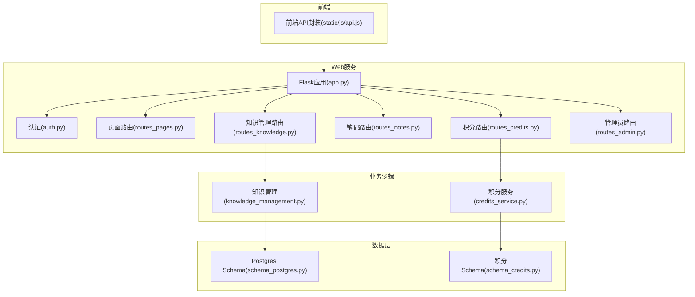
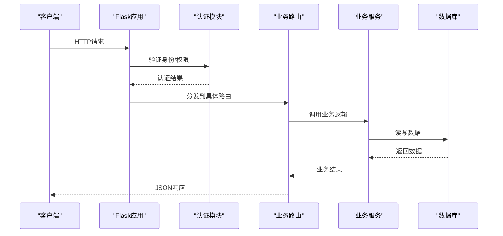
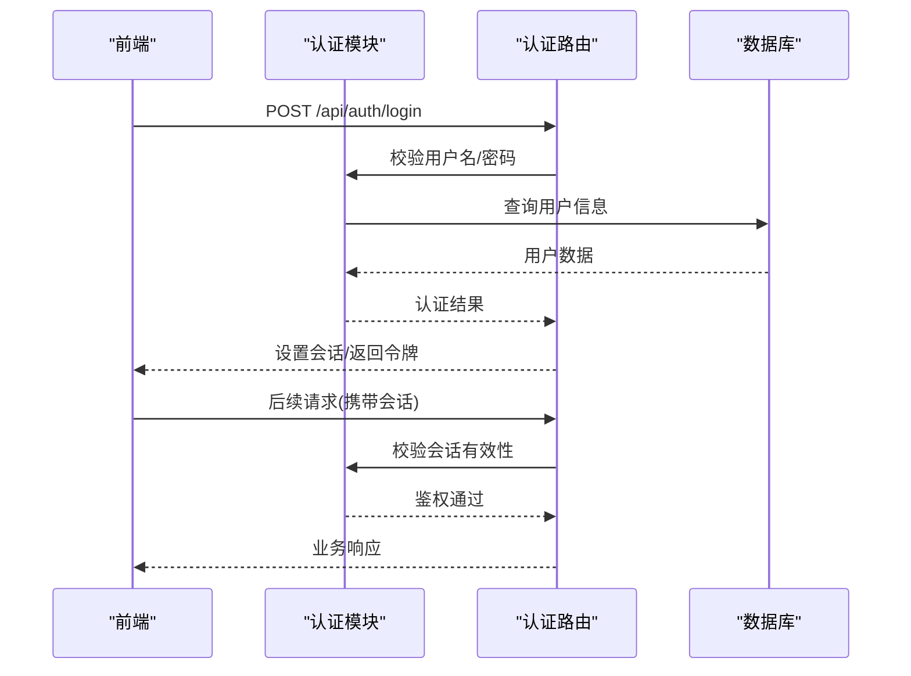
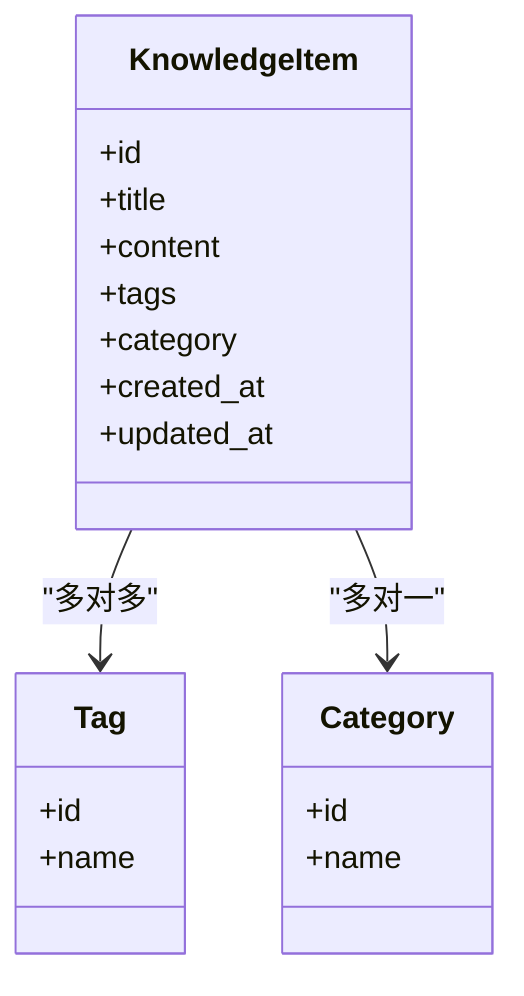
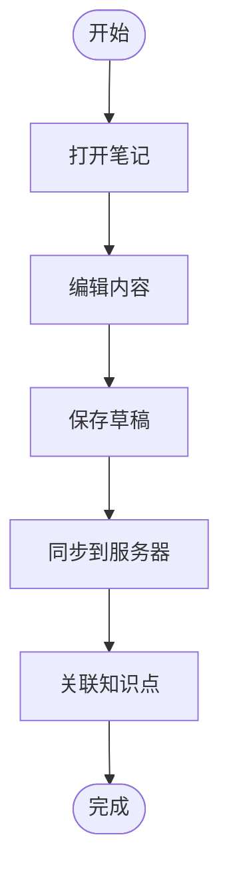
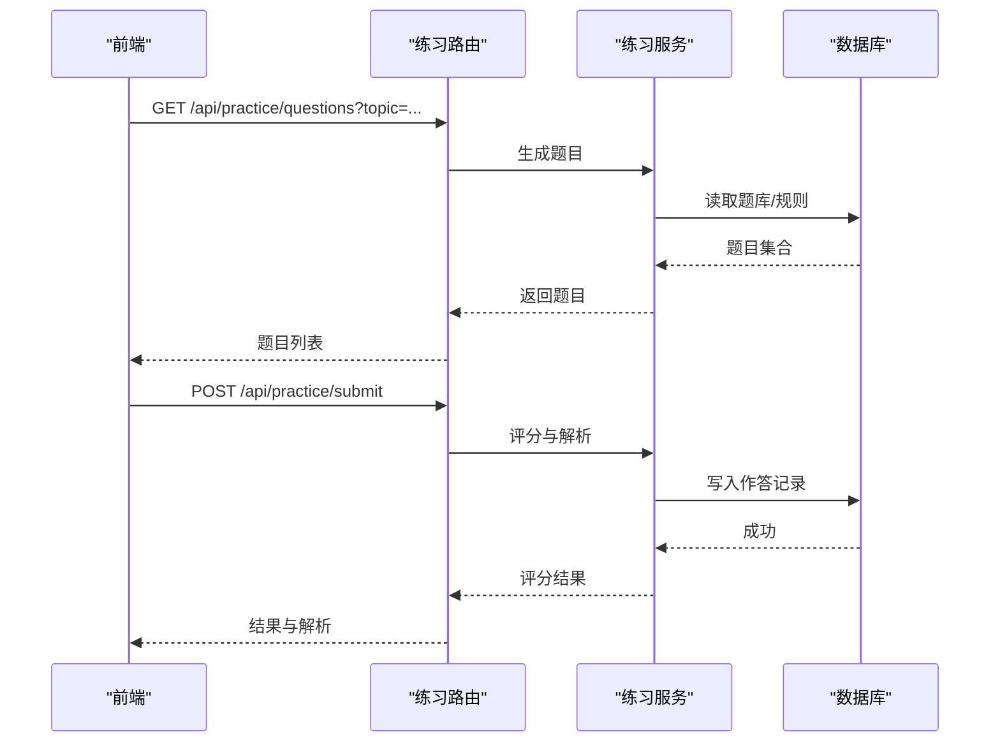
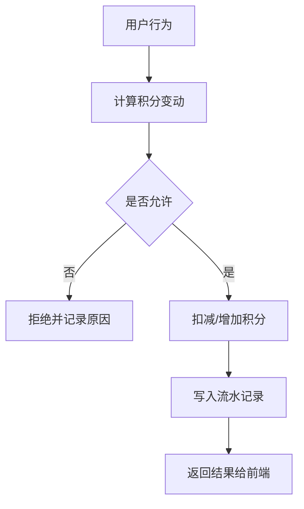
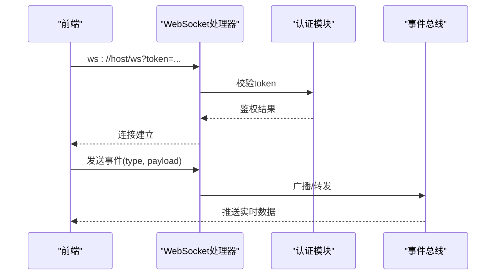
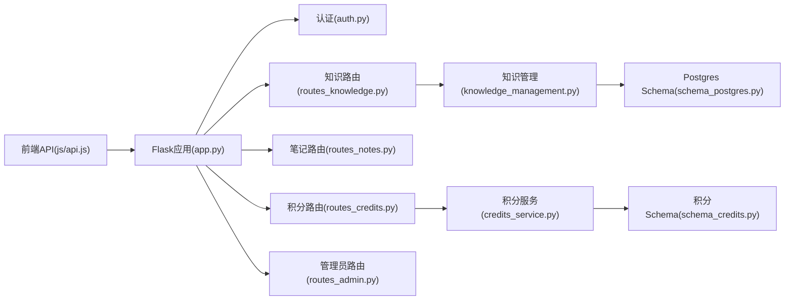

# API接口文档

<cite>
**本文引用的文件**   
- [app.py](file://server/app.py)
- [auth.py](file://server/auth.py)
- [routes_pages.py](file://server/routes_pages.py)
- [routes_knowledge.py](file://server/routes_knowledge.py)
- [routes_notes.py](file://server/routes_notes.py)
- [routes_credits.py](file://server/routes_credits.py)
- [routes_admin.py](file://server/routes_admin.py)
- [knowledge_management.py](file://server/knowledge_management.py)
- [credits_service.py](file://server/credits_service.py)
- [config.py](file://server/config.py)
- [database/schema_postgres.py](file://server/database/schema_postgres.py)
- [database/schema_credits.py](file://server/database/schema_credits.py)
- [static/js/api.js](file://server/static/js/api.js)
</cite>

## 目录
1. [简介](#简介)
2. [项目结构](#项目结构)
3. [核心组件](#核心组件)
4. [架构总览](#架构总览)
5. [详细组件分析](#详细组件分析)
6. [依赖关系分析](#依赖关系分析)
7. [性能考虑](#性能考虑)
8. [故障排查指南](#故障排查指南)
9. [结论](#结论)
10. [附录](#附录)

## 简介
本文件为 LectureLearnLoop 的API接口文档，覆盖RESTful与WebSocket两类接口，重点说明用户认证、知识管理、练习系统与积分管理等核心能力。文档包含：
- RESTful API：HTTP方法、URL模式、请求/响应模式、认证方式、错误处理、版本策略与速率限制建议
- WebSocket API：连接建立、消息格式、事件类型、实时交互流程
- 客户端实现指南、常见用例、调试与监控方法、安全注意事项与向后兼容说明

## 项目结构
后端采用Flask应用组织，按功能拆分路由模块，数据访问通过数据库适配器与Schema定义，前端静态资源通过JS封装API调用。

图表来源
- [app.py:1-200](file://server/app.py#L1-L200)
- [routes_pages.py:1-200](file://server/routes_pages.py#L1-L200)
- [routes_knowledge.py:1-200](file://server/routes_knowledge.py#L1-L200)
- [routes_notes.py:1-200](file://server/routes_notes.py#L1-L200)
- [routes_credits.py:1-200](file://server/routes_credits.py#L1-L200)
- [routes_admin.py:1-200](file://server/routes_admin.py#L1-L200)
- [knowledge_management.py:1-200](file://server/knowledge_management.py#L1-L200)
- [credits_service.py:1-200](file://server/credits_service.py#L1-L200)
- [database/schema_postgres.py:1-200](file://server/database/schema_postgres.py#L1-L200)
- [database/schema_credits.py:1-200](file://server/database/schema_credits.py#L1-L200)
- [static/js/api.js:1-200](file://server/static/js/api.js#L1-L200)

章节来源
- [app.py:1-200](file://server/app.py#L1-L200)
- [config.py:1-200](file://server/config.py#L1-L200)

## 核心组件
- 认证与鉴权：基于会话/令牌的用户认证与权限控制
- 知识管理：知识点CRUD、检索、关联与批量操作
- 笔记系统：在线课程笔记、编辑、保存与同步
- 练习系统：题目生成、作答、结果统计与错题管理
- 积分管理：积分获取、消耗、流水记录与审计
- 管理员面板：用户、积分、系统配置等管理功能

章节来源
- [auth.py:1-200](file://server/auth.py#L1-L200)
- [routes_knowledge.py:1-200](file://server/routes_knowledge.py#L1-L200)
- [routes_notes.py:1-200](file://server/routes_notes.py#L1-L200)
- [routes_credits.py:1-200](file://server/routes_credits.py#L1-L200)
- [routes_admin.py:1-200](file://server/routes_admin.py#L1-L200)

## 架构总览
整体采用“路由层 -> 业务层 -> 数据层”的分层架构。路由负责协议适配与参数校验；业务层封装领域逻辑；数据层通过Schema定义表结构与约束。

图表来源
- [app.py:1-200](file://server/app.py#L1-L200)
- [auth.py:1-200](file://server/auth.py#L1-L200)
- [routes_knowledge.py:1-200](file://server/routes_knowledge.py#L1-L200)
- [routes_credits.py:1-200](file://server/routes_credits.py#L1-L200)
- [database/schema_postgres.py:1-200](file://server/database/schema_postgres.py#L1-L200)

## 详细组件分析

### 用户认证与会话管理
- 认证方式：支持登录/登出、会话保持与权限校验
- 受保护接口：需要携带有效会话或令牌
- 典型流程：登录 -> 颁发会话 -> 后续请求携带会话 -> 鉴权通过

图表来源
- [auth.py:1-200](file://server/auth.py#L1-L200)
- [routes_pages.py:1-200](file://server/routes_pages.py#L1-L200)

章节来源
- [auth.py:1-200](file://server/auth.py#L1-L200)
- [routes_pages.py:1-200](file://server/routes_pages.py#L1-L200)

### 知识管理API
- 能力范围：知识点创建、更新、删除、查询、批量导入导出、标签与分类管理
- 数据模型：知识点实体、标签、分类、关联关系
- 典型流程：创建/更新 -> 索引构建 -> 检索优化

图表来源
- [routes_knowledge.py:1-200](file://server/routes_knowledge.py#L1-L200)
- [knowledge_management.py:1-200](file://server/knowledge_management.py#L1-L200)
- [database/schema_postgres.py:1-200](file://server/database/schema_postgres.py#L1-L200)

章节来源
- [routes_knowledge.py:1-200](file://server/routes_knowledge.py#L1-L200)
- [knowledge_management.py:1-200](file://server/knowledge_management.py#L1-L200)
- [database/schema_postgres.py:1-200](file://server/database/schema_postgres.py#L1-L200)

### 笔记系统API
- 能力范围：在线课程笔记的创建、编辑、保存、分页查询、与知识点关联
- 典型流程：打开笔记页 -> 增量保存 -> 同步至服务器

图表来源
- [routes_notes.py:1-200](file://server/routes_notes.py#L1-L200)

章节来源
- [routes_notes.py:1-200](file://server/routes_notes.py#L1-L200)

### 练习系统API
- 能力范围：题目生成、作答提交、结果反馈、错题收集、学习进度统计
- 典型流程：选择主题 -> 生成题目 -> 作答 -> 评分 -> 错题归档

图表来源
- [routes_notes.py:1-200](file://server/routes_notes.py#L1-L200)
- [routes_knowledge.py:1-200](file://server/routes_knowledge.py#L1-L200)

章节来源
- [routes_notes.py:1-200](file://server/routes_notes.py#L1-L200)
- [routes_knowledge.py:1-200](file://server/routes_knowledge.py#L1-L200)

### 积分管理API
- 能力范围：积分获取、消费、流水查询、余额查看、管理员调整
- 数据模型：用户积分、流水记录、审计日志
- 典型流程：行为触发 -> 积分变更 -> 流水落库 -> 通知前端

图表来源
- [routes_credits.py:1-200](file://server/routes_credits.py#L1-L200)
- [credits_service.py:1-200](file://server/credits_service.py#L1-L200)
- [database/schema_credits.py:1-200](file://server/database/schema_credits.py#L1-L200)

章节来源
- [routes_credits.py:1-200](file://server/routes_credits.py#L1-L200)
- [credits_service.py:1-200](file://server/credits_service.py#L1-L200)
- [database/schema_credits.py:1-200](file://server/database/schema_credits.py#L1-L200)

### 管理员API
- 能力范围：用户管理、积分调整、系统配置、审计日志查看
- 安全要求：仅管理员可访问，需强鉴权与审计记录

章节来源
- [routes_admin.py:1-200](file://server/routes_admin.py#L1-L200)

### WebSocket实时交互
- 用途：实时语音转写、练习过程推送、通知与状态同步
- 连接建立：客户端发起WS连接，服务端进行鉴权与会话绑定
- 消息格式：统一JSON信封，包含type、payload、timestamp等字段
- 事件类型：如transcript_chunk、practice_update、notification等
- 错误处理：连接失败、鉴权失败、消息格式错误的统一错误码

图表来源
- [app.py:1-200](file://server/app.py#L1-L200)
- [auth.py:1-200](file://server/auth.py#L1-L200)

章节来源
- [app.py:1-200](file://server/app.py#L1-L200)
- [auth.py:1-200](file://server/auth.py#L1-L200)

## 依赖关系分析
- 路由层依赖认证模块进行鉴权
- 业务路由依赖各自的服务模块（知识管理、积分服务等）
- 数据层通过Schema定义表结构，保证一致性
- 前端JS封装统一调用后端API

图表来源
- [static/js/api.js:1-200](file://server/static/js/api.js#L1-L200)
- [app.py:1-200](file://server/app.py#L1-L200)
- [routes_knowledge.py:1-200](file://server/routes_knowledge.py#L1-L200)
- [routes_notes.py:1-200](file://server/routes_notes.py#L1-L200)
- [routes_credits.py:1-200](file://server/routes_credits.py#L1-L200)
- [routes_admin.py:1-200](file://server/routes_admin.py#L1-L200)
- [knowledge_management.py:1-200](file://server/knowledge_management.py#L1-L200)
- [credits_service.py:1-200](file://server/credits_service.py#L1-L200)
- [database/schema_postgres.py:1-200](file://server/database/schema_postgres.py#L1-L200)
- [database/schema_credits.py:1-200](file://server/database/schema_credits.py#L1-L200)

章节来源
- [static/js/api.js:1-200](file://server/static/js/api.js#L1-L200)
- [app.py:1-200](file://server/app.py#L1-L200)

## 性能考虑
- 缓存热点数据：知识点检索、标签分类、题目池
- 异步任务：批量导入导出、积分结算、日志清理
- 数据库优化：索引设计、分页查询、连接池
- 限流与熔断：针对高频接口（如题目生成、积分变更）实施限流
- 前端优化：合并请求、去抖节流、离线草稿与重试机制

[本节为通用指导，不直接分析具体文件]

## 故障排查指南
- 认证失败：检查会话/令牌有效期、跨域配置、CSRF防护
- 数据不一致：核对Schema定义与迁移脚本、事务回滚情况
- 性能问题：观察慢查询、连接池耗尽、CPU/内存峰值
- WebSocket异常：检查握手阶段鉴权、心跳保活、消息序列化
- 日志与监控：启用结构化日志、指标采集、告警阈值

章节来源
- [auth.py:1-200](file://server/auth.py#L1-L200)
- [database/schema_postgres.py:1-200](file://server/database/schema_postgres.py#L1-L200)
- [database/schema_credits.py:1-200](file://server/database/schema_credits.py#L1-L200)

## 结论
LectureLearnLoop以分层架构提供稳定的REST与WebSocket接口，覆盖认证、知识、笔记、练习与积分等核心场景。通过清晰的Schema与模块化路由，便于扩展与维护。建议在上线前完善限流、监控与审计，确保系统在高并发下的稳定性与安全性。

[本节为总结性内容，不直接分析具体文件]

## 附录

### RESTful API规范
- 基础URL：/api
- 认证：多数接口需携带会话或令牌
- 请求体：JSON格式，字段命名使用小写下划线
- 响应体：统一包裹code、message、data字段
- 错误码：业务错误码与HTTP状态码分离
- 版本：URL路径或Header中声明版本号，如/v1

章节来源
- [app.py:1-200](file://server/app.py#L1-L200)
- [config.py:1-200](file://server/config.py#L1-L200)

### WebSocket API规范
- 端点：ws://host/ws
- 鉴权：连接参数携带token或Cookie
- 消息格式：{type, payload, timestamp}
- 事件类型：transcript_chunk、practice_update、notification、error
- 重连策略：指数退避、断线检测、状态同步

章节来源
- [app.py:1-200](file://server/app.py#L1-L200)
- [auth.py:1-200](file://server/auth.py#L1-L200)

### 安全与合规
- 传输加密：强制HTTPS/WSS
- 输入校验：服务端严格校验与过滤
- 权限控制：最小权限原则、角色隔离
- 审计日志：关键操作留痕与不可篡改
- 隐私保护：敏感数据脱敏与加密存储

章节来源
- [auth.py:1-200](file://server/auth.py#L1-L200)
- [routes_admin.py:1-200](file://server/routes_admin.py#L1-L200)

### 速率限制与配额
- 全局限流：按IP/用户维度限制QPS
- 接口级限流：高风险接口单独限流
- 配额管理：积分消费、题目生成次数上限
- 降级策略：过载时返回友好提示与重试时间

章节来源
- [routes_credits.py:1-200](file://server/routes_credits.py#L1-L200)
- [routes_knowledge.py:1-200](file://server/routes_knowledge.py#L1-L200)

### 客户端实现指南
- 统一封装：使用static/js/api.js进行请求封装
- 错误处理：统一捕获网络与业务错误，展示友好提示
- 重试机制：幂等接口支持自动重试与退避
- 离线支持：本地草稿与延迟同步

章节来源
- [static/js/api.js:1-200](file://server/static/js/api.js#L1-L200)

### 已弃用功能迁移指南
- 旧版API：在路由中保留兼容层，逐步引导迁移
- 数据迁移：提供迁移脚本与回滚方案
- 兼容性：新旧版本并行运行，灰度发布

章节来源
- [routes_pages.py:1-200](file://server/routes_pages.py#L1-L200)
- [routes_admin.py:1-200](file://server/routes_admin.py#L1-L200)