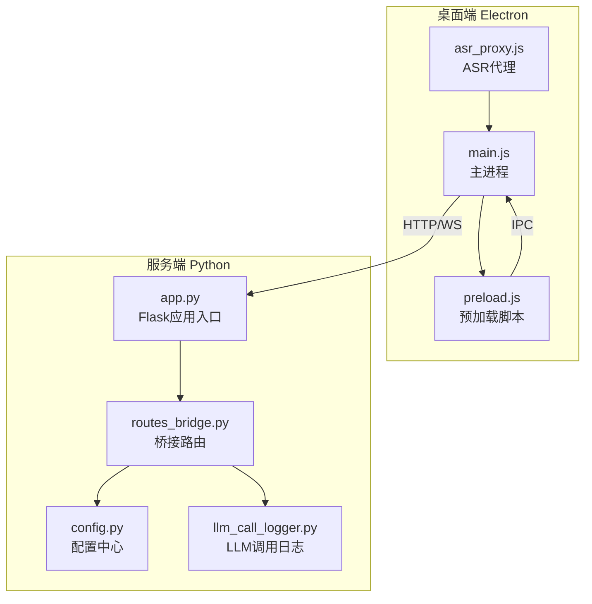
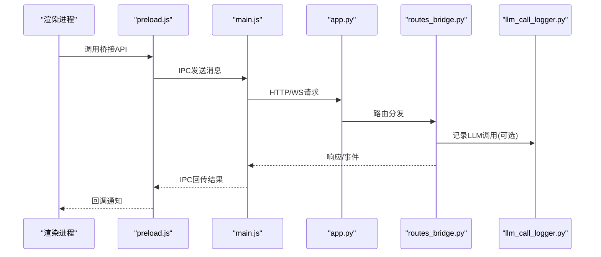
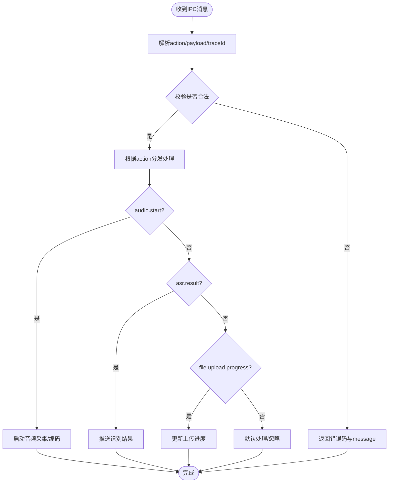
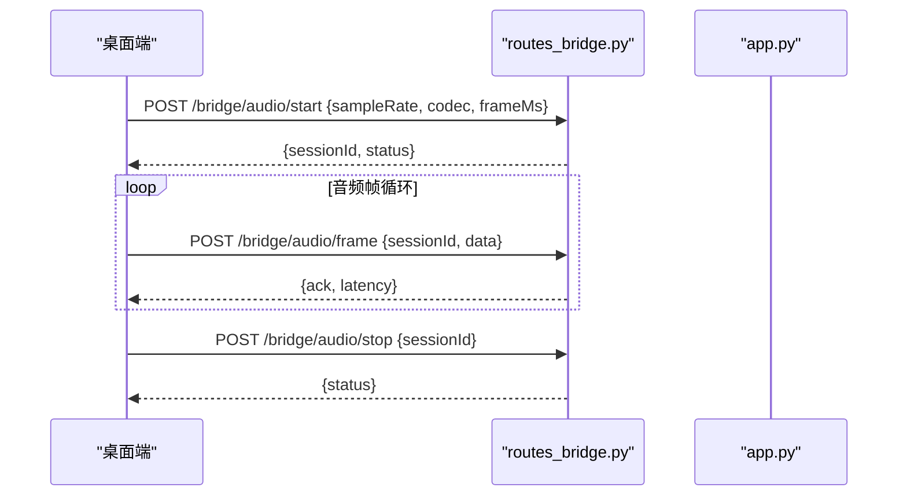
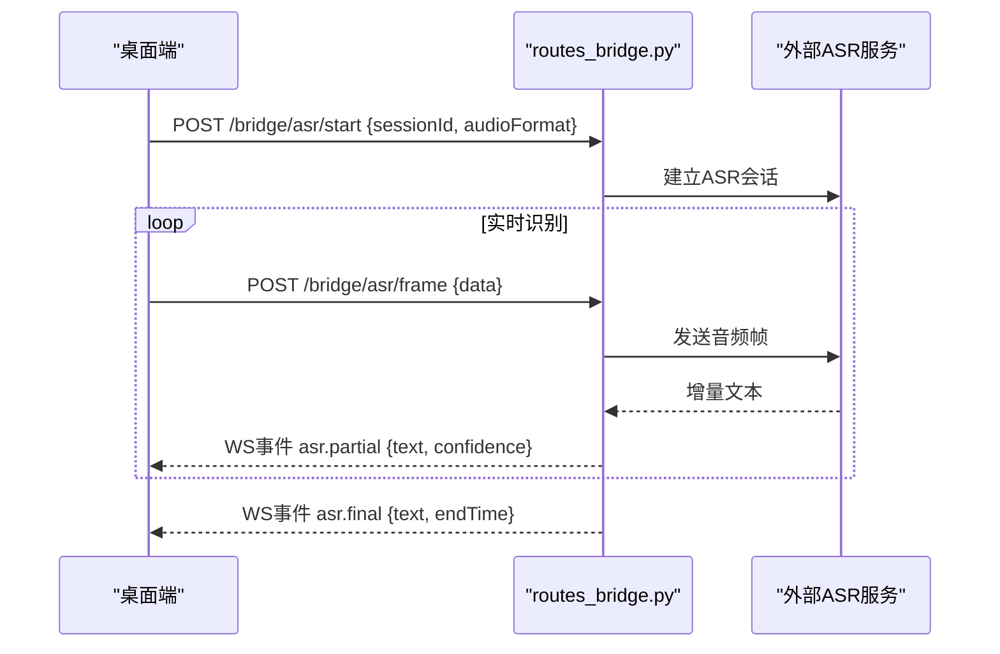
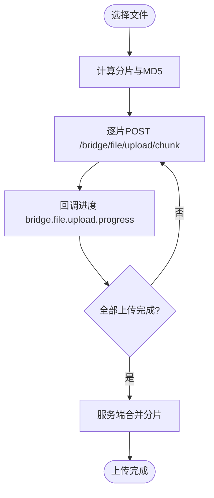
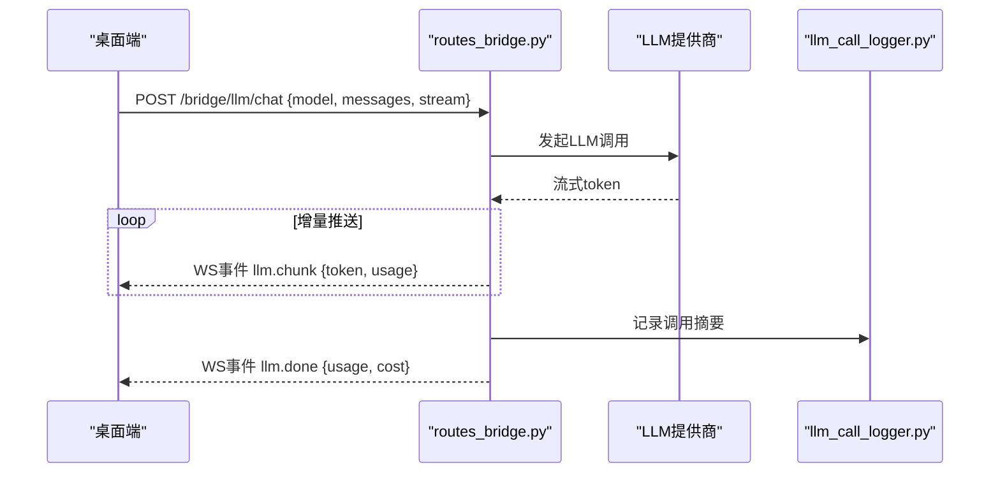
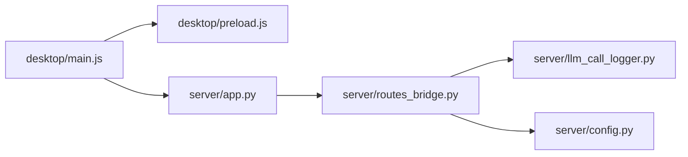

# 桥接服务API

<cite>
**本文引用的文件**   
- [desktop/main.js](file://desktop/main.js)
- [desktop/preload.js](file://desktop/preload.js)
- [desktop/asr_proxy.js](file://desktop/asr_proxy.js)
- [server/app.py](file://server/app.py)
- [server/routes_bridge.py](file://server/routes_bridge.py)
- [server/config.py](file://server/config.py)
- [server/llm_call_logger.py](file://server/llm_call_logger.py)
- [server/static/js/api.js](file://server/static/js/api.js)
</cite>

## 目录
1. [简介](#简介)
2. [项目结构](#项目结构)
3. [核心组件](#核心组件)
4. [架构总览](#架构总览)
5. [详细组件分析](#详细组件分析)
6. [依赖关系分析](#依赖关系分析)
7. [性能考虑](#性能考虑)
8. [故障排查指南](#故障排查指南)
9. [结论](#结论)
10. [附录](#附录)

## 简介
本文件为“桥接服务API”的完整文档，聚焦于Electron桌面应用与Python后端之间的通信接口规范。内容涵盖：
- IPC消息格式与通道约定
- 实时数据传输（音频流、语音识别结果推送）
- 文件上传下载桥接
- 音频流处理与播放控制
- LLM调用代理与日志记录
- 前后端集成最佳实践与调试工具使用方法

该文档旨在帮助前端、后端与测试人员快速理解并稳定集成桥接能力。

## 项目结构
本项目采用“桌面端 + Web后端”的双端架构：
- 桌面端（Electron）：负责系统级音频采集、媒体播放、IPC桥接、ASR代理等。
- 服务端（Python）：提供HTTP/WS接口、LLM调用代理、业务路由、配置与日志等。

**图表来源**
- [desktop/main.js:1-200](file://desktop/main.js#L1-L200)
- [desktop/preload.js:1-200](file://desktop/preload.js#L1-L200)
- [desktop/asr_proxy.js:1-200](file://desktop/asr_proxy.js#L1-L200)
- [server/app.py:1-200](file://server/app.py#L1-L200)
- [server/routes_bridge.py:1-200](file://server/routes_bridge.py#L1-L200)
- [server/config.py:1-200](file://server/config.py#L1-L200)
- [server/llm_call_logger.py:1-200](file://server/llm_call_logger.py#L1-L200)

**章节来源**
- [desktop/main.js:1-200](file://desktop/main.js#L1-L200)
- [desktop/preload.js:1-200](file://desktop/preload.js#L1-L200)
- [desktop/asr_proxy.js:1-200](file://desktop/asr_proxy.js#L1-L200)
- [server/app.py:1-200](file://server/app.py#L1-L200)
- [server/routes_bridge.py:1-200](file://server/routes_bridge.py#L1-L200)
- [server/config.py:1-200](file://server/config.py#L1-L200)
- [server/llm_call_logger.py:1-200](file://server/llm_call_logger.py#L1-L200)

## 核心组件
- 桌面端主进程（main.js）：启动Electron窗口、注册IPC通道、转发请求到后端、管理会话与状态。
- 预加载脚本（preload.js）：暴露安全的IPC API给渲染进程，封装消息协议。
- ASR代理（asr_proxy.js）：在桌面端对ASR相关流程进行代理与缓冲，降低网络抖动影响。
- Flask应用（app.py）：挂载路由、中间件、CORS、WebSocket等。
- 桥接路由（routes_bridge.py）：实现与桌面端对接的HTTP/WS接口，包括音频流、文件传输、LLM代理等。
- 配置中心（config.py）：集中管理端口、密钥、模型参数、日志级别等。
- LLM调用日志（llm_call_logger.py）：统一记录LLM调用的输入输出与耗时。

**章节来源**
- [desktop/main.js:1-200](file://desktop/main.js#L1-L200)
- [desktop/preload.js:1-200](file://desktop/preload.js#L1-L200)
- [desktop/asr_proxy.js:1-200](file://desktop/asr_proxy.js#L1-L200)
- [server/app.py:1-200](file://server/app.py#L1-L200)
- [server/routes_bridge.py:1-200](file://server/routes_bridge.py#L1-L200)
- [server/config.py:1-200](file://server/config.py#L1-L200)
- [server/llm_call_logger.py:1-200](file://server/llm_call_logger.py#L1-L200)

## 架构总览
整体数据流如下：
- 桌面端通过IPC与主进程交互，主进程再与后端进行HTTP/WS通信。
- 音频流从桌面端采集后，经桥接路由转发至后端或外部ASR服务，识别结果回推至桌面端。
- LLM调用由后端代理，支持流式返回；桌面端可发起调用并接收增量结果。
- 文件上传下载通过桥接路由统一处理，支持分片与进度回调。

**图表来源**
- [desktop/preload.js:1-200](file://desktop/preload.js#L1-L200)
- [desktop/main.js:1-200](file://desktop/main.js#L1-L200)
- [server/app.py:1-200](file://server/app.py#L1-L200)
- [server/routes_bridge.py:1-200](file://server/routes_bridge.py#L1-L200)
- [server/llm_call_logger.py:1-200](file://server/llm_call_logger.py#L1-L200)

## 详细组件分析

### IPC消息协议（桌面端）
- 通道命名：建议以“bridge.”前缀区分业务域，如“bridge.audio.start”、“bridge.asr.result”、“bridge.file.upload.progress”。
- 消息体结构：
  - action：字符串，表示动作类型
  - payload：对象，包含具体参数
  - traceId：字符串，用于链路追踪
- 错误码：
  - 0：成功
  - 非0：失败，附带message字段说明

**图表来源**
- [desktop/preload.js:1-200](file://desktop/preload.js#L1-L200)
- [desktop/main.js:1-200](file://desktop/main.js#L1-L200)

**章节来源**
- [desktop/preload.js:1-200](file://desktop/preload.js#L1-L200)
- [desktop/main.js:1-200](file://desktop/main.js#L1-L200)

### 音频流处理与播放控制
- 采集与编码：桌面端负责捕获系统音频或麦克风输入，按固定采样率与编码格式（如PCM/WAV）打包。
- 传输协议：
  - 短帧分片：每帧时长建议10-50ms，避免阻塞。
  - 心跳保活：周期性发送空帧或心跳包，维持连接。
- 播放控制：
  - start：开始播放远端音频
  - stop：停止播放
  - pause/resume：暂停/恢复
- 错误处理：丢帧、延迟阈值、缓冲区水位告警。

**图表来源**
- [server/routes_bridge.py:1-200](file://server/routes_bridge.py#L1-L200)
- [server/app.py:1-200](file://server/app.py#L1-L200)

**章节来源**
- [server/routes_bridge.py:1-200](file://server/routes_bridge.py#L1-L200)
- [server/app.py:1-200](file://server/app.py#L1-L200)

### 语音识别（ASR）结果推送
- 触发方式：
  - 桌面端主动上报音频帧
  - 后端基于外部ASR服务（如Deepgram）返回增量文本
- 推送机制：
  - WebSocket事件：asr.partial、asr.final
  - 或HTTP长轮询（备选）
- 数据结构：
  - text：识别文本片段
  - confidence：置信度
  - startTime/endTime：时间戳区间
  - sessionId：关联会话

**图表来源**
- [server/routes_bridge.py:1-200](file://server/routes_bridge.py#L1-L200)

**章节来源**
- [server/routes_bridge.py:1-200](file://server/routes_bridge.py#L1-L200)

### 文件上传与下载
- 上传：
  - 分片上传：支持断点续传，客户端计算分片MD5
  - 进度回调：bridge.file.upload.progress
- 下载：
  - 流式下载：大文件使用分块读取，避免内存峰值
  - 进度回调：bridge.file.download.progress

**图表来源**
- [server/routes_bridge.py:1-200](file://server/routes_bridge.py#L1-L200)

**章节来源**
- [server/routes_bridge.py:1-200](file://server/routes_bridge.py#L1-L200)

### LLM调用代理
- 调用流程：
  - 桌面端发起LLM请求（含prompt、模型参数）
  - 后端代理调用具体LLM提供商
  - 支持流式返回，增量推送至桌面端
- 日志记录：
  - 统一记录请求上下文、输入输出摘要、耗时
- 安全策略：
  - 鉴权与限流
  - 敏感信息脱敏

**图表来源**
- [server/routes_bridge.py:1-200](file://server/routes_bridge.py#L1-L200)
- [server/llm_call_logger.py:1-200](file://server/llm_call_logger.py#L1-L200)

**章节来源**
- [server/routes_bridge.py:1-200](file://server/routes_bridge.py#L1-L200)
- [server/llm_call_logger.py:1-200](file://server/llm_call_logger.py#L1-L200)

### 配置与环境变量
- 关键配置项：
  - 端口、跨域白名单
  - ASR服务URL与密钥
  - LLM提供商配置（模型、密钥、超时）
  - 日志级别与存储路径
- 动态重载：
  - 支持热更新部分配置（如日志级别）

**章节来源**
- [server/config.py:1-200](file://server/config.py#L1-L200)

## 依赖关系分析
- 桌面端依赖：
  - Electron IPC模块
  - 音频采集与播放库
  - WebSocket客户端
- 服务端依赖：
  - Flask框架
  - WebSocket扩展
  - LLM SDK/HTTP客户端
  - 外部ASR服务SDK/HTTP客户端

**图表来源**
- [desktop/main.js:1-200](file://desktop/main.js#L1-L200)
- [desktop/preload.js:1-200](file://desktop/preload.js#L1-L200)
- [server/app.py:1-200](file://server/app.py#L1-L200)
- [server/routes_bridge.py:1-200](file://server/routes_bridge.py#L1-L200)
- [server/llm_call_logger.py:1-200](file://server/llm_call_logger.py#L1-L200)
- [server/config.py:1-200](file://server/config.py#L1-L200)

**章节来源**
- [desktop/main.js:1-200](file://desktop/main.js#L1-L200)
- [desktop/preload.js:1-200](file://desktop/preload.js#L1-L200)
- [server/app.py:1-200](file://server/app.py#L1-L200)
- [server/routes_bridge.py:1-200](file://server/routes_bridge.py#L1-L200)
- [server/llm_call_logger.py:1-200](file://server/llm_call_logger.py#L1-L200)
- [server/config.py:1-200](file://server/config.py#L1-L200)

## 性能考虑
- 音频流：
  - 合理设置帧时长与采样率，平衡延迟与带宽
  - 启用压缩与丢包重传策略
- 并发与资源：
  - 限制同时进行的ASR会话数
  - 使用连接池与异步I/O提升吞吐
- 缓存与重试：
  - 对LLM调用结果做短期缓存（相同prompt）
  - 网络异常时指数退避重试
- 监控与指标：
  - 记录端到端延迟、丢帧率、错误率
  - 告警阈值与自动熔断

[本节为通用指导，不直接分析具体文件]

## 故障排查指南
- 常见问题：
  - 音频无声音：检查设备权限、采样率匹配、播放队列
  - ASR无结果：确认ASR服务连通性、密钥有效、音频格式正确
  - LLM调用失败：检查模型参数、密钥、网络连通性与限流
- 调试工具：
  - 桌面端：打开开发者工具查看IPC日志与网络请求
  - 服务端：开启DEBUG日志，查看请求体与响应体摘要
  - 抓包：使用Wireshark或浏览器Network面板定位问题

**章节来源**
- [server/app.py:1-200](file://server/app.py#L1-L200)
- [server/routes_bridge.py:1-200](file://server/routes_bridge.py#L1-L200)

## 结论
本桥接服务通过清晰的IPC与HTTP/WS接口，将Electron桌面端的音频采集、播放与ASR/LLM能力与Python后端解耦。遵循本文档的消息协议与最佳实践，可实现稳定、低延迟且可扩展的桌面端与后端协作。

[本节为总结性内容，不直接分析具体文件]

## 附录
- 常用API参考（示例路径）：
  - 音频：/bridge/audio/start、/bridge/audio/frame、/bridge/audio/stop
  - ASR：/bridge/asr/start、/bridge/asr/frame、WS事件 asr.partial/final
  - 文件：/bridge/file/upload/chunk、/bridge/file/download/stream
  - LLM：/bridge/llm/chat、WS事件 llm.chunk/done
- 集成要点：
  - 统一traceId贯穿全链路
  - 错误码与message标准化
  - 心跳与超时控制

**章节来源**
- [server/routes_bridge.py:1-200](file://server/routes_bridge.py#L1-L200)
- [server/app.py:1-200](file://server/app.py#L1-L200)
- [server/static/js/api.js:1-200](file://server/static/js/api.js#L1-L200)