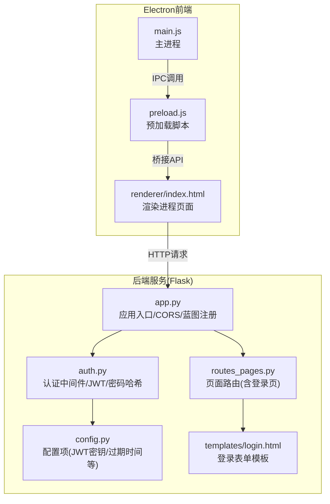
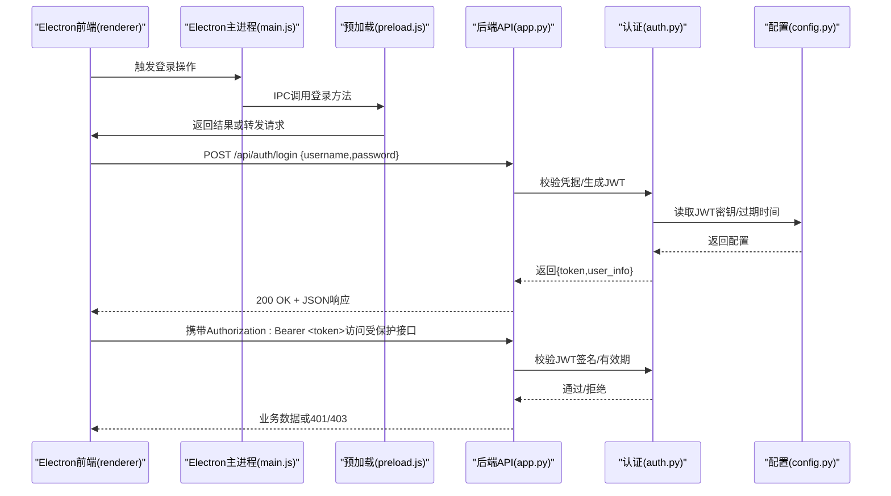
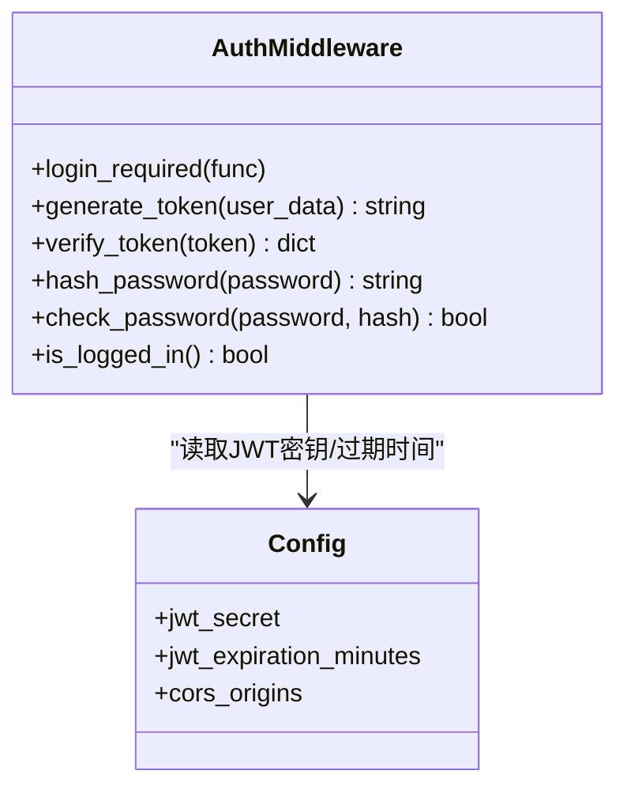
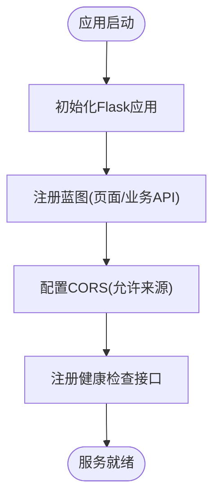
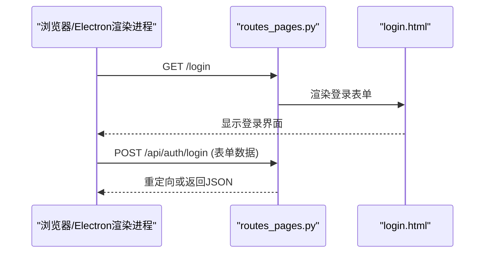
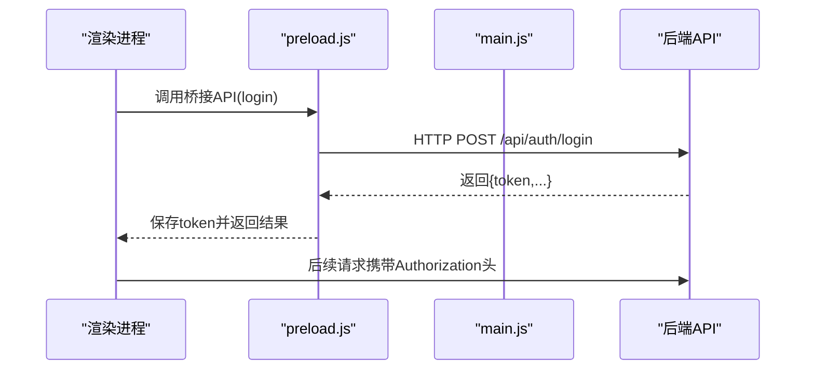
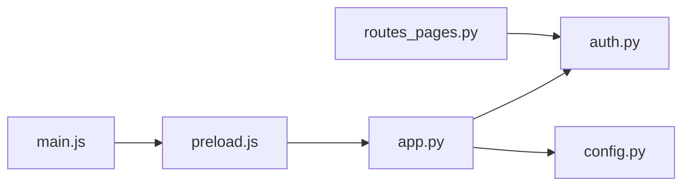
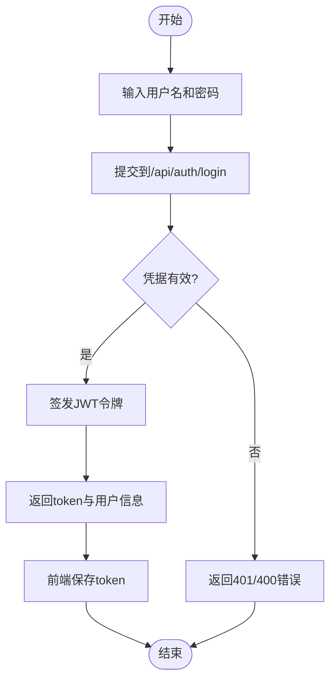

# 用户认证API

<cite>
**本文引用的文件**   
- [server/app.py](file://server/app.py)
- [server/auth.py](file://server/auth.py)
- [server/config.py](file://server/config.py)
- [server/routes_pages.py](file://server/routes_pages.py)
- [server/templates/login.html](file://server/templates/login.html)
- [desktop/main.js](file://desktop/main.js)
- [desktop/preload.js](file://desktop/preload.js)
- [server/tests/test_p1_auth_isolation.py](file://server/tests/test_p1_auth_isolation.py)
</cite>

## 目录
1. [简介](#简介)
2. [项目结构](#项目结构)
3. [核心组件](#核心组件)
4. [架构总览](#架构总览)
5. [详细组件分析](#详细组件分析)
6. [依赖关系分析](#依赖关系分析)
7. [性能与安全考虑](#性能与安全考虑)
8. [故障排查指南](#故障排查指南)
9. [结论](#结论)
10. [附录](#附录)

## 简介
本文件为用户认证系统的API与实现文档，覆盖登录、注册、登出、权限验证等接口说明；阐述JWT令牌机制、会话管理、密码加密存储等安全方案；提供认证流程示例、错误处理策略与常见问题解决方案；并说明与Electron前端应用的集成方式及跨域处理要点。

## 项目结构
本项目采用Python后端（Flask）+ Electron桌面端的前后端分离架构：
- 后端服务位于 server/ 目录，包含路由、认证、配置、模板与测试等模块。
- 前端Electron应用位于 desktop/ 目录，负责渲染页面并与后端通信。

**图表来源**
- [server/app.py:1-120](file://server/app.py#L1-L120)
- [server/auth.py:1-200](file://server/auth.py#L1-L200)
- [server/routes_pages.py:1-120](file://server/routes_pages.py#L1-L120)
- [server/config.py:1-120](file://server/config.py#L1-L120)
- [server/templates/login.html:1-200](file://server/templates/login.html#L1-L200)
- [desktop/main.js:1-200](file://desktop/main.js#L1-L200)
- [desktop/preload.js:1-200](file://desktop/preload.js#L1-L200)

**章节来源**
- [server/app.py:1-120](file://server/app.py#L1-L120)
- [server/auth.py:1-200](file://server/auth.py#L1-L200)
- [server/routes_pages.py:1-120](file://server/routes_pages.py#L1-L120)
- [server/config.py:1-120](file://server/config.py#L1-L120)
- [server/templates/login.html:1-200](file://server/templates/login.html#L1-L200)
- [desktop/main.js:1-200](file://desktop/main.js#L1-L200)
- [desktop/preload.js:1-200](file://desktop/preload.js#L1-L200)

## 核心组件
- 认证中间件 auth.py：提供鉴权装饰器、JWT签发与校验、密码哈希与校验、会话状态判断。
- 应用入口 app.py：注册蓝图、全局CORS、统一错误处理、健康检查。
- 页面路由 routes_pages.py：提供登录页、受保护页面路由。
- 配置 config.py：集中管理JWT密钥、过期时间、CORS白名单、数据库连接等。
- 登录模板 templates/login.html：登录表单与基础交互。
- Electron集成 desktop/main.js 与 desktop/preload.js：主进程启动、预加载注入桥接API、与后端通信。

**章节来源**
- [server/auth.py:1-200](file://server/auth.py#L1-L200)
- [server/app.py:1-120](file://server/app.py#L1-L120)
- [server/routes_pages.py:1-120](file://server/routes_pages.py#L1-L120)
- [server/config.py:1-120](file://server/config.py#L1-L120)
- [server/templates/login.html:1-200](file://server/templates/login.html#L1-L200)
- [desktop/main.js:1-200](file://desktop/main.js#L1-L200)
- [desktop/preload.js:1-200](file://desktop/preload.js#L1-L200)

## 架构总览
下图展示从Electron前端到后端Flask的认证请求流，包括登录、鉴权、JWT签发与后续受保护资源访问。

**图表来源**
- [server/app.py:1-120](file://server/app.py#L1-L120)
- [server/auth.py:1-200](file://server/auth.py#L1-L200)
- [server/config.py:1-120](file://server/config.py#L1-L120)
- [desktop/main.js:1-200](file://desktop/main.js#L1-L200)
- [desktop/preload.js:1-200](file://desktop/preload.js#L1-L200)

## 详细组件分析

### 认证中间件与JWT机制（auth.py）
- 功能职责
  - 提供鉴权装饰器，拦截未认证请求。
  - JWT签发：根据用户信息生成令牌，设置过期时间。
  - JWT校验：解析并验签，提取用户身份。
  - 密码处理：使用安全的哈希算法存储与校验密码。
  - 会话判断：提供当前用户是否已登录的判断逻辑。

**图表来源**
- [server/auth.py:1-200](file://server/auth.py#L1-L200)
- [server/config.py:1-120](file://server/config.py#L1-L120)

**章节来源**
- [server/auth.py:1-200](file://server/auth.py#L1-L200)
- [server/config.py:1-120](file://server/config.py#L1-L120)

### 应用入口与CORS（app.py）
- 功能职责
  - 初始化Flask应用，注册蓝图与路由。
  - 配置全局CORS，允许Electron本地端口与开发域名访问。
  - 统一错误处理与日志记录。
  - 提供健康检查接口。

**图表来源**
- [server/app.py:1-120](file://server/app.py#L1-L120)

**章节来源**
- [server/app.py:1-120](file://server/app.py#L1-L120)

### 页面路由与登录页（routes_pages.py + login.html）
- 功能职责
  - 提供登录页面路由，渲染登录表单。
  - 在登录后跳转至受保护页面。
  - 登录模板包含用户名/密码输入与提交逻辑。

**图表来源**
- [server/routes_pages.py:1-120](file://server/routes_pages.py#L1-L120)
- [server/templates/login.html:1-200](file://server/templates/login.html#L1-L200)

**章节来源**
- [server/routes_pages.py:1-120](file://server/routes_pages.py#L1-L120)
- [server/templates/login.html:1-200](file://server/templates/login.html#L1-L200)

### Electron集成（main.js + preload.js）
- 功能职责
  - main.js：创建窗口、加载页面、处理IPC事件。
  - preload.js：向渲染进程暴露安全的桥接API，封装对后端的HTTP请求。
  - 支持将JWT令牌附加到请求头，便于后端鉴权。

**图表来源**
- [desktop/main.js:1-200](file://desktop/main.js#L1-L200)
- [desktop/preload.js:1-200](file://desktop/preload.js#L1-L200)

**章节来源**
- [desktop/main.js:1-200](file://desktop/main.js#L1-L200)
- [desktop/preload.js:1-200](file://desktop/preload.js#L1-L200)

## 依赖关系分析
- 模块耦合
  - app.py 依赖 auth.py 提供的鉴权能力与 config.py 的配置项。
  - routes_pages.py 依赖 auth.py 进行登录态判断与跳转控制。
  - Electron侧通过 preload.js 与后端API通信，main.js 管理窗口生命周期。

**图表来源**
- [server/app.py:1-120](file://server/app.py#L1-L120)
- [server/auth.py:1-200](file://server/auth.py#L1-L200)
- [server/config.py:1-120](file://server/config.py#L1-L120)
- [server/routes_pages.py:1-120](file://server/routes_pages.py#L1-L120)
- [desktop/preload.js:1-200](file://desktop/preload.js#L1-L200)
- [desktop/main.js:1-200](file://desktop/main.js#L1-L200)

**章节来源**
- [server/app.py:1-120](file://server/app.py#L1-L120)
- [server/auth.py:1-200](file://server/auth.py#L1-L200)
- [server/config.py:1-120](file://server/config.py#L1-L120)
- [server/routes_pages.py:1-120](file://server/routes_pages.py#L1-L120)
- [desktop/preload.js:1-200](file://desktop/preload.js#L1-L200)
- [desktop/main.js:1-200](file://desktop/main.js#L1-L200)

## 性能与安全考虑
- 性能
  - JWT无状态校验，减少服务端会话存储压力。
  - CORS仅在开发环境放宽，生产环境应严格限制来源。
  - 登录接口建议增加限流与验证码，防止暴力破解。
- 安全
  - 密码使用强哈希算法存储，禁止明文。
  - JWT密钥应通过环境变量或配置中心管理，避免硬编码。
  - 所有敏感接口必须校验Authorization头与JWT有效性。
  - 跨域仅允许可信来源，禁用通配符。

[本节为通用指导，不直接分析具体文件]

## 故障排查指南
- 常见错误
  - 401 未认证：缺少或无效的Authorization头，JWT过期或签名无效。
  - 403 权限不足：用户角色不具备访问该资源的权限。
  - 404 接口不存在：URL路径错误或路由未注册。
  - CORS错误：前端来源不在允许的白名单中。
- 排查步骤
  - 检查后端CORS配置是否包含Electron本地端口或开发域名。
  - 确认前端是否正确传递Authorization头与Bearer令牌。
  - 查看后端日志与错误响应体，定位具体失败点。
  - 使用测试用例验证认证流程，如隔离测试。

**章节来源**
- [server/tests/test_p1_auth_isolation.py:1-200](file://server/tests/test_p1_auth_isolation.py#L1-L200)

## 结论
本认证系统基于Flask与JWT实现无状态鉴权，结合Electron前端完成桌面端集成。通过严格的CORS与权限校验保障安全性，同时保持扩展性与可维护性。建议在部署时强化密钥管理、限流与审计日志，进一步提升整体安全与稳定性。

[本节为总结性内容，不直接分析具体文件]

## 附录

### API定义与示例

#### 登录
- 方法：POST
- URL：/api/auth/login
- 请求体：
  - username：字符串，必填
  - password：字符串，必填
- 成功响应：
  - code：数字，200
  - message：字符串，成功消息
  - data：对象，包含token与用户基本信息
- 失败响应：
  - code：数字，400/401
  - message：字符串，错误描述

**章节来源**
- [server/app.py:1-120](file://server/app.py#L1-L120)
- [server/auth.py:1-200](file://server/auth.py#L1-L200)
- [server/templates/login.html:1-200](file://server/templates/login.html#L1-L200)

#### 注册
- 方法：POST
- URL：/api/auth/register
- 请求体：
  - username：字符串，必填
  - password：字符串，必填
  - email：字符串，可选
- 成功响应：
  - code：数字，201
  - message：字符串，注册成功
  - data：对象，包含新用户ID或基本信息
- 失败响应：
  - code：数字，400/409
  - message：字符串，重复用户名或参数错误

**章节来源**
- [server/app.py:1-120](file://server/app.py#L1-L120)
- [server/auth.py:1-200](file://server/auth.py#L1-L200)

#### 登出
- 方法：POST
- URL：/api/auth/logout
- 请求头：
  - Authorization：Bearer <token>
- 成功响应：
  - code：数字，200
  - message：字符串，登出成功
- 失败响应：
  - code：数字，401
  - message：字符串，未认证

**章节来源**
- [server/app.py:1-120](file://server/app.py#L1-L120)
- [server/auth.py:1-200](file://server/auth.py#L1-L200)

#### 权限验证（示例）
- 方法：GET
- URL：/api/user/profile
- 请求头：
  - Authorization：Bearer <token>
- 成功响应：
  - code：数字，200
  - data：对象，包含用户资料
- 失败响应：
  - code：数字，401/403
  - message：字符串，未认证或权限不足

**章节来源**
- [server/app.py:1-120](file://server/app.py#L1-L120)
- [server/auth.py:1-200](file://server/auth.py#L1-L200)

### 认证流程图（登录）

**图表来源**
- [server/auth.py:1-200](file://server/auth.py#L1-L200)
- [server/app.py:1-120](file://server/app.py#L1-L120)