# 知识管理API

<cite>
**本文引用的文件**   
- [routes_knowledge.py](file://server/routes_knowledge.py)
- [knowledge_management.py](file://server/knowledge_management.py)
- [db_adapter.py](file://server/database/db_adapter.py)
- [schema_postgres.py](file://server/database/schema_postgres.py)
- [app.py](file://server/app.py)
- [auth.py](file://server/auth.py)
- [api.js](file://server/static/js/api.js)
</cite>

## 目录
1. [简介](#简介)
2. [项目结构](#项目结构)
3. [核心组件](#核心组件)
4. [架构总览](#架构总览)
5. [详细组件分析](#详细组件分析)
6. [依赖关系分析](#依赖关系分析)
7. [性能考虑](#性能考虑)
8. [故障排查指南](#故障排查指南)
9. [结论](#结论)
10. [附录：接口规范与示例](#附录接口规范与示例)

## 简介
本文件为“知识管理系统”的API文档，聚焦知识点全生命周期管理（创建、读取、更新、删除）、内容解析、关联分析、搜索查询、标签与分类机制、批量操作、导入导出与版本管理等高级能力。文档面向后端开发者、前端集成方与测试工程师，提供清晰的接口契约、数据结构说明、错误处理建议与最佳实践。

## 项目结构
本项目采用分层架构：路由层暴露HTTP API，服务层封装业务逻辑，数据访问层对接数据库，静态资源由前端JS调用API。

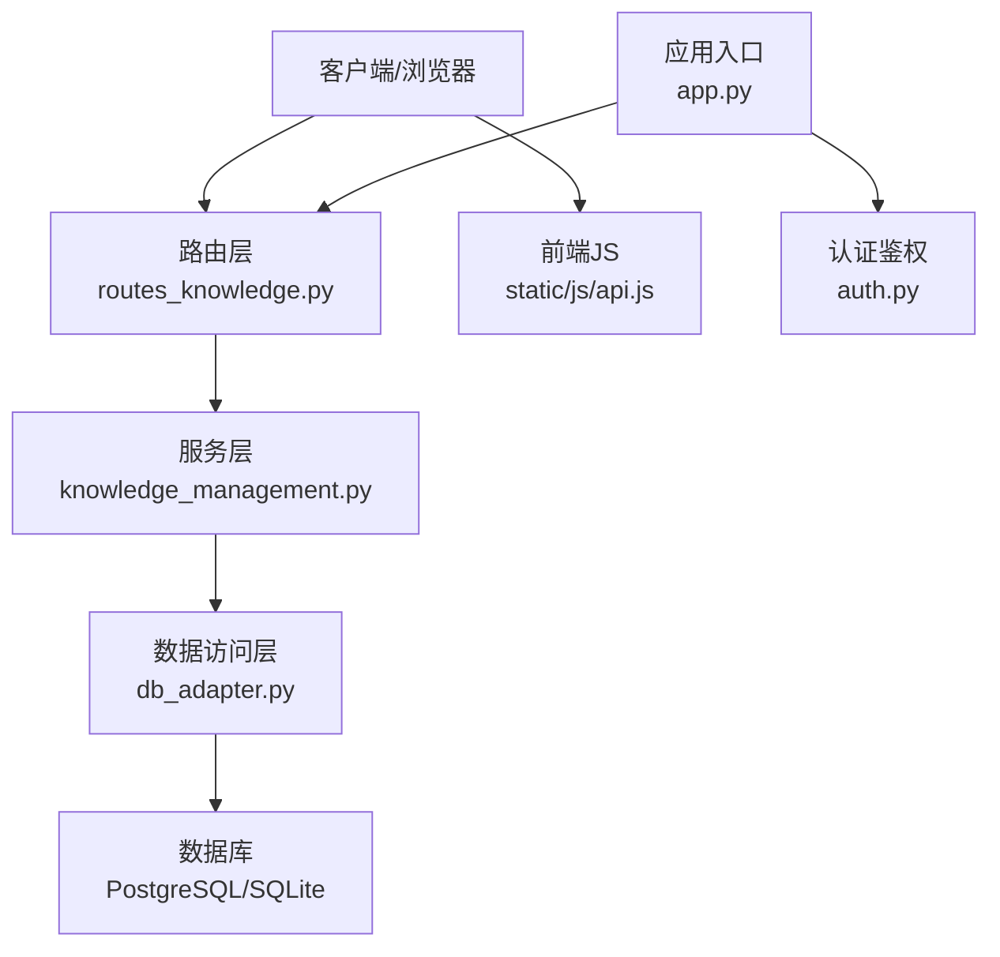

**图表来源**
- [app.py:1-200](file://server/app.py#L1-L200)
- [routes_knowledge.py:1-200](file://server/routes_knowledge.py#L1-L200)
- [knowledge_management.py:1-200](file://server/knowledge_management.py#L1-L200)
- [db_adapter.py:1-200](file://server/database/db_adapter.py#L1-L200)
- [schema_postgres.py:1-200](file://server/database/schema_postgres.py#L1-L200)
- [api.js:1-200](file://server/static/js/api.js#L1-L200)

**章节来源**
- [app.py:1-200](file://server/app.py#L1-L200)
- [routes_knowledge.py:1-200](file://server/routes_knowledge.py#L1-L200)
- [knowledge_management.py:1-200](file://server/knowledge_management.py#L1-L200)
- [db_adapter.py:1-200](file://server/database/db_adapter.py#L1-L200)
- [schema_postgres.py:1-200](file://server/database/schema_postgres.py#L1-L200)
- [api.js:1-200](file://server/static/js/api.js#L1-L200)

## 核心组件
- 路由层（routes_knowledge.py）：定义RESTful端点，负责参数校验、权限检查、请求转发与响应封装。
- 服务层（knowledge_management.py）：实现知识点CRUD、内容解析、关联分析、搜索、标签与分类、批量操作、导入导出、版本管理等业务逻辑。
- 数据访问层（db_adapter.py）：统一数据库连接、事务、SQL执行与结果映射。
- 数据库模式（schema_postgres.py）：定义知识点、标签、分类、版本等表结构与约束。
- 前端JS（api.js）：封装HTTP调用，便于页面直接调用API。

**章节来源**
- [routes_knowledge.py:1-200](file://server/routes_knowledge.py#L1-L200)
- [knowledge_management.py:1-200](file://server/knowledge_management.py#L1-L200)
- [db_adapter.py:1-200](file://server/database/db_adapter.py#L1-L200)
- [schema_postgres.py:1-200](file://server/database/schema_postgres.py#L1-L200)
- [api.js:1-200](file://server/static/js/api.js#L1-L200)

## 架构总览
系统对外暴露REST API，前端通过api.js发起请求；服务端路由将请求分发到服务层方法；服务层调用数据访问层进行持久化；必要时结合外部LLM或相似度匹配模块完成内容解析与关联分析。

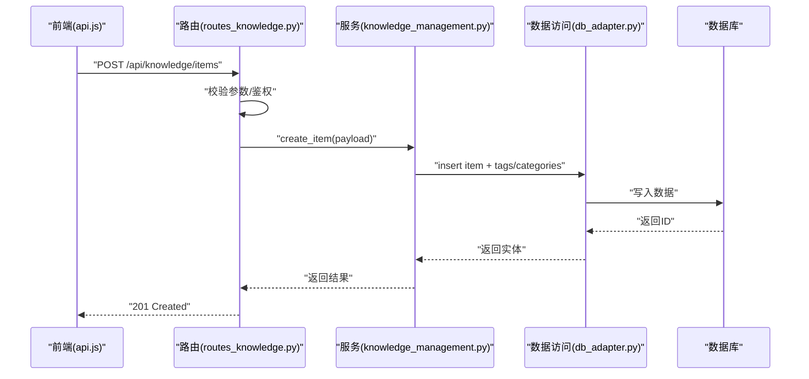

**图表来源**
- [routes_knowledge.py:1-200](file://server/routes_knowledge.py#L1-L200)
- [knowledge_management.py:1-200](file://server/knowledge_management.py#L1-L200)
- [db_adapter.py:1-200](file://server/database/db_adapter.py#L1-L200)

## 详细组件分析

### 知识点数据模型
知识点实体包含基础字段、内容、标签、分类、版本、状态等；标签与分类支持多对多关系；版本用于记录变更历史。

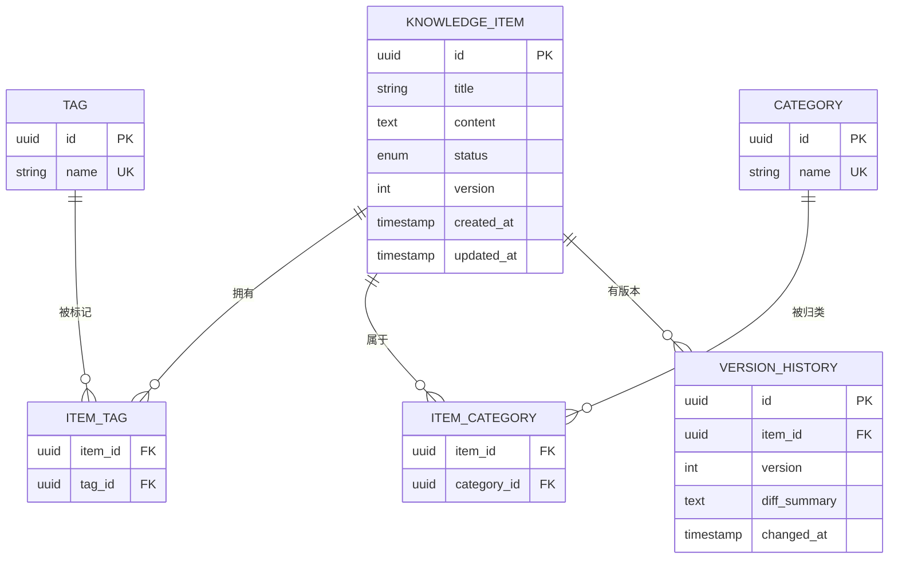

**图表来源**
- [schema_postgres.py:1-200](file://server/database/schema_postgres.py#L1-L200)

**章节来源**
- [schema_postgres.py:1-200](file://server/database/schema_postgres.py#L1-L200)

### 知识点CRUD接口
- 创建知识点
  - 方法：POST
  - 路径：/api/knowledge/items
  - 请求体：title、content、tags[]、categories[]、status等
  - 响应：201 Created，返回新建知识点对象（含id、version等）
- 获取知识点
  - 方法：GET
  - 路径：/api/knowledge/items/{id}
  - 响应：200 OK，返回知识点详情（含标签、分类、版本信息）
- 更新知识点
  - 方法：PUT
  - 路径：/api/knowledge/items/{id}
  - 请求体：可更新title、content、tags、categories、status等
  - 响应：200 OK，返回更新后的知识点（version自增）
- 删除知识点
  - 方法：DELETE
  - 路径：/api/knowledge/items/{id}
  - 响应：204 No Content

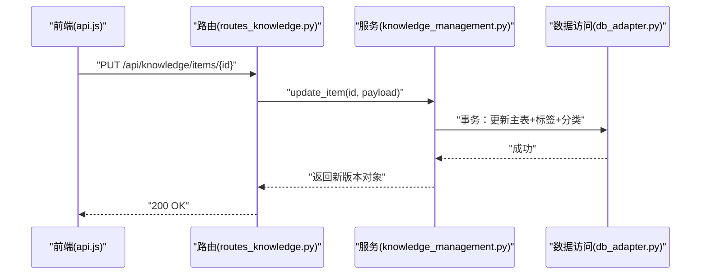

**图表来源**
- [routes_knowledge.py:1-200](file://server/routes_knowledge.py#L1-L200)
- [knowledge_management.py:1-200](file://server/knowledge_management.py#L1-L200)
- [db_adapter.py:1-200](file://server/database/db_adapter.py#L1-L200)

**章节来源**
- [routes_knowledge.py:1-200](file://server/routes_knowledge.py#L1-L200)
- [knowledge_management.py:1-200](file://server/knowledge_management.py#L1-L200)

### 内容解析接口
- 方法：POST
- 路径：/api/knowledge/parse
- 功能：对输入文本进行结构化解析，提取标题、正文、标签、分类建议等
- 请求体：raw_content、options（如是否自动打标、是否生成摘要）
- 响应：200 OK，返回解析结果（结构化片段、建议标签/分类、置信度）

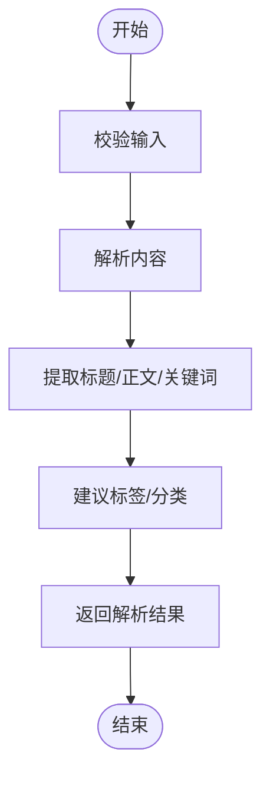

**图表来源**
- [knowledge_management.py:1-200](file://server/knowledge_management.py#L1-L200)

**章节来源**
- [knowledge_management.py:1-200](file://server/knowledge_management.py#L1-L200)

### 关联分析接口
- 方法：POST
- 路径：/api/knowledge/analyze
- 功能：基于相似度或规则计算知识点之间的关联强度，输出关联图或推荐链接
- 请求体：item_ids[]、mode（similarity/rule）、top_n
- 响应：200 OK，返回关联列表（目标item、权重、依据）

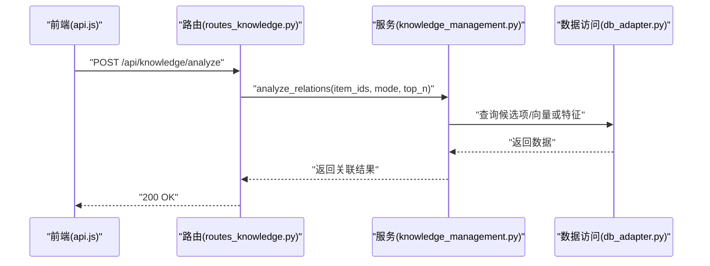

**图表来源**
- [routes_knowledge.py:1-200](file://server/routes_knowledge.py#L1-L200)
- [knowledge_management.py:1-200](file://server/knowledge_management.py#L1-L200)
- [db_adapter.py:1-200](file://server/database/db_adapter.py#L1-L200)

**章节来源**
- [routes_knowledge.py:1-200](file://server/routes_knowledge.py#L1-L200)
- [knowledge_management.py:1-200](file://server/knowledge_management.py#L1-L200)

### 搜索查询接口
- 方法：GET
- 路径：/api/knowledge/search
- 参数：q（关键词）、tag、category、status、page、size、sort_by、order
- 响应：200 OK，返回分页结果（items、total、page、size）

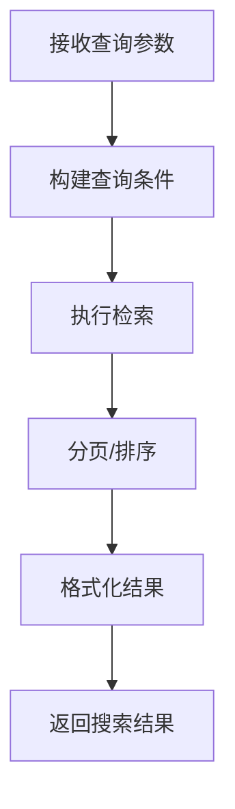

**图表来源**
- [routes_knowledge.py:1-200](file://server/routes_knowledge.py#L1-L200)
- [knowledge_management.py:1-200](file://server/knowledge_management.py#L1-L200)
- [db_adapter.py:1-200](file://server/database/db_adapter.py#L1-L200)

**章节来源**
- [routes_knowledge.py:1-200](file://server/routes_knowledge.py#L1-L200)
- [knowledge_management.py:1-200](file://server/knowledge_management.py#L1-L200)

### 标签与分类管理
- 标签
  - 创建/获取/更新/删除标签
  - 路径：/api/knowledge/tags
- 分类
  - 创建/获取/更新/删除分类
  - 路径：/api/knowledge/categories
- 知识点与标签/分类的多对多关系在更新知识点时同步维护

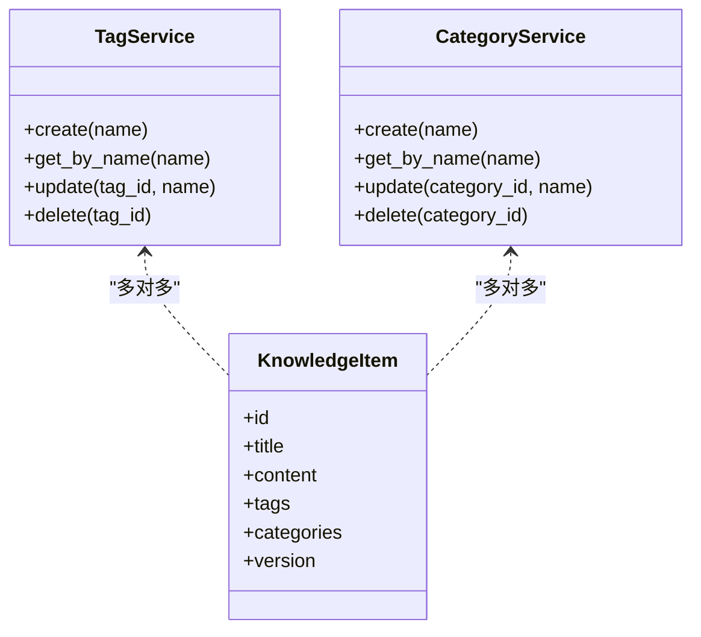

**图表来源**
- [knowledge_management.py:1-200](file://server/knowledge_management.py#L1-L200)
- [schema_postgres.py:1-200](file://server/database/schema_postgres.py#L1-L200)

**章节来源**
- [knowledge_management.py:1-200](file://server/knowledge_management.py#L1-L200)
- [schema_postgres.py:1-200](file://server/database/schema_postgres.py#L1-L200)

### 批量操作接口
- 批量创建
  - 方法：POST
  - 路径：/api/knowledge/items/batch
  - 请求体：items[]（每个元素为知识点对象）
  - 响应：201 Created，返回已创建条目列表及失败明细
- 批量更新
  - 方法：PUT
  - 路径：/api/knowledge/items/batch
  - 请求体：updates[]（包含id与待更新字段）
  - 响应：200 OK，返回更新结果与错误明细
- 批量删除
  - 方法：DELETE
  - 路径：/api/knowledge/items/batch
  - 请求体：ids[]
  - 响应：200 OK，返回删除结果与失败明细

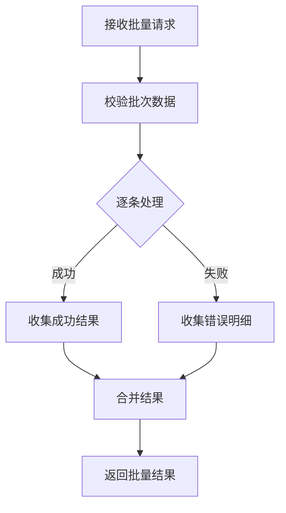

**图表来源**
- [routes_knowledge.py:1-200](file://server/routes_knowledge.py#L1-L200)
- [knowledge_management.py:1-200](file://server/knowledge_management.py#L1-L200)

**章节来源**
- [routes_knowledge.py:1-200](file://server/routes_knowledge.py#L1-L200)
- [knowledge_management.py:1-200](file://server/knowledge_management.py#L1-L200)

### 导入导出接口
- 导入
  - 方法：POST
  - 路径：/api/knowledge/import
  - 内容类型：multipart/form-data
  - 表单字段：file（CSV/JSON）、options（是否去重、是否覆盖、是否自动打标）
  - 响应：200 OK，返回导入统计（成功数、失败数、错误明细）
- 导出
  - 方法：GET
  - 路径：/api/knowledge/export
  - 参数：format（csv/json）、filters（tag/category/status等）
  - 响应：200 OK，返回文件流或下载链接

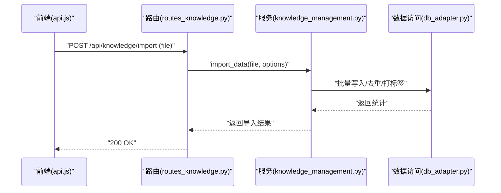

**图表来源**
- [routes_knowledge.py:1-200](file://server/routes_knowledge.py#L1-L200)
- [knowledge_management.py:1-200](file://server/knowledge_management.py#L1-L200)
- [db_adapter.py:1-200](file://server/database/db_adapter.py#L1-L200)

**章节来源**
- [routes_knowledge.py:1-200](file://server/routes_knowledge.py#L1-L200)
- [knowledge_management.py:1-200](file://server/knowledge_management.py#L1-L200)

### 版本管理接口
- 获取版本历史
  - 方法：GET
  - 路径：/api/knowledge/items/{id}/versions
  - 响应：200 OK，返回版本列表（版本号、变更摘要、时间戳）
- 回滚到指定版本
  - 方法：POST
  - 路径：/api/knowledge/items/{id}/rollback
  - 请求体：target_version
  - 响应：200 OK，返回回滚后的知识点对象

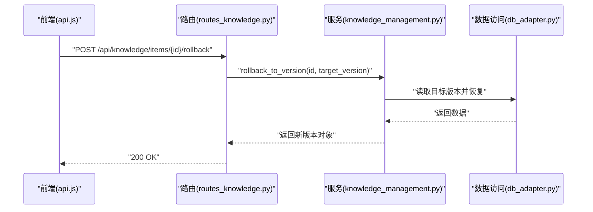

**图表来源**
- [routes_knowledge.py:1-200](file://server/routes_knowledge.py#L1-L200)
- [knowledge_management.py:1-200](file://server/knowledge_management.py#L1-L200)
- [db_adapter.py:1-200](file://server/database/db_adapter.py#L1-L200)

**章节来源**
- [routes_knowledge.py:1-200](file://server/routes_knowledge.py#L1-L200)
- [knowledge_management.py:1-200](file://server/knowledge_management.py#L1-L200)

## 依赖关系分析
- 路由层依赖服务层与认证模块；服务层依赖数据访问层；数据访问层依赖数据库驱动与模式定义。
- 前端JS依赖路由层提供的REST接口。

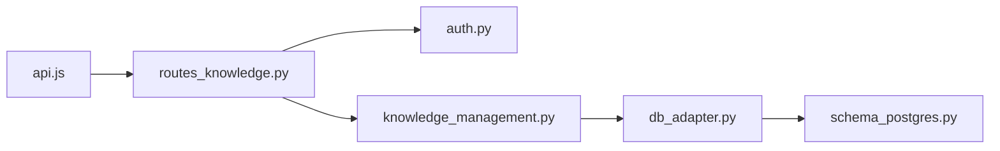

**图表来源**
- [api.js:1-200](file://server/static/js/api.js#L1-L200)
- [routes_knowledge.py:1-200](file://server/routes_knowledge.py#L1-L200)
- [auth.py:1-200](file://server/auth.py#L1-L200)
- [knowledge_management.py:1-200](file://server/knowledge_management.py#L1-L200)
- [db_adapter.py:1-200](file://server/database/db_adapter.py#L1-L200)
- [schema_postgres.py:1-200](file://server/database/schema_postgres.py#L1-L200)

**章节来源**
- [api.js:1-200](file://server/static/js/api.js#L1-L200)
- [routes_knowledge.py:1-200](file://server/routes_knowledge.py#L1-L200)
- [auth.py:1-200](file://server/auth.py#L1-L200)
- [knowledge_management.py:1-200](file://server/knowledge_management.py#L1-L200)
- [db_adapter.py:1-200](file://server/database/db_adapter.py#L1-L200)
- [schema_postgres.py:1-200](file://server/database/schema_postgres.py#L1-L200)

## 性能考虑
- 批量操作应使用事务保证一致性，减少往返次数。
- 搜索接口建议建立全文索引与复合索引（tag、category、status）。
- 关联分析可采用预计算或缓存策略，避免实时高开销计算。
- 导入导出大文件建议使用流式处理与分片上传/下载。

[本节为通用指导，不直接分析具体文件]

## 故障排查指南
- 常见错误码
  - 400：参数校验失败（缺失必填字段、格式错误）
  - 401：未认证或令牌无效
  - 403：无权限执行该操作
  - 404：资源不存在
  - 409：冲突（如重复标签/分类、版本冲突）
  - 422：业务校验失败（如内容过长、非法字符）
  - 500：服务器内部错误
- 排查步骤
  - 检查请求参数是否符合接口契约
  - 查看日志中错误堆栈与数据库异常
  - 验证标签/分类是否存在且唯一
  - 确认版本号与并发更新策略
  - 对于导入失败，检查文件格式与编码

**章节来源**
- [routes_knowledge.py:1-200](file://server/routes_knowledge.py#L1-L200)
- [knowledge_management.py:1-200](file://server/knowledge_management.py#L1-L200)
- [db_adapter.py:1-200](file://server/database/db_adapter.py#L1-L200)

## 结论
本文档系统化梳理了知识管理系统的API设计，涵盖知识点CRUD、内容解析、关联分析、搜索查询、标签与分类、批量操作、导入导出与版本管理等关键能力。通过分层架构与清晰的数据模型，系统具备良好的可扩展性与可维护性。建议在后续迭代中完善索引优化、缓存策略与更丰富的过滤选项，以提升整体性能与用户体验。

[本节为总结性内容，不直接分析具体文件]

## 附录：接口规范与示例

### 知识点CRUD
- 创建知识点
  - 请求示例
    - POST /api/knowledge/items
    - Body: {"title":"...","content":"...","tags":["..."],"categories":["..."],"status":"active"}
  - 响应示例
    - 201 Created
    - Body: {"id":"...","title":"...","content":"...","tags":[...],"categories":[...],"version":1,"created_at":"...","updated_at":"..."}
- 获取知识点
  - GET /api/knowledge/items/{id}
  - 响应示例
    - 200 OK
    - Body: 同创建响应结构
- 更新知识点
  - PUT /api/knowledge/items/{id}
  - Body: {"title":"...","content":"...","tags":["..."],"categories":["..."],"status":"..."}
  - 响应示例
    - 200 OK
    - Body: 同创建响应结构（version自增）
- 删除知识点
  - DELETE /api/knowledge/items/{id}
  - 响应示例
    - 204 No Content

**章节来源**
- [routes_knowledge.py:1-200](file://server/routes_knowledge.py#L1-L200)
- [knowledge_management.py:1-200](file://server/knowledge_management.py#L1-L200)

### 内容解析
- 请求示例
  - POST /api/knowledge/parse
  - Body: {"raw_content":"...","options":{"auto_tag":true,"summary":true}}
- 响应示例
  - 200 OK
  - Body: {"title":"...","sections":[{"heading":"...","body":"..."}],"suggested_tags":["..."],"suggested_categories":["..."]}

**章节来源**
- [routes_knowledge.py:1-200](file://server/routes_knowledge.py#L1-L200)
- [knowledge_management.py:1-200](file://server/knowledge_management.py#L1-L200)

### 关联分析
- 请求示例
  - POST /api/knowledge/analyze
  - Body: {"item_ids":["..."],"mode":"similarity","top_n":10}
- 响应示例
  - 200 OK
  - Body: {"relations":[{"target_id":"...","score":0.85,"reason":"..."}]}

**章节来源**
- [routes_knowledge.py:1-200](file://server/routes_knowledge.py#L1-L200)
- [knowledge_management.py:1-200](file://server/knowledge_management.py#L1-L200)

### 搜索查询
- 请求示例
  - GET /api/knowledge/search?q=关键词&tag=数学&category=课程&status=active&page=1&size=20&sort_by=updated_at&order=desc
- 响应示例
  - 200 OK
  - Body: {"items":[...],"total":120,"page":1,"size":20}

**章节来源**
- [routes_knowledge.py:1-200](file://server/routes_knowledge.py#L1-L200)
- [knowledge_management.py:1-200](file://server/knowledge_management.py#L1-L200)

### 标签与分类
- 标签
  - POST /api/knowledge/tags
  - GET /api/knowledge/tags/{name}
  - PUT /api/knowledge/tags/{id}
  - DELETE /api/knowledge/tags/{id}
- 分类
  - POST /api/knowledge/categories
  - GET /api/knowledge/categories/{name}
  - PUT /api/knowledge/categories/{id}
  - DELETE /api/knowledge/categories/{id}

**章节来源**
- [routes_knowledge.py:1-200](file://server/routes_knowledge.py#L1-L200)
- [knowledge_management.py:1-200](file://server/knowledge_management.py#L1-L200)

### 批量操作
- 批量创建
  - POST /api/knowledge/items/batch
  - Body: {"items":[...]}
  - 响应示例
    - 201 Created
    - Body: {"success":[{"id":"..."}],"failed":[{"index":1,"error":"..."}]}
- 批量更新
  - PUT /api/knowledge/items/batch
  - Body: {"updates":[{"id":"...","title":"..."}]}
  - 响应示例
    - 200 OK
    - Body: {"success":[{"id":"..."}],"failed":[{"index":0,"error":"..."}]}
- 批量删除
  - DELETE /api/knowledge/items/batch
  - Body: {"ids":["..."]}
  - 响应示例
    - 200 OK
    - Body: {"success":[{"id":"..."}],"failed":[{"index":0,"error":"..."}]}

**章节来源**
- [routes_knowledge.py:1-200](file://server/routes_knowledge.py#L1-L200)
- [knowledge_management.py:1-200](file://server/knowledge_management.py#L1-L200)

### 导入导出
- 导入
  - POST /api/knowledge/import
  - FormData: file, options
  - 响应示例
    - 200 OK
    - Body: {"imported":100,"failed":2,"errors":[{"row":5,"message":"..."}]}
- 导出
  - GET /api/knowledge/export?format=json&filters={"tag":"数学","category":"课程"}
  - 响应示例
    - 200 OK
    - Body: 文件流或下载链接

**章节来源**
- [routes_knowledge.py:1-200](file://server/routes_knowledge.py#L1-L200)
- [knowledge_management.py:1-200](file://server/knowledge_management.py#L1-L200)

### 版本管理
- 获取版本历史
  - GET /api/knowledge/items/{id}/versions
  - 响应示例
    - 200 OK
    - Body: {"versions":[{"version":1,"diff_summary":"...","changed_at":"..."}]}
- 回滚到指定版本
  - POST /api/knowledge/items/{id}/rollback
  - Body: {"target_version":2}
  - 响应示例
    - 200 OK
    - Body: 知识点对象（version为目标版本）

**章节来源**
- [routes_knowledge.py:1-200](file://server/routes_knowledge.py#L1-L200)
- [knowledge_management.py:1-200](file://server/knowledge_management.py#L1-L200)