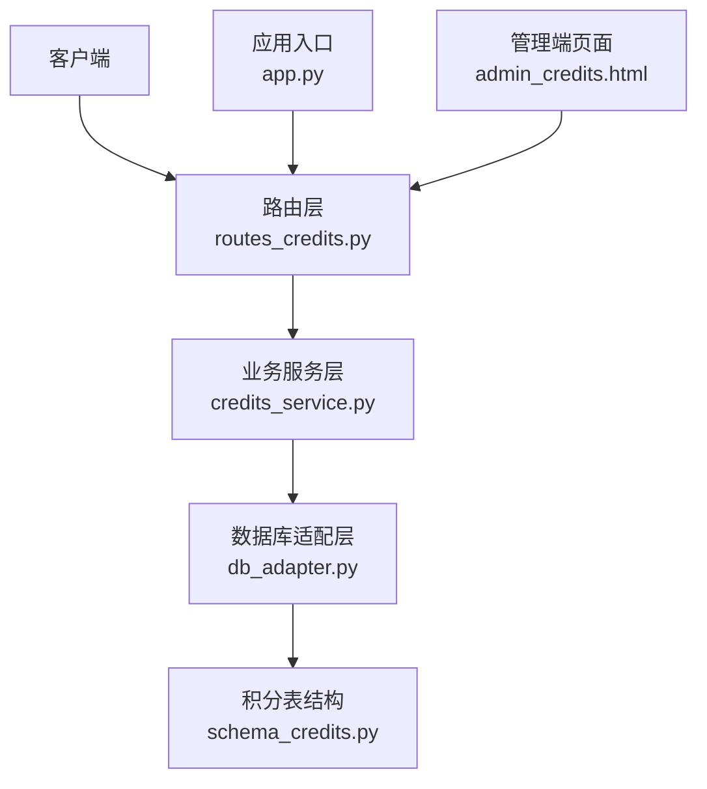
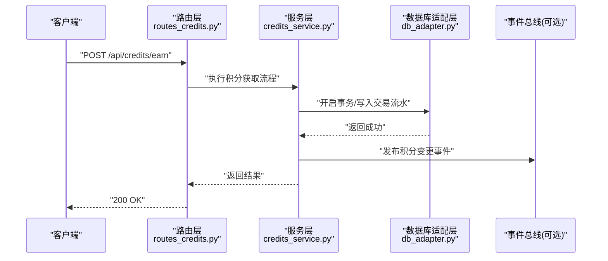
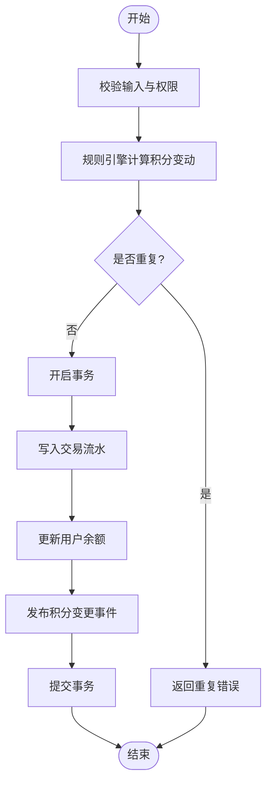
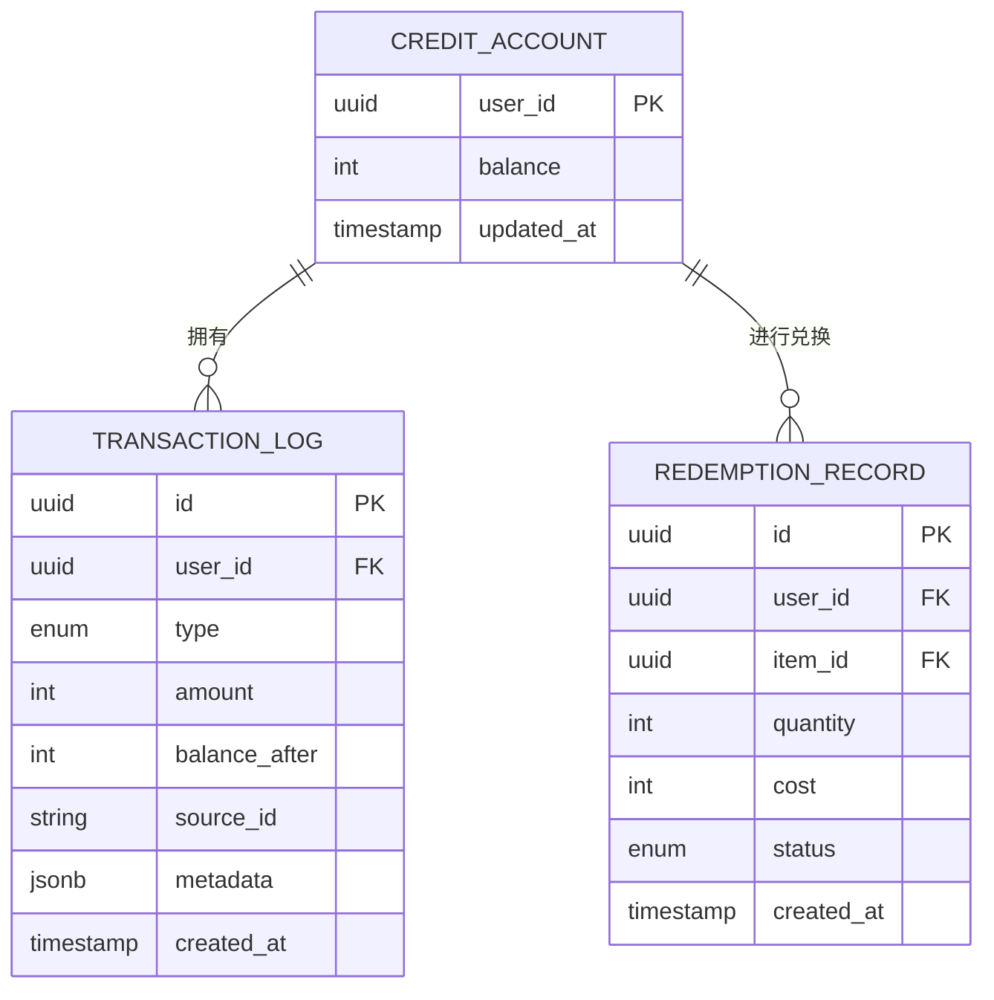

# 积分系统API

<cite>
**本文引用的文件**   
- [server/routes_credits.py](file://server/routes_credits.py)
- [server/credits_service.py](file://server/credits_service.py)
- [server/database/schema_credits.py](file://server/database/schema_credits.py)
- [server/database/db_adapter.py](file://server/database/db_adapter.py)
- [server/app.py](file://server/app.py)
- [server/templates/pages/admin_credits.html](file://server/templates/pages/admin_credits.html)
</cite>

## 目录
1. [简介](#简介)
2. [项目结构](#项目结构)
3. [核心组件](#核心组件)
4. [架构总览](#架构总览)
5. [详细组件分析](#详细组件分析)
6. [依赖关系分析](#依赖关系分析)
7. [性能考虑](#性能考虑)
8. [故障排查指南](#故障排查指南)
9. [结论](#结论)
10. [附录](#附录)

## 简介
本文件为“积分系统”的完整API文档，覆盖积分获取、消耗、查询、排行榜等接口规范；说明积分规则引擎、交易记录、兑换机制等业务逻辑的接口实现；并提供积分变更通知、批量操作、统计分析等高级功能的API说明与扩展点。读者可据此快速对接前后端或集成第三方系统。

## 项目结构
积分系统后端位于 server 目录下，主要涉及以下文件：
- routes_credits.py：HTTP路由层，暴露REST API
- credits_service.py：业务服务层，封装积分规则、交易、兑换、统计等逻辑
- database/schema_credits.py：积分相关数据库表结构定义
- database/db_adapter.py：数据库访问适配层
- app.py：应用入口与路由注册
- templates/pages/admin_credits.html：管理端页面（用于触发部分后台能力）

**图表来源**
- [server/app.py](file://server/app.py)
- [server/routes_credits.py](file://server/routes_credits.py)
- [server/credits_service.py](file://server/credits_service.py)
- [server/database/db_adapter.py](file://server/database/db_adapter.py)
- [server/database/schema_credits.py](file://server/database/schema_credits.py)
- [server/templates/pages/admin_credits.html](file://server/templates/pages/admin_credits.html)

**章节来源**
- [server/app.py](file://server/app.py)
- [server/routes_credits.py](file://server/routes_credits.py)
- [server/credits_service.py](file://server/credits_service.py)
- [server/database/schema_credits.py](file://server/database/schema_credits.py)
- [server/database/db_adapter.py](file://server/database/db_adapter.py)
- [server/templates/pages/admin_credits.html](file://server/templates/pages/admin_credits.html)

## 核心组件
- 路由层（routes_credits.py）
  - 提供RESTful接口：获取积分、增加/减少积分、查询交易明细、查询余额、排行榜、兑换、批量操作、统计等
  - 负责参数校验、鉴权上下文注入、统一响应格式
- 业务服务层（credits_service.py）
  - 积分规则引擎：根据行为类型、用户等级、活动配置计算积分变动
  - 交易记录：持久化每次积分变动的流水
  - 兑换机制：将积分转换为权益/商品并扣减余额
  - 统计与排行：聚合用户积分、生成排行榜
  - 事件通知：积分变更后发出变更通知（可扩展至消息队列）
- 数据层（schema_credits.py + db_adapter.py）
  - 定义积分账户、交易流水、兑换记录等表结构
  - 提供事务、并发安全、分页、聚合查询等通用能力

**章节来源**
- [server/routes_credits.py](file://server/routes_credits.py)
- [server/credits_service.py](file://server/credits_service.py)
- [server/database/schema_credits.py](file://server/database/schema_credits.py)
- [server/database/db_adapter.py](file://server/database/db_adapter.py)

## 架构总览
积分系统采用分层架构：路由层接收请求，调用服务层执行业务逻辑，服务层通过适配层访问数据库，同时对外发布积分变更事件供订阅者消费。

**图表来源**
- [server/routes_credits.py](file://server/routes_credits.py)
- [server/credits_service.py](file://server/credits_service.py)
- [server/database/db_adapter.py](file://server/database/db_adapter.py)

## 详细组件分析

### 路由层API（routes_credits.py）
- 基础约定
  - 认证：所有接口需携带有效会话或令牌
  - 输入：JSON Body，字段见各接口描述
  - 输出：统一JSON结构 { code, message, data }
- 接口清单（按功能分组）
  - 积分查询
    - GET /api/credits/balance
      - 作用：查询当前用户积分余额
      - 入参：无（从会话/令牌解析用户ID）
      - 出参：{ balance }
  - 积分获取
    - POST /api/credits/earn
      - 作用：根据行为类型发放积分
      - 入参：{ action_type, source_id?, metadata? }
      - 出参：{ change, new_balance }
  - 积分消耗
    - POST /api/credits/spend
      - 作用：扣除积分用于兑换或惩罚
      - 入参：{ amount, reason, target_type?, target_id? }
      - 出参：{ change, new_balance }
  - 交易明细
    - GET /api/credits/transactions
      - 作用：分页查询用户积分流水
      - 入参：page, page_size, type?, start_time?, end_time?
      - 出参：{ items, total }
  - 排行榜
    - GET /api/credits/ranking
      - 作用：获取积分排行榜
      - 入参：top_n, time_window?
      - 出参：{ rankings: [{ user_id, score }] }
  - 兑换
    - POST /api/credits/redeem
      - 作用：使用积分兑换权益/商品
      - 入参：{ item_id, quantity }
      - 出参：{ order_id, cost, new_balance }
  - 批量操作
    - POST /api/credits/batch
      - 作用：批量增减积分（管理员或批处理任务）
      - 入参：{ operations: [{ user_id, amount, reason }] }
      - 出参：{ results: [{ user_id, status, error? }] }
  - 统计
    - GET /api/credits/stats
      - 作用：统计维度汇总（如日新增、消耗、净增）
      - 入参：start_date, end_date, group_by?
      - 出参：{ series: [...] }

- 错误码
  - 400：参数校验失败
  - 401：未认证
  - 403：权限不足
  - 409：余额不足或重复操作
  - 500：内部错误

**章节来源**
- [server/routes_credits.py](file://server/routes_credits.py)

### 业务服务层（credits_service.py）
- 积分规则引擎
  - 支持基于行为类型、用户等级、活动配置的加权计算
  - 可插拔策略：通过策略注册表扩展新规则
- 交易记录
  - 每次积分变动均落库，保证可追溯与审计
  - 支持幂等键去重（source_id + action_type）
- 兑换机制
  - 校验库存与价格，扣减积分并生成兑换订单
  - 支持回滚：兑换失败时恢复积分
- 统计与排行
  - 聚合时间窗口内的积分变化，生成排行榜
  - 支持缓存热点数据（如TopN）
- 事件通知
  - 积分变更后发布事件，供外部系统订阅（邮件、短信、IM）

**图表来源**
- [server/credits_service.py](file://server/credits_service.py)
- [server/database/db_adapter.py](file://server/database/db_adapter.py)

**章节来源**
- [server/credits_service.py](file://server/credits_service.py)

### 数据模型（schema_credits.py）
- 积分账户表
  - 字段：user_id, balance, updated_at
  - 约束：user_id唯一，balance非负
- 交易流水表
  - 字段：id, user_id, type, amount, balance_after, source_id, metadata, created_at
  - 索引：user_id, created_at, type
- 兑换记录表
  - 字段：id, user_id, item_id, quantity, cost, status, created_at
  - 约束：status枚举（pending/completed/cancelled）

**图表来源**
- [server/database/schema_credits.py](file://server/database/schema_credits.py)

**章节来源**
- [server/database/schema_credits.py](file://server/database/schema_credits.py)

### 数据库适配层（db_adapter.py）
- 提供事务封装、分页查询、聚合函数、并发锁（行级锁）等能力
- 对上层屏蔽具体数据库方言差异

**章节来源**
- [server/database/db_adapter.py](file://server/database/db_adapter.py)

### 管理端页面（admin_credits.html）
- 提供管理员界面，用于触发批量操作、查看统计报表、导出交易明细等

**章节来源**
- [server/templates/pages/admin_credits.html](file://server/templates/pages/admin_credits.html)

## 依赖关系分析
- 路由层依赖服务层，服务层依赖数据库适配层
- 数据层由schema定义结构，db_adapter提供通用能力
- 管理端页面通过路由层调用后端API

**图表来源**
- [server/routes_credits.py](file://server/routes_credits.py)
- [server/credits_service.py](file://server/credits_service.py)
- [server/database/db_adapter.py](file://server/database/db_adapter.py)
- [server/database/schema_credits.py](file://server/database/schema_credits.py)
- [server/templates/pages/admin_credits.html](file://server/templates/pages/admin_credits.html)

**章节来源**
- [server/routes_credits.py](file://server/routes_credits.py)
- [server/credits_service.py](file://server/credits_service.py)
- [server/database/db_adapter.py](file://server/database/db_adapter.py)
- [server/database/schema_credits.py](file://server/database/schema_credits.py)
- [server/templates/pages/admin_credits.html](file://server/templates/pages/admin_credits.html)

## 性能考虑
- 排行榜与统计：建议引入缓存（如Redis）存储TopN与聚合结果，降低数据库压力
- 交易写入：使用批量插入与异步写盘提升吞吐
- 并发控制：对用户余额行级锁，避免超扣
- 分页与索引：合理设计索引，避免全表扫描

[本节为通用指导，不直接分析具体文件]

## 故障排查指南
- 常见问题
  - 余额不足：检查spend接口的amount与当前余额
  - 重复发放：检查source_id幂等键是否重复
  - 兑换失败：核对item_id与库存状态
- 日志与监控
  - 关注交易流水表的created_at与type分布
  - 监控事件总线消费延迟
- 定位步骤
  - 通过transaction_log回溯用户积分变动路径
  - 核对credits_service中的规则计算分支

**章节来源**
- [server/credits_service.py](file://server/credits_service.py)
- [server/database/schema_credits.py](file://server/database/schema_credits.py)

## 结论
本API文档覆盖了积分系统的核心接口与实现要点，包括规则引擎、交易记录、兑换机制、统计排行与事件通知。通过分层架构与可扩展的规则策略，系统具备良好的可维护性与扩展性。建议在上线前完善缓存与监控方案，确保高可用与高性能。

[本节为总结性内容，不直接分析具体文件]

## 附录
- 扩展点
  - 规则策略注册表：新增行为类型的积分计算策略
  - 事件订阅器：接入邮件、短信、IM等通知渠道
  - 兑换商品目录：扩展item_id与价格映射
- 最佳实践
  - 幂等设计：所有写操作需提供幂等键
  - 事务边界：严格限定在单次积分变动内
  - 审计追踪：保留metadata以便问题回溯

[本节为补充信息，不直接分析具体文件]