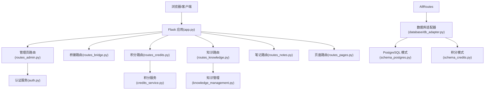
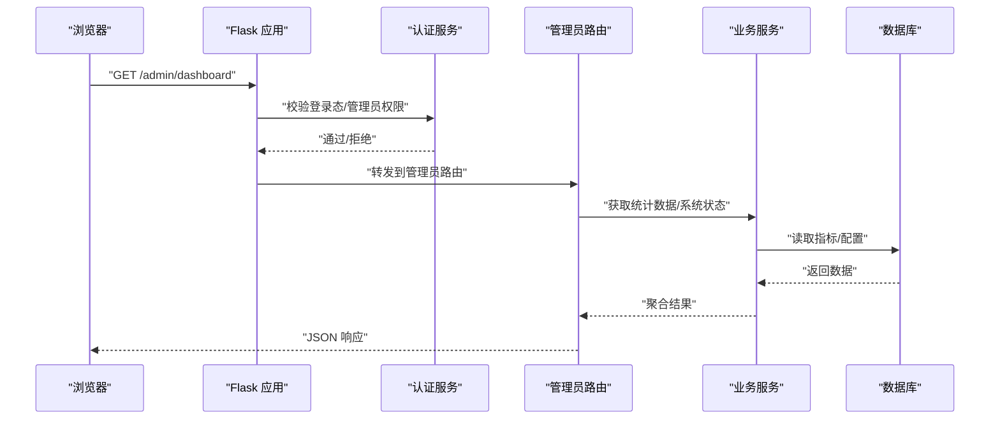
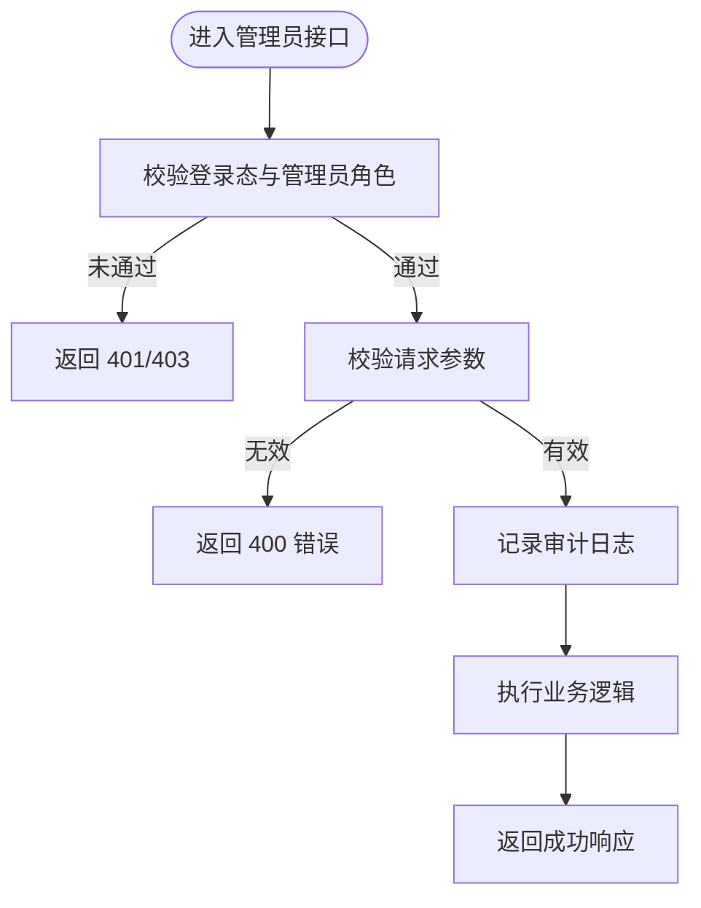
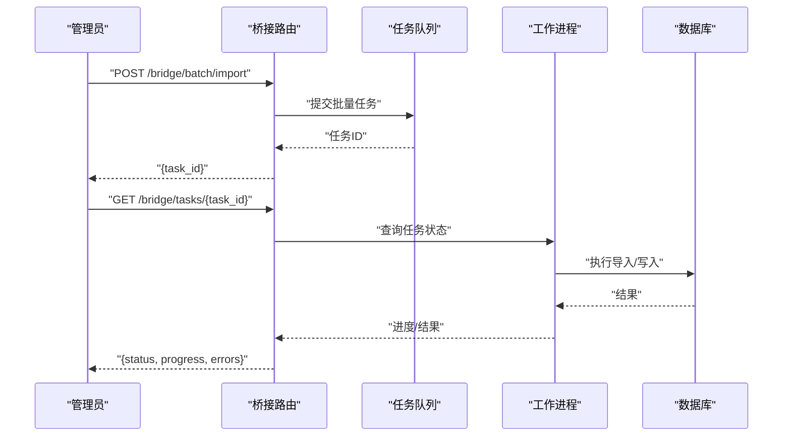
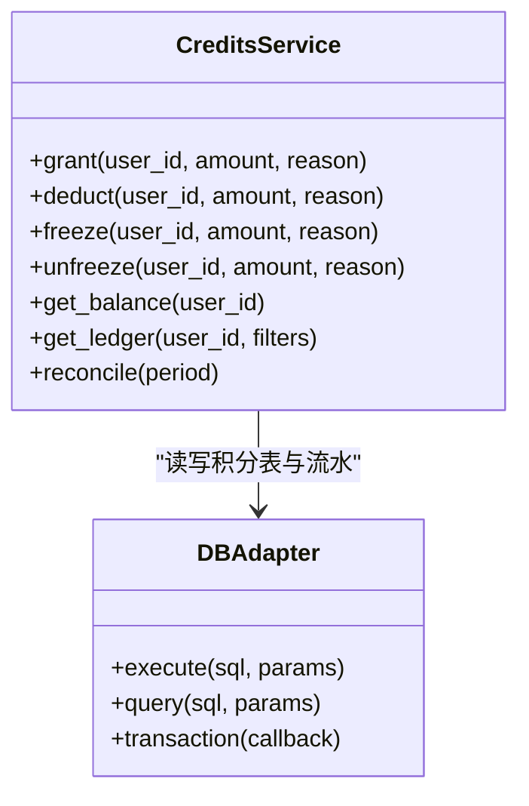
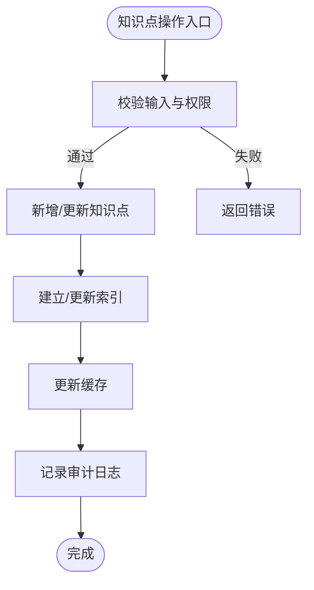
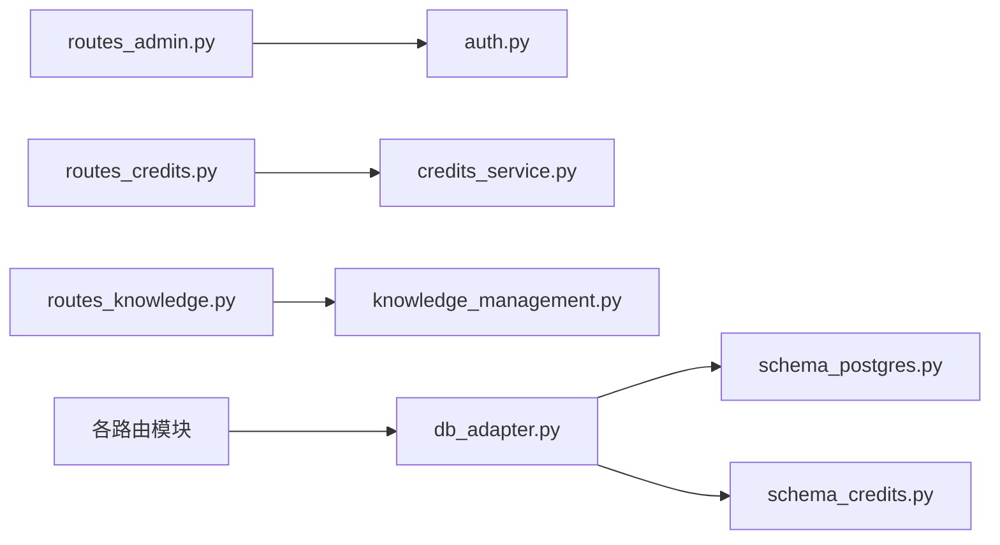

# 管理后台API

<cite>
**本文引用的文件**   
- [server/app.py](file://server/app.py)
- [server/auth.py](file://server/auth.py)
- [server/config.py](file://server/config.py)
- [server/routes_admin.py](file://server/routes_admin.py)
- [server/routes_bridge.py](file://server/routes_bridge.py)
- [server/routes_credits.py](file://server/routes_credits.py)
- [server/routes_knowledge.py](file://server/routes_knowledge.py)
- [server/routes_notes.py](file://server/routes_notes.py)
- [server/routes_pages.py](file://server/routes_pages.py)
- [server/credits_service.py](file://server/credits_service.py)
- [server/knowledge_management.py](file://server/knowledge_management.py)
- [server/database/db_adapter.py](file://server/database/db_adapter.py)
- [server/database/schema_postgres.py](file://server/database/schema_postgres.py)
- [server/database/schema_credits.py](file://server/database/schema_credits.py)
- [server/templates/pages/dashboard.html](file://server/templates/pages/dashboard.html)
- [server/templates/pages/settings.html](file://server/templates/pages/settings.html)
- [server/templates/pages/admin_credits.html](file://server/templates/pages/admin_credits.html)
- [server/static/js/api.js](file://server/static/js/api.js)
</cite>

## 目录
1. [引言](#引言)
2. [项目结构](#项目结构)
3. [核心组件](#核心组件)
4. [架构总览](#架构总览)
5. [详细组件分析](#详细组件分析)
6. [依赖关系分析](#依赖关系分析)
7. [性能考虑](#性能考虑)
8. [故障排查指南](#故障排查指南)
9. [结论](#结论)
10. [附录](#附录)

## 引言
本文件面向“练记系统”的管理后台，系统化梳理管理员专用接口与运维能力，覆盖用户管理、系统监控、数据统计、配置管理、权限控制、审计日志、健康检查、数据备份恢复、批量操作与性能调优等主题。文档以代码仓库中的后端路由、认证模块、数据库适配与模板页面为依据，提供可落地的接口规范与最佳实践建议。

## 项目结构
本项目采用分层组织：
- 应用入口与路由注册：app.py 集中挂载各功能路由模块
- 认证与鉴权：auth.py 提供登录、会话与权限校验
- 业务路由：routes_admin.py、routes_bridge.py、routes_credits.py、routes_knowledge.py、routes_notes.py、routes_pages.py
- 服务层：credits_service.py、knowledge_management.py
- 数据访问：database/db_adapter.py 及 schema_* 定义
- 前端模板与静态资源：templates/pages/* 与 static/js/*

图表来源
- [server/app.py:1-200](file://server/app.py#L1-L200)
- [server/routes_admin.py:1-200](file://server/routes_admin.py#L1-L200)
- [server/routes_bridge.py:1-200](file://server/routes_bridge.py#L1-L200)
- [server/routes_credits.py:1-200](file://server/routes_credits.py#L1-L200)
- [server/routes_knowledge.py:1-200](file://server/routes_knowledge.py#L1-L200)
- [server/routes_notes.py:1-200](file://server/routes_notes.py#L1-L200)
- [server/routes_pages.py:1-200](file://server/routes_pages.py#L1-L200)
- [server/auth.py:1-200](file://server/auth.py#L1-L200)
- [server/credits_service.py:1-200](file://server/credits_service.py#L1-L200)
- [server/knowledge_management.py:1-200](file://server/knowledge_management.py#L1-L200)
- [server/database/db_adapter.py:1-200](file://server/database/db_adapter.py#L1-L200)
- [server/database/schema_postgres.py:1-200](file://server/database/schema_postgres.py#L1-L200)
- [server/database/schema_credits.py:1-200](file://server/database/schema_credits.py#L1-L200)

章节来源
- [server/app.py:1-200](file://server/app.py#L1-L200)
- [server/routes_admin.py:1-200](file://server/routes_admin.py#L1-L200)

## 核心组件
- 认证与权限（auth.py）
  - 负责登录、会话维护、角色判断与权限拦截
  - 为管理员路由提供统一的鉴权中间逻辑
- 管理员路由（routes_admin.py）
  - 暴露用户管理、系统监控、统计概览、配置管理等接口
  - 结合审计日志与健康检查能力，支撑运维场景
- 桥接路由（routes_bridge.py）
  - 对外部系统或桌面端提供桥接能力，常用于批量导入导出、任务调度
- 积分服务（routes_credits.py + credits_service.py）
  - 提供积分发放、扣减、查询、对账等能力
- 知识管理（routes_knowledge.py + knowledge_management.py）
  - 知识点增删改查、批量导入、版本管理、检索聚合
- 笔记路由（routes_notes.py）
  - 笔记的创建、更新、删除、搜索与分页
- 页面路由（routes_pages.py）
  - 渲染管理后台页面（仪表盘、设置、积分管理等）

章节来源
- [server/auth.py:1-200](file://server/auth.py#L1-L200)
- [server/routes_admin.py:1-200](file://server/routes_admin.py#L1-L200)
- [server/routes_bridge.py:1-200](file://server/routes_bridge.py#L1-L200)
- [server/routes_credits.py:1-200](file://server/routes_credits.py#L1-L200)
- [server/credits_service.py:1-200](file://server/credits_service.py#L1-L200)
- [server/routes_knowledge.py:1-200](file://server/routes_knowledge.py#L1-L200)
- [server/knowledge_management.py:1-200](file://server/knowledge_management.py#L1-L200)
- [server/routes_notes.py:1-200](file://server/routes_notes.py#L1-L200)
- [server/routes_pages.py:1-200](file://server/routes_pages.py#L1-L200)

## 架构总览
下图展示管理员请求从浏览器到后端服务的完整路径，包括鉴权、路由分发、服务调用与数据库访问。

图表来源
- [server/app.py:1-200](file://server/app.py#L1-L200)
- [server/auth.py:1-200](file://server/auth.py#L1-L200)
- [server/routes_admin.py:1-200](file://server/routes_admin.py#L1-L200)
- [server/database/db_adapter.py:1-200](file://server/database/db_adapter.py#L1-L200)

## 详细组件分析

### 管理员路由与权限模型
- 职责范围
  - 用户管理：用户列表、详情、启用/禁用、角色分配
  - 系统监控：运行状态、资源使用、队列积压、错误率
  - 数据统计：活跃用户、知识点增长、积分流水汇总
  - 配置管理：系统参数查看与修改、开关控制
  - 审计日志：操作记录查询、导出
  - 健康检查：服务可用性、依赖健康度
- 权限模型
  - 基于角色的访问控制（RBAC），管理员角色具备所有管理接口访问权限
  - 敏感操作需二次确认与审计记录
- 安全建议
  - 统一鉴权中间件，强制管理员角色校验
  - 输入校验与输出脱敏，避免泄露敏感信息
  - 审计日志不可篡改，支持按时间、操作人、对象维度检索

图表来源
- [server/routes_admin.py:1-200](file://server/routes_admin.py#L1-L200)
- [server/auth.py:1-200](file://server/auth.py#L1-L200)

章节来源
- [server/routes_admin.py:1-200](file://server/routes_admin.py#L1-L200)
- [server/auth.py:1-200](file://server/auth.py#L1-L200)

### 桥接路由与批量操作
- 职责范围
  - 批量导入/导出：知识点、笔记、积分流水
  - 外部系统集成：与桌面端或其他服务的数据交换
  - 任务调度：异步任务提交与状态查询
- 设计要点
  - 大体积数据采用分片传输与进度回调
  - 幂等性保证与失败重试机制
  - 限流与配额控制，防止滥用

图表来源
- [server/routes_bridge.py:1-200](file://server/routes_bridge.py#L1-L200)

章节来源
- [server/routes_bridge.py:1-200](file://server/routes_bridge.py#L1-L200)

### 积分服务与对账
- 职责范围
  - 积分发放、扣减、冻结、解冻
  - 流水记录、余额查询、对账报表
- 一致性保障
  - 事务包裹关键操作，确保余额与流水一致
  - 并发控制，避免重复发放或超额扣减
- 审计与合规
  - 每笔变动记录操作人、原因、时间戳
  - 支持异常回滚与人工干预流程

图表来源
- [server/credits_service.py:1-200](file://server/credits_service.py#L1-L200)
- [server/database/db_adapter.py:1-200](file://server/database/db_adapter.py#L1-L200)

章节来源
- [server/routes_credits.py:1-200](file://server/routes_credits.py#L1-L200)
- [server/credits_service.py:1-200](file://server/credits_service.py#L1-L200)
- [server/database/schema_credits.py:1-200](file://server/database/schema_credits.py#L1-L200)

### 知识管理与检索
- 职责范围
  - 知识点CRUD、标签管理、版本控制
  - 批量导入/导出、全文检索、聚合统计
- 性能优化
  - 索引优化与分页查询
  - 缓存热点数据，降低数据库压力
- 质量保障
  - 数据校验与去重策略
  - 变更审计与回滚能力

图表来源
- [server/routes_knowledge.py:1-200](file://server/routes_knowledge.py#L1-L200)
- [server/knowledge_management.py:1-200](file://server/knowledge_management.py#L1-L200)

章节来源
- [server/routes_knowledge.py:1-200](file://server/routes_knowledge.py#L1-L200)
- [server/knowledge_management.py:1-200](file://server/knowledge_management.py#L1-L200)

### 笔记管理
- 职责范围
  - 笔记创建、编辑、删除、搜索、分页
  - 关联知识点与练习记录
- 交互体验
  - 自动保存与冲突检测
  - 富文本与附件支持

章节来源
- [server/routes_notes.py:1-200](file://server/routes_notes.py#L1-L200)

### 页面路由与管理后台视图
- 职责范围
  - 渲染仪表盘、设置、积分管理等页面
  - 提供前端所需的基础数据与配置
- 前端集成
  - 通过 api.js 发起 AJAX 请求
  - 模板注入必要上下文

章节来源
- [server/routes_pages.py:1-200](file://server/routes_pages.py#L1-L200)
- [server/templates/pages/dashboard.html:1-200](file://server/templates/pages/dashboard.html#L1-L200)
- [server/templates/pages/settings.html:1-200](file://server/templates/pages/settings.html#L1-L200)
- [server/templates/pages/admin_credits.html:1-200](file://server/templates/pages/admin_credits.html#L1-L200)
- [server/static/js/api.js:1-200](file://server/static/js/api.js#L1-L200)

## 依赖关系分析
- 路由与服务耦合
  - routes_admin.py 依赖 auth.py 进行鉴权
  - routes_credits.py 依赖 credits_service.py 进行积分业务处理
  - routes_knowledge.py 依赖 knowledge_management.py 进行知识领域逻辑
- 数据访问抽象
  - db_adapter.py 封装数据库连接、事务与查询
  - schema_postgres.py 与 schema_credits.py 定义数据模型
- 前端与后端契约
  - templates 与 static/js/api.js 约定数据格式与交互流程

图表来源
- [server/routes_admin.py:1-200](file://server/routes_admin.py#L1-L200)
- [server/auth.py:1-200](file://server/auth.py#L1-L200)
- [server/routes_credits.py:1-200](file://server/routes_credits.py#L1-L200)
- [server/credits_service.py:1-200](file://server/credits_service.py#L1-L200)
- [server/routes_knowledge.py:1-200](file://server/routes_knowledge.py#L1-L200)
- [server/knowledge_management.py:1-200](file://server/knowledge_management.py#L1-L200)
- [server/database/db_adapter.py:1-200](file://server/database/db_adapter.py#L1-L200)
- [server/database/schema_postgres.py:1-200](file://server/database/schema_postgres.py#L1-L200)
- [server/database/schema_credits.py:1-200](file://server/database/schema_credits.py#L1-L200)

章节来源
- [server/app.py:1-200](file://server/app.py#L1-L200)
- [server/database/db_adapter.py:1-200](file://server/database/db_adapter.py#L1-L200)

## 性能考虑
- 数据库层面
  - 合理索引与查询优化，避免全表扫描
  - 分页与游标查询，限制单次返回量
  - 读写分离与连接池配置
- 缓存与异步
  - 热点数据缓存（如统计指标、配置项）
  - 批量导入导出走异步任务，避免阻塞主线程
- 限流与熔断
  - 对批量操作与外部调用实施限流
  - 关键服务降级与熔断保护
- 监控与告警
  - 指标采集（QPS、延迟、错误率）
  - 慢查询与异常堆栈上报

[本节为通用指导，不直接分析具体文件]

## 故障排查指南
- 常见问题定位
  - 鉴权失败：检查登录态、角色权限与中间件配置
  - 数据不一致：核对事务边界与并发控制
  - 性能瓶颈：观察慢查询、缓存命中率与队列积压
- 日志与审计
  - 审计日志用于追踪管理员操作与系统事件
  - 错误日志包含堆栈与上下文，便于快速定位
- 健康检查
  - 服务可用性与依赖健康度检查，辅助自动化运维

章节来源
- [server/auth.py:1-200](file://server/auth.py#L1-L200)
- [server/routes_admin.py:1-200](file://server/routes_admin.py#L1-L200)

## 结论
本管理后台API以清晰的分层架构与严格的权限控制为基础，覆盖用户管理、系统监控、数据统计、配置管理、积分与知识管理等核心运维场景。通过审计日志、健康检查与批量操作能力，满足生产环境的安全与稳定性要求。建议在接入时遵循本文的最佳实践，并结合实际业务扩展接口与监控指标。

[本节为总结性内容，不直接分析具体文件]

## 附录
- 管理员权限模型与安全访问控制最佳实践
  - RBAC 角色划分：超级管理员、运营管理员、只读审计员
  - 最小权限原则：仅授予必要权限，敏感操作二次确认
  - 审计与合规：全量审计日志、不可篡改存储、定期审计
  - 安全加固：HTTPS、CSRF/XSS防护、输入校验与输出脱敏
  - 备份与恢复：定时快照、增量备份、恢复演练
  - 性能调优：缓存策略、异步任务、限流与熔断、容量规划

[本节为概念性内容，不直接分析具体文件]