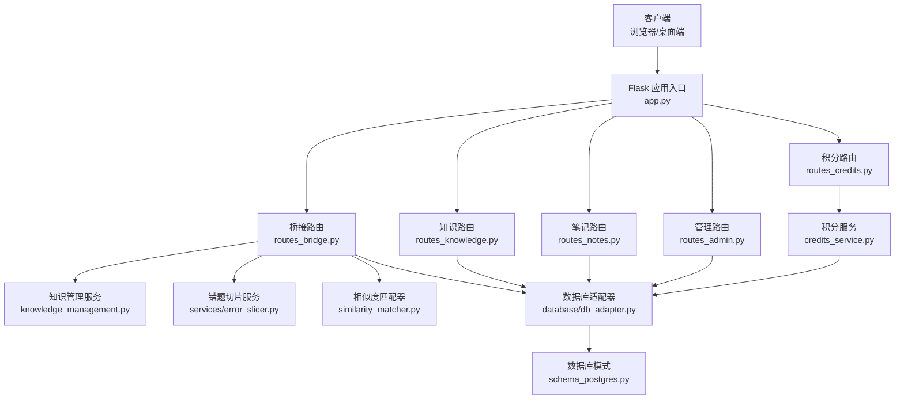
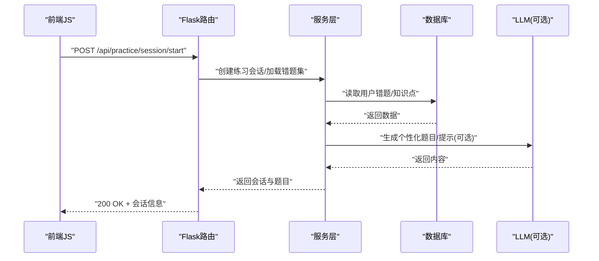
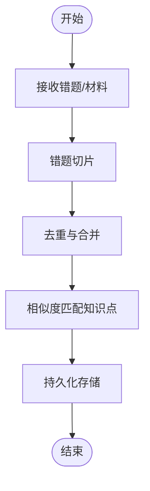
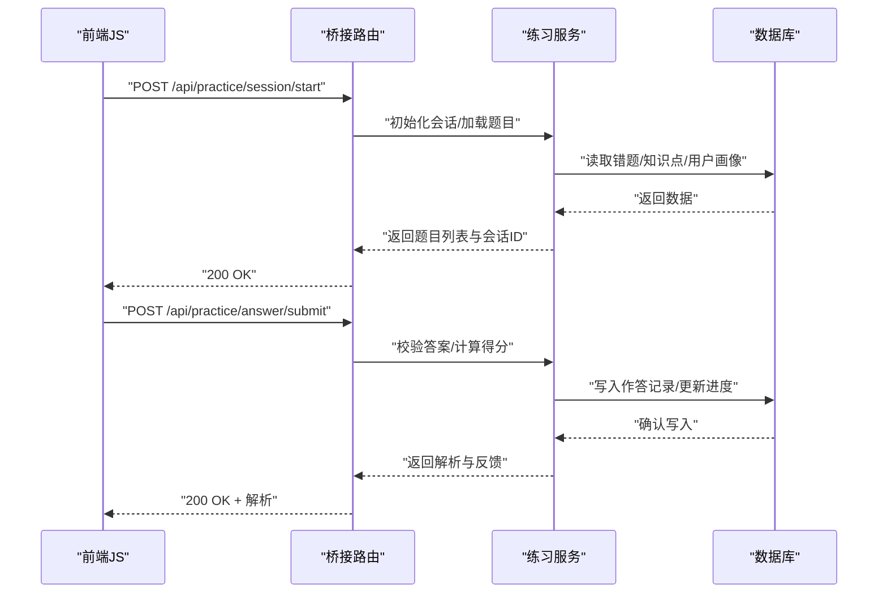
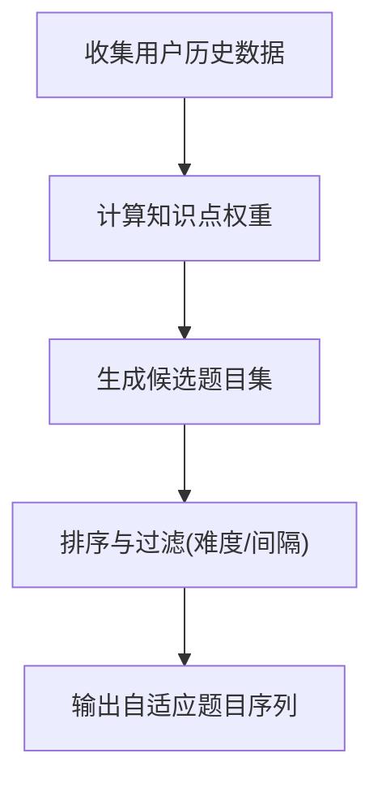
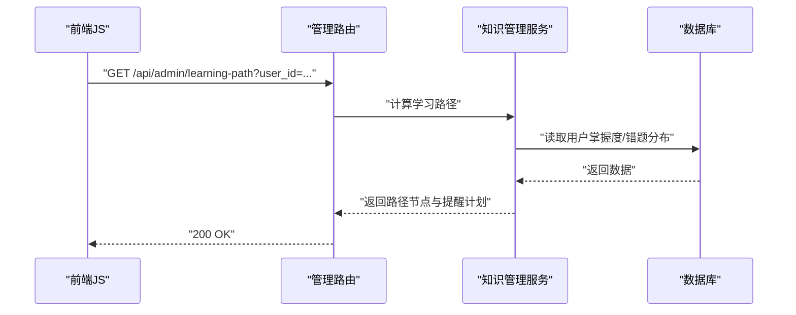
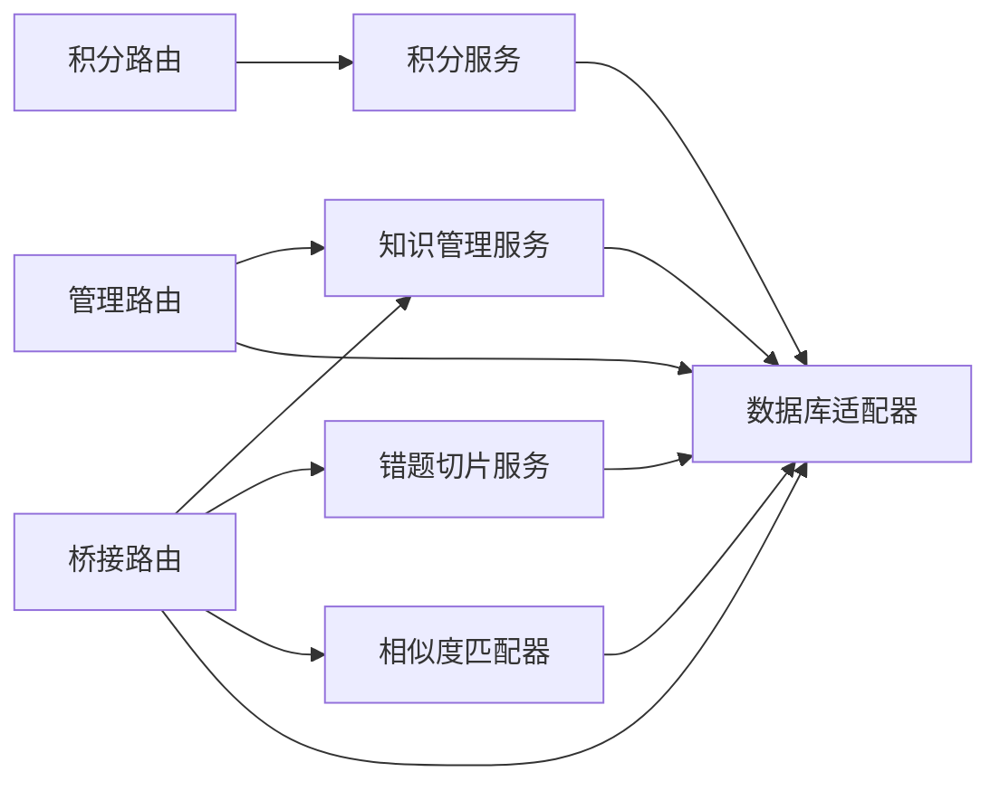

# 练习系统API

<cite>
**本文引用的文件**   
- [app.py](file://server/app.py)
- [routes_bridge.py](file://server/routes_bridge.py)
- [routes_knowledge.py](file://server/routes_knowledge.py)
- [routes_notes.py](file://server/routes_notes.py)
- [routes_admin.py](file://server/routes_admin.py)
- [routes_credits.py](file://server/routes_credits.py)
- [auth.py](file://server/auth.py)
- [config.py](file://server/config.py)
- [knowledge_management.py](file://server/knowledge_management.py)
- [credits_service.py](file://server/credits_service.py)
- [llm_call_logger.py](file://server/llm_call_logger.py)
- [llm_logger.py](file://server/llm_logger.py)
- [llm_provider_factory.py](file://server/llm_provider_factory.py)
- [similarity_matcher.py](file://server/similarity_matcher.py)
- [db_adapter.py](file://server/database/db_adapter.py)
- [schema_postgres.py](file://server/database/schema_postgres.py)
- [error_slicer.py](file://server/services/error_slicer.py)
- [api.js](file://server/static/js/api.js)
- [practice_welcome.js](file://server/static/js/practice_welcome.js)
- [recorder.js](file://server/static/js/recorder.js)
- [unified_logger.js](file://server/static/js/unified_logger.js)
- [2026-09-28-练记系统全功能测试文档.md](file://docs/测试/2026-09-28-练记系统全功能测试文档.md)
- [业务规则总览.md](file://docs/业务规则/业务规则总览.md)
</cite>

## 目录
1. [简介](#简介)
2. [项目结构](#项目结构)
3. [核心组件](#核心组件)
4. [架构总览](#架构总览)
5. [详细组件分析](#详细组件分析)
6. [依赖关系分析](#依赖关系分析)
7. [性能考虑](#性能考虑)
8. [故障排查指南](#故障排查指南)
9. [结论](#结论)
10. [附录](#附录)

## 简介
本文件为“练习系统”的API与实现说明，覆盖错题收集、在线练习、进度跟踪、成绩分析、自适应测试数据接口、学习路径规划、复习提醒、练习状态管理、答案提交与解析查看等核心业务流程。文档同时给出客户端集成示例与性能优化建议，帮助前端或桌面端快速接入后端服务。

## 项目结构
服务器端采用分层组织：路由层负责HTTP接口暴露，服务层封装业务逻辑，数据访问层对接数据库，静态资源与模板由Flask提供。前端JS通过统一API模块调用后端接口，并在页面中驱动练习流程。

图表来源
- [app.py:1-200](file://server/app.py#L1-L200)
- [routes_bridge.py:1-300](file://server/routes_bridge.py#L1-L300)
- [routes_knowledge.py:1-200](file://server/routes_knowledge.py#L1-L200)
- [routes_notes.py:1-200](file://server/routes_notes.py#L1-L200)
- [routes_admin.py:1-200](file://server/routes_admin.py#L1-L200)
- [routes_credits.py:1-200](file://server/routes_credits.py#L1-L200)
- [knowledge_management.py:1-200](file://server/knowledge_management.py#L1-L200)
- [error_slicer.py:1-150](file://server/services/error_slicer.py#L1-L150)
- [similarity_matcher.py:1-150](file://server/similarity_matcher.py#L1-L150)
- [db_adapter.py:1-200](file://server/database/db_adapter.py#L1-L200)
- [schema_postgres.py:1-200](file://server/database/schema_postgres.py#L1-L200)
- [credits_service.py:1-200](file://server/credits_service.py#L1-L200)

章节来源
- [app.py:1-200](file://server/app.py#L1-L200)
- [config.py:1-120](file://server/config.py#L1-L120)

## 核心组件
- 路由层
  - 桥接路由：聚合错题、练习、进度、成绩、自适应测试、学习路径、复习提醒等能力。
  - 知识路由：知识点检索、标签管理、知识图谱相关操作。
  - 笔记路由：笔记创建、更新、查询、关联题目。
  - 管理路由：管理员配置、用户权限、系统设置。
  - 积分路由：积分获取、消耗、统计。
- 服务层
  - 知识管理服务：知识点索引、推荐、难度评估。
  - 错题切片服务：将长题解拆分为可复习的最小单元。
  - 相似度匹配器：基于语义或文本相似度的题目/知识点匹配。
  - 积分服务：积分发放、扣减、审计。
- 数据访问层
  - 数据库适配器：统一SQL执行、事务、连接池。
  - 数据库模式：PostgreSQL表结构定义。
- LLM与日志
  - LLM调用记录器：记录大模型调用上下文与结果。
  - LLM提供者工厂：动态选择LLM提供商。
  - 通用日志器：结构化日志输出。
- 前端JS
  - api.js：统一HTTP请求封装。
  - practice_welcome.js：练习引导与状态初始化。
  - recorder.js：录音与音频上传（用于语音练习场景）。
  - unified_logger.js：前端日志采集与上报。

章节来源
- [routes_bridge.py:1-300](file://server/routes_bridge.py#L1-L300)
- [routes_knowledge.py:1-200](file://server/routes_knowledge.py#L1-L200)
- [routes_notes.py:1-200](file://server/routes_notes.py#L1-L200)
- [routes_admin.py:1-200](file://server/routes_admin.py#L1-L200)
- [routes_credits.py:1-200](file://server/routes_credits.py#L1-L200)
- [knowledge_management.py:1-200](file://server/knowledge_management.py#L1-L200)
- [error_slicer.py:1-150](file://server/services/error_slicer.py#L1-L150)
- [similarity_matcher.py:1-150](file://server/similarity_matcher.py#L1-L150)
- [db_adapter.py:1-200](file://server/database/db_adapter.py#L1-L200)
- [schema_postgres.py:1-200](file://server/database/schema_postgres.py#L1-L200)
- [credits_service.py:1-200](file://server/credits_service.py#L1-L200)
- [llm_call_logger.py:1-200](file://server/llm_call_logger.py#L1-L200)
- [llm_logger.py:1-200](file://server/llm_logger.py#L1-L200)
- [llm_provider_factory.py:1-200](file://server/llm_provider_factory.py#L1-L200)
- [api.js:1-200](file://server/static/js/api.js#L1-L200)
- [practice_welcome.js:1-200](file://server/static/js/practice_welcome.js#L1-L200)
- [recorder.js:1-200](file://server/static/js/recorder.js#L1-L200)
- [unified_logger.js:1-200](file://server/static/js/unified_logger.js#L1-L200)

## 架构总览
系统以Flask作为Web框架，路由层暴露REST风格接口；服务层处理业务逻辑；数据访问层屏蔽具体数据库差异；前端通过JS模块发起请求并渲染界面。

图表来源
- [routes_bridge.py:1-300](file://server/routes_bridge.py#L1-L300)
- [knowledge_management.py:1-200](file://server/knowledge_management.py#L1-L200)
- [db_adapter.py:1-200](file://server/database/db_adapter.py#L1-L200)
- [llm_call_logger.py:1-200](file://server/llm_call_logger.py#L1-L200)

## 详细组件分析

### 错题收集与切片
- 目标：从历史答题、笔记、材料中提取错误点，切分为可复习的最小单元，便于后续自适应训练。
- 关键流程
  - 接收原始错题或材料片段。
  - 使用错题切片服务进行分块与去重。
  - 与知识点库进行相似度匹配，标注知识点标签。
  - 持久化到数据库，供练习引擎使用。

图表来源
- [error_slicer.py:1-150](file://server/services/error_slicer.py#L1-L150)
- [similarity_matcher.py:1-150](file://server/similarity_matcher.py#L1-L150)
- [db_adapter.py:1-200](file://server/database/db_adapter.py#L1-L200)

章节来源
- [error_slicer.py:1-150](file://server/services/error_slicer.py#L1-L150)
- [similarity_matcher.py:1-150](file://server/similarity_matcher.py#L1-L150)
- [routes_bridge.py:1-300](file://server/routes_bridge.py#L1-L300)

### 在线练习与状态管理
- 目标：维护练习会话生命周期，包括开始、题目推送、作答、提交、解析查看、结束与复盘。
- 关键流程
  - 开始练习：根据用户错题集与知识点掌握度生成题目序列。
  - 作答与提交：支持单选、多选、填空、简答等多种题型。
  - 解析查看：返回题目解析、知识点链接、相似题推荐。
  - 进度跟踪：实时更新正确率、薄弱知识点、预计完成时间。

图表来源
- [routes_bridge.py:1-300](file://server/routes_bridge.py#L1-L300)
- [db_adapter.py:1-200](file://server/database/db_adapter.py#L1-L200)

章节来源
- [routes_bridge.py:1-300](file://server/routes_bridge.py#L1-L300)
- [practice_welcome.js:1-200](file://server/static/js/practice_welcome.js#L1-L200)

### 自适应测试算法的数据接口
- 目标：根据用户历史表现动态调整题目难度、知识点权重与复习间隔。
- 输入
  - 用户ID、历史作答记录、知识点掌握度、最近错误分布。
- 输出
  - 下一题集合、难度系数、知识点优先级、预计掌握曲线。
- 算法要点
  - 基于知识点的错误频率与掌握度计算权重。
  - 结合间隔重复策略安排复习题。
  - 使用相似度匹配器推荐相近知识点题目以巩固薄弱环节。

图表来源
- [knowledge_management.py:1-200](file://server/knowledge_management.py#L1-L200)
- [similarity_matcher.py:1-150](file://server/similarity_matcher.py#L1-L150)
- [routes_bridge.py:1-300](file://server/routes_bridge.py#L1-L300)

章节来源
- [knowledge_management.py:1-200](file://server/knowledge_management.py#L1-L200)
- [routes_bridge.py:1-300](file://server/routes_bridge.py#L1-L300)

### 学习路径规划与复习提醒
- 目标：为用户制定阶段性学习目标与复习计划，并通过提醒机制促使用户持续练习。
- 关键能力
  - 路径规划：按知识点难度与掌握度生成学习路线。
  - 复习提醒：基于遗忘曲线与用户活跃时段推送提醒。
  - 进度看板：可视化展示已完成、进行中、待复习任务。

图表来源
- [routes_admin.py:1-200](file://server/routes_admin.py#L1-L200)
- [knowledge_management.py:1-200](file://server/knowledge_management.py#L1-L200)
- [db_adapter.py:1-200](file://server/database/db_adapter.py#L1-L200)

章节来源
- [routes_admin.py:1-200](file://server/routes_admin.py#L1-L200)
- [knowledge_management.py:1-200](file://server/knowledge_management.py#L1-L200)

### 成绩分析与报告
- 目标：汇总练习结果，生成个人成绩报告与班级/群组对比（如适用）。
- 关键指标
  - 正确率、平均用时、知识点薄弱项、趋势变化。
- 输出格式
  - 结构化JSON，包含指标明细、图表数据源、建议复习清单。

章节来源
- [routes_bridge.py:1-300](file://server/routes_bridge.py#L1-L300)
- [routes_admin.py:1-200](file://server/routes_admin.py#L1-L200)

### 答案提交与解析查看
- 目标：确保答案提交的原子性与一致性，并提供详细的解析与知识点链接。
- 关键点
  - 幂等提交：防止重复提交导致分数异常。
  - 解析缓存：对高频题目的解析进行缓存以提升响应速度。
  - 解析版本控制：当解析更新时，保留历史版本以供回溯。

章节来源
- [routes_bridge.py:1-300](file://server/routes_bridge.py#L1-L300)
- [db_adapter.py:1-200](file://server/database/db_adapter.py#L1-L200)

### 客户端集成示例
- 前端JS通过统一API模块发起请求，封装了鉴权、重试、超时与错误处理。
- 典型流程
  - 初始化：加载用户信息与上次练习进度。
  - 开始练习：调用会话启动接口，渲染题目。
  - 提交答案：批量或逐题提交，实时反馈解析。
  - 结束练习：保存进度，刷新成绩看板。

章节来源
- [api.js:1-200](file://server/static/js/api.js#L1-L200)
- [practice_welcome.js:1-200](file://server/static/js/practice_welcome.js#L1-L200)
- [unified_logger.js:1-200](file://server/static/js/unified_logger.js#L1-L200)

## 依赖关系分析
- 路由与服务耦合
  - 桥接路由依赖知识管理、错题切片、相似度匹配与数据库适配器。
  - 管理路由依赖知识管理与数据库适配器。
  - 积分路由依赖积分服务与数据库适配器。
- 外部依赖
  - LLM调用记录器与提供者工厂用于增强题目生成与解析质量。
  - 数据库适配器统一封装SQL执行与事务管理。

图表来源
- [routes_bridge.py:1-300](file://server/routes_bridge.py#L1-L300)
- [routes_admin.py:1-200](file://server/routes_admin.py#L1-L200)
- [routes_credits.py:1-200](file://server/routes_credits.py#L1-L200)
- [knowledge_management.py:1-200](file://server/knowledge_management.py#L1-L200)
- [error_slicer.py:1-150](file://server/services/error_slicer.py#L1-L150)
- [similarity_matcher.py:1-150](file://server/similarity_matcher.py#L1-L150)
- [db_adapter.py:1-200](file://server/database/db_adapter.py#L1-L200)
- [credits_service.py:1-200](file://server/credits_service.py#L1-L200)

章节来源
- [routes_bridge.py:1-300](file://server/routes_bridge.py#L1-L300)
- [routes_admin.py:1-200](file://server/routes_admin.py#L1-L200)
- [routes_credits.py:1-200](file://server/routes_credits.py#L1-L200)
- [knowledge_management.py:1-200](file://server/knowledge_management.py#L1-L200)
- [error_slicer.py:1-150](file://server/services/error_slicer.py#L1-L150)
- [similarity_matcher.py:1-150](file://server/similarity_matcher.py#L1-L150)
- [db_adapter.py:1-200](file://server/database/db_adapter.py#L1-L200)
- [credits_service.py:1-200](file://server/credits_service.py#L1-L200)

## 性能考虑
- 数据库层面
  - 使用连接池与读写分离（如可用）提升并发能力。
  - 对热点题目与解析进行缓存，减少重复IO。
- 服务层
  - 异步处理LLM调用，避免阻塞主线程。
  - 批量写入作答记录，降低事务开销。
- 前端层面
  - 分页加载题目，避免一次性渲染大量DOM。
  - 使用防抖与节流优化频繁提交与搜索。
- 监控与日志
  - 通过LLM调用记录器与通用日志器追踪慢请求与异常。

[本节为通用指导，不直接分析具体文件]

## 故障排查指南
- 常见问题
  - 会话无法启动：检查用户权限、错题集是否为空、知识点索引是否完整。
  - 答案提交失败：检查幂等键、网络超时、数据库事务回滚。
  - 解析加载缓慢：检查解析缓存命中率、LLM调用延迟。
- 定位方法
  - 查看服务端日志与LLM调用记录。
  - 核对数据库事务与索引状态。
  - 前端通过统一日志器上报错误堆栈与请求上下文。

章节来源
- [llm_call_logger.py:1-200](file://server/llm_call_logger.py#L1-L200)
- [llm_logger.py:1-200](file://server/llm_logger.py#L1-L200)
- [unified_logger.js:1-200](file://server/static/js/unified_logger.js#L1-L200)

## 结论
本API文档系统化梳理了练习系统的核心接口与实现要点，覆盖错题收集、在线练习、进度跟踪、成绩分析、自适应测试、学习路径规划与复习提醒等关键能力。通过分层架构与清晰的数据流设计，系统具备良好的扩展性与可维护性。建议在生产环境中加强缓存、异步处理与监控告警，以提升用户体验与系统稳定性。

[本节为总结性内容，不直接分析具体文件]

## 附录
- 参考测试文档与业务规则
  - 全功能测试文档提供了端到端用例与边界条件验证思路。
  - 业务规则总览明确了知识点、错题、练习与积分的业务约束。

章节来源
- [2026-09-28-练记系统全功能测试文档.md:1-200](file://docs/测试/2026-09-28-练记系统全功能测试文档.md#L1-L200)
- [业务规则总览.md:1-200](file://docs/业务规则/业务规则总览.md#L1-L200)