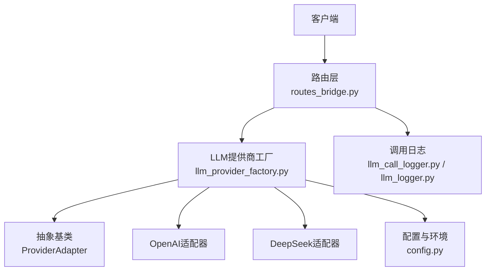
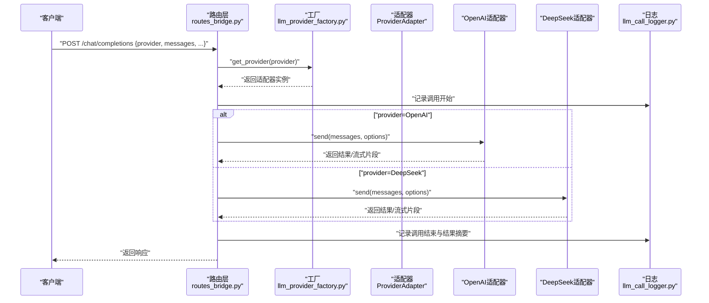
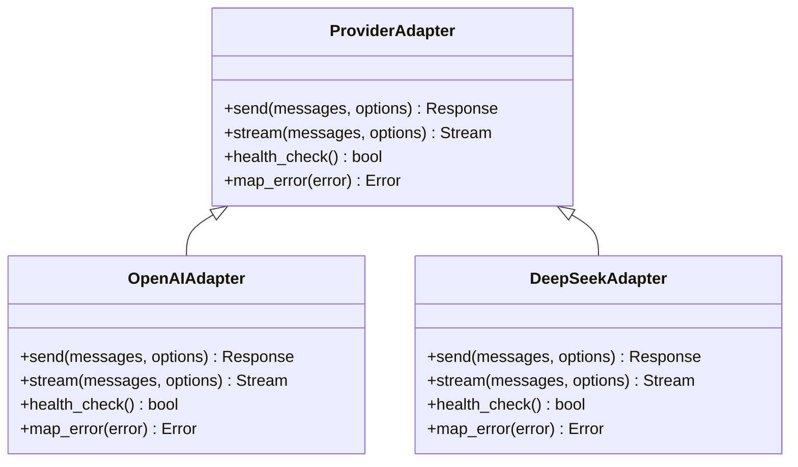
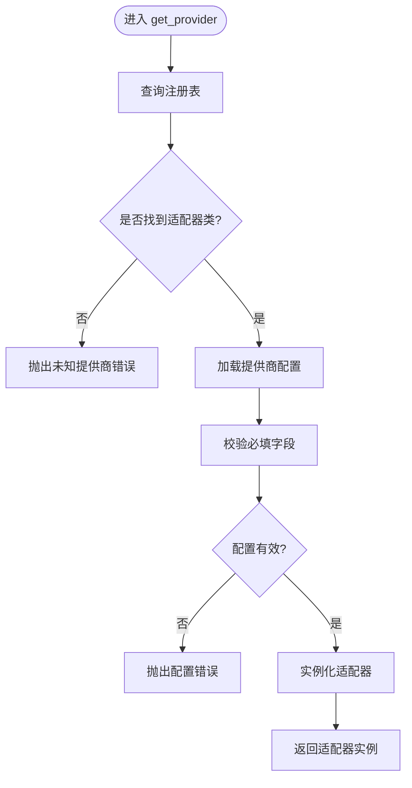
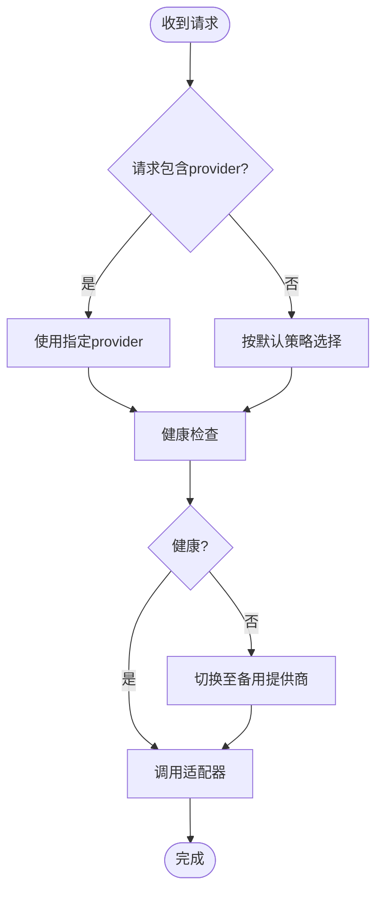
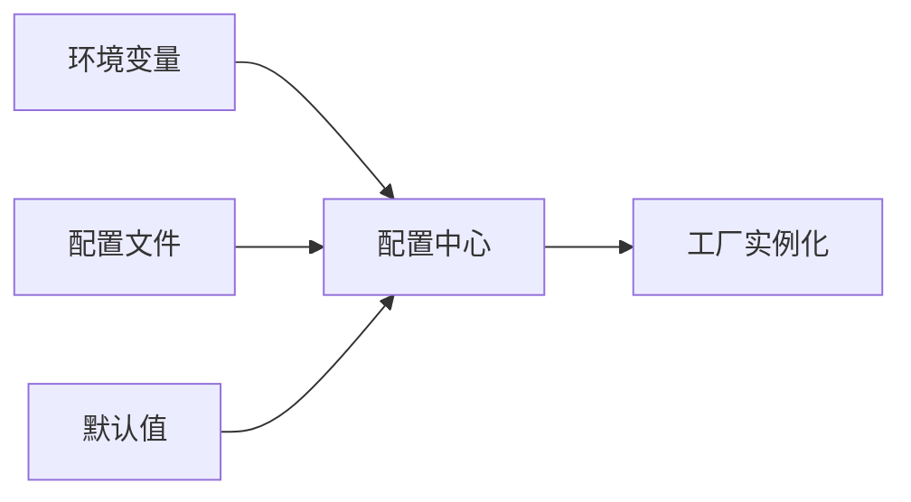
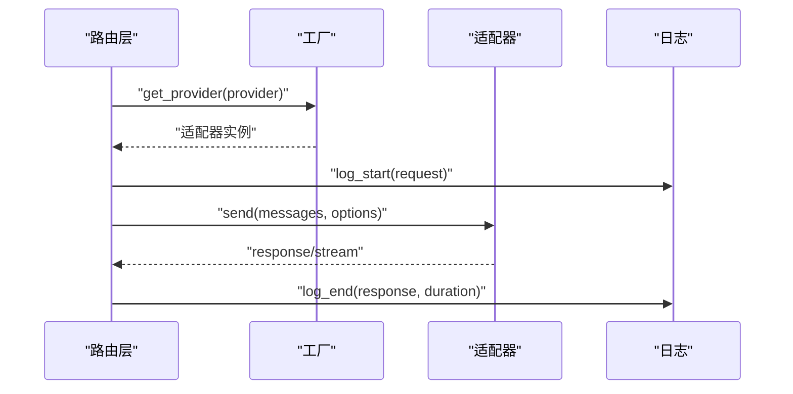
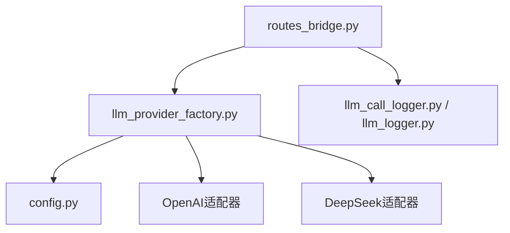

# LLM提供商工厂模式

<cite>
**本文引用的文件**   
- [llm_provider_factory.py](file://server/llm_provider_factory.py)
- [config.py](file://server/config.py)
- [app.py](file://server/app.py)
- [routes_bridge.py](file://server/routes_bridge.py)
- [llm_call_logger.py](file://server/llm_call_logger.py)
- [llm_logger.py](file://server/llm_logger.py)
</cite>

## 目录
1. [简介](#简介)
2. [项目结构](#项目结构)
3. [核心组件](#核心组件)
4. [架构总览](#架构总览)
5. [详细组件分析](#详细组件分析)
6. [依赖关系分析](#依赖关系分析)
7. [性能与可靠性](#性能与可靠性)
8. [故障排查指南](#故障排查指南)
9. [结论](#结论)
10. [附录：扩展新提供商步骤](#附录扩展新提供商步骤)

## 简介
本技术文档围绕LLM提供商工厂模式展开，聚焦于在Python服务端中通过统一的抽象接口，对OpenAI、DeepSeek等不同大模型提供商进行统一接入、动态实例化与配置管理。文档将解释工厂注册机制、选择逻辑、负载均衡与故障转移策略，并给出添加新提供商的完整流程与示例路径。同时说明配置文件结构与环境变量管理方式，帮助开发者快速理解并扩展系统能力。

## 项目结构
本项目在服务端使用Python实现，LLM相关能力集中在以下模块：
- 工厂与适配器：负责提供商的统一抽象、注册与实例化
- 配置与环境：集中管理各提供商的连接参数与密钥
- 路由层：暴露HTTP接口，调用工厂获取具体提供商客户端
- 日志记录：统一记录LLM调用请求与响应，便于审计与排障

**图示来源**
- [routes_bridge.py:1-200](file://server/routes_bridge.py#L1-L200)
- [llm_provider_factory.py:1-200](file://server/llm_provider_factory.py#L1-L200)
- [config.py:1-200](file://server/config.py#L1-L200)
- [llm_call_logger.py:1-200](file://server/llm_call_logger.py#L1-L200)
- [llm_logger.py:1-200](file://server/llm_logger.py#L1-L200)

**章节来源**
- [routes_bridge.py:1-200](file://server/routes_bridge.py#L1-L200)
- [llm_provider_factory.py:1-200](file://server/llm_provider_factory.py#L1-L200)
- [config.py:1-200](file://server/config.py#L1-L200)

## 核心组件
- 抽象基类（ProviderAdapter）：定义所有提供商必须实现的统一接口，如发送消息、流式输出、错误处理等。
- 具体适配器（OpenAI、DeepSeek）：基于各自SDK或HTTP协议实现统一接口。
- 工厂（LLMProviderFactory）：维护提供商注册表，根据名称动态创建对应适配器实例；支持负载均衡与故障转移。
- 配置中心（Config）：从环境变量或配置文件加载各提供商连接参数、密钥、超时、重试策略等。
- 路由层（RoutesBridge）：对外暴露HTTP接口，接收业务请求后通过工厂选择合适的提供商执行调用。
- 日志记录（LLMCallLogger/LLMLLogger）：统一记录调用上下文、输入输出与耗时，便于追踪与审计。

**章节来源**
- [llm_provider_factory.py:1-200](file://server/llm_provider_factory.py#L1-L200)
- [config.py:1-200](file://server/config.py#L1-L200)
- [routes_bridge.py:1-200](file://server/routes_bridge.py#L1-L200)
- [llm_call_logger.py:1-200](file://server/llm_call_logger.py#L1-L200)
- [llm_logger.py:1-200](file://server/llm_logger.py#L1-L200)

## 架构总览
下图展示了从HTTP请求到具体LLM调用的端到端流程，以及工厂在其中的作用。

**图示来源**
- [routes_bridge.py:1-200](file://server/routes_bridge.py#L1-L200)
- [llm_provider_factory.py:1-200](file://server/llm_provider_factory.py#L1-L200)
- [llm_call_logger.py:1-200](file://server/llm_call_logger.py#L1-L200)

## 详细组件分析

### 抽象基类与适配器设计
- ProviderAdapter（抽象基类）
  - 职责：定义统一API，包括发送消息、流式输出、健康检查、错误映射等。
  - 关键方法：send、stream、health_check、map_error等。
- OpenAI适配器
  - 职责：封装OpenAI SDK调用，遵循ProviderAdapter接口。
  - 特性：支持模型选择、温度、最大token数、流式输出等。
- DeepSeek适配器
  - 职责：封装DeepSeek HTTP/SDK调用，遵循ProviderAdapter接口。
  - 特性：支持不同模型、重试策略、错误码映射。

**图示来源**
- [llm_provider_factory.py:1-200](file://server/llm_provider_factory.py#L1-L200)

**章节来源**
- [llm_provider_factory.py:1-200](file://server/llm_provider_factory.py#L1-L200)

### 工厂注册机制与动态实例化
- 注册表
  - 工厂内部维护一个“提供商名称 -> 适配器类”的映射。
  - 支持显式注册（如register_provider(name, cls)）与自动发现（按约定命名）。
- 动态实例化
  - get_provider(name, config)根据名称查找适配器类，结合配置实例化。
  - 若未找到，抛出“未知提供商”错误。
- 配置注入
  - 工厂从配置中心读取该提供商的连接参数（如API Key、Base URL、超时、重试次数）。
  - 支持默认值与覆盖策略。

**图示来源**
- [llm_provider_factory.py:1-200](file://server/llm_provider_factory.py#L1-L200)
- [config.py:1-200](file://server/config.py#L1-L200)

**章节来源**
- [llm_provider_factory.py:1-200](file://server/llm_provider_factory.py#L1-L200)
- [config.py:1-200](file://server/config.py#L1-L200)

### 提供商选择逻辑、负载均衡与故障转移
- 选择逻辑
  - 优先使用请求中指定的provider。
  - 若未指定，则根据全局默认策略选择（如权重轮询、健康状态优先）。
- 负载均衡
  - 可配置多实例或多模型，按权重分配请求。
  - 支持按地域、延迟、成本等维度选择。
- 故障转移
  - 当主提供商失败时，自动切换到备用提供商。
  - 支持熔断与退避重试，避免雪崩。

**图示来源**
- [llm_provider_factory.py:1-200](file://server/llm_provider_factory.py#L1-L200)

**章节来源**
- [llm_provider_factory.py:1-200](file://server/llm_provider_factory.py#L1-L200)

### 配置管理与环境变量
- 配置来源
  - 环境变量：如OPENAI_API_KEY、DEEPSEEK_BASE_URL等。
  - 配置文件：集中存放各提供商的连接参数、超时、重试策略、权重等。
- 优先级
  - 环境变量 > 配置文件 > 默认值。
- 安全
  - 敏感信息（如API Key）仅从环境变量注入，不写入代码或日志。

**图示来源**
- [config.py:1-200](file://server/config.py#L1-L200)

**章节来源**
- [config.py:1-200](file://server/config.py#L1-L200)

### 路由层集成与日志记录
- 路由层
  - 接收HTTP请求，解析provider与参数。
  - 调用工厂获取适配器，执行业务逻辑。
  - 统一异常处理与响应格式。
- 日志记录
  - 记录调用开始/结束、输入摘要、输出摘要、耗时、错误码。
  - 支持结构化日志与采样策略。

**图示来源**
- [routes_bridge.py:1-200](file://server/routes_bridge.py#L1-L200)
- [llm_call_logger.py:1-200](file://server/llm_call_logger.py#L1-L200)
- [llm_logger.py:1-200](file://server/llm_logger.py#L1-L200)

**章节来源**
- [routes_bridge.py:1-200](file://server/routes_bridge.py#L1-L200)
- [llm_call_logger.py:1-200](file://server/llm_call_logger.py#L1-L200)
- [llm_logger.py:1-200](file://server/llm_logger.py#L1-L200)

## 依赖关系分析
- 模块耦合
  - 路由层依赖工厂与日志模块。
  - 工厂依赖配置中心与各适配器实现。
  - 适配器之间相互独立，通过抽象基类解耦。
- 外部依赖
  - OpenAI SDK/HTTP客户端。
  - DeepSeek SDK/HTTP客户端。
  - 配置库（如python-dotenv）、日志库（如structlog/logging）。

**图示来源**
- [routes_bridge.py:1-200](file://server/routes_bridge.py#L1-L200)
- [llm_provider_factory.py:1-200](file://server/llm_provider_factory.py#L1-L200)
- [config.py:1-200](file://server/config.py#L1-L200)
- [llm_call_logger.py:1-200](file://server/llm_call_logger.py#L1-L200)
- [llm_logger.py:1-200](file://server/llm_logger.py#L1-L200)

**章节来源**
- [routes_bridge.py:1-200](file://server/routes_bridge.py#L1-L200)
- [llm_provider_factory.py:1-200](file://server/llm_provider_factory.py#L1-L200)
- [config.py:1-200](file://server/config.py#L1-L200)
- [llm_call_logger.py:1-200](file://server/llm_call_logger.py#L1-L200)
- [llm_logger.py:1-200](file://server/llm_logger.py#L1-L200)

## 性能与可靠性
- 性能优化
  - 连接池与复用：为每个提供商维护HTTP连接池，减少握手开销。
  - 流式输出：降低首字延迟，提升用户体验。
  - 缓存热点：对相同请求进行短期缓存（可选）。
- 可靠性保障
  - 重试与退避：对瞬态错误进行指数退避重试。
  - 熔断器：当某提供商错误率超过阈值，暂时停止流量。
  - 健康检查：定期探测各提供商可用性，动态调整权重。
- 监控与可观测性
  - 指标上报：QPS、延迟分位、错误率、供应商占比。
  - 链路追踪：跨服务调用ID关联。

[本节为通用指导，无需特定文件引用]

## 故障排查指南
- 常见问题
  - 未知提供商：检查注册表与请求中的provider名称。
  - 配置缺失：确认环境变量或配置文件已正确设置。
  - 认证失败：核对API Key与Base URL是否正确。
  - 超时与限流：检查网络连通性与提供商配额。
- 定位手段
  - 查看调用日志：关注错误码、重试次数、耗时。
  - 健康检查：验证各提供商状态。
  - 降级策略：临时切换到备用提供商以恢复服务。

**章节来源**
- [llm_call_logger.py:1-200](file://server/llm_call_logger.py#L1-L200)
- [llm_logger.py:1-200](file://server/llm_logger.py#L1-L200)

## 结论
通过抽象基类与工厂模式，本项目实现了对多个LLM提供商的统一接入与灵活扩展。配置中心与环境变量管理确保了安全性与可移植性；负载均衡与故障转移提升了系统的稳定性与可用性。开发者可按本文档步骤快速新增提供商适配，保持整体架构的一致性与可维护性。

[本节为总结性内容，无需特定文件引用]

## 附录：扩展新提供商步骤
- 步骤概览
  1. 定义适配器类：继承ProviderAdapter，实现send、stream、health_check、map_error等方法。
  2. 注册提供商：在工厂中注册新适配器（名称与类映射）。
  3. 配置连接参数：在配置中心添加环境变量或配置文件项。
  4. 测试与验证：编写单元测试与集成测试，确保功能与性能达标。
  5. 上线与监控：开启日志与指标，观察健康状态与错误率。

- 参考路径
  - 适配器实现位置：[llm_provider_factory.py:1-200](file://server/llm_provider_factory.py#L1-L200)
  - 配置项位置：[config.py:1-200](file://server/config.py#L1-L200)
  - 路由调用入口：[routes_bridge.py:1-200](file://server/routes_bridge.py#L1-L200)
  - 日志记录位置：[llm_call_logger.py:1-200](file://server/llm_call_logger.py#L1-L200), [llm_logger.py:1-200](file://server/llm_logger.py#L1-L200)

**章节来源**
- [llm_provider_factory.py:1-200](file://server/llm_provider_factory.py#L1-L200)
- [config.py:1-200](file://server/config.py#L1-L200)
- [routes_bridge.py:1-200](file://server/routes_bridge.py#L1-L200)
- [llm_call_logger.py:1-200](file://server/llm_call_logger.py#L1-L200)
- [llm_logger.py:1-200](file://server/llm_logger.py#L1-L200)