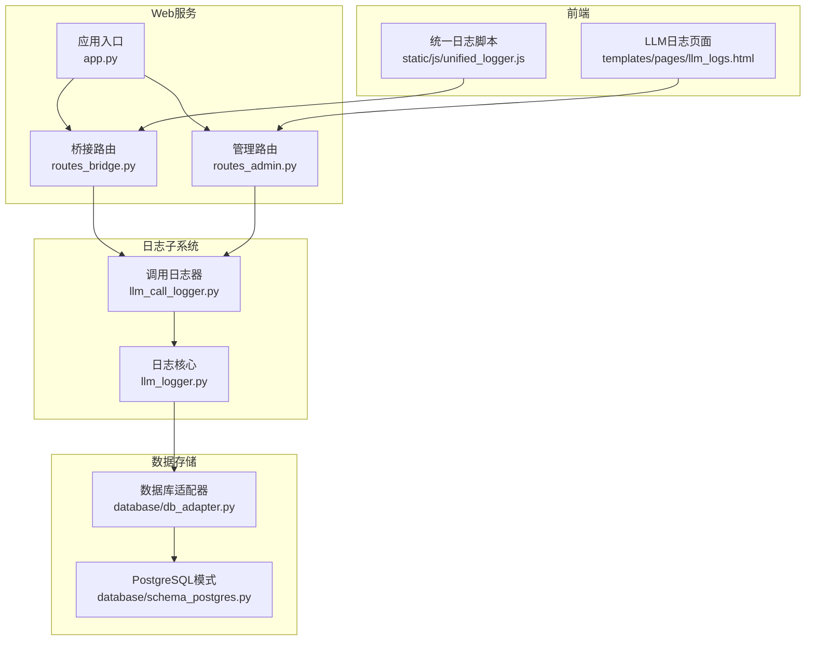
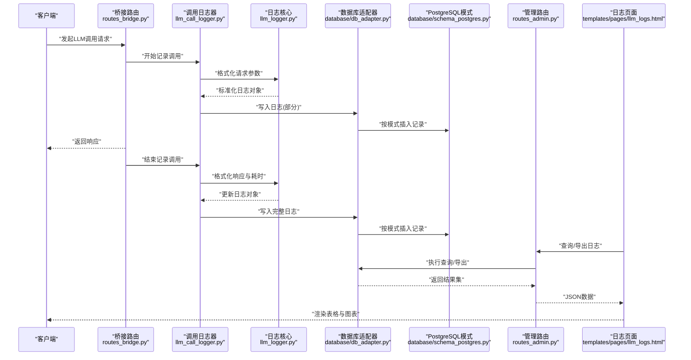
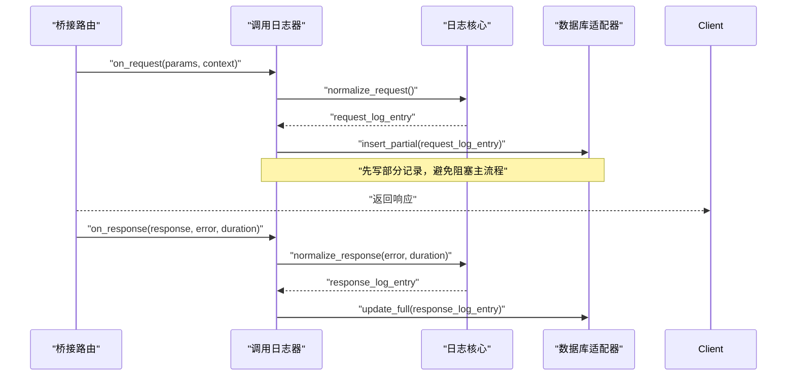
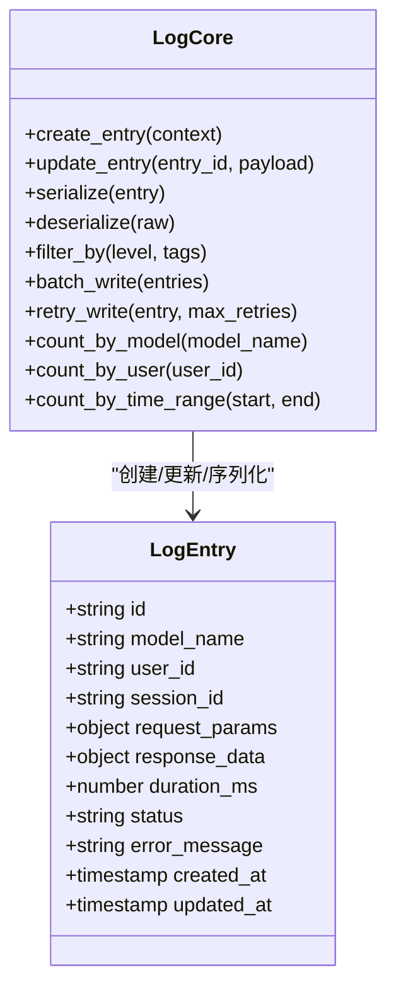
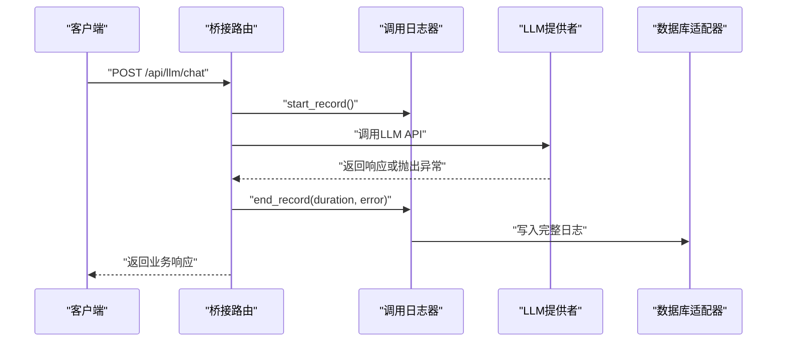
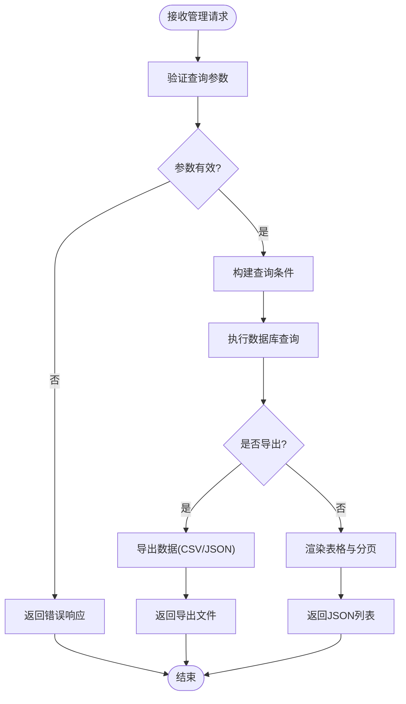
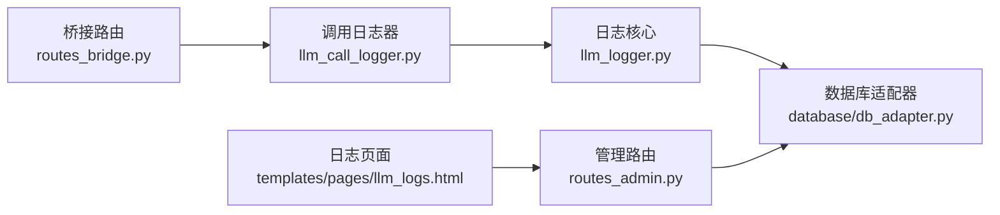

# LLM调用日志系统

<cite>
**本文引用的文件**   
- [llm_call_logger.py](file://server/llm_call_logger.py)
- [llm_logger.py](file://server/llm_logger.py)
- [routes_bridge.py](file://server/routes_bridge.py)
- [routes_admin.py](file://server/routes_admin.py)
- [app.py](file://server/app.py)
- [config.py](file://server/config.py)
- [database/db_adapter.py](file://server/database/db_adapter.py)
- [database/schema_postgres.py](file://server/database/schema_postgres.py)
- [templates/pages/llm_logs.html](file://server/templates/pages/llm_logs.html)
- [static/js/unified_logger.js](file://server/static/js/unified_logger.js)
</cite>

## 目录
1. [引言](#引言)
2. [项目结构](#项目结构)
3. [核心组件](#核心组件)
4. [架构总览](#架构总览)
5. [详细组件分析](#详细组件分析)
6. [依赖关系分析](#依赖关系分析)
7. [性能与成本监控](#性能与成本监控)
8. [故障排查指南](#故障排查指南)
9. [结论](#结论)
10. [附录](#附录)

## 引言
本文件面向LLM调用日志系统的实现与使用，覆盖以下目标：
- 记录每次LLM调用的请求参数、响应结果、耗时统计与错误信息。
- 明确日志存储结构与数据格式，并提供查询接口。
- 说明性能监控指标收集、调用频率统计与成本控制跟踪。
- 提供日志分析工具的使用方法与可视化展示方案。
- 解释敏感信息脱敏处理与安全考虑。
- 给出日志导出、备份与清理策略的具体实现建议。

该文档既适合开发者理解实现细节，也适合运维与产品人员掌握使用方式。

## 项目结构
围绕LLM调用日志的相关代码主要分布在服务端Python模块、数据库适配层、前端页面与脚本中：
- 日志采集与持久化：llm_call_logger.py、llm_logger.py
- Web路由与API：routes_bridge.py、routes_admin.py、app.py
- 配置与数据库：config.py、database/db_adapter.py、database/schema_postgres.py
- 前端展示与分析：templates/pages/llm_logs.html、static/js/unified_logger.js

图表来源
- [app.py:1-200](file://server/app.py#L1-L200)
- [routes_bridge.py:1-200](file://server/routes_bridge.py#L1-L200)
- [routes_admin.py:1-200](file://server/routes_admin.py#L1-L200)
- [llm_call_logger.py:1-200](file://server/llm_call_logger.py#L1-L200)
- [llm_logger.py:1-200](file://server/llm_logger.py#L1-L200)
- [database/db_adapter.py:1-200](file://server/database/db_adapter.py#L1-L200)
- [database/schema_postgres.py:1-200](file://server/database/schema_postgres.py#L1-L200)
- [templates/pages/llm_logs.html:1-200](file://server/templates/pages/llm_logs.html#L1-L200)
- [static/js/unified_logger.js:1-200](file://server/static/js/unified_logger.js#L1-L200)

章节来源
- [app.py:1-200](file://server/app.py#L1-L200)
- [routes_bridge.py:1-200](file://server/routes_bridge.py#L1-L200)
- [routes_admin.py:1-200](file://server/routes_admin.py#L1-L200)
- [llm_call_logger.py:1-200](file://server/llm_call_logger.py#L1-L200)
- [llm_logger.py:1-200](file://server/llm_logger.py#L1-L200)
- [database/db_adapter.py:1-200](file://server/database/db_adapter.py#L1-L200)
- [database/schema_postgres.py:1-200](file://server/database/schema_postgres.py#L1-L200)
- [templates/pages/llm_logs.html:1-200](file://server/templates/pages/llm_logs.html#L1-L200)
- [static/js/unified_logger.js:1-200](file://server/static/js/unified_logger.js#L1-L200)

## 核心组件
- 调用日志器（llm_call_logger.py）：负责在LLM调用前后采集请求参数、响应结果、耗时与错误信息，并进行必要的数据清洗与脱敏，最终写入日志存储。
- 日志核心（llm_logger.py）：提供统一的日志抽象、格式化、过滤与聚合能力，供上层组件复用。
- 桥接路由（routes_bridge.py）：暴露LLM调用相关的API，并在调用链路中注入日志采集逻辑。
- 管理路由（routes_admin.py）：提供日志查询、导出、统计等管理功能。
- 数据库适配器（database/db_adapter.py）：封装数据库连接、事务与通用CRUD操作。
- PostgreSQL模式（database/schema_postgres.py）：定义LLM调用日志表结构、索引与约束。
- 前端页面（templates/pages/llm_logs.html）：提供日志浏览、筛选、分页与可视化展示。
- 统一日志脚本（static/js/unified_logger.js）：在前端侧辅助日志输出与调试。

章节来源
- [llm_call_logger.py:1-200](file://server/llm_call_logger.py#L1-L200)
- [llm_logger.py:1-200](file://server/llm_logger.py#L1-L200)
- [routes_bridge.py:1-200](file://server/routes_bridge.py#L1-L200)
- [routes_admin.py:1-200](file://server/routes_admin.py#L1-L200)
- [database/db_adapter.py:1-200](file://server/database/db_adapter.py#L1-L200)
- [database/schema_postgres.py:1-200](file://server/database/schema_postgres.py#L1-L200)
- [templates/pages/llm_logs.html:1-200](file://server/templates/pages/llm_logs.html#L1-L200)
- [static/js/unified_logger.js:1-200](file://server/static/js/unified_logger.js#L1-L200)

## 架构总览
LLM调用日志系统采用“采集-处理-存储-展示”的分层架构：
- 采集层：在LLM调用入口处通过桥接路由拦截请求，记录请求参数与上下文；在返回处记录响应结果、耗时与错误。
- 处理层：日志核心对原始数据进行标准化、脱敏与校验，并生成结构化日志对象。
- 存储层：数据库适配器将日志对象持久化到PostgreSQL，遵循预定义的模式与索引策略。
- 展示层：管理路由提供查询与导出接口；前端页面渲染筛选、分页与图表。

图表来源
- [routes_bridge.py:1-200](file://server/routes_bridge.py#L1-L200)
- [llm_call_logger.py:1-200](file://server/llm_call_logger.py#L1-L200)
- [llm_logger.py:1-200](file://server/llm_logger.py#L1-L200)
- [database/db_adapter.py:1-200](file://server/database/db_adapter.py#L1-L200)
- [database/schema_postgres.py:1-200](file://server/database/schema_postgres.py#L1-L200)
- [routes_admin.py:1-200](file://server/routes_admin.py#L1-L200)
- [templates/pages/llm_logs.html:1-200](file://server/templates/pages/llm_logs.html#L1-L200)

## 详细组件分析

### 调用日志器（llm_call_logger.py）
职责与行为：
- 在LLM调用前捕获请求参数、模型名称、用户标识、会话ID等上下文。
- 在调用后捕获响应内容、状态码、错误信息与耗时。
- 对敏感字段进行脱敏（如密钥、令牌、个人信息）。
- 将结构化日志对象交给日志核心进行进一步处理与持久化。

关键流程（时序图）：

图表来源
- [llm_call_logger.py:1-200](file://server/llm_call_logger.py#L1-L200)
- [llm_logger.py:1-200](file://server/llm_logger.py#L1-L200)
- [database/db_adapter.py:1-200](file://server/database/db_adapter.py#L1-L200)

章节来源
- [llm_call_logger.py:1-200](file://server/llm_call_logger.py#L1-L200)

### 日志核心（llm_logger.py）
职责与行为：
- 提供日志对象的创建、更新、序列化与反序列化方法。
- 实现日志级别、标签与过滤规则。
- 支持批量写入与重试机制，提升写入吞吐与可靠性。
- 提供基础统计方法（如按模型、按用户、按时间段的计数）。

类与方法关系（类图）：

图表来源
- [llm_logger.py:1-200](file://server/llm_logger.py#L1-L200)

章节来源
- [llm_logger.py:1-200](file://server/llm_logger.py#L1-L200)

### 桥接路由（routes_bridge.py）
职责与行为：
- 暴露LLM调用相关API（如对话、文本生成、语音转写等）。
- 在调用前后注入日志采集逻辑，确保所有LLM调用均被记录。
- 对异常进行捕获并传递给日志器，保证错误信息可追踪。

典型调用序列（时序图）：

图表来源
- [routes_bridge.py:1-200](file://server/routes_bridge.py#L1-L200)
- [llm_call_logger.py:1-200](file://server/llm_call_logger.py#L1-L200)
- [database/db_adapter.py:1-200](file://server/database/db_adapter.py#L1-L200)

章节来源
- [routes_bridge.py:1-200](file://server/routes_bridge.py#L1-L200)

### 管理路由（routes_admin.py）
职责与行为：
- 提供日志查询接口（按模型、用户、时间段、状态等条件）。
- 提供日志导出接口（CSV/JSON），便于离线分析。
- 提供统计接口（调用次数、平均耗时、错误率、成本估算）。
- 提供清理接口（按时间范围删除旧日志，释放存储空间）。

查询与导出流程（流程图）：

图表来源
- [routes_admin.py:1-200](file://server/routes_admin.py#L1-L200)
- [database/db_adapter.py:1-200](file://server/database/db_adapter.py#L1-L200)

章节来源
- [routes_admin.py:1-200](file://server/routes_admin.py#L1-L200)

### 数据库适配器（database/db_adapter.py）
职责与行为：
- 封装数据库连接池、事务管理与通用CRUD操作。
- 提供批量插入与更新方法，优化写入性能。
- 支持分页查询与条件过滤，满足前端展示需求。

章节来源
- [database/db_adapter.py:1-200](file://server/database/db_adapter.py#L1-L200)

### PostgreSQL模式（database/schema_postgres.py）
职责与行为：
- 定义LLM调用日志表结构，包含请求参数、响应结果、耗时、状态、错误信息等字段。
- 为常用查询字段建立索引（如model_name、user_id、created_at、status）。
- 定义外键与约束，确保数据完整性。

章节来源
- [database/schema_postgres.py:1-200](file://server/database/schema_postgres.py#L1-L200)

### 前端页面（templates/pages/llm_logs.html）
职责与行为：
- 提供日志列表的渲染、筛选、分页与详情查看。
- 集成图表库展示调用趋势、错误分布与成本统计。
- 支持导出按钮，触发后端导出接口。

章节来源
- [templates/pages/llm_logs.html:1-200](file://server/templates/pages/llm_logs.html#L1-L200)

### 统一日志脚本（static/js/unified_logger.js）
职责与行为：
- 在前端侧输出调试日志，辅助开发与问题定位。
- 可选地将前端事件上报至后端日志系统（需配合后端接口）。

章节来源
- [static/js/unified_logger.js:1-200](file://server/static/js/unified_logger.js#L1-L200)

## 依赖关系分析
组件之间的依赖关系如下：
- 桥接路由依赖调用日志器以采集调用信息。
- 调用日志器依赖日志核心进行数据标准化与处理。
- 日志核心与数据库适配器协作完成持久化。
- 管理路由依赖数据库适配器进行查询与导出。
- 前端页面与管理路由交互，获取数据并渲染。

图表来源
- [routes_bridge.py:1-200](file://server/routes_bridge.py#L1-L200)
- [llm_call_logger.py:1-200](file://server/llm_call_logger.py#L1-L200)
- [llm_logger.py:1-200](file://server/llm_logger.py#L1-L200)
- [database/db_adapter.py:1-200](file://server/database/db_adapter.py#L1-L200)
- [routes_admin.py:1-200](file://server/routes_admin.py#L1-L200)
- [templates/pages/llm_logs.html:1-200](file://server/templates/pages/llm_logs.html#L1-L200)

章节来源
- [routes_bridge.py:1-200](file://server/routes_bridge.py#L1-L200)
- [llm_call_logger.py:1-200](file://server/llm_call_logger.py#L1-L200)
- [llm_logger.py:1-200](file://server/llm_logger.py#L1-L200)
- [database/db_adapter.py:1-200](file://server/database/db_adapter.py#L1-L200)
- [routes_admin.py:1-200](file://server/routes_admin.py#L1-L200)
- [templates/pages/llm_logs.html:1-200](file://server/templates/pages/llm_logs.html#L1-L200)

## 性能与成本监控
- 性能监控指标：
  - 调用延迟（P50/P95/P99）、吞吐量（QPS）、错误率。
  - 各模型的调用次数与平均耗时对比。
  - 用户维度的调用频率与峰值时段识别。
- 成本控制跟踪：
  - 基于模型与Token用量估算成本（需在日志中记录Token数或使用量）。
  - 按用户/部门维度进行成本分摊与预算预警。
- 数据采集与聚合：
  - 在日志核心中提供统计方法，定期聚合指标并写入统计表。
  - 前端图表展示趋势与分布，支持时间范围筛选。

章节来源
- [llm_logger.py:1-200](file://server/llm_logger.py#L1-L200)
- [routes_admin.py:1-200](file://server/routes_admin.py#L1-L200)
- [templates/pages/llm_logs.html:1-200](file://server/templates/pages/llm_logs.html#L1-L200)

## 故障排查指南
常见问题与处理方法：
- 日志缺失：检查桥接路由是否正确注入日志采集逻辑；确认调用日志器的start/end记录是否成对执行。
- 敏感信息泄露：确认日志核心与调用日志器是否启用脱敏规则；检查请求/响应字段映射。
- 写入失败：检查数据库适配器连接与事务；查看重试机制是否生效；核对PostgreSQL模式与索引。
- 查询缓慢：优化查询条件，利用索引字段（model_name、user_id、created_at）；分页加载大数据集。
- 前端渲染异常：检查管理路由返回的数据结构；确认前端模板与脚本版本一致。

章节来源
- [llm_call_logger.py:1-200](file://server/llm_call_logger.py#L1-L200)
- [llm_logger.py:1-200](file://server/llm_logger.py#L1-L200)
- [database/db_adapter.py:1-200](file://server/database/db_adapter.py#L1-L200)
- [database/schema_postgres.py:1-200](file://server/database/schema_postgres.py#L1-L200)
- [templates/pages/llm_logs.html:1-200](file://server/templates/pages/llm_logs.html#L1-L200)

## 结论
LLM调用日志系统通过分层架构实现了从采集、处理、存储到展示的完整闭环。系统在安全性（敏感信息脱敏）、性能（批量写入与索引优化）与可观测性（统计与可视化）方面提供了坚实基础。建议在生产环境中持续完善成本估算、预算预警与自动化清理策略，以提升整体运维效率与资源利用率。

## 附录
- 日志字段规范：
  - 请求参数：模型名称、用户标识、会话ID、消息内容（脱敏）、温度、最大Token等。
  - 响应结果：状态码、消息内容（脱敏）、Token用量、耗时、错误信息。
  - 元数据：创建时间、更新时间、来源IP、设备信息（可选）。
- 安全考虑：
  - 对所有敏感字段实施强制脱敏。
  - 限制日志访问权限，仅授权管理员可导出与清理。
  - 审计日志导出与清理操作，保留审计轨迹。
- 导出、备份与清理策略：
  - 导出：支持CSV/JSON格式，按时间范围与条件筛选。
  - 备份：定期归档历史日志至冷存储，保留策略可配置。
  - 清理：按时间范围删除旧日志，释放存储空间；提供软删除与恢复机制。