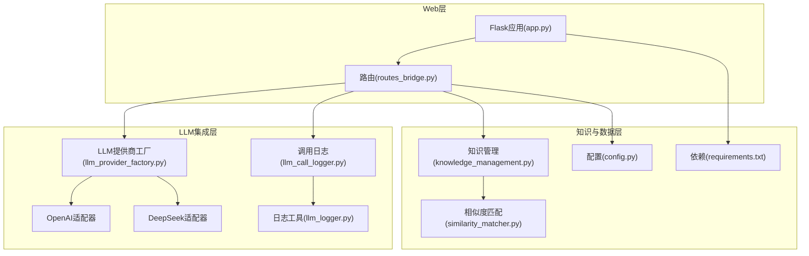
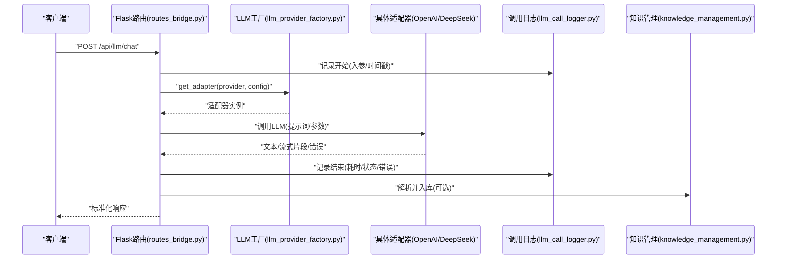
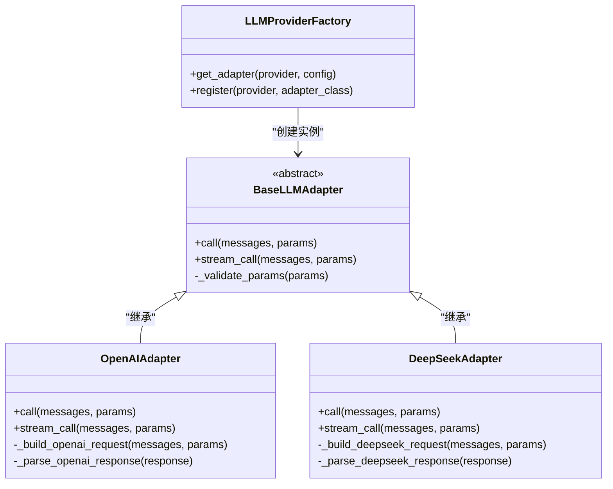
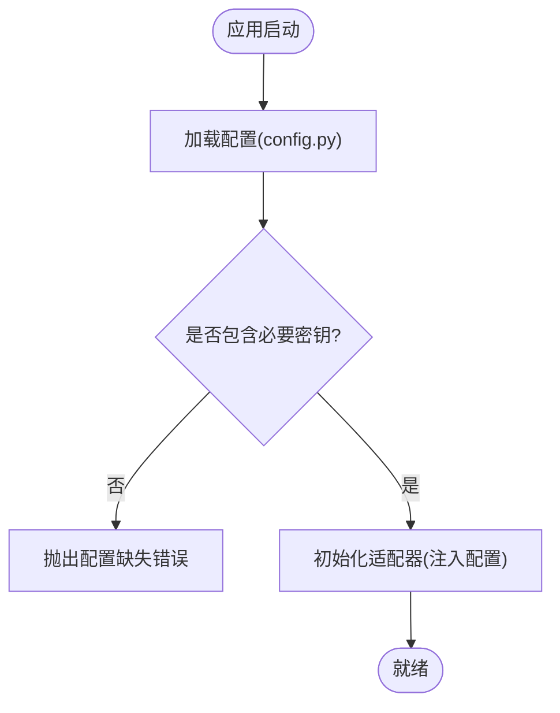
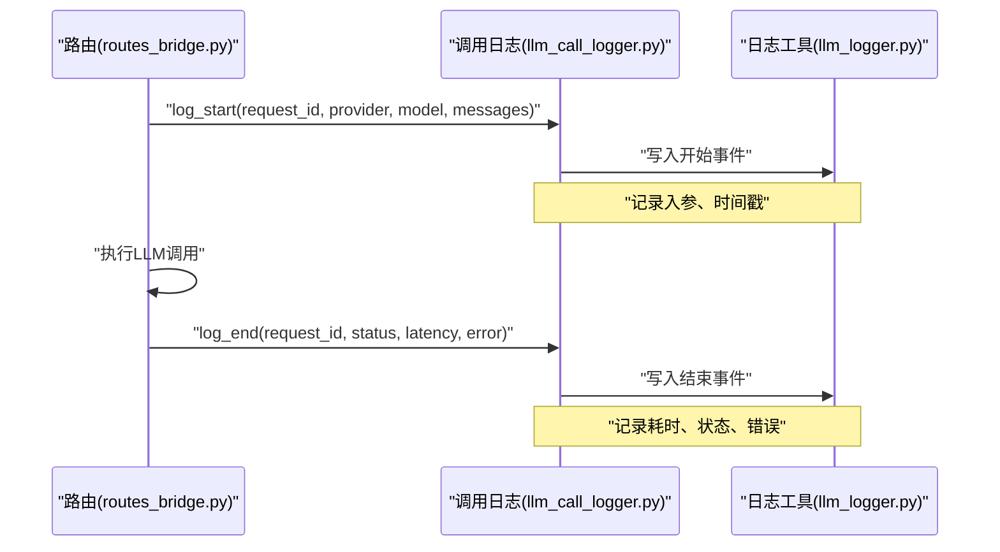
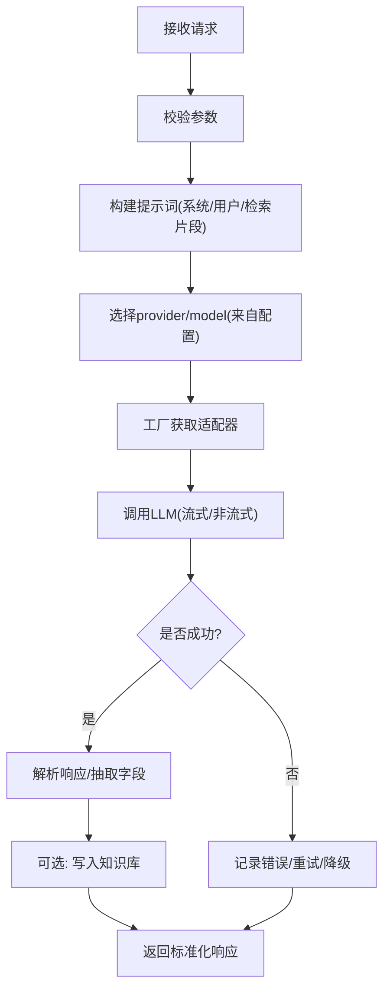
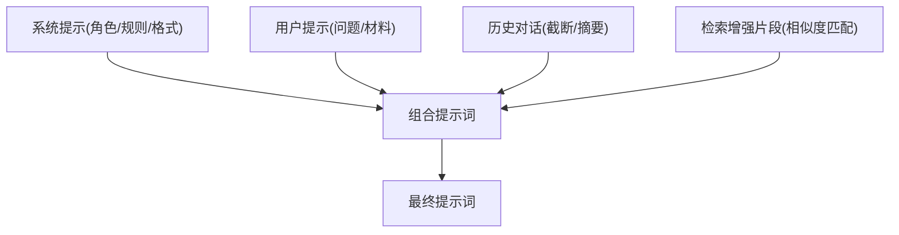
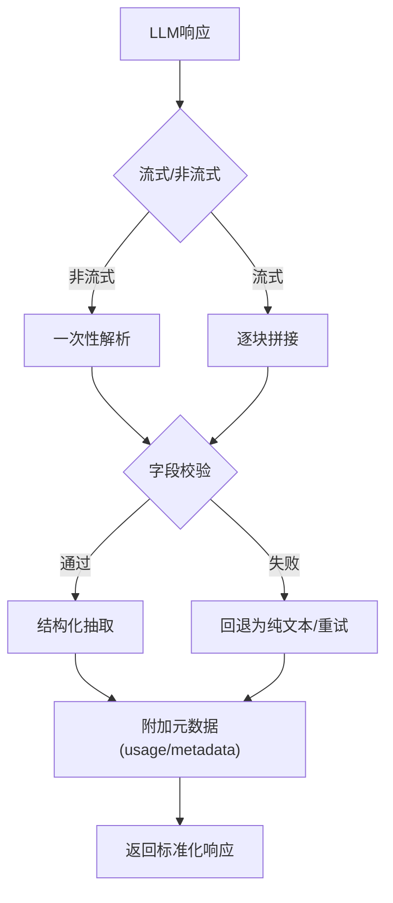
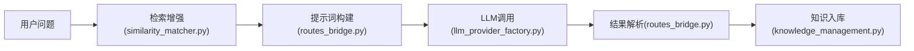
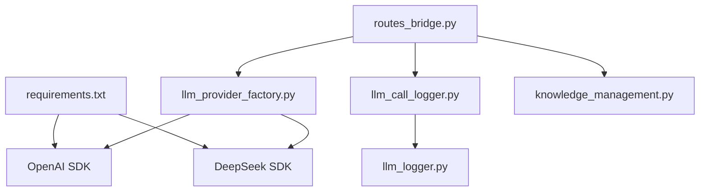

# LLM集成服务

<cite>
**本文引用的文件**   
- [llm_provider_factory.py](file://server/llm_provider_factory.py)
- [config.py](file://server/config.py)
- [llm_call_logger.py](file://server/llm_call_logger.py)
- [llm_logger.py](file://server/llm_logger.py)
- [routes_bridge.py](file://server/routes_bridge.py)
- [knowledge_management.py](file://server/knowledge_management.py)
- [similarity_matcher.py](file://server/similarity_matcher.py)
- [requirements.txt](file://server/requirements.txt)
- [app.py](file://server/app.py)
</cite>

## 目录
1. [引言](#引言)
2. [项目结构](#项目结构)
3. [核心组件](#核心组件)
4. [架构总览](#架构总览)
5. [详细组件分析](#详细组件分析)
6. [依赖关系分析](#依赖关系分析)
7. [性能与成本优化](#性能与成本优化)
8. [故障排查指南](#故障排查指南)
9. [结论](#结论)
10. [附录](#附录)

## 引言
本文件面向LectureLearnLoop的LLM集成服务，系统性说明多提供商适配器的工厂模式实现、提示词工程策略、响应处理机制，以及OpenAI、DeepSeek等提供商的集成方式与配置管理。文档同时覆盖调用日志记录、性能监控、错误处理策略，并给出LLM调用示例、提示词模板与结果解析思路，解释智能问答、内容生成与知识推理的实现原理，以及API密钥管理、调用频率限制和成本控制策略。

## 项目结构
围绕LLM集成的关键代码位于server目录下：
- 适配器与工厂：llm_provider_factory.py
- 配置与密钥：config.py
- 日志与审计：llm_call_logger.py、llm_logger.py
- 路由与业务入口：routes_bridge.py、knowledge_management.py
- 相似度匹配（用于检索增强）：similarity_matcher.py
- 依赖声明：requirements.txt
- Web应用启动：app.py

**图表来源**
- [app.py:1-200](file://server/app.py#L1-L200)
- [routes_bridge.py:1-200](file://server/routes_bridge.py#L1-L200)
- [llm_provider_factory.py:1-200](file://server/llm_provider_factory.py#L1-L200)
- [llm_call_logger.py:1-200](file://server/llm_call_logger.py#L1-L200)
- [llm_logger.py:1-200](file://server/llm_logger.py#L1-L200)
- [knowledge_management.py:1-200](file://server/knowledge_management.py#L1-L200)
- [similarity_matcher.py:1-200](file://server/similarity_matcher.py#L1-L200)
- [config.py:1-200](file://server/config.py#L1-L200)
- [requirements.txt:1-200](file://server/requirements.txt#L1-L200)

**章节来源**
- [app.py:1-200](file://server/app.py#L1-L200)
- [requirements.txt:1-200](file://server/requirements.txt#L1-L200)

## 核心组件
- LLM提供商工厂：统一创建不同LLM提供商的适配器实例，屏蔽底层差异，提供一致的调用接口。
- OpenAI适配器：封装OpenAI SDK调用，支持流式与非流式输出、模型参数与重试策略。
- DeepSeek适配器：封装DeepSeek API调用，遵循其请求结构与返回格式。
- 配置模块：集中管理API密钥、模型选择、超时、重试、速率限制等。
- 调用日志：记录每次LLM调用的输入、输出、耗时、状态码、错误信息，便于审计与排障。
- 路由与业务：对外暴露REST接口，串联提示词构建、LLM调用、结果解析与知识入库。
- 知识管理与相似度匹配：将LLM输出结构化入库，并通过相似度检索进行RAG增强。

**章节来源**
- [llm_provider_factory.py:1-200](file://server/llm_provider_factory.py#L1-L200)
- [config.py:1-200](file://server/config.py#L1-L200)
- [llm_call_logger.py:1-200](file://server/llm_call_logger.py#L1-L200)
- [llm_logger.py:1-200](file://server/llm_logger.py#L1-L200)
- [routes_bridge.py:1-200](file://server/routes_bridge.py#L1-L200)
- [knowledge_management.py:1-200](file://server/knowledge_management.py#L1-L200)
- [similarity_matcher.py:1-200](file://server/similarity_matcher.py#L1-L200)

## 架构总览
整体流程从前端或外部系统发起HTTP请求，经Flask路由进入业务逻辑，由工厂选择合适的LLM适配器执行调用，随后对响应进行解析、落库与返回；同时全程记录调用日志，供监控与审计使用。

**图表来源**
- [routes_bridge.py:1-200](file://server/routes_bridge.py#L1-L200)
- [llm_provider_factory.py:1-200](file://server/llm_provider_factory.py#L1-L200)
- [llm_call_logger.py:1-200](file://server/llm_call_logger.py#L1-L200)
- [knowledge_management.py:1-200](file://server/knowledge_management.py#L1-L200)

## 详细组件分析

### LLM提供商工厂与适配器类图
工厂负责按provider名称创建对应的适配器实例，所有适配器实现统一的调用接口，便于上层路由无差别调用。

**图表来源**
- [llm_provider_factory.py:1-200](file://server/llm_provider_factory.py#L1-L200)

**章节来源**
- [llm_provider_factory.py:1-200](file://server/llm_provider_factory.py#L1-L200)

### 配置与密钥管理
- 集中管理API密钥、模型名、超时、重试次数、并发与速率限制等。
- 支持按环境加载配置，避免硬编码敏感信息。
- 在适配器初始化时注入配置，确保调用一致性。

**图表来源**
- [config.py:1-200](file://server/config.py#L1-L200)

**章节来源**
- [config.py:1-200](file://server/config.py#L1-L200)

### 调用日志与审计
- 记录每次LLM调用的请求体、响应体摘要、耗时、状态码、错误堆栈。
- 支持按会话ID、用户ID、provider、model维度查询。
- 与llm_logger配合，提供结构化日志输出。

**图表来源**
- [llm_call_logger.py:1-200](file://server/llm_call_logger.py#L1-L200)
- [llm_logger.py:1-200](file://server/llm_logger.py#L1-L200)
- [routes_bridge.py:1-200](file://server/routes_bridge.py#L1-L200)

**章节来源**
- [llm_call_logger.py:1-200](file://server/llm_call_logger.py#L1-L200)
- [llm_logger.py:1-200](file://server/llm_logger.py#L1-L200)
- [routes_bridge.py:1-200](file://server/routes_bridge.py#L1-L200)

### 路由与业务编排
- 对外暴露REST接口，接收用户问题、上下文与参数。
- 组装提示词（含系统提示、历史对话、检索增强片段）。
- 通过工厂获取适配器并调用LLM。
- 解析响应，提取结构化字段，必要时入库。
- 返回标准化JSON响应，包含content、usage、metadata等。

**图表来源**
- [routes_bridge.py:1-200](file://server/routes_bridge.py#L1-L200)
- [llm_provider_factory.py:1-200](file://server/llm_provider_factory.py#L1-L200)
- [knowledge_management.py:1-200](file://server/knowledge_management.py#L1-L200)

**章节来源**
- [routes_bridge.py:1-200](file://server/routes_bridge.py#L1-L200)

### 提示词工程策略
- 系统提示：定义角色、任务边界、输出格式约束。
- 用户提示：具体问题、背景材料、检索增强片段。
- 历史对话：保留必要上下文，控制长度以节省token。
- 输出约束：要求结构化JSON或固定字段，便于后续解析。
- 安全与合规：过滤敏感信息，避免注入攻击。

**图表来源**
- [routes_bridge.py:1-200](file://server/routes_bridge.py#L1-L200)
- [similarity_matcher.py:1-200](file://server/similarity_matcher.py#L1-L200)

**章节来源**
- [routes_bridge.py:1-200](file://server/routes_bridge.py#L1-L200)
- [similarity_matcher.py:1-200](file://server/similarity_matcher.py#L1-L200)

### 响应处理与结果解析
- 非流式：直接解析完整响应，校验关键字段，失败则重试或降级。
- 流式：逐块拼接，实时反馈，结束时做完整性校验与结构化抽取。
- 结构化抽取：根据提示词约定的JSON Schema解析，若失败回退为纯文本。
- 元数据：统计token用量、延迟、provider、model等信息，用于计费与监控。

**图表来源**
- [routes_bridge.py:1-200](file://server/routes_bridge.py#L1-L200)

**章节来源**
- [routes_bridge.py:1-200](file://server/routes_bridge.py#L1-L200)

### 智能问答、内容生成与知识推理
- 智能问答：结合检索增强（相似度匹配）提升答案准确性。
- 内容生成：基于提示词模板生成文章、总结、要点等。
- 知识推理：通过结构化输出与规则后处理，形成可入库的知识条目。

**图表来源**
- [similarity_matcher.py:1-200](file://server/similarity_matcher.py#L1-L200)
- [routes_bridge.py:1-200](file://server/routes_bridge.py#L1-L200)
- [llm_provider_factory.py:1-200](file://server/llm_provider_factory.py#L1-L200)
- [knowledge_management.py:1-200](file://server/knowledge_management.py#L1-L200)

**章节来源**
- [similarity_matcher.py:1-200](file://server/similarity_matcher.py#L1-L200)
- [routes_bridge.py:1-200](file://server/routes_bridge.py#L1-L200)
- [llm_provider_factory.py:1-200](file://server/llm_provider_factory.py#L1-L200)
- [knowledge_management.py:1-200](file://server/knowledge_management.py#L1-L200)

## 依赖关系分析
- 外部SDK：OpenAI、DeepSeek等SDK由requirements.txt声明，适配器内部调用。
- 数据库：知识入库可能涉及持久化存储（由knowledge_management.py协调）。
- 日志框架：llm_logger.py提供统一日志能力。

**图表来源**
- [requirements.txt:1-200](file://server/requirements.txt#L1-L200)
- [routes_bridge.py:1-200](file://server/routes_bridge.py#L1-L200)
- [llm_provider_factory.py:1-200](file://server/llm_provider_factory.py#L1-L200)
- [llm_call_logger.py:1-200](file://server/llm_call_logger.py#L1-L200)
- [llm_logger.py:1-200](file://server/llm_logger.py#L1-L200)
- [knowledge_management.py:1-200](file://server/knowledge_management.py#L1-L200)

**章节来源**
- [requirements.txt:1-200](file://server/requirements.txt#L1-L200)
- [routes_bridge.py:1-200](file://server/routes_bridge.py#L1-L200)
- [llm_provider_factory.py:1-200](file://server/llm_provider_factory.py#L1-L200)
- [llm_call_logger.py:1-200](file://server/llm_call_logger.py#L1-L200)
- [llm_logger.py:1-200](file://server/llm_logger.py#L1-L200)
- [knowledge_management.py:1-200](file://server/knowledge_management.py#L1-L200)

## 性能与成本优化
- 模型选择：根据场景自动切换轻量/重型模型，平衡质量与成本。
- 流式输出：降低首字延迟，提升交互体验。
- 缓存与去重：对相似问题与高频提示词进行缓存，减少重复调用。
- 速率限制：按provider与model设置QPS上限，避免触发限流。
- Token预算：控制提示词长度与输出长度，避免超额计费。
- 重试与降级：网络抖动时指数退避重试，失败时降级到备用provider或纯缓存回答。

[本节为通用指导，不直接分析具体文件]

## 故障排查指南
- 配置缺失：检查API密钥与基础URL是否正确加载。
- 鉴权失败：确认provider鉴权头与密钥权限。
- 限流与配额：查看调用日志中的状态码与错误信息，调整QPS或扩容配额。
- 超时与中断：增加超时阈值或启用重试；检查网络稳定性。
- 解析失败：核对提示词约定的输出格式，完善解析容错逻辑。
- 日志定位：通过request_id追踪一次调用的完整链路。

**章节来源**
- [llm_call_logger.py:1-200](file://server/llm_call_logger.py#L1-L200)
- [llm_logger.py:1-200](file://server/llm_logger.py#L1-L200)
- [routes_bridge.py:1-200](file://server/routes_bridge.py#L1-L200)

## 结论
本LLM集成服务通过工厂模式统一管理多提供商适配器，结合完善的配置管理、日志审计与错误处理机制，实现了稳定、可扩展的智能问答、内容生成与知识推理能力。建议在上线前完善速率限制、Token预算与监控告警，持续优化提示词与解析逻辑，以获得更好的用户体验与成本效益。

[本节为总结性内容，不直接分析具体文件]

## 附录
- 典型调用示例（概念性步骤）
  - 构造请求：传入provider、model、messages、参数（temperature、max_tokens等）。
  - 选择适配器：工厂根据provider返回OpenAI或DeepSeek适配器。
  - 执行调用：非流式或流式调用，记录日志。
  - 解析响应：按约定格式抽取字段，附加usage与metadata。
  - 返回结果：标准化JSON响应给客户端。
- 提示词模板（概念性结构）
  - 系统提示：角色、任务、输出格式。
  - 用户提示：问题、背景材料、检索增强片段。
  - 历史对话：截断与摘要策略。
- 结果解析（概念性流程）
  - 校验关键字段，失败则回退为纯文本。
  - 抽取结构化字段，写入知识库（可选）。
  - 记录usage与metadata，用于计费与监控。

[本节为概念性说明，不直接分析具体文件]