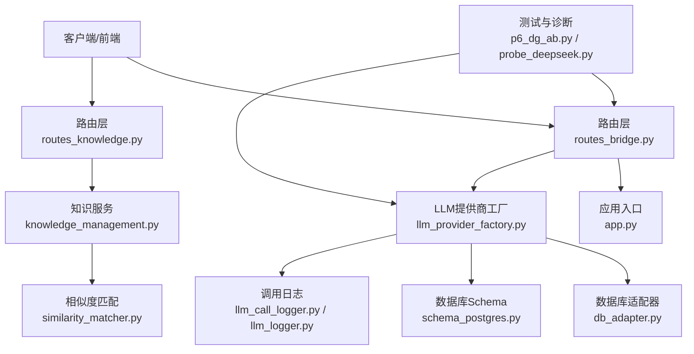
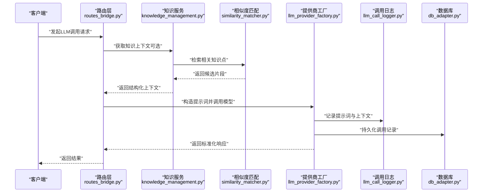
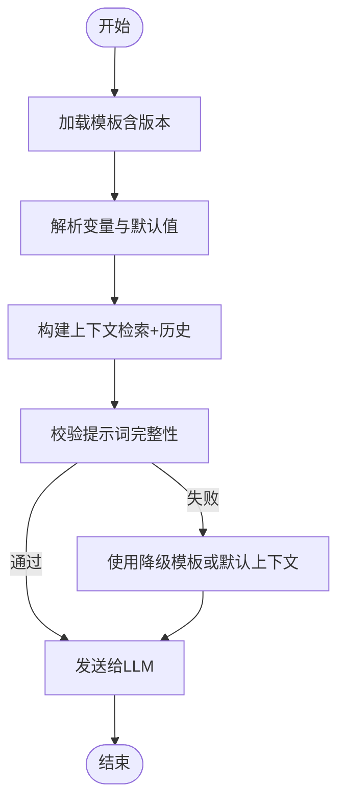
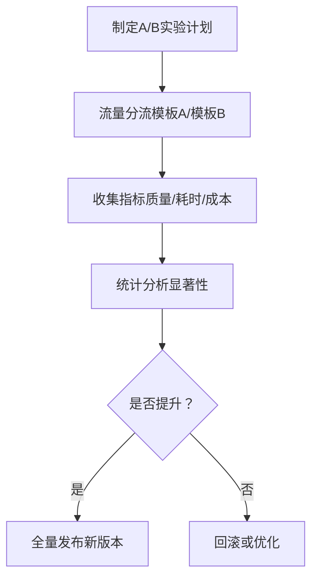
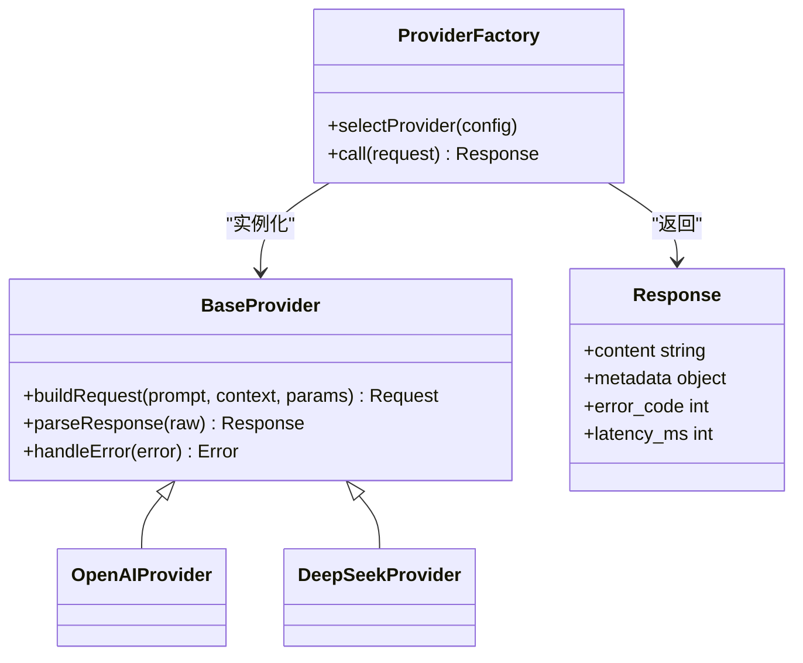
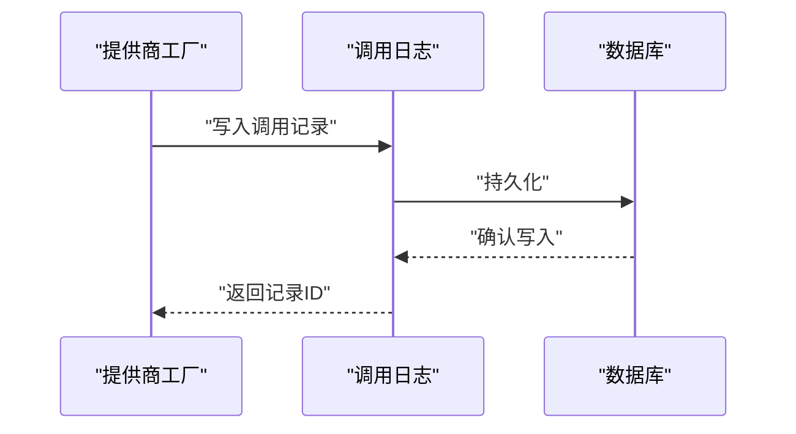
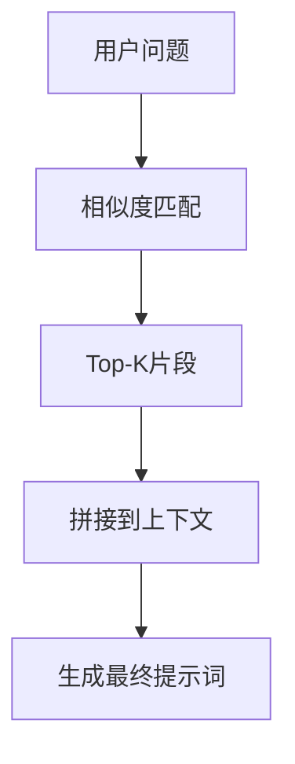
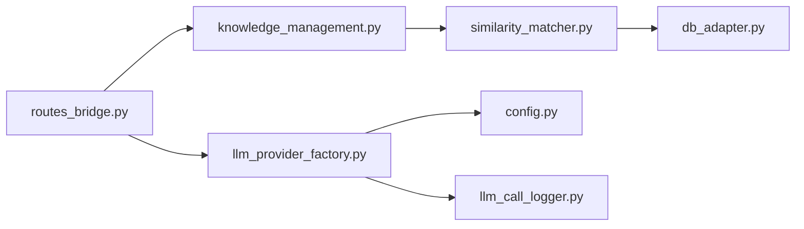

# 提示词工程框架

<cite>
**本文引用的文件**   
- [app.py](file://server/app.py)
- [config.py](file://server/config.py)
- [llm_provider_factory.py](file://server/llm_provider_factory.py)
- [llm_call_logger.py](file://server/llm_call_logger.py)
- [llm_logger.py](file://server/llm_logger.py)
- [routes_bridge.py](file://server/routes_bridge.py)
- [routes_knowledge.py](file://server/routes_knowledge.py)
- [knowledge_management.py](file://server/knowledge_management.py)
- [similarity_matcher.py](file://server/similarity_matcher.py)
- [db_adapter.py](file://server/database/db_adapter.py)
- [schema_postgres.py](file://server/database/schema_postgres.py)
- [error_slicer.py](file://server/services/error_slicer.py)
- [p6_dg_ab.py](file://server/tests/p6_dg_ab.py)
- [probe_deepseek.py](file://server/tests/probe_deepseek.py)
</cite>

## 目录
1. [引言](#引言)
2. [项目结构](#项目结构)
3. [核心组件](#核心组件)
4. [架构总览](#架构总览)
5. [详细组件分析](#详细组件分析)
6. [依赖关系分析](#依赖关系分析)
7. [性能与可观测性](#性能与可观测性)
8. [故障排查指南](#故障排查指南)
9. [结论](#结论)
10. [附录：提示词模板与最佳实践](#附录提示词模板与最佳实践)

## 引言
本文件面向“提示词工程框架”的实现文档，聚焦以下目标：
- 提示词模板管理系统、变量替换机制与上下文构建策略
- 知识问答、内容生成与分析总结等场景的提示词设计模式
- 提示词版本控制、A/B测试与效果评估方法
- 与LLM提供商的适配层设计与响应格式标准化
- 提示词调试工具与性能监控方案

该框架以服务端Python应用为核心，通过路由层暴露业务接口，借助LLM提供商工厂统一调用不同模型服务，并通过日志与数据库记录提示词、上下文与结果，形成可追踪、可评估、可演进的提示词工程闭环。

## 项目结构
本项目采用分层组织方式：
- 应用入口与配置：应用启动、全局配置、蓝图注册
- 路由层：对外暴露API（桥接、知识库等）
- 领域服务：知识管理、相似度匹配、错误切片等
- LLM适配层：提供商工厂、调用日志
- 数据层：数据库适配器与Schema定义
- 测试与诊断：A/B测试脚本、模型探测脚本

**图表来源**
- [app.py:1-200](file://server/app.py#L1-L200)
- [routes_bridge.py:1-200](file://server/routes_bridge.py#L1-L200)
- [routes_knowledge.py:1-200](file://server/routes_knowledge.py#L1-L200)
- [knowledge_management.py:1-200](file://server/knowledge_management.py#L1-L200)
- [similarity_matcher.py:1-200](file://server/similarity_matcher.py#L1-L200)
- [llm_provider_factory.py:1-200](file://server/llm_provider_factory.py#L1-L200)
- [db_adapter.py:1-200](file://server/database/db_adapter.py#L1-L200)
- [schema_postgres.py:1-200](file://server/database/schema_postgres.py#L1-L200)
- [llm_call_logger.py:1-200](file://server/llm_call_logger.py#L1-L200)
- [llm_logger.py:1-200](file://server/llm_logger.py#L1-L200)
- [p6_dg_ab.py:1-200](file://server/tests/p6_dg_ab.py#L1-L200)
- [probe_deepseek.py:1-200](file://server/tests/probe_deepseek.py#L1-L200)

**章节来源**
- [app.py:1-200](file://server/app.py#L1-L200)
- [config.py:1-200](file://server/config.py#L1-L200)

## 核心组件
- 应用入口与配置
  - app.py：应用初始化、蓝图注册、中间件挂载、路由装配
  - config.py：全局配置项（如LLM提供商参数、数据库连接、日志级别等）
- 路由层
  - routes_bridge.py：通用LLM调用桥接接口，接收提示词、上下文与参数，返回标准化结果
  - routes_knowledge.py：知识问答相关接口，封装检索、提示词组装与回答流程
- 领域服务
  - knowledge_management.py：知识条目CRUD、版本化、标签与元数据管理
  - similarity_matcher.py：基于向量或文本相似度的检索匹配
- LLM适配层
  - llm_provider_factory.py：根据配置选择具体提供商实现，统一输入输出契约
  - llm_call_logger.py / llm_logger.py：记录提示词、上下文、模型响应、耗时与错误
- 数据层
  - db_adapter.py：数据库连接、事务、查询封装
  - schema_postgres.py：PostgreSQL表结构与约束定义
- 测试与诊断
  - p6_dg_ab.py：A/B测试脚本，对比不同提示词或模型的效果
  - probe_deepseek.py：模型连通性与基础能力探测

**章节来源**
- [app.py:1-200](file://server/app.py#L1-L200)
- [config.py:1-200](file://server/config.py#L1-L200)
- [routes_bridge.py:1-200](file://server/routes_bridge.py#L1-L200)
- [routes_knowledge.py:1-200](file://server/routes_knowledge.py#L1-L200)
- [knowledge_management.py:1-200](file://server/knowledge_management.py#L1-L200)
- [similarity_matcher.py:1-200](file://server/similarity_matcher.py#L1-L200)
- [llm_provider_factory.py:1-200](file://server/llm_provider_factory.py#L1-L200)
- [llm_call_logger.py:1-200](file://server/llm_call_logger.py#L1-L200)
- [llm_logger.py:1-200](file://server/llm_logger.py#L1-L200)
- [db_adapter.py:1-200](file://server/database/db_adapter.py#L1-L200)
- [schema_postgres.py:1-200](file://server/database/schema_postgres.py#L1-L200)
- [p6_dg_ab.py:1-200](file://server/tests/p6_dg_ab.py#L1-L200)
- [probe_deepseek.py:1-200](file://server/tests/probe_deepseek.py#L1-L200)

## 架构总览
下图展示从请求到LLM调用、再到结果落库与返回的整体流程，突出提示词模板加载、变量替换、上下文构建与标准化响应的关键节点。

**图表来源**
- [routes_bridge.py:1-200](file://server/routes_bridge.py#L1-L200)
- [knowledge_management.py:1-200](file://server/knowledge_management.py#L1-L200)
- [similarity_matcher.py:1-200](file://server/similarity_matcher.py#L1-L200)
- [llm_provider_factory.py:1-200](file://server/llm_provider_factory.py#L1-L200)
- [llm_call_logger.py:1-200](file://server/llm_call_logger.py#L1-L200)
- [db_adapter.py:1-200](file://server/database/db_adapter.py#L1-L200)

## 详细组件分析

### 提示词模板管理与变量替换机制
- 模板管理职责
  - 按业务场景分类（知识问答、内容生成、分析总结）
  - 支持版本化（v1/v2等），便于回滚与A/B测试
  - 提供模板校验与默认值填充
- 变量替换机制
  - 将用户输入、系统指令、检索到的知识片段注入模板
  - 支持条件分支与占位符安全替换（缺失时降级为默认值）
- 上下文构建策略
  - 先检索后拼装：优先使用相似度匹配得到的相关片段
  - 多源融合：结合会话历史、用户画像与外部知识
  - 长度控制：对过长上下文进行截断或摘要

**图表来源**
- [routes_bridge.py:1-200](file://server/routes_bridge.py#L1-L200)
- [knowledge_management.py:1-200](file://server/knowledge_management.py#L1-L200)
- [similarity_matcher.py:1-200](file://server/similarity_matcher.py#L1-L200)

**章节来源**
- [routes_bridge.py:1-200](file://server/routes_bridge.py#L1-L200)
- [knowledge_management.py:1-200](file://server/knowledge_management.py#L1-L200)
- [similarity_matcher.py:1-200](file://server/similarity_matcher.py#L1-L200)

### 业务场景下的提示词设计模式
- 知识问答
  - 模式：检索增强生成（RAG）
  - 要点：明确问题边界、限定答案范围、引用来源
  - 示例路径：[routes_knowledge.py:1-200](file://server/routes_knowledge.py#L1-L200)
- 内容生成
  - 模式：角色+任务+约束+输出格式
  - 要点：风格一致、结构清晰、避免歧义
  - 示例路径：[routes_bridge.py:1-200](file://server/routes_bridge.py#L1-L200)
- 分析总结
  - 模式：输入材料+分析维度+结论要求
  - 要点：结构化输出、指标明确、可追溯
  - 示例路径：[routes_bridge.py:1-200](file://server/routes_bridge.py#L1-L200)

**章节来源**
- [routes_knowledge.py:1-200](file://server/routes_knowledge.py#L1-L200)
- [routes_bridge.py:1-200](file://server/routes_bridge.py#L1-L200)

### 提示词版本控制、A/B测试与效果评估
- 版本控制
  - 模板ID与版本号绑定，变更需提交评审
  - 支持灰度发布与快速回滚
- A/B测试
  - 通过路由层分流不同模板或模型
  - 统计关键指标（准确率、满意度、耗时、成本）
  - 参考脚本：[p6_dg_ab.py:1-200](file://server/tests/p6_dg_ab.py#L1-L200)
- 效果评估
  - 离线评测集 + 在线埋点
  - 自动评分与人工抽检结合

**图表来源**
- [p6_dg_ab.py:1-200](file://server/tests/p6_dg_ab.py#L1-L200)
- [routes_bridge.py:1-200](file://server/routes_bridge.py#L1-L200)

**章节来源**
- [p6_dg_ab.py:1-200](file://server/tests/p6_dg_ab.py#L1-L200)
- [routes_bridge.py:1-200](file://server/routes_bridge.py#L1-L200)

### 与LLM提供商的适配层设计与响应格式标准化
- 适配层职责
  - 统一输入契约：模型名称、提示词、上下文、参数
  - 统一输出契约：内容、元信息、错误码、耗时
  - 错误处理与重试、超时熔断
- 工厂模式
  - 根据配置动态选择提供商实现
  - 扩展新提供商只需实现统一接口
- 响应标准化
  - 字段命名一致、类型明确、可扩展字段
  - 错误码与消息规范化

**图表来源**
- [llm_provider_factory.py:1-200](file://server/llm_provider_factory.py#L1-L200)

**章节来源**
- [llm_provider_factory.py:1-200](file://server/llm_provider_factory.py#L1-L200)

### 调用日志与可观测性
- 日志记录
  - 记录提示词、上下文、模型响应、耗时、错误
  - 脱敏敏感信息，保留必要trace_id
- 存储与查询
  - 通过数据库适配器持久化
  - 支持按时间、模板版本、模型、状态筛选
- 监控与告警
  - 关键指标看板（成功率、延迟、错误率）
  - 异常阈值告警

**图表来源**
- [llm_call_logger.py:1-200](file://server/llm_call_logger.py#L1-L200)
- [llm_logger.py:1-200](file://server/llm_logger.py#L1-L200)
- [db_adapter.py:1-200](file://server/database/db_adapter.py#L1-L200)

**章节来源**
- [llm_call_logger.py:1-200](file://server/llm_call_logger.py#L1-L200)
- [llm_logger.py:1-200](file://server/llm_logger.py#L1-L200)
- [db_adapter.py:1-200](file://server/database/db_adapter.py#L1-L200)

### 知识检索与相似度匹配
- 知识管理
  - 知识条目CRUD、版本化、标签与元数据
  - 与提示词模板联动，确保上下文一致性
- 相似度匹配
  - 向量检索或文本相似度算法
  - 返回Top-K片段，供提示词上下文拼接

**图表来源**
- [knowledge_management.py:1-200](file://server/knowledge_management.py#L1-L200)
- [similarity_matcher.py:1-200](file://server/similarity_matcher.py#L1-L200)

**章节来源**
- [knowledge_management.py:1-200](file://server/knowledge_management.py#L1-L200)
- [similarity_matcher.py:1-200](file://server/similarity_matcher.py#L1-L200)

## 依赖关系分析
- 模块耦合
  - 路由层依赖知识服务与LLM工厂
  - 知识服务依赖相似度匹配与数据库
  - LLM工厂依赖配置与日志模块
- 外部依赖
  - LLM提供商API（OpenAI、DeepSeek等）
  - 数据库（PostgreSQL）
- 潜在循环依赖
  - 路由层不应直接依赖数据库，应通过服务层访问

**图表来源**
- [routes_bridge.py:1-200](file://server/routes_bridge.py#L1-L200)
- [knowledge_management.py:1-200](file://server/knowledge_management.py#L1-L200)
- [similarity_matcher.py:1-200](file://server/similarity_matcher.py#L1-L200)
- [llm_provider_factory.py:1-200](file://server/llm_provider_factory.py#L1-L200)
- [config.py:1-200](file://server/config.py#L1-L200)
- [llm_call_logger.py:1-200](file://server/llm_call_logger.py#L1-L200)
- [db_adapter.py:1-200](file://server/database/db_adapter.py#L1-L200)

**章节来源**
- [routes_bridge.py:1-200](file://server/routes_bridge.py#L1-L200)
- [knowledge_management.py:1-200](file://server/knowledge_management.py#L1-L200)
- [similarity_matcher.py:1-200](file://server/similarity_matcher.py#L1-L200)
- [llm_provider_factory.py:1-200](file://server/llm_provider_factory.py#L1-L200)
- [config.py:1-200](file://server/config.py#L1-L200)
- [llm_call_logger.py:1-200](file://server/llm_call_logger.py#L1-L200)
- [db_adapter.py:1-200](file://server/database/db_adapter.py#L1-L200)

## 性能与可观测性
- 性能优化
  - 缓存热点知识与模板，减少重复计算
  - 批量检索与并行调用，降低端到端延迟
  - 上下文长度控制与摘要压缩
- 可观测性
  - 调用链路追踪（trace_id贯穿请求）
  - 指标采集（QPS、P95/P99延迟、错误率）
  - 日志分级与采样，避免写放大

[本节为通用指导，不直接分析具体文件]

## 故障排查指南
- 常见问题
  - 模板变量缺失：检查变量映射与默认值
  - 上下文过长：启用截断或摘要
  - 模型调用失败：检查网络、密钥与配额
- 定位步骤
  - 查看调用日志中的trace_id与错误码
  - 核对模板版本与参数配置
  - 使用探针脚本验证模型连通性

**章节来源**
- [error_slicer.py:1-200](file://server/services/error_slicer.py#L1-L200)
- [probe_deepseek.py:1-200](file://server/tests/probe_deepseek.py#L1-L200)

## 结论
本框架通过模板管理、变量替换与上下文构建，实现了提示词的工程化管理；通过提供商适配层与响应标准化，屏蔽了底层差异；通过日志与数据库记录，形成了可追踪、可评估的闭环。建议持续完善模板版本治理、A/B测试体系与性能监控，以提升整体质量与效率。

[本节为总结性内容，不直接分析具体文件]

## 附录：提示词模板与最佳实践
- 模板分类
  - 知识问答：强调准确性与可溯源
  - 内容生成：强调风格与结构
  - 分析总结：强调维度与结论
- 最佳实践
  - 明确角色与任务
  - 给出约束与输出格式
  - 提供示例与反例
  - 设置默认值与降级策略
- 优化技巧
  - 分步提示（Chain-of-Thought）
  - 少样本学习（Few-Shot）
  - 结构化输出（JSON/表格）

[本节为概念性内容，不直接分析具体文件]