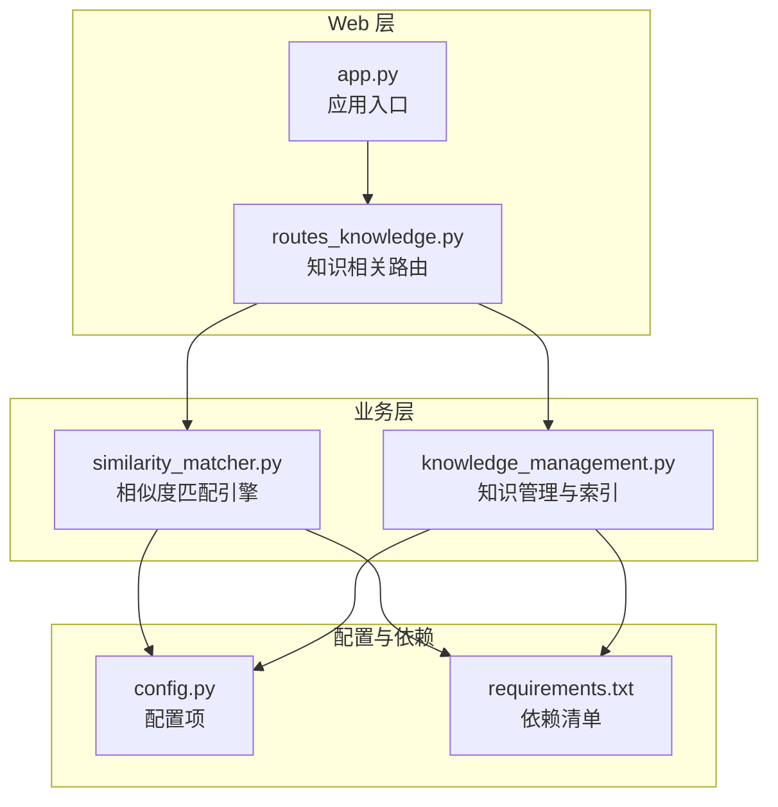
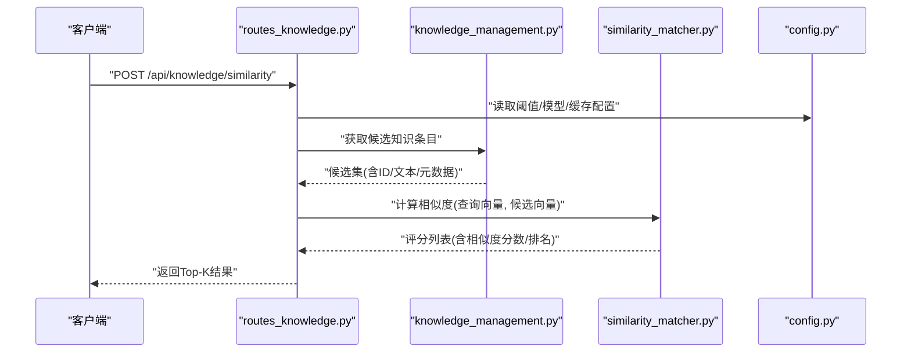
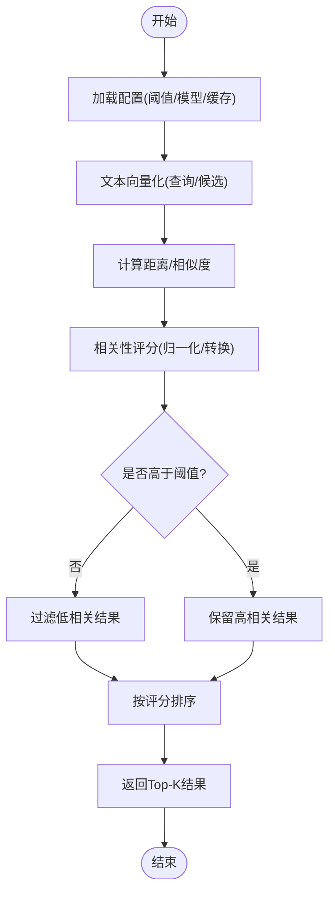
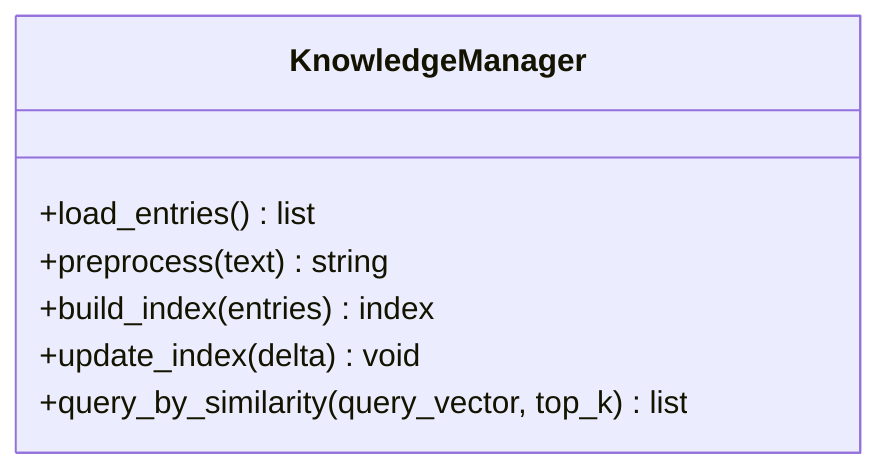
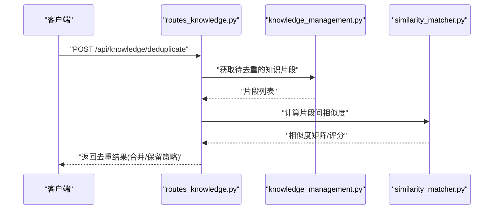
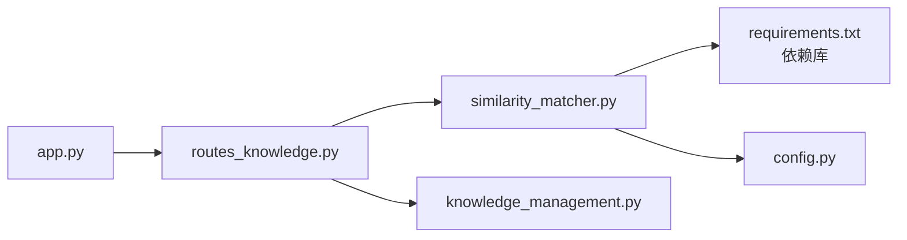

# 相似度匹配引擎

<cite>
**本文引用的文件**   
- [similarity_matcher.py](file://server/similarity_matcher.py)
- [routes_knowledge.py](file://server/routes_knowledge.py)
- [knowledge_management.py](file://server/knowledge_management.py)
- [config.py](file://server/config.py)
- [app.py](file://server/app.py)
- [requirements.txt](file://server/requirements.txt)
</cite>

## 目录
1. [简介](#简介)
2. [项目结构](#项目结构)
3. [核心组件](#核心组件)
4. [架构总览](#架构总览)
5. [详细组件分析](#详细组件分析)
6. [依赖关系分析](#依赖关系分析)
7. [性能与缓存优化](#性能与缓存优化)
8. [调优参数与评估方法](#调优参数与评估方法)
9. [故障排查指南](#故障排查指南)
10. [结论](#结论)

## 简介
本技术文档面向“相似度匹配引擎”，围绕文本相似度计算、知识点语义匹配、内容去重与智能推荐展开，覆盖向量表示、距离度量、相关性评分、阈值策略、性能优化与缓存机制，以及与知识库系统的集成和数据同步策略。文档同时提供可操作的配置建议、输入输出规范与结果解析方法，帮助读者快速理解并落地使用。

## 项目结构
本项目中与相似度匹配相关的代码主要位于 server 目录下：
- similarity_matcher.py：相似度匹配的核心实现（向量化、距离计算、评分、阈值过滤、候选集生成等）。
- routes_knowledge.py：知识相关的路由接口，暴露相似度查询、去重、推荐等能力。
- knowledge_management.py：知识管理逻辑，负责知识条目加载、索引构建、更新与同步。
- config.py：系统配置项，包含相似度阈值、模型选择、缓存开关等。
- app.py：应用入口，注册路由、初始化服务。
- requirements.txt：Python 依赖清单，包含向量与相似度计算所需库。

**图示来源**
- [routes_knowledge.py](file://server/routes_knowledge.py)
- [similarity_matcher.py](file://server/similarity_matcher.py)
- [knowledge_management.py](file://server/knowledge_management.py)
- [config.py](file://server/config.py)
- [app.py](file://server/app.py)
- [requirements.txt](file://server/requirements.txt)

**章节来源**
- [similarity_matcher.py](file://server/similarity_matcher.py)
- [routes_knowledge.py](file://server/routes_knowledge.py)
- [knowledge_management.py](file://server/knowledge_management.py)
- [config.py](file://server/config.py)
- [app.py](file://server/app.py)
- [requirements.txt](file://server/requirements.txt)

## 核心组件
- 相似度匹配器（similarity_matcher）
  - 负责将文本转换为向量表示，计算候选集合之间的相似度，并按相关性评分排序。
  - 支持多种距离度量（如余弦相似度、欧氏距离等），并提供阈值过滤与Top-K返回。
- 知识管理（knowledge_management）
  - 负责知识条目的加载、清洗、分块、索引构建与增量更新。
  - 为相似度匹配提供稳定的候选数据源。
- 路由层（routes_knowledge）
  - 暴露相似度查询、去重检测、智能推荐等API。
  - 接收请求参数，调用匹配器与知识管理，返回结构化结果。
- 配置（config）
  - 定义相似度阈值、模型名称、缓存开关、并发限制等关键参数。
- 应用入口（app）
  - 启动服务、注册路由、初始化依赖。

**章节来源**
- [similarity_matcher.py](file://server/similarity_matcher.py)
- [knowledge_management.py](file://server/knowledge_management.py)
- [routes_knowledge.py](file://server/routes_knowledge.py)
- [config.py](file://server/config.py)
- [app.py](file://server/app.py)

## 架构总览
相似度匹配引擎在系统中的位置如下：
- 客户端通过HTTP调用知识相关路由。
- 路由层解析参数，调用知识管理获取候选集，再调用相似度匹配器进行计算。
- 匹配器根据配置的模型与距离度量，输出相关性评分与排序结果。
- 配置模块统一管控阈值、模型、缓存等策略。

**图示来源**
- [routes_knowledge.py](file://server/routes_knowledge.py)
- [knowledge_management.py](file://server/knowledge_management.py)
- [similarity_matcher.py](file://server/similarity_matcher.py)
- [config.py](file://server/config.py)

## 详细组件分析

### 相似度匹配器（similarity_matcher）
职责与流程：
- 文本向量化：将输入文本与候选文本转换为固定维度的向量表示。
- 距离度量：基于余弦相似度或欧氏距离等算法计算向量间的相关性。
- 相关性评分：对原始距离进行归一化或转换，得到可比较的评分。
- 阈值过滤：依据配置中的阈值剔除低相关度结果。
- Top-K排序：按评分从高到低返回前K个最相关条目。

**图示来源**
- [similarity_matcher.py](file://server/similarity_matcher.py)
- [config.py](file://server/config.py)

**章节来源**
- [similarity_matcher.py](file://server/similarity_matcher.py)
- [config.py](file://server/config.py)

### 知识管理（knowledge_management）
职责与流程：
- 数据加载：从数据库或外部存储加载知识条目。
- 预处理：清洗、分词、分块，确保适合向量化。
- 索引构建：为候选知识建立向量索引，支持快速检索。
- 增量更新：支持新增、修改、删除后的索引刷新。

**图示来源**
- [knowledge_management.py](file://server/knowledge_management.py)

**章节来源**
- [knowledge_management.py](file://server/knowledge_management.py)

### 路由层（routes_knowledge）
职责与流程：
- 暴露相似度查询、去重检测、智能推荐等API。
- 参数校验与错误处理。
- 调用知识管理与相似度匹配器，组装响应。

**图示来源**
- [routes_knowledge.py](file://server/routes_knowledge.py)
- [knowledge_management.py](file://server/knowledge_management.py)
- [similarity_matcher.py](file://server/similarity_matcher.py)

**章节来源**
- [routes_knowledge.py](file://server/routes_knowledge.py)

## 依赖关系分析
相似度匹配引擎依赖以下外部库与模块：
- 向量与相似度计算库（例如 numpy、scipy、sentence-transformers 等，具体以 requirements.txt 为准）。
- 配置模块（config.py）用于统一参数管理。
- 知识管理模块（knowledge_management.py）提供候选数据与索引。
- 路由模块（routes_knowledge.py）对外暴露API。

**图示来源**
- [similarity_matcher.py](file://server/similarity_matcher.py)
- [requirements.txt](file://server/requirements.txt)
- [config.py](file://server/config.py)
- [routes_knowledge.py](file://server/routes_knowledge.py)
- [knowledge_management.py](file://server/knowledge_management.py)
- [app.py](file://server/app.py)

**章节来源**
- [requirements.txt](file://server/requirements.txt)
- [config.py](file://server/config.py)
- [routes_knowledge.py](file://server/routes_knowledge.py)
- [knowledge_management.py](file://server/knowledge_management.py)
- [similarity_matcher.py](file://server/similarity_matcher.py)
- [app.py](file://server/app.py)

## 性能与缓存优化
- 向量化批处理：批量将文本转为向量，减少重复计算开销。
- 距离计算优化：优先使用余弦相似度，避免昂贵的归一化步骤；必要时使用近似最近邻（ANN）加速。
- 阈值预过滤：在候选集层面先做粗筛，缩小匹配范围。
- 缓存机制：
  - 文本到向量的缓存：相同文本复用已计算的向量。
  - 相似度结果的缓存：对常见查询与候选组合缓存评分结果。
  - 索引缓存：知识索引持久化，重启后直接加载。
- 并发控制：限制并行相似度计算任务数量，避免资源争用。

[本节为通用指导，不直接分析具体文件]

## 调优参数与评估方法
- 阈值设置：
  - 相似度阈值：控制结果的相关性下限，过高会漏掉潜在相关项，过低会增加噪声。
  - Top-K：控制返回结果数量，需结合业务场景平衡召回率与准确率。
- 模型选择：
  - 不同嵌入模型对领域文本的表达能力不同，应针对知识库内容进行微调或选择更合适的预训练模型。
- 评估指标：
  - 精确率（Precision）、召回率（Recall）、F1值。
  - 平均倒数排名（MRR）、Top-K命中率。
- 实验方法：
  - 构建标注数据集，对比不同阈值与模型的评估结果。
  - A/B测试线上效果，观察用户反馈与行为指标变化。

[本节为通用指导，不直接分析具体文件]

## 故障排查指南
常见问题与定位思路：
- 向量化失败：检查依赖库安装与模型下载路径，确认输入文本非空且编码正确。
- 相似度结果为空：检查阈值是否过高，或候选集为空；查看日志中过滤条件。
- 性能瓶颈：监控CPU/GPU占用，检查是否未启用批处理或缓存；考虑引入ANN库。
- 知识索引不一致：检查增量更新流程是否正确触发，确认索引重建任务完成。

[本节为通用指导，不直接分析具体文件]

## 结论
相似度匹配引擎通过统一的向量化与距离度量，结合阈值过滤与Top-K排序，为知识点语义匹配、内容去重与智能推荐提供了稳定可靠的基础能力。配合知识管理的索引构建与增量更新，以及配置化的阈值与模型选择，可在不同业务场景中灵活部署与调优。建议在上线前进行充分的离线评估与A/B测试，持续优化阈值与模型，以获得更好的用户体验与业务收益。