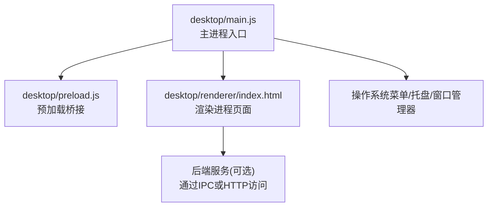
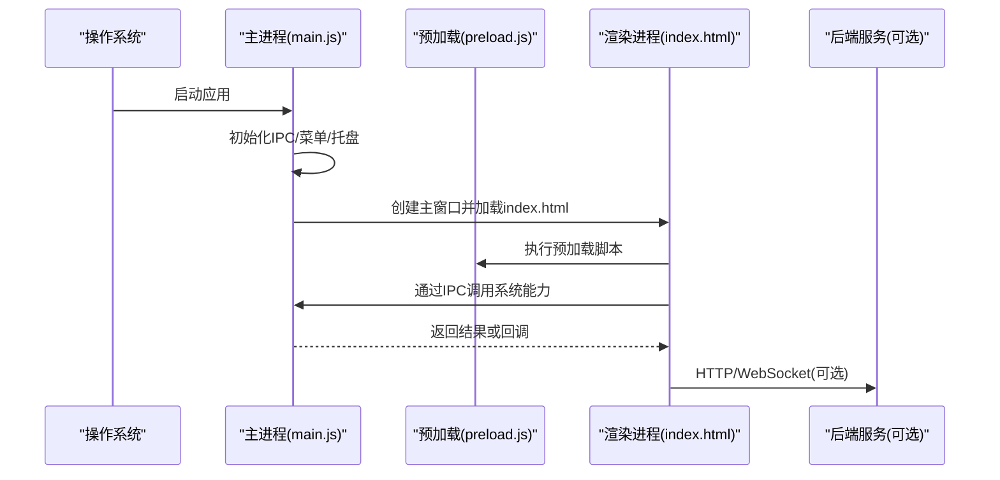
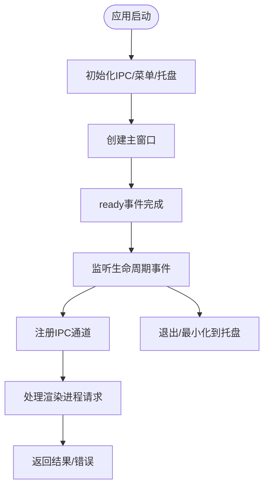
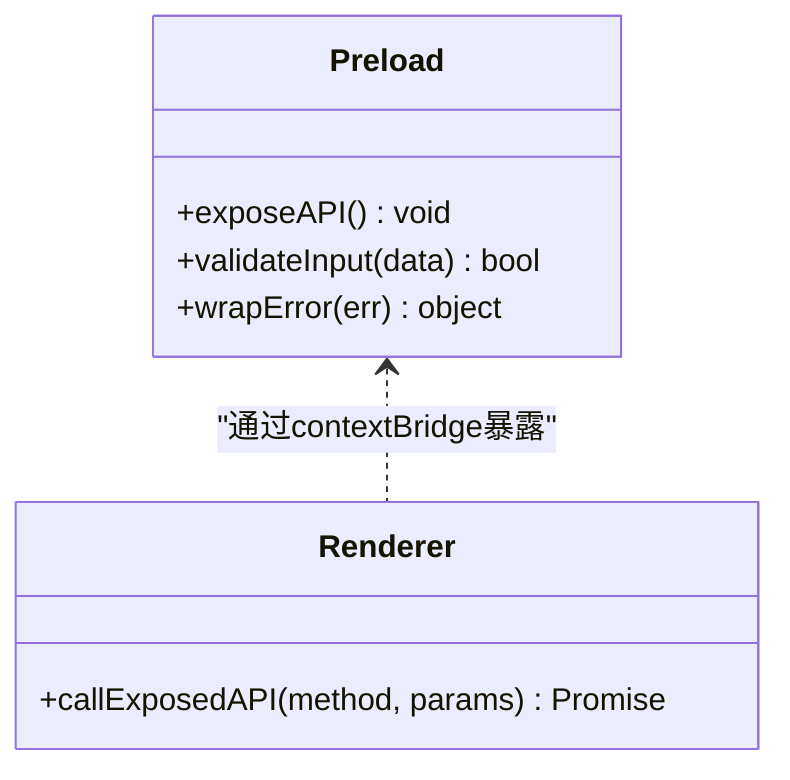
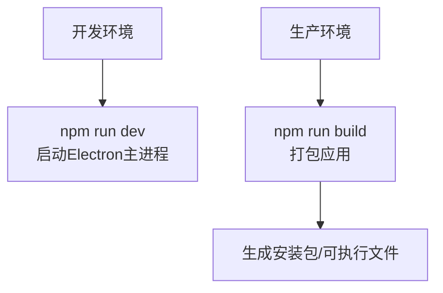
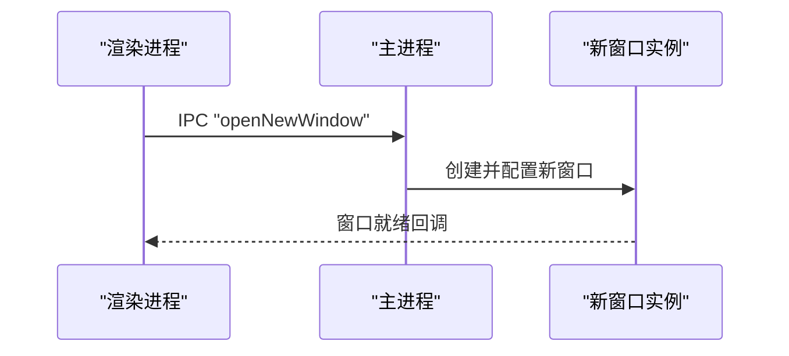
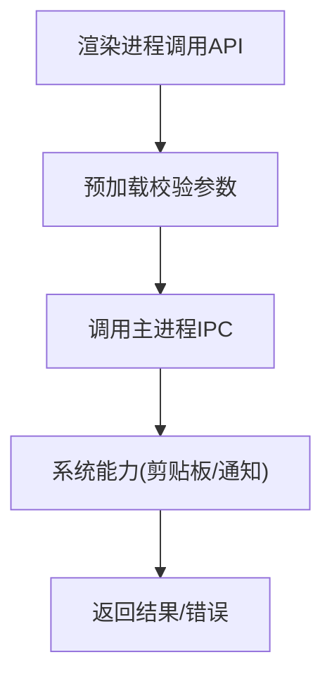

# Electron应用结构

<cite>
**本文引用的文件**   
- [desktop/main.js](file://desktop/main.js)
- [desktop/preload.js](file://desktop/preload.js)
- [desktop/package.json](file://desktop/package.json)
- [desktop/renderer/index.html](file://desktop/renderer/index.html)
- [start_app.ps1](file://start_app.ps1)
</cite>

## 目录
1. [简介](#简介)
2. [项目结构](#项目结构)
3. [核心组件](#核心组件)
4. [架构总览](#架构总览)
5. [详细组件分析](#详细组件分析)
6. [依赖与构建分析](#依赖与构建分析)
7. [性能考虑](#性能考虑)
8. [故障排查指南](#故障排查指南)
9. [结论](#结论)
10. [附录：扩展主进程功能示例](#附录扩展主进程功能示例)

## 简介
本文件为LectureLearnLoop的Electron桌面端提供结构化文档，聚焦主进程main.js的职责、生命周期管理、窗口创建、菜单与系统托盘能力；同时梳理package.json中的Electron配置、构建脚本与依赖管理。文档还覆盖应用的启动流程、进程间通信初始化、错误处理与日志记录机制，并给出扩展主进程功能的实践建议（如新增窗口类型或系统集成能力），以及开发/生产环境差异说明。

## 项目结构
Electron桌面端位于desktop目录，采用“主进程 + 预加载 + 渲染进程”的经典三层结构：
- desktop/main.js：Electron主进程入口，负责应用生命周期、窗口管理、菜单与托盘等系统级能力。
- desktop/preload.js：预加载脚本，用于在渲染进程安全暴露必要的桥接API。
- desktop/renderer/index.html：渲染进程页面入口。
- desktop/package.json：Electron应用元数据、依赖与脚本。
- start_app.ps1：本地快速启动脚本（Windows PowerShell）。

图表来源
- [desktop/main.js:1-200](file://desktop/main.js#L1-L200)
- [desktop/preload.js:1-200](file://desktop/preload.js#L1-L200)
- [desktop/renderer/index.html:1-200](file://desktop/renderer/index.html#L1-L200)

章节来源
- [desktop/main.js:1-200](file://desktop/main.js#L1-L200)
- [desktop/preload.js:1-200](file://desktop/preload.js#L1-L200)
- [desktop/renderer/index.html:1-200](file://desktop/renderer/index.html#L1-L200)
- [desktop/package.json:1-200](file://desktop/package.json#L1-L200)
- [start_app.ps1:1-200](file://start_app.ps1#L1-L200)

## 核心组件
- 主进程(main.js)
  - 应用生命周期：ready、window-all-closed、before-quit、activate等事件处理。
  - 窗口管理：创建主窗口、设置最小尺寸、居中显示、监听关闭行为。
  - 菜单与托盘：构建应用菜单、注册系统托盘图标与上下文菜单。
  - IPC通道：定义并监听渲染进程请求，转发到Node API或系统能力。
  - 错误处理与日志：捕获未处理异常、Promise拒绝、渲染进程崩溃上报。
- 预加载(preload.js)
  - 安全暴露API：将受控方法挂载到window对象，供渲染进程调用。
  - 权限控制：仅暴露必要接口，避免直接访问Node模块。
- 渲染进程(index.html)
  - 页面骨架与资源加载，通过预加载暴露的API与主进程交互。

章节来源
- [desktop/main.js:1-200](file://desktop/main.js#L1-L200)
- [desktop/preload.js:1-200](file://desktop/preload.js#L1-L200)
- [desktop/renderer/index.html:1-200](file://desktop/renderer/index.html#L1-L200)

## 架构总览
下图展示Electron应用在LectureLearnLoop中的整体交互关系：主进程负责系统能力与窗口管理，预加载脚本作为安全桥接，渲染进程承载UI并与后端服务交互。

图表来源
- [desktop/main.js:1-200](file://desktop/main.js#L1-L200)
- [desktop/preload.js:1-200](file://desktop/preload.js#L1-L200)
- [desktop/renderer/index.html:1-200](file://desktop/renderer/index.html#L1-L200)

## 详细组件分析

### 主进程 main.js
职责与关键点：
- 生命周期管理
  - 监听Electron的ready事件完成初始化，包括IPC通道注册、菜单与托盘构建。
  - 处理window-all-closed以适配不同平台退出策略（macOS通常保留应用运行）。
  - before-quit与activate事件用于清理资源与恢复窗口。
- 窗口管理
  - 使用BrowserWindow创建主窗口，设置最小尺寸、居中、无边框或透明等特性（视需求）。
  - 监听close事件，决定是否最小化到托盘或退出应用。
- 菜单与托盘
  - 使用Menu构建应用菜单，包含常用操作（新建、设置、关于、退出等）。
  - 使用Tray添加系统托盘图标，右键菜单支持显示/隐藏窗口、退出等。
- IPC通信
  - 使用ipcMain.handle/on注册通道，接收渲染进程请求，调用Node API或系统能力后返回结果。
  - 对关键通道进行参数校验与错误封装，确保渲染进程可感知失败原因。
- 错误处理与日志
  - 全局捕获未处理的Promise拒绝与异常，写入日志文件或控制台。
  - 监听渲染进程崩溃事件，收集崩溃信息并上报。

图表来源
- [desktop/main.js:1-200](file://desktop/main.js#L1-L200)

章节来源
- [desktop/main.js:1-200](file://desktop/main.js#L1-L200)

### 预加载 preload.js
职责与关键点：
- 安全桥接
  - 通过contextBridge暴露受限API给渲染进程，避免直接访问Node模块。
  - 对每个暴露的方法进行输入校验与错误包装，保证稳定性。
- 典型能力
  - 文件系统访问（读取/写入用户数据）、路径解析、剪贴板操作、通知、窗口控制等。
- 调试与日志
  - 在开发模式下输出调试信息，生产模式减少冗余日志。

图表来源
- [desktop/preload.js:1-200](file://desktop/preload.js#L1-L200)

章节来源
- [desktop/preload.js:1-200](file://desktop/preload.js#L1-L200)

### 渲染进程 index.html
职责与关键点：
- 页面结构与资源加载，引入必要的JS/CSS。
- 通过预加载暴露的API与主进程交互，触发系统能力或业务逻辑。
- 错误边界与重试机制，提升用户体验。

章节来源
- [desktop/renderer/index.html:1-200](file://desktop/renderer/index.html#L1-L200)

## 依赖与构建分析
- package.json
  - dependencies：运行时依赖（如electron、node-xxx等）。
  - devDependencies：开发与打包工具（如electron-builder、electron-packager等）。
  - scripts：构建与发布命令（build、pack、dev等）。
  - electron配置项：入口文件、目标平台、签名、图标等。
- 构建脚本
  - 开发模式：直接启动Electron主进程，启用热重载与调试。
  - 生产模式：打包为可执行文件，优化体积与安全性。
- 环境变量
  - 区分开发/生产环境的配置开关（如调试日志、后端地址、功能开关）。

图表来源
- [desktop/package.json:1-200](file://desktop/package.json#L1-L200)
- [start_app.ps1:1-200](file://start_app.ps1#L1-L200)

章节来源
- [desktop/package.json:1-200](file://desktop/package.json#L1-L200)
- [start_app.ps1:1-200](file://start_app.ps1#L1-L200)

## 性能考虑
- 窗口创建与销毁
  - 复用窗口实例，避免频繁创建销毁带来的内存抖动。
  - 合理设置最小尺寸与透明度，降低GPU压力。
- IPC通信
  - 批量发送消息，减少通道调用次数。
  - 对大对象使用序列化优化或分片传输。
- 预加载脚本
  - 仅暴露必要API，避免不必要的计算与I/O。
- 日志与监控
  - 生产环境限制日志级别，避免磁盘IO瓶颈。
  - 异步写入日志，避免阻塞主线程。

[本节为通用指导，不直接分析具体文件]

## 故障排查指南
常见问题与定位思路：
- 应用无法启动
  - 检查Electron版本与Node版本兼容性。
  - 查看主进程是否抛出未捕获异常或Promise拒绝。
- 窗口不显示或黑屏
  - 确认index.html路径正确且资源加载成功。
  - 检查preload脚本是否正确注入。
- IPC调用失败
  - 核对通道名称与方法签名是否一致。
  - 检查预加载暴露的API是否被渲染进程正确调用。
- 托盘/菜单不生效
  - 确认平台支持情况（如Linux需安装相关依赖）。
  - 检查图标路径与权限。

章节来源
- [desktop/main.js:1-200](file://desktop/main.js#L1-L200)
- [desktop/preload.js:1-200](file://desktop/preload.js#L1-L200)

## 结论
LectureLearnLoop的Electron桌面端采用清晰的主进程-预加载-渲染进程分层，主进程集中管理窗口、菜单与托盘，预加载脚本提供安全桥接，渲染进程专注UI与业务交互。通过合理的IPC设计与错误处理机制，应用具备良好的可扩展性与稳定性。建议在扩展新功能时遵循现有模式，保持职责单一与安全边界清晰。

[本节为总结性内容，不直接分析具体文件]

## 附录：扩展主进程功能示例
以下示例展示如何在现有基础上扩展主进程能力，例如新增窗口类型或系统集成能力。请根据实际代码位置替换行号引用。

- 新增窗口类型
  - 在主进程中定义新的窗口创建函数，复用窗口基础配置（尺寸、居中、最小化到托盘等）。
  - 在菜单或托盘中添加打开新窗口的动作，调用该函数。
  - 在渲染进程中通过IPC触发打开新窗口的事件。

图表来源
- [desktop/main.js:1-200](file://desktop/main.js#L1-L200)

- 新增系统集成能力（如剪贴板、通知）
  - 在预加载脚本中暴露对应API，并在主进程中实现具体逻辑。
  - 在渲染进程中调用该API，处理成功与失败分支。

图表来源
- [desktop/preload.js:1-200](file://desktop/preload.js#L1-L200)
- [desktop/main.js:1-200](file://desktop/main.js#L1-L200)

章节来源
- [desktop/main.js:1-200](file://desktop/main.js#L1-L200)
- [desktop/preload.js:1-200](file://desktop/preload.js#L1-L200)