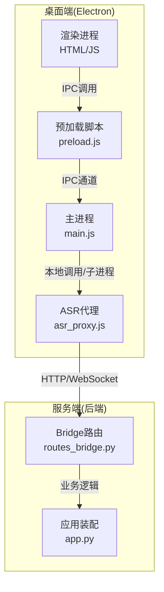
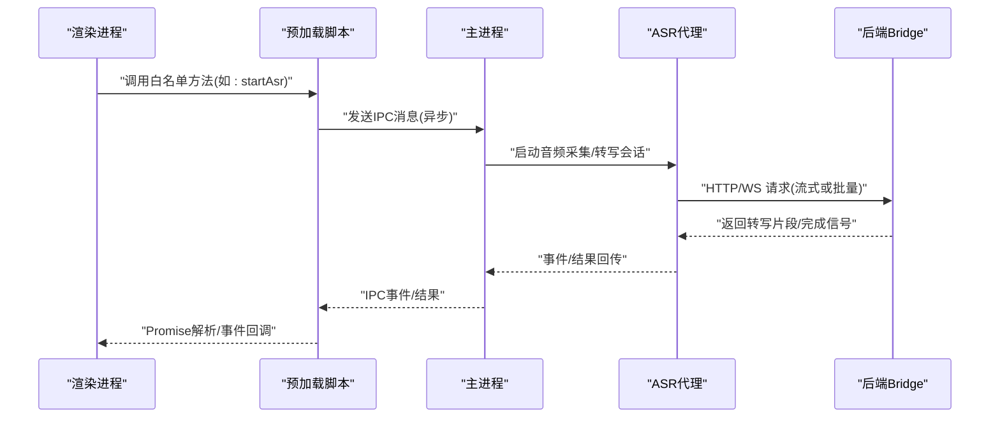
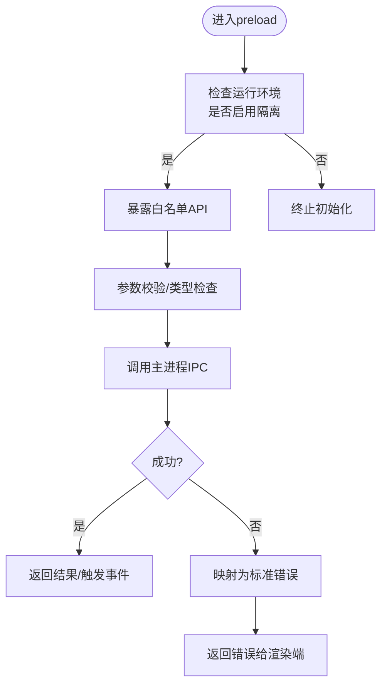
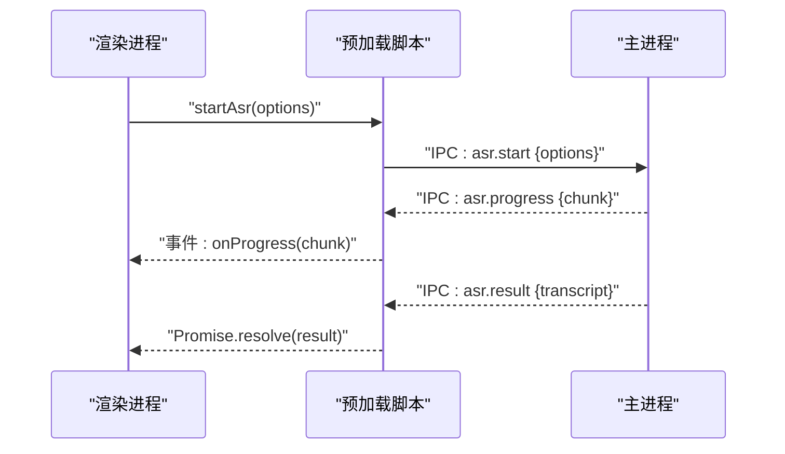
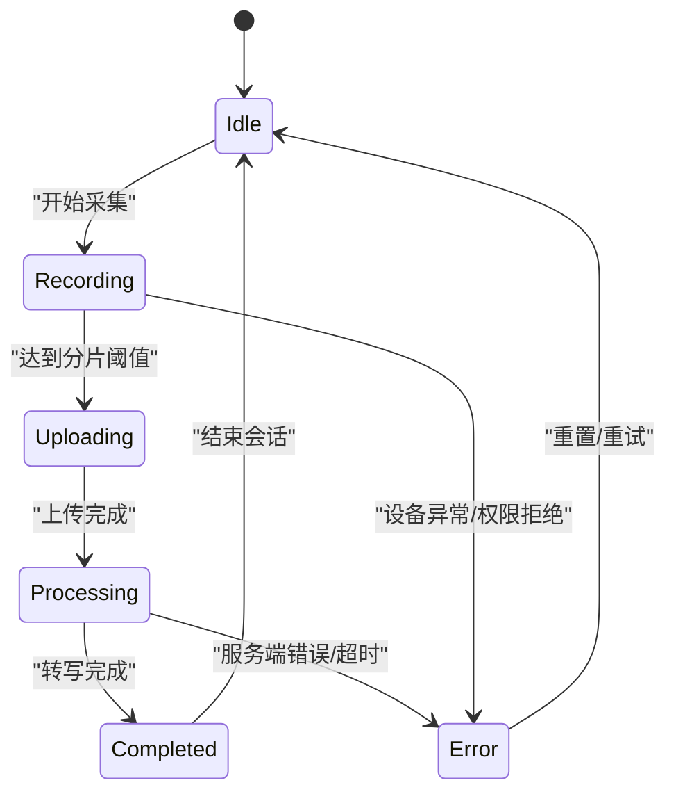
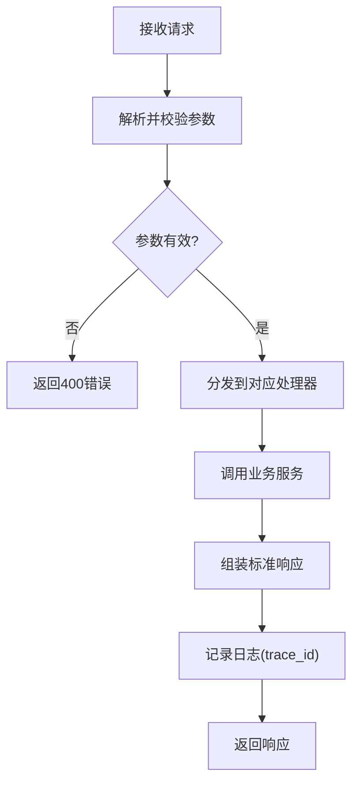

# IPC通信机制

<cite>
**本文引用的文件**   
- [preload.js](file://desktop/preload.js)
- [main.js](file://desktop/main.js)
- [asr_proxy.js](file://desktop/asr_proxy.js)
- [routes_bridge.py](file://server/routes_bridge.py)
- [app.py](file://server/app.py)
</cite>

## 目录
1. [简介](#简介)
2. [项目结构](#项目结构)
3. [核心组件](#核心组件)
4. [架构总览](#架构总览)
5. [详细组件分析](#详细组件分析)
6. [依赖关系分析](#依赖关系分析)
7. [性能考量](#性能考量)
8. [故障排查指南](#故障排查指南)
9. [结论](#结论)
10. [附录：IPC调用示例与最佳实践](#附录ipc调用示例与最佳实践)

## 简介
本文件面向LectureLearnLoop的IPC通信机制，聚焦以下目标：
- 解释预加载脚本preload.js的安全隔离机制（Node.js API白名单暴露、上下文隔离）。
- 说明渲染进程与主进程之间的消息传递协议（同步与异步模式）。
- 文档化语音识别代理asr_proxy.js的实现要点（音频流处理、设备管理、错误恢复）。
- 解释与后端Bridge路由的集成方式（数据格式转换、错误处理策略）。
- 提供可操作的IPC调用示例与最佳实践。

## 项目结构
本项目采用Electron多进程架构，关键路径如下：
- desktop/preload.js：安全桥接层，向渲染进程暴露最小API集合。
- desktop/main.js：Electron主进程入口，承载系统能力与资源管理。
- desktop/asr_proxy.js：语音识别代理，封装音频采集、转写与状态机。
- server/routes_bridge.py：后端Bridge路由，统一对外接口并转发到业务服务。
- server/app.py：后端应用装配与中间件配置。

**图表来源**
- [preload.js:1-200](file://desktop/preload.js#L1-L200)
- [main.js:1-200](file://desktop/main.js#L1-L200)
- [asr_proxy.js:1-200](file://desktop/asr_proxy.js#L1-L200)
- [routes_bridge.py:1-200](file://server/routes_bridge.py#L1-L200)
- [app.py:1-200](file://server/app.py#L1-L200)

**章节来源**
- [preload.js:1-200](file://desktop/preload.js#L1-L200)
- [main.js:1-200](file://desktop/main.js#L1-L200)
- [asr_proxy.js:1-200](file://desktop/asr_proxy.js#L1-L200)
- [routes_bridge.py:1-200](file://server/routes_bridge.py#L1-L200)
- [app.py:1-200](file://server/app.py#L1-L200)

## 核心组件
- 预加载脚本(preload.js)
  - 职责：在渲染进程与主进程之间建立最小权限的IPC桥；通过contextIsolation与nodeIntegration:false实现安全隔离；仅暴露白名单API。
  - 关键点：使用safeChannel命名空间避免污染全局；对敏感能力进行参数校验与类型检查；将异步回调包装为Promise以简化调用。
- 主进程(main.js)
  - 职责：注册IPC处理器；管理窗口生命周期；协调ASR代理；维护跨进程状态。
  - 关键点：集中式IPC路由表；错误向上抛出并转换为统一响应；对长连接/流式数据进行背压控制。
- ASR代理(asr_proxy.js)
  - 职责：音频采集、编码、流式传输、转写结果聚合、设备枚举与切换、断线重连与重试。
  - 关键点：基于事件的状态机；缓冲与节流；可插拔的后端适配器；统一的错误码与恢复策略。
- 后端Bridge(routes_bridge.py)
  - 职责：统一REST/WS接口；鉴权与限流；请求校验；与业务服务交互；返回标准化JSON。
  - 关键点：输入输出Schema校验；错误映射到标准错误体；日志与追踪ID贯穿。

**章节来源**
- [preload.js:1-200](file://desktop/preload.js#L1-L200)
- [main.js:1-200](file://desktop/main.js#L1-L200)
- [asr_proxy.js:1-200](file://desktop/asr_proxy.js#L1-L200)
- [routes_bridge.py:1-200](file://server/routes_bridge.py#L1-L200)

## 架构总览
下图展示从渲染进程发起IPC到后端Bridge的完整链路，包括同步与异步两种调用模式。

**图表来源**
- [preload.js:1-200](file://desktop/preload.js#L1-L200)
- [main.js:1-200](file://desktop/main.js#L1-L200)
- [asr_proxy.js:1-200](file://desktop/asr_proxy.js#L1-L200)
- [routes_bridge.py:1-200](file://server/routes_bridge.py#L1-L200)

## 详细组件分析

### 预加载脚本 preload.js 的安全隔离机制
- 安全模型
  - 渲染进程禁用Node集成，启用上下文隔离，防止直接访问文件系统、网络等敏感能力。
  - 仅通过preload暴露受控API，所有能力在主进程中执行，确保权限边界清晰。
- 白名单暴露
  - 定义safeChannel命名空间，按功能域分组方法（如audio、system、bridge）。
  - 每个方法包含参数校验、类型检查与默认值填充，拒绝非法输入。
- 同步与异步调用
  - 异步：基于Promise封装IPC通道，支持取消与超时。
  - 同步：仅在必要时使用阻塞式调用，并提供超时保护。
- 错误处理
  - 统一错误对象，包含code、message、details字段；渲染端根据code分类提示。

**图表来源**
- [preload.js:1-200](file://desktop/preload.js#L1-L200)

**章节来源**
- [preload.js:1-200](file://desktop/preload.js#L1-L200)

### 渲染进程与主进程的IPC协议
- 通道设计
  - 使用命名通道区分功能域，避免冲突；例如：asr.start、asr.stop、asr.data、asr.error。
  - 消息体包含id、type、payload、timestamp，便于追踪与幂等处理。
- 同步调用
  - 适用于轻量、无副作用操作（如获取设备列表、读取配置）。
  - 主进程需保证快速返回，避免阻塞渲染线程。
- 异步调用
  - 适用于耗时任务（如音频转写、文件IO、网络请求）。
  - 主进程通过事件推送进度与结果，渲染端监听并更新UI。
- 错误与取消
  - 统一错误码；支持客户端主动取消（如停止录音）。
  - 超时与重试策略由主进程统一管理。

**图表来源**
- [preload.js:1-200](file://desktop/preload.js#L1-L200)
- [main.js:1-200](file://desktop/main.js#L1-L200)

**章节来源**
- [preload.js:1-200](file://desktop/preload.js#L1-L200)
- [main.js:1-200](file://desktop/main.js#L1-L200)

### 语音识别代理 asr_proxy.js 实现要点
- 音频流处理
  - 采集：选择默认或指定设备，设置采样率、声道数、位深。
  - 编码：按需压缩（如PCM→Opus），降低带宽占用。
  - 分片：按时间或大小切分，支持流式上传与增量结果。
- 设备管理
  - 枚举可用设备，支持热插拔检测。
  - 动态切换设备时自动重建采集器，保持会话连续性。
- 错误恢复
  - 网络异常：指数退避重试，带最大重试次数。
  - 设备丢失：降级到默认设备或提示用户重新选择。
  - 转写中断：保留未提交片段，断点续传。
- 状态机
  - 状态包括：idle、recording、uploading、processing、completed、error。
  - 状态变更触发事件，供上层订阅与UI反馈。

**图表来源**
- [asr_proxy.js:1-200](file://desktop/asr_proxy.js#L1-L200)

**章节来源**
- [asr_proxy.js:1-200](file://desktop/asr_proxy.js#L1-L200)

### 与后端Bridge路由的集成
- 路由设计
  - /api/bridge/asr：统一入口，内部按action分发（start、stop、stream、status）。
  - 支持REST与WebSocket双通道：REST用于控制命令，WS用于流式结果。
- 数据格式
  - 请求体：{ action, session_id, payload }，payload根据action变化。
  - 响应体：{ code, message, data, trace_id }，统一错误码。
- 错误处理
  - 参数校验失败：返回400与具体字段错误。
  - 业务异常：返回500与可诊断信息；trace_id用于日志追踪。
  - 上游服务不可用：返回503并建议重试。

**图表来源**
- [routes_bridge.py:1-200](file://server/routes_bridge.py#L1-L200)

**章节来源**
- [routes_bridge.py:1-200](file://server/routes_bridge.py#L1-L200)
- [app.py:1-200](file://server/app.py#L1-L200)

## 依赖关系分析
- 模块耦合
  - preload.js仅依赖主进程IPC，不直接访问系统API，降低耦合度。
  - main.js作为调度中心，解耦UI与底层能力（ASR、文件、网络）。
  - asr_proxy.js与后端Bridge松耦合，通过标准HTTP/WS协议交互。
- 外部依赖
  - Electron IPC、Node音频API、后端HTTP/WS客户端。
- 潜在循环依赖
  - 通过事件总线与消息ID解耦，避免模块间直接引用导致的循环。

**图表来源**
- [preload.js:1-200](file://desktop/preload.js#L1-L200)
- [main.js:1-200](file://desktop/main.js#L1-L200)
- [asr_proxy.js:1-200](file://desktop/asr_proxy.js#L1-L200)
- [routes_bridge.py:1-200](file://server/routes_bridge.py#L1-L200)
- [app.py:1-200](file://server/app.py#L1-L200)

**章节来源**
- [preload.js:1-200](file://desktop/preload.js#L1-L200)
- [main.js:1-200](file://desktop/main.js#L1-L200)
- [asr_proxy.js:1-200](file://desktop/asr_proxy.js#L1-L200)
- [routes_bridge.py:1-200](file://server/routes_bridge.py#L1-L200)
- [app.py:1-200](file://server/app.py#L1-L200)

## 性能考量
- IPC开销
  - 避免频繁小消息，合并为批量或流式传输。
  - 使用二进制传输（如ArrayBuffer）减少序列化成本。
- 背压与缓冲
  - 当后端处理慢时，主进程应暂停采集或丢弃旧片段，防止内存膨胀。
- 并发控制
  - 限制同时进行的ASR会话数量，避免资源争用。
- 缓存与复用
  - 设备枚举结果短期缓存；WebSocket连接复用。

[本节为通用指导，不涉及具体文件分析]

## 故障排查指南
- 常见问题
  - 渲染端无法调用IPC：检查preload是否正确注入、channel名称是否匹配。
  - 音频设备不可用：确认权限授予、设备枚举结果、驱动状态。
  - 转写结果不完整：检查网络稳定性、分片大小、重试策略。
  - 后端返回错误：查看trace_id定位日志，核对参数校验规则。
- 诊断步骤
  - 在渲染端打印IPC事件与错误码。
  - 在主进程记录IPC出入参与耗时。
  - 在后端开启调试日志，关注trace_id关联的请求链。

**章节来源**
- [preload.js:1-200](file://desktop/preload.js#L1-L200)
- [main.js:1-200](file://desktop/main.js#L1-L200)
- [asr_proxy.js:1-200](file://desktop/asr_proxy.js#L1-L200)
- [routes_bridge.py:1-200](file://server/routes_bridge.py#L1-L200)

## 结论
本IPC机制通过预加载脚本的安全隔离、主进程的集中调度、ASR代理的稳健实现以及后端Bridge的统一接入，构建了稳定、可扩展的桌面端与服务端通信体系。遵循本文的最佳实践，可有效提升安全性、可维护性与用户体验。

[本节为总结性内容，不涉及具体文件分析]

## 附录：IPC调用示例与最佳实践
- 示例：启动语音识别
  - 渲染端调用：window.safeChannel.asr.start({ deviceId: "default", sampleRate: 16000 })
  - 预期行为：主进程创建会话，ASR代理开始采集，后端返回首个片段。
- 示例：停止语音识别
  - 渲染端调用：window.safeChannel.asr.stop()
  - 预期行为：清理资源，释放设备，返回最终结果。
- 最佳实践
  - 始终使用白名单API，避免绕过preload。
  - 对长任务使用事件监听，而非轮询。
  - 统一错误码与提示文案，提升可观测性。
  - 对敏感参数进行严格校验与脱敏。
  - 为关键路径添加trace_id，便于全链路追踪。

[本节为概念性示例，不涉及具体代码片段]