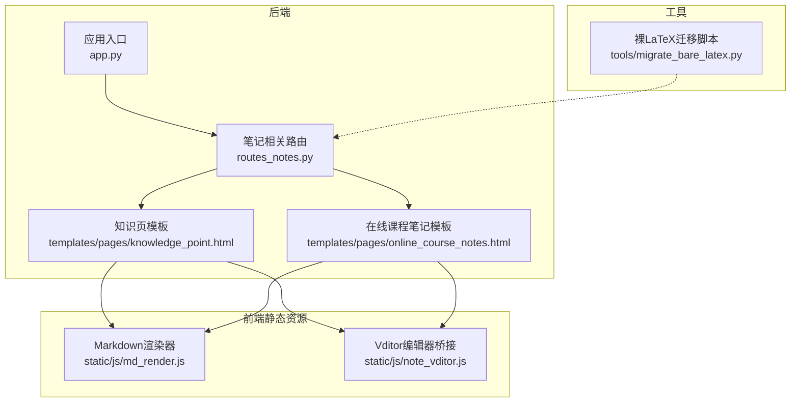
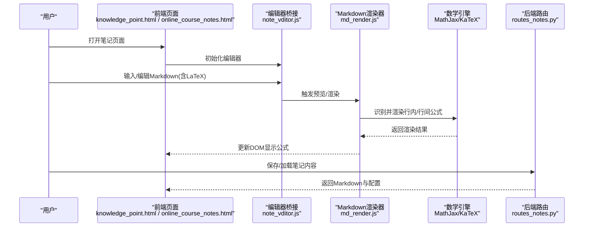
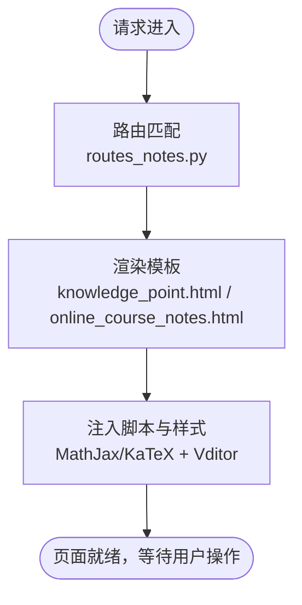
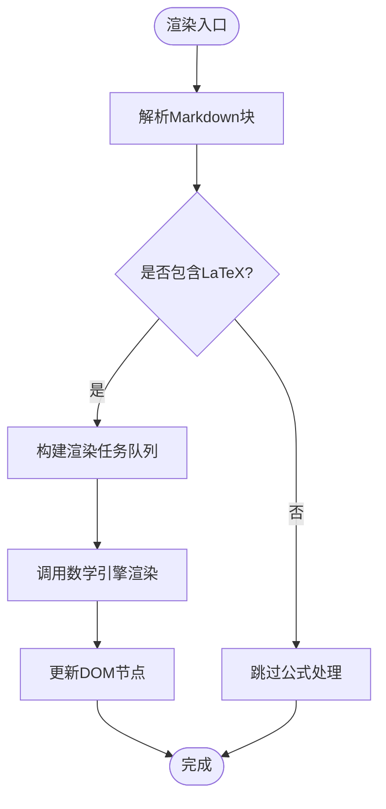
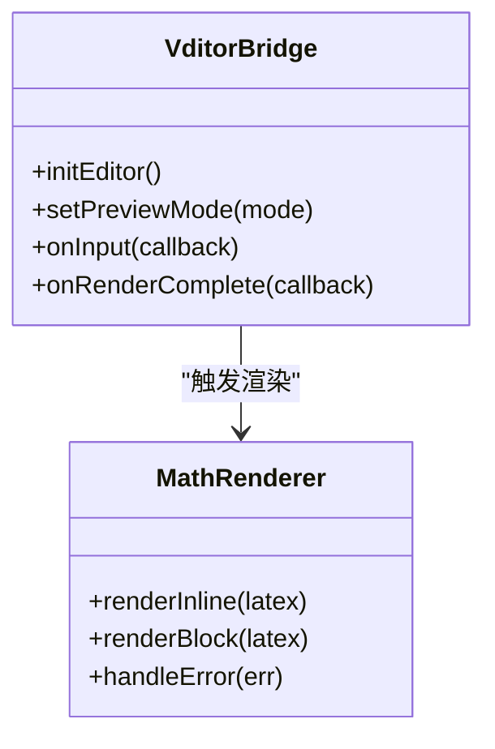
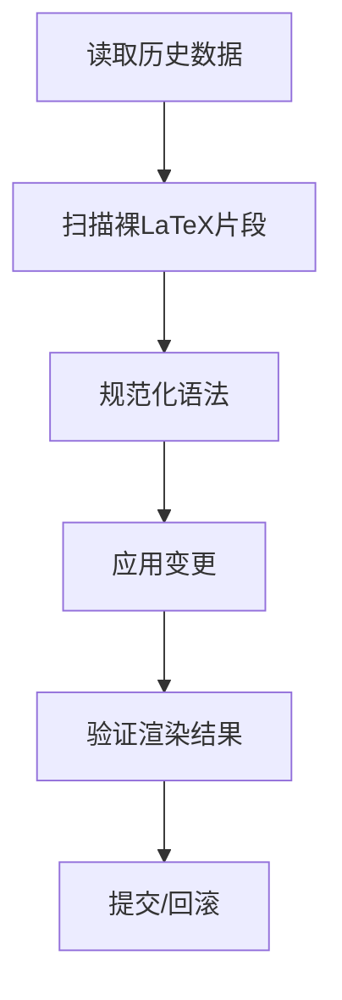
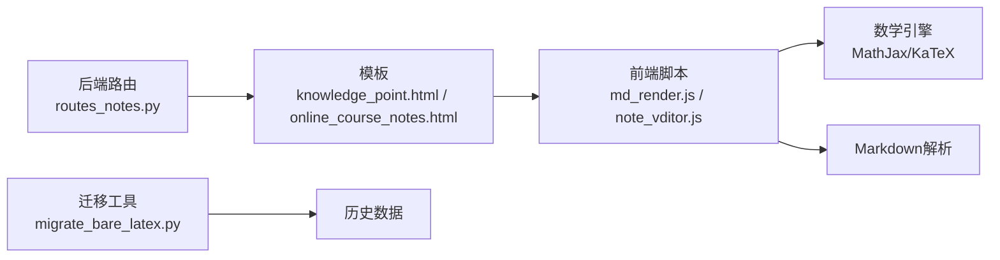

# LaTeX公式渲染系统

<cite>
**本文引用的文件**   
- [app.py](file://server/app.py)
- [routes_notes.py](file://server/routes_notes.py)
- [md_render.js](file://server/static/js/md_render.js)
- [note_vditor.js](file://server/static/js/note_vditor.js)
- [migrate_bare_latex.py](file://server/tools/migrate_bare_latex.py)
- [test_p4_note_preview.py](file://server/tests/test_p4_note_preview.py)
- [knowledge_point.html](file://server/templates/pages/knowledge_point.html)
- [online_course_notes.html](file://server/templates/pages/online_course_notes.html)
</cite>

## 目录
1. [引言](#引言)
2. [项目结构](#项目结构)
3. [核心组件](#核心组件)
4. [架构总览](#架构总览)
5. [详细组件分析](#详细组件分析)
6. [依赖关系分析](#依赖关系分析)
7. [性能与稳定性](#性能与稳定性)
8. [故障排查指南](#故障排查指南)
9. [结论](#结论)
10. [附录](#附录)

## 引言
本文件聚焦于“LaTeX公式渲染系统”的设计与实现，覆盖从后端路由、模板注入到前端Markdown编辑器与渲染器的完整链路。目标是帮助读者理解：
- 笔记编辑与预览中LaTeX公式的输入、存储、传输与渲染流程
- 前后端在MathJax/KaTeX等引擎上的集成方式
- 常见异常与兼容性问题的定位方法
- 可观测性与优化建议

## 项目结构
围绕LaTeX公式渲染的关键路径主要涉及以下模块：
- 后端服务与路由：负责页面渲染、静态资源分发、以及可能的数据预处理
- 前端模板：注入必要的脚本与样式，提供编辑器与预览容器
- 前端JS：负责Markdown解析、公式识别、调用渲染引擎并更新DOM
- 工具脚本：用于历史数据的迁移或修复（例如裸LaTeX文本）

**图表来源**
- [app.py:1-200](file://server/app.py#L1-L200)
- [routes_notes.py:1-200](file://server/routes_notes.py#L1-L200)
- [knowledge_point.html:1-200](file://server/templates/pages/knowledge_point.html#L1-L200)
- [online_course_notes.html:1-200](file://server/templates/pages/online_course_notes.html#L1-L200)
- [md_render.js:1-200](file://server/static/js/md_render.js#L1-L200)
- [note_vditor.js:1-200](file://server/static/js/note_vditor.js#L1-L200)
- [migrate_bare_latex.py:1-200](file://server/tools/migrate_bare_latex.py#L1-L200)

**章节来源**
- [app.py:1-200](file://server/app.py#L1-L200)
- [routes_notes.py:1-200](file://server/routes_notes.py#L1-L200)
- [knowledge_point.html:1-200](file://server/templates/pages/knowledge_point.html#L1-L200)
- [online_course_notes.html:1-200](file://server/templates/pages/online_course_notes.html#L1-L200)
- [md_render.js:1-200](file://server/static/js/md_render.js#L1-L200)
- [note_vditor.js:1-200](file://server/static/js/note_vditor.js#L1-L200)
- [migrate_bare_latex.py:1-200](file://server/tools/migrate_bare_latex.py#L1-L200)

## 核心组件
- 后端路由层：承载笔记相关页面的渲染逻辑，负责将Markdown内容与必要的渲染配置传递给前端模板
- 模板层：注入MathJax/KaTeX初始化脚本、编辑器初始化脚本，并提供内容容器
- 前端渲染器：解析Markdown中的行内与行间公式，调用渲染引擎生成数学表达式并插入DOM
- 编辑器桥接：基于Vditor等编辑器，处理用户输入时的实时预览与公式高亮
- 迁移工具：对历史数据中的裸LaTeX进行规范化，避免渲染失败

**章节来源**
- [routes_notes.py:1-200](file://server/routes_notes.py#L1-L200)
- [knowledge_point.html:1-200](file://server/templates/pages/knowledge_point.html#L1-L200)
- [online_course_notes.html:1-200](file://server/templates/pages/online_course_notes.html#L1-L200)
- [md_render.js:1-200](file://server/static/js/md_render.js#L1-L200)
- [note_vditor.js:1-200](file://server/static/js/note_vditor.js#L1-L200)
- [migrate_bare_latex.py:1-200](file://server/tools/migrate_bare_latex.py#L1-L200)

## 架构总览
下图展示了从用户编辑到公式最终渲染的端到端流程：

**图表来源**
- [knowledge_point.html:1-200](file://server/templates/pages/knowledge_point.html#L1-L200)
- [online_course_notes.html:1-200](file://server/templates/pages/online_course_notes.html#L1-L200)
- [note_vditor.js:1-200](file://server/static/js/note_vditor.js#L1-L200)
- [md_render.js:1-200](file://server/static/js/md_render.js#L1-L200)
- [routes_notes.py:1-200](file://server/routes_notes.py#L1-L200)

## 详细组件分析

### 后端路由与模板注入
- 作用：提供笔记页面渲染，注入数学引擎初始化脚本与编辑器初始化脚本，确保页面加载后即可进行公式渲染
- 关键点：
  - 模板中需包含数学引擎的CDN或本地资源引用
  - 模板中需提供编辑器容器的HTML节点
  - 路由应保证Markdown内容以安全的方式传入模板，避免XSS风险

**图表来源**
- [routes_notes.py:1-200](file://server/routes_notes.py#L1-L200)
- [knowledge_point.html:1-200](file://server/templates/pages/knowledge_point.html#L1-L200)
- [online_course_notes.html:1-200](file://server/templates/pages/online_course_notes.html#L1-L200)

**章节来源**
- [routes_notes.py:1-200](file://server/routes_notes.py#L1-L200)
- [knowledge_point.html:1-200](file://server/templates/pages/knowledge_point.html#L1-L200)
- [online_course_notes.html:1-200](file://server/templates/pages/online_course_notes.html#L1-L200)

### Markdown渲染器与公式识别
- 作用：解析Markdown中的行内与行间公式，调用数学引擎完成渲染，并将结果写回DOM
- 关键点：
  - 行内公式与行间公式的语法边界识别
  - 渲染回调与重绘时机控制，避免闪烁与重复计算
  - 错误捕获与降级策略（如语法非法时保留原始文本）

**图表来源**
- [md_render.js:1-200](file://server/static/js/md_render.js#L1-L200)

**章节来源**
- [md_render.js:1-200](file://server/static/js/md_render.js#L1-L200)

### 编辑器桥接（Vditor）
- 作用：为编辑器提供实时预览、公式高亮与快捷键支持
- 关键点：
  - 编辑器初始化参数中启用数学公式插件
  - 预览模式与编辑模式的切换与同步
  - 与渲染器的解耦，避免重复渲染

**图表来源**
- [note_vditor.js:1-200](file://server/static/js/note_vditor.js#L1-L200)
- [md_render.js:1-200](file://server/static/js/md_render.js#L1-L200)

**章节来源**
- [note_vditor.js:1-200](file://server/static/js/note_vditor.js#L1-L200)
- [md_render.js:1-200](file://server/static/js/md_render.js#L1-L200)

### 历史数据迁移（裸LaTeX）
- 作用：对历史数据中的裸LaTeX进行规范化，使其符合渲染器期望的语法格式
- 关键点：
  - 识别未包裹的LaTeX片段
  - 自动添加合适的分隔符或转义
  - 批量执行与回滚机制

**图表来源**
- [migrate_bare_latex.py:1-200](file://server/tools/migrate_bare_latex.py#L1-L200)

**章节来源**
- [migrate_bare_latex.py:1-200](file://server/tools/migrate_bare_latex.py#L1-L200)

### 测试与验收
- 作用：验证笔记预览功能与公式渲染的正确性
- 关键点：
  - 覆盖行内/行间公式场景
  - 校验渲染后的DOM结构与样式
  - 回归测试保障升级后不破坏现有行为

**章节来源**
- [test_p4_note_preview.py:1-200](file://server/tests/test_p4_note_preview.py#L1-L200)

## 依赖关系分析
- 后端依赖：模板引擎、静态资源服务
- 前端依赖：
  - 数学引擎（MathJax/KaTeX）
  - Markdown解析库（如marked等）
  - 编辑器（Vditor）
- 工具依赖：Python标准库或第三方数据处理库

**图表来源**
- [routes_notes.py:1-200](file://server/routes_notes.py#L1-L200)
- [knowledge_point.html:1-200](file://server/templates/pages/knowledge_point.html#L1-L200)
- [online_course_notes.html:1-200](file://server/templates/pages/online_course_notes.html#L1-L200)
- [md_render.js:1-200](file://server/static/js/md_render.js#L1-L200)
- [note_vditor.js:1-200](file://server/static/js/note_vditor.js#L1-L200)
- [migrate_bare_latex.py:1-200](file://server/tools/migrate_bare_latex.py#L1-L200)

**章节来源**
- [routes_notes.py:1-200](file://server/routes_notes.py#L1-L200)
- [knowledge_point.html:1-200](file://server/templates/pages/knowledge_point.html#L1-L200)
- [online_course_notes.html:1-200](file://server/templates/pages/online_course_notes.html#L1-L200)
- [md_render.js:1-200](file://server/static/js/md_render.js#L1-L200)
- [note_vditor.js:1-200](file://server/static/js/note_vditor.js#L1-L200)
- [migrate_bare_latex.py:1-200](file://server/tools/migrate_bare_latex.py#L1-L200)

## 性能与稳定性
- 渲染性能
  - 使用增量渲染与任务队列，避免一次性重绘大量节点
  - 对长文档采用分页或懒加载策略
- 内存占用
  - 及时释放已渲染的临时对象
  - 限制同时渲染的公式数量
- 兼容性
  - 对非法LaTeX进行容错处理，保留原始文本
  - 在不同浏览器环境下进行基础回归测试
- 可观测性
  - 记录渲染耗时与错误堆栈
  - 提供开关以开启调试日志

[本节为通用指导，不涉及具体文件]

## 故障排查指南
- 现象：公式未渲染或显示为源码
  - 检查模板是否正确引入数学引擎脚本
  - 确认Markdown中LaTeX语法是否符合规范
  - 查看控制台是否有语法错误或网络请求失败
- 现象：编辑器预览卡顿
  - 减少同时渲染的公式数量
  - 关闭不必要的实时预览，改为手动触发
- 现象：历史数据渲染异常
  - 运行迁移脚本对裸LaTeX进行规范化
  - 对比迁移前后的差异，确认变更范围

**章节来源**
- [knowledge_point.html:1-200](file://server/templates/pages/knowledge_point.html#L1-L200)
- [online_course_notes.html:1-200](file://server/templates/pages/online_course_notes.html#L1-L200)
- [md_render.js:1-200](file://server/static/js/md_render.js#L1-L200)
- [note_vditor.js:1-200](file://server/static/js/note_vditor.js#L1-L200)
- [migrate_bare_latex.py:1-200](file://server/tools/migrate_bare_latex.py#L1-L200)

## 结论
LaTeX公式渲染系统通过后端路由与模板注入、前端Markdown渲染器与编辑器桥接、以及历史数据迁移工具，形成了完整的输入、存储、传输与渲染闭环。建议在后续迭代中重点关注：
- 渲染性能优化与内存管理
- 更严格的语法校验与错误恢复
- 跨浏览器兼容性与自动化测试覆盖

[本节为总结性内容，不涉及具体文件]

## 附录
- 相关测试用例与验收脚本可用于快速验证渲染正确性与回归问题
- 迁移脚本可作为数据治理的一部分，定期执行以保证数据一致性

**章节来源**
- [test_p4_note_preview.py:1-200](file://server/tests/test_p4_note_preview.py#L1-L200)
- [migrate_bare_latex.py:1-200](file://server/tools/migrate_bare_latex.py#L1-L200)