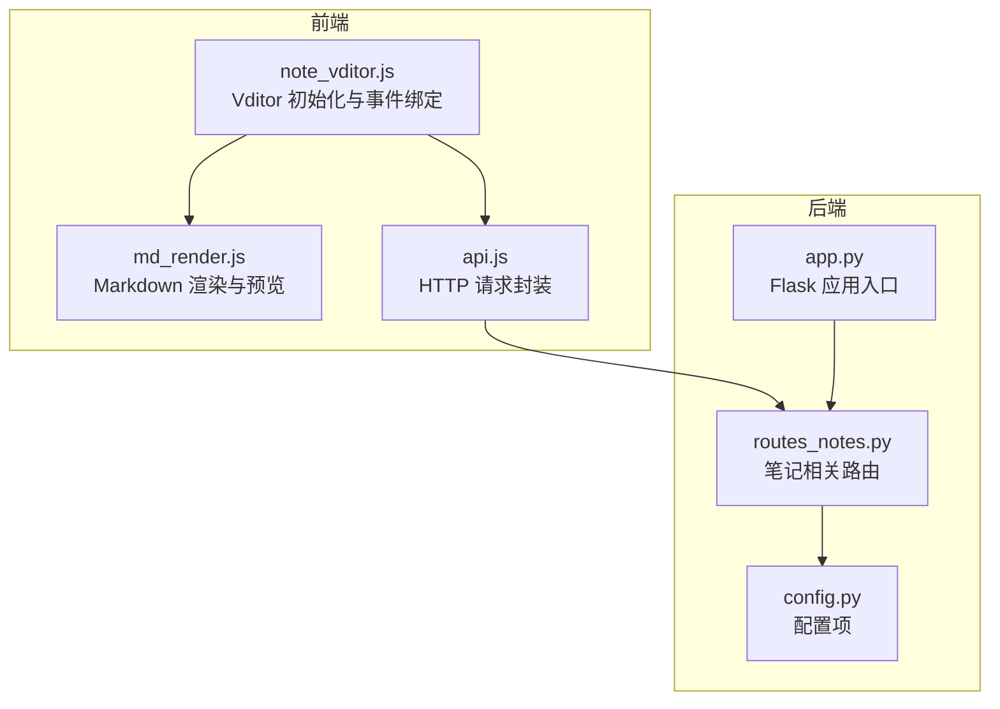
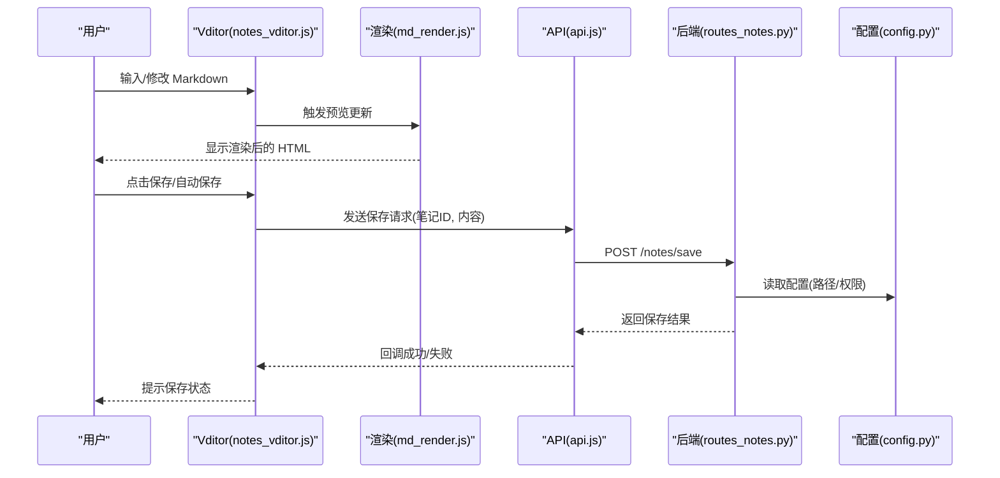
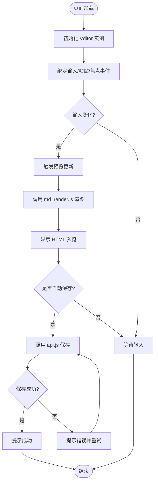
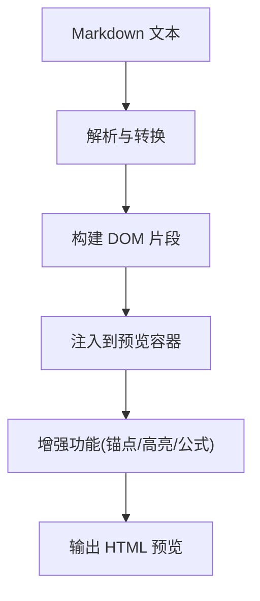
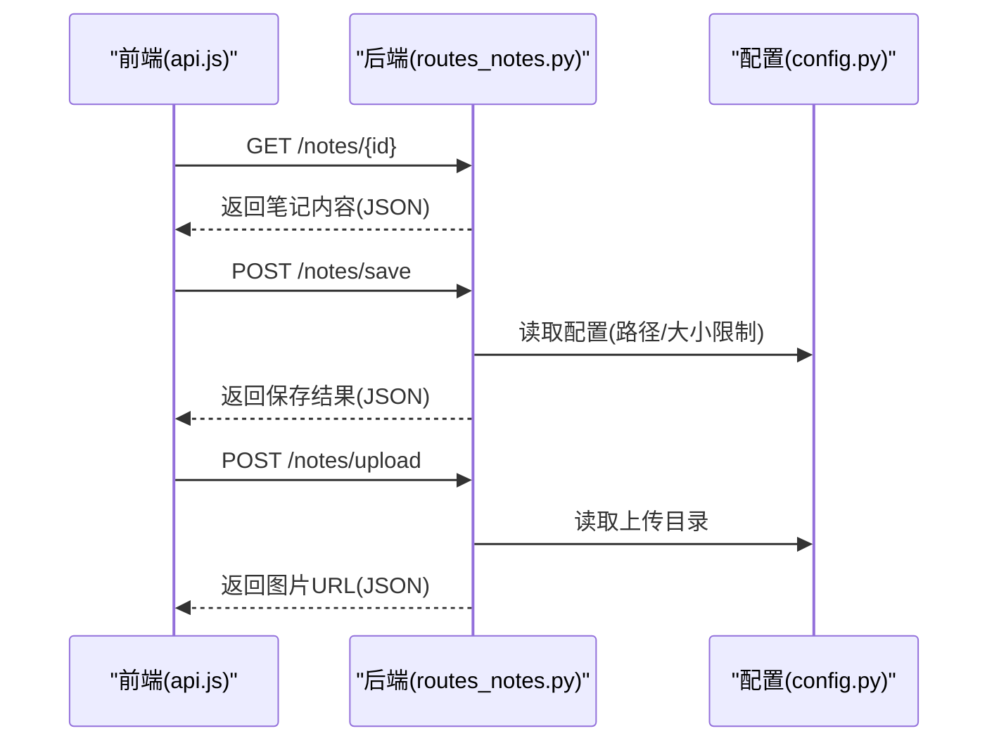
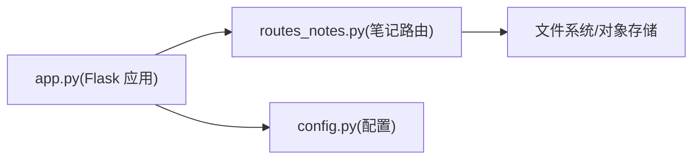
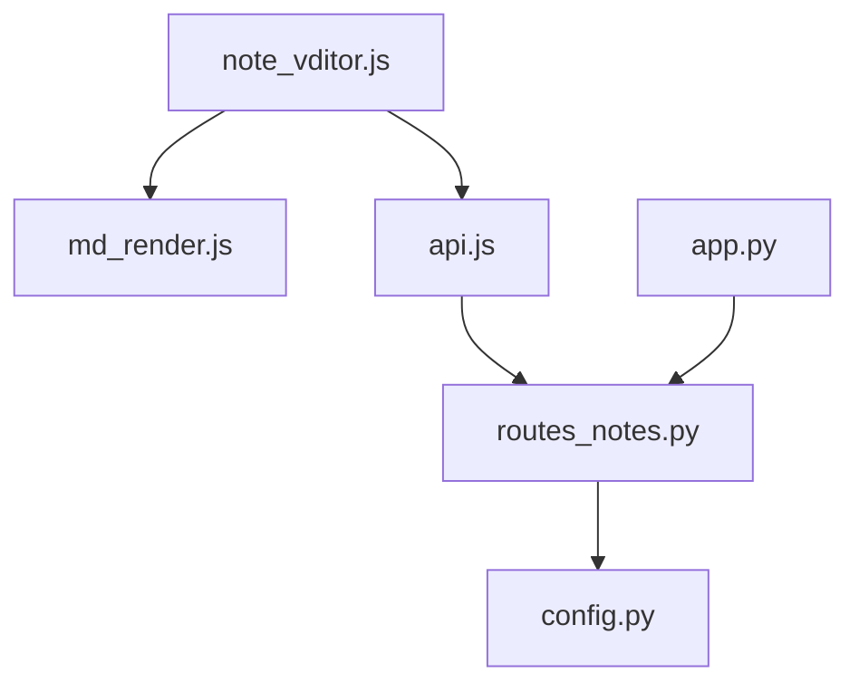

# Vditor编辑器系统

<cite>
**本文引用的文件**   
- [note_vditor.js](file://server/static/js/note_vditor.js)
- [md_render.js](file://server/static/js/md_render.js)
- [api.js](file://server/static/js/api.js)
- [routes_notes.py](file://server/routes_notes.py)
- [app.py](file://server/app.py)
- [config.py](file://server/config.py)
- [2026-10-10-学页MD编辑Vditor升级.md](file://docs/开发日志/2026-10-10-学页MD编辑Vditor升级.md)
- [_vd_editor_assert.js](file://server/tests/_vd_editor_assert.js)
- [_vd_editor_result.json](file://server/tests/_vd_editor_result.json)
</cite>

## 目录
1. [简介](#简介)
2. [项目结构](#项目结构)
3. [核心组件](#核心组件)
4. [架构总览](#架构总览)
5. [详细组件分析](#详细组件分析)
6. [依赖关系分析](#依赖关系分析)
7. [性能考虑](#性能考虑)
8. [故障排查指南](#故障排查指南)
9. [结论](#结论)
10. [附录](#附录)

## 简介
本文件面向“Vditor编辑器系统”，聚焦于基于 Vditor 的 Markdown 笔记编辑、预览与后端保存流程。文档从系统架构、组件职责、数据流、接口契约、错误处理与性能优化等维度进行系统化说明，帮助开发者快速理解并扩展该子系统。

## 项目结构
围绕 Vditor 编辑器的关键代码主要分布在以下位置：
- 前端脚本：负责初始化 Vditor、渲染 Markdown、调用 API 与处理交互逻辑
- 后端路由：提供笔记内容的读取、保存与预览相关接口
- 应用入口与配置：注册路由、加载配置项（如上传路径）
- 测试与断言：覆盖编辑器行为与结果校验

**图表来源**
- [note_vditor.js](file://server/static/js/note_vditor.js)
- [md_render.js](file://server/static/js/md_render.js)
- [api.js](file://server/static/js/api.js)
- [routes_notes.py](file://server/routes_notes.py)
- [app.py](file://server/app.py)
- [config.py](file://server/config.py)

**章节来源**
- [note_vditor.js](file://server/static/js/note_vditor.js)
- [md_render.js](file://server/static/js/md_render.js)
- [api.js](file://server/static/js/api.js)
- [routes_notes.py](file://server/routes_notes.py)
- [app.py](file://server/app.py)
- [config.py](file://server/config.py)

## 核心组件
- Vditor 编辑器初始化与配置：在页面中创建编辑器实例，设置工具栏、主题、高度、粘贴行为等；监听输入变化以触发预览更新或自动保存。
- Markdown 渲染与预览：将编辑器内容转换为 HTML，支持数学公式、表格、代码高亮等；提供同步滚动、锚点定位等增强能力。
- API 客户端：统一封装对后端的 HTTP 请求，包括获取笔记内容、保存笔记、上传图片等。
- 后端笔记路由：实现笔记内容的读取、保存、预览与图片上传等接口，并与文件系统或对象存储对接。
- 应用入口与配置：注册路由、注入配置（如静态资源路径、上传目录），确保前后端协同工作。

**章节来源**
- [note_vditor.js](file://server/static/js/note_vditor.js)
- [md_render.js](file://server/static/js/md_render.js)
- [api.js](file://server/static/js/api.js)
- [routes_notes.py](file://server/routes_notes.py)
- [app.py](file://server/app.py)
- [config.py](file://server/config.py)

## 架构总览
下图展示从用户编辑到内容持久化的端到端流程：用户在 Vditor 中编辑 Markdown，前端通过 API 调用后端接口，后端将内容写入存储并提供预览渲染。

**图表来源**
- [note_vditor.js](file://server/static/js/note_vditor.js)
- [md_render.js](file://server/static/js/md_render.js)
- [api.js](file://server/static/js/api.js)
- [routes_notes.py](file://server/routes_notes.py)
- [config.py](file://server/config.py)

## 详细组件分析

### Vditor 编辑器初始化与交互
- 初始化策略：根据页面上下文动态配置编辑器选项，如工具集、语言、主题、占位符、快捷键等。
- 事件绑定：监听输入变化、粘贴、拖拽、焦点切换等事件，用于实时预览、草稿缓存与防抖保存。
- 预览联动：与 md_render.js 协作，将编辑器内容转换为 HTML，并支持同步滚动、段落锚点跳转。
- 错误处理：捕获网络异常、渲染异常与本地存储异常，向用户反馈友好提示。

**图表来源**
- [note_vditor.js](file://server/static/js/note_vditor.js)
- [md_render.js](file://server/static/js/md_render.js)
- [api.js](file://server/static/js/api.js)

**章节来源**
- [note_vditor.js](file://server/static/js/note_vditor.js)
- [md_render.js](file://server/static/js/md_render.js)
- [api.js](file://server/static/js/api.js)

### Markdown 渲染与预览
- 渲染管线：接收 Markdown 文本，解析为 AST 或 HTML，插入 DOM；支持数学公式、表格、代码块高亮。
- 性能优化：对长文档进行分块渲染、懒加载图片、防抖重绘，避免主线程阻塞。
- 可访问性：为标题生成锚点，支持键盘导航与屏幕阅读器。
- 错误边界：捕获渲染异常，降级为纯文本显示，保证页面可用性。

**图表来源**
- [md_render.js](file://server/static/js/md_render.js)

**章节来源**
- [md_render.js](file://server/static/js/md_render.js)

### API 客户端与后端路由
- 前端 API：封装统一的请求方法，处理鉴权头、重试机制、超时控制与错误映射。
- 后端路由：提供笔记读取、保存、预览与图片上传接口；校验参数、权限与路径安全。
- 配置注入：从 config.py 读取静态资源路径、上传目录、文件大小限制等。

**图表来源**
- [api.js](file://server/static/js/api.js)
- [routes_notes.py](file://server/routes_notes.py)
- [config.py](file://server/config.py)

**章节来源**
- [api.js](file://server/static/js/api.js)
- [routes_notes.py](file://server/routes_notes.py)
- [config.py](file://server/config.py)

### 应用入口与路由注册
- Flask 应用入口：初始化应用实例、注册蓝图与路由、加载中间件与模板引擎。
- 路由挂载：将 notes 相关路由挂载到应用，确保 URL 前缀与静态资源路径正确。
- 环境配置：根据运行环境加载不同配置（开发/生产），启用调试模式与热重载。

**图表来源**
- [app.py](file://server/app.py)
- [routes_notes.py](file://server/routes_notes.py)
- [config.py](file://server/config.py)

**章节来源**
- [app.py](file://server/app.py)
- [routes_notes.py](file://server/routes_notes.py)
- [config.py](file://server/config.py)

## 依赖关系分析
- 前端模块依赖：
  - note_vditor.js 依赖 md_render.js 进行预览渲染，依赖 api.js 进行网络请求。
  - md_render.js 依赖浏览器原生 DOM API 与第三方库（如 MathJax、Prism）。
  - api.js 依赖 fetch/XMLHttpRequest 与全局鉴权头。
- 后端模块依赖：
  - routes_notes.py 依赖 config.py 获取配置，依赖文件系统或对象存储 SDK。
  - app.py 依赖 Flask 框架与模板引擎，注册路由与静态资源。

**图表来源**
- [note_vditor.js](file://server/static/js/note_vditor.js)
- [md_render.js](file://server/static/js/md_render.js)
- [api.js](file://server/static/js/api.js)
- [routes_notes.py](file://server/routes_notes.py)
- [config.py](file://server/config.py)
- [app.py](file://server/app.py)

**章节来源**
- [note_vditor.js](file://server/static/js/note_vditor.js)
- [md_render.js](file://server/static/js/md_render.js)
- [api.js](file://server/static/js/api.js)
- [routes_notes.py](file://server/routes_notes.py)
- [config.py](file://server/config.py)
- [app.py](file://server/app.py)

## 性能考虑
- 渲染性能：
  - 对长文档采用分块渲染与懒加载，减少首屏压力。
  - 使用防抖与节流控制预览更新频率，避免频繁重排。
- 网络性能：
  - 合并请求、缓存静态资源、启用 Gzip/Brotli。
  - 图片上传采用分片与断点续传，提升大文件稳定性。
- 内存管理：
  - 及时释放不再使用的 DOM 节点与事件监听器。
  - 避免在高频回调中创建大型对象。

[本节为通用指导，不直接分析具体文件]

## 故障排查指南
- 常见问题：
  - 预览空白：检查 md_render.js 是否正确注入 HTML，确认第三方库加载成功。
  - 保存失败：查看 api.js 的错误映射与后端返回码，确认鉴权头与参数完整性。
  - 图片上传失败：核对 config.py 中的上传目录权限与大小限制。
- 诊断步骤：
  - 打开浏览器控制台，观察网络请求与错误堆栈。
  - 使用测试断言验证编辑器行为与结果一致性。
  - 在后端日志中检索路由处理过程中的异常信息。

**章节来源**
- [_vd_editor_assert.js](file://server/tests/_vd_editor_assert.js)
- [_vd_editor_result.json](file://server/tests/_vd_editor_result.json)

## 结论
Vditor 编辑器系统通过清晰的前后端分工与模块化设计，实现了高效的 Markdown 编辑、预览与保存流程。前端负责交互与渲染，后端负责数据持久化与配置管理。通过合理的性能优化与错误处理策略，系统在用户体验与稳定性方面达到良好平衡。建议持续完善单元测试与集成测试，进一步提升系统的可维护性与可扩展性。

[本节为总结性内容，不直接分析具体文件]

## 附录
- 版本演进记录：参考开发日志中对 Vditor 升级的说明，了解功能变更与兼容性调整。

**章节来源**
- [2026-10-10-学页MD编辑Vditor升级.md](file://docs/开发日志/2026-10-10-学页MD编辑Vditor升级.md)