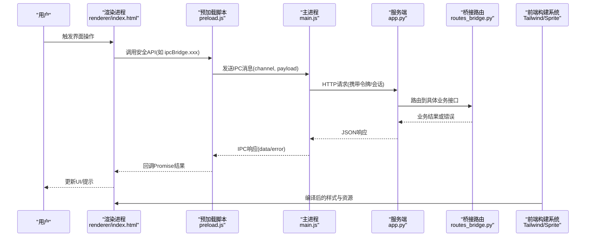
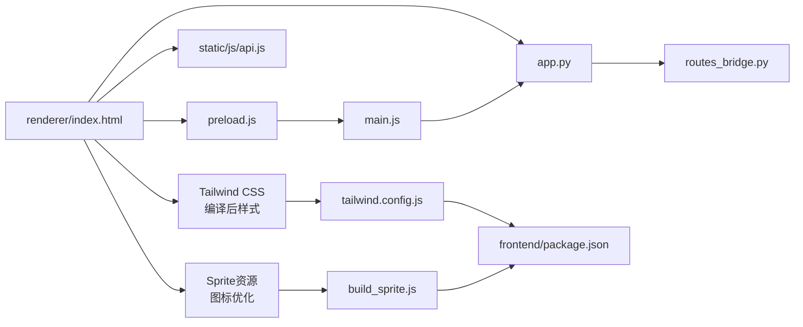
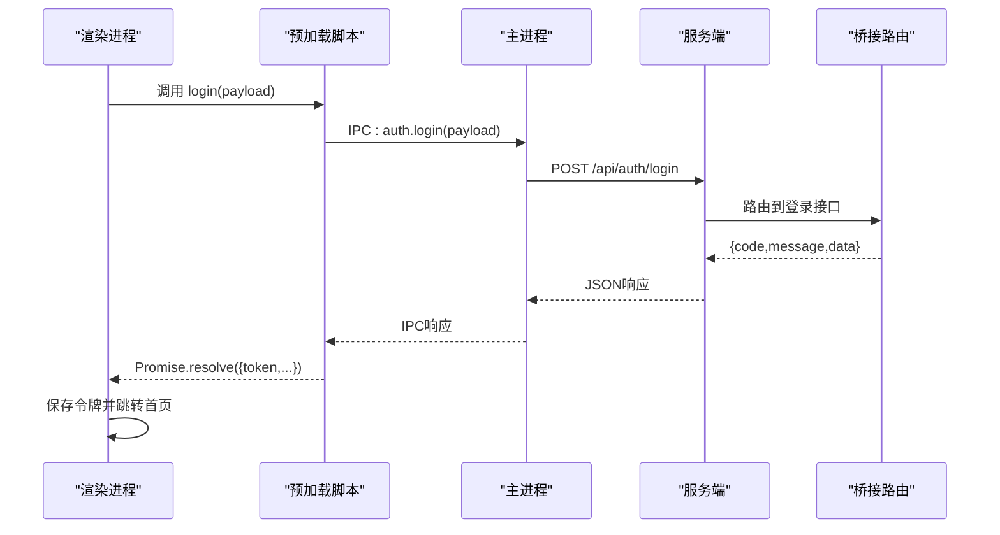

# 前端架构

<cite>
**本文引用的文件**   
- [desktop/main.js](file://desktop/main.js)
- [desktop/preload.js](file://desktop/preload.js)
- [desktop/renderer/index.html](file://desktop/renderer/index.html)
- [desktop/package.json](file://desktop/package.json)
- [frontend/build_sprite.js](file://frontend/build_sprite.js)
- [frontend/input.css](file://frontend/input.css)
- [frontend/tailwind.config.js](file://frontend/tailwind.config.js)
- [frontend/package.json](file://frontend/package.json)
- [server/app.py](file://server/app.py)
- [server/auth.py](file://server/auth.py)
- [server/routes_bridge.py](file://server/routes_bridge.py)
- [server/static/js/api.js](file://server/static/js/api.js)
</cite>

## 更新摘要
**变更内容**   
- 新增现代化前端构建系统，集成 Tailwind CSS 原子化样式框架
- 引入 Sprite 构建工具，优化图标资源管理
- 建立现代化的开发工作流，支持样式编译与资源优化
- 扩展项目结构以支持前端工程化建设

## 目录
1. [简介](#简介)
2. [项目结构](#项目结构)
3. [核心组件](#核心组件)
4. [架构总览](#架构总览)
5. [详细组件分析](#详细组件分析)
6. [依赖关系分析](#依赖关系分析)
7. [性能与兼容性](#性能与兼容性)
8. [故障排查指南](#故障排查指南)
9. [结论](#结论)
10. [附录：API与IPC协议参考](#附录api与ipc协议参考)

## 简介
本文件为 LectureLearnLoop 前端（Electron 桌面应用）的架构文档。重点覆盖以下方面：
- Electron 主进程、预加载脚本与渲染进程的职责分离与安全边界
- 页面组件设计与模板系统的使用方式
- 状态管理模式与跨进程通信（IPC）机制
- **现代化前端构建系统**：Tailwind CSS 集成、Sprite 构建工具与开发工作流
- 响应式设计与浏览器兼容性处理
- 性能优化技巧
- 与后端 API 的集成方式，包括认证令牌管理与会话保持

## 项目结构
本项目采用"桌面端 + Web 服务端"的双端协作模式，并引入了现代化的前端构建系统：
- desktop 目录：Electron 桌面应用入口、主进程、预加载脚本与渲染页
- frontend 目录：**新增的前端构建系统**，包含 Tailwind CSS 配置、Sprite 构建工具与样式源文件
- server 目录：Python 后端服务，提供页面模板、静态资源、业务路由与桥接接口

```mermaid
graph TB
subgraph "桌面端(Electron)"
M["main.js<br/>主进程"]
P["preload.js<br/>预加载脚本"]
R["renderer/index.html<br/>渲染进程页面"]
end
subgraph "前端构建系统"
T["tailwind.config.js<br/>Tailwind配置"]
I["input.css<br/>样式源文件"]
S["build_sprite.js<br/>Sprite构建工具"]
F["package.json<br/>构建依赖"]
end
subgraph "服务端(Web)"
A["app.py<br/>Web服务器/路由分发"]
B["routes_bridge.py<br/>桥接API"]
T["templates/*<br/>HTML模板"]
J["static/js/api.js<br/>前端JS库"]
end
M --> |"启动并托管"| R
R --> |"通过预加载暴露的安全API"| P
R --> |"HTTP请求"| A
A --> |"模板渲染/静态资源"| T
A --> |"业务逻辑/鉴权"| B
R --> |"调用|J"
F --> |"构建依赖"| I
I --> |"编译"| R
S --> |"生成"| R
```

**图表来源**
- [desktop/main.js:1-200](file://desktop/main.js#L1-L200)
- [desktop/preload.js:1-200](file://desktop/preload.js#L1-L200)
- [desktop/renderer/index.html:1-200](file://desktop/renderer/index.html#L1-L200)
- [frontend/tailwind.config.js:1-200](file://frontend/tailwind.config.js#L1-L200)
- [frontend/input.css:1-200](file://frontend/input.css#L1-L200)
- [frontend/build_sprite.js:1-200](file://frontend/build_sprite.js#L1-L200)
- [frontend/package.json:1-200](file://frontend/package.json#L1-L200)
- [server/app.py:1-200](file://server/app.py#L1-L200)
- [server/routes_bridge.py:1-200](file://server/routes_bridge.py#L1-L200)
- [server/static/js/api.js:1-200](file://server/static/js/api.js#L1-L200)

**章节来源**
- [desktop/package.json:1-200](file://desktop/package.json#L1-L200)
- [desktop/main.js:1-200](file://desktop/main.js#L1-L200)
- [desktop/preload.js:1-200](file://desktop/preload.js#L1-L200)
- [desktop/renderer/index.html:1-200](file://desktop/renderer/index.html#L1-L200)
- [frontend/tailwind.config.js:1-200](file://frontend/tailwind.config.js#L1-L200)
- [frontend/input.css:1-200](file://frontend/input.css#L1-L200)
- [frontend/build_sprite.js:1-200](file://frontend/build_sprite.js#L1-L200)
- [frontend/package.json:1-200](file://frontend/package.json#L1-L200)
- [server/app.py:1-200](file://server/app.py#L1-L200)
- [server/routes_bridge.py:1-200](file://server/routes_bridge.py#L1-L200)
- [server/static/js/api.js:1-200](file://server/static/js/api.js#L1-L200)

## 核心组件
- 主进程（main.js）
  - 负责创建窗口、生命周期管理、菜单/托盘等原生能力
  - 注册 IPC 通道，将受控能力安全地暴露给渲染进程
- 预加载脚本（preload.js）
  - 在渲染进程上下文之前执行，注入受限 API
  - 隔离 Node.js 直接访问，仅暴露白名单方法
- 渲染进程（renderer/index.html）
  - 承载 UI 与交互逻辑，通过预加载暴露的 API 与主进程通信
  - 使用服务端模板与静态资源构建页面
- **前端构建系统**
  - Tailwind CSS 配置与样式编译
  - Sprite 构建工具用于图标资源优化
  - 现代化的开发工作流支持
- 服务端（app.py、routes_bridge.py）
  - 提供页面模板、静态资源与业务 API
  - 桥接接口统一封装鉴权、参数校验与错误返回

**章节来源**
- [desktop/main.js:1-200](file://desktop/main.js#L1-L200)
- [desktop/preload.js:1-200](file://desktop/preload.js#L1-L200)
- [desktop/renderer/index.html:1-200](file://desktop/renderer/index.html#L1-L200)
- [frontend/tailwind.config.js:1-200](file://frontend/tailwind.config.js#L1-L200)
- [frontend/build_sprite.js:1-200](file://frontend/build_sprite.js#L1-L200)
- [server/app.py:1-200](file://server/app.py#L1-L200)
- [server/routes_bridge.py:1-200](file://server/routes_bridge.py#L1-L200)

## 架构总览
下图展示从用户操作到数据落盘的整体流程，涵盖 Electron 主进程、预加载脚本、渲染进程与服务端之间的交互，以及现代化前端构建系统的参与。



**图表来源**
- [desktop/renderer/index.html:1-200](file://desktop/renderer/index.html#L1-L200)
- [desktop/preload.js:1-200](file://desktop/preload.js#L1-L200)
- [desktop/main.js:1-200](file://desktop/main.js#L1-L200)
- [server/app.py:1-200](file://server/app.py#L1-L200)
- [server/routes_bridge.py:1-200](file://server/routes_bridge.py#L1-L200)
- [frontend/tailwind.config.js:1-200](file://frontend/tailwind.config.js#L1-L200)
- [frontend/build_sprite.js:1-200](file://frontend/build_sprite.js#L1-L200)

## 详细组件分析

### 主进程（main.js）
- 职责
  - 初始化 Electron 应用，创建 BrowserWindow
  - 监听应用生命周期事件（ready、window-all-closed、activate 等）
  - 注册 IPC 通道，转发渲染进程请求到系统能力或后端服务
- 关键点
  - 避免在主进程中直接访问 DOM
  - 对敏感能力进行权限控制与审计日志
  - 集中处理未捕获异常与崩溃上报

**章节来源**
- [desktop/main.js:1-200](file://desktop/main.js#L1-L200)

### 预加载脚本（preload.js）
- 职责
  - 在渲染进程上下文中注入受限 API
  - 屏蔽 Node.js 全局对象，仅暴露必要方法
  - 作为 IPC 客户端，封装 channel 调用与 Promise 化
- 安全机制
  - contextIsolation=true 时，仅通过 contextBridge 暴露白名单
  - 对传入参数做基础校验，拒绝危险类型
  - 所有 IPC 调用均带唯一请求ID，便于追踪与超时处理

**章节来源**
- [desktop/preload.js:1-200](file://desktop/preload.js#L1-L200)

### 渲染进程（renderer/index.html）
- 职责
  - 加载页面模板与静态资源
  - 绑定用户交互事件，调用预加载暴露的安全 API
  - 维护本地视图状态，必要时与服务端同步
- 组件设计
  - 以 HTML 模板为主，配合少量 JS 模块组织逻辑
  - 通过服务端模板引擎拼装页面骨架，减少首屏体积
  - **集成 Tailwind CSS 编译后的样式与 Sprite 资源**

**章节来源**
- [desktop/renderer/index.html:1-200](file://desktop/renderer/index.html#L1-L200)

### 现代化前端构建系统
- Tailwind CSS 集成
  - 配置文件定义主题、插件与构建选项
  - 原子化样式类提升开发效率与一致性
  - 生产环境自动清理未使用的样式类
- Sprite 构建工具
  - 自动化图标资源合并与优化
  - 支持 SVG 图标转换为高效格式
  - 生成统一的资源引用路径
- 开发工作流
  - 样式热重载与实时预览
  - 资源压缩与缓存策略
  - 构建产物优化与部署准备

**章节来源**
- [frontend/tailwind.config.js:1-200](file://frontend/tailwind.config.js#L1-L200)
- [frontend/input.css:1-200](file://frontend/input.css#L1-L200)
- [frontend/build_sprite.js:1-200](file://frontend/build_sprite.js#L1-L200)
- [frontend/package.json:1-200](file://frontend/package.json#L1-L200)

### 服务端（app.py、routes_bridge.py）
- app.py
  - 配置 Web 服务器、静态资源路径与模板目录
  - 统一中间件（CORS、日志、错误处理）
- routes_bridge.py
  - 定义桥接 API，统一鉴权、参数校验、错误码与响应格式
  - 聚合多个业务子路由，对外暴露稳定契约

**章节来源**
- [server/app.py:1-200](file://server/app.py#L1-L200)
- [server/routes_bridge.py:1-200](file://server/routes_bridge.py#L1-L200)

### 模板系统与页面组件
- 模板系统
  - 基于服务端模板引擎（如 Jinja2），提供 base.html 与页面级模板
  - 组件化 header/sidebar/settings 等可复用片段
- 页面组件
  - 登录、仪表盘、知识库、练习循环等页面分别对应独立模板
  - SPA 布局模板用于单页应用场景

**章节来源**
- [server/templates/base.html](file://server/templates/base.html)
- [server/templates/spa_layout.html](file://server/templates/spa_layout.html)
- [server/templates/pages/*.html](file://server/templates/pages/)
- [server/templates/components/*.html](file://server/templates/components/)

### 状态管理模式
- 视图层状态
  - 由页面模板与少量 JS 模块维护，遵循"最小状态"原则
- 持久化状态
  - 通过服务端 API 读写数据库，避免在渲染进程存储敏感数据
- 跨组件状态
  - 使用事件总线或轻量状态容器（如自定义 Pub/Sub）解耦组件

**章节来源**
- [desktop/renderer/index.html:1-200](file://desktop/renderer/index.html#L1-L200)
- [server/static/js/api.js:1-200](file://server/static/js/api.js#L1-L200)

### IPC 通信机制
- 通道命名
  - 建议按功能域划分 channel，如 app.window、system.audio、bridge.api
- 消息协议
  - 请求体包含 method、payload、requestId
  - 响应体包含 code、message、data
- 事件处理
  - 预加载脚本封装 send + onReply 模式，支持超时与重试
- 错误处理
  - 统一错误码映射，渲染进程根据 code 决定提示或重试策略

**章节来源**
- [desktop/preload.js:1-200](file://desktop/preload.js#L1-L200)
- [desktop/main.js:1-200](file://desktop/main.js#L1-L200)
- [server/routes_bridge.py:1-200](file://server/routes_bridge.py#L1-L200)

### 响应式设计与浏览器兼容性
- 响应式
  - 使用 CSS 媒体查询与弹性布局适配不同窗口尺寸
  - 针对 Electron 多分辨率屏幕进行缩放与 DPI 适配
  - **Tailwind CSS 提供内置响应式断点与工具类**
- 兼容性
  - 优先使用现代 Web API，并提供降级方案
  - 对音频、摄像头等能力进行特性检测与回退

**章节来源**
- [desktop/renderer/index.html:1-200](file://desktop/renderer/index.html#L1-L200)
- [server/static/js/api.js:1-200](file://server/static/js/api.js#L1-L200)
- [frontend/tailwind.config.js:1-200](file://frontend/tailwind.config.js#L1-L200)

### 性能优化技巧
- 首屏优化
  - 模板按需渲染，静态资源缓存与压缩
  - 延迟加载非关键脚本与图片
  - **Tailwind CSS 自动清理未使用样式，减小包体积**
  - **Sprite 图标优化，减少 HTTP 请求次数**
- 运行时优化
  - 节流/防抖高频事件（滚动、输入）
  - 列表虚拟化与分页加载
- 网络优化
  - 合并请求、合理设置缓存头
  - 失败重试与指数退避

**章节来源**
- [server/app.py:1-200](file://server/app.py#L1-L200)
- [server/static/js/api.js:1-200](file://server/static/js/api.js#L1-L200)
- [frontend/tailwind.config.js:1-200](file://frontend/tailwind.config.js#L1-L200)
- [frontend/build_sprite.js:1-200](file://frontend/build_sprite.js#L1-L200)

## 依赖关系分析


**图表来源**
- [desktop/renderer/index.html:1-200](file://desktop/renderer/index.html#L1-L200)
- [desktop/preload.js:1-200](file://desktop/preload.js#L1-L200)
- [desktop/main.js:1-200](file://desktop/main.js#L1-L200)
- [server/app.py:1-200](file://server/app.py#L1-L200)
- [server/routes_bridge.py:1-200](file://server/routes_bridge.py#L1-L200)
- [server/static/js/api.js:1-200](file://server/static/js/api.js#L1-L200)
- [frontend/tailwind.config.js:1-200](file://frontend/tailwind.config.js#L1-L200)
- [frontend/build_sprite.js:1-200](file://frontend/build_sprite.js#L1-L200)
- [frontend/package.json:1-200](file://frontend/package.json#L1-L200)

**章节来源**
- [desktop/package.json:1-200](file://desktop/package.json#L1-L200)
- [server/app.py:1-200](file://server/app.py#L1-L200)
- [frontend/package.json:1-200](file://frontend/package.json#L1-L200)

## 性能与兼容性
- 渲染性能
  - 避免频繁重排重绘，批量更新 DOM
  - 使用 requestAnimationFrame 处理动画
  - **Tailwind CSS 优化样式计算，减少重绘开销**
- 内存管理
  - 及时释放事件监听器与大对象引用
  - 长列表使用虚拟滚动
- 兼容性策略
  - 对 Web Audio API、MediaDevices 等进行特性检测
  - 提供降级路径与友好提示
  - **Tailwind CSS 提供浏览器兼容性处理**

[本节为通用指导，不直接分析具体文件]

## 故障排查指南
- 常见问题
  - IPC 调用无响应：检查 channel 是否注册、请求ID是否匹配、超时时间是否过短
  - 鉴权失败：确认令牌是否有效、是否随请求携带、服务端会话是否过期
  - 页面空白：检查模板路径、静态资源路径、CORS 配置
  - **样式问题：检查 Tailwind CSS 构建是否成功、样式类是否正确**
  - **图标显示异常：检查 Sprite 构建是否完成、资源路径是否正确**
- 定位手段
  - 启用调试日志，记录 IPC 请求/响应与 HTTP 状态码
  - 使用浏览器开发者工具查看网络面板与控制台错误
  - 在服务端打印桥接接口入参与出参
  - **检查前端构建日志，确认 Tailwind CSS 和 Sprite 构建输出**

**章节来源**
- [desktop/main.js:1-200](file://desktop/main.js#L1-L200)
- [desktop/preload.js:1-200](file://desktop/preload.js#L1-L200)
- [server/routes_bridge.py:1-200](file://server/routes_bridge.py#L1-L200)
- [frontend/tailwind.config.js:1-200](file://frontend/tailwind.config.js#L1-L200)
- [frontend/build_sprite.js:1-200](file://frontend/build_sprite.js#L1-L200)

## 结论
本架构通过 Electron 主进程与预加载脚本建立安全边界，渲染进程专注于 UI 与交互；服务端提供模板与桥接 API，统一鉴权与错误处理。**新增的现代化前端构建系统通过 Tailwind CSS 和 Sprite 工具提升了开发效率和运行性能**。该模式兼顾安全性、可维护性与扩展性，适合复杂桌面应用的长期演进。

[本节为总结性内容，不直接分析具体文件]

## 附录：API与IPC协议参考

### 认证与会话
- 令牌管理
  - 登录后获取令牌，保存在安全位置（如主进程内存或加密存储）
  - 每次 HTTP 请求自动附加令牌头
- 会话保持
  - 服务端维持会话状态，客户端在令牌失效时引导重新登录
  - 支持刷新令牌机制以减少重复登录

**章节来源**
- [server/auth.py:1-200](file://server/auth.py#L1-L200)
- [server/routes_bridge.py:1-200](file://server/routes_bridge.py#L1-L200)
- [server/static/js/api.js:1-200](file://server/static/js/api.js#L1-L200)

### IPC 消息协议
- 请求结构
  - channel: 字符串，标识通道名
  - payload: 对象，业务参数
  - requestId: 字符串，唯一请求ID
- 响应结构
  - code: 数字，状态码
  - message: 字符串，人类可读信息
  - data: 任意，业务数据

**章节来源**
- [desktop/preload.js:1-200](file://desktop/preload.js#L1-L200)
- [desktop/main.js:1-200](file://desktop/main.js#L1-L200)

### 典型调用序列（登录）


**图表来源**
- [desktop/renderer/index.html:1-200](file://desktop/renderer/index.html#L1-L200)
- [desktop/preload.js:1-200](file://desktop/preload.js#L1-L200)
- [desktop/main.js:1-200](file://desktop/main.js#L1-L200)
- [server/app.py:1-200](file://server/app.py#L1-L200)
- [server/routes_bridge.py:1-200](file://server/routes_bridge.py#L1-L200)

### 前端构建系统配置
- Tailwind CSS 配置
  - 主题定制与插件扩展
  - 响应式断点与工具类配置
  - 生产环境优化选项
- Sprite 构建配置
  - 图标源文件管理与合并策略
  - 输出格式与路径配置
  - 构建钩子与任务集成

**章节来源**
- [frontend/tailwind.config.js:1-200](file://frontend/tailwind.config.js#L1-L200)
- [frontend/build_sprite.js:1-200](file://frontend/build_sprite.js#L1-L200)
- [frontend/package.json:1-200](file://frontend/package.json#L1-L200)