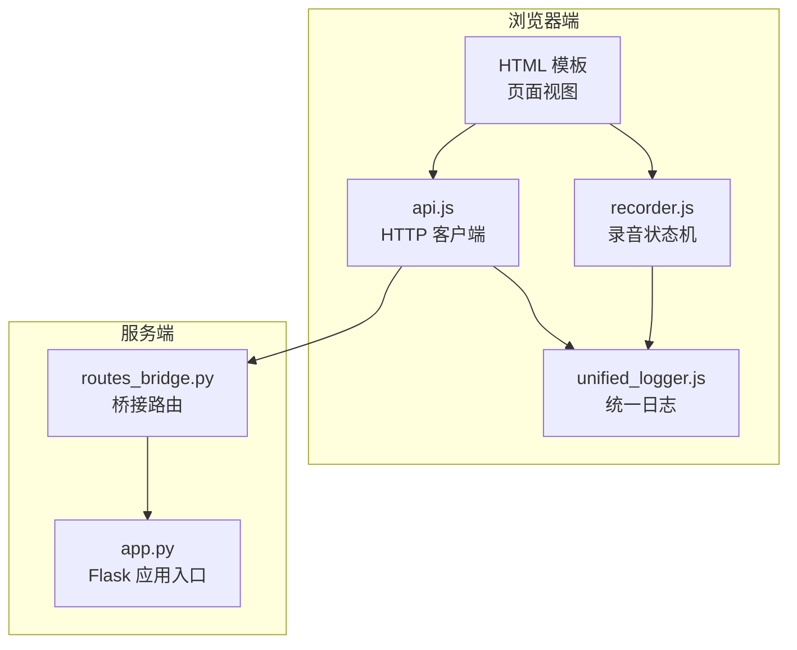
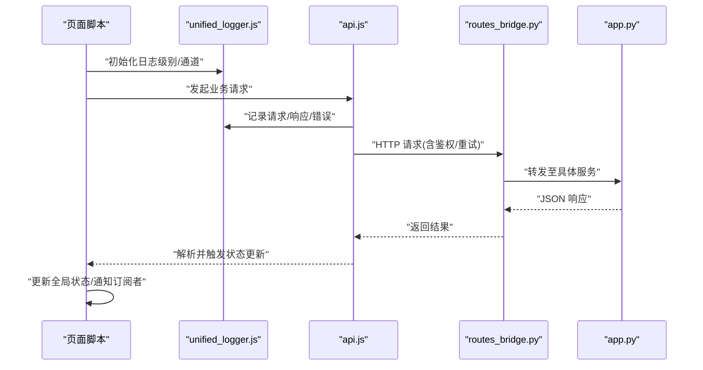
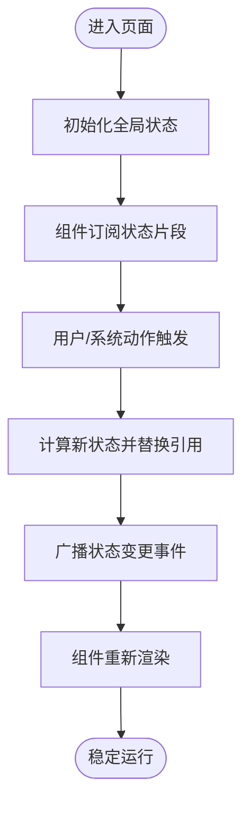
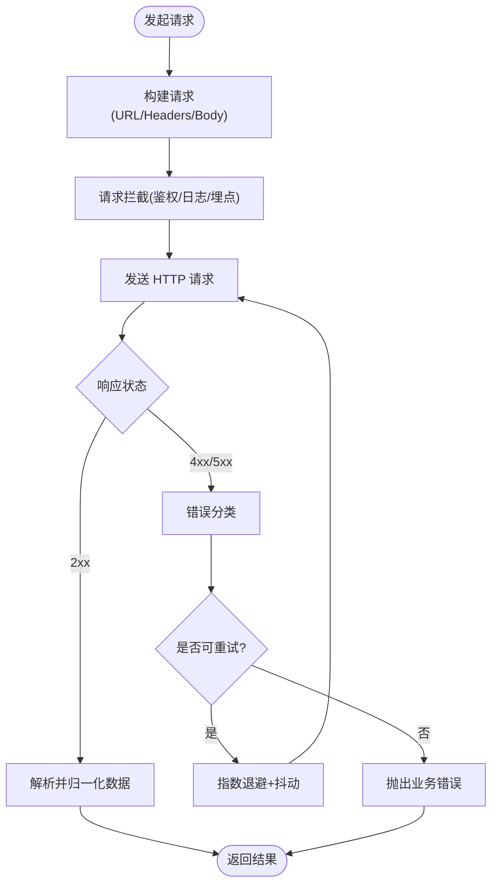
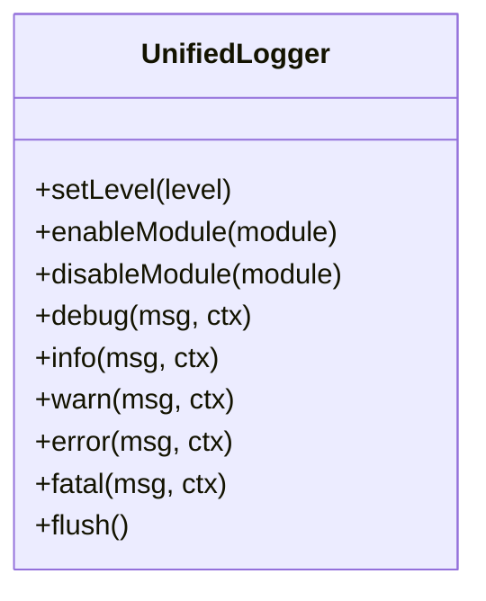
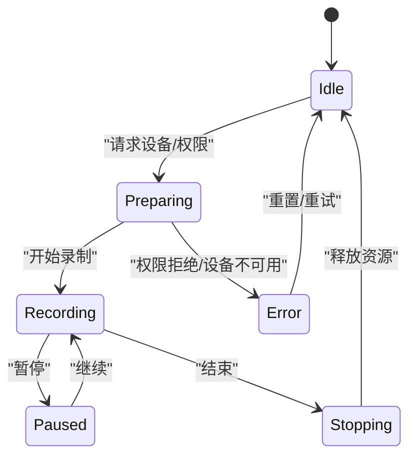
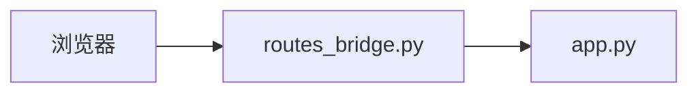
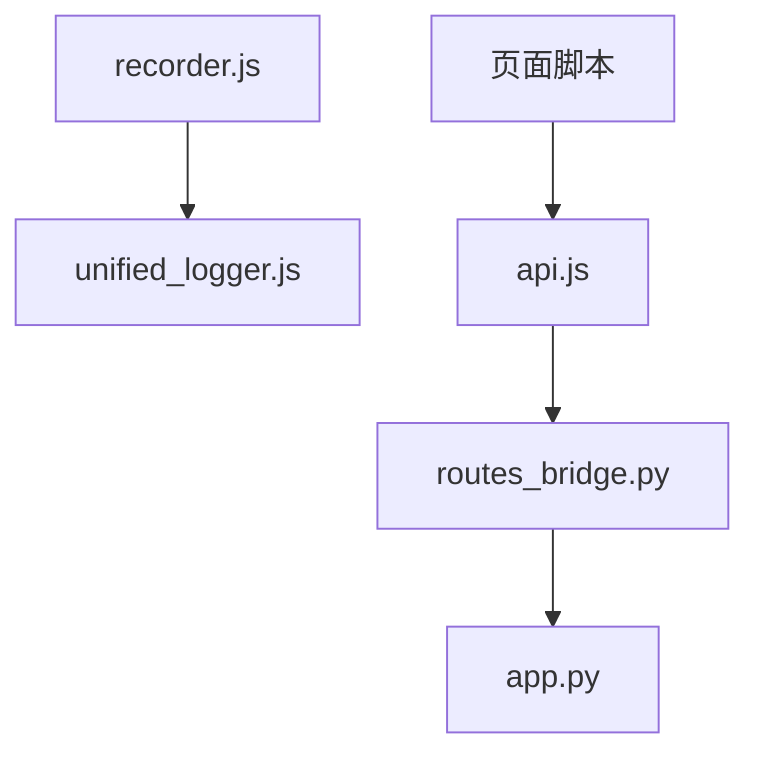

# 状态管理

<cite>
**本文引用的文件**   
- [api.js](file://server/static/js/api.js)
- [unified_logger.js](file://server/static/js/unified_logger.js)
- [recorder.js](file://server/static/js/recorder.js)
- [app.py](file://server/app.py)
- [routes_bridge.py](file://server/routes_bridge.py)
</cite>

## 目录
1. [引言](#引言)
2. [项目结构](#项目结构)
3. [核心组件](#核心组件)
4. [架构总览](#架构总览)
5. [详细组件分析](#详细组件分析)
6. [依赖关系分析](#依赖关系分析)
7. [性能考虑](#性能考虑)
8. [故障排查指南](#故障排查指南)
9. [结论](#结论)

## 引言
本文件聚焦于 LectureLearnLoop 前端状态管理与关键基础设施，围绕以下目标展开：
- 全局状态存储、组件间数据共享与状态同步机制
- API 客户端 api.js 的请求拦截器、响应处理器与错误重试策略
- 统一日志记录器 unified_logger.js 的级别控制、输出格式化与调试支持
- 录音器 recorder.js 的状态管理（音频录制状态、设备状态、用户交互状态）
- 提供可操作的最佳实践与示例路径

## 项目结构
本项目采用“服务端渲染模板 + 静态前端脚本”的混合架构。前端逻辑以浏览器端 JavaScript 为主，通过后端路由暴露 REST/桥接接口；状态主要保存在浏览器内存中，由页面脚本驱动 UI 更新。

**图表来源**
- [app.py:1-120](file://server/app.py#L1-L120)
- [routes_bridge.py:1-120](file://server/routes_bridge.py#L1-L120)

**章节来源**
- [app.py:1-120](file://server/app.py#L1-L120)
- [routes_bridge.py:1-120](file://server/routes_bridge.py#L1-L120)

## 核心组件
- 全局状态存储与共享
  - 使用模块级对象作为单一事实源，集中保存当前会话、配置、UI 状态等
  - 通过事件总线或发布订阅模式实现跨组件状态同步
- API 客户端
  - 封装请求头、鉴权、超时、重试、错误分类与日志上报
- 统一日志
  - 提供分级日志、结构化输出、控制台/网络双通道输出与开关控制
- 录音器
  - 基于 MediaDevices/MediaRecorder 的状态机，管理设备枚举、权限、录制生命周期与错误恢复

**章节来源**
- [api.js:1-200](file://server/static/js/api.js#L1-L200)
- [unified_logger.js:1-200](file://server/static/js/unified_logger.js#L1-L200)
- [recorder.js:1-200](file://server/static/js/recorder.js#L1-L200)

## 架构总览
下图展示从页面到后端的端到端调用链，以及状态在浏览器侧的流转方式。

**图表来源**
- [api.js:1-200](file://server/static/js/api.js#L1-L200)
- [unified_logger.js:1-200](file://server/static/js/unified_logger.js#L1-L200)
- [routes_bridge.py:1-120](file://server/routes_bridge.py#L1-L120)
- [app.py:1-120](file://server/app.py#L1-L120)

## 详细组件分析

### 全局状态管理模式
- 设计要点
  - 单一事实源：维护一个全局状态对象，包含会话信息、用户设置、当前页面上下文、录音状态等
  - 不可变更新：通过生成新状态对象并替换引用，避免隐式副作用
  - 观察者模式：提供订阅/发布接口，状态变更时通知 UI 层刷新
- 典型流程
  - 初始化：加载本地配置/缓存，合并默认值
  - 变更：业务动作触发状态更新函数，写入新状态并广播事件
  - 消费：各组件订阅感兴趣的状态片段，按需渲染
- 最佳实践
  - 将状态按领域拆分（如 session、ui、recording），降低耦合
  - 对敏感字段进行脱敏后再落盘或上报
  - 为异步操作引入中间态（loading/success/error）

[本图为概念性流程图，不直接映射具体源码]

**章节来源**
- [api.js:1-200](file://server/static/js/api.js#L1-L200)
- [recorder.js:1-200](file://server/static/js/recorder.js#L1-L200)

### API 客户端 api.js
- 职责边界
  - 统一构建请求 URL、头部、查询参数
  - 鉴权注入（如 Token）、超时控制、取消令牌
  - 请求/响应拦截：日志、埋点、幂等键
  - 响应处理：成功/失败分支、错误分类、数据归一化
  - 重试策略：指数退避、最大重试次数、可重试错误白名单
- 重试策略建议
  - 仅对 5xx、网络抖动、超时等可重试错误执行重试
  - 指数退避 + 抖动，避免雪崩
  - 针对写操作增加去重键，防止重复提交
- 错误处理
  - 区分网络错误、业务错误、鉴权错误
  - 鉴权过期自动刷新 Token 并重试一次
  - 统一错误码映射与用户友好提示

**图表来源**
- [api.js:1-200](file://server/static/js/api.js#L1-L200)

**章节来源**
- [api.js:1-200](file://server/static/js/api.js#L1-L200)

### 统一日志记录器 unified_logger.js
- 功能特性
  - 多级日志：debug/info/warn/error/fatal
  - 输出格式：时间戳、级别、模块、消息、可选上下文 JSON
  - 输出通道：控制台、网络上报（节流/批量）
  - 运行时开关：动态调整级别、过滤模块、关闭网络上报
- 性能与安全
  - 生产环境默认关闭 debug
  - 对敏感信息进行脱敏
  - 网络上报采用队列与限流，避免阻塞主线程
- 调试支持
  - 提供 traceId/correlationId 关联链路
  - 支持导出最近 N 条日志用于诊断

**图表来源**
- [unified_logger.js:1-200](file://server/static/js/unified_logger.js#L1-L200)

**章节来源**
- [unified_logger.js:1-200](file://server/static/js/unified_logger.js#L1-L200)

### 录音器 recorder.js 的状态管理
- 状态维度
  - 设备状态：可用设备列表、权限状态、采样率/比特率等能力
  - 录制状态：空闲/准备中/录制中/暂停/停止/错误
  - 用户交互状态：开始/暂停/结束按钮可用性、进度、时长
- 生命周期
  - 初始化：枚举设备、申请权限、创建 MediaStream
  - 录制：分片上传或本地缓冲，心跳保活
  - 结束：释放资源、清理监听、持久化元数据
- 错误恢复
  - 设备热插拔检测与自动切换
  - 权限拒绝引导用户授权
  - 网络中断时的断点续传与重试

**图表来源**
- [recorder.js:1-200](file://server/static/js/recorder.js#L1-L200)

**章节来源**
- [recorder.js:1-200](file://server/static/js/recorder.js#L1-L200)

### 前后端集成与路由
- 桥接路由
  - 负责鉴权校验、参数校验、转发到内部服务
  - 统一错误包装与日志追踪
- 应用入口
  - 注册路由、挂载中间件、启动服务

**图表来源**
- [routes_bridge.py:1-120](file://server/routes_bridge.py#L1-L120)
- [app.py:1-120](file://server/app.py#L1-L120)

**章节来源**
- [routes_bridge.py:1-120](file://server/routes_bridge.py#L1-L120)
- [app.py:1-120](file://server/app.py#L1-L120)

## 依赖关系分析
- 组件内聚与耦合
  - recorder.js 依赖 unified_logger.js 进行状态与错误日志
  - api.js 被所有页面脚本调用，承担对外通信职责
  - 全局状态对象被多个组件订阅，需保证变更原子性与一致性
- 外部依赖
  - 浏览器 Web Audio / MediaDevices API
  - Fetch/XHR 与 AbortController
  - 后端 Flask 路由与鉴权中间件

**图表来源**
- [recorder.js:1-200](file://server/static/js/recorder.js#L1-L200)
- [unified_logger.js:1-200](file://server/static/js/unified_logger.js#L1-L200)
- [api.js:1-200](file://server/static/js/api.js#L1-L200)
- [routes_bridge.py:1-120](file://server/routes_bridge.py#L1-L120)
- [app.py:1-120](file://server/app.py#L1-L120)

**章节来源**
- [recorder.js:1-200](file://server/static/js/recorder.js#L1-L200)
- [unified_logger.js:1-200](file://server/static/js/unified_logger.js#L1-L200)
- [api.js:1-200](file://server/static/js/api.js#L1-L200)
- [routes_bridge.py:1-120](file://server/routes_bridge.py#L1-L120)
- [app.py:1-120](file://server/app.py#L1-L120)

## 性能考虑
- 状态更新
  - 批量更新状态，减少不必要的重渲染
  - 使用局部订阅，避免全量组件树更新
- 网络请求
  - 合理设置超时与重试上限，避免长尾请求拖垮界面
  - 对大体积响应启用分页/流式传输
- 日志输出
  - 生产环境降低日志级别，关闭冗余 debug
  - 网络上报采用批处理与节流，避免频繁 I/O

[本节为通用指导，不直接分析具体文件]

## 故障排查指南
- 常见问题定位
  - 鉴权失败：检查 Token 注入与刷新逻辑，确认后端路由鉴权中间件
  - 录音异常：查看设备枚举与权限状态，核对 MediaRecorder 错误码
  - 日志缺失：确认日志级别与模块开关，检查网络上报通道
- 快速验证步骤
  - 打开浏览器控制台，观察 unified_logger.js 的输出
  - 在 api.js 中开启请求/响应日志，核对状态码与错误分类
  - 在 recorder.js 中打印状态机转换与错误堆栈

**章节来源**
- [unified_logger.js:1-200](file://server/static/js/unified_logger.js#L1-L200)
- [api.js:1-200](file://server/static/js/api.js#L1-L200)
- [recorder.js:1-200](file://server/static/js/recorder.js#L1-L200)

## 结论
通过对全局状态、API 客户端、统一日志与录音器的系统化梳理，LectureLearnLoop 在前端实现了清晰的状态分层与可靠的错误处理。建议在后续迭代中：
- 完善状态快照与回滚机制，提升复杂交互的可观测性
- 细化重试策略与熔断保护，增强弱网下的稳定性
- 扩展日志采集与链路追踪，提高线上问题定位效率