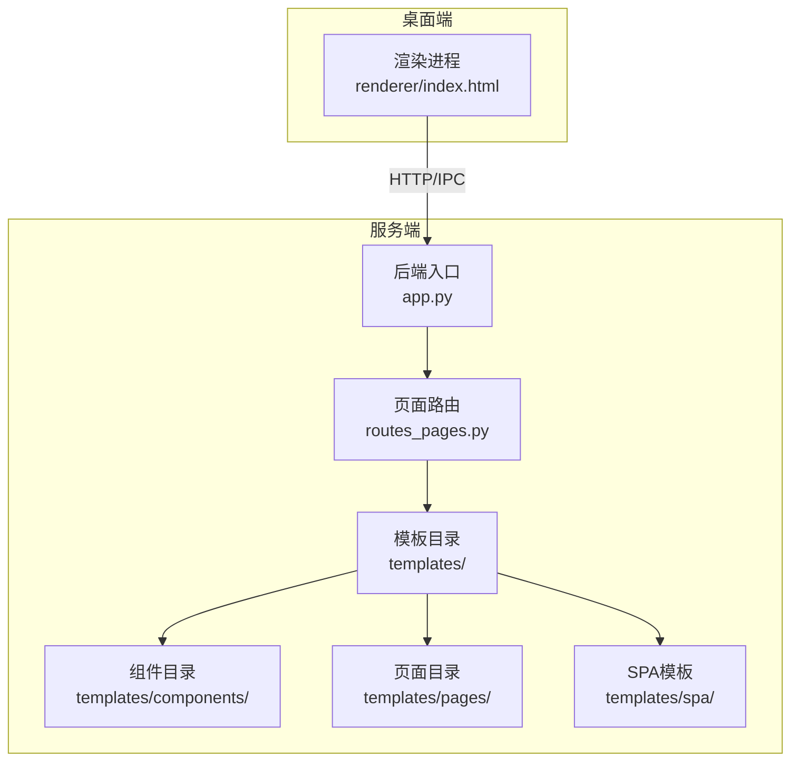
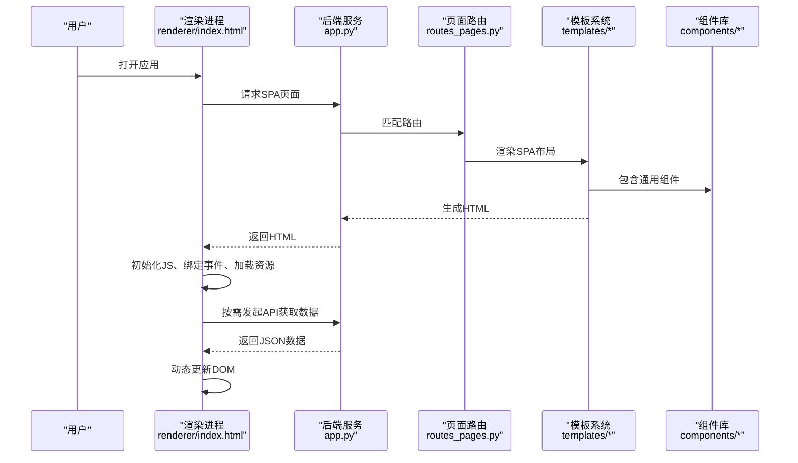
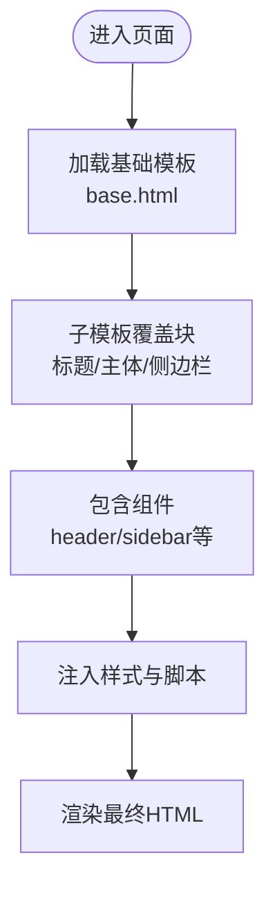
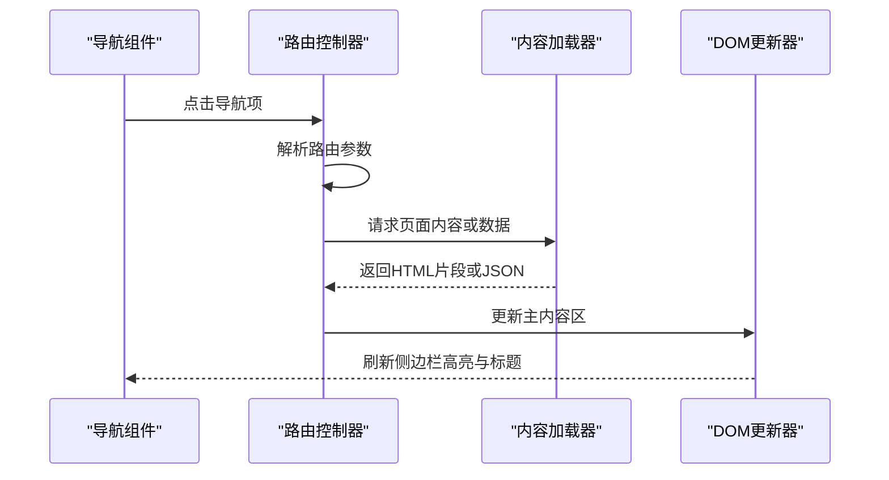
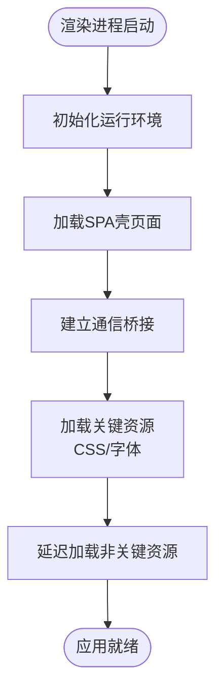
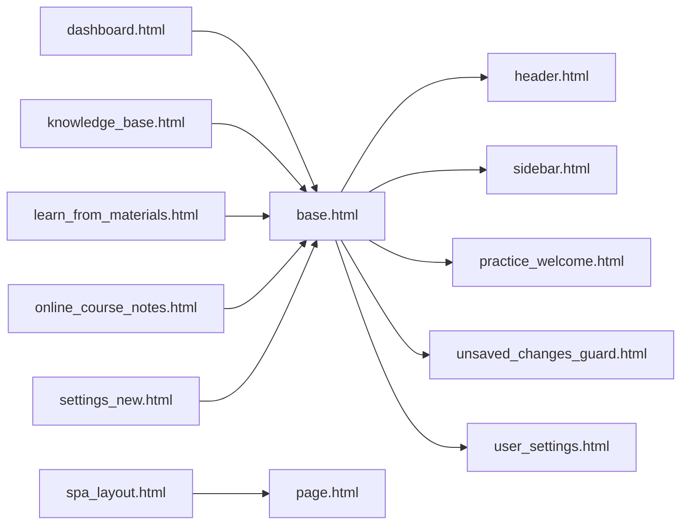

# 页面组件设计

<cite>
**本文引用的文件**   
- [base.html](file://server/templates/base.html)
- [spa_layout.html](file://server/templates/spa_layout.html)
- [index.html](file://desktop/renderer/index.html)
- [page.html](file://server/templates/spa/page.html)
- [header.html](file://server/templates/components/header.html)
- [sidebar.html](file://server/templates/components/sidebar.html)
- [practice_welcome.html](file://server/templates/components/practice_welcome.html)
- [unsaved_changes_guard.html](file://server/templates/components/unsaved_changes_guard.html)
- [user_settings.html](file://server/templates/components/user_settings.html)
- [dashboard.html](file://server/templates/pages/dashboard.html)
- [knowledge_base.html](file://server/templates/pages/knowledge_base.html)
- [learn_from_materials.html](file://server/templates/pages/learn_from_materials.html)
- [online_course_notes.html](file://server/templates/pages/online_course_notes.html)
- [settings_new.html](file://server/templates/pages/settings_new.html)
- [app.py](file://server/app.py)
- [routes_pages.py](file://server/routes_pages.py)
</cite>

## 目录
1. [引言](#引言)
2. [项目结构](#项目结构)
3. [核心组件](#核心组件)
4. [架构总览](#架构总览)
5. [详细组件分析](#详细组件分析)
6. [依赖关系分析](#依赖关系分析)
7. [性能考虑](#性能考虑)
8. [故障排查指南](#故障排查指南)
9. [结论](#结论)
10. [附录](#附录)

## 引言
本文件面向LectureLearnLoop的页面组件设计与实现，聚焦以下目标：
- HTML模板系统的架构与基础模板base.html的结构、组件复用机制
- SPA布局spa_layout.html的单页应用实现（路由切换、内容动态加载）
- 渲染进程index.html的初始化流程与资源加载策略
- 响应式设计的实现方式（CSS框架使用与移动端适配）
- 页面组件开发指南与样式规范
- 模板引擎使用模式与自定义组件开发方法

## 项目结构
本项目采用“服务端模板 + 桌面渲染进程”的双层前端架构：
- 服务端提供基于Jinja2的HTML模板与静态资源，负责页面组装与数据注入
- 桌面端通过Electron渲染进程加载SPA页面，并在需要时与服务端交互

图表来源
- [app.py](file://server/app.py)
- [routes_pages.py](file://server/routes_pages.py)
- [base.html](file://server/templates/base.html)
- [spa_layout.html](file://server/templates/spa_layout.html)
- [index.html](file://desktop/renderer/index.html)

章节来源
- [app.py](file://server/app.py)
- [routes_pages.py](file://server/routes_pages.py)
- [base.html](file://server/templates/base.html)
- [spa_layout.html](file://server/templates/spa_layout.html)
- [index.html](file://desktop/renderer/index.html)

## 核心组件
本节梳理关键模板与组件的职责与复用方式。

- 基础模板 base.html
  - 定义全局HTML骨架、公共头部与尾部、脚本与样式引入位置
  - 提供块（block）扩展点，供子模板覆盖标题、主体内容与侧边栏等区域
  - 统一引入CSS框架与主题变量，保证全站风格一致

- 组件集合 components/*
  - header.html：顶部导航、用户信息、操作入口
  - sidebar.html：左侧导航菜单、当前页面高亮
  - practice_welcome.html：练习欢迎区与引导文案
  - unsaved_changes_guard.html：未保存变更拦截提示
  - user_settings.html：用户设置面板

- SPA布局 spa_layout.html
  - 作为单页应用外壳，承载主内容区与路由容器
  - 通过JS驱动路由切换，避免整页刷新
  - 与base.html组合，形成完整的SPA页面骨架

- 页面模板 pages/*
  - dashboard.html、knowledge_base.html、learn_from_materials.html、online_course_notes.html、settings_new.html等
  - 继承base.html或spa_layout.html，填充具体业务内容

- 渲染进程 index.html
  - Electron渲染进程的入口，负责加载SPA壳并初始化前端环境
  - 管理本地资源加载、桥接API调用与日志记录

章节来源
- [base.html](file://server/templates/base.html)
- [header.html](file://server/templates/components/header.html)
- [sidebar.html](file://server/templates/components/sidebar.html)
- [practice_welcome.html](file://server/templates/components/practice_welcome.html)
- [unsaved_changes_guard.html](file://server/templates/components/unsaved_changes_guard.html)
- [user_settings.html](file://server/templates/components/user_settings.html)
- [spa_layout.html](file://server/templates/spa_layout.html)
- [dashboard.html](file://server/templates/pages/dashboard.html)
- [knowledge_base.html](file://server/templates/pages/knowledge_base.html)
- [learn_from_materials.html](file://server/templates/pages/learn_from_materials.html)
- [online_course_notes.html](file://server/templates/pages/online_course_notes.html)
- [settings_new.html](file://server/templates/pages/settings_new.html)
- [index.html](file://desktop/renderer/index.html)

## 架构总览
下图展示从后端路由到前端渲染的整体流程，以及模板之间的继承与包含关系。

图表来源
- [index.html](file://desktop/renderer/index.html)
- [app.py](file://server/app.py)
- [routes_pages.py](file://server/routes_pages.py)
- [spa_layout.html](file://server/templates/spa_layout.html)
- [base.html](file://server/templates/base.html)

## 详细组件分析

### 基础模板 base.html 与组件复用机制
- 作用
  - 定义全局HTML结构、站点元信息、公共样式与脚本挂载点
  - 通过块（如标题、主体、侧边栏）为子模板提供扩展点
- 复用机制
  - 子模板通过继承base.html，覆盖对应块以注入页面特定内容
  - 组件通过include或宏的方式被多个页面复用，减少重复代码
- 样式与主题
  - 统一引入CSS框架与主题变量，确保视觉一致性
  - 在媒体查询中处理不同屏幕尺寸下的布局变化

图表来源
- [base.html](file://server/templates/base.html)
- [header.html](file://server/templates/components/header.html)
- [sidebar.html](file://server/templates/components/sidebar.html)

章节来源
- [base.html](file://server/templates/base.html)
- [header.html](file://server/templates/components/header.html)
- [sidebar.html](file://server/templates/components/sidebar.html)

### SPA布局 spa_layout.html 的单页应用实现
- 职责
  - 作为SPA外壳，提供主内容容器与路由占位元素
  - 与base.html组合，形成完整页面骨架
- 路由切换
  - 通过JS监听导航点击，阻止默认跳转，执行路由逻辑
  - 根据路由参数动态加载页面片段或触发服务端接口
- 内容动态加载
  - 使用AJAX或Fetch获取页面内容或数据
  - 将返回的HTML片段插入主内容容器，或更新DOM树局部节点
- 状态管理
  - 维护当前路由、页面标题、侧边栏高亮等状态
  - 在路由切换时清理旧事件监听器，防止内存泄漏

图表来源
- [spa_layout.html](file://server/templates/spa_layout.html)
- [page.html](file://server/templates/spa/page.html)

章节来源
- [spa_layout.html](file://server/templates/spa_layout.html)
- [page.html](file://server/templates/spa/page.html)

### 渲染进程 index.html 的初始化流程与资源加载策略
- 初始化流程
  - 创建渲染进程窗口，加载SPA壳页面
  - 初始化日志、错误捕获与调试工具
  - 建立与服务端的通信通道（HTTP/IPC），用于数据获取与命令下发
- 资源加载策略
  - 优先加载关键CSS与字体，提升首屏体验
  - 延迟加载非关键脚本与图片，降低初始负载
  - 对静态资源进行缓存控制，提高二次访问速度
- 安全与隔离
  - 启用Node集成开关的最小权限模型
  - 对外部资源进行白名单校验，防止恶意注入

图表来源
- [index.html](file://desktop/renderer/index.html)

章节来源
- [index.html](file://desktop/renderer/index.html)

### 响应式设计实现与移动端适配
- CSS框架使用
  - 通过统一的样式入口引入CSS框架，确保栅格系统与组件样式一致
  - 使用框架提供的断点类名与工具类，快速构建响应式布局
- 移动端适配
  - 针对小屏幕优化侧边栏折叠、导航收起与内容排版
  - 使用媒体查询调整字号、间距与触控区域大小
- 可访问性
  - 为关键交互元素添加语义化标签与ARIA属性
  - 支持键盘导航与焦点管理

章节来源
- [base.html](file://server/templates/base.html)
- [spa_layout.html](file://server/templates/spa_layout.html)

### 页面组件开发指南与样式规范
- 组件命名
  - 使用语义化文件名，如header.html、sidebar.html
  - 组件内部类名遵循BEM或类似约定，避免冲突
- 组件结构
  - 每个组件独立封装HTML结构与样式，必要时附带JS行为
  - 通过include或宏的方式在主模板中复用
- 样式规范
  - 所有样式通过统一入口引入，禁止在页面内联样式
  - 使用CSS变量管理主题色、字号与间距
  - 遵循栅格系统，避免破坏布局
- 交互规范
  - 所有异步操作需显示加载状态与错误提示
  - 表单提交需做客户端校验与防抖处理

章节来源
- [header.html](file://server/templates/components/header.html)
- [sidebar.html](file://server/templates/components/sidebar.html)
- [practice_welcome.html](file://server/templates/components/practice_welcome.html)
- [unsaved_changes_guard.html](file://server/templates/components/unsaved_changes_guard.html)
- [user_settings.html](file://server/templates/components/user_settings.html)

### 模板引擎使用模式与自定义组件开发方法
- Jinja2模板继承
  - 子模板extends基础模板，覆盖block区域
  - 使用include引入组件片段，保持页面结构清晰
- 宏与过滤器
  - 使用宏封装常用UI片段，减少重复代码
  - 使用过滤器格式化数据，如日期、金额、文本截断
- 自定义组件开发
  - 在components目录下创建新组件文件
  - 在基础模板或页面模板中通过include引入
  - 为组件提供配置参数，便于在不同场景复用

章节来源
- [base.html](file://server/templates/base.html)
- [header.html](file://server/templates/components/header.html)
- [sidebar.html](file://server/templates/components/sidebar.html)

## 依赖关系分析
下图展示模板与组件之间的依赖关系，以及页面如何组合这些模块。

图表来源
- [base.html](file://server/templates/base.html)
- [spa_layout.html](file://server/templates/spa_layout.html)
- [page.html](file://server/templates/spa/page.html)
- [dashboard.html](file://server/templates/pages/dashboard.html)
- [knowledge_base.html](file://server/templates/pages/knowledge_base.html)
- [learn_from_materials.html](file://server/templates/pages/learn_from_materials.html)
- [online_course_notes.html](file://server/templates/pages/online_course_notes.html)
- [settings_new.html](file://server/templates/pages/settings_new.html)

章节来源
- [base.html](file://server/templates/base.html)
- [spa_layout.html](file://server/templates/spa_layout.html)
- [page.html](file://server/templates/spa/page.html)
- [dashboard.html](file://server/templates/pages/dashboard.html)
- [knowledge_base.html](file://server/templates/pages/knowledge_base.html)
- [learn_from_materials.html](file://server/templates/pages/learn_from_materials.html)
- [online_course_notes.html](file://server/templates/pages/online_course_notes.html)
- [settings_new.html](file://server/templates/pages/settings_new.html)

## 性能考虑
- 首屏优化
  - 关键CSS与字体预加载，减少阻塞
  - 延迟加载非关键脚本与图片
- 路由切换优化
  - 使用片段加载与DOM增量更新，避免整页刷新
  - 对频繁切换的路由进行内容缓存
- 资源缓存
  - 为静态资源设置合适的缓存头，提高二次访问速度
  - 对动态数据进行分页与增量更新
- 内存管理
  - 在路由切换时清理事件监听器与定时器
  - 避免长时间持有大对象引用

[本节为通用指导，不直接分析具体文件]

## 故障排查指南
- 模板渲染异常
  - 检查子模板是否正确继承基础模板并覆盖必要块
  - 确认组件include路径与变量传递正确
- SPA路由问题
  - 验证路由参数解析与页面片段加载逻辑
  - 检查事件监听器是否重复绑定或未清理
- 渲染进程初始化失败
  - 检查通信桥接是否建立成功
  - 查看控制台错误日志与网络请求状态
- 样式错乱
  - 确认CSS框架引入顺序与优先级
  - 检查媒体查询与栅格系统的使用是否符合规范

章节来源
- [base.html](file://server/templates/base.html)
- [spa_layout.html](file://server/templates/spa_layout.html)
- [index.html](file://desktop/renderer/index.html)

## 结论
LectureLearnLoop的页面组件设计以基础模板为核心，结合组件化与SPA布局，实现了良好的复用性与可扩展性。通过规范的模板继承、组件拆分与响应式策略，系统在可维护性、性能与用户体验方面达到平衡。后续可在路由缓存、懒加载与可访问性方面继续优化。

[本节为总结性内容，不直接分析具体文件]

## 附录
- 术语表
  - 基础模板：提供全局HTML骨架与扩展点的模板
  - 组件：可复用的UI片段，通常包含HTML、样式与少量JS
  - SPA：单页应用，通过路由切换与动态加载实现页面更新
  - 渲染进程：Electron中的前端运行环境，负责加载与执行前端代码

[本节为概念说明，不直接分析具体文件]