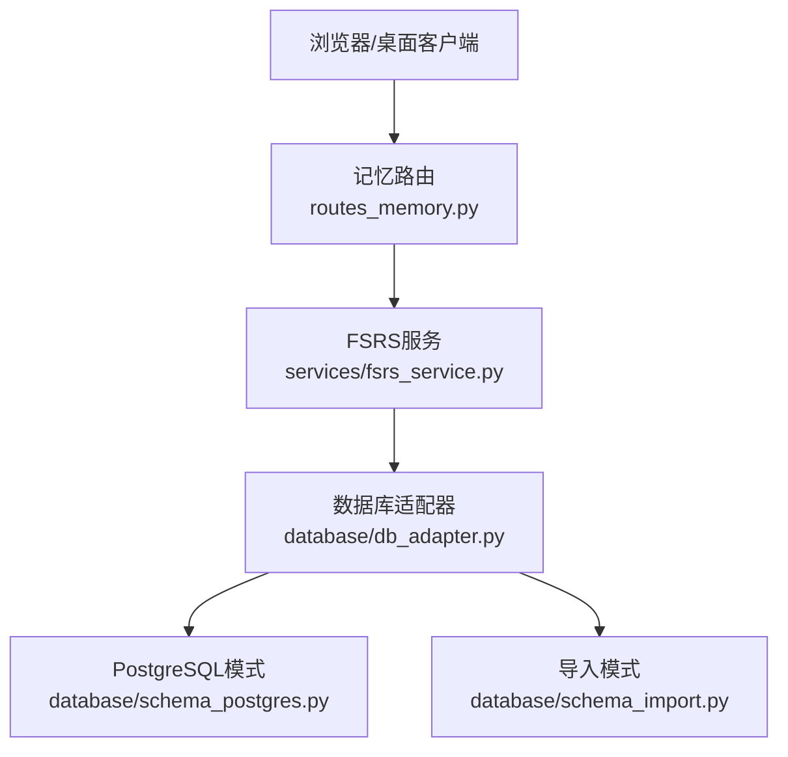
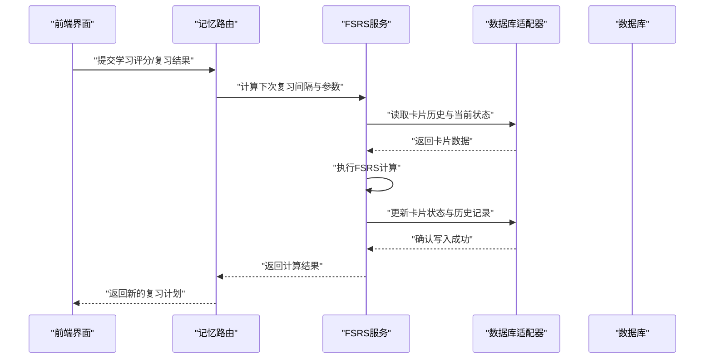
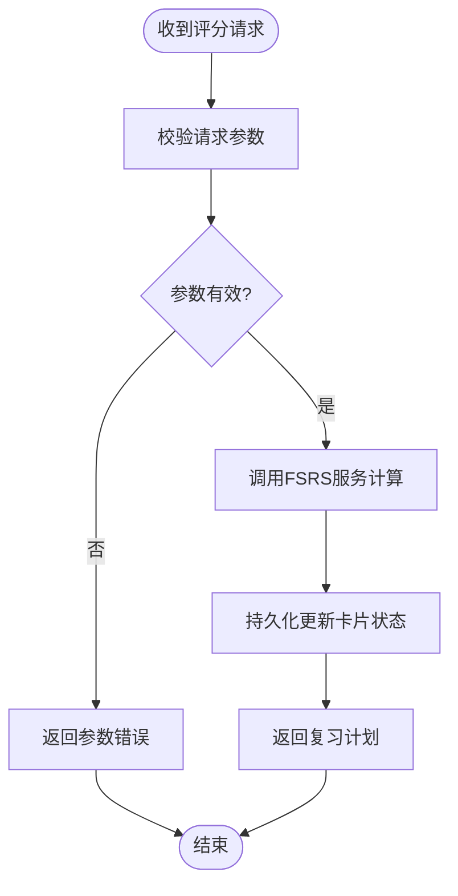
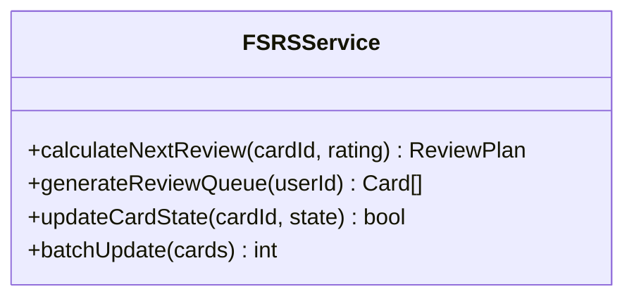
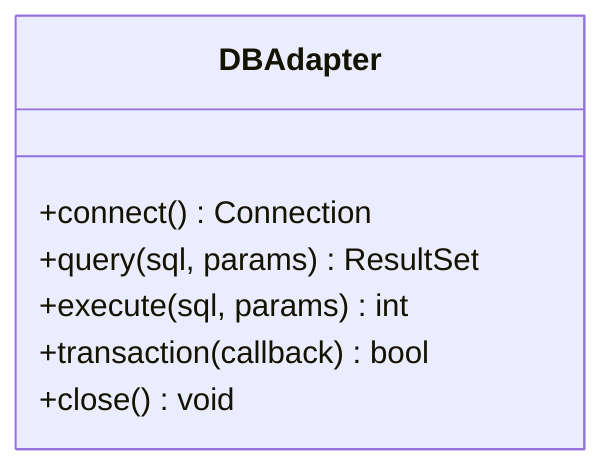
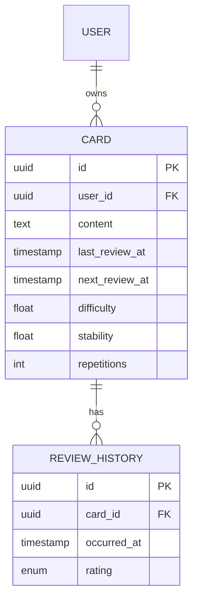
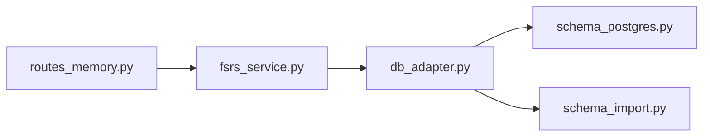

# FSRS间隔重复记忆系统

<cite>
**本文引用的文件**   
- [app.py](file://server/app.py)
- [routes_memory.py](file://server/routes_memory.py)
- [fsrs_service.py](file://server/services/fsrs_service.py)
- [db_adapter.py](file://server/database/db_adapter.py)
- [schema_postgres.py](file://server/database/schema_postgres.py)
- [schema_import.py](file://server/database/schema_import.py)
- [_integ_fsrs_service.py](file://server/_integ_fsrs_service.py)
- [_wt_fsrs_service.py](file://server/_wt_fsrs_service.py)
- [apply_fsrs_schema.py](file://server/tools/apply_fsrs_schema.py)
</cite>

## 目录
1. [简介](#简介)
2. [项目结构](#项目结构)
3. [核心组件](#核心组件)
4. [架构总览](#架构总览)
5. [详细组件分析](#详细组件分析)
6. [依赖关系分析](#依赖关系分析)
7. [性能考虑](#性能考虑)
8. [故障排查指南](#故障排查指南)
9. [结论](#结论)
10. [附录](#附录)

## 简介
本仓库实现了一个基于FSRS（Free Spaced Repetition Scheduler）的间隔重复记忆系统，服务于知识点的“练记”闭环。后端以Python服务为核心，提供记忆任务调度、卡片状态更新与复习队列生成等能力；前端通过模板页面与静态脚本调用后端接口，完成学习、练习与复习流程。数据库层支持SQLite与PostgreSQL两种适配，便于本地开发与生产部署。

## 项目结构
围绕记忆系统的代码主要位于 server 目录下：
- routes_memory.py：暴露与记忆相关的HTTP路由，承接前端请求并委派给服务层。
- services/fsrs_service.py：封装FSRS算法与服务逻辑，负责计算下次复习时间、难度与稳定性等参数。
- database/*：数据库适配与模式定义，包含DB适配器与不同数据库的模式文件。
- tools/apply_fsrs_schema.py：用于应用或迁移FSRS相关表结构的工具脚本。
- _integ_* 与 _wt_*：集成测试与Web测试辅助脚本，覆盖FSRS服务的关键路径。

**图表来源**
- [routes_memory.py:1-200](file://server/routes_memory.py#L1-L200)
- [fsrs_service.py:1-200](file://server/services/fsrs_service.py#L1-L200)
- [db_adapter.py:1-200](file://server/database/db_adapter.py#L1-L200)
- [schema_postgres.py:1-200](file://server/database/schema_postgres.py#L1-L200)
- [schema_import.py:1-200](file://server/database/schema_import.py#L1-L200)

**章节来源**
- [app.py:1-200](file://server/app.py#L1-L200)
- [routes_memory.py:1-200](file://server/routes_memory.py#L1-L200)
- [fsrs_service.py:1-200](file://server/services/fsrs_service.py#L1-L200)
- [db_adapter.py:1-200](file://server/database/db_adapter.py#L1-L200)
- [schema_postgres.py:1-200](file://server/database/schema_postgres.py#L1-L200)
- [schema_import.py:1-200](file://server/database/schema_import.py#L1-L200)

## 核心组件
- 记忆路由层：接收用户提交的学习结果（如回忆评分），触发FSRS计算并持久化卡片状态。
- FSRS服务层：实现FSRS核心计算，包括预测下次复习间隔、调整难度与稳定性，以及生成复习队列。
- 数据访问层：统一数据库操作，屏蔽SQLite与PostgreSQL差异，提供事务、查询与批量写入能力。
- 模式与迁移：定义记忆相关表结构与字段，提供工具脚本在启动或维护时应用/迁移模式。

**章节来源**
- [routes_memory.py:1-200](file://server/routes_memory.py#L1-L200)
- [fsrs_service.py:1-200](file://server/services/fsrs_service.py#L1-L200)
- [db_adapter.py:1-200](file://server/database/db_adapter.py#L1-L200)
- [schema_postgres.py:1-200](file://server/database/schema_postgres.py#L1-L200)
- [schema_import.py:1-200](file://server/database/schema_import.py#L1-L200)

## 架构总览
整体采用分层架构：
- 表现层：HTML模板与JS静态资源，渲染记忆相关页面并与后端交互。
- 路由层：将HTTP请求映射到具体业务方法。
- 服务层：封装FSRS算法与业务规则。
- 数据层：通过适配器访问数据库，保证跨库一致性。

**图表来源**
- [routes_memory.py:1-200](file://server/routes_memory.py#L1-L200)
- [fsrs_service.py:1-200](file://server/services/fsrs_service.py#L1-L200)
- [db_adapter.py:1-200](file://server/database/db_adapter.py#L1-L200)

## 详细组件分析

### 记忆路由层（routes_memory.py）
职责：
- 暴露记忆相关API端点，例如提交学习评分、获取复习队列、查询卡片状态等。
- 校验请求参数，调用FSRS服务进行计算，并将结果序列化返回。
- 处理错误与异常，确保前端获得一致的响应格式。

关键流程：
- 接收评分输入 -> 调用FSRS服务 -> 持久化更新 -> 返回新计划。

**图表来源**
- [routes_memory.py:1-200](file://server/routes_memory.py#L1-L200)

**章节来源**
- [routes_memory.py:1-200](file://server/routes_memory.py#L1-L200)

### FSRS服务层（fsrs_service.py）
职责：
- 实现FSRS核心算法，根据用户评分与历史表现计算下一次复习间隔、难度与稳定性。
- 管理复习队列生成策略，按优先级与遗忘曲线安排复习顺序。
- 提供批量更新与统计接口，支持大规模卡片的状态同步。

复杂度与优化：
- 单次计算通常为常数级复杂度，批量更新为线性复杂度。
- 可通过缓存最近一次计算结果减少重复计算开销。

**图表来源**
- [fsrs_service.py:1-200](file://server/services/fsrs_service.py#L1-L200)

**章节来源**
- [fsrs_service.py:1-200](file://server/services/fsrs_service.py#L1-L200)

### 数据访问层（db_adapter.py）
职责：
- 封装数据库连接、事务管理与通用CRUD操作。
- 屏蔽SQLite与PostgreSQL的差异，提供统一的查询接口。
- 支持批量插入与更新，提升大批量场景的性能。

关键点：
- 连接池与超时配置，避免连接泄漏与阻塞。
- 事务边界清晰，确保FSRS计算的原子性。

**图表来源**
- [db_adapter.py:1-200](file://server/database/db_adapter.py#L1-L200)

**章节来源**
- [db_adapter.py:1-200](file://server/database/db_adapter.py#L1-L200)

### 数据库模式（schema_postgres.py / schema_import.py）
职责：
- 定义记忆相关表结构，包括卡片、历史记录、用户复习进度等。
- 提供导入脚本，用于初始化或迁移数据库模式。

重点字段：
- 卡片ID、用户ID、上次复习时间、下次复习时间、难度、稳定性、重复次数等。

**图表来源**
- [schema_postgres.py:1-200](file://server/database/schema_postgres.py#L1-L200)
- [schema_import.py:1-200](file://server/database/schema_import.py#L1-L200)

**章节来源**
- [schema_postgres.py:1-200](file://server/database/schema_postgres.py#L1-L200)
- [schema_import.py:1-200](file://server/database/schema_import.py#L1-L200)

### 集成与测试（_integ_fsrs_service.py / _wt_fsrs_service.py）
职责：
- 对FSRS服务进行端到端验证，覆盖评分输入、间隔计算、状态更新等路径。
- 提供Web测试脚本，模拟前端交互，验证路由与服务层的协同。

使用建议：
- 在CI中运行集成测试，确保每次变更不破坏FSRS核心逻辑。
- 结合日志与断言，定位异常分支与边界条件。

**章节来源**
- [_integ_fsrs_service.py:1-200](file://server/_integ_fsrs_service.py#L1-L200)
- [_wt_fsrs_service.py:1-200](file://server/_wt_fsrs_service.py#L1-L200)

### 模式迁移工具（apply_fsrs_schema.py）
职责：
- 在应用启动或维护窗口中，自动应用或迁移FSRS相关表结构。
- 支持幂等执行，避免重复迁移导致的数据不一致。

注意事项：
- 在生产环境谨慎执行，建议在低峰期或停机窗口运行。
- 记录迁移日志，便于审计与回滚。

**章节来源**
- [apply_fsrs_schema.py:1-200](file://server/tools/apply_fsrs_schema.py#L1-L200)

## 依赖关系分析
- 路由层依赖FSRS服务与数据库适配器。
- FSRS服务依赖数据库适配器进行读写。
- 数据库适配器依赖具体数据库驱动（SQLite/PostgreSQL）。
- 模式文件被适配器与迁移工具引用。

**图表来源**
- [routes_memory.py:1-200](file://server/routes_memory.py#L1-L200)
- [fsrs_service.py:1-200](file://server/services/fsrs_service.py#L1-L200)
- [db_adapter.py:1-200](file://server/database/db_adapter.py#L1-L200)
- [schema_postgres.py:1-200](file://server/database/schema_postgres.py#L1-L200)
- [schema_import.py:1-200](file://server/database/schema_import.py#L1-L200)

**章节来源**
- [routes_memory.py:1-200](file://server/routes_memory.py#L1-L200)
- [fsrs_service.py:1-200](file://server/services/fsrs_service.py#L1-L200)
- [db_adapter.py:1-200](file://server/database/db_adapter.py#L1-L200)

## 性能考虑
- 批量更新：对大量卡片的复习计划更新应使用批量接口，减少往返开销。
- 索引优化：为高频查询字段（如用户ID、下次复习时间）建立索引，提升查询效率。
- 缓存策略：对热点卡片的FSRS计算结果进行短期缓存，降低重复计算压力。
- 连接池：合理配置数据库连接池大小，避免在高并发下出现连接耗尽。

[本节为通用指导，无需特定文件来源]

## 故障排查指南
常见问题与定位步骤：
- 评分提交失败：检查路由层参数校验与错误返回，确认FSRS服务是否抛出异常。
- 复习计划未更新：核查数据库适配器的事务边界与写入结果，确认模式是否正确应用。
- 性能退化：观察批量更新耗时与数据库慢查询日志，评估是否需要索引或缓存优化。
- 迁移失败：查看迁移工具的日志输出，确认SQL语句与目标数据库兼容性。

**章节来源**
- [routes_memory.py:1-200](file://server/routes_memory.py#L1-L200)
- [fsrs_service.py:1-200](file://server/services/fsrs_service.py#L1-L200)
- [db_adapter.py:1-200](file://server/database/db_adapter.py#L1-L200)
- [apply_fsrs_schema.py:1-200](file://server/tools/apply_fsrs_schema.py#L1-L200)

## 结论
该FSRS间隔重复记忆系统通过清晰的分层架构与可靠的数据库适配，实现了从前端交互到算法计算再到数据持久化的完整闭环。路由层与服务解耦，便于扩展与维护；FSRS服务提供稳定的复习计划生成能力；数据层支持多数据库后端，满足不同部署需求。建议在后续迭代中持续优化批量操作与缓存策略，并结合集成测试保障核心逻辑的正确性。

[本节为总结性内容，无需特定文件来源]

## 附录
- 集成测试入口：[_integ_fsrs_service.py](file://server/_integ_fsrs_service.py)
- Web测试入口：[_wt_fsrs_service.py](file://server/_wt_fsrs_service.py)
- 模式迁移工具：[apply_fsrs_schema.py](file://server/tools/apply_fsrs_schema.py)

[本节为补充信息，无需特定文件来源]