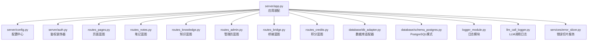
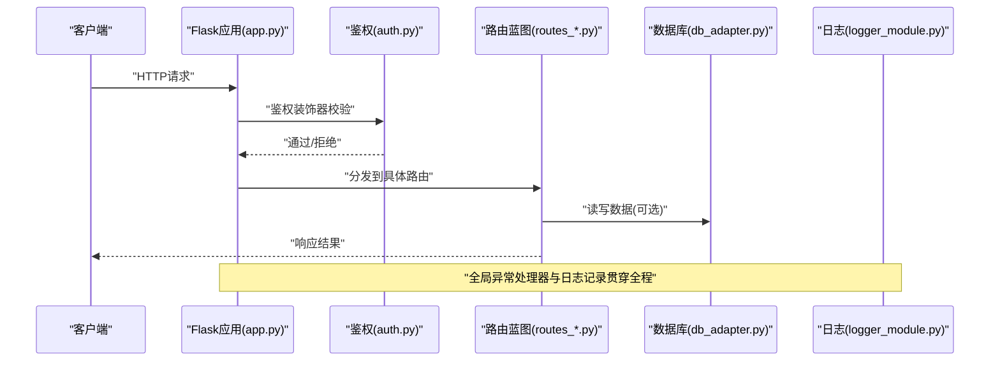
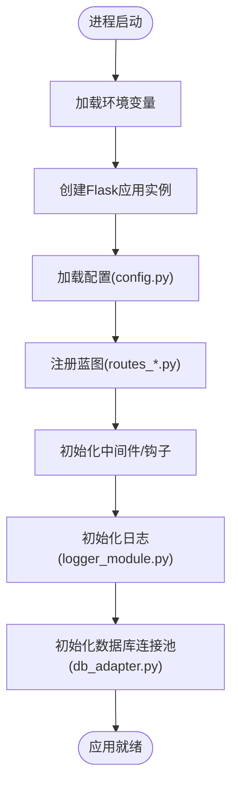
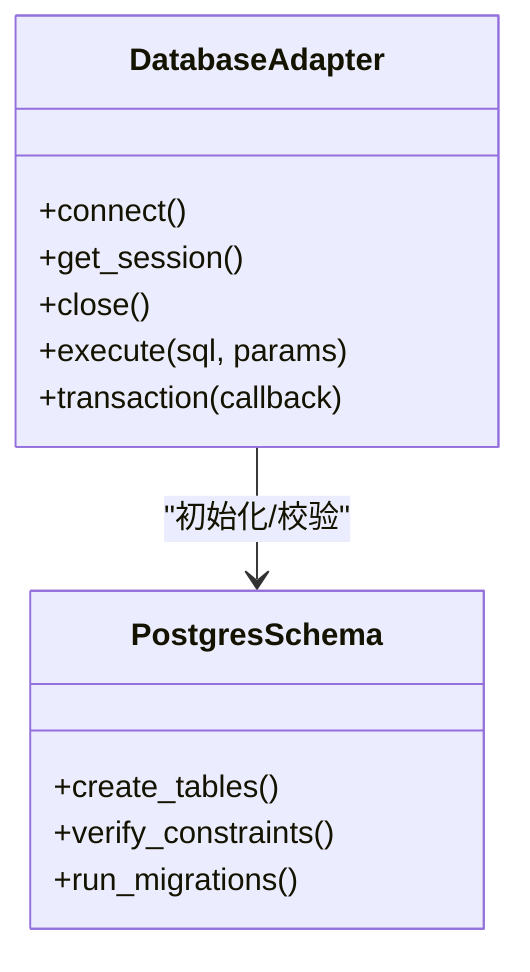
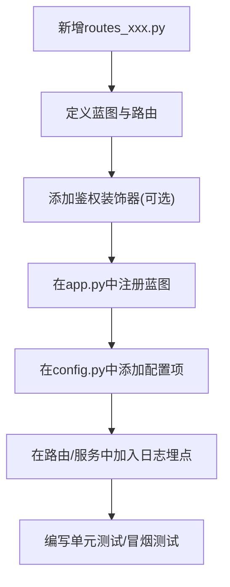
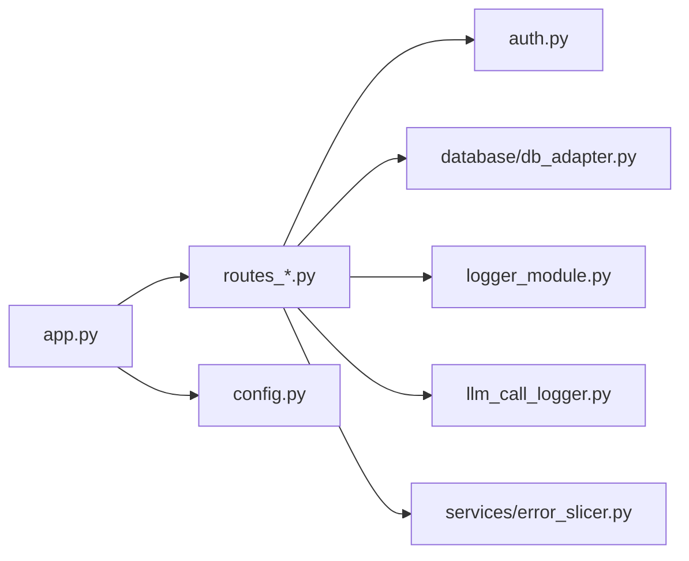

# Flask应用结构

<cite>
**本文引用的文件**   
- [app.py](file://server/app.py)
- [config.py](file://server/config.py)
- [auth.py](file://server/auth.py)
- [routes_pages.py](file://server/routes_pages.py)
- [routes_notes.py](file://server/routes_notes.py)
- [routes_knowledge.py](file://server/routes_knowledge.py)
- [routes_admin.py](file://server/routes_admin.py)
- [routes_bridge.py](file://server/routes_bridge.py)
- [routes_credits.py](file://server/routes_credits.py)
- [logger_module.py](file://server/logger_module.py)
- [llm_call_logger.py](file://server/llm_call_logger.py)
- [database/db_adapter.py](file://server/database/db_adapter.py)
- [database/schema_postgres.py](file://server/database/schema_postgres.py)
- [services/error_slicer.py](file://server/services/error_slicer.py)
- [start_app.ps1](file://start_app.ps1)
</cite>

## 目录
1. [简介](#简介)
2. [项目结构](#项目结构)
3. [核心组件](#核心组件)
4. [架构总览](#架构总览)
5. [详细组件分析](#详细组件分析)
6. [依赖关系分析](#依赖关系分析)
7. [性能考虑](#性能考虑)
8. [故障排查指南](#故障排查指南)
9. [结论](#结论)
10. [附录](#附录)

## 简介
本文件面向LectureLearnLoop的Flask后端，系统化梳理其应用初始化、配置管理、蓝图注册、中间件与日志体系，并给出扩展新路由模块、接入外部服务与数据库连接池配置的实践指引。文档兼顾技术深度与可读性，帮助不同背景的读者快速理解并安全地扩展系统。

## 项目结构
Flask后端位于server目录，采用“按功能域拆分蓝图”的组织方式：
- 入口与装配：app.py负责创建应用实例、加载配置、注册蓝图、挂载中间件与错误处理。
- 配置中心：config.py集中管理环境变量与运行时配置。
- 认证与安全：auth.py提供鉴权装饰器与会话/权限相关逻辑。
- 路由蓝图：routes_*.py按页面、笔记、知识、管理员、桥接、积分等维度拆分。
- 数据访问：database/*封装数据库适配器与PostgreSQL模式定义。
- 服务层：services/*提供通用业务能力（如错误切片）。
- 日志：logger_module.py与llm_call_logger.py统一日志输出与LLM调用审计。

图表来源
- [app.py:1-200](file://server/app.py#L1-L200)
- [config.py:1-200](file://server/config.py#L1-L200)
- [auth.py:1-200](file://server/auth.py#L1-L200)
- [routes_pages.py:1-200](file://server/routes_pages.py#L1-L200)
- [routes_notes.py:1-200](file://server/routes_notes.py#L1-L200)
- [routes_knowledge.py:1-200](file://server/routes_knowledge.py#L1-L200)
- [routes_admin.py:1-200](file://server/routes_admin.py#L1-L200)
- [routes_bridge.py:1-200](file://server/routes_bridge.py#L1-L200)
- [routes_credits.py:1-200](file://server/routes_credits.py#L1-L200)
- [database/db_adapter.py:1-200](file://server/database/db_adapter.py#L1-L200)
- [database/schema_postgres.py:1-200](file://server/database/schema_postgres.py#L1-L200)
- [logger_module.py:1-200](file://server/logger_module.py#L1-L200)
- [llm_call_logger.py:1-200](file://server/llm_call_logger.py#L1-L200)
- [services/error_slicer.py:1-200](file://server/services/error_slicer.py#L1-L200)

章节来源
- [app.py:1-200](file://server/app.py#L1-L200)
- [config.py:1-200](file://server/config.py#L1-L200)

## 核心组件
- 应用装配器：负责创建Flask应用、读取配置、注册蓝图、挂载全局异常处理器、初始化日志与数据库连接。
- 配置中心：从环境变量与默认值构建配置对象，供各模块按需读取。
- 鉴权装饰器：为受保护路由提供登录校验与权限控制。
- 蓝图集合：按业务域划分的路由模块，便于独立开发与测试。
- 数据库适配器：封装连接池、会话生命周期与事务边界。
- 日志系统：统一结构化日志与LLM调用审计。
- 错误切片服务：将复杂错误信息切分为可展示片段。

章节来源
- [app.py:1-200](file://server/app.py#L1-L200)
- [config.py:1-200](file://server/config.py#L1-L200)
- [auth.py:1-200](file://server/auth.py#L1-L200)
- [database/db_adapter.py:1-200](file://server/database/db_adapter.py#L1-L200)
- [logger_module.py:1-200](file://server/logger_module.py#L1-L200)
- [llm_call_logger.py:1-200](file://server/llm_call_logger.py#L1-L200)
- [services/error_slicer.py:1-200](file://server/services/error_slicer.py#L1-L200)

## 架构总览
下图展示了请求进入后的关键路径：客户端请求经Flask应用分发到对应蓝图路由，路由通过鉴权装饰器进行权限校验，随后调用服务层或数据访问层；所有异常被全局处理器捕获并记录；日志贯穿全链路。

图表来源
- [app.py:1-200](file://server/app.py#L1-L200)
- [auth.py:1-200](file://server/auth.py#L1-L200)
- [routes_pages.py:1-200](file://server/routes_pages.py#L1-L200)
- [database/db_adapter.py:1-200](file://server/database/db_adapter.py#L1-L200)
- [logger_module.py:1-200](file://server/logger_module.py#L1-L200)

## 详细组件分析

### 应用初始化与启动流程
- 应用创建：在入口文件中创建Flask应用实例，设置静态模板目录、调试开关等基础属性。
- 配置加载：从配置中心读取环境变量与默认值，注入到应用上下文。
- 蓝图注册：批量导入并按前缀注册各业务蓝图，形成清晰的路由命名空间。
- 中间件与钩子：注册全局异常处理器、请求前后钩子、CORS或限流等中间件（如有）。
- 日志初始化：根据环境选择控制台/文件输出，并启用结构化字段。
- 数据库初始化：根据配置建立连接池，执行必要的表结构检查或迁移。

图表来源
- [app.py:1-200](file://server/app.py#L1-L200)
- [config.py:1-200](file://server/config.py#L1-L200)
- [logger_module.py:1-200](file://server/logger_module.py#L1-L200)
- [database/db_adapter.py:1-200](file://server/database/db_adapter.py#L1-L200)

章节来源
- [app.py:1-200](file://server/app.py#L1-L200)
- [config.py:1-200](file://server/config.py#L1-L200)

### 配置管理策略
- 环境变量优先：敏感信息与运行参数通过环境变量注入，避免硬编码。
- 默认值兜底：非敏感配置提供合理默认值，便于本地开发。
- 类型与校验：对端口、数据库URL、密钥等进行类型转换与基本校验。
- 作用域隔离：区分开发、测试、生产环境的差异化配置。

章节来源
- [config.py:1-200](file://server/config.py#L1-L200)

### 蓝图注册机制
- 模块化路由：每个routes_*.py文件对应一个业务域，使用Blueprint声明路由。
- 统一前缀：通过url_prefix为蓝图分组，便于版本化与权限控制。
- 依赖注入：在蓝图内通过Flask提供的g或应用上下文获取共享资源（如数据库会话、配置）。
- 可扩展性：新增功能只需新建蓝图并在入口中注册即可。

章节来源
- [routes_pages.py:1-200](file://server/routes_pages.py#L1-L200)
- [routes_notes.py:1-200](file://server/routes_notes.py#L1-L200)
- [routes_knowledge.py:1-200](file://server/routes_knowledge.py#L1-L200)
- [routes_admin.py:1-200](file://server/routes_admin.py#L1-L200)
- [routes_bridge.py:1-200](file://server/routes_bridge.py#L1-L200)
- [routes_credits.py:1-200](file://server/routes_credits.py#L1-L200)

### 鉴权与中间件
- 鉴权装饰器：auth.py提供装饰器用于校验用户登录状态与角色权限。
- 请求钩子：可在请求进入/离开时执行审计、埋点、清理等操作。
- 全局异常处理：统一捕获未处理异常，返回友好JSON或HTML错误页，并记录堆栈。

章节来源
- [auth.py:1-200](file://server/auth.py#L1-L200)
- [app.py:1-200](file://server/app.py#L1-L200)

### 数据库连接池与模式
- 连接池：db_adapter.py封装连接池，复用连接，减少握手开销。
- 会话管理：为每个请求分配独立会话，确保事务隔离。
- 模式定义：schema_postgres.py维护表结构与约束，支持迁移与一致性检查。

图表来源
- [database/db_adapter.py:1-200](file://server/database/db_adapter.py#L1-L200)
- [database/schema_postgres.py:1-200](file://server/database/schema_postgres.py#L1-L200)

章节来源
- [database/db_adapter.py:1-200](file://server/database/db_adapter.py#L1-L200)
- [database/schema_postgres.py:1-200](file://server/database/schema_postgres.py#L1-L200)

### 日志系统与LLM调用审计
- 统一日志：logger_module.py提供结构化日志接口，包含请求ID、用户、耗时等字段。
- LLM审计：llm_call_logger.py记录模型调用输入输出摘要、耗时与错误码，便于追踪与成本核算。
- 分级输出：开发环境输出到控制台，生产环境输出到文件并轮转。

章节来源
- [logger_module.py:1-200](file://server/logger_module.py#L1-L200)
- [llm_call_logger.py:1-200](file://server/llm_call_logger.py#L1-L200)

### 错误处理与切片
- 全局异常：捕获未处理异常，转换为标准错误响应。
- 错误切片：services/error_slicer.py将长错误消息切分为前端友好的片段，提升用户体验。

章节来源
- [services/error_slicer.py:1-200](file://server/services/error_slicer.py#L1-L200)
- [app.py:1-200](file://server/app.py#L1-L200)

### 扩展应用功能与添加新路由模块
- 新建蓝图：在server目录下新增routes_xxx.py，使用Blueprint声明路由。
- 注册蓝图：在app.py中导入并注册该蓝图，指定url_prefix。
- 鉴权保护：对需要登录的路由使用auth.py中的装饰器。
- 配置外部服务：在config.py中添加新的环境变量，并在服务层或路由中读取。
- 日志埋点：在关键路径加入logger_module.py的结构化日志。

图表来源
- [routes_pages.py:1-200](file://server/routes_pages.py#L1-L200)
- [app.py:1-200](file://server/app.py#L1-L200)
- [config.py:1-200](file://server/config.py#L1-L200)
- [logger_module.py:1-200](file://server/logger_module.py#L1-L200)

章节来源
- [routes_pages.py:1-200](file://server/routes_pages.py#L1-L200)
- [app.py:1-200](file://server/app.py#L1-L200)
- [config.py:1-200](file://server/config.py#L1-L200)
- [logger_module.py:1-200](file://server/logger_module.py#L1-L200)

### 环境变量处理与应用启动
- 启动脚本：start_app.ps1负责设置必要的环境变量并启动Flask应用。
- 环境变量清单：包括数据库连接串、密钥、日志级别、第三方服务API Key等。
- 启动顺序：先加载环境变量，再启动WSGI服务器，最后由应用装配器完成初始化。

章节来源
- [start_app.ps1:1-200](file://start_app.ps1#L1-L200)
- [config.py:1-200](file://server/config.py#L1-L200)

## 依赖关系分析
- 低耦合：蓝图之间不直接相互依赖，通过Flask上下文共享资源。
- 明确边界：数据访问集中在database/*，业务逻辑在routes_*与services/*。
- 外部依赖：数据库、LLM提供商、ASR/TTS等服务通过配置注入，便于替换与测试。

图表来源
- [routes_pages.py:1-200](file://server/routes_pages.py#L1-L200)
- [routes_notes.py:1-200](file://server/routes_notes.py#L1-L200)
- [routes_knowledge.py:1-200](file://server/routes_knowledge.py#L1-L200)
- [routes_admin.py:1-200](file://server/routes_admin.py#L1-L200)
- [routes_bridge.py:1-200](file://server/routes_bridge.py#L1-L200)
- [routes_credits.py:1-200](file://server/routes_credits.py#L1-L200)
- [auth.py:1-200](file://server/auth.py#L1-L200)
- [database/db_adapter.py:1-200](file://server/database/db_adapter.py#L1-L200)
- [logger_module.py:1-200](file://server/logger_module.py#L1-L200)
- [llm_call_logger.py:1-200](file://server/llm_call_logger.py#L1-L200)
- [services/error_slicer.py:1-200](file://server/services/error_slicer.py#L1-L200)
- [app.py:1-200](file://server/app.py#L1-L200)
- [config.py:1-200](file://server/config.py#L1-L200)

## 性能考虑
- 连接池复用：数据库连接池减少频繁建连开销，提高并发能力。
- 懒加载与缓存：对静态资源与大对象采用懒加载与缓存策略。
- 日志异步：在高吞吐场景下，日志写入建议异步化以避免阻塞主线程。
- 请求裁剪：对大响应体进行分页或流式传输，降低内存占用。

## 故障排查指南
- 启动失败：检查环境变量是否完整，数据库连接串是否正确，端口是否被占用。
- 鉴权失败：确认会话/Token是否有效，权限配置是否匹配。
- 数据库异常：查看连接池状态、SQL语句与索引使用情况。
- 日志缺失：确认日志级别与输出目标配置正确。
- LLM调用失败：核对API Key、网络连通性与速率限制。

章节来源
- [logger_module.py:1-200](file://server/logger_module.py#L1-L200)
- [llm_call_logger.py:1-200](file://server/llm_call_logger.py#L1-L200)
- [database/db_adapter.py:1-200](file://server/database/db_adapter.py#L1-L200)
- [auth.py:1-200](file://server/auth.py#L1-L200)

## 结论
LectureLearnLoop的Flask后端以清晰的模块化蓝图组织、集中的配置管理与完善的日志/错误处理体系为基础，具备良好的可扩展性与可维护性。通过遵循本文的扩展指南与最佳实践，团队可以快速增加新功能、接入外部服务并保持系统的稳定与高性能。

## 附录
- 常用命令：参考start_app.ps1与环境变量说明。
- 蓝图示例：参考现有routes_*.py文件的结构与命名约定。
- 配置清单：参考config.py中的键名与默认值。