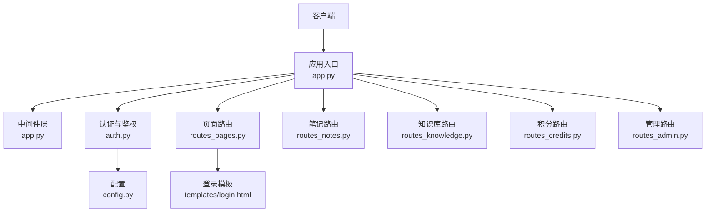
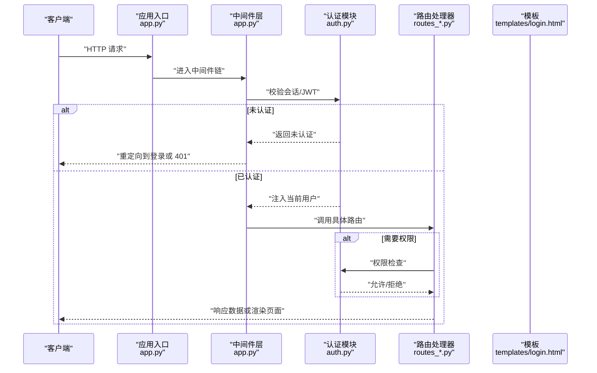
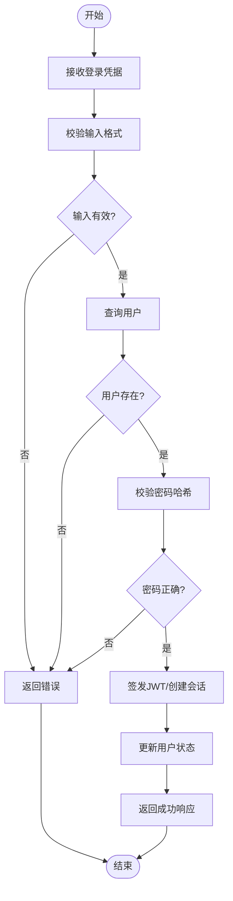
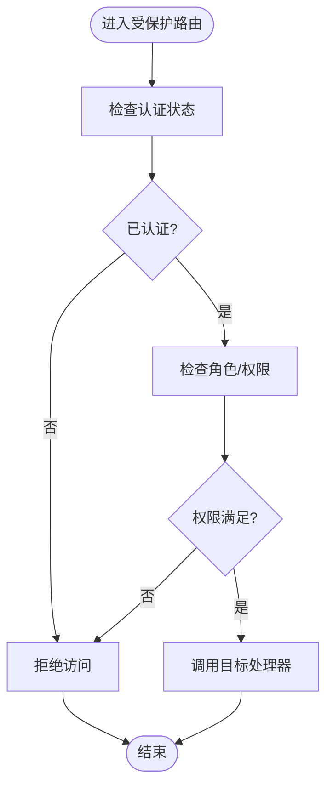
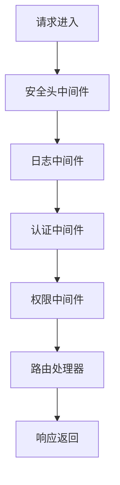
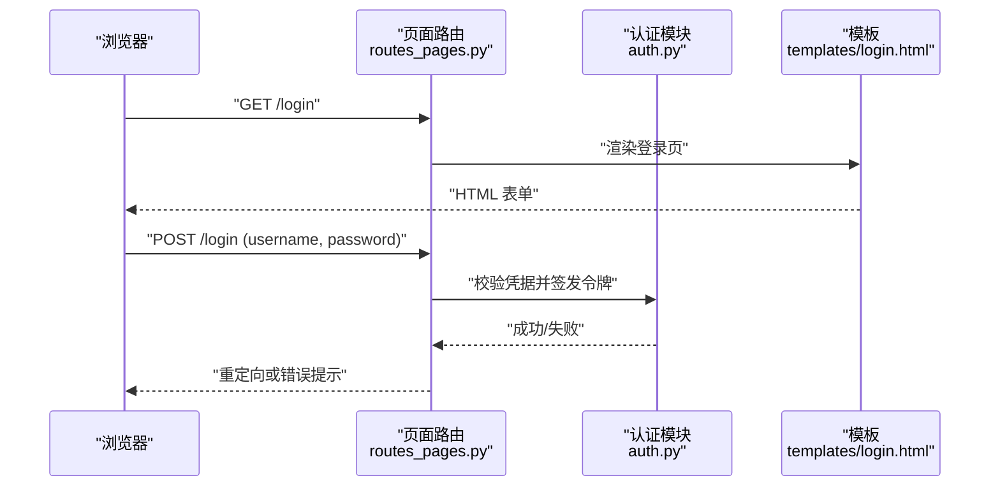
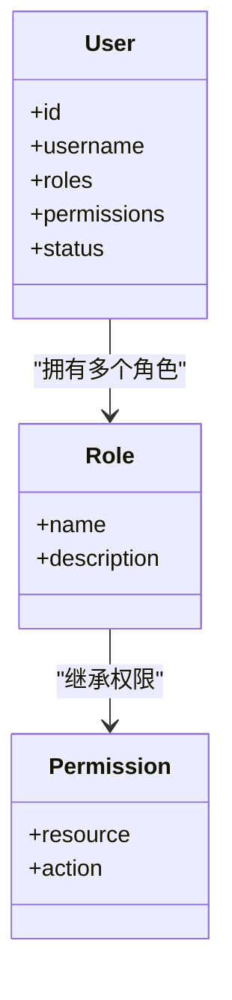
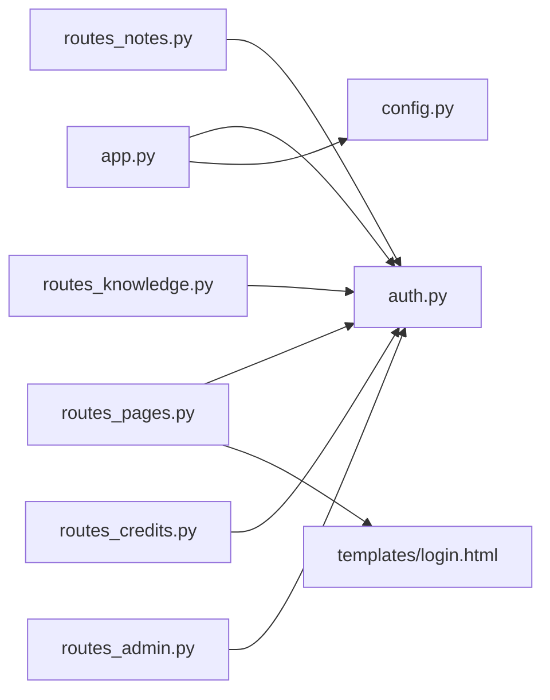

# 中间件与认证

<cite>
**本文引用的文件**   
- [app.py](file://server/app.py)
- [auth.py](file://server/auth.py)
- [config.py](file://server/config.py)
- [routes_pages.py](file://server/routes_pages.py)
- [routes_notes.py](file://server/routes_notes.py)
- [routes_admin.py](file://server/routes_admin.py)
- [routes_credits.py](file://server/routes_credits.py)
- [routes_knowledge.py](file://server/routes_knowledge.py)
- [templates/login.html](file://server/templates/login.html)
- [tests/test_p1_auth_isolation.py](file://server/tests/test_p1_auth_isolation.py)
</cite>

## 目录
1. [简介](#简介)
2. [项目结构](#项目结构)
3. [核心组件](#核心组件)
4. [架构总览](#架构总览)
5. [详细组件分析](#详细组件分析)
6. [依赖关系分析](#依赖关系分析)
7. [性能考虑](#性能考虑)
8. [故障排查指南](#故障排查指南)
9. [结论](#结论)
10. [附录](#附录)

## 简介
本文件为 LectureLearnLoop 的中间件与认证系统提供全面文档，覆盖用户认证流程、会话管理、权限控制策略、角色管理、JWT 令牌处理、密码加密存储、用户状态管理、装饰器使用、访问控制实现、中间件执行顺序、请求生命周期钩子、自定义中间件开发，以及安全最佳实践（CSRF 防护与 XSS 防护）。文档面向不同技术背景的读者，既提供高层概览，也深入到代码级实现细节。

## 项目结构
LectureLearnLoop 的后端基于 Python Web 框架组织，认证与安全相关能力集中在以下模块：
- 应用入口与全局中间件注册：[app.py](file://server/app.py)
- 认证与鉴权核心逻辑：[auth.py](file://server/auth.py)
- 配置项（含安全相关配置）：[config.py](file://server/config.py)
- 页面路由（登录/登出等）：[routes_pages.py](file://server/routes_pages.py)
- 业务路由（笔记、知识库、积分、管理等），通过装饰器进行权限控制：[routes_notes.py](file://server/routes_notes.py)、[routes_knowledge.py](file://server/routes_knowledge.py)、[routes_credits.py](file://server/routes_credits.py)、[routes_admin.py](file://server/routes_admin.py)
- 登录模板：[templates/login.html](file://server/templates/login.html)
- 认证隔离测试用例：[tests/test_p1_auth_isolation.py](file://server/tests/test_p1_auth_isolation.py)

**图示来源**
- [app.py:1-200](file://server/app.py#L1-L200)
- [auth.py:1-200](file://server/auth.py#L1-L200)
- [config.py:1-200](file://server/config.py#L1-L200)
- [routes_pages.py:1-200](file://server/routes_pages.py#L1-L200)
- [routes_notes.py:1-200](file://server/routes_notes.py#L1-L200)
- [routes_knowledge.py:1-200](file://server/routes_knowledge.py#L1-L200)
- [routes_credits.py:1-200](file://server/routes_credits.py#L1-L200)
- [routes_admin.py:1-200](file://server/routes_admin.py#L1-L200)
- [templates/login.html:1-200](file://server/templates/login.html#L1-L200)

**章节来源**
- [app.py:1-200](file://server/app.py#L1-L200)
- [auth.py:1-200](file://server/auth.py#L1-L200)
- [config.py:1-200](file://server/config.py#L1-L200)
- [routes_pages.py:1-200](file://server/routes_pages.py#L1-L200)
- [routes_notes.py:1-200](file://server/routes_notes.py#L1-L200)
- [routes_knowledge.py:1-200](file://server/routes_knowledge.py#L1-L200)
- [routes_credits.py:1-200](file://server/routes_credits.py#L1-L200)
- [routes_admin.py:1-200](file://server/routes_admin.py#L1-L200)
- [templates/login.html:1-200](file://server/templates/login.html#L1-L200)

## 核心组件
- 应用入口与中间件注册：负责挂载全局中间件、设置请求上下文、统一错误处理、初始化日志与数据库连接。
- 认证与鉴权模块：提供登录校验、会话创建与验证、JWT 签发与解析、密码哈希与校验、角色与权限检查装饰器。
- 配置模块：集中管理密钥、令牌过期时间、会话配置、安全头与跨域策略。
- 路由层：页面路由处理登录/登出；业务路由通过装饰器进行权限控制。
- 模板层：登录页渲染与表单提交。
- 测试：认证隔离与权限边界测试。

**章节来源**
- [app.py:1-200](file://server/app.py#L1-L200)
- [auth.py:1-200](file://server/auth.py#L1-L200)
- [config.py:1-200](file://server/config.py#L1-L200)
- [routes_pages.py:1-200](file://server/routes_pages.py#L1-L200)
- [routes_notes.py:1-200](file://server/routes_notes.py#L1-L200)
- [routes_knowledge.py:1-200](file://server/routes_knowledge.py#L1-L200)
- [routes_credits.py:1-200](file://server/routes_credits.py#L1-L200)
- [routes_admin.py:1-200](file://server/routes_admin.py#L1-L200)
- [templates/login.html:1-200](file://server/templates/login.html#L1-L200)
- [tests/test_p1_auth_isolation.py:1-200](file://server/tests/test_p1_auth_isolation.py#L1-L200)

## 架构总览
下图展示从客户端到服务端的核心交互路径，包括中间件、认证、鉴权与路由处理。

**图示来源**
- [app.py:1-200](file://server/app.py#L1-L200)
- [auth.py:1-200](file://server/auth.py#L1-L200)
- [routes_pages.py:1-200](file://server/routes_pages.py#L1-L200)
- [templates/login.html:1-200](file://server/templates/login.html#L1-L200)

## 详细组件分析

### 认证与鉴权模块（auth.py）
- 功能要点
  - 登录校验：验证用户名/密码，生成会话或 JWT。
  - 会话管理：创建、读取、更新、销毁会话。
  - JWT 处理：签发、解析、刷新、黑名单（可选）。
  - 密码安全：使用强哈希算法存储与校验密码。
  - 权限与角色：提供装饰器用于路由级权限控制，支持角色与资源级权限。
  - 用户状态：维护在线状态、最后登录时间、失败次数等。

- 关键流程（登录）

- 关键流程（鉴权装饰器）

- 装饰器使用示例（说明性）
  - @require_login：要求用户已登录。
  - @require_role("admin")：要求具备指定角色。
  - @require_permission("notes:write")：要求具备特定资源权限。

- 安全要点
  - 密码哈希：使用不可逆哈希函数，加盐存储。
  - JWT 签名：使用强密钥与合理过期时间。
  - 会话固定防护：登录后刷新会话标识。
  - 速率限制：对登录接口实施限流。

**图示来源**
- [auth.py:1-200](file://server/auth.py#L1-L200)

**章节来源**
- [auth.py:1-200](file://server/auth.py#L1-L200)

### 应用入口与中间件（app.py）
- 功能要点
  - 中间件注册：按顺序挂载认证、日志、错误处理、安全头等中间件。
  - 请求生命周期钩子：在请求前/后注入用户信息、记录访问日志、清理上下文。
  - 统一错误处理：捕获异常并返回标准化错误响应。
  - 健康检查与调试开关。

- 中间件执行顺序（示意）

- 自定义中间件开发建议
  - 遵循统一接口：接收请求对象，返回响应或继续链式调用。
  - 保持幂等与无副作用：避免在中间件中修改业务状态。
  - 可观测性：记录关键指标与错误堆栈。
  - 可配置性：通过配置模块控制行为。

**图示来源**
- [app.py:1-200](file://server/app.py#L1-L200)

**章节来源**
- [app.py:1-200](file://server/app.py#L1-L200)

### 配置模块（config.py）
- 功能要点
  - 安全密钥与令牌配置：JWT 密钥、过期时间、刷新策略。
  - 会话配置：存储后端、超时时间、Cookie 属性（HttpOnly、Secure、SameSite）。
  - 安全头策略：CSP、X-Frame-Options、HSTS、Referrer-Policy。
  - 跨域策略：允许的源、方法、头部。
  - 日志级别与输出。

- 配置项分类（示意）
  - 认证与授权：jwt_secret、token_expiry、session_timeout。
  - 安全：csrf_enabled、xss_protection、csp_policy。
  - 服务：host、port、debug、log_level。

**章节来源**
- [config.py:1-200](file://server/config.py#L1-L200)

### 页面路由（routes_pages.py）
- 功能要点
  - 登录页面渲染与表单提交处理。
  - 登出处理：清除会话/JWT。
  - 密码重置与账户锁定策略（可选）。

- 登录流程（与 auth.py 协作）

**图示来源**
- [routes_pages.py:1-200](file://server/routes_pages.py#L1-L200)
- [auth.py:1-200](file://server/auth.py#L1-L200)
- [templates/login.html:1-200](file://server/templates/login.html#L1-L200)

**章节来源**
- [routes_pages.py:1-200](file://server/routes_pages.py#L1-L200)
- [templates/login.html:1-200](file://server/templates/login.html#L1-L200)

### 业务路由与权限控制（routes_notes.py、routes_knowledge.py、routes_credits.py、routes_admin.py）
- 功能要点
  - 使用认证与权限装饰器保护 API。
  - 角色与资源权限检查：如“管理员”、“编辑者”、“普通用户”。
  - 审计日志：记录敏感操作。

- 权限模型（示意）

**图示来源**
- [routes_notes.py:1-200](file://server/routes_notes.py#L1-L200)
- [routes_knowledge.py:1-200](file://server/routes_knowledge.py#L1-L200)
- [routes_credits.py:1-200](file://server/routes_credits.py#L1-L200)
- [routes_admin.py:1-200](file://server/routes_admin.py#L1-L200)
- [auth.py:1-200](file://server/auth.py#L1-L200)

**章节来源**
- [routes_notes.py:1-200](file://server/routes_notes.py#L1-L200)
- [routes_knowledge.py:1-200](file://server/routes_knowledge.py#L1-L200)
- [routes_credits.py:1-200](file://server/routes_credits.py#L1-L200)
- [routes_admin.py:1-200](file://server/routes_admin.py#L1-L200)
- [auth.py:1-200](file://server/auth.py#L1-L200)

## 依赖关系分析
- 模块耦合
  - app.py 依赖 auth.py 与 config.py，作为中间件与生命周期钩子的协调者。
  - routes_* 依赖 auth.py 提供的装饰器与工具函数。
  - templates/login.html 由 routes_pages.py 渲染。
- 外部依赖
  - 数据库适配器（DAL/DB 层）用于用户与权限数据持久化。
  - 第三方库（如 JWT、哈希库）用于令牌与密码安全。

**图示来源**
- [app.py:1-200](file://server/app.py#L1-L200)
- [auth.py:1-200](file://server/auth.py#L1-L200)
- [config.py:1-200](file://server/config.py#L1-L200)
- [routes_pages.py:1-200](file://server/routes_pages.py#L1-L200)
- [routes_notes.py:1-200](file://server/routes_notes.py#L1-L200)
- [routes_knowledge.py:1-200](file://server/routes_knowledge.py#L1-L200)
- [routes_credits.py:1-200](file://server/routes_credits.py#L1-L200)
- [routes_admin.py:1-200](file://server/routes_admin.py#L1-L200)
- [templates/login.html:1-200](file://server/templates/login.html#L1-L200)

**章节来源**
- [app.py:1-200](file://server/app.py#L1-L200)
- [auth.py:1-200](file://server/auth.py#L1-L200)
- [config.py:1-200](file://server/config.py#L1-L200)
- [routes_pages.py:1-200](file://server/routes_pages.py#L1-L200)
- [routes_notes.py:1-200](file://server/routes_notes.py#L1-L200)
- [routes_knowledge.py:1-200](file://server/routes_knowledge.py#L1-L200)
- [routes_credits.py:1-200](file://server/routes_credits.py#L1-L200)
- [routes_admin.py:1-200](file://server/routes_admin.py#L1-L200)
- [templates/login.html:1-200](file://server/templates/login.html#L1-L200)

## 性能考虑
- 认证开销
  - JWT 解析与校验应缓存公钥/密钥元数据，减少重复计算。
  - 会话存储选择高效后端（内存缓存或高性能数据库）。
- 中间件链
  - 将高频且轻量级的中间件前置，降低分支判断成本。
  - 避免在中间件中进行重型 I/O 操作。
- 并发与锁
  - 对用户状态更新采用乐观锁或原子操作，避免竞争条件。
- 监控与度量
  - 记录认证失败率、平均延迟与热点接口，辅助容量规划。

[本节为通用指导，不直接分析具体文件]

## 故障排查指南
- 常见问题
  - 登录失败：检查凭据校验逻辑、密码哈希算法一致性、用户状态是否被锁定。
  - 令牌失效：确认 JWT 密钥一致性与过期时间配置。
  - 权限不足：核对角色与权限映射、装饰器参数是否正确。
  - 会话丢失：检查 Cookie 属性（HttpOnly、Secure、SameSite）与跨域设置。
- 诊断步骤
  - 启用详细日志，定位中间件与认证模块的错误堆栈。
  - 使用测试用例验证认证隔离与权限边界。
  - 检查安全头与 CSP 策略是否阻止了必要资源加载。

**章节来源**
- [tests/test_p1_auth_isolation.py:1-200](file://server/tests/test_p1_auth_isolation.py#L1-L200)
- [auth.py:1-200](file://server/auth.py#L1-L200)
- [config.py:1-200](file://server/config.py#L1-L200)

## 结论
LectureLearnLoop 的中间件与认证系统以模块化方式组织，通过统一的中间件链与装饰器机制实现灵活的认证与鉴权。结合安全的密码哈希、JWT 管理与会话策略，系统在安全性与可维护性之间取得平衡。建议在后续迭代中持续完善审计日志、细粒度权限模型与自动化安全测试，以提升整体安全水位与用户体验。

[本节为总结性内容，不直接分析具体文件]

## 附录
- 安全最佳实践清单
  - CSRF 防护：启用 CSRF Token 校验，确保状态变更接口仅接受同源请求。
  - XSS 防护：对所有用户输入进行输出编码，配置 CSP 限制脚本来源。
  - 最小权限原则：默认拒绝，按需授予角色与权限。
  - 密钥管理：使用环境变量或密钥管理服务管理敏感配置。
  - 速率限制：对登录、注册、密码重置等接口实施限流。
  - 安全头：启用 HSTS、X-Content-Type-Options、X-Frame-Options 等。

[本节为通用指导，不直接分析具体文件]