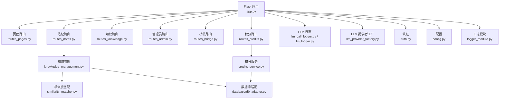
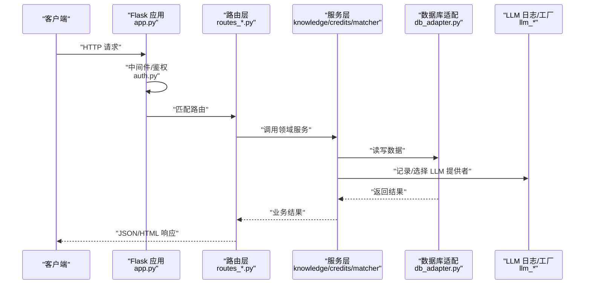
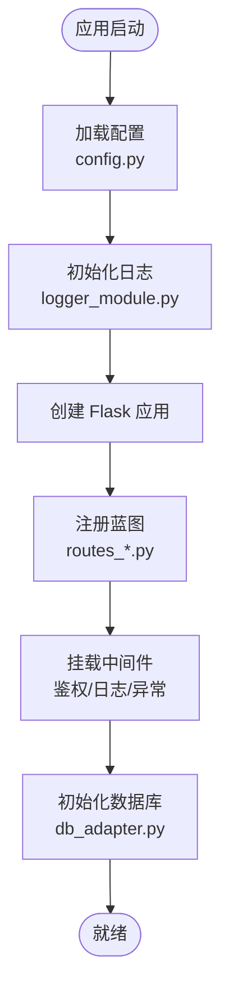
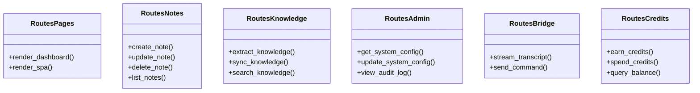
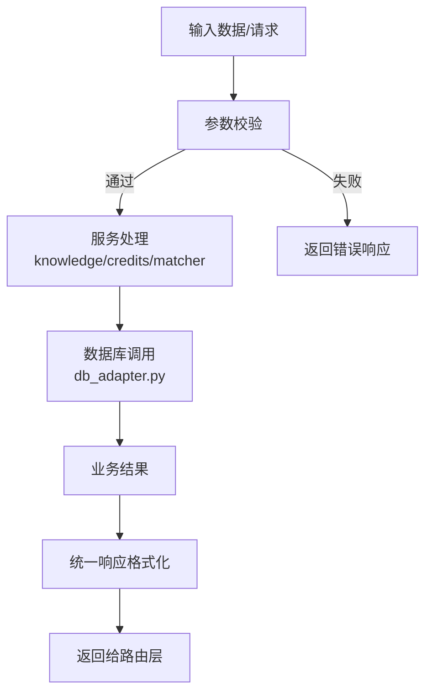
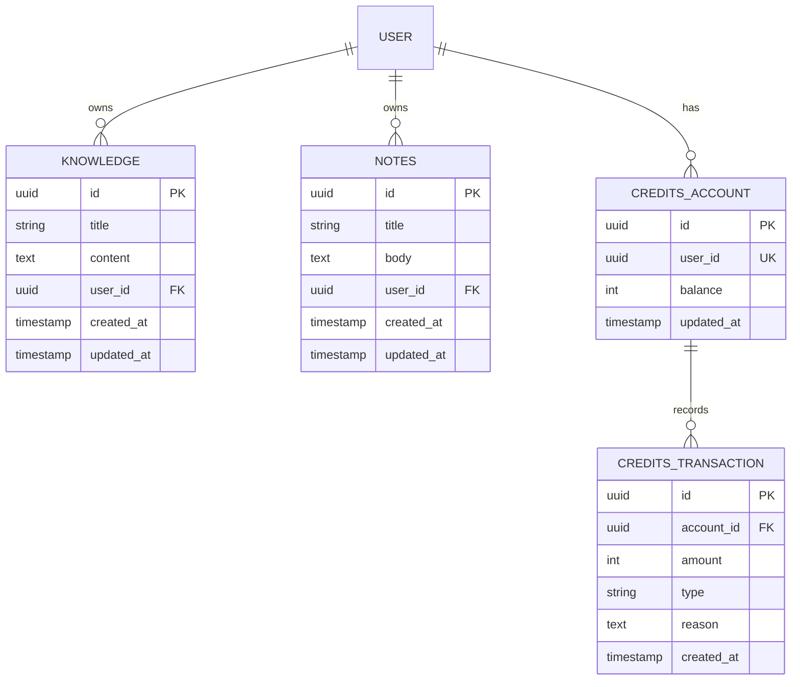
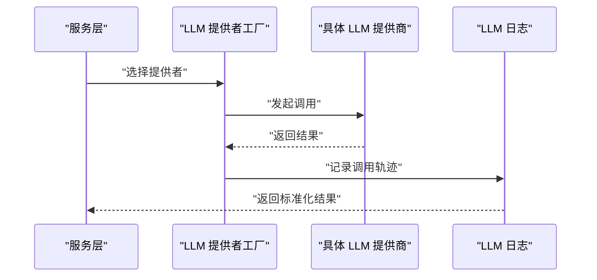
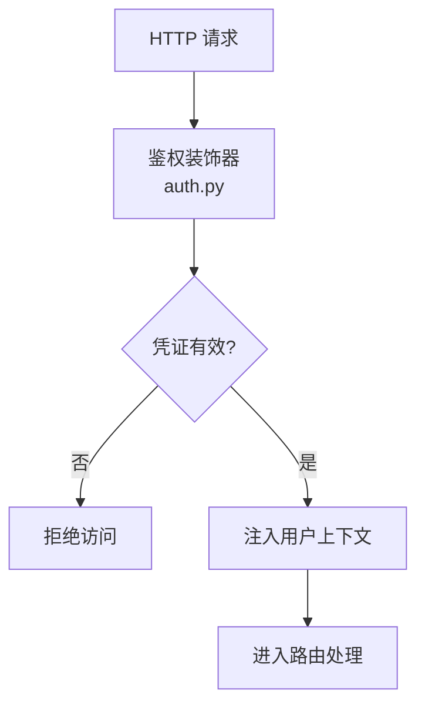
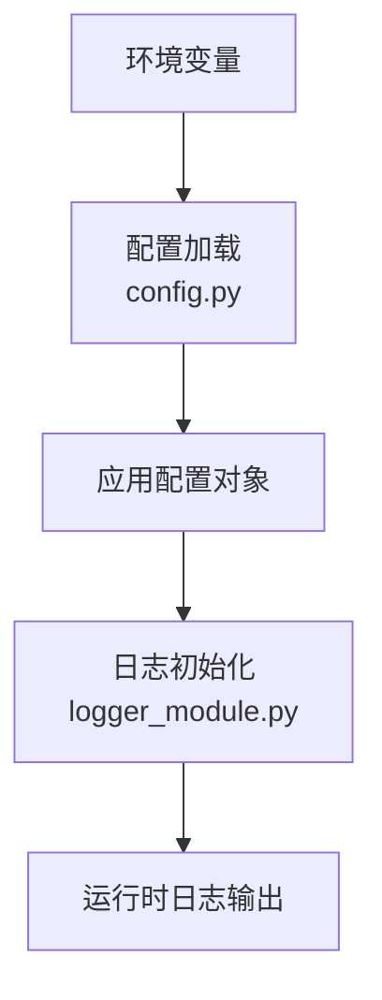
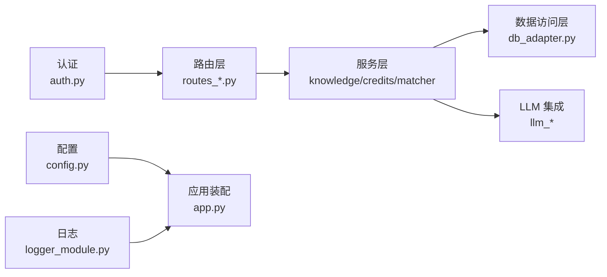

# 后端架构

<cite>
**本文引用的文件**   
- [app.py](file://server/app.py)
- [config.py](file://server/config.py)
- [auth.py](file://server/auth.py)
- [routes_pages.py](file://server/routes_pages.py)
- [routes_notes.py](file://server/routes_notes.py)
- [routes_knowledge.py](file://server/routes_knowledge.py)
- [routes_admin.py](file://server/routes_admin.py)
- [routes_bridge.py](file://server/routes_bridge.py)
- [routes_credits.py](file://server/routes_credits.py)
- [credits_service.py](file://server/credits_service.py)
- [knowledge_management.py](file://server/knowledge_management.py)
- [llm_call_logger.py](file://server/llm_call_logger.py)
- [llm_logger.py](file://server/llm_logger.py)
- [llm_provider_factory.py](file://server/llm_provider_factory.py)
- [logger_module.py](file://server/logger_module.py)
- [similarity_matcher.py](file://server/similarity_matcher.py)
- [database/db_adapter.py](file://server/database/db_adapter.py)
- [database/schema_postgres.py](file://server/database/schema_postgres.py)
- [database/schema_credits.py](file://server/database/schema_credits.py)
- [services/error_slicer.py](file://server/services/error_slicer.py)
</cite>

## 目录
1. [简介](#简介)
2. [项目结构](#项目结构)
3. [核心组件](#核心组件)
4. [架构总览](#架构总览)
5. [详细组件分析](#详细组件分析)
6. [依赖关系分析](#依赖关系分析)
7. [性能与缓存](#性能与缓存)
8. [故障排查指南](#故障排查指南)
9. [结论](#结论)
10. [附录：API与路由规范](#附录api与路由规范)

## 简介
本文件为 LectureLearnLoop 后端（Flask）的架构文档，面向开发者与维护者，系统性说明应用整体结构、模块化路由设计、服务层抽象、数据访问层组织、中间件机制、请求处理流程、响应格式化、RESTful API 设计规范、错误处理策略、日志记录机制、配置与环境变量管理、部署要点，以及异步处理、缓存策略和性能优化方案。

## 项目结构
后端位于 server 目录，采用“按功能域拆分路由 + 服务层 + 数据访问层”的分层组织方式：
- 入口与装配：app.py 负责 Flask 应用创建、蓝图注册、中间件挂载、模板与静态资源路径、初始化数据库与配置加载。
- 路由层：routes_*.py 按业务域划分（页面、笔记、知识、管理员、桥接、积分等），每个模块仅暴露路由函数，不直接写复杂业务逻辑。
- 服务层：credits_service.py、knowledge_management.py、similarity_matcher.py、services/error_slicer.py 等封装领域逻辑与算法。
- 数据访问层：database/* 提供数据库适配器与表结构定义，供服务层调用。
- LLM 集成：llm_* 系列文件统一 LLM 调用、日志与提供者工厂。
- 认证与安全：auth.py 提供鉴权装饰器与用户上下文。
- 配置与日志：config.py、logger_module.py 统一管理配置项与日志输出。

**图表来源** 
- [app.py:1-200](file://server/app.py#L1-L200)
- [routes_pages.py:1-200](file://server/routes_pages.py#L1-L200)
- [routes_notes.py:1-200](file://server/routes_notes.py#L1-L200)
- [routes_knowledge.py:1-200](file://server/routes_knowledge.py#L1-L200)
- [routes_admin.py:1-200](file://server/routes_admin.py#L1-L200)
- [routes_bridge.py:1-200](file://server/routes_bridge.py#L1-L200)
- [routes_credits.py:1-200](file://server/routes_credits.py#L1-L200)
- [knowledge_management.py:1-200](file://server/knowledge_management.py#L1-L200)
- [credits_service.py:1-200](file://server/credits_service.py#L1-L200)
- [similarity_matcher.py:1-200](file://server/similarity_matcher.py#L1-L200)
- [database/db_adapter.py:1-200](file://server/database/db_adapter.py#L1-L200)
- [llm_call_logger.py:1-200](file://server/llm_call_logger.py#L1-L200)
- [llm_logger.py:1-200](file://server/llm_logger.py#L1-L200)
- [llm_provider_factory.py:1-200](file://server/llm_provider_factory.py#L1-L200)
- [auth.py:1-200](file://server/auth.py#L1-L200)
- [config.py:1-200](file://server/config.py#L1-L200)
- [logger_module.py:1-200](file://server/logger_module.py#L1-L200)

**章节来源**
- [app.py:1-200](file://server/app.py#L1-L200)

## 核心组件
- 应用装配与蓝图注册：在 app.py 中集中创建 Flask 实例、注册各路由蓝图、挂载中间件、设置模板与静态目录、初始化数据库连接与配置。
- 路由层：按功能域拆分为 routes_pages.py、routes_notes.py、routes_knowledge.py、routes_admin.py、routes_bridge.py、routes_credits.py，职责单一、易于扩展。
- 服务层：
  - knowledge_management.py：知识抽取、整理、存储与检索。
  - credits_service.py：积分获取、消费、审计与对账。
  - similarity_matcher.py：文本相似度计算与匹配。
  - services/error_slicer.py：错误切片与归因辅助。
- 数据访问层：database/db_adapter.py 提供统一的数据库操作接口；schema_postgres.py、schema_credits.py 定义表结构与迁移脚本。
- LLM 集成：llm_call_logger.py、llm_logger.py 记录 LLM 调用轨迹；llm_provider_factory.py 根据配置选择不同 LLM 提供商。
- 认证与安全：auth.py 提供鉴权装饰器与用户上下文注入。
- 配置与日志：config.py 读取环境变量与配置文件；logger_module.py 统一日志格式与输出目标。

**章节来源**
- [app.py:1-200](file://server/app.py#L1-L200)
- [routes_notes.py:1-200](file://server/routes_notes.py#L1-L200)
- [routes_knowledge.py:1-200](file://server/routes_knowledge.py#L1-L200)
- [routes_admin.py:1-200](file://server/routes_admin.py#L1-L200)
- [routes_bridge.py:1-200](file://server/routes_bridge.py#L1-L200)
- [routes_credits.py:1-200](file://server/routes_credits.py#L1-L200)
- [knowledge_management.py:1-200](file://server/knowledge_management.py#L1-L200)
- [credits_service.py:1-200](file://server/credits_service.py#L1-L200)
- [similarity_matcher.py:1-200](file://server/similarity_matcher.py#L1-L200)
- [database/db_adapter.py:1-200](file://server/database/db_adapter.py#L1-L200)
- [database/schema_postgres.py:1-200](file://server/database/schema_postgres.py#L1-L200)
- [database/schema_credits.py:1-200](file://server/database/schema_credits.py#L1-L200)
- [llm_call_logger.py:1-200](file://server/llm_call_logger.py#L1-L200)
- [llm_logger.py:1-200](file://server/llm_logger.py#L1-L200)
- [llm_provider_factory.py:1-200](file://server/llm_provider_factory.py#L1-L200)
- [auth.py:1-200](file://server/auth.py#L1-L200)
- [config.py:1-200](file://server/config.py#L1-L200)
- [logger_module.py:1-200](file://server/logger_module.py#L1-L200)

## 架构总览
下图展示从 HTTP 请求到数据持久化的完整链路，包括鉴权、路由分发、服务调用、数据库访问与 LLM 调用日志。

**图表来源** 
- [app.py:1-200](file://server/app.py#L1-L200)
- [auth.py:1-200](file://server/auth.py#L1-L200)
- [routes_notes.py:1-200](file://server/routes_notes.py#L1-L200)
- [routes_knowledge.py:1-200](file://server/routes_knowledge.py#L1-L200)
- [routes_credits.py:1-200](file://server/routes_credits.py#L1-L200)
- [knowledge_management.py:1-200](file://server/knowledge_management.py#L1-L200)
- [credits_service.py:1-200](file://server/credits_service.py#L1-L200)
- [database/db_adapter.py:1-200](file://server/database/db_adapter.py#L1-L200)
- [llm_call_logger.py:1-200](file://server/llm_call_logger.py#L1-L200)
- [llm_provider_factory.py:1-200](file://server/llm_provider_factory.py#L1-L200)

## 详细组件分析

### 应用装配与中间件（app.py）
- 职责：创建 Flask 应用、注册蓝图、挂载中间件、设置模板与静态目录、初始化数据库与配置、启动调试或生产模式。
- 关键点：
  - 蓝图注册：将各 routes_*.py 作为独立蓝图挂载，便于权限控制与版本化。
  - 中间件：统一鉴权、跨域、请求日志、异常捕获等。
  - 配置加载：优先使用环境变量，其次回退默认值。
  - 模板与静态：集中管理前端页面与 JS/CSS 资源路径。

**图表来源** 
- [app.py:1-200](file://server/app.py#L1-L200)
- [config.py:1-200](file://server/config.py#L1-L200)
- [logger_module.py:1-200](file://server/logger_module.py#L1-L200)
- [database/db_adapter.py:1-200](file://server/database/db_adapter.py#L1-L200)

**章节来源**
- [app.py:1-200](file://server/app.py#L1-L200)

### 路由层与模块化设计（routes_*.py）
- 设计原则：
  - 按功能域拆分路由模块，保持高内聚低耦合。
  - 路由函数只做参数校验、权限检查与服务调用，不写复杂业务逻辑。
  - 统一响应格式：成功返回 {code, data}，失败返回 {code, message}。
- 主要模块：
  - routes_pages.py：页面渲染与 SPA 入口。
  - routes_notes.py：笔记相关接口（增删改查、导入导出）。
  - routes_knowledge.py：知识点抽取、整理、检索与同步。
  - routes_admin.py：管理员面板、系统配置、审计日志。
  - routes_bridge.py：与桌面端/前端桥接的通信接口。
  - routes_credits.py：积分获取、消费、查询与对账。

**图表来源** 
- [routes_pages.py:1-200](file://server/routes_pages.py#L1-L200)
- [routes_notes.py:1-200](file://server/routes_notes.py#L1-L200)
- [routes_knowledge.py:1-200](file://server/routes_knowledge.py#L1-L200)
- [routes_admin.py:1-200](file://server/routes_admin.py#L1-L200)
- [routes_bridge.py:1-200](file://server/routes_bridge.py#L1-L200)
- [routes_credits.py:1-200](file://server/routes_credits.py#L1-L200)

**章节来源**
- [routes_notes.py:1-200](file://server/routes_notes.py#L1-L200)
- [routes_knowledge.py:1-200](file://server/routes_knowledge.py#L1-L200)
- [routes_admin.py:1-200](file://server/routes_admin.py#L1-L200)
- [routes_bridge.py:1-200](file://server/routes_bridge.py#L1-L200)
- [routes_credits.py:1-200](file://server/routes_credits.py#L1-L200)

### 服务层抽象（knowledge_management.py、credits_service.py、similarity_matcher.py、error_slicer.py）
- knowledge_management.py：封装知识点抽取、清洗、去重、索引构建与检索；可组合 similarity_matcher.py 进行语义近似匹配。
- credits_service.py：封装积分账户、交易流水、余额查询、风控规则与审计；保证事务一致性与幂等性。
- similarity_matcher.py：实现文本相似度算法（如 TF-IDF、余弦相似度或嵌入向量距离），支持批量匹配与阈值过滤。
- error_slicer.py：对错误消息进行切片与归类，辅助定位问题根因。

**图表来源** 
- [knowledge_management.py:1-200](file://server/knowledge_management.py#L1-L200)
- [credits_service.py:1-200](file://server/credits_service.py#L1-L200)
- [similarity_matcher.py:1-200](file://server/similarity_matcher.py#L1-L200)
- [services/error_slicer.py:1-200](file://server/services/error_slicer.py#L1-L200)
- [database/db_adapter.py:1-200](file://server/database/db_adapter.py#L1-L200)

**章节来源**
- [knowledge_management.py:1-200](file://server/knowledge_management.py#L1-L200)
- [credits_service.py:1-200](file://server/credits_service.py#L1-L200)
- [similarity_matcher.py:1-200](file://server/similarity_matcher.py#L1-L200)
- [services/error_slicer.py:1-200](file://server/services/error_slicer.py#L1-L200)

### 数据访问层（database/db_adapter.py、schema_postgres.py、schema_credits.py）
- db_adapter.py：提供统一的数据库连接、会话管理、事务封装、SQL 执行与 ORM 映射（若使用 ORM）。
- schema_postgres.py：PostgreSQL 表结构定义、索引与约束。
- schema_credits.py：积分相关表结构、流水表与审计字段。

**图表来源** 
- [database/schema_postgres.py:1-200](file://server/database/schema_postgres.py#L1-L200)
- [database/schema_credits.py:1-200](file://server/database/schema_credits.py#L1-L200)

**章节来源**
- [database/db_adapter.py:1-200](file://server/database/db_adapter.py#L1-L200)
- [database/schema_postgres.py:1-200](file://server/database/schema_postgres.py#L1-L200)
- [database/schema_credits.py:1-200](file://server/database/schema_credits.py#L1-L200)

### LLM 集成（llm_call_logger.py、llm_logger.py、llm_provider_factory.py）
- llm_call_logger.py：记录 LLM 调用的入参、出参、耗时与状态码，便于审计与排障。
- llm_logger.py：通用日志封装，统一级别、格式与输出目标。
- llm_provider_factory.py：根据配置动态选择 LLM 提供商（如 OpenAI、DeepSeek 等），并封装统一调用接口。

**图表来源** 
- [llm_call_logger.py:1-200](file://server/llm_call_logger.py#L1-L200)
- [llm_logger.py:1-200](file://server/llm_logger.py#L1-L200)
- [llm_provider_factory.py:1-200](file://server/llm_provider_factory.py#L1-L200)

**章节来源**
- [llm_call_logger.py:1-200](file://server/llm_call_logger.py#L1-L200)
- [llm_logger.py:1-200](file://server/llm_logger.py#L1-L200)
- [llm_provider_factory.py:1-200](file://server/llm_provider_factory.py#L1-L200)

### 认证与安全（auth.py）
- 提供鉴权装饰器，用于保护受保护路由。
- 注入用户上下文，便于后续服务层进行权限判断与审计。
- 支持多策略认证（如 Token、Session），并通过配置开关启用。

**图表来源** 
- [auth.py:1-200](file://server/auth.py#L1-L200)

**章节来源**
- [auth.py:1-200](file://server/auth.py#L1-L200)

### 配置与日志（config.py、logger_module.py）
- config.py：集中管理环境变量与默认配置，支持开发/测试/生产环境切换。
- logger_module.py：统一日志级别、格式、输出目标（控制台/文件/远端），并提供结构化日志字段。

**图表来源** 
- [config.py:1-200](file://server/config.py#L1-L200)
- [logger_module.py:1-200](file://server/logger_module.py#L1-L200)

**章节来源**
- [config.py:1-200](file://server/config.py#L1-L200)
- [logger_module.py:1-200](file://server/logger_module.py#L1-L200)

## 依赖关系分析
- 路由层依赖服务层，服务层依赖数据访问层与 LLM 集成模块。
- 认证模块被路由层与中间件共同依赖。
- 配置与日志贯穿全栈，作为横切关注点。

**图表来源** 
- [routes_notes.py:1-200](file://server/routes_notes.py#L1-L200)
- [routes_knowledge.py:1-200](file://server/routes_knowledge.py#L1-L200)
- [routes_credits.py:1-200](file://server/routes_credits.py#L1-L200)
- [knowledge_management.py:1-200](file://server/knowledge_management.py#L1-L200)
- [credits_service.py:1-200](file://server/credits_service.py#L1-L200)
- [database/db_adapter.py:1-200](file://server/database/db_adapter.py#L1-L200)
- [llm_call_logger.py:1-200](file://server/llm_call_logger.py#L1-L200)
- [llm_provider_factory.py:1-200](file://server/llm_provider_factory.py#L1-L200)
- [auth.py:1-200](file://server/auth.py#L1-L200)
- [config.py:1-200](file://server/config.py#L1-L200)
- [logger_module.py:1-200](file://server/logger_module.py#L1-L200)
- [app.py:1-200](file://server/app.py#L1-L200)

**章节来源**
- [app.py:1-200](file://server/app.py#L1-L200)

## 性能与缓存
- 异步处理：
  - 对长耗时任务（如 LLM 调用、大规模数据处理）建议采用异步队列（如 Celery/RQ）或后台线程，避免阻塞请求线程。
  - 流式响应：对于语音转写、实时笔记生成等场景，可使用 SSE 或 WebSocket 推送进度与增量结果。
- 缓存策略：
  - 热点数据（如知识库索引、用户配置）使用 Redis/Memcached 缓存，设置合理 TTL 与失效策略。
  - 数据库层面：合理使用索引、分页与只读副本，减少慢查询。
- 性能优化：
  - 路由层最小化逻辑，服务层复用公共算法（如 similarity_matcher.py）。
  - 批量操作：合并多次数据库写入，减少 IO 次数。
  - 连接池：数据库与外部 API 调用均使用连接池，避免频繁握手。
  - 压缩与懒加载：静态资源启用 gzip/br，按需加载大体积资源。

[本节为通用指导，不直接分析具体文件]

## 故障排查指南
- 日志定位：
  - 使用 logger_module.py 的统一日志格式，结合 request_id、user_id、trace_id 追踪请求链路。
  - LLM 调用日志由 llm_call_logger.py 记录，便于核对输入输出与耗时。
- 常见错误：
  - 鉴权失败：检查 auth.py 的装饰器与 Token/Session 配置。
  - 数据库连接失败：检查 db_adapter.py 的连接参数与 schema 是否对齐。
  - LLM 调用超时：检查 llm_provider_factory.py 的超时与重试策略。
- 诊断步骤：
  - 开启调试日志，复现问题后抓取 trace_id。
  - 查看对应路由与服务层的日志输出。
  - 检查数据库与 LLM 提供商的状态与配额。

**章节来源**
- [logger_module.py:1-200](file://server/logger_module.py#L1-L200)
- [llm_call_logger.py:1-200](file://server/llm_call_logger.py#L1-L200)
- [auth.py:1-200](file://server/auth.py#L1-L200)
- [database/db_adapter.py:1-200](file://server/database/db_adapter.py#L1-L200)
- [llm_provider_factory.py:1-200](file://server/llm_provider_factory.py#L1-L200)

## 结论
本架构以 Flask 为核心，采用模块化路由、清晰的服务层抽象与统一的数据访问层，配合认证、配置与日志体系，形成可扩展、易维护的后端基础。通过合理的异步与缓存策略，可在保障稳定性的同时提升性能。建议在后续迭代中持续完善监控告警、限流熔断与灰度发布能力。

[本节为总结性内容，不直接分析具体文件]

## 附录：API与路由规范
- RESTful 设计规范：
  - 资源命名：使用名词复数形式，如 /notes、/knowledge、/credits。
  - HTTP 方法：GET 查询、POST 创建、PUT 更新、DELETE 删除。
  - 状态码：200 成功、201 创建成功、400 参数错误、401 未授权、403 无权限、404 不存在、500 服务器错误。
  - 响应体：统一 {code, message, data} 结构。
- 示例路由（示意）：
  - GET /api/notes：列出当前用户的笔记。
  - POST /api/notes：创建新笔记。
  - PUT /api/notes/{id}：更新笔记。
  - DELETE /api/notes/{id}：删除笔记。
  - GET /api/knowledge/search?q=...：搜索知识点。
  - POST /api/credits/spend：消费积分。
  - GET /api/credits/balance：查询余额。
- 鉴权要求：
  - 所有 /api/* 接口需携带有效凭证（Token/Session）。
  - 管理员接口需在路由层增加管理员角色校验。
- 错误处理：
  - 参数校验失败返回 400 与明确错误信息。
  - 业务异常在服务层抛出，统一转换为标准错误响应。
  - 未捕获异常由中间件捕获并记录日志，返回 500。

[本节为概念性规范，不直接分析具体文件]