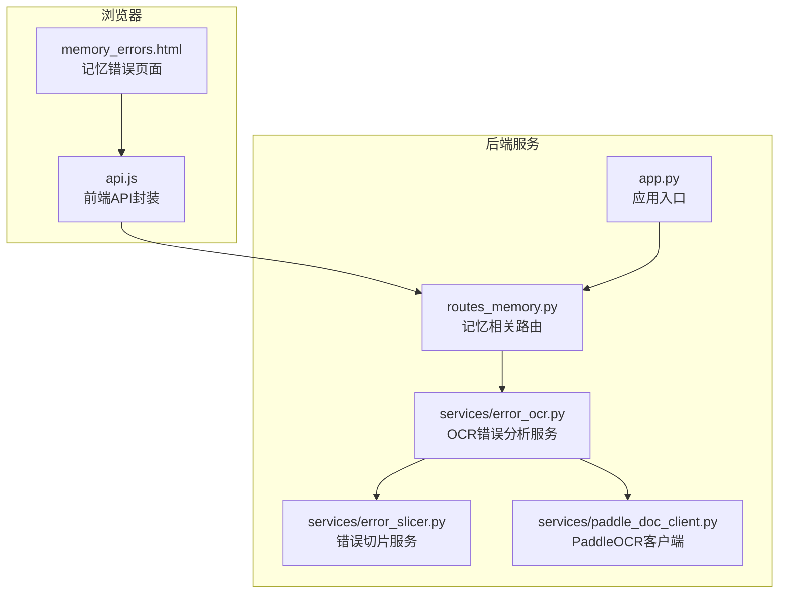
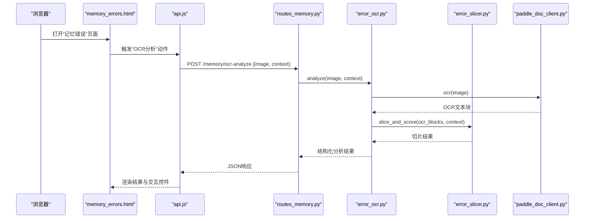
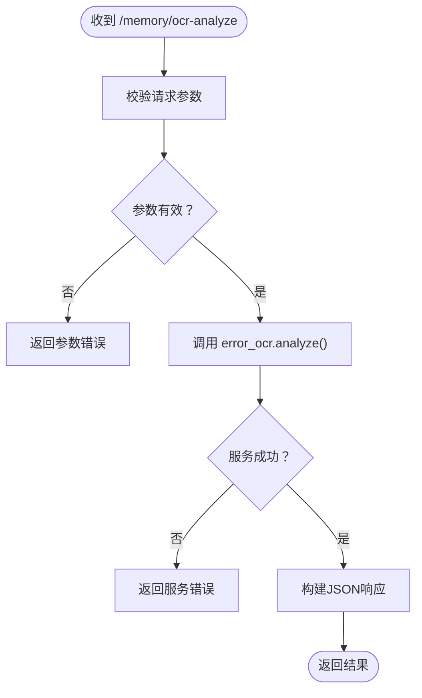
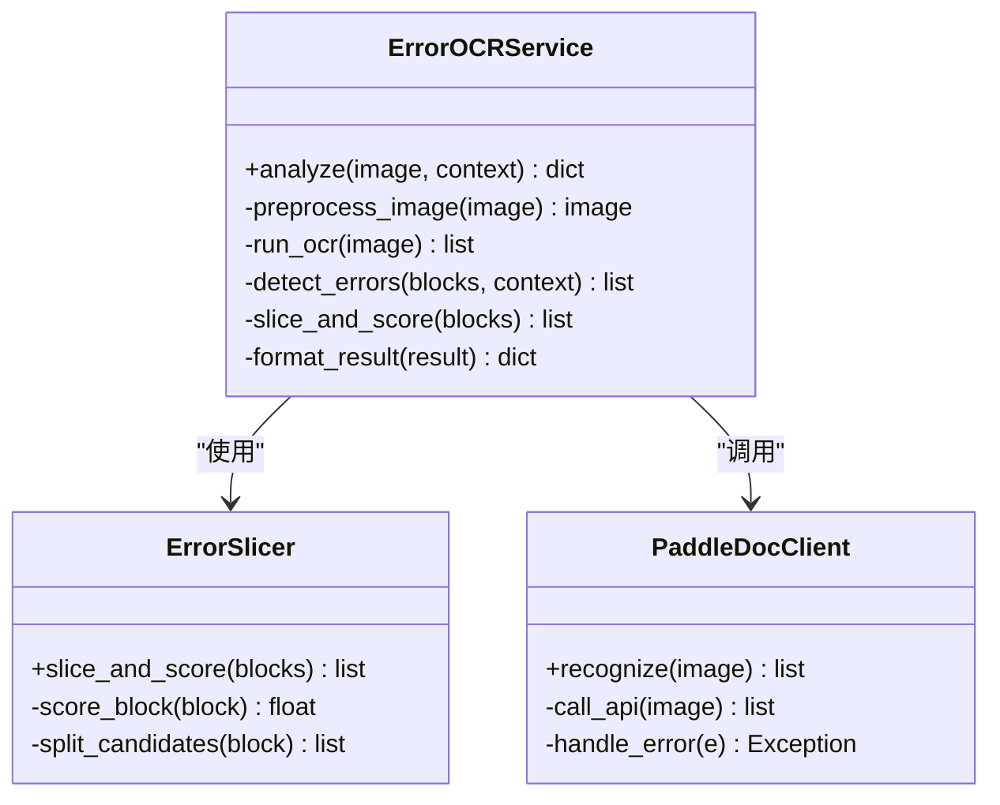
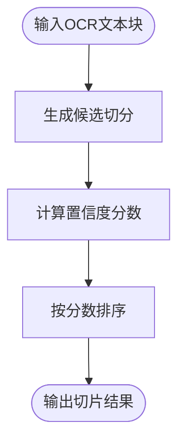
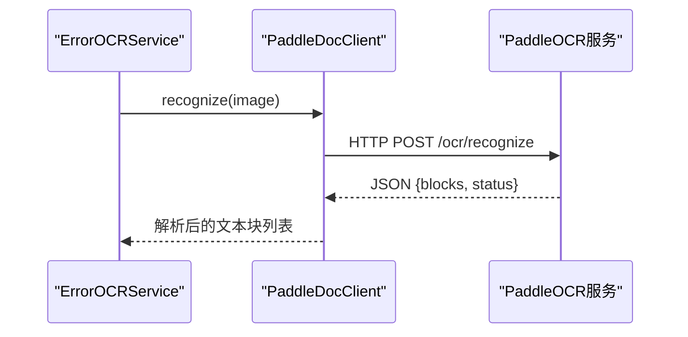
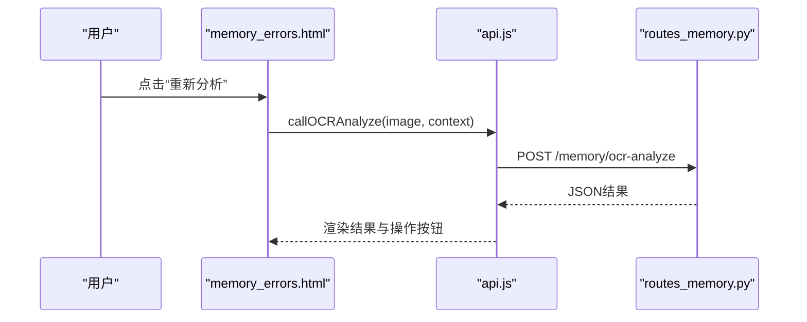
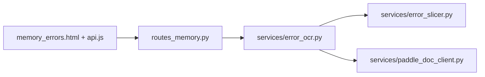

# OCR错误分析系统

<cite>
**本文引用的文件**   
- [app.py](file://server/app.py)
- [routes_memory.py](file://server/routes_memory.py)
- [services/error_ocr.py](file://server/services/error_ocr.py)
- [services/error_slicer.py](file://server/services/error_slicer.py)
- [services/paddle_doc_client.py](file://server/services/paddle_doc_client.py)
- [templates/pages/memory_errors.html](file://server/templates/pages/memory_errors.html)
- [static/js/api.js](file://server/static/js/api.js)
- [tests/test_error_analyze_service.py](file://server/tests/test_error_analyze_service.py)
- [tests/test_error_analyze_api.py](file://server/tests/test_error_analyze_api.py)
</cite>

## 目录
1. [引言](#引言)
2. [项目结构](#项目结构)
3. [核心组件](#核心组件)
4. [架构总览](#架构总览)
5. [详细组件分析](#详细组件分析)
6. [依赖关系分析](#依赖关系分析)
7. [性能考虑](#性能考虑)
8. [故障排查指南](#故障排查指南)
9. [结论](#结论)

## 引言
本文件面向“OCR错误分析系统”，聚焦后端服务中用于识别、切片与修复OCR错误的核心能力，以及与之配套的Web接口与前端页面。该系统主要服务于记忆与练习模块中的错题场景：当用户提交包含图片的错题时，系统通过OCR解析图片内容，定位可能的错误片段，结合业务规则进行切片与修正建议，最终在“记忆错误”页面中展示结果并支持人工确认或二次处理。

该文档从系统架构、组件职责、数据流、接口契约、测试覆盖与性能优化等维度展开，帮助读者快速理解并扩展该系统。

## 项目结构
围绕OCR错误分析的相关代码主要位于后端服务层与模板/静态资源层：
- 路由层：暴露REST风格接口，接收错题图片与上下文，返回OCR分析与切片结果。
- 服务层：封装OCR调用、文本切片、错误定位与结果组装逻辑。
- 前端模板与脚本：渲染错题列表、展示OCR结果、提供交互操作（如确认、忽略、重新分析）。

**图表来源**
- [app.py:1-200](file://server/app.py#L1-L200)
- [routes_memory.py:1-200](file://server/routes_memory.py#L1-L200)
- [services/error_ocr.py:1-200](file://server/services/error_ocr.py#L1-L200)
- [services/error_slicer.py:1-200](file://server/services/error_slicer.py#L1-L200)
- [services/paddle_doc_client.py:1-200](file://server/services/paddle_doc_client.py#L1-L200)
- [templates/pages/memory_errors.html:1-200](file://server/templates/pages/memory_errors.html#L1-L200)
- [static/js/api.js:1-200](file://server/static/js/api.js#L1-L200)

**章节来源**
- [app.py:1-200](file://server/app.py#L1-L200)
- [routes_memory.py:1-200](file://server/routes_memory.py#L1-L200)
- [services/error_ocr.py:1-200](file://server/services/error_ocr.py#L1-L200)
- [services/error_slicer.py:1-200](file://server/services/error_slicer.py#L1-L200)
- [services/paddle_doc_client.py:1-200](file://server/services/paddle_doc_client.py#L1-L200)
- [templates/pages/memory_errors.html:1-200](file://server/templates/pages/memory_errors.html#L1-L200)
- [static/js/api.js:1-200](file://server/static/js/api.js#L1-L200)

## 核心组件
- 路由层（routes_memory.py）
  - 负责接收来自前端的OCR分析请求，校验输入参数，调用OCR服务，并将结构化结果返回给前端。
  - 典型流程：接收图片与题目上下文 → 调用OCR服务 → 组装响应 → 返回JSON。
- OCR错误分析服务（services/error_ocr.py）
  - 封装OCR调用的整体流程：图像预处理、OCR识别、错误检测、结果清洗与格式化。
  - 协调切片服务与外部OCR客户端，保证错误分析的端到端可用性。
- 错误切片服务（services/error_slicer.py）
  - 基于OCR输出与业务规则，对可能错误的文本片段进行切分、标注与排序，便于后续人工复核。
- PaddleOCR客户端（services/paddle_doc_client.py）
  - 封装与PaddleOCR服务的通信细节，包括鉴权、超时、重试与异常转换。
- 前端页面与API封装（templates/pages/memory_errors.html, static/js/api.js）
  - 提供错题列表、OCR结果可视化、交互按钮（重新分析、确认、忽略），并通过api.js统一发起HTTP请求。

**章节来源**
- [routes_memory.py:1-200](file://server/routes_memory.py#L1-L200)
- [services/error_ocr.py:1-200](file://server/services/error_ocr.py#L1-L200)
- [services/error_slicer.py:1-200](file://server/services/error_slicer.py#L1-L200)
- [services/paddle_doc_client.py:1-200](file://server/services/paddle_doc_client.py#L1-L200)
- [templates/pages/memory_errors.html:1-200](file://server/templates/pages/memory_errors.html#L1-L200)
- [static/js/api.js:1-200](file://server/static/js/api.js#L1-L200)

## 架构总览
下图展示了从前端到后端的完整调用链，以及各组件之间的依赖关系。

**图表来源**
- [routes_memory.py:1-200](file://server/routes_memory.py#L1-L200)
- [services/error_ocr.py:1-200](file://server/services/error_ocr.py#L1-L200)
- [services/error_slicer.py:1-200](file://server/services/error_slicer.py#L1-L200)
- [services/paddle_doc_client.py:1-200](file://server/services/paddle_doc_client.py#L1-L200)
- [templates/pages/memory_errors.html:1-200](file://server/templates/pages/memory_errors.html#L1-L200)
- [static/js/api.js:1-200](file://server/static/js/api.js#L1-L200)

## 详细组件分析

### 路由层：记忆相关接口（routes_memory.py）
- 职责
  - 定义与记忆相关的API端点，包括OCR错误分析、结果查询、状态更新等。
  - 对请求参数进行基础校验，将业务逻辑委托给服务层。
- 关键流程
  - 接收前端上传的图片与题目上下文。
  - 调用OCR服务执行分析。
  - 将分析结果序列化为JSON返回。
- 错误处理
  - 捕获服务层抛出的异常，转换为标准HTTP错误码与消息。
  - 对非法输入（如缺失图片、格式不支持）返回明确错误信息。

**图表来源**
- [routes_memory.py:1-200](file://server/routes_memory.py#L1-L200)

**章节来源**
- [routes_memory.py:1-200](file://server/routes_memory.py#L1-L200)

### OCR错误分析服务（services/error_ocr.py）
- 职责
  - 编排OCR识别、错误检测、切片评分与结果整理。
  - 对外暴露统一的analyze方法，屏蔽内部复杂度。
- 关键步骤
  - 图像预处理：尺寸归一化、去噪、对比度增强（视实现而定）。
  - OCR识别：调用PaddleOCR客户端获取文本块。
  - 错误检测：结合上下文与规则判断哪些文本块可能存在错误。
  - 切片评分：对疑似错误片段进行切分与置信度打分。
  - 结果整理：输出结构化数据，供前端渲染与人工复核。
- 异常与边界
  - 处理OCR服务不可用、超时、空结果等情况。
  - 对低质量图片给出降级策略（如提示重拍或裁剪）。

**图表来源**
- [services/error_ocr.py:1-200](file://server/services/error_ocr.py#L1-L200)
- [services/error_slicer.py:1-200](file://server/services/error_slicer.py#L1-L200)
- [services/paddle_doc_client.py:1-200](file://server/services/paddle_doc_client.py#L1-L200)

**章节来源**
- [services/error_ocr.py:1-200](file://server/services/error_ocr.py#L1-L200)

### 错误切片服务（services/error_slicer.py）
- 职责
  - 根据OCR输出的文本块与上下文，识别潜在错误片段并进行切分。
  - 为每个候选片段计算置信度分数，便于排序与展示。
- 算法要点
  - 基于规则与启发式策略（如字符密度、标点分布、长度阈值）进行候选切分。
  - 对切分后的片段进行评分，综合考虑与上下文的匹配度与异常程度。
- 可扩展性
  - 可替换评分函数以适配不同学科或题型。
  - 支持配置化阈值与规则集，便于A/B测试与迭代优化。

**图表来源**
- [services/error_slicer.py:1-200](file://server/services/error_slicer.py#L1-L200)

**章节来源**
- [services/error_slicer.py:1-200](file://server/services/error_slicer.py#L1-L200)

### PaddleOCR客户端（services/paddle_doc_client.py）
- 职责
  - 封装与PaddleOCR服务的通信，包括鉴权、请求构造、响应解析与异常处理。
- 关键特性
  - 超时与重试机制，提高稳定性。
  - 错误码映射，将底层错误转换为上层可理解的异常类型。
  - 日志记录，便于问题追踪与性能监控。

**图表来源**
- [services/paddle_doc_client.py:1-200](file://server/services/paddle_doc_client.py#L1-L200)

**章节来源**
- [services/paddle_doc_client.py:1-200](file://server/services/paddle_doc_client.py#L1-L200)

### 前端页面与API封装（templates/pages/memory_errors.html, static/js/api.js）
- 职责
  - 渲染错题列表与OCR分析结果。
  - 提供交互控件：重新分析、确认、忽略、导出等。
  - 通过api.js统一发起HTTP请求，处理加载状态与错误提示。
- 交互流程
  - 用户点击“重新分析” → 调用后端OCR接口 → 显示进度与结果 → 支持人工确认。
- 可访问性与体验
  - 对长列表采用分页或虚拟滚动。
  - 对OCR耗时操作提供乐观更新与回滚机制。

**图表来源**
- [templates/pages/memory_errors.html:1-200](file://server/templates/pages/memory_errors.html#L1-L200)
- [static/js/api.js:1-200](file://server/static/js/api.js#L1-L200)
- [routes_memory.py:1-200](file://server/routes_memory.py#L1-L200)

**章节来源**
- [templates/pages/memory_errors.html:1-200](file://server/templates/pages/memory_errors.html#L1-L200)
- [static/js/api.js:1-200](file://server/static/js/api.js#L1-L200)

## 依赖关系分析
- 组件耦合
  - 路由层仅依赖服务层，保持接口清晰。
  - OCR服务依赖切片服务与PaddleOCR客户端，形成稳定的三层结构。
- 外部依赖
  - PaddleOCR服务作为外部OCR引擎，需确保可用性与版本兼容。
- 潜在循环依赖
  - 当前设计无循环依赖；若未来引入缓存或异步任务队列，需注意解耦。

**图表来源**
- [routes_memory.py:1-200](file://server/routes_memory.py#L1-L200)
- [services/error_ocr.py:1-200](file://server/services/error_ocr.py#L1-L200)
- [services/error_slicer.py:1-200](file://server/services/error_slicer.py#L1-L200)
- [services/paddle_doc_client.py:1-200](file://server/services/paddle_doc_client.py#L1-L200)
- [templates/pages/memory_errors.html:1-200](file://server/templates/pages/memory_errors.html#L1-L200)
- [static/js/api.js:1-200](file://server/static/js/api.js#L1-L200)

**章节来源**
- [routes_memory.py:1-200](file://server/routes_memory.py#L1-L200)
- [services/error_ocr.py:1-200](file://server/services/error_ocr.py#L1-L200)
- [services/error_slicer.py:1-200](file://server/services/error_slicer.py#L1-L200)
- [services/paddle_doc_client.py:1-200](file://server/services/paddle_doc_client.py#L1-L200)
- [templates/pages/memory_errors.html:1-200](file://server/templates/pages/memory_errors.html#L1-L200)
- [static/js/api.js:1-200](file://server/static/js/api.js#L1-L200)

## 性能考虑
- OCR识别耗时
  - 大图片或高分辨率图片会显著增加识别时间，建议在服务端进行图像压缩与尺寸限制。
  - 对频繁重复的图片可使用缓存键（如MD5）避免重复识别。
- 切片评分开销
  - 复杂规则可能导致CPU占用升高，建议将规则参数化并启用批量处理。
- 并发与限流
  - 对OCR接口设置合理的并发上限与队列长度，防止服务过载。
- 前端体验
  - 对长列表采用分页或懒加载，减少DOM压力。
  - 对耗时操作提供进度反馈与取消机制。

[本节为通用指导，不直接分析具体文件]

## 故障排查指南
- 常见错误
  - OCR服务不可用：检查PaddleOCR服务健康状态与网络连通性。
  - 图片格式不支持：校验前端上传的文件类型与大小限制。
  - 切片结果为空：检查规则阈值与图片质量，必要时调整参数。
- 日志与诊断
  - 在服务端记录OCR请求与响应摘要，便于定位问题。
  - 在前端记录API调用失败时的错误码与消息，辅助用户反馈。
- 回归测试
  - 使用单元测试与集成测试验证OCR与分析流程的正确性。

**章节来源**
- [tests/test_error_analyze_service.py:1-200](file://server/tests/test_error_analyze_service.py#L1-L200)
- [tests/test_error_analyze_api.py:1-200](file://server/tests/test_error_analyze_api.py#L1-L200)

## 结论
OCR错误分析系统通过清晰的分层架构与模块化设计，实现了从图片OCR到错误切片与结果展示的完整闭环。路由层与服务层职责明确，前端交互友好，测试覆盖关键路径。未来可在规则可配置化、性能优化与多模型支持方面持续演进，以提升准确率与用户体验。