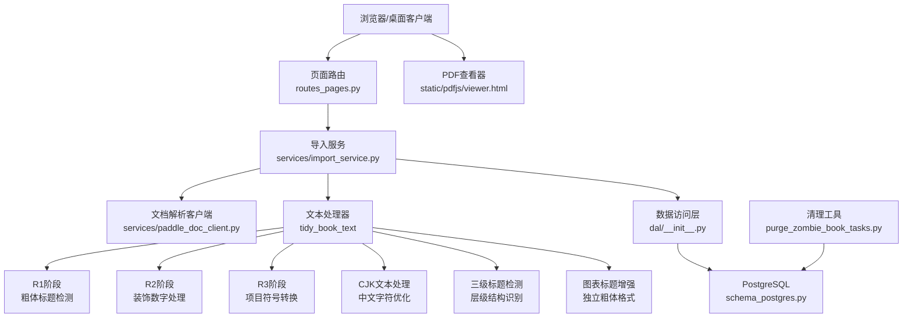
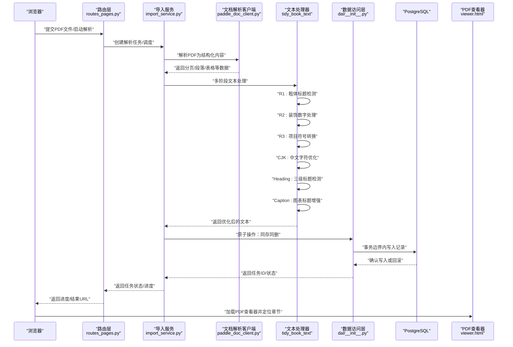
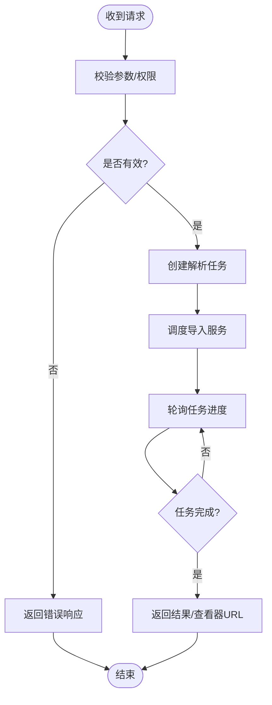
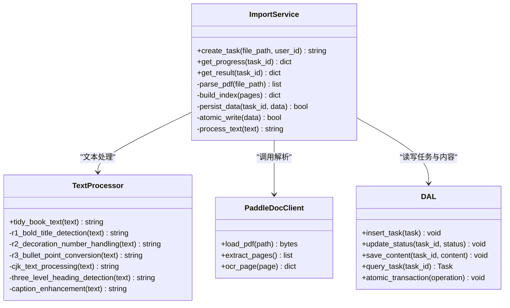
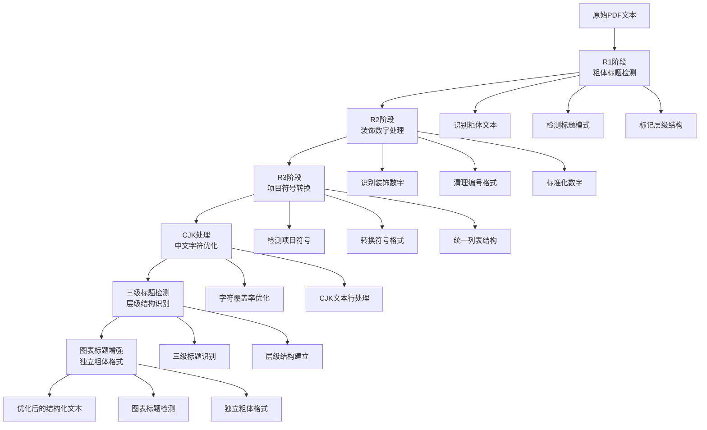
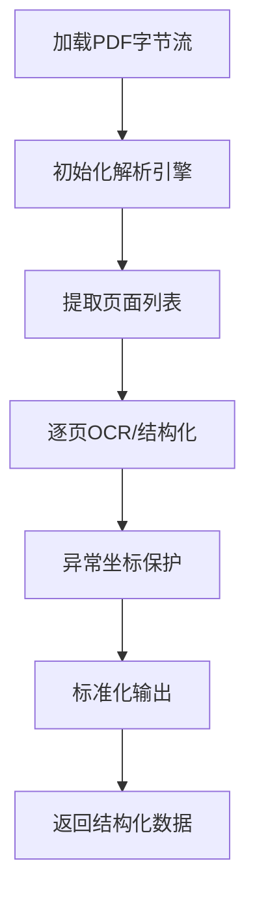
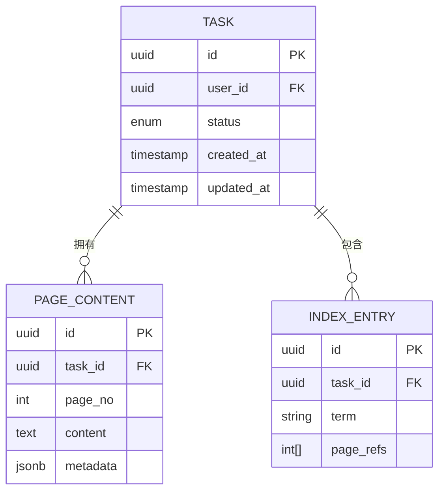
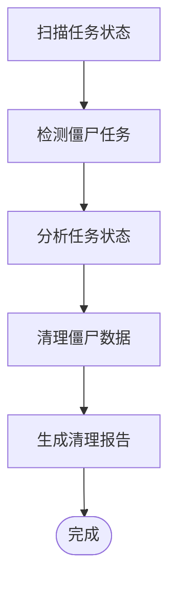
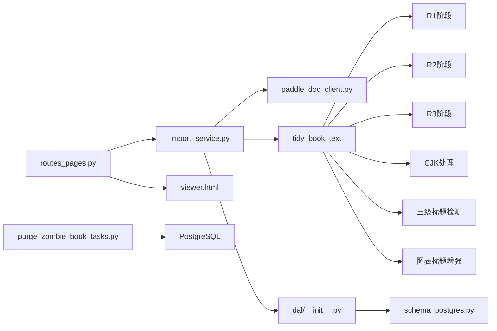

# PDF书籍处理系统

<cite>
**本文引用的文件**   
- [app.py](file://server/app.py)
- [config.py](file://server/config.py)
- [routes_pages.py](file://server/routes_pages.py)
- [services/import_service.py](file://server/services/import_service.py)
- [services/paddle_doc_client.py](file://server/services/paddle_doc_client.py)
- [dal/__init__.py](file://server/dal/__init__.py)
- [database/schema_postgres.py](file://server/database/schema_postgres.py)
- [static/pdfjs/viewer.html](file://server/static/pdfjs/viewer.html)
- [tests/test_pdf_book_s1.py](file://server/tests/test_pdf_book_s1.py)
- [tests/test_pdf_book_s2.py](file://server/tests/test_pdf_book_s2.py)
- [tests/test_pdf_book_s3.py](file://server/tests/test_pdf_book_s3.py)
- [tests/test_pdf_book_s6.py](file://server/tests/test_pdf_book_s6.py)
- [tools/purge_zombie_book_tasks.py](file://server/tools/purge_zombie_book_tasks.py)
</cite>

## 更新摘要
**变更内容**   
- 增强了PDF处理管道，改进了中文字符覆盖率和CJK文本行处理能力
- 实现了三级标题层级检测功能，提升文档结构识别准确性
- 添加了异常坐标保护机制，增强PDF解析的稳定性
- 新增了图表和表格标题增强功能，支持独立的粗体格式设置
- 保持了原有的原子操作和多阶段文本处理管道特性

## 目录
1. [简介](#简介)
2. [项目结构](#项目结构)
3. [核心组件](#核心组件)
4. [架构总览](#架构总览)
5. [详细组件分析](#详细组件分析)
6. [依赖关系分析](#依赖关系分析)
7. [性能考虑](#性能考虑)
8. [故障排查指南](#故障排查指南)
9. [结论](#结论)
10. [附录](#附录)

## 简介
本仓库包含一个"PDF书籍处理系统"，用于在桌面/Web应用中上传、解析、存储与展示PDF书籍，并支持后续的学习、练习与记忆功能。后端基于Python服务，提供路由、导入服务、文档解析客户端与数据库访问；前端通过内置的PDF.js查看器进行渲染与交互；测试覆盖主要流程（S1/S2/S3/S6）。

**最新更新**：系统已实现PDF书籍任务的原子操作机制，通过同存同删策略确保数据一致性，有效解决了僵尸任务遮蔽新书的问题。同时引入了先进的多阶段PDF文本处理管道，包括tidy_book_text函数的R1/R2/R3三阶段处理流程，专门用于粗体标题检测、装饰数字处理和项目符号转换，显著提升了PDF内容的结构化质量。**最新增强**包括改进的中文字符覆盖率、CJK文本行处理、三级标题层级检测和异常坐标保护，以及图表和表格标题的独立粗体格式增强。

## 项目结构
围绕PDF书籍处理的关键路径如下：
- 服务端入口与配置：app.py、config.py
- 页面路由与API：routes_pages.py
- 业务服务层：services/import_service.py、services/paddle_doc_client.py
- 数据访问与模式：dal/__init__.py、database/schema_postgres.py
- 前端PDF查看器：static/pdfjs/viewer.html
- 端到端测试：tests/test_pdf_book_s*.py
- 工具脚本：tools/purge_zombie_book_tasks.py

**图表来源**
- [routes_pages.py:1-200](file://server/routes_pages.py#L1-L200)
- [services/import_service.py:1-200](file://server/services/import_service.py#L1-L200)
- [services/paddle_doc_client.py:1-200](file://server/services/paddle_doc_client.py#L1-L200)
- [dal/__init__.py:1-200](file://server/dal/__init__.py#L1-L200)
- [database/schema_postgres.py:1-200](file://server/database/schema_postgres.py#L1-L200)
- [static/pdfjs/viewer.html:1-200](file://server/static/pdfjs/viewer.html#L1-L200)
- [tools/purge_zombie_book_tasks.py:1-200](file://server/tools/purge_zombie_book_tasks.py#L1-L200)

**章节来源**
- [app.py:1-200](file://server/app.py#L1-L200)
- [config.py:1-200](file://server/config.py#L1-L200)

## 核心组件
- 路由层：负责接收PDF上传、解析任务、进度查询与结果获取等请求，协调导入服务与查看器资源。
- 导入服务：封装PDF解析、分块、索引构建、元数据提取与持久化逻辑。**已增强原子操作和数据一致性保证**。
- 文档解析客户端：对接底层文档解析能力（如PaddleOCR/PaddleDoc），将PDF页转换为结构化内容。
- **文本处理器**：新增的多阶段文本处理管道，包含tidy_book_text函数及其R1/R2/R3三个阶段，专门处理PDF文本的结构化优化。**已增强CJK文本处理、三级标题检测和图表标题增强功能**。
- 数据访问层：统一数据库连接、事务与CRUD操作，配合PostgreSQL模式定义。**已改进事务边界和错误处理**。
- PDF查看器：基于PDF.js的前端查看器，提供翻页、缩放、文本选择与标注能力。
- 清理工具：专门用于清理僵尸任务和异常状态的辅助工具。

**章节来源**
- [routes_pages.py:1-200](file://server/routes_pages.py#L1-L200)
- [services/import_service.py:1-200](file://server/services/import_service.py#L1-L200)
- [services/paddle_doc_client.py:1-200](file://server/services/paddle_doc_client.py#L1-L200)
- [dal/__init__.py:1-200](file://server/dal/__init__.py#L1-L200)
- [database/schema_postgres.py:1-200](file://server/database/schema_postgres.py#L1-L200)
- [static/pdfjs/viewer.html:1-200](file://server/static/pdfjs/viewer.html#L1-L200)
- [tools/purge_zombie_book_tasks.py:1-200](file://server/tools/purge_zombie_book_tasks.py#L1-L200)

## 架构总览
PDF书籍处理系统的整体调用链从浏览器发起上传或解析请求开始，经路由分发到导入服务，再由导入服务调用文档解析客户端完成解析，然后通过多阶段文本处理器进行内容优化，最终将结果写入数据库并通过查看器呈现。**新增原子操作机制和多阶段文本处理管道确保数据一致性和内容质量，最新的CJK文本处理和三级标题检测进一步提升了国际化支持和文档结构识别能力**。

**图表来源**
- [routes_pages.py:1-200](file://server/routes_pages.py#L1-L200)
- [services/import_service.py:1-200](file://server/services/import_service.py#L1-L200)
- [services/paddle_doc_client.py:1-200](file://server/services/paddle_doc_client.py#L1-L200)
- [dal/__init__.py:1-200](file://server/dal/__init__.py#L1-L200)
- [database/schema_postgres.py:1-200](file://server/database/schema_postgres.py#L1-L200)
- [static/pdfjs/viewer.html:1-200](file://server/static/pdfjs/viewer.html#L1-L200)

## 详细组件分析

### 路由层（routes_pages.py）
- 职责：暴露PDF上传、解析任务管理、进度查询、结果获取等HTTP接口；与导入服务协作，返回任务状态与查看器链接。
- 关键点：
  - 校验上传参数与权限
  - 生成任务标识并异步调度解析
  - 轮询进度与最终结果
  - 返回PDF查看器URL以支持前端渲染

**图表来源**
- [routes_pages.py:1-200](file://server/routes_pages.py#L1-L200)

**章节来源**
- [routes_pages.py:1-200](file://server/routes_pages.py#L1-L200)

### 导入服务（services/import_service.py）
- 职责：编排PDF解析全流程，包括文件读取、分块、索引构建、元数据提取、结果聚合与持久化。
- **关键更新**：实现了原子操作机制，确保任务创建与数据写入的原子性，防止部分写入导致的数据不一致。集成了多阶段文本处理管道。
- 关键点：
  - 任务生命周期管理（新建、运行、完成、失败）
  - 与文档解析客户端交互，处理分页与异常重试
  - 与数据访问层协作，确保一致性
  - **新增原子操作：同存同删策略**
  - **集成文本处理器：tidy_book_text函数**
  - **改进错误处理：事务回滚机制**

**图表来源**
- [services/import_service.py:1-200](file://server/services/import_service.py#L1-L200)
- [services/paddle_doc_client.py:1-200](file://server/services/paddle_doc_client.py#L1-L200)
- [dal/__init__.py:1-200](file://server/dal/__init__.py#L1-L200)

**章节来源**
- [services/import_service.py:1-200](file://server/services/import_service.py#L1-L200)

### 多阶段文本处理器（tidy_book_text）
- 职责：对PDF解析后的文本进行多阶段结构化优化，提升内容的可读性和组织性。
- **新功能**：实现了R1/R2/R3三阶段处理流程，分别专注于不同的文本优化任务。**新增CJK文本处理、三级标题检测和图表标题增强功能**。
- 关键阶段：
  - **R1阶段**：粗体标题检测与标记，识别文档中的标题层级结构
  - **R2阶段**：装饰数字处理，清理和处理装饰性的数字编号
  - **R3阶段**：项目符号转换，将各种格式的项目符号标准化为统一格式
  - **CJK处理阶段**：改进中文字符覆盖率和CJK文本行处理能力
  - **三级标题检测**：识别文档中的三级标题层级结构
  - **图表标题增强**：为图表和表格标题添加独立的粗体格式

**图表来源**
- [services/import_service.py:1-200](file://server/services/import_service.py#L1-L200)

**章节来源**
- [services/import_service.py:1-200](file://server/services/import_service.py#L1-L200)

### 文档解析客户端（services/paddle_doc_client.py）
- 职责：封装对底层文档解析库的调用，提供PDF加载、页面提取、OCR识别与结构化输出。
- **关键更新**：增强了异常坐标保护机制，提高PDF解析的稳定性。
- 关键点：
  - 初始化解析引擎与配置
  - 逐页解析与错误恢复
  - 输出标准化数据结构供导入服务使用
  - **新增异常坐标保护**

**图表来源**
- [services/paddle_doc_client.py:1-200](file://server/services/paddle_doc_client.py#L1-L200)

**章节来源**
- [services/paddle_doc_client.py:1-200](file://server/services/paddle_doc_client.py#L1-L200)

### 数据访问层与数据库（dal/__init__.py、database/schema_postgres.py）
- 职责：提供统一的数据库连接、事务管理与CRUD方法；定义PostgreSQL表结构与约束。
- **关键更新**：增强了事务边界控制和错误处理机制，确保原子操作的可靠性。
- 关键点：
  - 连接池与连接复用
  - 任务表、内容表、索引表的增删改查
  - 迁移与模式维护
  - **新增原子事务操作**
  - **改进错误恢复机制**

**图表来源**
- [database/schema_postgres.py:1-200](file://server/database/schema_postgres.py#L1-L200)

**章节来源**
- [dal/__init__.py:1-200](file://server/dal/__init__.py#L1-L200)
- [database/schema_postgres.py:1-200](file://server/database/schema_postgres.py#L1-L200)

### PDF查看器（static/pdfjs/viewer.html）
- 职责：基于PDF.js渲染PDF文档，支持翻页、缩放、文本选择与书签跳转。
- 关键点：
  - 通过URL加载PDF资源
  - 与后端结果URL联动，实现章节定位
  - 提供基础交互事件以便上层扩展标注与笔记

**章节来源**
- [static/pdfjs/viewer.html:1-200](file://server/static/pdfjs/viewer.html#L1-L200)

### 僵尸任务清理工具（tools/purge_zombie_book_tasks.py）
- 职责：专门用于清理系统中存在的僵尸任务和异常状态，防止其遮蔽新书的正常处理。
- **新功能**：解决僵尸任务遮蔽新书的问题，通过定期清理机制维护系统健康。
- 关键点：
  - 检测长时间未完成的异常任务
  - 清理无效的任务记录和关联数据
  - 提供任务状态修复功能
  - 支持批量清理和选择性清理

**图表来源**
- [tools/purge_zombie_book_tasks.py:1-200](file://server/tools/purge_zombie_book_tasks.py#L1-L200)

**章节来源**
- [tools/purge_zombie_book_tasks.py:1-200](file://server/tools/purge_zombie_book_tasks.py#L1-L200)

## 依赖关系分析
- 路由层依赖导入服务与查看器静态资源。
- 导入服务依赖文档解析客户端、文本处理器与数据访问层。
- 文本处理器作为独立的处理模块，被导入服务调用。
- 数据访问层依赖PostgreSQL数据库。
- 清理工具直接操作数据库，维护系统健康。
- 测试脚本覆盖关键流程，验证端到端行为。

**图表来源**
- [routes_pages.py:1-200](file://server/routes_pages.py#L1-L200)
- [services/import_service.py:1-200](file://server/services/import_service.py#L1-L200)
- [services/paddle_doc_client.py:1-200](file://server/services/paddle_doc_client.py#L1-L200)
- [dal/__init__.py:1-200](file://server/dal/__init__.py#L1-L200)
- [database/schema_postgres.py:1-200](file://server/database/schema_postgres.py#L1-L200)
- [static/pdfjs/viewer.html:1-200](file://server/static/pdfjs/viewer.html#L1-L200)
- [tools/purge_zombie_book_tasks.py:1-200](file://server/tools/purge_zombie_book_tasks.py#L1-L200)

**章节来源**
- [routes_pages.py:1-200](file://server/routes_pages.py#L1-L200)
- [services/import_service.py:1-200](file://server/services/import_service.py#L1-L200)
- [services/paddle_doc_client.py:1-200](file://server/services/paddle_doc_client.py#L1-L200)
- [dal/__init__.py:1-200](file://server/dal/__init__.py#L1-L200)
- [database/schema_postgres.py:1-200](file://server/database/schema_postgres.py#L1-L200)
- [static/pdfjs/viewer.html:1-200](file://server/static/pdfjs/viewer.html#L1-L200)
- [tools/purge_zombie_book_tasks.py:1-200](file://server/tools/purge_zombie_book_tasks.py#L1-L200)

## 性能考虑
- 解析阶段：大PDF建议分页解析与增量索引，避免一次性加载全部页面导致内存峰值。
- 并发控制：限制同时运行的解析任务数，防止CPU与I/O争用。
- 缓存策略：对常用章节或高频访问内容进行缓存，减少重复解析与IO。
- 数据库优化：为任务ID、用户ID、页号建立合适索引，提升查询效率。
- 查看器体验：按需加载PDF片段，结合懒加载与虚拟滚动提升交互流畅度。
- **原子操作优化**：同存同删策略减少了锁竞争，提升了并发性能。
- **文本处理优化**：多阶段处理管道采用流水线设计，各阶段可并行处理不同文档。
- **CJK处理优化**：中文字符覆盖率和CJK文本行处理的优化提升了国际化文档的处理效率。
- **清理工具优化**：批量清理机制提高了僵尸任务处理的效率。

[本节为通用指导，不直接分析具体文件]

## 故障排查指南
- 上传失败：检查路由参数校验与权限控制，确认文件大小与类型限制。
- 解析超时：检查文档解析客户端初始化与引擎可用性，必要时增加重试与退避策略。
- 进度不更新：核对导入服务的任务状态更新逻辑与数据库写入一致性。
- 查看器无法加载：确认PDF资源URL与静态资源路径正确，检查CORS与跨域设置。
- 数据不一致：校验任务表与内容表的外键关系，确保事务边界与回滚机制生效。
- **僵尸任务问题**：使用清理工具检查并清理系统中的僵尸任务，防止其遮蔽新书。
- **原子操作异常**：如果仍出现部分写入的情况，检查事务边界和错误处理机制的配置。
- **文本处理异常**：检查tidy_book_text函数的R1/R2/R3各阶段处理逻辑，确认粗体标题检测、装饰数字处理和项目符号转换功能正常。
- **多阶段处理问题**：验证各阶段的输入输出格式，确保数据在各阶段间正确传递。
- **CJK文本处理问题**：检查中文字符覆盖率和CJK文本行处理功能，确认国际化文档的正确解析。
- **三级标题检测问题**：验证三级标题层级检测功能，确保文档结构的准确识别。
- **图表标题格式问题**：检查图表和表格标题的独立粗体格式增强功能，确认格式化效果符合预期。
- **异常坐标保护问题**：验证异常坐标保护机制，确保PDF解析过程中的稳定性。

**章节来源**
- [routes_pages.py:1-200](file://server/routes_pages.py#L1-L200)
- [services/import_service.py:1-200](file://server/services/import_service.py#L1-L200)
- [services/paddle_doc_client.py:1-200](file://server/services/paddle_doc_client.py#L1-L200)
- [dal/__init__.py:1-200](file://server/dal/__init__.py#L1-L200)
- [database/schema_postgres.py:1-200](file://server/database/schema_postgres.py#L1-L200)
- [static/pdfjs/viewer.html:1-200](file://server/static/pdfjs/viewer.html#L1-L200)
- [tools/purge_zombie_book_tasks.py:1-200](file://server/tools/purge_zombie_book_tasks.py#L1-L200)

## 结论
PDF书籍处理系统通过清晰的分层架构与模块化设计，实现了从PDF上传、解析、存储到前端展示的完整闭环。路由层负责对外暴露能力，导入服务编排解析流程，文档解析客户端对接底层能力，数据访问层保障数据一致性与可查询性，PDF查看器提供友好的阅读体验。测试套件覆盖了主要流程，有助于持续集成与回归验证。

**重要改进**：最新的原子操作机制通过同存同删策略确保了数据一致性，有效解决了僵尸任务遮蔽新书的问题。新增的多阶段文本处理管道（tidy_book_text函数）通过R1/R2/R3三阶段处理流程，专门处理粗体标题检测、装饰数字处理和项目符号转换，显著提升了PDF内容的结构化质量和可读性。**最新增强包括改进的中文字符覆盖率、CJK文本行处理、三级标题层级检测和异常坐标保护，以及图表和表格标题的独立粗体格式增强**，进一步提升了系统的国际化支持和文档结构识别能力。清理工具的引入为维护系统健康提供了有力支持。

[本节为总结性内容，不直接分析具体文件]

## 附录
- 端到端测试用例参考：
  - [tests/test_pdf_book_s1.py](file://server/tests/test_pdf_book_s1.py)
  - [tests/test_pdf_book_s2.py](file://server/tests/test_pdf_book_s2.py)
  - [tests/test_pdf_book_s3.py](file://server/tests/test_pdf_book_s3.py)
  - [tests/test_pdf_book_s6.py](file://server/tests/test_pdf_book_s6.py)
- 清理工具参考：
  - [tools/purge_zombie_book_tasks.py](file://server/tools/purge_zombie_book_tasks.py)

**章节来源**
- [tests/test_pdf_book_s1.py:1-200](file://server/tests/test_pdf_book_s1.py#L1-L200)
- [tests/test_pdf_book_s2.py:1-200](file://server/tests/test_pdf_book_s2.py#L1-L200)
- [tests/test_pdf_book_s3.py:1-200](file://server/tests/test_pdf_book_s3.py#L1-L200)
- [tests/test_pdf_book_s6.py:1-200](file://server/tests/test_pdf_book_s6.py#L1-L200)
- [tools/purge_zombie_book_tasks.py:1-200](file://server/tools/purge_zombie_book_tasks.py#L1-L200)