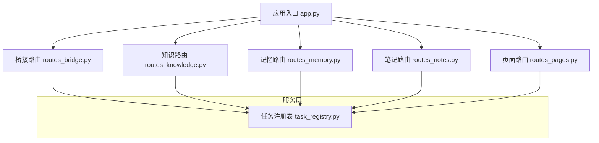
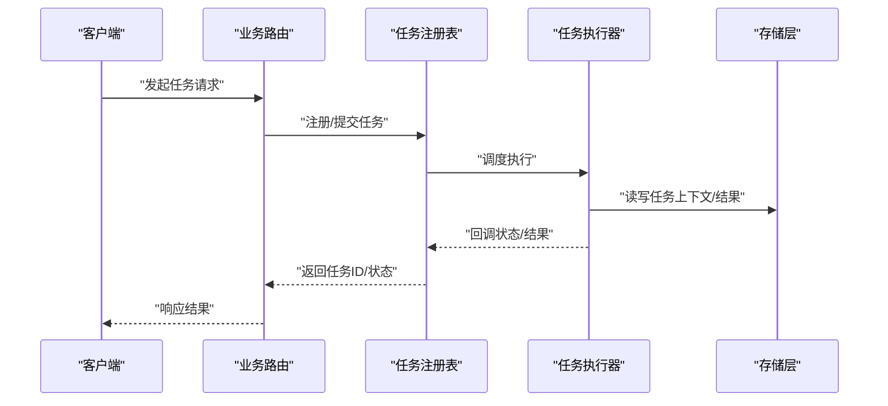
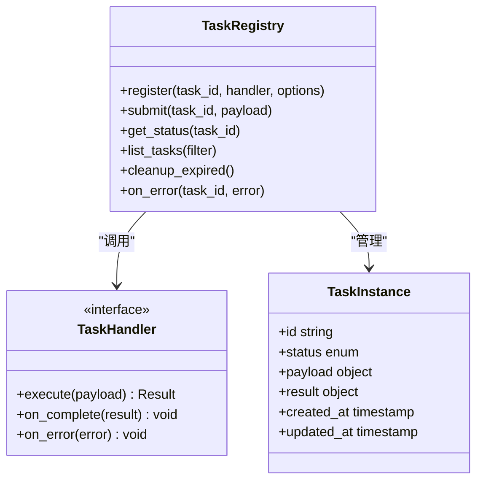
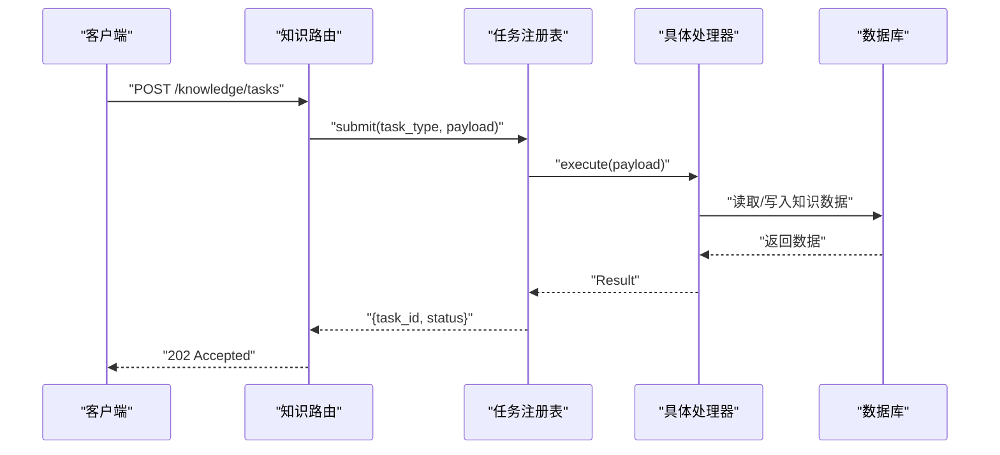
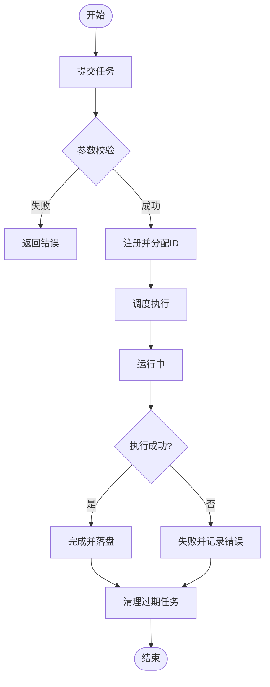

# 任务注册表系统

<cite>
**本文引用的文件**   
- [task_registry.py](file://server/services/task_registry.py)
- [routes_bridge.py](file://server/routes_bridge.py)
- [routes_knowledge.py](file://server/routes_knowledge.py)
- [routes_memory.py](file://server/routes_memory.py)
- [routes_notes.py](file://server/routes_notes.py)
- [routes_pages.py](file://server/routes_pages.py)
- [app.py](file://server/app.py)
</cite>

## 目录
1. [简介](#简介)
2. [项目结构](#项目结构)
3. [核心组件](#核心组件)
4. [架构总览](#架构总览)
5. [详细组件分析](#详细组件分析)
6. [依赖关系分析](#依赖关系分析)
7. [性能与扩展性](#性能与扩展性)
8. [故障排查指南](#故障排查指南)
9. [结论](#结论)

## 简介
本文件围绕“任务注册表系统”展开，聚焦后端服务中用于统一注册、发现与调度任务的机制。该系统的目标是：
- 为各业务路由提供一致的任务创建、查询、更新与清理接口
- 通过集中式注册表降低模块耦合，提升可测试性与可维护性
- 支持异步任务生命周期管理与错误隔离

## 项目结构
从仓库结构看，任务注册表位于服务端 services 层，被多个业务路由（知识、记忆、笔记、页面等）以及桥接路由调用。整体分层如下：
- 表现层：Flask 路由（routes_*.py）
- 服务层：services/ 下的领域服务与通用基础设施（含任务注册表）
- 数据层：dal/ 与 database/（持久化相关）
- 应用入口：app.py（装配与启动）

**图示来源**
- [app.py:1-200](file://server/app.py#L1-L200)
- [routes_bridge.py:1-200](file://server/routes_bridge.py#L1-L200)
- [routes_knowledge.py:1-200](file://server/routes_knowledge.py#L1-L200)
- [routes_memory.py:1-200](file://server/routes_memory.py#L1-L200)
- [routes_notes.py:1-200](file://server/routes_notes.py#L1-L200)
- [routes_pages.py:1-200](file://server/routes_pages.py#L1-L200)
- [task_registry.py:1-200](file://server/services/task_registry.py#L1-L200)

**章节来源**
- [app.py:1-200](file://server/app.py#L1-L200)
- [routes_bridge.py:1-200](file://server/routes_bridge.py#L1-L200)
- [routes_knowledge.py:1-200](file://server/routes_knowledge.py#L1-L200)
- [routes_memory.py:1-200](file://server/routes_memory.py#L1-L200)
- [routes_notes.py:1-200](file://server/routes_notes.py#L1-L200)
- [routes_pages.py:1-200](file://server/routes_pages.py#L1-L200)
- [task_registry.py:1-200](file://server/services/task_registry.py#L1-L200)

## 核心组件
- 任务注册表（Task Registry）
  - 职责：集中管理任务定义、实例生命周期、状态查询与清理策略
  - 关键能力：注册/注销、按 ID 查找、批量查询、定时清理、错误隔离
- 路由集成点
  - 桥接路由：跨域或跨进程任务编排
  - 知识/记忆/笔记/页面路由：各自业务场景下的任务发起与结果消费

**章节来源**
- [task_registry.py:1-200](file://server/services/task_registry.py#L1-L200)
- [routes_bridge.py:1-200](file://server/routes_bridge.py#L1-L200)
- [routes_knowledge.py:1-200](file://server/routes_knowledge.py#L1-L200)
- [routes_memory.py:1-200](file://server/routes_memory.py#L1-L200)
- [routes_notes.py:1-200](file://server/routes_notes.py#L1-L200)
- [routes_pages.py:1-200](file://server/routes_pages.py#L1-L200)

## 架构总览
下图展示请求从路由进入，到任务注册表执行，再到结果返回的整体流程。

**图示来源**
- [routes_bridge.py:1-200](file://server/routes_bridge.py#L1-L200)
- [routes_knowledge.py:1-200](file://server/routes_knowledge.py#L1-L200)
- [routes_memory.py:1-200](file://server/routes_memory.py#L1-L200)
- [routes_notes.py:1-200](file://server/routes_notes.py#L1-L200)
- [routes_pages.py:1-200](file://server/routes_pages.py#L1-L200)
- [task_registry.py:1-200](file://server/services/task_registry.py#L1-L200)

## 详细组件分析

### 任务注册表类图

**图示来源**
- [task_registry.py:1-200](file://server/services/task_registry.py#L1-L200)

**章节来源**
- [task_registry.py:1-200](file://server/services/task_registry.py#L1-L200)

### 路由与注册表的协作序列
以“知识路由”为例，展示一次任务从路由到注册表的调用链。

**图示来源**
- [routes_knowledge.py:1-200](file://server/routes_knowledge.py#L1-L200)
- [task_registry.py:1-200](file://server/services/task_registry.py#L1-L200)

**章节来源**
- [routes_knowledge.py:1-200](file://server/routes_knowledge.py#L1-L200)
- [task_registry.py:1-200](file://server/services/task_registry.py#L1-L200)

### 任务生命周期流程图

**图示来源**
- [task_registry.py:1-200](file://server/services/task_registry.py#L1-L200)

**章节来源**
- [task_registry.py:1-200](file://server/services/task_registry.py#L1-L200)

### 其他路由接入点概览
- 桥接路由：负责跨模块/跨进程任务编排，通常作为任务编排的入口
- 记忆路由：面向记忆相关的任务（如复习计划生成、间隔重复计算）
- 笔记路由：面向笔记导入、解析、预览等任务
- 页面路由：面向页面级渲染、缓存刷新等任务

这些路由均通过统一的注册表接口进行任务提交与状态查询，从而保持行为一致与可观测。

**章节来源**
- [routes_bridge.py:1-200](file://server/routes_bridge.py#L1-L200)
- [routes_memory.py:1-200](file://server/routes_memory.py#L1-L200)
- [routes_notes.py:1-200](file://server/routes_notes.py#L1-L200)
- [routes_pages.py:1-200](file://server/routes_pages.py#L1-L200)

## 依赖关系分析
- 内聚性
  - 任务注册表将任务生命周期管理集中在单一模块，提高内聚性
- 耦合度
  - 路由层仅依赖注册表抽象，不感知具体实现细节，降低耦合
- 外部依赖
  - 存储层（数据库/文件系统）由具体处理器访问，注册表不直接耦合存储实现
- 循环依赖
  - 通过路由→注册表→处理器的单向依赖避免循环引用

**图示来源**
- [routes_bridge.py:1-200](file://server/routes_bridge.py#L1-L200)
- [routes_knowledge.py:1-200](file://server/routes_knowledge.py#L1-L200)
- [routes_memory.py:1-200](file://server/routes_memory.py#L1-L200)
- [routes_notes.py:1-200](file://server/routes_notes.py#L1-L200)
- [routes_pages.py:1-200](file://server/routes_pages.py#L1-L200)
- [task_registry.py:1-200](file://server/services/task_registry.py#L1-L200)

**章节来源**
- [task_registry.py:1-200](file://server/services/task_registry.py#L1-L200)

## 性能与扩展性
- 并发控制
  - 建议对同一任务类型设置并发上限，避免热点任务阻塞
- 批处理
  - 对批量任务采用分片与合并策略，减少锁竞争
- 超时与重试
  - 为长耗时任务配置超时与重试退避策略
- 可扩展性
  - 新增任务类型仅需在注册表中注册处理器，无需改动路由层
- 可观测性
  - 暴露任务统计指标（队列长度、成功率、平均耗时）

[本节为通用指导，不涉及具体文件分析]

## 故障排查指南
常见问题与定位思路：
- 任务未触发
  - 检查路由是否正确调用注册表提交接口
  - 确认处理器已正确注册且未被覆盖
- 任务卡住
  - 查看任务状态是否为“运行中”，是否存在死锁或外部依赖不可用
- 结果不一致
  - 核对处理器幂等性设计与重试逻辑
- 内存增长
  - 检查是否及时清理已完成/失败任务

**章节来源**
- [task_registry.py:1-200](file://server/services/task_registry.py#L1-L200)

## 结论
任务注册表系统将任务的生命周期管理从业务路由中抽离，形成统一、可观测、可扩展的基础设施。通过清晰的职责边界与一致的接口契约，显著降低了模块间耦合，提升了系统的稳定性与可维护性。后续可在并发控制、批处理与可观测性方面持续优化。