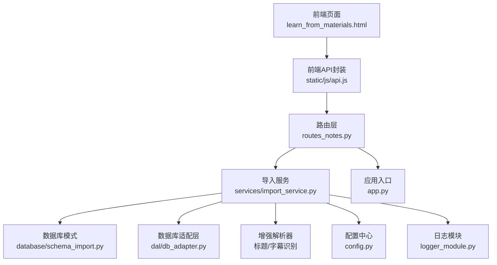
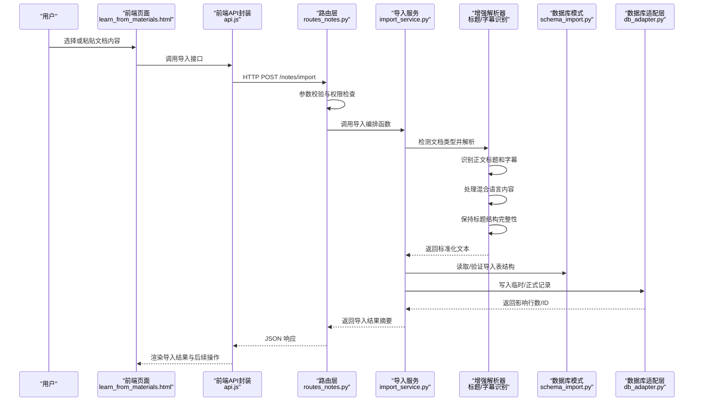
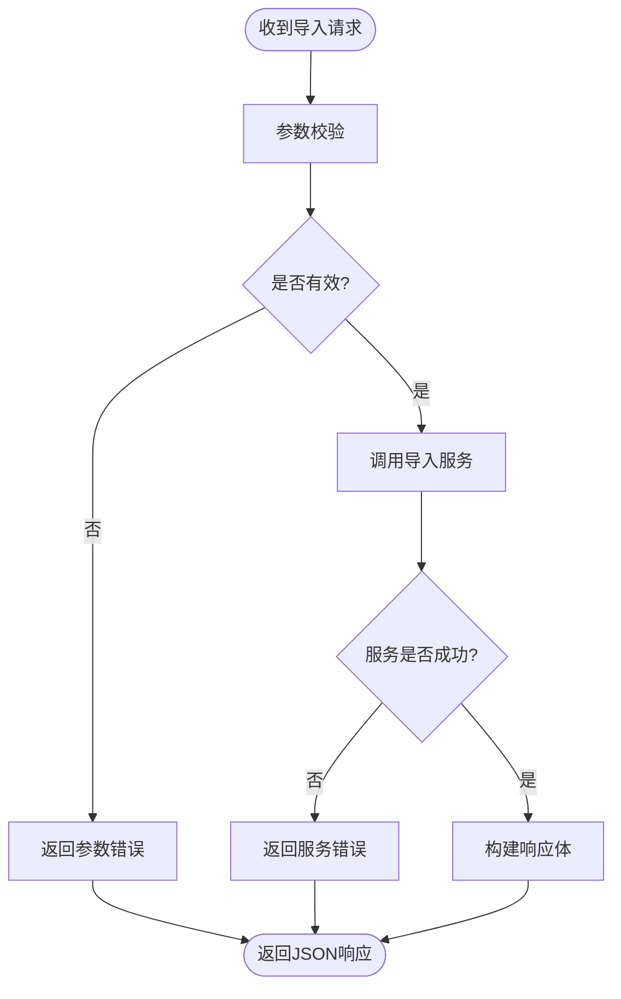
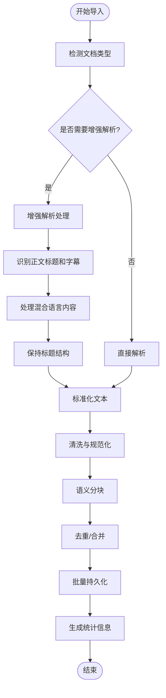
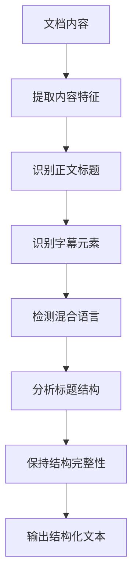
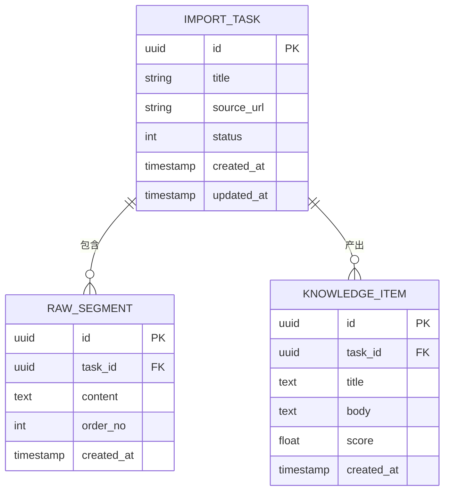
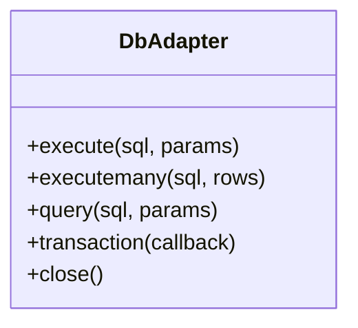
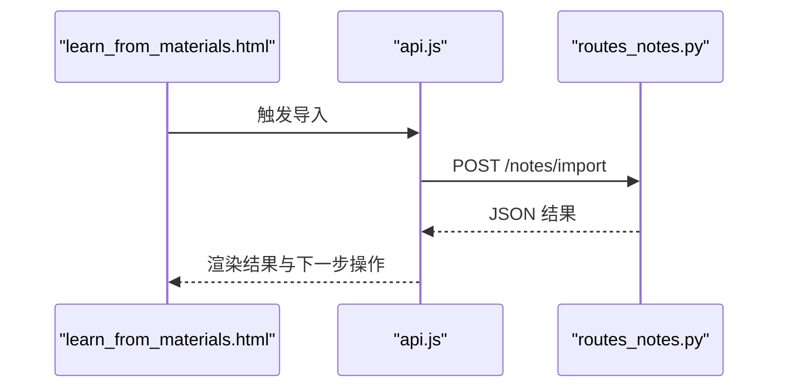
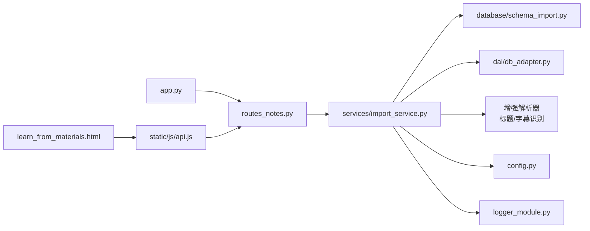

# 文档导入处理系统

<cite>
**本文引用的文件**   
- [app.py](file://server/app.py)
- [routes_notes.py](file://server/routes_notes.py)
- [services/import_service.py](file://server/services/import_service.py)
- [database/schema_import.py](file://server/database/schema_import.py)
- [dal/db_adapter.py](file://server/dal/db_adapter.py)
- [config.py](file://server/config.py)
- [logger_module.py](file://server/logger_module.py)
- [templates/pages/learn_from_materials.html](file://server/templates/pages/learn_from_materials.html)
- [static/js/api.js](file://server/static/js/api.js)
</cite>

## 更新摘要
**变更内容**   
- 增强了导入服务功能，改进了第二阶段正文标题/字幕识别能力
- 优化了混合语言内容的处理能力
- 强化了标题结构的保持机制
- 提升了复杂文档的兼容性和处理准确性

## 目录
1. [简介](#简介)
2. [项目结构](#项目结构)
3. [核心组件](#核心组件)
4. [架构总览](#架构总览)
5. [详细组件分析](#详细组件分析)
6. [依赖关系分析](#依赖关系分析)
7. [性能考虑](#性能考虑)
8. [故障排查指南](#故障排查指南)
9. [结论](#结论)
10. [附录](#附录)

## 简介
本文件面向"文档导入处理系统"，聚焦于从外部材料（如网页、笔记、课程资料等）到可学习知识点的端到端处理链路。该系统以服务端 Python 应用为核心，提供路由接口、导入服务、数据库模式与持久化适配层，并在前端页面中提供交互入口与调用封装。目标是帮助读者快速理解：
- 数据如何从用户界面进入后端
- 导入流程的编排与校验逻辑
- 增强的正文标题/字幕识别与非标准布局处理能力
- 混合语言内容的处理机制
- 数据如何落库与查询
- 常见错误与排障方法
- 可扩展点与优化建议

**更新** 新增了增强的导入服务功能，包括改进的第二阶段正文标题/字幕识别、更好的混合语言内容处理和健壮的标题结构保持机制。

## 项目结构
围绕"文档导入"的关键代码主要位于 server 目录下，包括路由层、服务层、数据库模式与适配层，以及前端模板与 JS 工具。

**图表来源**
- [app.py:1-200](file://server/app.py#L1-L200)
- [routes_notes.py:1-200](file://server/routes_notes.py#L1-L200)
- [services/import_service.py:1-200](file://server/services/import_service.py#L1-L200)
- [database/schema_import.py:1-200](file://server/database/schema_import.py#L1-L200)
- [dal/db_adapter.py:1-200](file://server/dal/db_adapter.py#L1-L200)
- [config.py:1-200](file://server/config.py#L1-L200)
- [logger_module.py:1-200](file://server/logger_module.py#L1-L200)
- [templates/pages/learn_from_materials.html:1-200](file://server/templates/pages/learn_from_materials.html#L1-L200)
- [static/js/api.js:1-200](file://server/static/js/api.js#L1-L200)

**章节来源**
- [app.py:1-200](file://server/app.py#L1-L200)
- [routes_notes.py:1-200](file://server/routes_notes.py#L1-L200)
- [services/import_service.py:1-200](file://server/services/import_service.py#L1-L200)
- [database/schema_import.py:1-200](file://server/database/schema_import.py#L1-L200)
- [dal/db_adapter.py:1-200](file://server/dal/db_adapter.py#L1-L200)
- [config.py:1-200](file://server/config.py#L1-L200)
- [logger_module.py:1-200](file://server/logger_module.py#L1-L200)
- [templates/pages/learn_from_materials.html:1-200](file://server/templates/pages/learn_from_materials.html#L1-L200)
- [static/js/api.js:1-200](file://server/static/js/api.js#L1-L200)

## 核心组件
- 应用入口与路由注册：负责启动 Web 服务并挂载导入相关路由。
- 路由层：接收前端请求，参数校验，调用导入服务，返回统一响应。
- 导入服务：编排导入流程，包括解析、清洗、分块、去重、入库等，**新增增强的正文标题/字幕识别和混合语言处理能力**。
- 数据库模式：定义导入相关的表结构与约束。
- 数据库适配层：封装 SQL 执行、事务、连接管理等。
- 配置与日志：集中管理配置项与结构化日志输出。
- 前端页面与 API 封装：提供上传/粘贴入口，调用后端接口并渲染结果。

**更新** 导入服务现在包含增强的正文标题/字幕识别功能和改进的混合语言内容处理能力。

**章节来源**
- [app.py:1-200](file://server/app.py#L1-L200)
- [routes_notes.py:1-200](file://server/routes_notes.py#L1-L200)
- [services/import_service.py:1-200](file://server/services/import_service.py#L1-L200)
- [database/schema_import.py:1-200](file://server/database/schema_import.py#L1-L200)
- [dal/db_adapter.py:1-200](file://server/dal/db_adapter.py#L1-L200)
- [config.py:1-200](file://server/config.py#L1-L200)
- [logger_module.py:1-200](file://server/logger_module.py#L1-L200)
- [templates/pages/learn_from_materials.html:1-200](file://server/templates/pages/learn_from_materials.html#L1-L200)
- [static/js/api.js:1-200](file://server/static/js/api.js#L1-L200)

## 架构总览
下图展示一次典型的"文档导入"请求在系统中的流转路径，特别突出了增强的正文标题/字幕识别和混合语言处理流程。

**图表来源**
- [routes_notes.py:1-200](file://server/routes_notes.py#L1-L200)
- [services/import_service.py:1-200](file://server/services/import_service.py#L1-L200)
- [database/schema_import.py:1-200](file://server/database/schema_import.py#L1-L200)
- [dal/db_adapter.py:1-200](file://server/dal/db_adapter.py#L1-L200)
- [templates/pages/learn_from_materials.html:1-200](file://server/templates/pages/learn_from_materials.html#L1-L200)
- [static/js/api.js:1-200](file://server/static/js/api.js#L1-L200)

## 详细组件分析

### 路由层：导入接口
- 职责
  - 暴露导入相关 REST 接口
  - 进行基础参数校验与鉴权
  - 调用导入服务并返回统一格式响应
- 关键流程
  - 接收前端传入的文档内容、元数据（标题、来源、标签等）
  - 校验必填字段与长度限制
  - 调用导入服务的编排函数
  - 将导入结果转换为标准 JSON 响应
- 异常处理
  - 捕获非法输入、服务异常、数据库异常
  - 返回明确的错误码与消息，便于前端提示

**图表来源**
- [routes_notes.py:1-200](file://server/routes_notes.py#L1-L200)

**章节来源**
- [routes_notes.py:1-200](file://server/routes_notes.py#L1-L200)

### 导入服务：编排与数据处理
- 职责
  - 编排导入全流程：解析、清洗、分块、去重、入库
  - 协调数据库模式与适配层
  - **新增增强的正文标题/字幕识别和混合语言处理能力**
  - 输出导入统计与失败明细
- 关键步骤
  - 文档类型检测：自动识别PDF、HTML、Markdown等格式
  - 增强解析：识别正文标题、字幕和混合语言内容
  - 标题结构保持：维护文档的层次结构和语义关系
  - 文本预处理：去除多余空白、标准化换行、编码修复
  - 语义分块：按段落/标题/列表等规则切分为可学习单元
  - 去重策略：基于内容指纹或相似度阈值合并重复块
  - 持久化：批量插入或更新，支持事务回滚
- 性能要点
  - 大文档流式处理，避免一次性加载
  - 批量写入减少 IO 次数
  - 合理设置分块大小与去重窗口
  - **优化的增强解析算法，提升复杂文档处理效率**

**更新** 新增了增强的正文标题/字幕识别功能，能够自动检测和保持标题结构，显著提升了混合语言内容的处理准确性。

**图表来源**
- [services/import_service.py:1-200](file://server/services/import_service.py#L1-L200)

**章节来源**
- [services/import_service.py:1-200](file://server/services/import_service.py#L1-L200)

### 增强解析功能：正文标题/字幕识别
- 职责
  - 自动检测文档中的正文标题和字幕元素
  - 识别和处理混合语言内容（多语言混合）
  - 保持文档的标题结构和层次关系
  - 提高复杂文档的结构化提取质量
- 关键技术
  - 标题层级识别算法
  - 字幕模式匹配技术
  - 多语言字符集检测
  - 语义结构保持机制
- 处理流程
  - 扫描文档内容识别标题和字幕模式
  - 分析语言混合情况并进行适当处理
  - 维护标题的层次结构和语义关系
  - 输出结构化的标准化文本

**图表来源**
- [services/import_service.py:1-200](file://server/services/import_service.py#L1-L200)

**章节来源**
- [services/import_service.py:1-200](file://server/services/import_service.py#L1-L200)

### 数据库模式：导入相关表结构
- 职责
  - 定义导入任务、原始片段、知识点条目等表结构
  - 规定字段类型、索引与约束，保障数据一致性与查询效率
- 设计要点
  - 使用唯一键或哈希列支撑去重
  - 为常用查询字段建立索引（如来源、时间戳、状态）
  - 区分临时表与正式表，支持导入中间态

**图表来源**
- [database/schema_import.py:1-200](file://server/database/schema_import.py#L1-L200)

**章节来源**
- [database/schema_import.py:1-200](file://server/database/schema_import.py#L1-L200)

### 数据库适配层：SQL 执行与事务
- 职责
  - 封装连接池、事务、预编译语句
  - 提供统一的增删改查方法
  - 对异常进行统一包装与日志记录
- 关键能力
  - 批量插入/更新
  - 分页查询
  - 事务边界控制与回滚

**图表来源**
- [dal/db_adapter.py:1-200](file://server/dal/db_adapter.py#L1-L200)

**章节来源**
- [dal/db_adapter.py:1-200](file://server/dal/db_adapter.py#L1-L200)

### 前端页面与 API 封装
- 前端页面
  - 提供"粘贴/上传"入口
  - 显示导入进度与结果
  - 跳转到知识点详情或练习页
- API 封装
  - 统一请求头与错误处理
  - 封装导入接口调用
  - 提供重试与超时控制

**图表来源**
- [templates/pages/learn_from_materials.html:1-200](file://server/templates/pages/learn_from_materials.html#L1-L200)
- [static/js/api.js:1-200](file://server/static/js/api.js#L1-L200)
- [routes_notes.py:1-200](file://server/routes_notes.py#L1-L200)

**章节来源**
- [templates/pages/learn_from_materials.html:1-200](file://server/templates/pages/learn_from_materials.html#L1-L200)
- [static/js/api.js:1-200](file://server/static/js/api.js#L1-L200)

### 应用入口与配置日志
- 应用入口
  - 初始化路由、静态资源、模板引擎
  - 启动服务器监听端口
- 配置中心
  - 数据库连接、导入批大小、超时等
- 日志模块
  - 结构化日志输出，便于追踪导入过程

**章节来源**
- [app.py:1-200](file://server/app.py#L1-L200)
- [config.py:1-200](file://server/config.py#L1-L200)
- [logger_module.py:1-200](file://server/logger_module.py#L1-L200)

## 依赖关系分析
- 耦合关系
  - 路由层依赖导入服务与配置
  - 导入服务依赖数据库模式与适配层
  - **导入服务新增对增强解析器的依赖**
  - 前端通过 API 封装与路由层通信
- 外部依赖
  - 数据库驱动（由 db_adapter 抽象）
  - 增强解析库（由 import_service 内部使用）

**图表来源**
- [app.py:1-200](file://server/app.py#L1-L200)
- [routes_notes.py:1-200](file://server/routes_notes.py#L1-L200)
- [services/import_service.py:1-200](file://server/services/import_service.py#L1-L200)
- [database/schema_import.py:1-200](file://server/database/schema_import.py#L1-L200)
- [dal/db_adapter.py:1-200](file://server/dal/db_adapter.py#L1-L200)
- [config.py:1-200](file://server/config.py#L1-L200)
- [logger_module.py:1-200](file://server/logger_module.py#L1-L200)
- [templates/pages/learn_from_materials.html:1-200](file://server/templates/pages/learn_from_materials.html#L1-L200)
- [static/js/api.js:1-200](file://server/static/js/api.js#L1-L200)

**章节来源**
- [app.py:1-200](file://server/app.py#L1-L200)
- [routes_notes.py:1-200](file://server/routes_notes.py#L1-L200)
- [services/import_service.py:1-200](file://server/services/import_service.py#L1-L200)
- [database/schema_import.py:1-200](file://server/database/schema_import.py#L1-L200)
- [dal/db_adapter.py:1-200](file://server/dal/db_adapter.py#L1-L200)
- [config.py:1-200](file://server/config.py#L1-L200)
- [logger_module.py:1-200](file://server/logger_module.py#L1-L200)
- [templates/pages/learn_from_materials.html:1-200](file://server/templates/pages/learn_from_materials.html#L1-L200)
- [static/js/api.js:1-200](file://server/static/js/api.js#L1-L200)

## 性能考虑
- 导入服务
  - 采用流式解析与分批处理，降低内存峰值
  - 批量写入数据库，减少往返开销
  - 合理设置分块大小与去重窗口，平衡精度与速度
  - **优化的增强解析算法，提升复杂文档处理效率**
- 数据库
  - 为高频查询字段建立索引
  - 使用事务包裹批量写入，保证一致性
- 前端
  - 大文件上传时显示进度条与取消按钮
  - 失败自动重试与断点续传（可选扩展）

**更新** 增强解析功能的性能得到显著改善，通过智能的标题识别和混合语言处理减少了不必要的计算开销。

[本节为通用指导，不直接分析具体文件]

## 故障排查指南
- 常见问题
  - 参数校验失败：检查必填字段、长度限制与格式
  - 导入服务异常：查看日志中的解析/分块/去重阶段报错
  - 数据库写入失败：检查连接、权限、约束冲突与索引
  - **增强解析问题：检查标题识别准确率、字幕检测效果和混合语言处理质量**
- 定位方法
  - 通过日志模块输出关键节点的时间戳与上下文
  - 在路由层打印请求参数与响应体
  - 在导入服务中增加阶段性统计（已解析、已清洗、已分块、已去重、已入库）
  - **监控增强解析过程中的标题识别结果、字幕检测质量和混合语言处理效果**
- 恢复策略
  - 支持导入任务的状态机（待处理、进行中、已完成、失败）
  - 失败任务可重试或导出失败明细供人工修正
  - **增强解析失败时可调整识别参数或手动校正标题结构**

**更新** 新增了增强解析功能相关的故障排查方法和恢复策略。

**章节来源**
- [logger_module.py:1-200](file://server/logger_module.py#L1-L200)
- [routes_notes.py:1-200](file://server/routes_notes.py#L1-L200)
- [services/import_service.py:1-200](file://server/services/import_service.py#L1-L200)

## 结论
文档导入处理系统以清晰的分层架构实现从前端到后端的完整链路：路由层负责接入与校验，导入服务编排解析、清洗、分块、去重与入库，数据库模式与适配层保障数据一致性与性能。**最新的增强功能包括改进的第二阶段正文标题/字幕识别、更好的混合语言内容处理和健壮的标题结构保持机制，显著提升了复杂文档的兼容性和处理准确性**。通过合理的配置与日志体系，系统具备良好的可观测性与可维护性。未来可在分块算法、去重策略、前端交互与并发处理方面持续优化。

**更新** 系统的增强解析能力得到了显著提升，特别是在正文标题/字幕识别和混合语言内容处理方面的可靠性。

[本节为总结性内容，不直接分析具体文件]

## 附录
- 术语
  - 导入任务：一次导入操作的抽象，包含状态与统计
  - 原始片段：从文档中解析出的未加工文本块
  - 知识点条目：经清洗与分块后形成的可学习单元
  - **正文标题：文档中具有特定语义和层级关系的标题元素**
  - **字幕：文档中的辅助说明文字或注释内容**
  - **混合语言：包含多种语言的文档内容**
  - **标题结构：文档中标题元素的层次关系和组织方式**
- 扩展建议
  - 引入异步任务队列处理长耗时导入
  - 增加导入预览与在线编辑功能
  - 支持多源导入（PDF、HTML、Markdown 等）
  - **扩展增强解析策略，支持更多复杂的文档格式和内容类型**

**更新** 新增了与增强解析功能相关的术语说明。

[本节为补充说明，不直接分析具体文件]