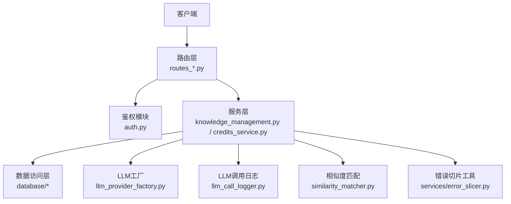
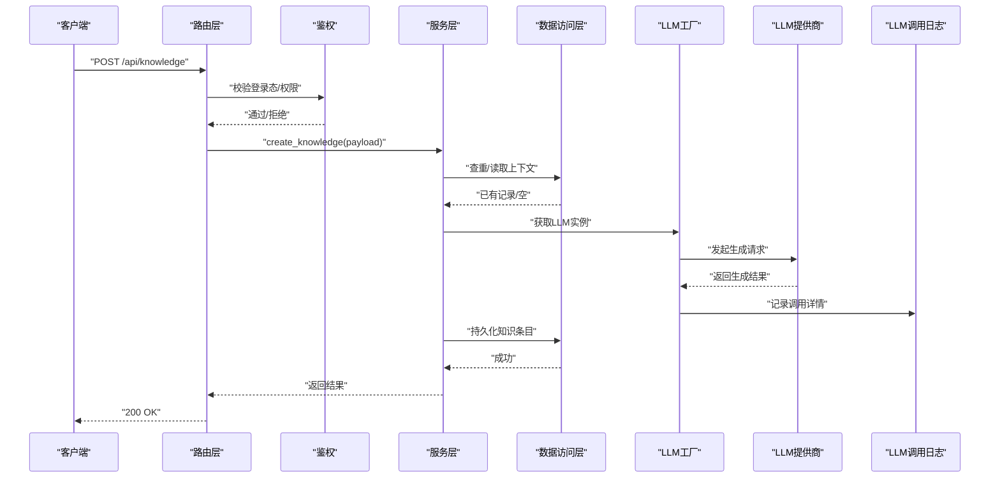
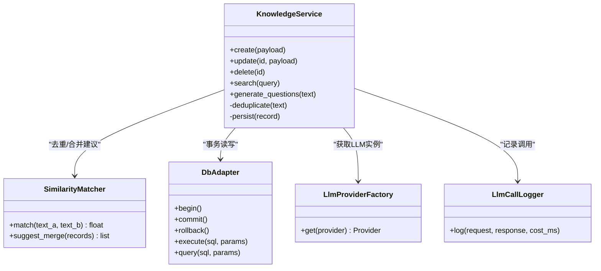
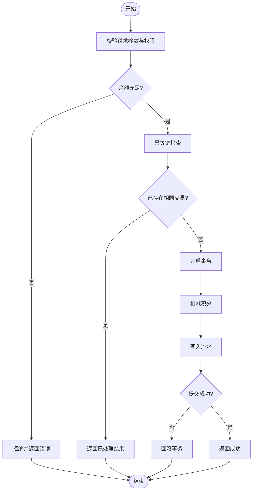
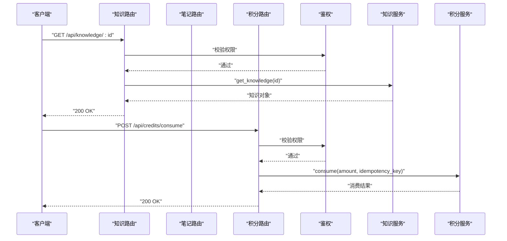
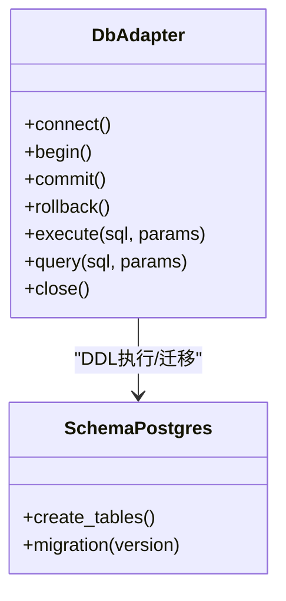
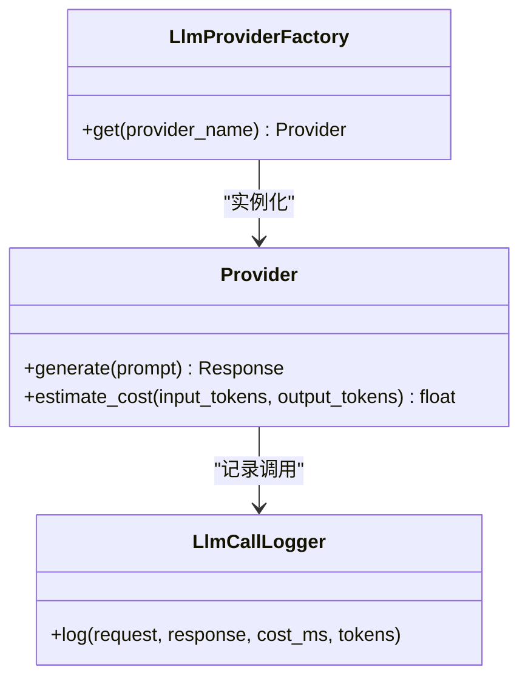
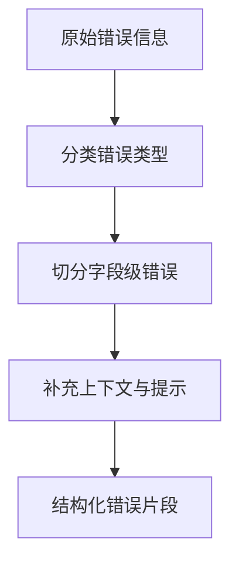
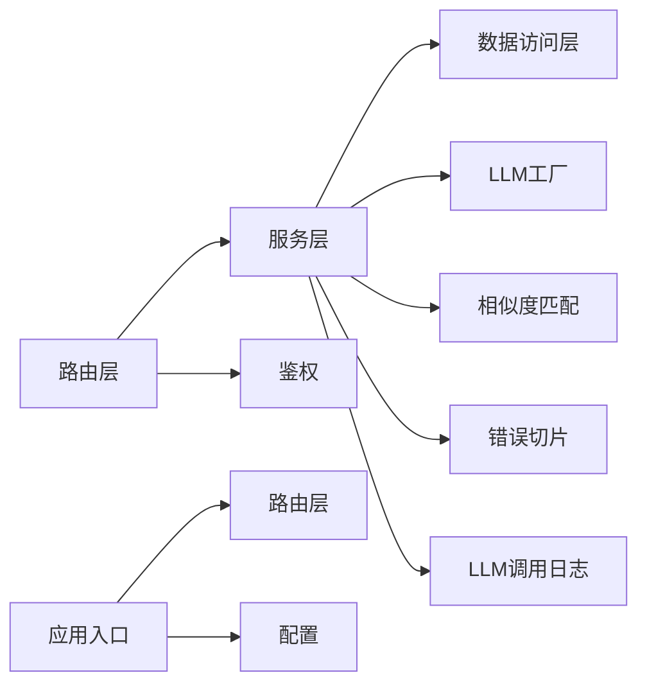

# 服务层架构

<cite>
**本文引用的文件**   
- [app.py](file://server/app.py)
- [config.py](file://server/config.py)
- [auth.py](file://server/auth.py)
- [routes_knowledge.py](file://server/routes_knowledge.py)
- [routes_notes.py](file://server/routes_notes.py)
- [routes_credits.py](file://server/routes_credits.py)
- [routes_admin.py](file://server/routes_admin.py)
- [knowledge_management.py](file://server/knowledge_management.py)
- [credits_service.py](file://server/credits_service.py)
- [llm_provider_factory.py](file://server/llm_provider_factory.py)
- [llm_call_logger.py](file://server/llm_call_logger.py)
- [similarity_matcher.py](file://server/similarity_matcher.py)
- [database/db_adapter.py](file://server/database/db_adapter.py)
- [database/schema_postgres.py](file://server/database/schema_postgres.py)
- [services/error_slicer.py](file://server/services/error_slicer.py)
- [AGENTS.md](file://AGENTS.md)
</cite>

## 目录
1. [引言](#引言)
2. [项目结构](#项目结构)
3. [核心组件](#核心组件)
4. [架构总览](#架构总览)
5. [详细组件分析](#详细组件分析)
6. [依赖关系分析](#依赖关系分析)
7. [性能与可扩展性](#性能与可扩展性)
8. [故障排查指南](#故障排查指南)
9. [结论](#结论)
10. [附录：测试与可观测性](#附录测试与可观测性)

## 引言
本文件面向LectureLearnLoop的服务层，聚焦职责分离、业务逻辑封装与领域模型设计。文档说明核心服务类的实现模式、依赖管理、事务处理机制，并给出服务调用示例、错误处理策略和数据验证规则。同时覆盖服务的可测试性设计、Mock对象使用与单元测试最佳实践，以及服务间通信、事件驱动与异步任务处理的建议方案。

## 项目结构
服务器端采用“路由层 + 服务层 + 数据访问层”的分层架构：
- 路由层：负责HTTP请求解析、鉴权校验、参数校验与响应包装。
- 服务层：封装领域业务逻辑、编排跨域操作、协调外部系统（LLM、ASR等）。
- 数据访问层：统一数据库连接、Schema定义与ORM/SQL执行。
- 横切关注点：配置、日志、LLM调用记录、相似度匹配、错误切片工具等。

**图示来源**
- [routes_knowledge.py:1-200](file://server/routes_knowledge.py#L1-L200)
- [routes_notes.py:1-200](file://server/routes_notes.py#L1-L200)
- [routes_credits.py:1-200](file://server/routes_credits.py#L1-L200)
- [knowledge_management.py:1-200](file://server/knowledge_management.py#L1-L200)
- [credits_service.py:1-200](file://server/credits_service.py#L1-L200)
- [database/db_adapter.py:1-200](file://server/database/db_adapter.py#L1-L200)
- [llm_provider_factory.py:1-200](file://server/llm_provider_factory.py#L1-L200)
- [llm_call_logger.py:1-200](file://server/llm_call_logger.py#L1-L200)
- [similarity_matcher.py:1-200](file://server/similarity_matcher.py#L1-L200)
- [services/error_slicer.py:1-200](file://server/services/error_slicer.py#L1-L200)

**章节来源**
- [app.py:1-200](file://server/app.py#L1-L200)
- [AGENTS.md:1-200](file://AGENTS.md#L1-L200)

## 核心组件
- 应用入口与中间件
  - app.py：注册蓝图、初始化配置、挂载全局异常处理器、启动Web服务。
  - config.py：集中化配置项（数据库、LLM、缓存、日志级别等），支持环境区分。
- 鉴权与安全
  - auth.py：用户登录态校验、权限控制、会话管理。
- 路由层
  - routes_knowledge.py：知识条目CRUD、检索、关联练习材料等接口。
  - routes_notes.py：笔记相关接口（创建、更新、同步、导出）。
  - routes_credits.py：积分/额度相关接口（充值、消费、查询）。
  - routes_admin.py：管理员后台接口（审计、统计、配置下发）。
- 服务层
  - knowledge_management.py：知识点生命周期管理、与LLM交互生成题目/解析、与相似度匹配器协作去重。
  - credits_service.py：积分账户一致性保障、交易流水、幂等控制。
- 数据访问层
  - database/db_adapter.py：数据库连接池、事务边界、通用查询封装。
  - database/schema_postgres.py：PostgreSQL表结构与约束定义。
- 横切能力
  - llm_provider_factory.py：LLM提供商抽象与工厂选择。
  - llm_call_logger.py：LLM调用入出参、耗时、成本等可观测性记录。
  - similarity_matcher.py：文本相似度计算、重复检测、近似合并建议。
  - services/error_slicer.py：将复杂错误信息切分为结构化片段，便于前端展示与追踪。

**章节来源**
- [app.py:1-200](file://server/app.py#L1-L200)
- [config.py:1-200](file://server/config.py#L1-L200)
- [auth.py:1-200](file://server/auth.py#L1-L200)
- [routes_knowledge.py:1-200](file://server/routes_knowledge.py#L1-L200)
- [routes_notes.py:1-200](file://server/routes_notes.py#L1-L200)
- [routes_credits.py:1-200](file://server/routes_credits.py#L1-L200)
- [routes_admin.py:1-200](file://server/routes_admin.py#L1-L200)
- [knowledge_management.py:1-200](file://server/knowledge_management.py#L1-L200)
- [credits_service.py:1-200](file://server/credits_service.py#L1-L200)
- [database/db_adapter.py:1-200](file://server/database/db_adapter.py#L1-L200)
- [database/schema_postgres.py:1-200](file://server/database/schema_postgres.py#L1-L200)
- [llm_provider_factory.py:1-200](file://server/llm_provider_factory.py#L1-L200)
- [llm_call_logger.py:1-200](file://server/llm_call_logger.py#L1-L200)
- [similarity_matcher.py:1-200](file://server/similarity_matcher.py#L1-L200)
- [services/error_slicer.py:1-200](file://server/services/error_slicer.py#L1-L200)

## 架构总览
服务层作为业务编排中心，向上承接路由层的请求，向下协调数据访问层与外部系统（LLM、ASR、存储等）。关键流程包括：
- 知识条目创建：路由接收请求 → 鉴权 → 服务层校验与去重 → 调用LLM生成内容 → 落库 → 返回结果。
- 积分消费：路由接收请求 → 鉴权 → 服务层校验余额与幂等 → 扣减积分 → 写流水 → 返回结果。
- 错误处理：统一异常捕获 → 错误切片 → 标准化响应。

**图示来源**
- [routes_knowledge.py:1-200](file://server/routes_knowledge.py#L1-L200)
- [knowledge_management.py:1-200](file://server/knowledge_management.py#L1-L200)
- [llm_provider_factory.py:1-200](file://server/llm_provider_factory.py#L1-L200)
- [llm_call_logger.py:1-200](file://server/llm_call_logger.py#L1-L200)
- [database/db_adapter.py:1-200](file://server/database/db_adapter.py#L1-L200)

## 详细组件分析

### 知识管理服务（Knowledge Management）
职责：
- 知识点生命周期管理（创建、更新、删除、归档）。
- 与LLM协作生成题目、解析、复习要点。
- 与相似度匹配器协作进行近似重复检测与合并建议。
- 与数据访问层协作完成事务性写入。

**图示来源**
- [knowledge_management.py:1-200](file://server/knowledge_management.py#L1-L200)
- [similarity_matcher.py:1-200](file://server/similarity_matcher.py#L1-L200)
- [database/db_adapter.py:1-200](file://server/database/db_adapter.py#L1-L200)
- [llm_provider_factory.py:1-200](file://server/llm_provider_factory.py#L1-L200)
- [llm_call_logger.py:1-200](file://server/llm_call_logger.py#L1-L200)

**章节来源**
- [knowledge_management.py:1-200](file://server/knowledge_management.py#L1-L200)
- [similarity_matcher.py:1-200](file://server/similarity_matcher.py#L1-L200)
- [database/db_adapter.py:1-200](file://server/database/db_adapter.py#L1-L200)
- [llm_provider_factory.py:1-200](file://server/llm_provider_factory.py#L1-L200)
- [llm_call_logger.py:1-200](file://server/llm_call_logger.py#L1-L200)

### 积分服务（Credits Service）
职责：
- 积分账户的查询、充值、消费、冻结/解冻。
- 交易流水记录与对账。
- 并发安全与幂等控制（防止重复扣费）。

**图示来源**
- [credits_service.py:1-200](file://server/credits_service.py#L1-L200)
- [database/db_adapter.py:1-200](file://server/database/db_adapter.py#L1-L200)

**章节来源**
- [credits_service.py:1-200](file://server/credits_service.py#L1-L200)
- [database/db_adapter.py:1-200](file://server/database/db_adapter.py#L1-L200)

### 路由层与鉴权
- 路由层职责：
  - 解析请求体、路径参数、查询参数。
  - 调用服务层方法，封装标准响应格式。
  - 统一错误码与消息映射。
- 鉴权模块职责：
  - 校验登录态、角色权限。
  - 提供装饰器或中间件注入当前用户上下文。

**图示来源**
- [routes_knowledge.py:1-200](file://server/routes_knowledge.py#L1-L200)
- [routes_notes.py:1-200](file://server/routes_notes.py#L1-L200)
- [routes_credits.py:1-200](file://server/routes_credits.py#L1-L200)
- [auth.py:1-200](file://server/auth.py#L1-L200)

**章节来源**
- [routes_knowledge.py:1-200](file://server/routes_knowledge.py#L1-L200)
- [routes_notes.py:1-200](file://server/routes_notes.py#L1-L200)
- [routes_credits.py:1-200](file://server/routes_credits.py#L1-L200)
- [auth.py:1-200](file://server/auth.py#L1-L200)

### 数据访问层与Schema
- db_adapter.py：
  - 提供连接池、事务边界（begin/commit/rollback）、通用execute/query封装。
  - 支持重试与超时控制。
- schema_postgres.py：
  - 定义知识库、笔记、积分账户、交易流水等表结构及索引。

**图示来源**
- [database/db_adapter.py:1-200](file://server/database/db_adapter.py#L1-L200)
- [database/schema_postgres.py:1-200](file://server/database/schema_postgres.py#L1-L200)

**章节来源**
- [database/db_adapter.py:1-200](file://server/database/db_adapter.py#L1-L200)
- [database/schema_postgres.py:1-200](file://server/database/schema_postgres.py#L1-L200)

### LLM集成与可观测性
- llm_provider_factory.py：
  - 抽象不同LLM提供商接口，按配置选择具体实现。
- llm_call_logger.py：
  - 记录每次调用的输入、输出、耗时、成本、错误信息，便于审计与优化。

**图示来源**
- [llm_provider_factory.py:1-200](file://server/llm_provider_factory.py#L1-L200)
- [llm_call_logger.py:1-200](file://server/llm_call_logger.py#L1-L200)

**章节来源**
- [llm_provider_factory.py:1-200](file://server/llm_provider_factory.py#L1-L200)
- [llm_call_logger.py:1-200](file://server/llm_call_logger.py#L1-L200)

### 错误切片工具
- services/error_slicer.py：
  - 将复杂错误信息切分为结构化片段（分类、字段、提示），便于前端渲染与定位问题。

**图示来源**
- [services/error_slicer.py:1-200](file://server/services/error_slicer.py#L1-L200)

**章节来源**
- [services/error_slicer.py:1-200](file://server/services/error_slicer.py#L1-L200)

## 依赖关系分析
- 路由层依赖服务层与鉴权模块，不直接访问数据库。
- 服务层依赖数据访问层、LLM工厂、相似度匹配器、错误切片工具。
- 数据访问层依赖数据库驱动与Schema定义。
- 横切能力（日志、配置、鉴权）被多层复用。

**图示来源**
- [app.py:1-200](file://server/app.py#L1-L200)
- [config.py:1-200](file://server/config.py#L1-L200)
- [routes_knowledge.py:1-200](file://server/routes_knowledge.py#L1-L200)
- [knowledge_management.py:1-200](file://server/knowledge_management.py#L1-L200)
- [database/db_adapter.py:1-200](file://server/database/db_adapter.py#L1-L200)
- [llm_provider_factory.py:1-200](file://server/llm_provider_factory.py#L1-L200)
- [similarity_matcher.py:1-200](file://server/similarity_matcher.py#L1-L200)
- [services/error_slicer.py:1-200](file://server/services/error_slicer.py#L1-L200)
- [llm_call_logger.py:1-200](file://server/llm_call_logger.py#L1-L200)

**章节来源**
- [app.py:1-200](file://server/app.py#L1-L200)
- [config.py:1-200](file://server/config.py#L1-L200)

## 性能与可扩展性
- 连接池与事务：
  - 使用连接池减少握手开销；在长事务中避免持有锁过久。
- LLM调用优化：
  - 批量请求、缓存热点prompt、限制token上限、失败重试与退避。
- 相似度计算：
  - 对高频文本建立向量索引或布隆过滤器，降低全量比对成本。
- 异步与事件驱动：
  - 将耗时的LLM生成、文件处理、通知发送放入异步队列（如Celery/RQ），路由层立即返回任务ID。
- 可观测性：
  - 通过LLM调用日志与指标采集（延迟、成功率、成本）持续优化。

[本节为通用指导，无需特定文件引用]

## 故障排查指南
- 常见问题定位：
  - 鉴权失败：检查会话状态、权限策略与路由守卫。
  - 数据库异常：查看连接池状态、事务是否提交、索引缺失导致慢查询。
  - LLM调用失败：核对提供商配置、网络连通性、限流与配额。
  - 积分不一致：核查幂等键、并发竞争、流水记录完整性。
- 错误切片与日志：
  - 使用错误切片工具将错误结构化，结合LLM调用日志快速定位根因。
- 建议步骤：
  - 复现最小用例 → 收集请求/响应/日志 → 定位服务层断点 → 修复并回归测试。

**章节来源**
- [services/error_slicer.py:1-200](file://server/services/error_slicer.py#L1-L200)
- [llm_call_logger.py:1-200](file://server/llm_call_logger.py#L1-L200)

## 结论
服务层通过清晰的分层与职责划分，实现了业务逻辑的可维护性与可扩展性。知识管理与积分服务分别封装了各自领域的核心流程，配合数据访问层与LLM集成，形成稳定可靠的后端能力。通过错误切片与可观测性手段，提升了排障效率与系统稳定性。未来可通过异步化与事件驱动进一步提升吞吐与用户体验。

[本节为总结性内容，无需特定文件引用]

## 附录：测试与可观测性
- 可测试性设计：
  - 服务层方法应无副作用或副作用可控（通过依赖注入DbAdapter、LlmProviderFactory等）。
  - 使用Mock对象替换外部依赖（数据库、LLM、文件系统）。
- Mock对象使用：
  - 模拟DbAdapter的execute/query返回值，验证事务边界与错误分支。
  - 模拟LlmProviderFactory返回固定Response，验证生成流程与日志记录。
- 单元测试最佳实践：
  - 覆盖正常路径、边界条件、异常路径。
  - 针对幂等与并发场景编写用例（如积分消费）。
  - 使用夹具（fixtures）准备测试数据，确保隔离与可重复性。
- 可观测性：
  - 利用LLM调用日志记录关键指标，结合错误切片输出结构化诊断信息。

**章节来源**
- [database/db_adapter.py:1-200](file://server/database/db_adapter.py#L1-L200)
- [llm_provider_factory.py:1-200](file://server/llm_provider_factory.py#L1-L200)
- [llm_call_logger.py:1-200](file://server/llm_call_logger.py#L1-L200)
- [services/error_slicer.py:1-200](file://server/services/error_slicer.py#L1-L200)