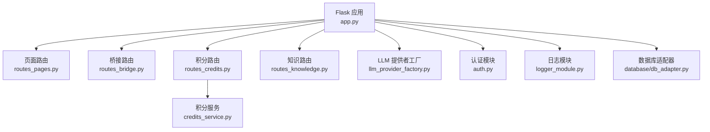
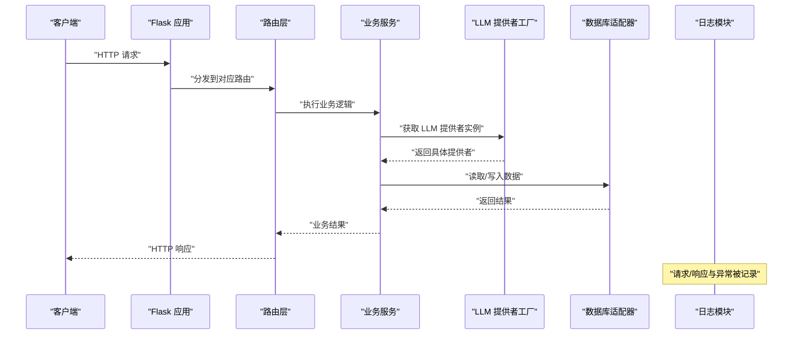
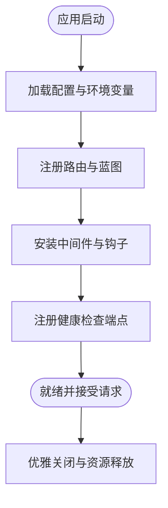
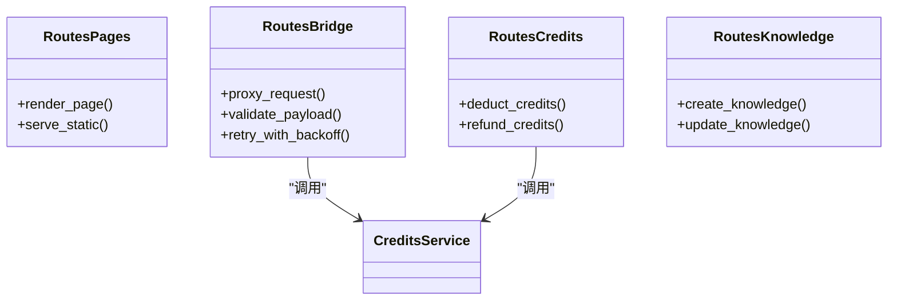
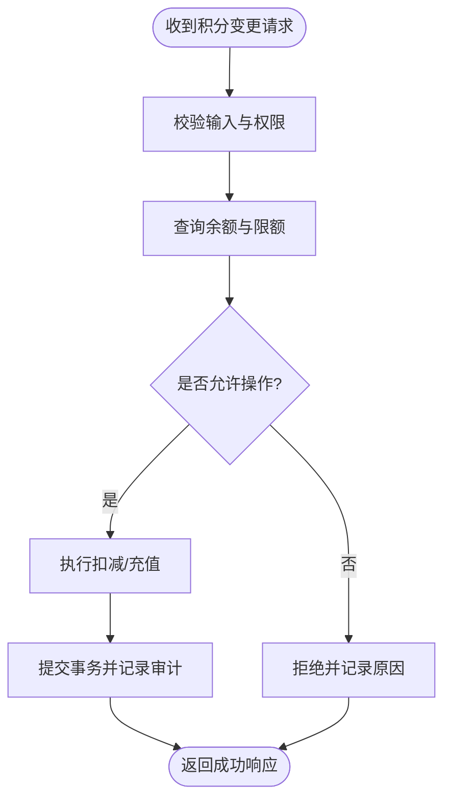
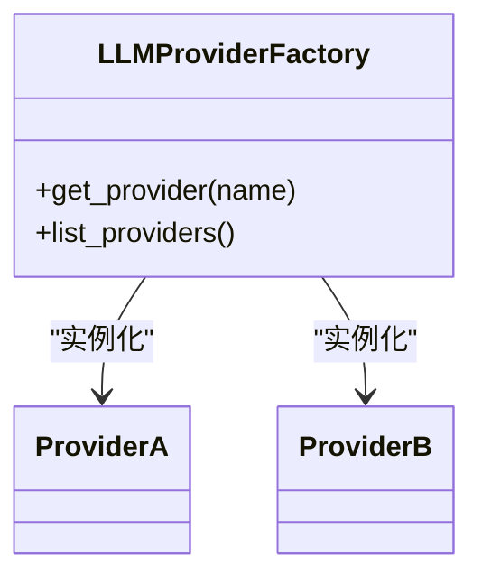
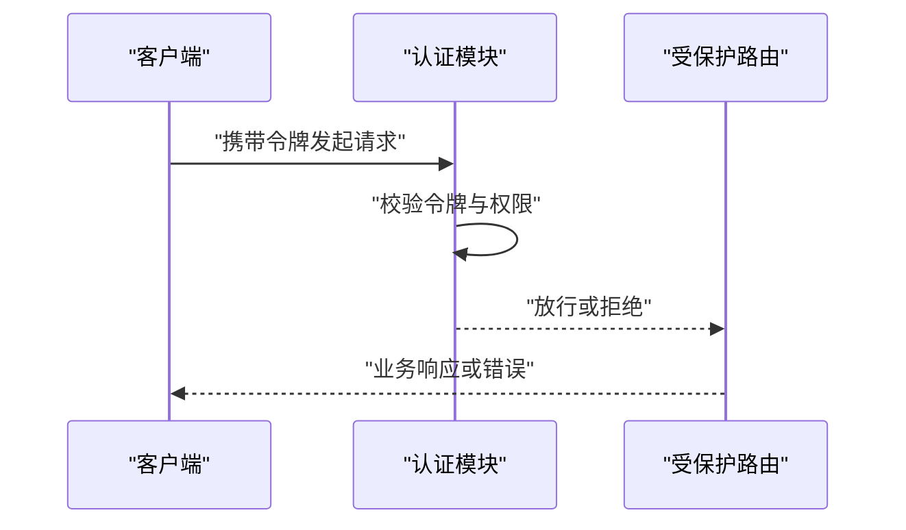
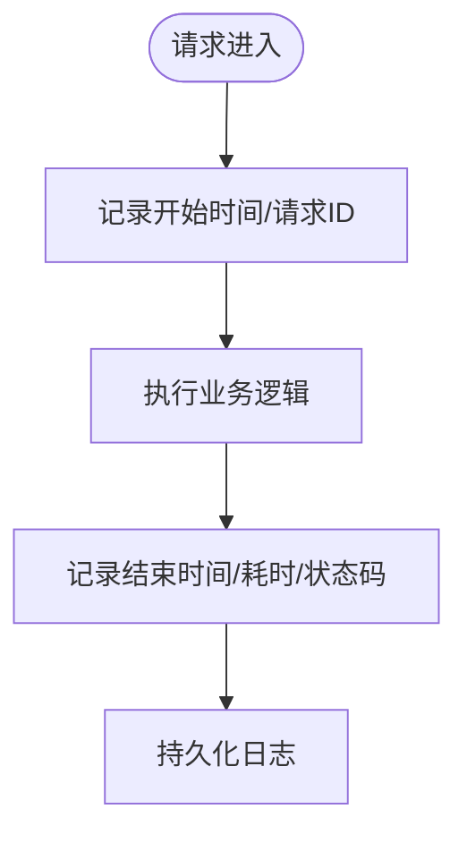
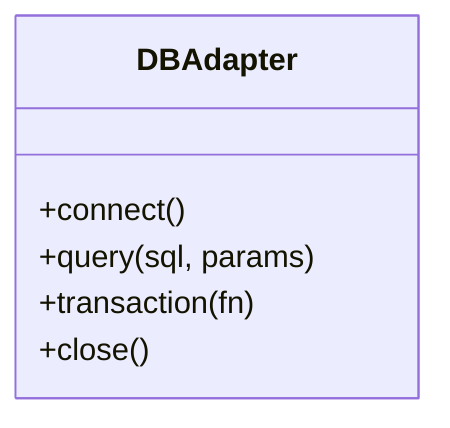
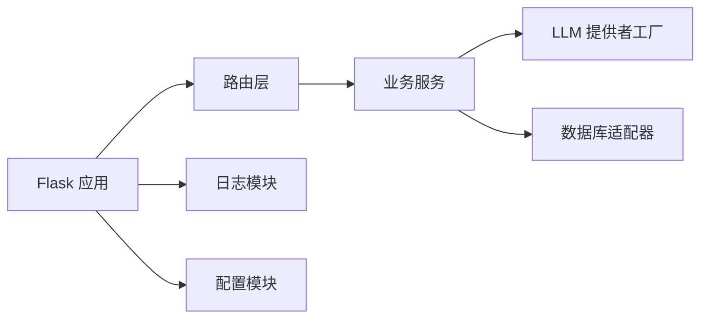

# 服务间通信

<cite>
**本文引用的文件**   
- [app.py](file://server/app.py)
- [config.py](file://server/config.py)
- [auth.py](file://server/auth.py)
- [routes_pages.py](file://server/routes_pages.py)
- [routes_bridge.py](file://server/routes_bridge.py)
- [routes_credits.py](file://server/routes_credits.py)
- [routes_knowledge.py](file://server/routes_knowledge.py)
- [credits_service.py](file://server/credits_service.py)
- [llm_provider_factory.py](file://server/llm_provider_factory.py)
- [logger_module.py](file://server/logger_module.py)
- [llm_call_logger.py](file://server/llm_call_logger.py)
- [database/db_adapter.py](file://server/database/db_adapter.py)
</cite>

## 目录
1. [简介](#简介)
2. [项目结构](#项目结构)
3. [核心组件](#核心组件)
4. [架构总览](#架构总览)
5. [详细组件分析](#详细组件分析)
6. [依赖关系分析](#依赖关系分析)
7. [性能与扩展性](#性能与扩展性)
8. [故障排查指南](#故障排查指南)
9. [结论](#结论)
10. [附录：配置与环境变量](#附录配置与环境变量)

## 简介
本文件面向“服务间通信”主题，围绕 Flask 应用中的服务注册、依赖注入与生命周期管理展开，并结合仓库中实际代码说明服务发现、负载均衡与故障转移的实现现状与建议。文档同时覆盖典型的服务调用模式、异步任务处理、消息队列集成思路、配置管理与环境变量、动态参数传递，以及监控、日志与性能指标采集的实践建议。

## 项目结构
后端采用单进程 Flask 应用组织，按路由层、业务服务层、数据访问层与基础设施（配置、日志、数据库）分层。关键入口为 app.py；路由模块负责 HTTP 接口编排；业务服务封装领域逻辑；数据库适配器统一数据访问；配置与日志提供横切能力。

**图表来源**
- [app.py:1-120](file://server/app.py#L1-L120)
- [routes_pages.py:1-80](file://server/routes_pages.py#L1-L80)
- [routes_bridge.py:1-120](file://server/routes_bridge.py#L1-L120)
- [routes_credits.py:1-120](file://server/routes_credits.py#L1-L120)
- [routes_knowledge.py:1-120](file://server/routes_knowledge.py#L1-L120)
- [credits_service.py:1-120](file://server/credits_service.py#L1-L120)
- [llm_provider_factory.py:1-120](file://server/llm_provider_factory.py#L1-L120)
- [auth.py:1-120](file://server/auth.py#L1-L120)
- [logger_module.py:1-120](file://server/logger_module.py#L1-L120)
- [database/db_adapter.py:1-120](file://server/database/db_adapter.py#L1-L120)

**章节来源**
- [app.py:1-120](file://server/app.py#L1-L120)

## 核心组件
- Flask 应用与中间件
  - 应用初始化、蓝图注册、请求钩子、错误处理器、健康检查端点等集中在应用入口完成。
- 路由层
  - 页面路由、桥接路由、积分路由、知识路由分别承载不同业务域。
- 业务服务
  - 积分服务封装积分相关领域逻辑，供路由层调用。
- LLM 提供者工厂
  - 根据配置选择具体 LLM 提供商实现，支持多供应商接入。
- 认证模块
  - 提供鉴权装饰器或中间件，保护受保护路由。
- 日志模块
  - 统一日志配置与结构化输出。
- 数据库适配器
  - 抽象数据库连接与查询执行，屏蔽底层差异。

**章节来源**
- [app.py:1-120](file://server/app.py#L1-L120)
- [routes_pages.py:1-80](file://server/routes_pages.py#L1-L80)
- [routes_bridge.py:1-120](file://server/routes_bridge.py#L1-L120)
- [routes_credits.py:1-120](file://server/routes_credits.py#L1-L120)
- [credits_service.py:1-120](file://server/credits_service.py#L1-L120)
- [llm_provider_factory.py:1-120](file://server/llm_provider_factory.py#L1-L120)
- [auth.py:1-120](file://server/auth.py#L1-L120)
- [logger_module.py:1-120](file://server/logger_module.py#L1-L120)
- [database/db_adapter.py:1-120](file://server/database/db_adapter.py#L1-L120)

## 架构总览
下图展示一次典型的跨服务调用流程：客户端通过 Flask 路由进入，路由层调用业务服务，业务服务再调用外部系统（如 LLM 或数据库），并贯穿认证、日志与配置。

**图表来源**
- [routes_bridge.py:1-120](file://server/routes_bridge.py#L1-L120)
- [credits_service.py:1-120](file://server/credits_service.py#L1-L120)
- [llm_provider_factory.py:1-120](file://server/llm_provider_factory.py#L1-L120)
- [database/db_adapter.py:1-120](file://server/database/db_adapter.py#L1-L120)
- [logger_module.py:1-120](file://server/logger_module.py#L1-L120)

## 详细组件分析

### Flask 应用：服务注册、依赖注入与生命周期
- 服务注册
  - 在应用入口集中注册蓝图（路由）、中间件、错误处理器与健康检查端点，形成统一的对外暴露面。
- 依赖注入
  - 通过应用上下文或全局容器持有共享资源（如配置对象、日志器、数据库连接池），由路由与服务按需获取，避免硬编码耦合。
- 生命周期管理
  - 使用 Flask 的启动/关闭钩子进行资源初始化与清理，确保数据库连接、外部客户端等在进程生命周期内正确创建与释放。

**图表来源**
- [app.py:1-120](file://server/app.py#L1-L120)

**章节来源**
- [app.py:1-120](file://server/app.py#L1-L120)

### 路由层：服务调用模式与认证
- 页面路由
  - 渲染模板与基础页面逻辑，通常不直接涉及复杂外部调用。
- 桥接路由
  - 作为内部服务网关，聚合多个下游服务调用，承担参数校验、重试与熔断策略。
- 积分路由
  - 面向积分领域的 API，调用积分服务完成扣减、充值等操作。
- 知识路由
  - 面向知识管理的 API，读写知识库数据。

**图表来源**
- [routes_pages.py:1-80](file://server/routes_pages.py#L1-L80)
- [routes_bridge.py:1-120](file://server/routes_bridge.py#L1-L120)
- [routes_credits.py:1-120](file://server/routes_credits.py#L1-L120)
- [routes_knowledge.py:1-120](file://server/routes_knowledge.py#L1-L120)
- [credits_service.py:1-120](file://server/credits_service.py#L1-L120)

**章节来源**
- [routes_pages.py:1-80](file://server/routes_pages.py#L1-L80)
- [routes_bridge.py:1-120](file://server/routes_bridge.py#L1-L120)
- [routes_credits.py:1-120](file://server/routes_credits.py#L1-L120)
- [routes_knowledge.py:1-120](file://server/routes_knowledge.py#L1-L120)

### 业务服务：积分服务与领域逻辑
- 职责边界
  - 封装积分计算、事务一致性、幂等控制与审计日志。
- 与路由解耦
  - 路由仅做参数校验与协议转换，核心规则下沉至服务层，便于测试与复用。

**图表来源**
- [routes_credits.py:1-120](file://server/routes_credits.py#L1-L120)
- [credits_service.py:1-120](file://server/credits_service.py#L1-L120)

**章节来源**
- [routes_credits.py:1-120](file://server/routes_credits.py#L1-L120)
- [credits_service.py:1-120](file://server/credits_service.py#L1-L120)

### LLM 提供者工厂：多供应商接入与选择
- 工厂模式
  - 根据配置键选择具体 LLM 提供商实现，新增供应商无需改动调用方。
- 配置驱动
  - 通过环境变量或配置文件切换提供商、密钥与超时等参数。

**图表来源**
- [llm_provider_factory.py:1-120](file://server/llm_provider_factory.py#L1-L120)

**章节来源**
- [llm_provider_factory.py:1-120](file://server/llm_provider_factory.py#L1-L120)

### 认证模块：鉴权与访问控制
- 装饰器/中间件
  - 对受保护路由进行身份校验、权限检查与会话验证。
- 安全边界
  - 将敏感信息（如令牌）限制在最小作用域，避免泄露。

**图表来源**
- [auth.py:1-120](file://server/auth.py#L1-L120)

**章节来源**
- [auth.py:1-120](file://server/auth.py#L1-L120)

### 日志模块：结构化日志与可观测性
- 统一日志
  - 集中配置日志级别、格式与输出目标，便于收集与分析。
- 链路追踪
  - 在关键路径埋点，结合请求 ID 实现跨服务追踪。

**图表来源**
- [logger_module.py:1-120](file://server/logger_module.py#L1-L120)
- [llm_call_logger.py:1-120](file://server/llm_call_logger.py#L1-L120)

**章节来源**
- [logger_module.py:1-120](file://server/logger_module.py#L1-L120)
- [llm_call_logger.py:1-120](file://server/llm_call_logger.py#L1-L120)

### 数据库适配器：数据访问抽象
- 连接管理
  - 统一管理连接池、事务与查询执行，屏蔽底层差异。
- 错误处理
  - 捕获并转换底层异常为统一错误模型，便于上层处理。

**图表来源**
- [database/db_adapter.py:1-120](file://server/database/db_adapter.py#L1-L120)

**章节来源**
- [database/db_adapter.py:1-120](file://server/database/db_adapter.py#L1-L120)

## 依赖关系分析
- 低耦合高内聚
  - 路由层仅负责协议适配与参数校验，业务逻辑下沉至服务层；外部依赖（LLM、数据库）通过工厂与适配器抽象。
- 可能的循环依赖
  - 当前结构以单向依赖为主，若引入更多横向能力（如缓存、消息队列），应通过接口隔离避免循环引用。

**图表来源**
- [app.py:1-120](file://server/app.py#L1-L120)
- [routes_bridge.py:1-120](file://server/routes_bridge.py#L1-L120)
- [credits_service.py:1-120](file://server/credits_service.py#L1-L120)
- [llm_provider_factory.py:1-120](file://server/llm_provider_factory.py#L1-L120)
- [database/db_adapter.py:1-120](file://server/database/db_adapter.py#L1-L120)
- [logger_module.py:1-120](file://server/logger_module.py#L1-L120)
- [config.py:1-120](file://server/config.py#L1-L120)

**章节来源**
- [app.py:1-120](file://server/app.py#L1-L120)
- [config.py:1-120](file://server/config.py#L1-L120)

## 性能与扩展性
- 服务发现
  - 当前为单机部署，未内置服务发现；可通过外部代理（如 Nginx/Ingress）或容器编排平台（Kubernetes）实现。
- 负载均衡
  - 建议在反向代理层启用轮询或加权策略，配合多实例部署提升吞吐与可用性。
- 故障转移
  - 在桥接路由或服务层实现重试、退避与熔断；对 LLM 调用增加超时与降级策略。
- 异步任务与消息队列
  - 对于耗时任务（如转写、批处理），建议引入 Celery/RQ 等任务队列，路由仅投递任务并返回任务 ID。
- 监控与指标
  - 接入 Prometheus/Grafana 采集 QPS、延迟、错误率；结合结构化日志与链路追踪实现可观测性闭环。

[本节为通用指导，不涉及具体文件]

## 故障排查指南
- 常见问题定位
  - 认证失败：检查令牌有效期、权限范围与中间件顺序。
  - LLM 调用超时：检查网络连通性、密钥配置与超时阈值。
  - 数据库连接异常：检查连接池大小、事务未提交与慢查询。
- 日志与追踪
  - 通过请求 ID 关联全链路日志；关注错误堆栈与上游依赖状态。
- 快速恢复
  - 启用熔断与降级开关；必要时回滚配置并重启实例。

**章节来源**
- [logger_module.py:1-120](file://server/logger_module.py#L1-L120)
- [llm_call_logger.py:1-120](file://server/llm_call_logger.py#L1-L120)
- [database/db_adapter.py:1-120](file://server/database/db_adapter.py#L1-L120)

## 结论
本项目采用清晰的 Flask 分层架构，通过路由层、业务服务层与基础设施层的解耦，实现了稳定的服务间通信基础。在此基础上，建议逐步引入服务发现、负载均衡、熔断重试与异步任务队列，完善监控与可观测性体系，以提升系统的可扩展性与韧性。

[本节为总结性内容，不涉及具体文件]

## 附录：配置与环境变量
- 配置来源
  - 应用配置集中于配置模块，支持从环境变量与配置文件加载。
- 关键项建议
  - 数据库连接串、LLM 提供商密钥、日志级别、超时与重试参数等均应通过环境变量注入，避免硬编码。
- 动态参数
  - 对运行时可调参数（如并发度、缓存 TTL）建议提供热更新机制，并通过配置中心下发。

**章节来源**
- [config.py:1-120](file://server/config.py#L1-L120)