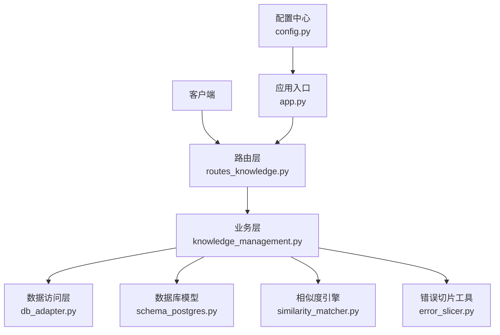
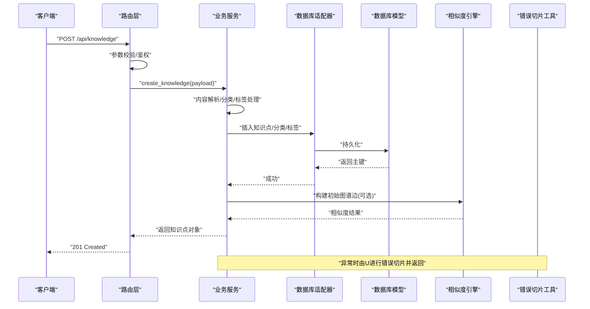
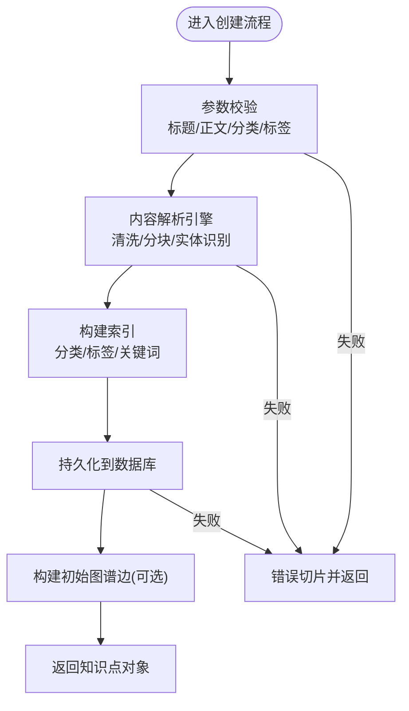
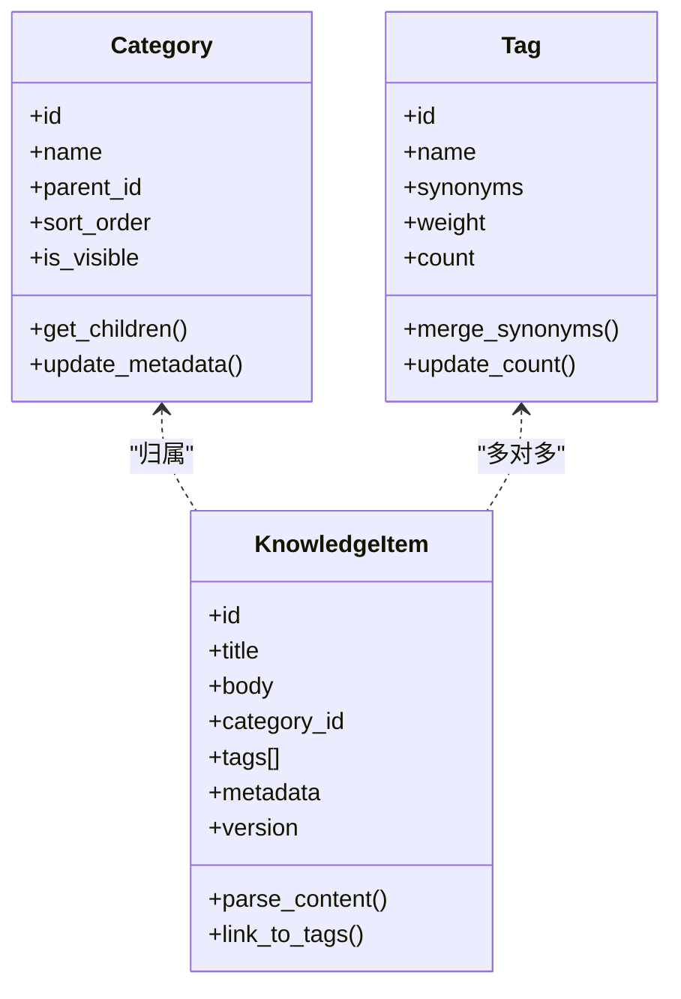
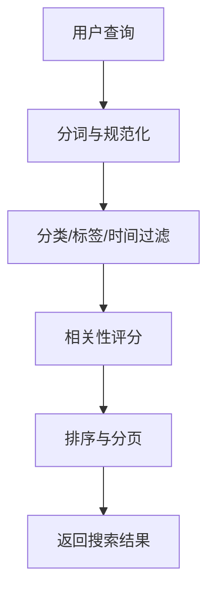
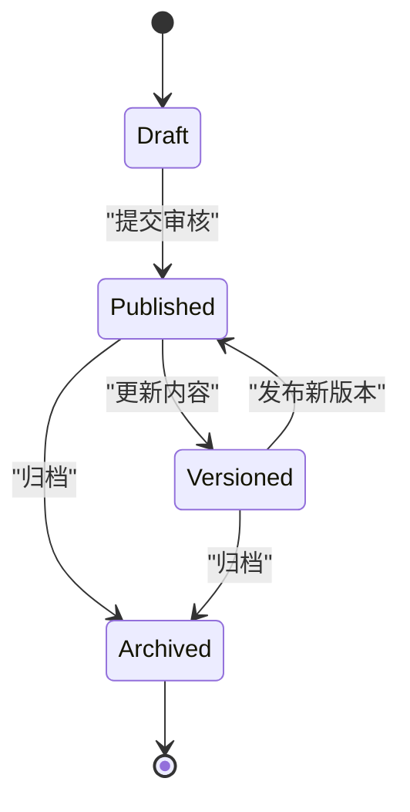
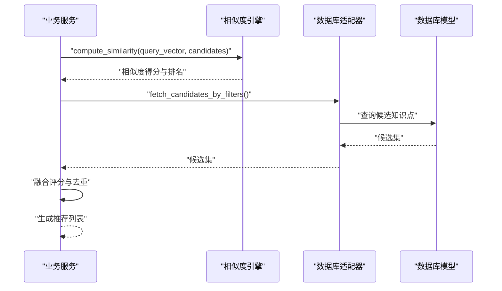
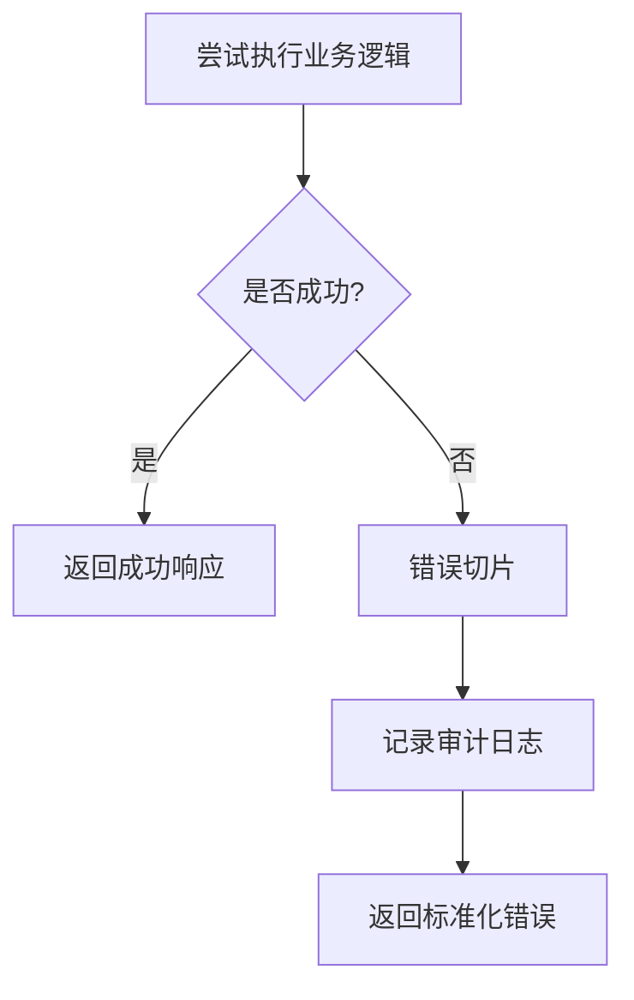
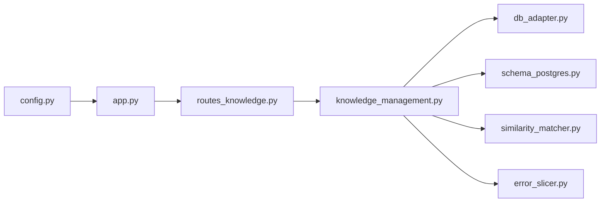

# 知识管理服务

<cite>
**本文引用的文件**   
- [knowledge_management.py](file://server/knowledge_management.py)
- [routes_knowledge.py](file://server/routes_knowledge.py)
- [similarity_matcher.py](file://server/similarity_matcher.py)
- [db_adapter.py](file://server/database/db_adapter.py)
- [schema_postgres.py](file://server/database/schema_postgres.py)
- [app.py](file://server/app.py)
- [config.py](file://server/config.py)
- [error_slicer.py](file://server/services/error_slicer.py)
</cite>

## 目录
1. [简介](#简介)
2. [项目结构](#项目结构)
3. [核心组件](#核心组件)
4. [架构总览](#架构总览)
5. [详细组件分析](#详细组件分析)
6. [依赖关系分析](#依赖关系分析)
7. [性能考虑](#性能考虑)
8. [故障排查指南](#故障排查指南)
9. [结论](#结论)
10. [附录](#附录)

## 简介
本文件为“知识管理服务”的完整技术文档，覆盖知识点CRUD、内容解析引擎、知识关联算法、分类与标签管理、搜索、版本控制、知识图谱构建、相似性匹配与智能推荐等能力。文档同时给出服务调用示例、数据验证规则、错误处理策略、数据库交互模式、缓存策略与性能优化方案，帮助开发者快速理解并扩展该服务。

## 项目结构
知识管理服务位于后端服务器中，主要涉及以下模块：
- 路由层：对外暴露HTTP接口，负责参数校验、鉴权、响应封装与错误统一处理。
- 业务层：实现知识点CRUD、分类/标签管理、搜索、版本控制、知识图谱构建、相似性匹配与推荐。
- 数据访问层：封装数据库连接、事务、查询与写入操作。
- 配置与环境：集中管理数据库、缓存、外部服务等配置项。
- 工具与服务：提供错误切片、日志记录、相似度计算等通用能力。

**图表来源**
- [routes_knowledge.py:1-200](file://server/routes_knowledge.py#L1-L200)
- [knowledge_management.py:1-300](file://server/knowledge_management.py#L1-L300)
- [db_adapter.py:1-200](file://server/database/db_adapter.py#L1-L200)
- [schema_postgres.py:1-200](file://server/database/schema_postgres.py#L1-L200)
- [similarity_matcher.py:1-200](file://server/similarity_matcher.py#L1-L200)
- [error_slicer.py:1-100](file://server/services/error_slicer.py#L1-L100)
- [app.py:1-100](file://server/app.py#L1-L100)
- [config.py:1-100](file://server/config.py#L1-L100)

**章节来源**
- [routes_knowledge.py:1-200](file://server/routes_knowledge.py#L1-L200)
- [knowledge_management.py:1-300](file://server/knowledge_management.py#L1-L300)
- [db_adapter.py:1-200](file://server/database/db_adapter.py#L1-L200)
- [schema_postgres.py:1-200](file://server/database/schema_postgres.py#L1-L200)
- [similarity_matcher.py:1-200](file://server/similarity_matcher.py#L1-L200)
- [error_slicer.py:1-100](file://server/services/error_slicer.py#L1-L100)
- [app.py:1-100](file://server/app.py#L1-L100)
- [config.py:1-100](file://server/config.py#L1-L100)

## 核心组件
- 知识点路由控制器：定义RESTful接口，包括创建、读取、更新、删除、批量导入、搜索、版本管理等。
- 知识点业务服务：封装领域逻辑，如内容解析、分类/标签管理、版本控制、知识图谱构建、相似性匹配与推荐。
- 相似度匹配器：提供文本相似度计算、向量检索、候选集筛选与排序。
- 数据库适配器：统一数据库连接、事务、查询与写入，屏蔽底层差异。
- 数据库模型：定义知识点、分类、标签、版本、图谱边等表结构与约束。
- 错误切片工具：将复杂错误信息切分为结构化片段，便于前端展示与定位问题。
- 应用入口与配置：注册路由、加载配置、初始化依赖。

**章节来源**
- [routes_knowledge.py:1-200](file://server/routes_knowledge.py#L1-L200)
- [knowledge_management.py:1-300](file://server/knowledge_management.py#L1-L300)
- [similarity_matcher.py:1-200](file://server/similarity_matcher.py#L1-L200)
- [db_adapter.py:1-200](file://server/database/db_adapter.py#L1-L200)
- [schema_postgres.py:1-200](file://server/database/schema_postgres.py#L1-L200)
- [error_slicer.py:1-100](file://server/services/error_slicer.py#L1-L100)
- [app.py:1-100](file://server/app.py#L1-L100)
- [config.py:1-100](file://server/config.py#L1-L100)

## 架构总览
知识管理服务采用分层架构：
- 表现层（路由）：接收请求、参数校验、鉴权、返回响应。
- 业务层（服务）：实现领域逻辑，协调数据访问与外部工具。
- 数据层（DAO/ORM）：封装数据库操作，保证一致性与可维护性。
- 支撑层（工具/配置）：提供相似度计算、错误处理、配置加载等能力。

**图表来源**
- [routes_knowledge.py:1-200](file://server/routes_knowledge.py#L1-L200)
- [knowledge_management.py:1-300](file://server/knowledge_management.py#L1-L300)
- [db_adapter.py:1-200](file://server/database/db_adapter.py#L1-L200)
- [schema_postgres.py:1-200](file://server/database/schema_postgres.py#L1-L200)
- [similarity_matcher.py:1-200](file://server/similarity_matcher.py#L1-L200)
- [error_slicer.py:1-100](file://server/services/error_slicer.py#L1-L100)

## 详细组件分析

### 知识点CRUD与内容解析引擎
- 创建知识点：支持标题、正文、分类、标签、元数据；自动解析内容结构（段落、列表、代码块），生成摘要与关键词；根据分类/标签建立索引。
- 读取知识点：按ID或条件查询，支持分页、过滤、排序；返回包含分类、标签、版本信息的完整对象。
- 更新知识点：支持增量更新与全量替换；保留历史版本；触发重新解析与索引更新。
- 删除知识点：软删除标记，支持回收站恢复；级联清理标签与图谱边。
- 内容解析引擎：对富文本/Markdown/HTML进行清洗、分块、去噪、实体识别，输出结构化内容与向量表示。

**图表来源**
- [routes_knowledge.py:1-200](file://server/routes_knowledge.py#L1-L200)
- [knowledge_management.py:1-300](file://server/knowledge_management.py#L1-L300)
- [db_adapter.py:1-200](file://server/database/db_adapter.py#L1-L200)
- [schema_postgres.py:1-200](file://server/database/schema_postgres.py#L1-L200)
- [error_slicer.py:1-100](file://server/services/error_slicer.py#L1-L100)

**章节来源**
- [routes_knowledge.py:1-200](file://server/routes_knowledge.py#L1-L200)
- [knowledge_management.py:1-300](file://server/knowledge_management.py#L1-L300)
- [db_adapter.py:1-200](file://server/database/db_adapter.py#L1-L200)
- [schema_postgres.py:1-200](file://server/database/schema_postgres.py#L1-L200)
- [error_slicer.py:1-100](file://server/services/error_slicer.py#L1-L100)

### 分类与标签管理
- 分类：树形结构，支持层级、排序、可见性；知识点创建时可自动归类或手动指定。
- 标签：扁平结构，支持同义词合并、权重、统计；与知识点多对多关联。
- 管理接口：增删改查、批量导入/导出、统计聚合。

**图表来源**
- [schema_postgres.py:1-200](file://server/database/schema_postgres.py#L1-L200)
- [knowledge_management.py:1-300](file://server/knowledge_management.py#L1-L300)

**章节来源**
- [schema_postgres.py:1-200](file://server/database/schema_postgres.py#L1-L200)
- [knowledge_management.py:1-300](file://server/knowledge_management.py#L1-L300)

### 搜索功能
- 全文检索：基于关键词与分词结果，支持高亮、短语匹配、停用词过滤。
- 多维过滤：按分类、标签、时间范围、作者、状态等过滤。
- 排序与分页：相关性评分、时间倒序、自定义权重；分页游标与偏移两种模式。
- 建议与补全：输入联想、热门标签、相关分类。

**图表来源**
- [routes_knowledge.py:1-200](file://server/routes_knowledge.py#L1-L200)
- [knowledge_management.py:1-300](file://server/knowledge_management.py#L1-L300)
- [db_adapter.py:1-200](file://server/database/db_adapter.py#L1-L200)

**章节来源**
- [routes_knowledge.py:1-200](file://server/routes_knowledge.py#L1-L200)
- [knowledge_management.py:1-300](file://server/knowledge_management.py#L1-L300)
- [db_adapter.py:1-200](file://server/database/db_adapter.py#L1-L200)

### 版本控制机制
- 版本策略：每次更新生成新版本，保留历史快照；支持回滚与对比。
- 变更追踪：字段级差异比较，生成变更摘要；审计日志记录操作人、时间与原因。
- 冲突解决：乐观锁与版本号校验；冲突时提示合并策略。

**图表来源**
- [schema_postgres.py:1-200](file://server/database/schema_postgres.py#L1-L200)
- [knowledge_management.py:1-300](file://server/knowledge_management.py#L1-L300)

**章节来源**
- [schema_postgres.py:1-200](file://server/database/schema_postgres.py#L1-L200)
- [knowledge_management.py:1-300](file://server/knowledge_management.py#L1-L300)

### 知识图谱构建、相似性匹配与智能推荐
- 图谱构建：以知识点为节点，分类/标签/实体为属性节点，边关系包括“属于”、“引用”、“相似”等。
- 相似性匹配：使用向量相似度与关键词重叠度综合评分，支持阈值过滤与Top-N召回。
- 智能推荐：基于用户历史、当前上下文与图谱结构，生成个性化推荐列表。

**图表来源**
- [similarity_matcher.py:1-200](file://server/similarity_matcher.py#L1-L200)
- [knowledge_management.py:1-300](file://server/knowledge_management.py#L1-L300)
- [db_adapter.py:1-200](file://server/database/db_adapter.py#L1-L200)
- [schema_postgres.py:1-200](file://server/database/schema_postgres.py#L1-L200)

**章节来源**
- [similarity_matcher.py:1-200](file://server/similarity_matcher.py#L1-L200)
- [knowledge_management.py:1-300](file://server/knowledge_management.py#L1-L300)
- [db_adapter.py:1-200](file://server/database/db_adapter.py#L1-L200)
- [schema_postgres.py:1-200](file://server/database/schema_postgres.py#L1-L200)

### 服务调用示例
以下为典型API调用示例（仅描述请求/响应结构，不展示具体代码）：
- 创建知识点
  - 方法：POST
  - 路径：/api/knowledge
  - 请求体：{ title, body, category_id, tags[], metadata{} }
  - 响应：{ id, title, summary, category, tags[], version, created_at }
- 查询知识点
  - 方法：GET
  - 路径：/api/knowledge/{id}
  - 响应：{ id, title, body, category, tags[], versions[], metadata }
- 更新知识点
  - 方法：PUT
  - 路径：/api/knowledge/{id}
  - 请求体：{ title?, body?, category_id?, tags[], metadata? }
  - 响应：{ id, version, updated_at }
- 删除知识点
  - 方法：DELETE
  - 路径：/api/knowledge/{id}
  - 响应：{ success: true }
- 搜索知识点
  - 方法：GET
  - 路径：/api/knowledge/search?q=...&category=...&tag=...&page=...&size=...
  - 响应：{ items[], total, page, size }
- 获取推荐
  - 方法：GET
  - 路径：/api/knowledge/recommend?context=...&top_n=...
  - 响应：{ recommendations[] }

**章节来源**
- [routes_knowledge.py:1-200](file://server/routes_knowledge.py#L1-L200)
- [knowledge_management.py:1-300](file://server/knowledge_management.py#L1-L300)

### 数据验证规则
- 必填字段：title、body在创建时必填；category_id可为空但需符合分类存在性。
- 长度限制：title不超过上限；body不超过存储限制；tags数量与长度限制。
- 格式校验：body支持Markdown/HTML，需通过解析器校验；metadata为JSON结构。
- 唯一性：同一分类下标题重复需提示；标签名称唯一（含同义词）。
- 权限校验：仅授权用户可创建/更新/删除；管理员可管理分类与标签。

**章节来源**
- [routes_knowledge.py:1-200](file://server/routes_knowledge.py#L1-L200)
- [knowledge_management.py:1-300](file://server/knowledge_management.py#L1-L300)

### 错误处理策略
- 统一错误码：业务错误与系统错误分离，返回标准错误结构。
- 错误切片：将复杂错误拆分为字段级错误，便于前端定位与展示。
- 重试与降级：对网络与外部依赖进行重试；不可用时返回降级响应。
- 审计日志：记录关键操作与异常堆栈，便于排查。

**图表来源**
- [error_slicer.py:1-100](file://server/services/error_slicer.py#L1-L100)
- [routes_knowledge.py:1-200](file://server/routes_knowledge.py#L1-L200)

**章节来源**
- [error_slicer.py:1-100](file://server/services/error_slicer.py#L1-L100)
- [routes_knowledge.py:1-200](file://server/routes_knowledge.py#L1-L200)

## 依赖关系分析
- 路由层依赖业务服务与配置，负责参数校验与响应封装。
- 业务服务依赖数据库适配器、相似度引擎与错误切片工具。
- 数据库适配器依赖数据库模型定义，屏蔽底层差异。
- 相似度引擎独立于业务，可被其他模块复用。

**图表来源**
- [routes_knowledge.py:1-200](file://server/routes_knowledge.py#L1-L200)
- [knowledge_management.py:1-300](file://server/knowledge_management.py#L1-L300)
- [db_adapter.py:1-200](file://server/database/db_adapter.py#L1-L200)
- [schema_postgres.py:1-200](file://server/database/schema_postgres.py#L1-L200)
- [similarity_matcher.py:1-200](file://server/similarity_matcher.py#L1-L200)
- [error_slicer.py:1-100](file://server/services/error_slicer.py#L1-L100)
- [app.py:1-100](file://server/app.py#L1-L100)
- [config.py:1-100](file://server/config.py#L1-L100)

**章节来源**
- [routes_knowledge.py:1-200](file://server/routes_knowledge.py#L1-L200)
- [knowledge_management.py:1-300](file://server/knowledge_management.py#L1-L300)
- [db_adapter.py:1-200](file://server/database/db_adapter.py#L1-L200)
- [schema_postgres.py:1-200](file://server/database/schema_postgres.py#L1-L200)
- [similarity_matcher.py:1-200](file://server/similarity_matcher.py#L1-L200)
- [error_slicer.py:1-100](file://server/services/error_slicer.py#L1-L100)
- [app.py:1-100](file://server/app.py#L1-L100)
- [config.py:1-100](file://server/config.py#L1-L100)

## 性能考虑
- 数据库优化
  - 索引设计：对常用查询字段（分类、标签、时间、作者）建立复合索引。
  - 分页优化：使用游标分页替代偏移分页，减少深翻页开销。
  - 读写分离：读多写少场景下引入只读副本。
- 缓存策略
  - 热点数据缓存：知识点详情、分类树、标签统计使用缓存。
  - 查询结果缓存：搜索结果与推荐结果短期缓存，设置TTL与失效策略。
  - 缓存一致性：更新后主动失效相关缓存，避免脏读。
- 相似度计算
  - 向量化预计算：对高频查询内容进行离线向量化，减少在线计算压力。
  - 近似最近邻：使用ANN库加速大规模向量检索。
  - 阈值与Top-N：合理设置相似度阈值与返回数量，平衡精度与性能。
- 内容解析
  - 异步解析：大文档解析任务异步执行，避免阻塞请求。
  - 增量解析：仅解析变更部分，减少CPU与I/O开销。

[本节为通用性能指导，无需列出具体文件来源]

## 故障排查指南
- 常见问题
  - 创建失败：检查必填字段、格式校验、分类存在性、标签唯一性。
  - 搜索无结果：确认分词与停用词配置、索引是否重建、过滤条件是否过严。
  - 推荐不准确：调整相似度阈值、增加上下文特征、优化向量模型。
  - 版本回滚失败：检查乐观锁版本号、审计日志与权限。
- 诊断步骤
  - 查看错误切片结果，定位字段级错误。
  - 检查审计日志与数据库慢查询。
  - 验证缓存命中与失效策略。
  - 复现最小用例，逐步缩小问题范围。

**章节来源**
- [error_slicer.py:1-100](file://server/services/error_slicer.py#L1-L100)
- [routes_knowledge.py:1-200](file://server/routes_knowledge.py#L1-L200)

## 结论
知识管理服务通过清晰的分层架构与完善的工具链，实现了知识点的CRUD、内容解析、分类与标签管理、搜索、版本控制、知识图谱构建、相似性匹配与智能推荐。结合合理的数据库设计、缓存策略与性能优化，能够支撑大规模知识管理与个性化推荐场景。建议在后续迭代中持续优化向量模型、索引策略与缓存一致性，以提升整体体验与效率。

[本节为总结性内容，无需列出具体文件来源]

## 附录
- 术语表
  - 知识点：具有标题、正文、分类、标签与元数据的知识单元。
  - 分类：树形组织结构，用于知识归类。
  - 标签：扁平标识符，用于知识检索与聚合。
  - 版本：知识单元的变更记录与快照。
  - 图谱边：知识点之间的语义关系。
- 参考文件
  - [routes_knowledge.py](file://server/routes_knowledge.py)
  - [knowledge_management.py](file://server/knowledge_management.py)
  - [similarity_matcher.py](file://server/similarity_matcher.py)
  - [db_adapter.py](file://server/database/db_adapter.py)
  - [schema_postgres.py](file://server/database/schema_postgres.py)
  - [error_slicer.py](file://server/services/error_slicer.py)
  - [app.py](file://server/app.py)
  - [config.py](file://server/config.py)