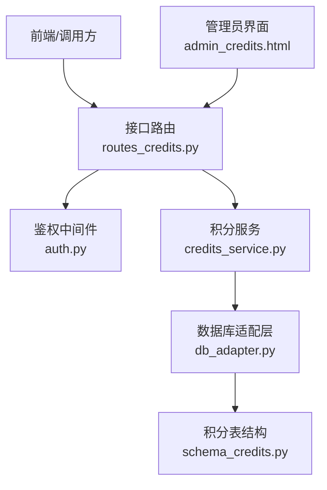
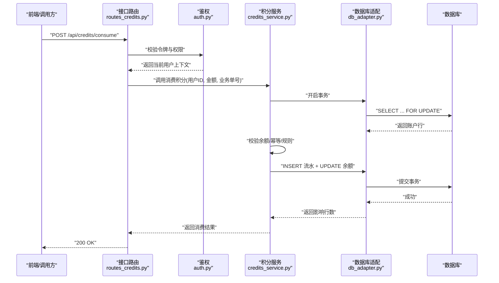
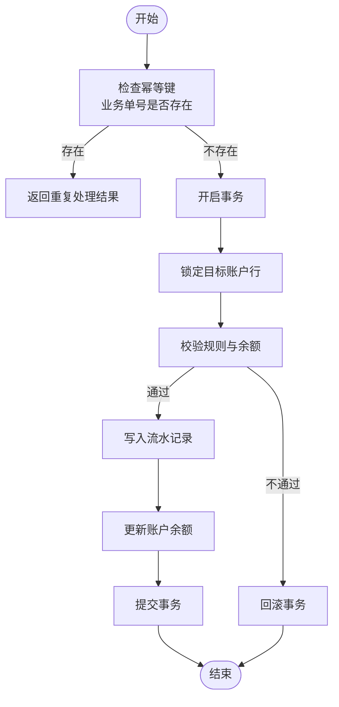
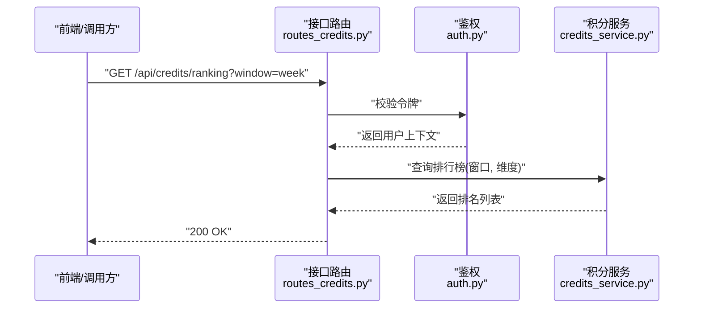
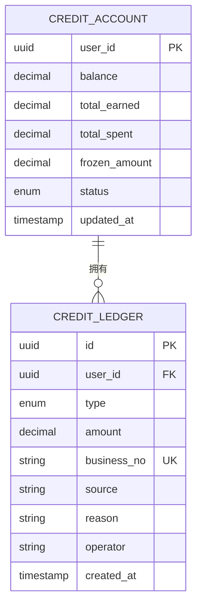
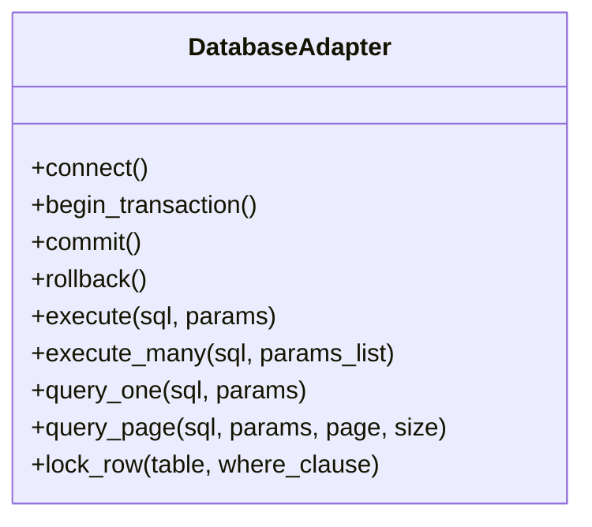
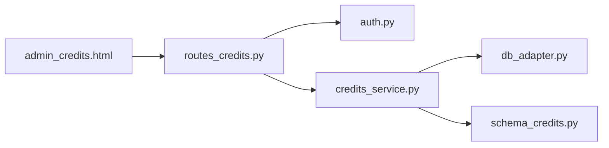

# 积分服务

<cite>
**本文引用的文件**   
- [credits_service.py](file://server/credits_service.py)
- [routes_credits.py](file://server/routes_credits.py)
- [schema_credits.py](file://server/database/schema_credits.py)
- [db_adapter.py](file://server/database/db_adapter.py)
- [auth.py](file://server/auth.py)
- [app.py](file://server/app.py)
- [admin_credits.html](file://server/templates/pages/admin_credits.html)
</cite>

## 目录
1. [简介](#简介)
2. [项目结构](#项目结构)
3. [核心组件](#核心组件)
4. [架构总览](#架构总览)
5. [详细组件分析](#详细组件分析)
6. [依赖关系分析](#依赖关系分析)
7. [性能与并发](#性能与并发)
8. [故障排查指南](#故障排查指南)
9. [结论](#结论)
10. [附录](#附录)

## 简介
本文件为“积分服务”的完整技术文档，覆盖以下主题：
- 积分获取规则、消费记录与排行榜
- 用户积分账户管理、交易流水与统计报表
- 积分计算逻辑、事务处理与并发安全机制
- 与用户系统的集成方式、权限控制与审计日志
- 积分兑换机制、活动奖励与自动化任务处理

该服务通过数据库层持久化积分账户与流水，提供面向前端的接口路由，并在后台完成幂等校验、并发控制与审计记录。

## 项目结构
与积分服务直接相关的代码与资源分布如下：
- 业务服务层：积分核心逻辑封装在独立的服务模块中
- 接口路由层：对外暴露 HTTP 接口，负责鉴权、参数校验与结果返回
- 数据模型层：定义积分账户与流水表结构
- 数据库适配层：统一数据库连接、事务与查询执行
- 模板层：管理员积分管理页面
- 应用入口：注册路由与中间件（鉴权）

**图表来源**
- [routes_credits.py:1-200](file://server/routes_credits.py#L1-L200)
- [auth.py:1-200](file://server/auth.py#L1-L200)
- [credits_service.py:1-200](file://server/credits_service.py#L1-L200)
- [db_adapter.py:1-200](file://server/database/db_adapter.py#L1-L200)
- [schema_credits.py:1-200](file://server/database/schema_credits.py#L1-L200)
- [admin_credits.html:1-200](file://server/templates/pages/admin_credits.html#L1-L200)

**章节来源**
- [routes_credits.py:1-200](file://server/routes_credits.py#L1-L200)
- [credits_service.py:1-200](file://server/credits_service.py#L1-L200)
- [schema_credits.py:1-200](file://server/database/schema_credits.py#L1-L200)
- [db_adapter.py:1-200](file://server/database/db_adapter.py#L1-L200)
- [auth.py:1-200](file://server/auth.py#L1-L200)
- [admin_credits.html:1-200](file://server/templates/pages/admin_credits.html#L1-L200)

## 核心组件
- 积分服务（credits_service.py）
  - 职责：封装积分获取、消费、转账、冻结解冻、余额查询、流水查询、排行榜、统计报表生成等核心业务逻辑；实现幂等校验、并发控制与事务边界。
- 接口路由（routes_credits.py）
  - 职责：定义 RESTful 接口，绑定鉴权、参数校验、调用积分服务并返回统一响应；提供管理员操作入口。
- 数据模型（schema_credits.py）
  - 职责：定义积分账户表与流水表的字段、约束与索引策略，确保数据一致性与查询性能。
- 数据库适配（db_adapter.py）
  - 职责：封装数据库连接、事务提交/回滚、批量写入、分页查询等通用能力。
- 鉴权（auth.py）
  - 职责：解析请求头中的身份令牌，注入当前用户上下文，校验访问权限。
- 管理员界面（admin_credits.html）
  - 职责：提供积分发放、调整、流水查看、排行榜导出等管理功能的前端交互。

**章节来源**
- [credits_service.py:1-200](file://server/credits_service.py#L1-L200)
- [routes_credits.py:1-200](file://server/routes_credits.py#L1-L200)
- [schema_credits.py:1-200](file://server/database/schema_credits.py#L1-L200)
- [db_adapter.py:1-200](file://server/database/db_adapter.py#L1-L200)
- [auth.py:1-200](file://server/auth.py#L1-L200)
- [admin_credits.html:1-200](file://server/templates/pages/admin_credits.html#L1-L200)

## 架构总览
积分服务采用分层架构：
- 表现层：管理员界面与外部调用方通过 HTTP 接口访问
- 接口层：路由负责鉴权、参数校验、错误包装与响应格式化
- 服务层：封装积分业务规则、计算逻辑、事务与并发控制
- 数据层：通过适配层访问数据库，遵循预定义的表结构与索引

**图表来源**
- [routes_credits.py:1-200](file://server/routes_credits.py#L1-L200)
- [auth.py:1-200](file://server/auth.py#L1-L200)
- [credits_service.py:1-200](file://server/credits_service.py#L1-L200)
- [db_adapter.py:1-200](file://server/database/db_adapter.py#L1-L200)

**章节来源**
- [routes_credits.py:1-200](file://server/routes_credits.py#L1-L200)
- [credits_service.py:1-200](file://server/credits_service.py#L1-L200)
- [db_adapter.py:1-200](file://server/database/db_adapter.py#L1-L200)

## 详细组件分析

### 积分服务（credits_service.py）
- 主要能力
  - 积分获取：支持按规则（学习行为、活动奖励、系统补偿）发放积分
  - 积分消费：支持兑换商品、抵扣费用、转赠等场景
  - 账户管理：创建、查询、冻结/解冻、限额配置
  - 流水记录：每笔变动均产生不可变流水，支持分页与筛选
  - 排行榜：按时间窗口与维度（日/周/月）计算排名
  - 统计报表：汇总获取/消费趋势、TopN 用户、异常事件
- 关键设计
  - 幂等性：基于业务单号去重，防止重复入账或扣款
  - 并发安全：使用行级锁保证余额一致性，避免超扣
  - 事务边界：所有写操作在事务内完成，失败自动回滚
  - 审计日志：记录操作人、来源、原因、前后快照

**图表来源**
- [credits_service.py:1-200](file://server/credits_service.py#L1-L200)
- [db_adapter.py:1-200](file://server/database/db_adapter.py#L1-L200)

**章节来源**
- [credits_service.py:1-200](file://server/credits_service.py#L1-L200)

### 接口路由（routes_credits.py）
- 主要接口
  - 获取积分：POST /api/credits/earn
  - 消费积分：POST /api/credits/consume
  - 转账积分：POST /api/credits/transfer
  - 查询余额：GET /api/credits/balance
  - 流水查询：GET /api/credits/ledger
  - 排行榜：GET /api/credits/ranking
  - 统计报表：GET /api/credits/report
  - 管理员操作：POST /api/credits/admin/*
- 鉴权与校验
  - 通过鉴权中间件获取当前用户上下文
  - 对请求体进行必填字段校验与范围校验
  - 将业务异常转换为标准错误码与消息

**图表来源**
- [routes_credits.py:1-200](file://server/routes_credits.py#L1-L200)
- [auth.py:1-200](file://server/auth.py#L1-L200)
- [credits_service.py:1-200](file://server/credits_service.py#L1-L200)

**章节来源**
- [routes_credits.py:1-200](file://server/routes_credits.py#L1-L200)

### 数据模型（schema_credits.py）
- 积分账户表
  - 字段：用户ID、当前余额、累计获取、累计消费、冻结金额、状态、更新时间
  - 约束：用户ID唯一、余额非负、状态枚举
  - 索引：用户ID、更新时间
- 积分流水表
  - 字段：流水ID、用户ID、类型（获取/消费/转账/冻结/解冻）、金额、业务单号、来源、原因、操作人、时间戳
  - 约束：业务单号唯一、金额正数、时间戳递增
  - 索引：用户ID+时间戳、业务单号、类型+时间戳

**图表来源**
- [schema_credits.py:1-200](file://server/database/schema_credits.py#L1-L200)

**章节来源**
- [schema_credits.py:1-200](file://server/database/schema_credits.py#L1-L200)

### 数据库适配（db_adapter.py）
- 能力
  - 连接池与连接复用
  - 事务开启、提交、回滚
  - 参数化查询与批量写入
  - 分页查询与排序
- 并发控制
  - 提供 SELECT ... FOR UPDATE 的行级锁封装
  - 重试机制应对死锁与短暂冲突

**图表来源**
- [db_adapter.py:1-200](file://server/database/db_adapter.py#L1-L200)

**章节来源**
- [db_adapter.py:1-200](file://server/database/db_adapter.py#L1-L200)

### 鉴权（auth.py）
- 功能
  - 解析请求头中的令牌
  - 校验令牌有效性并加载用户上下文
  - 校验角色与权限（如管理员可执行敏感操作）
- 集成点
  - 被接口路由在入口处调用
  - 将当前用户信息注入到后续处理流程

**章节来源**
- [auth.py:1-200](file://server/auth.py#L1-L200)

### 管理员界面（admin_credits.html）
- 功能
  - 手动发放积分、调整余额、冻结/解冻
  - 查看流水明细、导出报表
  - 查看排行榜与异常告警
- 交互
  - 通过 AJAX 调用接口路由提供的管理接口
  - 展示实时数据与操作反馈

**章节来源**
- [admin_credits.html:1-200](file://server/templates/pages/admin_credits.html#L1-L200)

## 依赖关系分析
- 模块耦合
  - 接口路由依赖鉴权与积分服务
  - 积分服务依赖数据库适配与数据模型
  - 管理员界面依赖接口路由
- 外部依赖
  - 数据库驱动（由 db_adapter 抽象）
  - 前端框架（用于渲染 admin_credits.html）

**图表来源**
- [routes_credits.py:1-200](file://server/routes_credits.py#L1-L200)
- [auth.py:1-200](file://server/auth.py#L1-L200)
- [credits_service.py:1-200](file://server/credits_service.py#L1-L200)
- [db_adapter.py:1-200](file://server/database/db_adapter.py#L1-L200)
- [schema_credits.py:1-200](file://server/database/schema_credits.py#L1-L200)
- [admin_credits.html:1-200](file://server/templates/pages/admin_credits.html#L1-L200)

**章节来源**
- [routes_credits.py:1-200](file://server/routes_credits.py#L1-L200)
- [credits_service.py:1-200](file://server/credits_service.py#L1-L200)
- [db_adapter.py:1-200](file://server/database/db_adapter.py#L1-L200)
- [schema_credits.py:1-200](file://server/database/schema_credits.py#L1-L200)
- [admin_credits.html:1-200](file://server/templates/pages/admin_credits.html#L1-L200)

## 性能与并发
- 并发安全
  - 使用行级锁保证同一用户的积分变更串行化，避免超扣与不一致
  - 幂等键（业务单号）防止重复入账或扣款
- 事务处理
  - 所有写操作在事务内完成，失败自动回滚，保证原子性
- 查询优化
  - 流水表按用户ID+时间戳索引，提升分页与筛选效率
  - 排行榜按时间窗口聚合，必要时引入物化视图或缓存
- 扩展建议
  - 热点用户分片或分区表
  - 读写分离与只读副本
  - 异步任务队列处理批量报表与排行榜计算

[本节为通用性能指导，不直接分析具体文件]

## 故障排查指南
- 常见问题
  - 余额不足：检查消费规则与账户冻结状态
  - 重复入账：检查业务单号是否重复提交
  - 并发冲突：观察数据库锁等待与重试日志
  - 权限拒绝：确认用户角色与接口权限配置
- 定位步骤
  - 通过流水查询定位异常交易
  - 核对管理员操作日志与审计记录
  - 检查鉴权中间件的令牌与上下文注入
- 恢复建议
  - 对账差异：以流水为准进行补录或冲正
  - 锁超时：优化热点账户拆分或降低并发压力
  - 权限问题：修正角色分配或接口白名单

**章节来源**
- [routes_credits.py:1-200](file://server/routes_credits.py#L1-L200)
- [credits_service.py:1-200](file://server/credits_service.py#L1-L200)
- [auth.py:1-200](file://server/auth.py#L1-L200)

## 结论
积分服务通过清晰的分层架构与严格的并发控制，实现了可靠的积分获取、消费、转账、冻结解冻、排行榜与统计报表能力。结合鉴权与审计日志，满足企业级系统在安全性、一致性与可观测性方面的要求。建议在热点场景下进一步引入缓存、分区与异步任务以提升整体吞吐与稳定性。

[本节为总结性内容，不直接分析具体文件]

## 附录
- 术语
  - 业务单号：用于幂等控制的唯一标识
  - 冻结金额：暂时不可用的积分额度，解冻后恢复可用
  - 流水：不可变的积分变动记录
- 最佳实践
  - 所有写操作必须携带业务单号
  - 排行榜与报表尽量异步生成
  - 管理员操作需双人复核与审计留痕

[本节为补充说明，不直接分析具体文件]