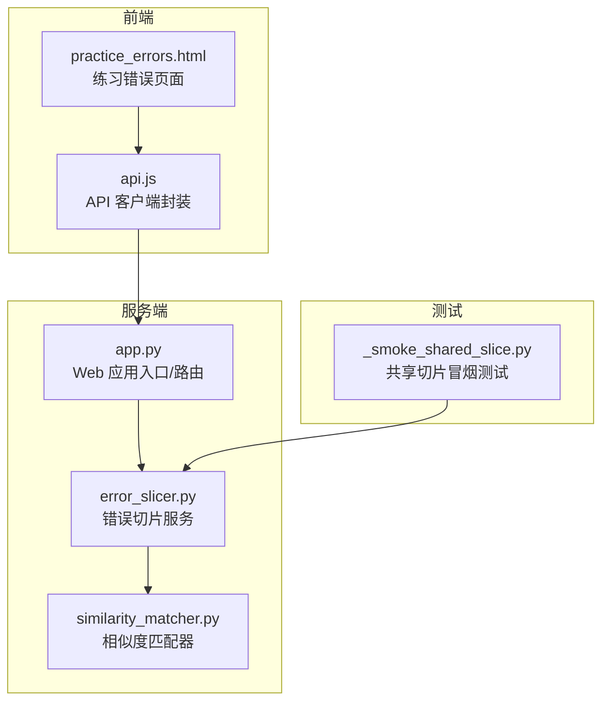
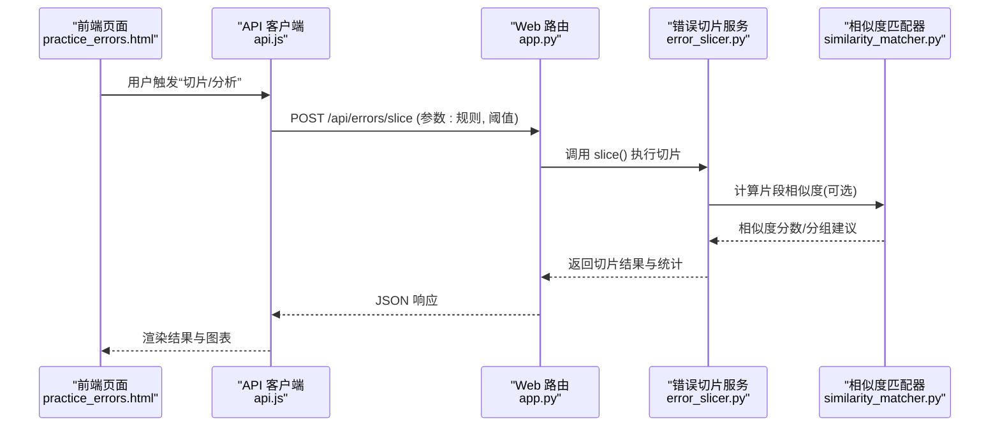
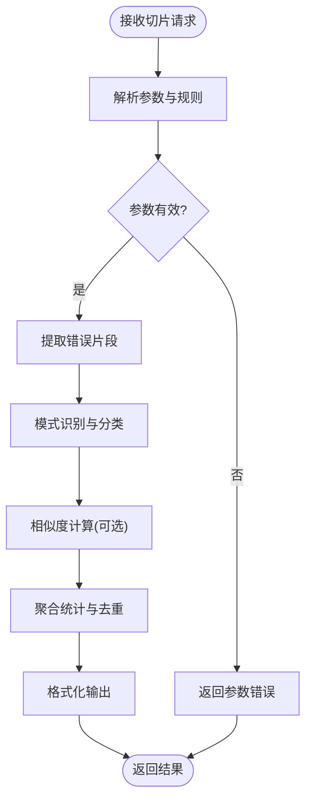
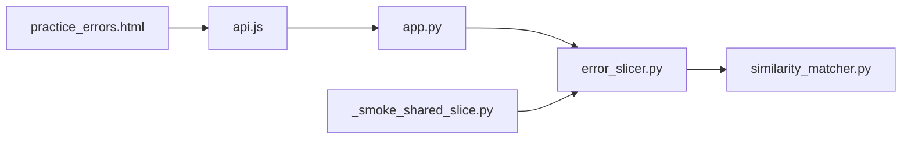

# 错误切片服务

<cite>
**本文引用的文件**   
- [server/services/error_slicer.py](file://server/services/error_slicer.py)
- [server/similarity_matcher.py](file://server/similarity_matcher.py)
- [server/app.py](file://server/app.py)
- [server/templates/pages/practice_errors.html](file://server/templates/pages/practice_errors.html)
- [server/static/js/api.js](file://server/static/js/api.js)
- [server/tests/_smoke_shared_slice.py](file://server/tests/_smoke_shared_slice.py)
</cite>

## 目录
1. [简介](#简介)
2. [项目结构](#项目结构)
3. [核心组件](#核心组件)
4. [架构总览](#架构总览)
5. [详细组件分析](#详细组件分析)
6. [依赖关系分析](#依赖关系分析)
7. [性能考量](#性能考量)
8. [故障排查指南](#故障排查指南)
9. [结论](#结论)
10. [附录](#附录)

## 简介
本文件为“错误切片服务”的完整技术文档，聚焦以下目标：
- 错误数据的智能切片算法与规则配置
- 错误模式识别与分类机制
- 错误片段提取、相似度分析与聚合统计
- 阈值设置与结果输出格式
- 与练习系统的集成方式、错误追踪与历史对比
- 错误报告生成、趋势分析与预警机制

该服务以服务端 Python 模块为核心，结合前端页面与 API 调用，形成从数据输入到可视化报告的闭环。

## 项目结构
围绕错误切片服务的代码主要分布在以下位置：
- 服务实现：server/services/error_slicer.py
- 相似度计算：server/similarity_matcher.py
- Web 路由与启动：server/app.py
- 前端页面：server/templates/pages/practice_errors.html
- 前端 API 封装：server/static/js/api.js
- 共享切片测试用例：server/tests/_smoke_shared_slice.py

图表来源
- [server/app.py](file://server/app.py)
- [server/services/error_slicer.py](file://server/services/error_slicer.py)
- [server/similarity_matcher.py](file://server/similarity_matcher.py)
- [server/templates/pages/practice_errors.html](file://server/templates/pages/practice_errors.html)
- [server/static/js/api.js](file://server/static/js/api.js)
- [server/tests/_smoke_shared_slice.py](file://server/tests/_smoke_shared_slice.py)

章节来源
- [server/services/error_slicer.py](file://server/services/error_slicer.py)
- [server/similarity_matcher.py](file://server/similarity_matcher.py)
- [server/app.py](file://server/app.py)
- [server/templates/pages/practice_errors.html](file://server/templates/pages/practice_errors.html)
- [server/static/js/api.js](file://server/static/js/api.js)
- [server/tests/_smoke_shared_slice.py](file://server/tests/_smoke_shared_slice.py)

## 核心组件
- 错误切片服务（Error Slicer）
  - 负责将原始错误日志或题目作答记录切分为可分析的“错误片段”，并基于规则进行归类、去重与聚合。
  - 支持多种切片策略（如按题号、知识点、时间窗口等），并提供阈值控制与统计汇总。
- 相似度匹配器（Similarity Matcher）
  - 提供文本相似度计算能力，用于错误片段之间的相似性评估与聚类辅助。
- Web 路由与应用入口
  - 暴露 REST 接口供前端调用，承载切片请求、参数校验、结果返回与错误处理。
- 前端页面与 API 客户端
  - 提供错误列表、切片结果展示、筛选与导出功能；通过 api.js 统一发起后端请求。
- 共享切片测试
  - 针对切片逻辑的端到端冒烟测试，确保切片规则与输出格式稳定。

章节来源
- [server/services/error_slicer.py](file://server/services/error_slicer.py)
- [server/similarity_matcher.py](file://server/similarity_matcher.py)
- [server/app.py](file://server/app.py)
- [server/templates/pages/practice_errors.html](file://server/templates/pages/practice_errors.html)
- [server/static/js/api.js](file://server/static/js/api.js)
- [server/tests/_smoke_shared_slice.py](file://server/tests/_smoke_shared_slice.py)

## 架构总览
错误切片服务采用“前端页面 + API 客户端 + 后端服务 + 相似度引擎”的分层架构。

图表来源
- [server/templates/pages/practice_errors.html](file://server/templates/pages/practice_errors.html)
- [server/static/js/api.js](file://server/static/js/api.js)
- [server/app.py](file://server/app.py)
- [server/services/error_slicer.py](file://server/services/error_slicer.py)
- [server/similarity_matcher.py](file://server/similarity_matcher.py)

## 详细组件分析

### 错误切片服务（Error Slicer）
职责与能力
- 输入：原始错误数据（如题目作答失败记录、错误日志片段）。
- 切片策略：按题号、知识点、时间窗口、错误类型等多维度切分。
- 模式识别：基于关键词、正则或语义特征识别错误模式。
- 分类机制：将错误片段映射到预定义类别（如语法类、概念类、步骤遗漏类等）。
- 聚合统计：按类别、时间、用户等维度统计频次、占比与趋势。
- 阈值控制：相似度阈值、最小片段长度、最大分组数等。
- 输出格式：结构化 JSON，包含片段、标签、统计指标与元数据。

关键流程（流程图）

图表来源
- [server/services/error_slicer.py](file://server/services/error_slicer.py)

章节来源
- [server/services/error_slicer.py](file://server/services/error_slicer.py)

### 相似度匹配器（Similarity Matcher）
职责与能力
- 提供文本相似度计算（如余弦相似度、编辑距离等）。
- 支持自定义权重与停用词过滤。
- 为错误片段聚类与重复检测提供依据。
- 可配置阈值，决定是否将两个片段视为“相似”。

典型用法
- 在切片后对片段集合进行相似度打分。
- 根据阈值合并相似片段，减少冗余。
- 输出相似度矩阵或分组建议，供上层聚合使用。

章节来源
- [server/similarity_matcher.py](file://server/similarity_matcher.py)

### Web 路由与应用入口（App）
职责与能力
- 注册 REST 路由，例如 /api/errors/slice。
- 参数校验与权限控制。
- 调用错误切片服务并序列化响应。
- 统一错误处理与日志记录。

交互要点
- 前端通过 api.js 发起请求，携带切片规则与阈值。
- 后端返回结构化 JSON，便于前端渲染与导出。

章节来源
- [server/app.py](file://server/app.py)

### 前端页面与 API 客户端
- practice_errors.html：展示错误列表、切片结果、统计图表与导出按钮。
- api.js：封装 HTTP 请求，统一错误处理与重试策略。

交互要点
- 用户在页面选择范围与规则，点击“分析”触发切片。
- 前端根据返回结果动态更新视图，支持筛选、排序与分页。

章节来源
- [server/templates/pages/practice_errors.html](file://server/templates/pages/practice_errors.html)
- [server/static/js/api.js](file://server/static/js/api.js)

### 共享切片测试（Smoke Test）
- 覆盖常见切片场景，验证规则生效与输出格式正确。
- 作为回归保障，防止切片逻辑变更导致的行为不一致。

章节来源
- [server/tests/_smoke_shared_slice.py](file://server/tests/_smoke_shared_slice.py)

## 依赖关系分析
- error_slicer.py 依赖 similarity_matcher.py 进行相似度计算。
- app.py 作为路由层，依赖 error_slicer.py 执行业务逻辑。
- 前端 practice_errors.html 通过 api.js 调用 app.py 暴露的接口。
- 测试 _smoke_shared_slice.py 直接调用 error_slicer.py 验证行为。

图表来源
- [server/templates/pages/practice_errors.html](file://server/templates/pages/practice_errors.html)
- [server/static/js/api.js](file://server/static/js/api.js)
- [server/app.py](file://server/app.py)
- [server/services/error_slicer.py](file://server/services/error_slicer.py)
- [server/similarity_matcher.py](file://server/similarity_matcher.py)
- [server/tests/_smoke_shared_slice.py](file://server/tests/_smoke_shared_slice.py)

章节来源
- [server/app.py](file://server/app.py)
- [server/services/error_slicer.py](file://server/services/error_slicer.py)
- [server/similarity_matcher.py](file://server/similarity_matcher.py)
- [server/templates/pages/practice_errors.html](file://server/templates/pages/practice_errors.html)
- [server/static/js/api.js](file://server/static/js/api.js)
- [server/tests/_smoke_shared_slice.py](file://server/tests/_smoke_shared_slice.py)

## 性能考量
- 切片粒度与阈值调优：过细的切片会增加后续相似度计算与聚合成本；合理设置最小片段长度与最大分组数可平衡精度与性能。
- 相似度计算复杂度：当片段数量较大时，建议使用近似最近邻或向量化方法降低 O(n^2) 开销。
- 缓存与增量更新：对热点规则与高频片段进行缓存，避免重复计算。
- 异步与批处理：对大规模错误集采用分批处理与异步任务队列，提升吞吐。
- I/O 优化：批量写入统计结果，减少数据库或文件系统频繁访问。

[本节为通用指导，不直接分析具体文件]

## 故障排查指南
常见问题与定位思路
- 参数校验失败
  - 检查前端传入的规则与阈值是否符合后端期望。
  - 查看路由层的参数解析与校验逻辑。
- 切片结果为空或异常
  - 确认输入数据源是否存在有效错误片段。
  - 检查切片规则是否过于严格（如最小片段长度过大）。
- 相似度计算耗时过长
  - 调整相似度阈值与候选集大小。
  - 考虑启用近似算法或向量索引。
- 前端渲染异常
  - 核对后端返回的 JSON 结构与字段命名。
  - 检查 api.js 的错误处理与重试逻辑。

章节来源
- [server/app.py](file://server/app.py)
- [server/static/js/api.js](file://server/static/js/api.js)
- [server/services/error_slicer.py](file://server/services/error_slicer.py)

## 结论
错误切片服务通过模块化设计，将切片、相似度计算与聚合统计解耦，配合前端可视化与测试保障，形成了完整的错误分析闭环。通过合理的规则配置与阈值调优，可在保证分析质量的同时提升系统性能。未来可进一步引入更强大的语义模型与在线学习机制，以提升模式识别准确率与自适应能力。

[本节为总结性内容，不直接分析具体文件]

## 附录

### 切片规则配置与阈值设置
- 切片维度
  - 题号、知识点、错误类型、时间窗口、用户/会话等。
- 阈值参数
  - 相似度阈值：控制片段合并的严格程度。
  - 最小片段长度：过滤噪声片段。
  - 最大分组数：限制聚合后的组数，避免结果过于分散。
- 输出字段（示例）
  - 片段 ID、原始文本、标签、类别、相似度分数、统计指标（频次、占比）、时间戳、来源等。

[本节为概念性说明，不直接分析具体文件]

### 与练习系统的集成方式
- 数据接入
  - 从练习系统导出错误记录或实时推送错误事件。
- 触发时机
  - 练习结束后自动触发切片与分析。
- 结果回写
  - 将切片结果与统计指标回写到练习系统，用于错题本与复习计划。

[本节为概念性说明，不直接分析具体文件]

### 错误追踪与历史对比
- 追踪
  - 为每个错误片段生成唯一标识，关联用户、题目、时间与上下文。
- 历史对比
  - 对比不同时间段的错误分布与趋势，识别反复出现的薄弱点。

[本节为概念性说明，不直接分析具体文件]

### 错误报告生成、趋势分析与预警机制
- 报告生成
  - 按日/周/月生成错误报告，包含分类统计、Top 错误与改进建议。
- 趋势分析
  - 绘制错误频次随时间变化曲线，识别上升或下降趋势。
- 预警机制
  - 当某类错误频次超过阈值或出现异常增长时，触发告警通知。

[本节为概念性说明，不直接分析具体文件]