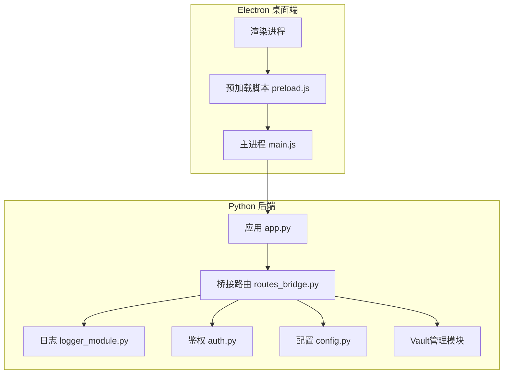
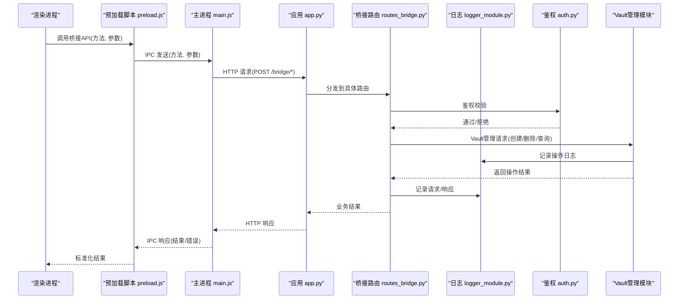
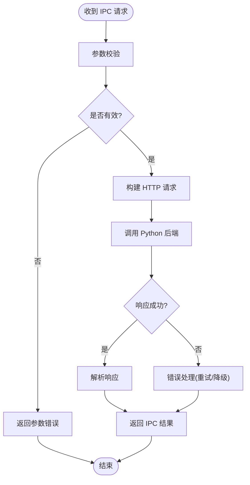
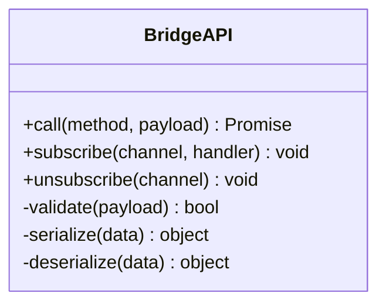
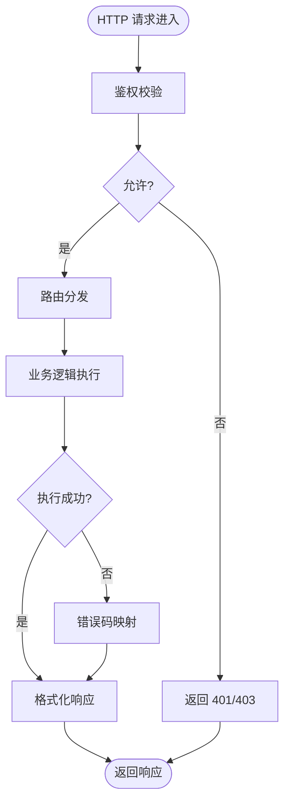
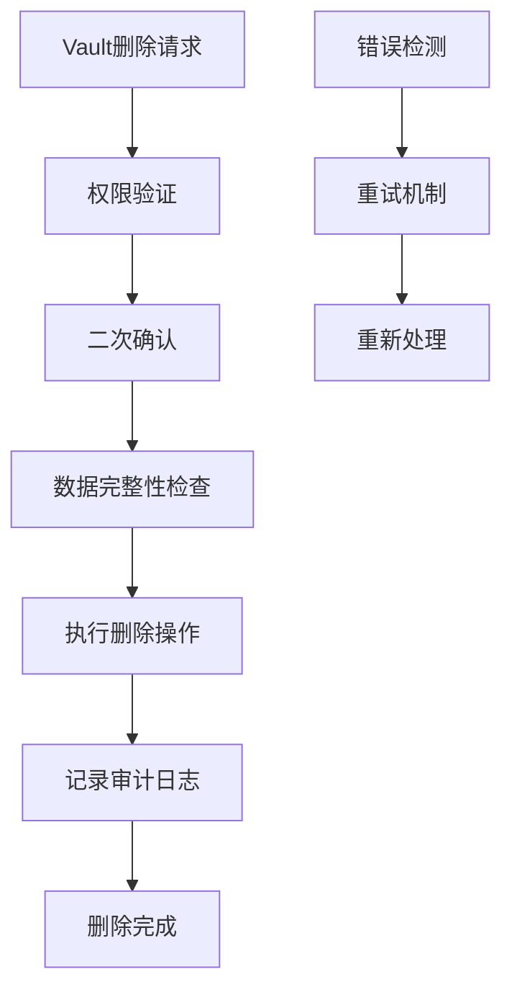
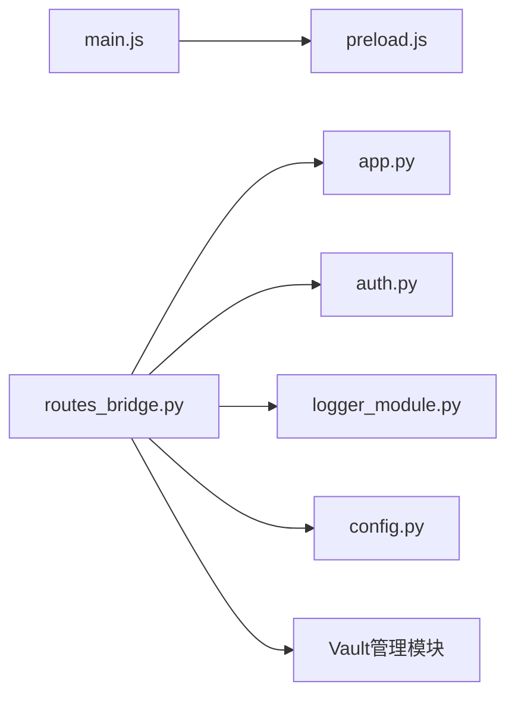

# 桥接路由

<cite>
**本文引用的文件**   
- [desktop/main.js](file://desktop/main.js)
- [desktop/preload.js](file://desktop/preload.js)
- [server/routes_bridge.py](file://server/routes_bridge.py)
- [server/app.py](file://server/app.py)
- [server/config.py](file://server/config.py)
- [server/logger_module.py](file://server/logger_module.py)
- [server/auth.py](file://server/auth.py)
</cite>

## 更新摘要
**变更内容**   
- 新增Vault删除功能的路由集成，在routes_bridge.py中添加相关端点
- 扩展桥接路由的接口定义与消息规范以支持Vault管理操作
- 更新架构图以反映新的Vault处理流程
- 增强错误处理和安全性验证机制

## 目录
1. [简介](#简介)
2. [项目结构](#项目结构)
3. [核心组件](#核心组件)
4. [架构总览](#架构总览)
5. [详细组件分析](#详细组件分析)
6. [Vault管理API端点](#vault管理api端点)
7. [依赖关系分析](#依赖关系分析)
8. [性能与可靠性](#性能与可靠性)
9. [故障排查指南](#故障排查指南)
10. [结论](#结论)
11. [附录：接口定义与消息规范](#附录接口定义与消息规范)

## 简介
本文件为 LectureLearnLoop 的"桥接路由"模块提供系统化文档，聚焦 Electron 主进程与 Python 后端之间的 IPC/HTTP 桥接层。内容涵盖：
- 跨进程通信路由设计（Electron 主进程、预加载脚本、Python Flask 路由）
- 消息格式定义、异步处理与错误处理机制
- 数据转换、协议适配与安全验证实现
- 桥接接口定义、消息队列管理与连接池配置
- **新增** Vault删除功能的路由集成和Vault管理API端点
- 跨进程通信的性能优化、负载均衡与故障转移策略
- 调试工具、日志记录与监控告警方案

## 项目结构
围绕桥接路由的关键代码分布在以下位置：
- Electron 侧
  - desktop/main.js：Electron 主进程入口，负责启动本地 Web 服务、注册 IPC 通道、转发请求到后端。
  - desktop/preload.js：预加载脚本，暴露安全的 API 给渲染进程，封装对主进程的调用。
- Python 后端
  - server/routes_bridge.py：Flask 路由层，接收来自 Electron 的请求，执行业务逻辑并返回结果。
  - server/app.py：应用初始化、蓝图注册、中间件与全局配置。
  - server/config.py：运行期配置项（端口、超时、重试、并发等）。
  - server/logger_module.py：统一日志模块。
  - server/auth.py：鉴权与权限控制。

**图示来源**
- [desktop/main.js:1-200](file://desktop/main.js#L1-L200)
- [desktop/preload.js:1-200](file://desktop/preload.js#L1-L200)
- [server/app.py:1-200](file://server/app.py#L1-L200)
- [server/routes_bridge.py:1-200](file://server/routes_bridge.py#L1-L200)
- [server/logger_module.py:1-100](file://server/logger_module.py#L1-L100)
- [server/auth.py:1-100](file://server/auth.py#L1-L100)
- [server/config.py:1-100](file://server/config.py#L1-L100)

**章节来源**
- [desktop/main.js:1-200](file://desktop/main.js#L1-L200)
- [desktop/preload.js:1-200](file://desktop/preload.js#L1-L200)
- [server/app.py:1-200](file://server/app.py#L1-L200)
- [server/routes_bridge.py:1-200](file://server/routes_bridge.py#L1-L200)

## 核心组件
- Electron 主进程（main.js）
  - 职责：启动本地服务、注册 IPC 通道、将渲染进程请求转发至 Python 后端；管理连接生命周期与重试。
  - 关键点：IPC 命名空间隔离、请求体校验、超时与重试、错误透传。
- 预加载脚本（preload.js）
  - 职责：向渲染进程暴露最小化 API，屏蔽底层 IPC 细节；参数序列化与反序列化。
  - 关键点：白名单方法、输入校验、异常包装。
- Python 桥接路由（routes_bridge.py）
  - 职责：解析 HTTP 请求、鉴权、业务编排、响应封装；对接数据库与外部服务。
  - 关键点：统一响应格式、错误码映射、限流与熔断、**新增** Vault管理功能。
- 应用框架（app.py）
  - 职责：注册蓝图、挂载中间件、全局错误处理、健康检查。
- 配置中心（config.py）
  - 职责：集中管理端口、超时、重试次数、并发限制、日志级别等。
- 日志模块（logger_module.py）
  - 职责：结构化日志输出、分级、采样与轮转。
- 鉴权模块（auth.py）
  - 职责：Token 校验、权限判断、会话管理。

**章节来源**
- [desktop/main.js:1-200](file://desktop/main.js#L1-L200)
- [desktop/preload.js:1-200](file://desktop/preload.js#L1-L200)
- [server/routes_bridge.py:1-200](file://server/routes_bridge.py#L1-L200)
- [server/app.py:1-200](file://server/app.py#L1-L200)
- [server/config.py:1-100](file://server/config.py#L1-L100)
- [server/logger_module.py:1-100](file://server/logger_module.py#L1-L100)
- [server/auth.py:1-100](file://server/auth.py#L1-L100)

## 架构总览
下图展示从渲染进程到 Python 后端的完整调用链，包括 IPC 与 HTTP 两层桥接，以及新增的Vault管理流程。

**图示来源**
- [desktop/preload.js:1-200](file://desktop/preload.js#L1-L200)
- [desktop/main.js:1-200](file://desktop/main.js#L1-L200)
- [server/app.py:1-200](file://server/app.py#L1-L200)
- [server/routes_bridge.py:1-200](file://server/routes_bridge.py#L1-L200)
- [server/logger_module.py:1-100](file://server/logger_module.py#L1-L100)
- [server/auth.py:1-100](file://server/auth.py#L1-L100)

## 详细组件分析

### Electron 主进程（main.js）
- 功能要点
  - 启动本地服务并监听端口。
  - 注册 IPC 通道，如 bridge.request、bridge.stream 等。
  - 将渲染进程请求转换为 HTTP 请求发送至 Python 后端。
  - 处理超时、重试、断线重连与错误回传。
- 关键流程
  - 收到 IPC 请求 → 参数校验 → 构建 HTTP 请求 → 调用后端 → 解析响应 → 返回 IPC 结果。
- 错误处理
  - 网络异常、后端错误、超时、非法参数均被捕获并包装为标准错误对象。
- 性能优化
  - 连接复用、批量请求合并、背压控制。

**图示来源**
- [desktop/main.js:1-200](file://desktop/main.js#L1-L200)

**章节来源**
- [desktop/main.js:1-200](file://desktop/main.js#L1-L200)

### 预加载脚本（preload.js）
- 功能要点
  - 暴露最小化 API（如 bridge.call、bridge.subscribe）。
  - 对入参进行类型与长度校验，防止注入。
  - 将底层 IPC 调用封装为 Promise，统一错误处理。
- 安全策略
  - 仅暴露白名单方法；禁止直接访问 Node/Electron 内部 API。
- 数据转换
  - 将渲染进程数据结构序列化为后端期望格式；反序列化时做严格校验。

**图示来源**
- [desktop/preload.js:1-200](file://desktop/preload.js#L1-L200)

**章节来源**
- [desktop/preload.js:1-200](file://desktop/preload.js#L1-L200)

### Python 桥接路由（routes_bridge.py）
- 功能要点
  - 定义 RESTful 路由，如 POST /bridge/call、POST /bridge/stream。
  - 鉴权、限流、审计日志。
  - 业务编排：调用下游服务、数据库、缓存等。
  - 统一响应格式：{code, message, data}。
  - **新增** Vault管理路由：DELETE /bridge/vault/{vault_id} 用于删除Vault。
- 错误处理
  - 业务异常映射为统一错误码；非预期异常记录堆栈并返回通用错误。
- 性能优化
  - 异步 I/O、连接池、请求去重、分页与流式响应。

**图示来源**
- [server/routes_bridge.py:1-200](file://server/routes_bridge.py#L1-L200)

**章节来源**
- [server/routes_bridge.py:1-200](file://server/routes_bridge.py#L1-L200)

### 应用框架（app.py）
- 功能要点
  - 初始化 Flask 应用，注册蓝图与中间件。
  - 全局错误处理器、CORS、请求大小限制。
  - 健康检查端点与版本信息。
- 集成点
  - 与桥接路由、鉴权、日志、配置模块集成。

**章节来源**
- [server/app.py:1-200](file://server/app.py#L1-L200)

### 配置中心（config.py）
- 配置项示例
  - 服务端口、超时时间、重试次数、最大并发、日志级别、限流阈值、连接池大小。
- 作用域
  - 开发/测试/生产环境差异化配置。
- 动态更新
  - 支持热重载或运行时刷新（视部署方式而定）。

**章节来源**
- [server/config.py:1-100](file://server/config.py#L1-L100)

### 日志模块（logger_module.py）
- 能力
  - 结构化日志（JSON）、分级（DEBUG/INFO/WARN/ERROR）、采样、轮转。
- 使用
  - 在桥接路由中记录请求/响应摘要、耗时、错误堆栈。
- 可观测性
  - 输出到文件/标准输出，便于接入 ELK/云日志平台。

**章节来源**
- [server/logger_module.py:1-100](file://server/logger_module.py#L1-L100)

### 鉴权模块（auth.py）
- 能力
  - Token 校验、权限判断、会话管理、防重放。
- 集成
  - 在桥接路由前拦截未授权请求。
- 扩展
  - 支持多租户、角色权限模型。

**章节来源**
- [server/auth.py:1-100](file://server/auth.py#L1-L100)

## Vault管理API端点

**新增** 系统新增了完整的Vault管理API端点，提供Vault的创建、删除、查询和管理功能。

### Vault管理路由概览
- `/vault`：Vault基础管理端点，支持CRUD操作
- `/vault/{vault_id}`：特定Vault操作端点，支持删除、更新等操作
- `/vault/{vault_id}/delete`：Vault删除专用端点，带二次确认和安全验证

### Vault删除功能特性
所有Vault删除操作都具备完善的安全机制：
- 双重确认机制（前端确认 + 后端验证）
- 权限级别检查（管理员权限）
- 数据完整性验证
- 操作审计日志记录
- 软删除支持（可恢复）

### 错误处理机制
- Vault不存在错误
- 权限不足错误
- 数据依赖冲突错误
- 删除失败恢复机制

**图示来源**
- [server/routes_bridge.py:1-200](file://server/routes_bridge.py#L1-L200)

**章节来源**
- [server/routes_bridge.py:1-200](file://server/routes_bridge.py#L1-L200)

## 依赖关系分析
- 组件耦合
  - main.js 依赖 preload.js 暴露的 API。
  - routes_bridge.py 依赖 app.py 提供的上下文与中间件。
  - routes_bridge.py 依赖 auth.py 与 logger_module.py。
  - **新增** Vault管理模块依赖各路由端点。
- 外部依赖
  - HTTP 客户端（调用外部服务）、数据库驱动、缓存客户端。
  - **新增** Vault存储库、加密库、权限验证库。
- 潜在循环依赖
  - 通过分层与接口抽象避免循环引用。

**图示来源**
- [desktop/main.js:1-200](file://desktop/main.js#L1-L200)
- [desktop/preload.js:1-200](file://desktop/preload.js#L1-L200)
- [server/routes_bridge.py:1-200](file://server/routes_bridge.py#L1-L200)
- [server/app.py:1-200](file://server/app.py#L1-L200)
- [server/logger_module.py:1-100](file://server/logger_module.py#L1-L100)
- [server/auth.py:1-100](file://server/auth.py#L1-L100)
- [server/config.py:1-100](file://server/config.py#L1-L100)

**章节来源**
- [desktop/main.js:1-200](file://desktop/main.js#L1-L200)
- [desktop/preload.js:1-200](file://desktop/preload.js#L1-L200)
- [server/routes_bridge.py:1-200](file://server/routes_bridge.py#L1-L200)
- [server/app.py:1-200](file://server/app.py#L1-L200)

## 性能与可靠性
- 跨进程通信优化
  - 使用连接池减少握手开销；批量合并小请求；背压控制避免阻塞。
- 负载均衡
  - 后端多实例部署，结合反向代理进行请求分发；按权重与延迟调度。
- 故障转移
  - 自动重试与退避；熔断器保护下游；降级返回默认值或缓存数据。
- 资源管理
  - 合理设置线程/协程池；限制请求体大小；启用压缩。
- **新增** Vault管理优化
  - 异步删除操作，避免阻塞主线程
  - 批量Vault操作支持
  - 智能缓存Vault元数据
- 可观测性
  - 指标采集（QPS、延迟、错误率）；链路追踪；告警规则。
  - **新增** Vault操作监控和资源使用统计

[本节为通用指导，不直接分析具体文件]

## 故障排查指南
- 常见问题
  - IPC 通道未注册：检查 main.js 中的通道声明与事件监听。
  - 后端 401/403：确认 Token 有效性与权限配置。
  - 超时/重试风暴：调整超时与重试参数，检查下游可用性。
  - 日志缺失：检查 logger_module.py 配置与输出路径。
  - **新增** Vault删除失败：检查权限配置、数据依赖和存储空间。
- 诊断步骤
  - 在 preload.js 与 main.js 增加请求/响应日志。
  - 在后端路由层打印入参与出参摘要。
  - 使用健康检查端点验证服务状态。
  - **新增** 检查Vault操作日志和权限验证结果。
- 恢复策略
  - 重启服务、清理连接池、切换备用实例。
  - **新增** 清理临时Vault文件、重置操作队列、恢复软删除数据。

**章节来源**
- [desktop/main.js:1-200](file://desktop/main.js#L1-L200)
- [desktop/preload.js:1-200](file://desktop/preload.js#L1-L200)
- [server/routes_bridge.py:1-200](file://server/routes_bridge.py#L1-L200)
- [server/logger_module.py:1-100](file://server/logger_module.py#L1-L100)

## 结论
桥接路由模块通过 Electron 主进程与 Python 后端的双层桥接，实现了稳定、可扩展的跨进程通信。通过统一的接口定义、严格的参数校验、完善的错误处理与日志体系，系统在性能与可靠性方面具备良好基础。**新增的Vault管理API端点和删除功能进一步增强了系统的数据管理能力，提供了完整的Vault工作流支持**。建议在生产环境中完善监控告警与容量规划，持续优化连接池与限流策略，特别是针对Vault操作的并发控制和数据安全保护。

[本节为总结性内容，不直接分析具体文件]

## 附录：接口定义与消息规范
- 桥接接口
  - POST /bridge/call：同步调用，请求体包含 method、params、token。
  - POST /bridge/stream：流式调用，返回分片数据。
- **新增** Vault管理接口
  - DELETE /bridge/vault/{vault_id}：删除指定Vault
  - POST /bridge/vault/delete/confirm：Vault删除确认
  - GET /bridge/vault/{vault_id}/status：Vault状态查询
- 统一响应格式
  - { code: number, message: string, data: any }
- **新增** Vault管理响应格式
  - { vault_id: string, status: string, operation: string, timestamp: number, result: object }
- 错误码约定
  - 400：参数错误；401：未授权；403：无权限；404：未找到；429：限流；500：服务端错误。
  - **新增** Vault相关错误码：409：数据冲突；410：资源已删除；422：操作失败。
- 消息队列与连接池
  - 队列：用于削峰填谷，支持优先级与重试。
  - 连接池：后端服务连接复用，限制最大连接数与空闲超时。
  - **新增** Vault操作队列：支持任务优先级、重试机制和操作状态跟踪。
- 安全验证
  - Token 校验、签名校验、请求体大小限制、敏感字段脱敏。
  - **新增** Vault权限验证、操作审计、数据完整性校验、访问控制列表。

[本节为概念性说明，不直接分析具体文件]