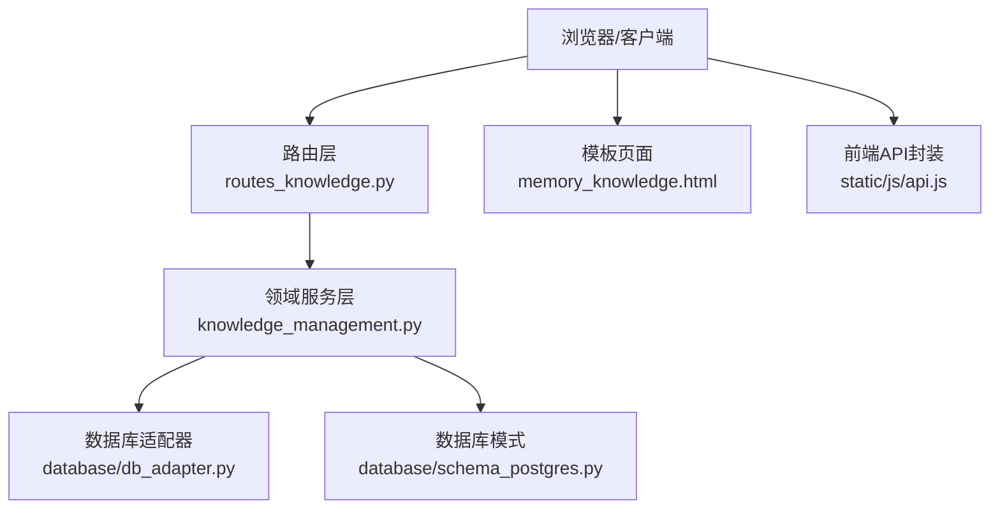
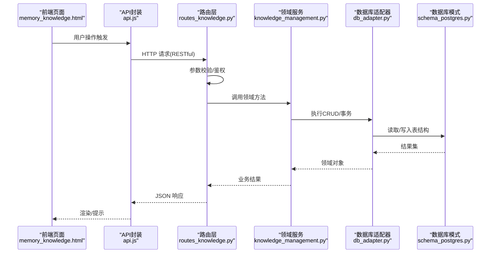
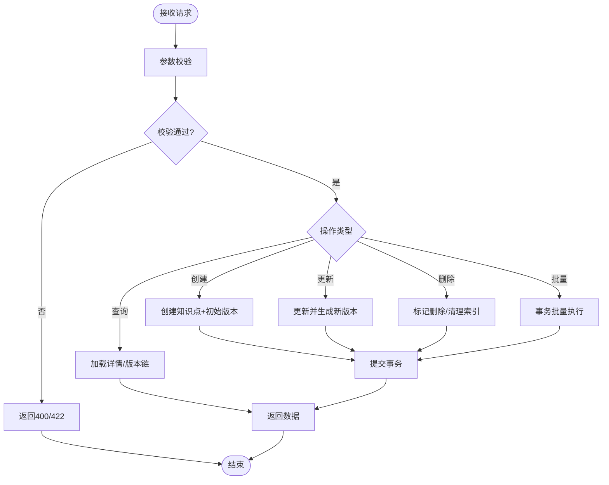
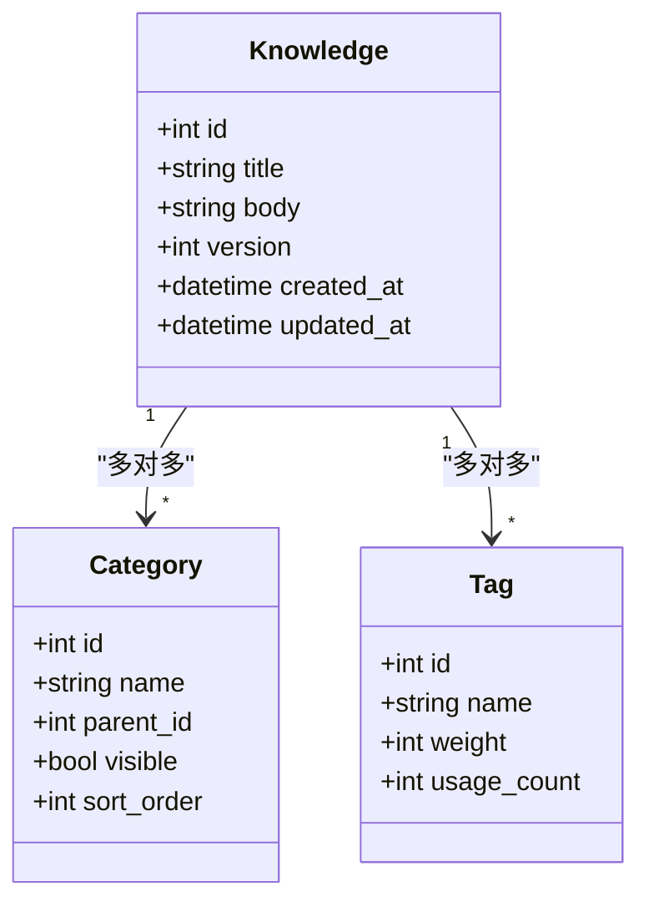
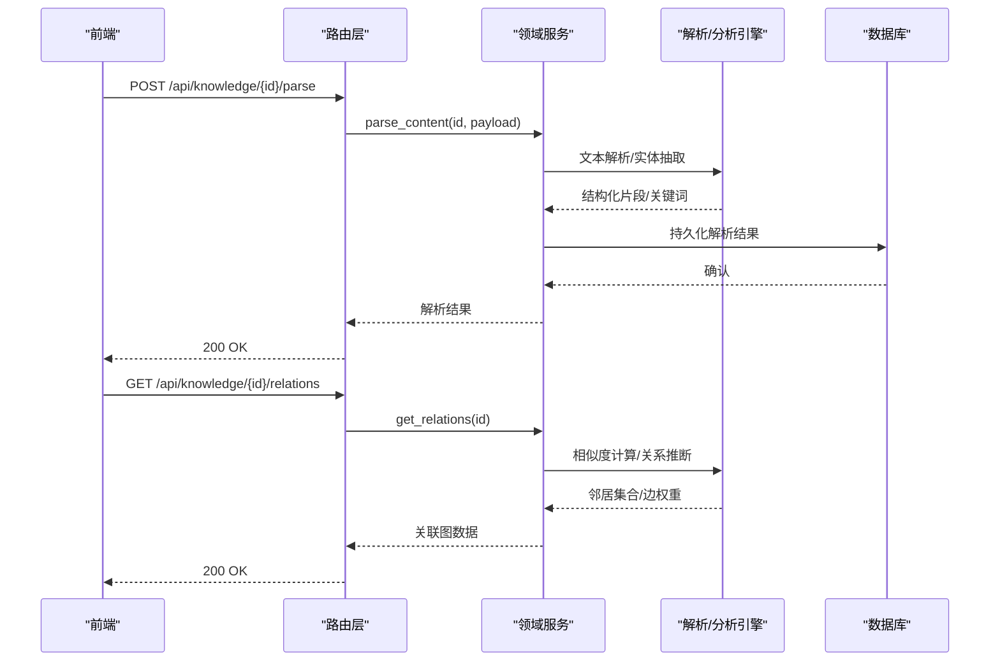
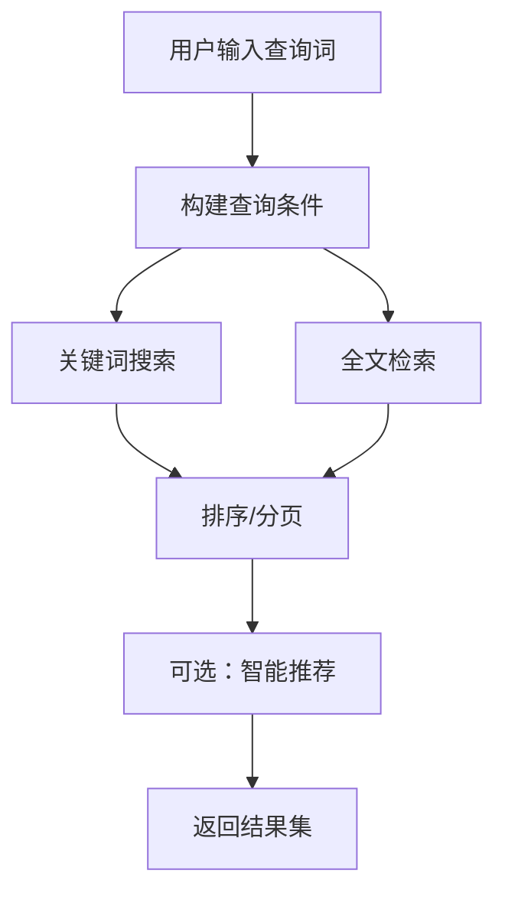
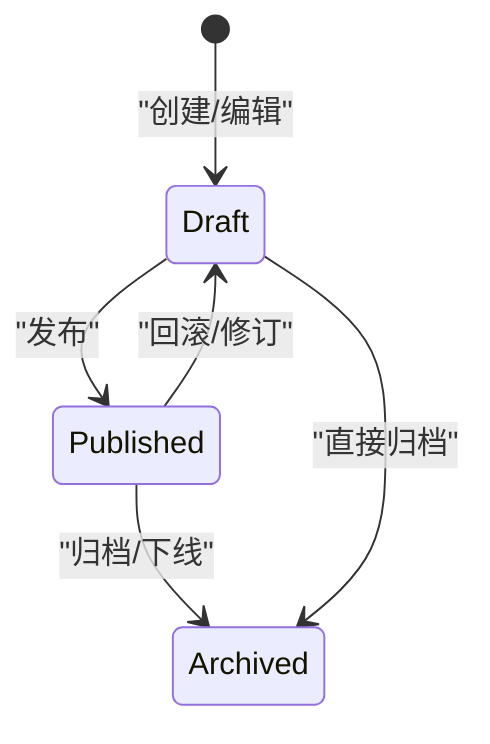
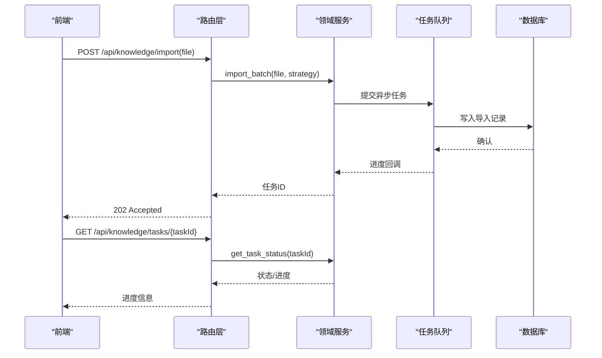

# 知识管理路由

<cite>
**本文引用的文件**   
- [routes_knowledge.py](file://server/routes_knowledge.py)
- [knowledge_management.py](file://server/knowledge_management.py)
- [app.py](file://server/app.py)
- [database/db_adapter.py](file://server/database/db_adapter.py)
- [database/schema_postgres.py](file://server/database/schema_postgres.py)
- [templates/pages/memory_knowledge.html](file://server/templates/pages/memory_knowledge.html)
- [static/js/api.js](file://server/static/js/api.js)
</cite>

## 目录
1. [简介](#简介)
2. [项目结构](#项目结构)
3. [核心组件](#核心组件)
4. [架构总览](#架构总览)
5. [详细组件分析](#详细组件分析)
6. [依赖关系分析](#依赖关系分析)
7. [性能考虑](#性能考虑)
8. [故障排查指南](#故障排查指南)
9. [结论](#结论)
10. [附录](#附录)

## 简介
本文件为 LectureLearnLoop 的知识管理路由模块提供系统化文档，聚焦知识点（Knowledge）的 CRUD、分类与标签、内容解析与关联分析、搜索与全文检索、智能推荐、版本管理、数据导入导出与批量处理等能力。文档从系统架构、组件职责、数据流、接口契约、错误码规范到性能优化策略进行分层说明，帮助开发者快速理解并扩展该模块。

## 项目结构
知识管理相关代码主要位于 server 目录下：
- routes_knowledge.py：RESTful 路由定义与请求校验
- knowledge_management.py：领域服务层，封装知识点业务逻辑
- database/*：数据库适配与模式定义
- templates/pages/memory_knowledge.html：前端页面入口
- static/js/api.js：前端 API 调用封装

图表来源
- [routes_knowledge.py:1-200](file://server/routes_knowledge.py#L1-L200)
- [knowledge_management.py:1-200](file://server/knowledge_management.py#L1-L200)
- [database/db_adapter.py:1-200](file://server/database/db_adapter.py#L1-L200)
- [database/schema_postgres.py:1-200](file://server/database/schema_postgres.py#L1-L200)
- [templates/pages/memory_knowledge.html:1-200](file://server/templates/pages/memory_knowledge.html#L1-L200)
- [static/js/api.js:1-200](file://server/static/js/api.js#L1-L200)

章节来源
- [routes_knowledge.py:1-200](file://server/routes_knowledge.py#L1-L200)
- [knowledge_management.py:1-200](file://server/knowledge_management.py#L1-L200)
- [database/db_adapter.py:1-200](file://server/database/db_adapter.py#L1-L200)
- [database/schema_postgres.py:1-200](file://server/database/schema_postgres.py#L1-L200)
- [templates/pages/memory_knowledge.html:1-200](file://server/templates/pages/memory_knowledge.html#L1-L200)
- [static/js/api.js:1-200](file://server/static/js/api.js#L1-L200)

## 核心组件
- 路由层（routes_knowledge.py）
  - 负责 RESTful 端点注册、参数校验、权限控制、响应格式化与错误映射
  - 覆盖知识点创建、更新、删除、查询、批量操作、分类与标签、搜索、全文检索、推荐、版本管理等
- 领域服务层（knowledge_management.py）
  - 封装知识点生命周期、分类/标签管理、内容解析、关联分析、搜索索引构建、推荐算法、版本控制、导入导出与批量处理
- 数据访问层（database/db_adapter.py + schema_postgres.py）
  - 提供统一数据库连接、事务、CRUD 抽象与表结构定义

章节来源
- [routes_knowledge.py:1-200](file://server/routes_knowledge.py#L1-L200)
- [knowledge_management.py:1-200](file://server/knowledge_management.py#L1-L200)
- [database/db_adapter.py:1-200](file://server/database/db_adapter.py#L1-L200)
- [database/schema_postgres.py:1-200](file://server/database/schema_postgres.py#L1-L200)

## 架构总览
知识管理模块采用“路由层-服务层-数据层”的分层架构，前后端通过 RESTful API 交互，前端使用 api.js 封装请求，模板页面承载 UI。

图表来源
- [routes_knowledge.py:1-200](file://server/routes_knowledge.py#L1-L200)
- [knowledge_management.py:1-200](file://server/knowledge_management.py#L1-L200)
- [database/db_adapter.py:1-200](file://server/database/db_adapter.py#L1-L200)
- [database/schema_postgres.py:1-200](file://server/database/schema_postgres.py#L1-L200)
- [templates/pages/memory_knowledge.html:1-200](file://server/templates/pages/memory_knowledge.html#L1-L200)
- [static/js/api.js:1-200](file://server/static/js/api.js#L1-L200)

## 详细组件分析

### 知识点 CRUD 与批量操作
- 创建知识点
  - 端点：POST /api/knowledge
  - 输入：标题、正文、分类、标签、来源、可见性、优先级、版本元数据等
  - 校验：必填字段、长度限制、标签去重、分类存在性
  - 输出：新建知识点对象（含 id、版本号、时间戳）
- 更新知识点
  - 端点：PUT /api/knowledge/{id}
  - 输入：可更新字段子集；支持增量更新或全量替换
  - 行为：生成新版本记录，保留历史版本
- 删除知识点
  - 端点：DELETE /api/knowledge/{id}
  - 行为：软删除或物理删除（由配置决定），清理关联索引
- 查询知识点
  - 端点：GET /api/knowledge/{id}
  - 输出：知识点详情（含分类、标签、版本链）
- 批量操作
  - 端点：POST /api/knowledge/batch
  - 输入：{ actions: [{op, id, data}] }
  - 行为：事务内执行多个动作，返回成功/失败明细

图表来源
- [routes_knowledge.py:1-200](file://server/routes_knowledge.py#L1-L200)
- [knowledge_management.py:1-200](file://server/knowledge_management.py#L1-L200)
- [database/db_adapter.py:1-200](file://server/database/db_adapter.py#L1-L200)

章节来源
- [routes_knowledge.py:1-200](file://server/routes_knowledge.py#L1-L200)
- [knowledge_management.py:1-200](file://server/knowledge_management.py#L1-L200)

### 分类与标签管理
- 分类
  - 端点：GET/POST/PUT/DELETE /api/knowledge/categories
  - 功能：分类树维护、层级关系、排序与可见性
- 标签
  - 端点：GET/POST/PUT/DELETE /api/knowledge/tags
  - 功能：标签创建、合并、别名、权重与统计
- 绑定
  - 端点：PATCH /api/knowledge/{id}/categories、/api/knowledge/{id}/tags
  - 功能：为知识点批量绑定/解绑分类与标签

图表来源
- [database/schema_postgres.py:1-200](file://server/database/schema_postgres.py#L1-L200)
- [routes_knowledge.py:1-200](file://server/routes_knowledge.py#L1-L200)
- [knowledge_management.py:1-200](file://server/knowledge_management.py#L1-L200)

章节来源
- [routes_knowledge.py:1-200](file://server/routes_knowledge.py#L1-L200)
- [knowledge_management.py:1-200](file://server/knowledge_management.py#L1-L200)
- [database/schema_postgres.py:1-200](file://server/database/schema_postgres.py#L1-L200)

### 内容解析与关联分析
- 内容解析
  - 端点：POST /api/knowledge/{id}/parse
  - 功能：提取结构化片段（标题、段落、列表、表格）、实体识别、关键词抽取
- 关联分析
  - 端点：GET /api/knowledge/{id}/relations
  - 功能：基于语义相似度与引用关系构建关联图，返回邻居节点与边权重

图表来源
- [routes_knowledge.py:1-200](file://server/routes_knowledge.py#L1-L200)
- [knowledge_management.py:1-200](file://server/knowledge_management.py#L1-L200)

章节来源
- [routes_knowledge.py:1-200](file://server/routes_knowledge.py#L1-L200)
- [knowledge_management.py:1-200](file://server/knowledge_management.py#L1-L200)

### 搜索、全文检索与智能推荐
- 搜索
  - 端点：GET /api/knowledge/search?q=...&filters=...
  - 功能：关键词匹配、过滤（分类、标签、时间范围、可见性）、分页
- 全文检索
  - 端点：GET /api/knowledge/fulltext?q=...
  - 功能：倒排索引查询、高亮片段、相关性评分
- 智能推荐
  - 端点：GET /api/knowledge/recommend?topic=...&limit=...
  - 功能：基于主题/标签/相似内容的推荐列表

图表来源
- [routes_knowledge.py:1-200](file://server/routes_knowledge.py#L1-L200)
- [knowledge_management.py:1-200](file://server/knowledge_management.py#L1-L200)

章节来源
- [routes_knowledge.py:1-200](file://server/routes_knowledge.py#L1-L200)
- [knowledge_management.py:1-200](file://server/knowledge_management.py#L1-L200)

### 版本管理
- 版本控制
  - 端点：GET /api/knowledge/{id}/versions
  - 功能：列出版本链、对比差异、回滚到指定版本
- 版本发布
  - 端点：POST /api/knowledge/{id}/publish
  - 功能：将当前版本标记为稳定版，供下游消费

图表来源
- [routes_knowledge.py:1-200](file://server/routes_knowledge.py#L1-L200)
- [knowledge_management.py:1-200](file://server/knowledge_management.py#L1-L200)

章节来源
- [routes_knowledge.py:1-200](file://server/routes_knowledge.py#L1-L200)
- [knowledge_management.py:1-200](file://server/knowledge_management.py#L1-L200)

### 数据导入导出与批量处理
- 导入
  - 端点：POST /api/knowledge/import
  - 功能：批量导入知识点（CSV/JSON），支持冲突策略（跳过/覆盖/合并）
- 导出
  - 端点：GET /api/knowledge/export?format=csv|json&filters=...
  - 功能：按筛选条件导出数据
- 批量任务
  - 端点：POST /api/knowledge/tasks
  - 功能：异步任务（如重建索引、批量打标签），返回任务ID与状态查询

图表来源
- [routes_knowledge.py:1-200](file://server/routes_knowledge.py#L1-L200)
- [knowledge_management.py:1-200](file://server/knowledge_management.py#L1-L200)

章节来源
- [routes_knowledge.py:1-200](file://server/routes_knowledge.py#L1-L200)
- [knowledge_management.py:1-200](file://server/knowledge_management.py#L1-L200)

## 依赖关系分析
- 路由层依赖领域服务进行业务编排
- 领域服务依赖数据库适配器进行数据存取
- 数据库适配器依赖模式定义确保一致性
- 前端通过模板页面与 API 封装与后端交互

图表来源
- [routes_knowledge.py:1-200](file://server/routes_knowledge.py#L1-L200)
- [knowledge_management.py:1-200](file://server/knowledge_management.py#L1-L200)
- [database/db_adapter.py:1-200](file://server/database/db_adapter.py#L1-L200)
- [database/schema_postgres.py:1-200](file://server/database/schema_postgres.py#L1-L200)
- [templates/pages/memory_knowledge.html:1-200](file://server/templates/pages/memory_knowledge.html#L1-L200)
- [static/js/api.js:1-200](file://server/static/js/api.js#L1-L200)

章节来源
- [routes_knowledge.py:1-200](file://server/routes_knowledge.py#L1-L200)
- [knowledge_management.py:1-200](file://server/knowledge_management.py#L1-L200)
- [database/db_adapter.py:1-200](file://server/database/db_adapter.py#L1-L200)
- [database/schema_postgres.py:1-200](file://server/database/schema_postgres.py#L1-L200)
- [templates/pages/memory_knowledge.html:1-200](file://server/templates/pages/memory_knowledge.html#L1-L200)
- [static/js/api.js:1-200](file://server/static/js/api.js#L1-L200)

## 性能考虑
- 查询优化
  - 合理使用分页与过滤条件，避免全表扫描
  - 对高频查询字段建立索引（标题、分类、标签、更新时间）
- 全文检索
  - 使用倒排索引与分词器，缓存热点查询结果
  - 增量更新索引，避免全量重建
- 批量处理
  - 使用事务与分批提交，降低锁竞争
  - 异步任务队列处理耗时操作（导入、索引重建）
- 缓存策略
  - 分类/标签字典缓存
  - 搜索结果短期缓存（带失效策略）
- 资源控制
  - 限制单次导入文件大小与条数
  - 并发控制与限流保护

[本节为通用指导，不直接分析具体文件]

## 故障排查指南
- 常见错误码
  - 400/422：请求参数校验失败（缺失必填字段、格式错误）
  - 404：资源不存在（知识点/分类/标签）
  - 409：冲突（重复标签、版本冲突）
  - 500：内部错误（数据库异常、解析失败）
- 排查步骤
  - 检查路由参数与校验规则
  - 查看领域服务日志与数据库事务状态
  - 验证索引是否同步、任务队列是否正常
- 定位建议
  - 在路由层打印入参与出参
  - 在服务层捕获并记录异常堆栈
  - 在数据层检查慢查询与锁等待

章节来源
- [routes_knowledge.py:1-200](file://server/routes_knowledge.py#L1-L200)
- [knowledge_management.py:1-200](file://server/knowledge_management.py#L1-L200)
- [database/db_adapter.py:1-200](file://server/database/db_adapter.py#L1-L200)

## 结论
知识管理路由模块以清晰的层次结构与完善的接口契约支撑知识点的完整生命周期管理。通过分类与标签体系、内容解析与关联分析、搜索与推荐、版本控制以及导入导出与批量处理能力，形成闭环的知识管理体系。建议在后续迭代中持续优化索引与缓存策略，完善监控与告警，提升系统的稳定性与可扩展性。

[本节为总结性内容，不直接分析具体文件]

## 附录
- 应用启动与路由注册参考
  - app.py 中注册各路由蓝图与中间件
- 前端集成要点
  - memory_knowledge.html 作为页面入口
  - api.js 封装统一请求头、鉴权与错误处理

章节来源
- [app.py:1-200](file://server/app.py#L1-L200)
- [templates/pages/memory_knowledge.html:1-200](file://server/templates/pages/memory_knowledge.html#L1-L200)
- [static/js/api.js:1-200](file://server/static/js/api.js#L1-L200)