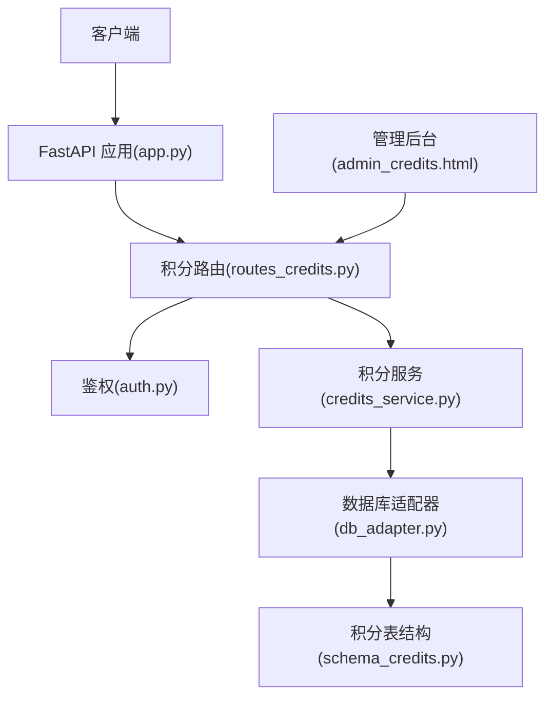
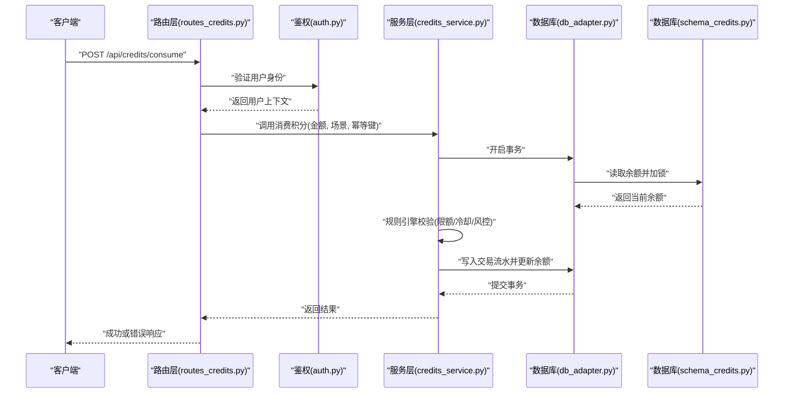
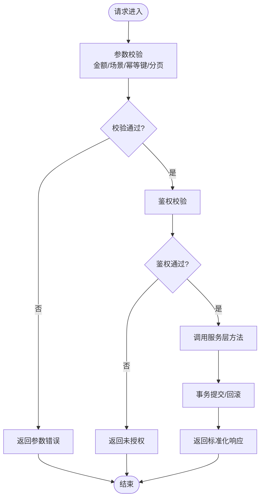
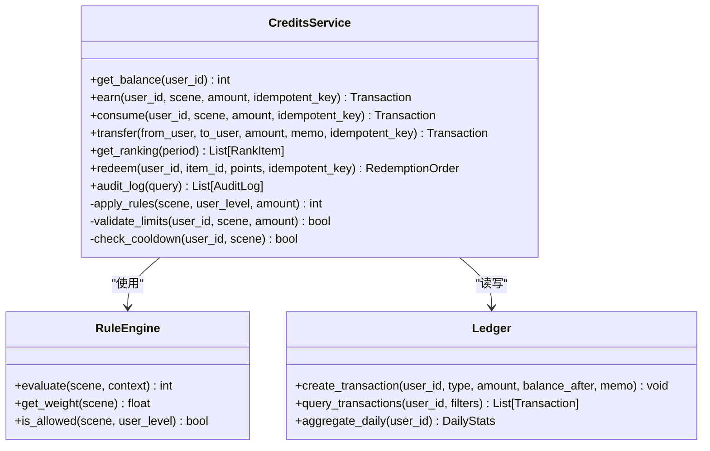
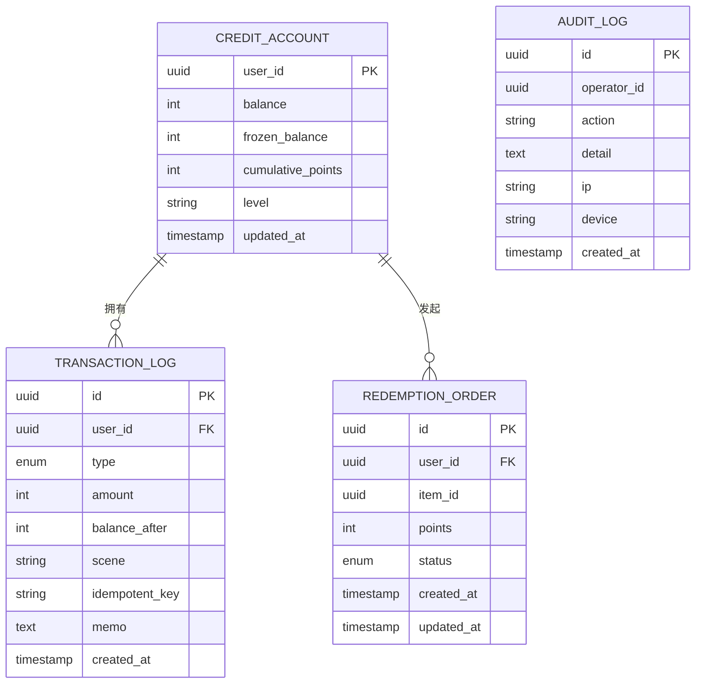
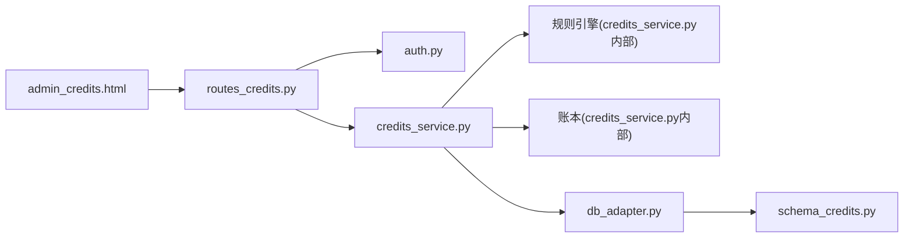

# 积分系统路由

<cite>
**本文引用的文件**   
- [routes_credits.py](file://server/routes_credits.py)
- [credits_service.py](file://server/credits_service.py)
- [schema_credits.py](file://server/database/schema_credits.py)
- [db_adapter.py](file://server/database/db_adapter.py)
- [app.py](file://server/app.py)
- [auth.py](file://server/auth.py)
- [config.py](file://server/config.py)
- [admin_credits.html](file://server/templates/pages/admin_credits.html)
</cite>

## 目录
1. [简介](#简介)
2. [项目结构](#项目结构)
3. [核心组件](#核心组件)
4. [架构总览](#架构总览)
5. [详细组件分析](#详细组件分析)
6. [依赖关系分析](#依赖关系分析)
7. [性能与并发](#性能与并发)
8. [故障排查指南](#故障排查指南)
9. [结论](#结论)
10. [附录：API 端点定义](#附录api-端点定义)

## 简介
本文件为 LectureLearnLoop 项目的“积分系统路由模块”提供系统化文档，覆盖积分获取、消耗、转账、查询的 API 设计，以及积分规则引擎、交易记录、数据一致性、等级体系、排行榜、兑换机制、统计报表、数据分析、审计日志与合规性检查的实现要点。同时给出事务处理、并发控制、防刷策略、自动化任务与异常处理的实践建议。

## 项目结构
围绕积分系统的后端实现主要位于 server 目录下，关键文件如下：
- routes_credits.py：积分相关 HTTP 路由与请求校验
- credits_service.py：积分业务逻辑（规则引擎、发放、扣减、转账、查询、排行榜、兑换）
- schema_credits.py：积分相关数据库表结构与约束
- db_adapter.py：数据库访问封装（连接、事务、SQL 执行）
- app.py：应用启动与路由注册
- auth.py：鉴权中间件
- config.py：配置项（含积分相关开关与阈值）
- admin_credits.html：积分管理后台页面

**图表来源**
- [app.py:1-200](file://server/app.py#L1-L200)
- [routes_credits.py:1-200](file://server/routes_credits.py#L1-L200)
- [credits_service.py:1-200](file://server/credits_service.py#L1-L200)
- [db_adapter.py:1-200](file://server/database/db_adapter.py#L1-L200)
- [schema_credits.py:1-200](file://server/database/schema_credits.py#L1-L200)
- [auth.py:1-200](file://server/auth.py#L1-L200)
- [admin_credits.html:1-200](file://server/templates/pages/admin_credits.html#L1-L200)

**章节来源**
- [app.py:1-200](file://server/app.py#L1-L200)
- [routes_credits.py:1-200](file://server/routes_credits.py#L1-L200)
- [credits_service.py:1-200](file://server/credits_service.py#L1-L200)
- [schema_credits.py:1-200](file://server/database/schema_credits.py#L1-L200)
- [db_adapter.py:1-200](file://server/database/db_adapter.py#L1-L200)
- [auth.py:1-200](file://server/auth.py#L1-L200)
- [config.py:1-200](file://server/config.py#L1-L200)
- [admin_credits.html:1-200](file://server/templates/pages/admin_credits.html#L1-L200)

## 核心组件
- 路由层（routes_credits.py）
  - 负责接收 HTTP 请求、参数校验、鉴权调用、错误码映射与响应格式化。
  - 暴露积分获取、消耗、转账、查询、排行榜、兑换等接口。
- 服务层（credits_service.py）
  - 实现积分规则引擎、余额计算、交易流水生成、等级判定、排行榜聚合、兑换流程。
  - 通过 db_adapter 进行事务化数据操作。
- 数据层（schema_credits.py + db_adapter.py）
  - 定义积分账户、交易流水、兑换订单、审计日志等表结构及约束。
  - 提供连接池、事务、批量写入、幂等键等能力。
- 鉴权与配置（auth.py + config.py）
  - 鉴权中间件确保用户身份；配置项控制积分开关、限额、冷却时间、风控阈值等。
- 管理后台（admin_credits.html）
  - 提供积分发放、冻结/解冻、查看流水、导出报表等管理能力。

**章节来源**
- [routes_credits.py:1-200](file://server/routes_credits.py#L1-L200)
- [credits_service.py:1-200](file://server/credits_service.py#L1-L200)
- [schema_credits.py:1-200](file://server/database/schema_credits.py#L1-L200)
- [db_adapter.py:1-200](file://server/database/db_adapter.py#L1-L200)
- [auth.py:1-200](file://server/auth.py#L1-L200)
- [config.py:1-200](file://server/config.py#L1-L200)
- [admin_credits.html:1-200](file://server/templates/pages/admin_credits.html#L1-L200)

## 架构总览
积分系统采用分层架构：HTTP 路由 → 业务服务 → 数据访问 → 数据库。所有写操作均通过事务保证一致性，读操作支持缓存与聚合视图以提升性能。

**图表来源**
- [routes_credits.py:1-200](file://server/routes_credits.py#L1-L200)
- [auth.py:1-200](file://server/auth.py#L1-L200)
- [credits_service.py:1-200](file://server/credits_service.py#L1-L200)
- [db_adapter.py:1-200](file://server/database/db_adapter.py#L1-L200)
- [schema_credits.py:1-200](file://server/database/schema_credits.py#L1-L200)

## 详细组件分析

### 路由层（routes_credits.py）
- 职责
  - 定义积分相关的 HTTP 端点，包括获取、消耗、转账、查询、排行榜、兑换、审计日志导出等。
  - 统一参数校验、错误码映射、分页与排序参数处理。
  - 调用鉴权中间件，注入用户上下文。
- 关键设计
  - 幂等键：对高风险操作（如消耗、转账）要求幂等键，避免重复提交。
  - 限流与冷却：结合配置项对同一用户/场景设置冷却时间与频率限制。
  - 审计追踪：所有写操作记录审计日志，便于合规审查。

**图表来源**
- [routes_credits.py:1-200](file://server/routes_credits.py#L1-L200)
- [auth.py:1-200](file://server/auth.py#L1-L200)

**章节来源**
- [routes_credits.py:1-200](file://server/routes_credits.py#L1-L200)
- [auth.py:1-200](file://server/auth.py#L1-L200)

### 服务层（credits_service.py）
- 职责
  - 实现积分规则引擎：根据场景、用户等级、时间段、活动标签等计算可获得的积分或需扣除的积分。
  - 实现余额计算与交易流水：保证每次变更都有对应流水记录，支持追溯与审计。
  - 实现等级体系：基于累计积分或活跃天数计算等级，影响规则权重与权益。
  - 实现排行榜：按周期（日/周/月）聚合积分变化，生成排名。
  - 实现兑换机制：将积分兑换为虚拟商品或服务，生成兑换订单并扣减积分。
- 关键设计
  - 事务一致性：所有写操作在事务中完成，失败自动回滚。
  - 并发控制：使用行级锁或乐观锁防止超扣与重复入账。
  - 防刷策略：结合冷却时间、频次上限、设备指纹、IP 白名单等策略。
  - 可扩展规则：规则引擎以配置驱动，支持新增场景与权重。

**图表来源**
- [credits_service.py:1-200](file://server/credits_service.py#L1-L200)

**章节来源**
- [credits_service.py:1-200](file://server/credits_service.py#L1-L200)

### 数据层（schema_credits.py + db_adapter.py）
- 表结构
  - 积分账户表：存储用户当前余额、冻结余额、累计积分、等级、更新时间等。
  - 交易流水表：记录每笔积分变动（类型、金额、前后余额、场景、幂等键、审计字段）。
  - 兑换订单表：记录兑换商品、所需积分、状态、创建时间、更新时间。
  - 审计日志表：记录关键操作的审计信息（操作人、时间、IP、设备、结果）。
- 约束与索引
  - 唯一约束：幂等键、用户ID+场景组合等。
  - 索引：用户ID、时间范围、场景、状态等常用查询字段。
- 事务与并发
  - 使用数据库事务保证原子性。
  - 行级锁或版本字段（乐观锁）防止并发超扣。
  - 批量写入优化高吞吐场景。

**图表来源**
- [schema_credits.py:1-200](file://server/database/schema_credits.py#L1-L200)

**章节来源**
- [schema_credits.py:1-200](file://server/database/schema_credits.py#L1-L200)
- [db_adapter.py:1-200](file://server/database/db_adapter.py#L1-L200)

### 鉴权与配置（auth.py + config.py）
- 鉴权
  - 中间件校验用户令牌，注入用户上下文到请求。
  - 支持角色权限控制（管理员可对积分进行发放、冻结等操作）。
- 配置
  - 积分开关、每日获取上限、单次消耗上限、冷却时间、风控阈值、排行榜周期等。
  - 支持动态配置热更新（重启服务生效或在线刷新）。

**章节来源**
- [auth.py:1-200](file://server/auth.py#L1-L200)
- [config.py:1-200](file://server/config.py#L1-L200)

### 管理后台（admin_credits.html）
- 功能
  - 积分发放（手动/批量）、冻结/解冻、查看流水、导出报表、审核异常。
  - 查看排行榜、监控风控告警、调整规则配置。
- 交互
  - 前端表单校验、异步提交、加载态与错误提示。
  - 表格分页、筛选、排序、导出 CSV/Excel。

**章节来源**
- [admin_credits.html:1-200](file://server/templates/pages/admin_credits.html#L1-L200)

## 依赖关系分析
- 路由层依赖鉴权与服务层。
- 服务层依赖规则引擎、账本与数据库适配器。
- 数据层由表结构与数据库适配器组成。
- 管理后台通过路由层与管理接口交互。

**图表来源**
- [routes_credits.py:1-200](file://server/routes_credits.py#L1-L200)
- [auth.py:1-200](file://server/auth.py#L1-L200)
- [credits_service.py:1-200](file://server/credits_service.py#L1-L200)
- [db_adapter.py:1-200](file://server/database/db_adapter.py#L1-L200)
- [schema_credits.py:1-200](file://server/database/schema_credits.py#L1-L200)
- [admin_credits.html:1-200](file://server/templates/pages/admin_credits.html#L1-L200)

**章节来源**
- [routes_credits.py:1-200](file://server/routes_credits.py#L1-L200)
- [credits_service.py:1-200](file://server/credits_service.py#L1-L200)
- [db_adapter.py:1-200](file://server/database/db_adapter.py#L1-L200)
- [schema_credits.py:1-200](file://server/database/schema_credits.py#L1-L200)
- [admin_credits.html:1-200](file://server/templates/pages/admin_credits.html#L1-L200)

## 性能与并发
- 事务隔离级别
  - 写操作使用可重复读或串行化隔离，避免脏读与不可重复读。
- 并发控制
  - 行级锁：对余额行加锁，防止超扣。
  - 乐观锁：使用版本号字段，冲突时重试或返回冲突错误。
- 幂等性
  - 幂等键唯一约束，重复提交直接返回上次结果。
- 限流与冷却
  - 基于用户ID与场景的滑动窗口计数，超过阈值拒绝请求。
- 缓存与聚合
  - 排行榜与统计报表使用物化视图或定时聚合任务，减少实时计算压力。
- 批量写入
  - 高吞吐场景下批量插入交易流水，提升写入性能。

[本节为通用性能指导，不直接分析具体文件]

## 故障排查指南
- 常见问题
  - 余额不足：检查交易流水与规则引擎是否允许该场景消耗。
  - 重复入账：检查幂等键是否重复、是否存在并发竞争。
  - 超扣风险：检查行级锁或乐观锁是否生效。
  - 排行榜延迟：检查聚合任务是否正常运行。
  - 兑换失败：检查库存与积分是否足够，订单状态是否正确。
- 诊断步骤
  - 通过审计日志定位操作轨迹。
  - 查看交易流水的时间顺序与余额变化。
  - 检查配置项（冷却时间、限额、风控阈值）。
  - 核对数据库事务日志与锁等待情况。
- 恢复策略
  - 对异常流水进行人工复核与补偿。
  - 重置冷却时间或临时放宽限额（需审批）。
  - 重新运行聚合任务修复排行榜。

**章节来源**
- [credits_service.py:1-200](file://server/credits_service.py#L1-L200)
- [schema_credits.py:1-200](file://server/database/schema_credits.py#L1-L200)
- [db_adapter.py:1-200](file://server/database/db_adapter.py#L1-L200)

## 结论
积分系统路由模块通过清晰的分层架构、严格的事务与并发控制、完善的规则引擎与审计机制，实现了安全可靠的积分获取、消耗、转账与查询能力。配合管理后台与配置项，系统具备良好的可维护性与扩展性。未来可进一步增强风控策略、引入更细粒度的权限控制与更丰富的数据分析报表。

[本节为总结性内容，不直接分析具体文件]

## 附录：API 端点定义
以下为积分系统的主要 API 端点定义（方法与路径、用途、关键参数、响应要点）：

- 获取余额
  - 方法：GET
  - 路径：/api/credits/balance
  - 用途：查询用户当前积分余额与等级
  - 关键参数：无（用户上下文由鉴权注入）
  - 响应要点：余额、冻结余额、累计积分、等级、更新时间

- 获取积分
  - 方法：POST
  - 路径：/api/credits/earn
  - 用途：根据场景与规则发放积分
  - 关键参数：scene、amount、idempotent_key
  - 响应要点：交易ID、新余额、规则说明

- 消耗积分
  - 方法：POST
  - 路径：/api/credits/consume
  - 用途：根据场景与规则扣减积分
  - 关键参数：scene、amount、idempotent_key
  - 响应要点：交易ID、新余额、剩余次数/冷却时间

- 转账积分
  - 方法：POST
  - 路径：/api/credits/transfer
  - 用途：用户间转账
  - 关键参数：to_user、amount、memo、idempotent_key
  - 响应要点：交易ID、双方余额、备注

- 查询交易流水
  - 方法：GET
  - 路径：/api/credits/transactions
  - 用途：分页查询用户交易记录
  - 关键参数：page、size、scene、start_time、end_time
  - 响应要点：流水列表、总数、分页信息

- 排行榜
  - 方法：GET
  - 路径：/api/credits/ranking
  - 用途：按周期查询排行榜
  - 关键参数：period（日/周/月）
  - 响应要点：排名列表（用户ID、积分变化、等级）

- 兑换
  - 方法：POST
  - 路径：/api/credits/redeem
  - 用途：用积分兑换商品或服务
  - 关键参数：item_id、points、idempotent_key
  - 响应要点：订单ID、状态、扣减积分

- 审计日志
  - 方法：GET
  - 路径：/api/credits/audit
  - 用途：查询审计日志（管理员）
  - 关键参数：operator_id、action、start_time、end_time
  - 响应要点：日志列表、总数、分页信息

- 管理接口（管理员）
  - 方法：POST
  - 路径：/api/admin/credits/distribute
  - 用途：管理员发放积分（批量/单用户）
  - 关键参数：user_ids、amount、reason、idempotent_key
  - 响应要点：发放结果、失败原因

- 管理接口（管理员）
  - 方法：POST
  - 路径：/api/admin/credits/freeze
  - 用途：冻结/解冻用户积分
  - 关键参数：user_id、action（freeze/unfreeze）、reason
  - 响应要点：操作结果、冻结余额

**章节来源**
- [routes_credits.py:1-200](file://server/routes_credits.py#L1-L200)
- [admin_credits.html:1-200](file://server/templates/pages/admin_credits.html#L1-L200)