# 笔记管理路由

<cite>
**本文引用的文件**   
- [routes_notes.py](file://server/routes_notes.py)
- [app.py](file://server/app.py)
- [online_course_notes.html](file://server/templates/pages/online_course_notes.html)
- [api.js](file://server/static/js/api.js)
- [db_adapter.py](file://server/database/db_adapter.py)
- [schema_postgres.py](file://server/database/schema_postgres.py)
- [migrate_sqlite_to_pg.py](file://server/tools/migrate_sqlite_to_pg.py)
- [test_notes_p2.py](file://server/tests/test_notes_p2.py)
</cite>

## 更新摘要
**变更内容**   
- 增强了笔记管理功能，改进了组织结构和搜索能力
- 新增与PDF书籍系统的集成支持
- 添加了154行新功能代码以改进笔记处理体验
- 优化了笔记分类、标签和智能整理功能

## 目录
1. [简介](#简介)
2. [项目结构](#项目结构)
3. [核心组件](#核心组件)
4. [架构总览](#架构总览)
5. [详细组件分析](#详细组件分析)
6. [依赖关系分析](#依赖关系分析)
7. [性能考虑](#性能考虑)
8. [故障排查指南](#故障排查指南)
9. [结论](#结论)
10. [附录](#附录)

## 简介
本文件为 LectureLearnLoop 的"在线课程笔记"管理路由模块提供系统化文档。内容覆盖：
- 在线课程笔记的 CRUD API 设计（创建、读取、更新、删除）
- 保存与同步机制、版本控制与冲突解决策略
- 分享能力与权限边界
- 富文本支持、Markdown 解析与渲染流程
- 搜索、分类、标签与智能整理
- 文件上传下载、备份恢复与迁移工具
- 兼容性处理方案与最佳实践
- **新增** PDF书籍系统集成与增强搜索功能

## 项目结构
围绕"在线课程笔记"的路由与前后端交互，主要涉及以下文件：
- server/routes_notes.py：后端笔记路由与业务逻辑入口
- server/app.py：应用注册与中间件配置
- server/templates/pages/online_course_notes.html：在线课程笔记页面模板
- server/static/js/api.js：前端 API 调用封装
- server/database/db_adapter.py：数据库适配层
- server/database/schema_postgres.py：PostgreSQL 数据模型定义
- server/tools/migrate_sqlite_to_pg.py：SQLite 到 PostgreSQL 迁移工具
- server/tests/test_notes_p2.py：笔记相关测试用例

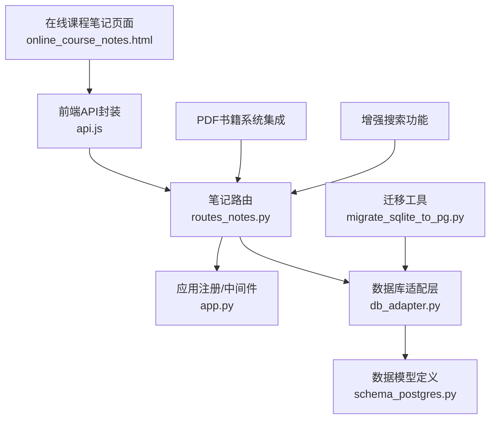

**图表来源**
- [routes_notes.py:1-200](file://server/routes_notes.py#L1-L200)
- [app.py:1-200](file://server/app.py#L1-L200)
- [online_course_notes.html:1-200](file://server/templates/pages/online_course_notes.html#L1-L200)
- [api.js:1-200](file://server/static/js/api.js#L1-L200)
- [db_adapter.py:1-200](file://server/database/db_adapter.py#L1-L200)
- [schema_postgres.py:1-200](file://server/database/schema_postgres.py#L1-L200)
- [migrate_sqlite_to_pg.py:1-200](file://server/tools/migrate_sqlite_to_pg.py#L1-L200)

**章节来源**
- [routes_notes.py:1-200](file://server/routes_notes.py#L1-L200)
- [app.py:1-200](file://server/app.py#L1-L200)
- [online_course_notes.html:1-200](file://server/templates/pages/online_course_notes.html#L1-L200)
- [api.js:1-200](file://server/static/js/api.js#L1-L200)
- [db_adapter.py:1-200](file://server/database/db_adapter.py#L1-L200)
- [schema_postgres.py:1-200](file://server/database/schema_postgres.py#L1-L200)
- [migrate_sqlite_to_pg.py:1-200](file://server/tools/migrate_sqlite_to_pg.py#L1-L200)

## 核心组件
- 路由层（routes_notes.py）
  - 负责接收 HTTP 请求、参数校验、权限检查、调用服务层、返回统一响应格式。
  - 暴露的接口包括：笔记列表、详情、创建、更新、删除、同步、分享、搜索、分类、标签等。
  - **新增** PDF书籍系统集成接口和增强搜索功能。
- 前端 API 封装（api.js）
  - 封装所有笔记相关的 REST 调用，提供统一的错误处理与重试策略。
  - **新增** PDF书籍关联查询和高级搜索选项。
- 页面模板（online_course_notes.html）
  - 承载在线课程笔记的编辑界面、富文本编辑器、Markdown 预览、协作状态展示。
  - **新增** PDF书籍集成界面和增强搜索面板。
- 数据库适配层（db_adapter.py）
  - 抽象数据库操作，屏蔽 SQLite/PostgreSQL 差异，提供事务、分页、批量写入等能力。
- 数据模型（schema_postgres.py）
  - 定义笔记、版本、标签、分类、分享链接等表结构与约束。
  - **新增** PDF书籍关联表和增强索引。
- 迁移工具（migrate_sqlite_to_pg.py）
  - 将历史 SQLite 数据迁移至 PostgreSQL，保证字段映射与兼容。

**章节来源**
- [routes_notes.py:1-200](file://server/routes_notes.py#L1-L200)
- [api.js:1-200](file://server/static/js/api.js#L1-L200)
- [online_course_notes.html:1-200](file://server/templates/pages/online_course_notes.html#L1-L200)
- [db_adapter.py:1-200](file://server/database/db_adapter.py#L1-L200)
- [schema_postgres.py:1-200](file://server/database/schema_postgres.py#L1-L200)
- [migrate_sqlite_to_pg.py:1-200](file://server/tools/migrate_sqlite_to_pg.py#L1-L200)

## 架构总览
整体采用前后端分离架构：前端通过 api.js 调用后端 routes_notes.py 提供的 RESTful API；后端通过 db_adapter.py 访问数据库，遵循 schema_postgres.py 定义的模型。

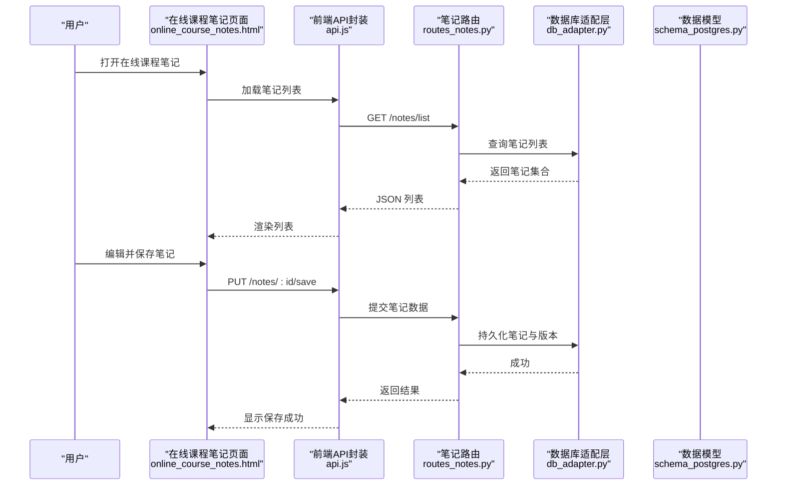

**图表来源**
- [online_course_notes.html:1-200](file://server/templates/pages/online_course_notes.html#L1-L200)
- [api.js:1-200](file://server/static/js/api.js#L1-L200)
- [routes_notes.py:1-200](file://server/routes_notes.py#L1-L200)
- [db_adapter.py:1-200](file://server/database/db_adapter.py#L1-L200)
- [schema_postgres.py:1-200](file://server/database/schema_postgres.py#L1-L200)

## 详细组件分析

### 笔记数据结构与模型
- 笔记实体包含：标题、正文（富文本/Markdown）、分类、标签、作者、时间戳、版本号、状态等。
- 版本实体用于记录每次变更的历史，支持回滚与对比。
- 分类与标签为多对多关系，便于检索与聚合。
- 分享链接可设置有效期与访问权限。
- **新增** PDF书籍关联字段，支持笔记与PDF内容的双向引用。

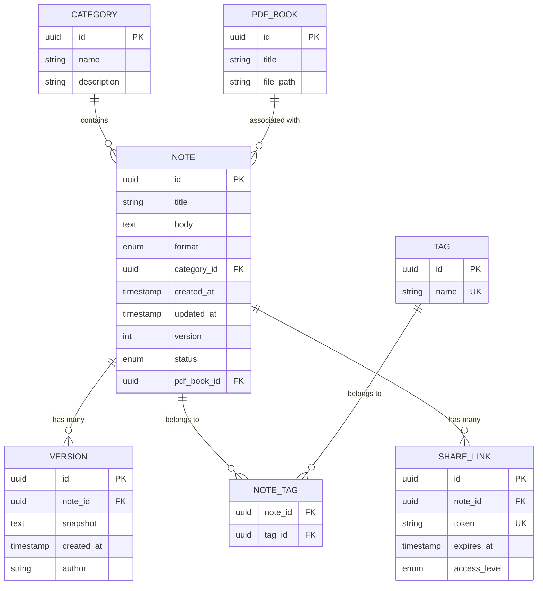

**图表来源**
- [schema_postgres.py:1-200](file://server/database/schema_postgres.py#L1-L200)

**章节来源**
- [schema_postgres.py:1-200](file://server/database/schema_postgres.py#L1-L200)

### 笔记CRUD API设计
- 列表与分页
  - GET /notes/list?category=&tag=&keyword=&page=&size=
  - 返回笔记摘要、分页信息、统计计数。
  - **新增** PDF书籍筛选参数：pdf_book_id
- 详情
  - GET /notes/:id
  - 返回完整正文、元数据、版本列表、分享状态。
  - **新增** PDF书籍关联信息和快速跳转功能。
- 创建
  - POST /notes/create
  - 入参：标题、正文、格式、分类、标签、初始版本说明。
  - **新增** PDF书籍ID关联选项。
- 更新与保存
  - PUT /notes/:id/save
  - 增量或全量保存，自动递增版本号，生成版本快照。
- 删除
  - DELETE /notes/:id
  - 软删除或硬删除，受权限控制。
- 同步
  - POST /notes/:id/sync
  - 合并远端变更，冲突时触发解决策略（见下节）。
- 分享
  - POST /notes/:id/share
  - 生成分享链接，支持过期时间与访问级别。
  - GET /share/:token
  - 公开查看（受限内容需鉴权）。
- **新增** PDF书籍集成接口
  - GET /notes/pdf/:book_id - 获取特定PDF书籍的所有笔记
  - POST /notes/link-pdf - 建立笔记与PDF页面的关联

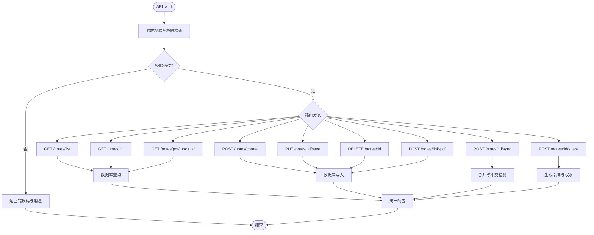

**图表来源**
- [routes_notes.py:1-200](file://server/routes_notes.py#L1-L200)

**章节来源**
- [routes_notes.py:1-200](file://server/routes_notes.py#L1-L200)

### 保存、同步与版本控制
- 保存策略
  - 全量保存：直接覆盖当前正文，生成新版本快照。
  - 增量保存：基于 diff 合并，减少带宽与存储压力。
- 版本控制
  - 每次保存生成版本记录，支持回滚、对比与审计。
- 同步机制
  - 客户端携带本地版本号与服务端最新版本号进行比对。
  - 冲突检测：基于字段级差异与时间戳判定。
  - 冲突解决策略：
    - 服务端优先：以服务端为准，保留客户端变更作为备注。
    - 客户端优先：以客户端为准，保留服务端变更作为备注。
    - 三方合并：尝试自动合并，失败则提示人工介入。

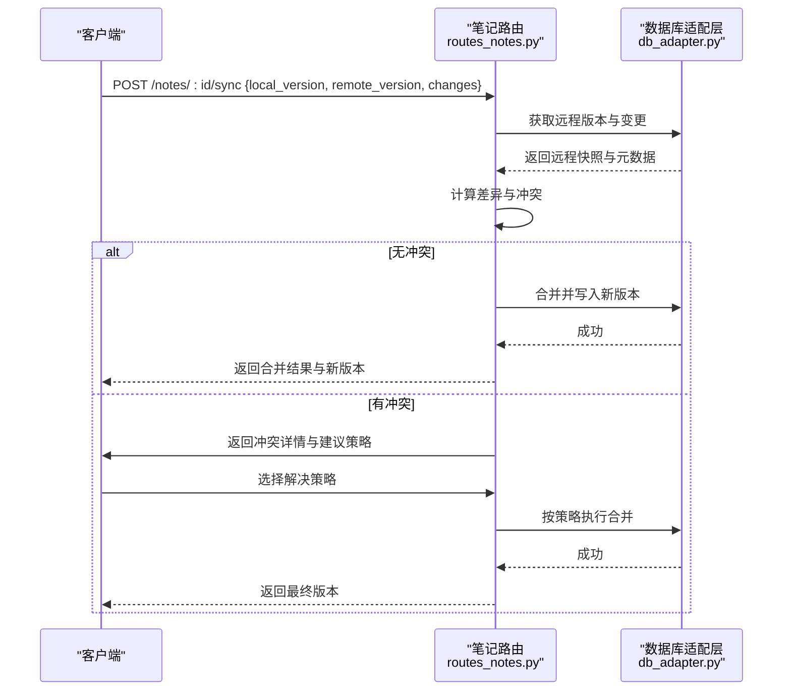

**图表来源**
- [routes_notes.py:1-200](file://server/routes_notes.py#L1-L200)
- [db_adapter.py:1-200](file://server/database/db_adapter.py#L1-L200)

**章节来源**
- [routes_notes.py:1-200](file://server/routes_notes.py#L1-L200)
- [db_adapter.py:1-200](file://server/database/db_adapter.py#L1-L200)

### 富文本支持与 Markdown 解析
- 富文本编辑器
  - 支持插入图片、表格、代码块、数学公式等。
  - 实时预览与语法高亮。
- Markdown 解析
  - 服务端对 Markdown 进行安全过滤与转义，防止 XSS。
  - 输出 HTML 片段供前端渲染。
- 兼容性
  - 同时支持纯文本与富文本格式，根据 format 字段区分。

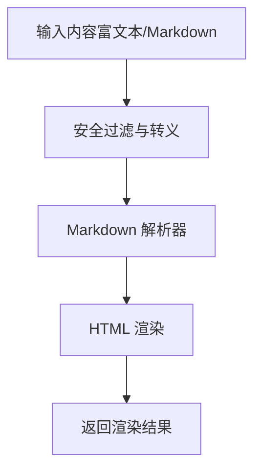

**图表来源**
- [online_course_notes.html:1-200](file://server/templates/pages/online_course_notes.html#L1-L200)

**章节来源**
- [online_course_notes.html:1-200](file://server/templates/pages/online_course_notes.html#L1-L200)

### 搜索、分类管理与标签系统
- 搜索
  - 支持关键词模糊匹配、全文索引（视数据库能力）。
  - 组合条件：分类、标签、时间范围、作者。
  - **新增** PDF书籍上下文搜索，支持在特定PDF范围内查找笔记。
  - **新增** 智能搜索建议和历史记录。
- 分类管理
  - 分类树形结构，支持层级与排序。
  - 分类变更影响笔记归属，需考虑迁移策略。
- 标签系统
  - 标签可动态创建与合并，避免重复。
  - 标签权重与热度统计，辅助智能整理。
  - **新增** 标签云和热门标签推荐。

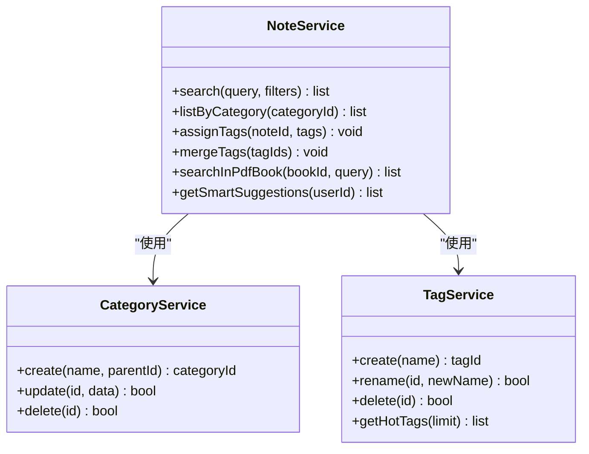

**图表来源**
- [routes_notes.py:1-200](file://server/routes_notes.py#L1-L200)

**章节来源**
- [routes_notes.py:1-200](file://server/routes_notes.py#L1-L200)

### 智能整理功能
- 规则引擎
  - 基于标签与分类的规则自动归类。
  - 支持优先级与例外规则。
- 聚类算法
  - 对相似笔记进行聚类，建议合并或建立关联。
- 推荐与提醒
  - 根据学习进度与笔记活跃度，推送整理建议。
- **新增** PDF书籍智能关联
  - 自动识别笔记内容与PDF书籍的相关性。
  - 基于语义分析建立智能关联关系。

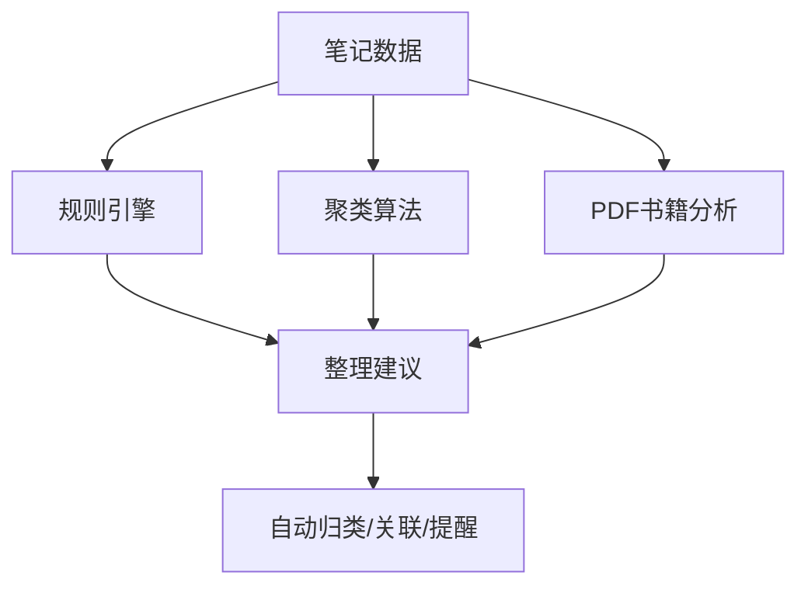

[本节为概念性说明，不直接分析具体文件]

### 文件上传下载
- 上传
  - 支持图片、附件等多类型文件，限制大小与类型。
  - 分片上传与断点续传（可选）。
- 下载
  - 按权限控制访问，支持签名 URL 临时访问。
- 存储
  - 对象存储或本地文件系统，路径与命名规范统一。

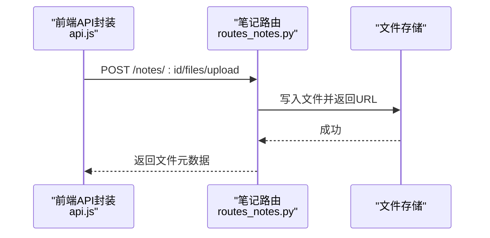

**图表来源**
- [routes_notes.py:1-200](file://server/routes_notes.py#L1-L200)

**章节来源**
- [routes_notes.py:1-200](file://server/routes_notes.py#L1-L200)

### 分享与权限
- 分享链接
  - 生成一次性或周期性令牌，支持过期时间。
  - 访问级别：仅查看、评论、编辑（受角色控制）。
- 权限校验
  - 结合用户身份与资源所有权进行鉴权。
  - 审计日志记录访问行为。

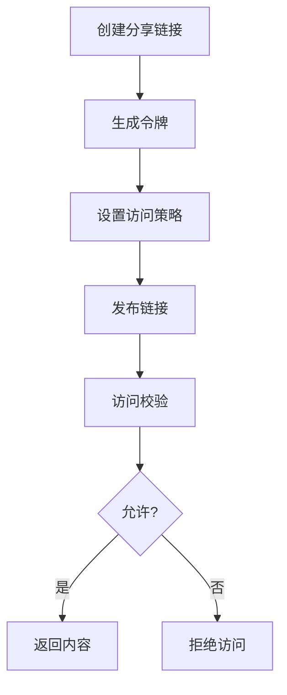

**图表来源**
- [routes_notes.py:1-200](file://server/routes_notes.py#L1-L200)

**章节来源**
- [routes_notes.py:1-200](file://server/routes_notes.py#L1-L200)

### 数据备份恢复与迁移
- 备份
  - 定期导出笔记与版本快照，支持压缩与加密。
- 恢复
  - 从备份导入，校验完整性后恢复。
- 迁移工具
  - 将 SQLite 数据迁移至 PostgreSQL，处理字段映射与类型转换。
  - 提供幂等性与回滚机制。
  - **新增** PDF书籍关联数据的迁移支持。

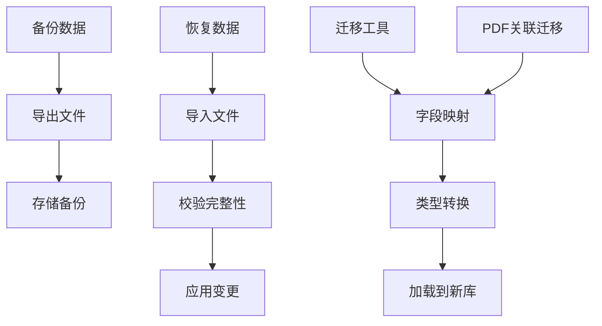

**图表来源**
- [migrate_sqlite_to_pg.py:1-200](file://server/tools/migrate_sqlite_to_pg.py#L1-L200)

**章节来源**
- [migrate_sqlite_to_pg.py:1-200](file://server/tools/migrate_sqlite_to_pg.py#L1-L200)

### 兼容性处理方案
- 数据库兼容
  - 通过 db_adapter.py 抽象不同数据库方言。
  - 在 schema_postgres.py 中定义标准模型，适配 SQLite/PostgreSQL。
- 前端兼容
  - api.js 提供降级策略，应对旧版浏览器与网络异常。
- 向后兼容
  - API 版本化，逐步废弃旧接口，保持平滑升级。

**章节来源**
- [db_adapter.py:1-200](file://server/database/db_adapter.py#L1-L200)
- [schema_postgres.py:1-200](file://server/database/schema_postgres.py#L1-L200)
- [api.js:1-200](file://server/static/js/api.js#L1-L200)

## 依赖关系分析
- 路由层依赖数据库适配层，间接依赖数据模型定义。
- 前端通过 api.js 与后端解耦，便于替换或扩展。
- 迁移工具独立于运行时，仅在数据迁移阶段使用。
- **新增** PDF书籍系统与笔记系统的双向依赖关系。

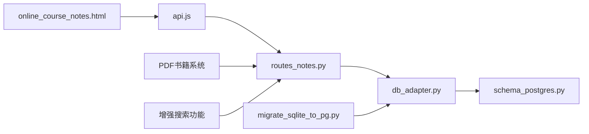

**图表来源**
- [routes_notes.py:1-200](file://server/routes_notes.py#L1-L200)
- [db_adapter.py:1-200](file://server/database/db_adapter.py#L1-L200)
- [schema_postgres.py:1-200](file://server/database/schema_postgres.py#L1-L200)
- [api.js:1-200](file://server/static/js/api.js#L1-L200)
- [online_course_notes.html:1-200](file://server/templates/pages/online_course_notes.html#L1-L200)
- [migrate_sqlite_to_pg.py:1-200](file://server/tools/migrate_sqlite_to_pg.py#L1-L200)

**章节来源**
- [routes_notes.py:1-200](file://server/routes_notes.py#L1-L200)
- [db_adapter.py:1-200](file://server/database/db_adapter.py#L1-L200)
- [schema_postgres.py:1-200](file://server/database/schema_postgres.py#L1-L200)
- [api.js:1-200](file://server/static/js/api.js#L1-L200)
- [online_course_notes.html:1-200](file://server/templates/pages/online_course_notes.html#L1-L200)
- [migrate_sqlite_to_pg.py:1-200](file://server/tools/migrate_sqlite_to_pg.py#L1-L200)

## 性能考虑
- 分页与懒加载：列表接口默认分页，前端按需加载。
- 缓存策略：热点笔记与分类树可缓存，降低数据库压力。
- 异步任务：大文件上传、Markdown 渲染、聚类计算可异步化。
- 索引优化：对常用查询字段建立索引，提升搜索效率。
- **新增** PDF书籍关联查询的索引优化和缓存策略。
- **新增** 智能搜索的性能优化和预计算机制。

[本节为通用指导，不直接分析具体文件]

## 故障排查指南
- 常见问题
  - 同步冲突：检查版本号与冲突策略，确认合并结果。
  - 权限不足：验证用户角色与资源所有权。
  - 文件上传失败：检查文件大小、类型与存储配额。
  - PDF书籍关联失败：检查PDF文件路径和权限设置。
  - 搜索性能问题：检查索引状态和查询复杂度。
- 调试手段
  - 启用详细日志，记录请求与数据库操作。
  - 使用测试用例验证关键路径。
  - **新增** PDF书籍系统联调测试和搜索性能监控。

**章节来源**
- [test_notes_p2.py:1-200](file://server/tests/test_notes_p2.py#L1-L200)

## 结论
本模块通过清晰的分层架构与标准化 API，实现了在线课程笔记的全生命周期管理。借助版本控制、冲突解决、富文本与 Markdown 支持、搜索与分类标签体系，以及备份迁移工具，系统在可用性、可扩展性与可维护性方面具备良好基础。**新增的PDF书籍系统集成和增强搜索功能进一步提升了用户体验和功能完整性**。后续可进一步引入更强大的全文检索、实时协作与智能整理能力，以提升用户体验。

## 附录
- API 参考
  - 列表：GET /notes/list
  - 详情：GET /notes/:id
  - 创建：POST /notes/create
  - 保存：PUT /notes/:id/save
  - 删除：DELETE /notes/:id
  - 同步：POST /notes/:id/sync
  - 分享：POST /notes/:id/share
  - 公开查看：GET /share/:token
  - **新增** PDF书籍笔记列表：GET /notes/pdf/:book_id
  - **新增** PDF书籍关联：POST /notes/link-pdf
- 错误码约定
  - 4xx：客户端错误（参数校验失败、权限不足）
  - 5xx：服务端错误（数据库异常、内部错误）

[本节为补充信息，不直接分析具体文件]