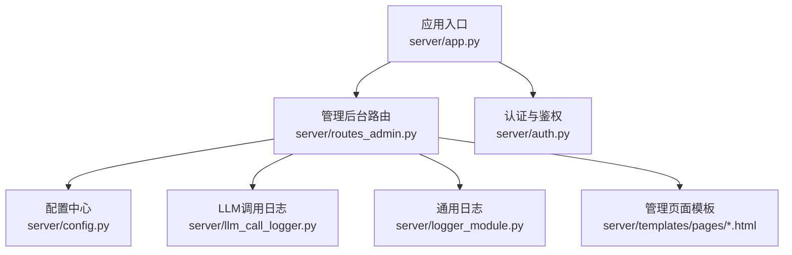
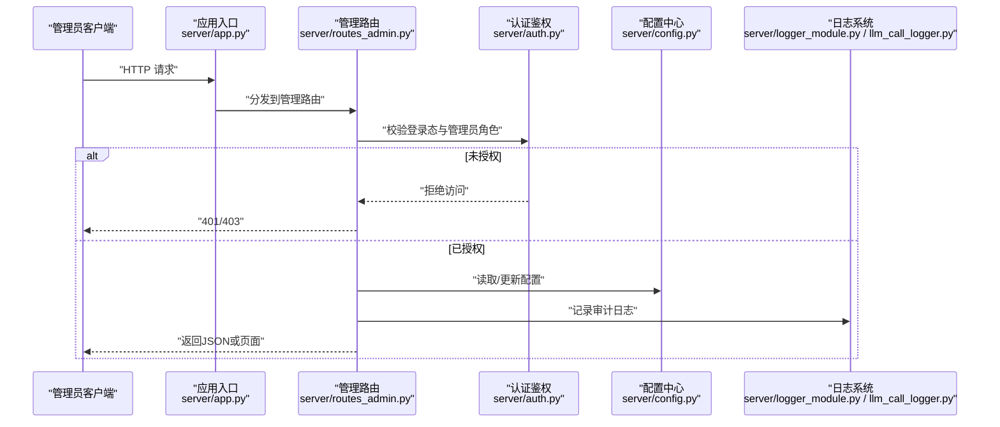
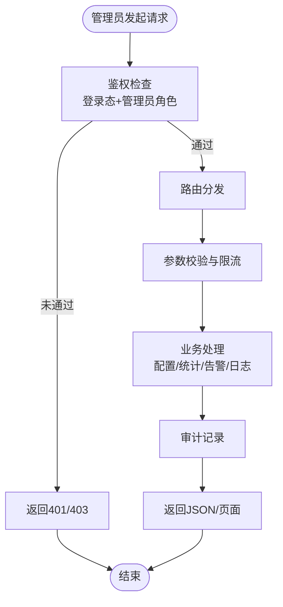
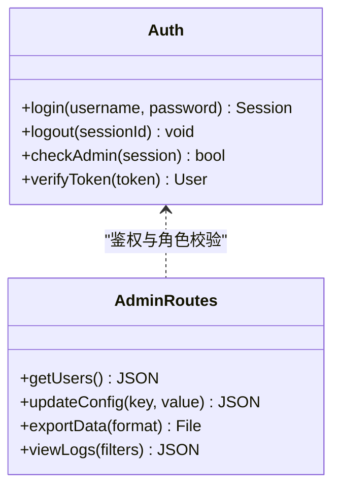
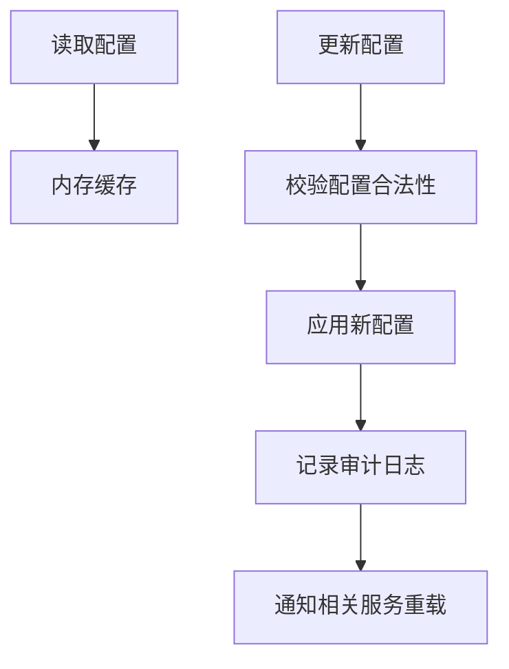
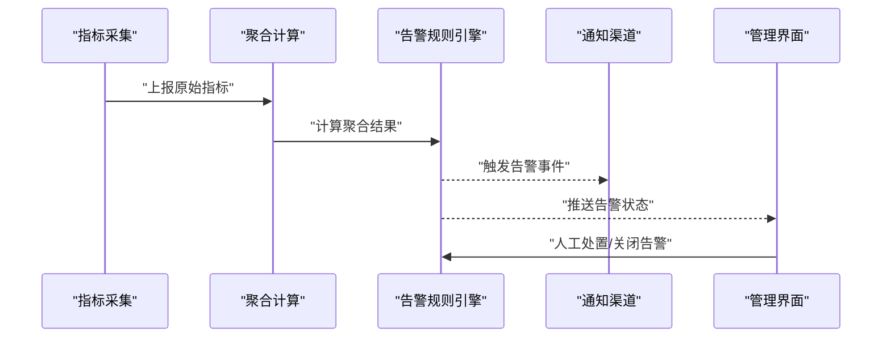
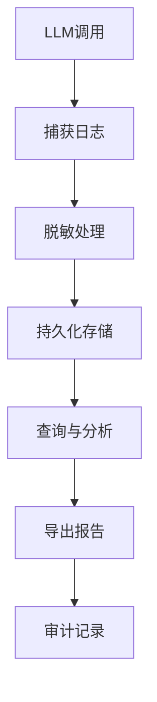
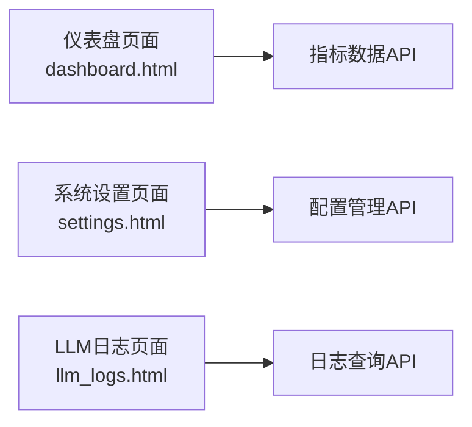
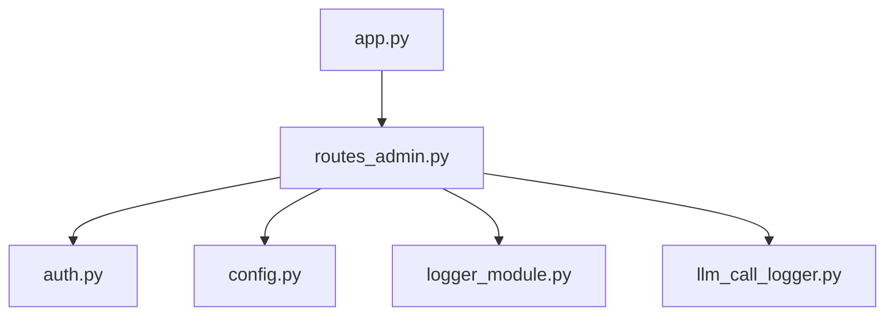

# 管理后台路由

<cite>
**本文引用的文件**   
- [server/app.py](file://server/app.py)
- [server/routes_admin.py](file://server/routes_admin.py)
- [server/auth.py](file://server/auth.py)
- [server/config.py](file://server/config.py)
- [server/llm_call_logger.py](file://server/llm_call_logger.py)
- [server/logger_module.py](file://server/logger_module.py)
- [server/templates/pages/dashboard.html](file://server/templates/pages/dashboard.html)
- [server/templates/pages/settings.html](file://server/templates/pages/settings.html)
- [server/templates/pages/llm_logs.html](file://server/templates/pages/llm_logs.html)
- [server/tests/_list_routes_r2.py](file://server/tests/_list_routes_r2.py)
</cite>

## 目录
1. [引言](#引言)
2. [项目结构](#项目结构)
3. [核心组件](#核心组件)
4. [架构总览](#架构总览)
5. [详细组件分析](#详细组件分析)
6. [依赖关系分析](#依赖关系分析)
7. [性能与可观测性](#性能与可观测性)
8. [故障诊断与排错](#故障诊断与排错)
9. [管理员操作规范与安全策略](#管理员操作规范与安全策略)
10. [应急响应方案](#应急响应方案)
11. [结论](#结论)

## 引言
本文件面向LectureLearnLoop的管理后台路由模块，聚焦管理员权限控制、用户管理、系统配置、数据统计与监控告警等能力。文档从系统架构、路由组织、权限验证、审计机制出发，给出API端点定义、批量操作、数据导出与系统维护工具的实现思路，并补充性能监控、日志分析与故障诊断要点，最后沉淀管理员操作规范、安全策略与应急响应流程。

## 项目结构
管理后台相关代码主要位于server目录：
- 应用入口与蓝图注册：server/app.py
- 管理后台路由实现：server/routes_admin.py
- 认证与鉴权：server/auth.py
- 配置中心：server/config.py
- LLM调用日志与通用日志：server/llm_call_logger.py、server/logger_module.py
- 管理页面模板：server/templates/pages/*.html（如仪表盘、设置、LLM日志）
- 路由测试辅助脚本：server/tests/_list_routes_r2.py

**图表来源**
- [server/app.py:1-200](file://server/app.py#L1-L200)
- [server/routes_admin.py:1-200](file://server/routes_admin.py#L1-L200)
- [server/auth.py:1-200](file://server/auth.py#L1-L200)
- [server/config.py:1-200](file://server/config.py#L1-L200)
- [server/llm_call_logger.py:1-200](file://server/llm_call_logger.py#L1-L200)
- [server/logger_module.py:1-200](file://server/logger_module.py#L1-L200)

**章节来源**
- [server/app.py:1-200](file://server/app.py#L1-L200)
- [server/routes_admin.py:1-200](file://server/routes_admin.py#L1-L200)
- [server/auth.py:1-200](file://server/auth.py#L1-L200)
- [server/config.py:1-200](file://server/config.py#L1-L200)
- [server/llm_call_logger.py:1-200](file://server/llm_call_logger.py#L1-L200)
- [server/logger_module.py:1-200](file://server/logger_module.py#L1-L200)

## 核心组件
- 管理后台路由层：集中暴露管理员API，统一鉴权、参数校验、审计记录与错误处理。
- 认证与鉴权：基于会话或令牌的身份校验与角色判断，提供登录态检查、管理员角色判定、访问控制装饰器。
- 配置中心：集中读取与缓存系统配置，支持热更新与变更审计。
- 日志子系统：统一结构化日志输出，包含LLM调用追踪与通用业务日志。
- 管理页面：仪表盘、系统设置、LLM日志查看等前端页面，通过路由渲染或返回JSON供前端消费。

**章节来源**
- [server/routes_admin.py:1-200](file://server/routes_admin.py#L1-L200)
- [server/auth.py:1-200](file://server/auth.py#L1-L200)
- [server/config.py:1-200](file://server/config.py#L1-L200)
- [server/llm_call_logger.py:1-200](file://server/llm_call_logger.py#L1-L200)
- [server/logger_module.py:1-200](file://server/logger_module.py#L1-L200)

## 架构总览
管理后台采用“应用入口 + 路由蓝图 + 服务层 + 模板/JSON”的分层结构。管理员请求进入app后由routes_admin进行鉴权与路由分发，再调用配置、日志等服务完成业务逻辑，最终返回HTML页面或JSON数据。

**图表来源**
- [server/app.py:1-200](file://server/app.py#L1-L200)
- [server/routes_admin.py:1-200](file://server/routes_admin.py#L1-L200)
- [server/auth.py:1-200](file://server/auth.py#L1-L200)
- [server/config.py:1-200](file://server/config.py#L1-L200)
- [server/logger_module.py:1-200](file://server/logger_module.py#L1-L200)
- [server/llm_call_logger.py:1-200](file://server/llm_call_logger.py#L1-L200)

## 详细组件分析

### 管理后台路由与API设计
- 路由组织原则
  - 以/admin为前缀的命名空间，按功能域划分子路径，例如用户管理、系统配置、数据统计、监控告警、LLM日志等。
  - 每个路由统一经过鉴权中间件，确保仅管理员可访问。
- API设计规范
  - RESTful风格，使用GET/POST/PUT/DELETE表达资源操作；列表接口支持分页、过滤与排序。
  - 响应体统一包含状态码、消息与数据字段，便于前端解析与错误提示。
  - 敏感操作需二次确认与审计记录。
- 典型端点类别
  - 用户管理：创建、编辑、禁用/启用、重置密码、批量导入/导出。
  - 系统配置：读取当前配置、逐项更新、批量更新、回滚历史版本。
  - 数据统计：指标查询、聚合统计、趋势分析、报表导出。
  - 监控告警：告警规则CRUD、告警事件查询、告警通知配置、告警处置记录。
  - LLM日志：日志检索、详情查看、采样导出、脱敏下载。
- 批量操作与导出
  - 批量接口接受数组参数，服务端执行事务性处理，失败时部分回滚并返回明细。
  - 导出接口支持CSV/Excel格式，大文件采用流式下载与进度回调。

**图表来源**
- [server/routes_admin.py:1-200](file://server/routes_admin.py#L1-L200)
- [server/auth.py:1-200](file://server/auth.py#L1-L200)

**章节来源**
- [server/routes_admin.py:1-200](file://server/routes_admin.py#L1-L200)

### 认证与权限控制
- 身份认证
  - 基于会话或令牌的认证机制，登录成功后建立会话上下文。
  - 支持多端登录与会话刷新策略。
- 角色与权限
  - 管理员角色判定：在会话中存储角色信息，路由层通过装饰器或中间件强制校验。
  - 细粒度权限：对敏感操作（如删除用户、修改系统配置）进行额外授权检查。
- 访问控制
  - 全局拦截未登录请求，重定向至登录页或返回401。
  - 非管理员访问管理路由直接返回403。

**图表来源**
- [server/auth.py:1-200](file://server/auth.py#L1-L200)
- [server/routes_admin.py:1-200](file://server/routes_admin.py#L1-L200)

**章节来源**
- [server/auth.py:1-200](file://server/auth.py#L1-L200)
- [server/routes_admin.py:1-200](file://server/routes_admin.py#L1-L200)

### 系统配置管理
- 配置读取与缓存
  - 从配置文件或数据库加载配置，并在内存中缓存以提升性能。
  - 支持热更新，变更后自动刷新缓存并广播给相关服务。
- 配置变更审计
  - 所有写操作记录变更前后的值、操作人、时间戳与IP。
  - 提供配置历史版本对比与一键回滚。
- 配置项分类
  - 基础运行参数、第三方服务密钥、功能开关、阈值与配额等。

**图表来源**
- [server/config.py:1-200](file://server/config.py#L1-L200)
- [server/routes_admin.py:1-200](file://server/routes_admin.py#L1-L200)

**章节来源**
- [server/config.py:1-200](file://server/config.py#L1-L200)
- [server/routes_admin.py:1-200](file://server/routes_admin.py#L1-L200)

### 数据统计与监控告警
- 数据统计
  - 指标采集：用户活跃度、学习时长、知识点掌握度、错误率等。
  - 聚合计算：按日/周/月维度聚合，支持同比/环比。
  - 报表生成：可视化图表数据与汇总表格，支持导出。
- 监控告警
  - 告警规则：CPU/内存/磁盘/网络/业务指标阈值。
  - 告警事件：触发、升级、恢复、关闭全生命周期管理。
  - 通知渠道：站内信、邮件、短信、Webhook。

**图表来源**
- [server/routes_admin.py:1-200](file://server/routes_admin.py#L1-L200)

**章节来源**
- [server/routes_admin.py:1-200](file://server/routes_admin.py#L1-L200)

### LLM日志与审计
- 日志采集
  - 记录LLM调用的输入、输出、耗时、模型名称、Provider、费用估算等。
  - 支持采样与脱敏，避免敏感信息泄露。
- 日志查询与分析
  - 按时间、模型、Provider、状态码、耗时范围过滤。
  - 提供TopN慢调用、错误分布、成本趋势分析。
- 审计与合规
  - 所有查看与导出操作均记录审计日志。
  - 支持导出脱敏后的日志用于问题定位与合规审查。

**图表来源**
- [server/llm_call_logger.py:1-200](file://server/llm_call_logger.py#L1-L200)
- [server/routes_admin.py:1-200](file://server/routes_admin.py#L1-L200)

**章节来源**
- [server/llm_call_logger.py:1-200](file://server/llm_call_logger.py#L1-L200)
- [server/routes_admin.py:1-200](file://server/routes_admin.py#L1-L200)

### 管理界面与模板
- 仪表盘
  - 展示关键指标、告警概览、最近操作审计。
  - 通过AJAX拉取实时数据，支持刷新与筛选。
- 系统设置
  - 表单化配置编辑，支持逐项保存与批量导入。
  - 变更预览与回滚按钮。
- LLM日志
  - 列表视图与详情弹窗，支持分页与高级筛选。
  - 导出按钮触发后端流式下载。

**图表来源**
- [server/templates/pages/dashboard.html:1-200](file://server/templates/pages/dashboard.html#L1-L200)
- [server/templates/pages/settings.html:1-200](file://server/templates/pages/settings.html#L1-L200)
- [server/templates/pages/llm_logs.html:1-200](file://server/templates/pages/llm_logs.html#L1-L200)

**章节来源**
- [server/templates/pages/dashboard.html:1-200](file://server/templates/pages/dashboard.html#L1-L200)
- [server/templates/pages/settings.html:1-200](file://server/templates/pages/settings.html#L1-L200)
- [server/templates/pages/llm_logs.html:1-200](file://server/templates/pages/llm_logs.html#L1-L200)

## 依赖关系分析
- 组件耦合
  - routes_admin依赖auth进行鉴权，依赖config进行配置读写，依赖logger_module与llm_call_logger进行审计与日志记录。
  - app.py负责蓝图注册与全局中间件挂载。
- 外部依赖
  - 数据库适配器、ORM、缓存、消息队列等由其他模块提供，管理路由通过服务层间接调用。
- 潜在循环依赖
  - 路由层不应反向依赖服务层的具体实现细节，保持单向依赖。

**图表来源**
- [server/app.py:1-200](file://server/app.py#L1-L200)
- [server/routes_admin.py:1-200](file://server/routes_admin.py#L1-L200)
- [server/auth.py:1-200](file://server/auth.py#L1-L200)
- [server/config.py:1-200](file://server/config.py#L1-L200)
- [server/logger_module.py:1-200](file://server/logger_module.py#L1-L200)
- [server/llm_call_logger.py:1-200](file://server/llm_call_logger.py#L1-L200)

**章节来源**
- [server/app.py:1-200](file://server/app.py#L1-L200)
- [server/routes_admin.py:1-200](file://server/routes_admin.py#L1-L200)

## 性能与可观测性
- 性能优化
  - 配置缓存与懒加载，减少频繁IO。
  - 列表接口分页与索引优化，避免全表扫描。
  - 导出接口流式处理，降低内存峰值。
- 可观测性
  - 结构化日志：统一trace_id、操作人、IP、耗时、状态码。
  - 指标埋点：接口QPS、P95/P99延迟、错误率、导出文件大小。
  - 告警联动：异常指标触发告警，快速定位瓶颈。

[本节为通用指导，不直接分析具体文件]

## 故障诊断与排错
- 常见问题
  - 鉴权失败：检查会话是否过期、角色是否正确。
  - 配置更新无效：确认缓存是否刷新、服务是否重载。
  - 导出失败：检查磁盘空间、权限与流式写入是否正常。
- 诊断步骤
  - 查看审计日志与LLM日志，定位操作链路与异常堆栈。
  - 检查指标面板，识别高延迟或高错误率的接口。
  - 复现问题并抓取请求ID，关联上下游日志。

**章节来源**
- [server/logger_module.py:1-200](file://server/logger_module.py#L1-L200)
- [server/llm_call_logger.py:1-200](file://server/llm_call_logger.py#L1-L200)

## 管理员操作规范与安全策略
- 操作规范
  - 所有敏感操作需双人复核与审批留痕。
  - 批量操作前务必备份数据，并提供回滚预案。
  - 导出文件需脱敏并按最小必要原则分发。
- 安全策略
  - 强口令与多因素认证，定期轮换密钥。
  - 最小权限原则，按需授予管理员角色。
  - 传输加密与访问白名单，限制内网访问。
- 应急响应
  - 发现异常立即隔离受影响服务，冻结相关账号。
  - 启动应急预案，通知相关干系人并记录事件时间线。
  - 事后复盘，完善检测与防护策略。

[本节为通用指导，不直接分析具体文件]

## 结论
管理后台路由模块通过统一鉴权、清晰的路由组织、完善的审计与日志体系，为管理员提供了用户管理、系统配置、数据统计与监控告警等核心能力。结合性能优化与可观测性建设，能够有效支撑系统的稳定运行与持续演进。建议持续完善细粒度权限、自动化审计与智能告警，进一步提升管理效率与安全性。

[本节为总结性内容，不直接分析具体文件]