# 路由设计

<cite>
**本文引用的文件**   
- [app.py](file://server/app.py)
- [routes_pages.py](file://server/routes_pages.py)
- [routes_notes.py](file://server/routes_notes.py)
- [routes_knowledge.py](file://server/routes_knowledge.py)
- [routes_bridge.py](file://server/routes_bridge.py)
- [routes_admin.py](file://server/routes_admin.py)
- [routes_credits.py](file://server/routes_credits.py)
- [auth.py](file://server/auth.py)
- [config.py](file://server/config.py)
</cite>

## 目录
1. [引言](#引言)
2. [项目结构](#项目结构)
3. [核心组件](#核心组件)
4. [架构总览](#架构总览)
5. [详细组件分析](#详细组件分析)
6. [依赖关系分析](#依赖关系分析)
7. [性能考虑](#性能考虑)
8. [故障排查指南](#故障排查指南)
9. [结论](#结论)
10. [附录](#附录)

## 引言
本文件面向LectureLearnLoop后端的路由设计与实现，聚焦以下目标：
- 模块化路由组织方式与RESTful API设计规范
- 请求参数验证与响应格式化策略
- 业务模块路由划分原则、权限控制机制与版本管理策略
- 路由中间件、请求拦截器与响应转换器的实现要点
- API文档生成、Swagger集成与接口测试策略

本说明以实际代码为依据，结合仓库中的路由文件与服务入口进行系统化梳理。

## 项目结构
后端采用Flask应用，按业务域拆分路由模块，统一在应用入口注册蓝图（Blueprint），并通过认证装饰器对受保护接口进行权限校验。

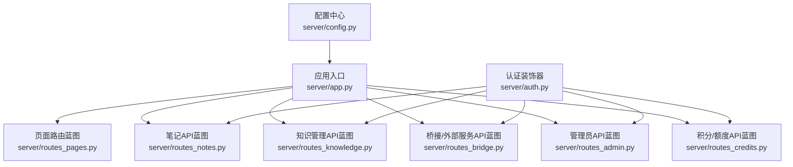

**图表来源**
- [app.py:1-120](file://server/app.py#L1-L120)
- [routes_pages.py:1-120](file://server/routes_pages.py#L1-L120)
- [routes_notes.py:1-120](file://server/routes_notes.py#L1-L120)
- [routes_knowledge.py:1-120](file://server/routes_knowledge.py#L1-L120)
- [routes_bridge.py:1-120](file://server/routes_bridge.py#L1-L120)
- [routes_admin.py:1-120](file://server/routes_admin.py#L1-L120)
- [routes_credits.py:1-120](file://server/routes_credits.py#L1-L120)
- [auth.py:1-120](file://server/auth.py#L1-L120)
- [config.py:1-120](file://server/config.py#L1-L120)

**章节来源**
- [app.py:1-120](file://server/app.py#L1-L120)

## 核心组件
- 应用入口与蓝图注册：集中创建Flask应用、加载配置、注册各业务蓝图，并挂载全局错误处理与中间件。
- 业务路由模块：按领域拆分为页面渲染、笔记、知识管理、桥接、管理员、积分等蓝图。
- 认证与权限：提供装饰器用于登录态校验与角色权限判断，作用于受保护的API路由。
- 配置中心：统一管理数据库、第三方服务、开关与默认值。

**章节来源**
- [app.py:1-120](file://server/app.py#L1-L120)
- [auth.py:1-120](file://server/auth.py#L1-L120)
- [config.py:1-120](file://server/config.py#L1-L120)

## 架构总览
下图展示从客户端到具体业务处理的请求链路，包括认证拦截、路由分发与业务逻辑调用。

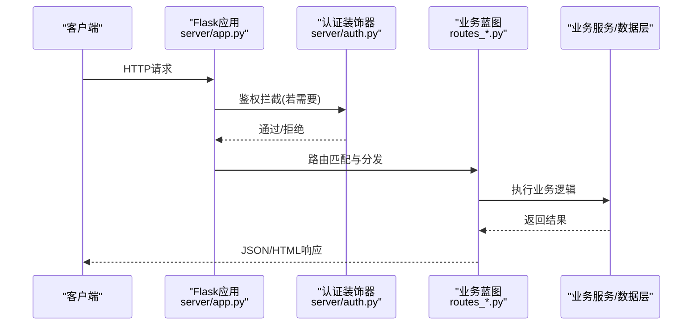

**图表来源**
- [app.py:1-120](file://server/app.py#L1-L120)
- [auth.py:1-120](file://server/auth.py#L1-L120)
- [routes_notes.py:1-120](file://server/routes_notes.py#L1-L120)
- [routes_knowledge.py:1-120](file://server/routes_knowledge.py#L1-L120)
- [routes_bridge.py:1-120](file://server/routes_bridge.py#L1-L120)
- [routes_admin.py:1-120](file://server/routes_admin.py#L1-L120)
- [routes_credits.py:1-120](file://server/routes_credits.py#L1-L120)

## 详细组件分析

### 应用入口与蓝图注册
- 职责：初始化应用、加载配置、注册蓝图、挂载全局异常处理器、启动服务。
- 关键点：
  - 蓝图命名空间清晰，便于URL前缀与文档分组。
  - 全局错误处理统一返回JSON或HTML，保证前后端一致体验。
  - 中间件/钩子可用于日志、跨域、限流等横切关注点。

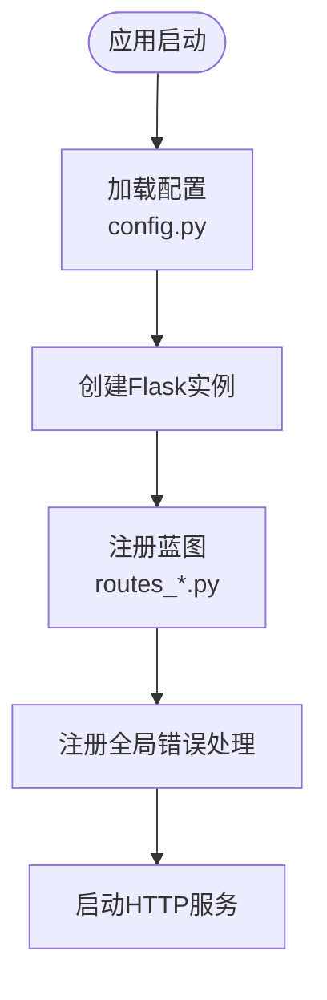

**图表来源**
- [app.py:1-120](file://server/app.py#L1-L120)
- [config.py:1-120](file://server/config.py#L1-L120)

**章节来源**
- [app.py:1-120](file://server/app.py#L1-L120)

### 页面路由（模板渲染）
- 职责：提供SPA布局、登录页、仪表盘、设置页、知识库、练习页等页面渲染。
- URL模式：通常以“/”或“/pages/*”为前缀，返回HTML模板。
- 权限：部分页面需登录态；未登录时重定向至登录页。

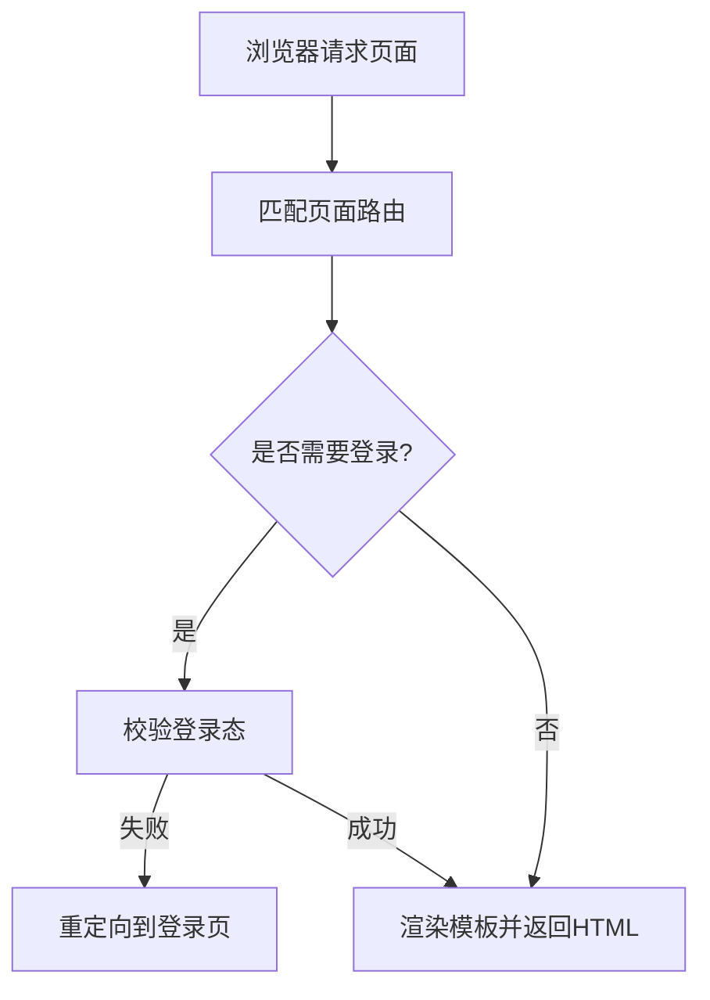

**图表来源**
- [routes_pages.py:1-120](file://server/routes_pages.py#L1-L120)
- [auth.py:1-120](file://server/auth.py#L1-L120)

**章节来源**
- [routes_pages.py:1-120](file://server/routes_pages.py#L1-L120)

### 笔记API（RESTful）
- 资源模型：笔记实体，典型操作包含列表、详情、创建、更新、删除。
- URL模式：建议采用“/api/v1/notes/*”，遵循REST语义。
- 方法规范：GET/POST/PUT/PATCH/DELETE对应CRUD。
- 参数验证：路径参数、查询参数、请求体字段校验；非法参数返回400。
- 响应格式：统一JSON结构，包含数据、状态码、消息与分页信息。

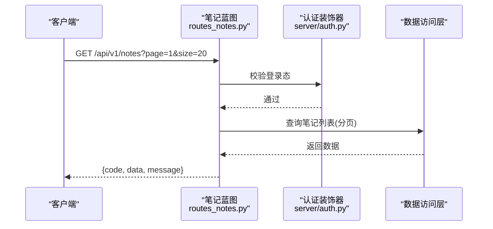

**图表来源**
- [routes_notes.py:1-120](file://server/routes_notes.py#L1-L120)
- [auth.py:1-120](file://server/auth.py#L1-L120)

**章节来源**
- [routes_notes.py:1-120](file://server/routes_notes.py#L1-L120)

### 知识管理API（RESTful）
- 资源模型：知识点、标签、关联关系等。
- URL模式：建议采用“/api/v1/knowledge/*”。
- 方法规范：与笔记API一致，强调资源语义与幂等性。
- 权限控制：仅管理员或授权用户可写；读接口可开放。

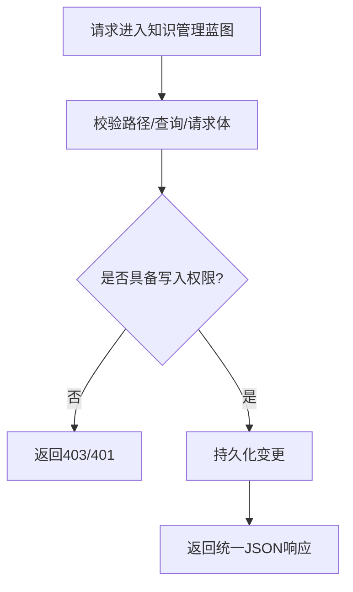

**图表来源**
- [routes_knowledge.py:1-120](file://server/routes_knowledge.py#L1-L120)
- [auth.py:1-120](file://server/auth.py#L1-L120)

**章节来源**
- [routes_knowledge.py:1-120](file://server/routes_knowledge.py#L1-L120)

### 桥接API（外部服务/流式处理）
- 职责：对接ASR、LLM、TTS等外部能力，可能涉及长连接、流式响应。
- URL模式：建议采用“/api/v1/bridge/*”，区分不同外部能力子路径。
- 特殊处理：超时、重试、断线恢复、进度回调、事件推送。

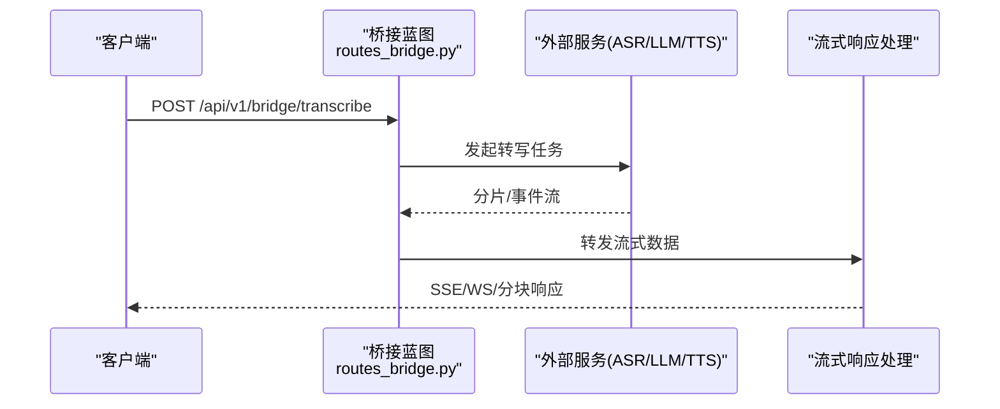

**图表来源**
- [routes_bridge.py:1-120](file://server/routes_bridge.py#L1-L120)

**章节来源**
- [routes_bridge.py:1-120](file://server/routes_bridge.py#L1-L120)

### 管理员API（权限敏感）
- 职责：系统配置、用户管理、审计日志、积分管理等。
- URL模式：建议采用“/api/v1/admin/*”。
- 权限控制：强校验管理员角色；记录审计日志；限制高危操作。

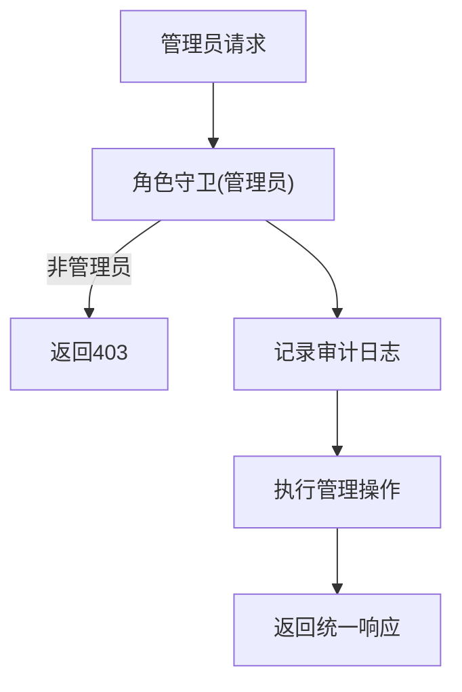

**图表来源**
- [routes_admin.py:1-120](file://server/routes_admin.py#L1-L120)
- [auth.py:1-120](file://server/auth.py#L1-L120)

**章节来源**
- [routes_admin.py:1-120](file://server/routes_admin.py#L1-L120)

### 积分/额度API（计费相关）
- 职责：查询与扣减积分、额度检查、账单记录。
- URL模式：建议采用“/api/v1/credits/*”。
- 一致性：事务保障、并发安全、幂等键防重。

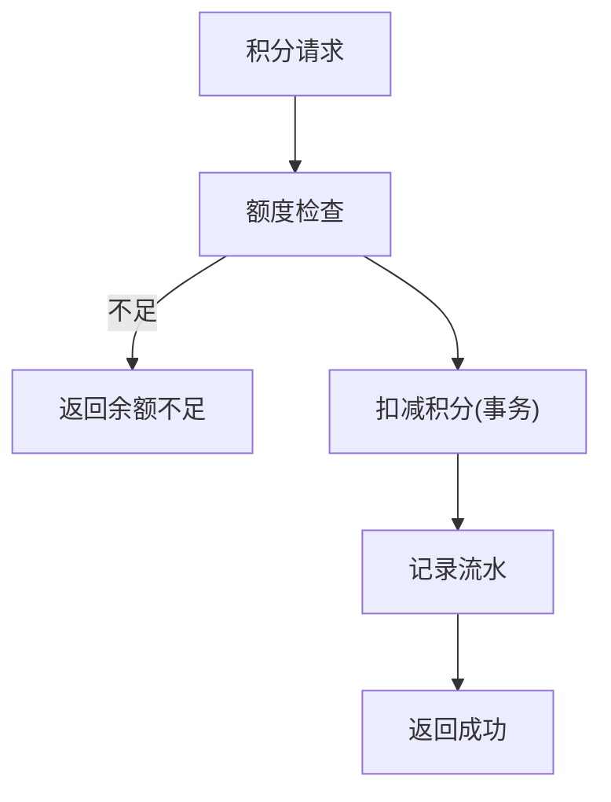

**图表来源**
- [routes_credits.py:1-120](file://server/routes_credits.py#L1-L120)

**章节来源**
- [routes_credits.py:1-120](file://server/routes_credits.py#L1-L120)

### 认证与权限控制
- 装饰器：提供登录态校验、角色校验、IP白名单等能力。
- 使用位置：所有受保护的API蓝图路由上。
- 行为：未通过则返回401/403；通过后注入当前用户上下文。

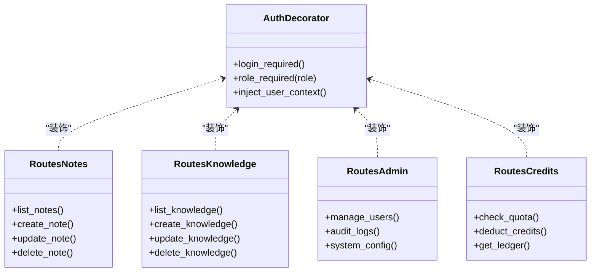

**图表来源**
- [auth.py:1-120](file://server/auth.py#L1-L120)
- [routes_notes.py:1-120](file://server/routes_notes.py#L1-L120)
- [routes_knowledge.py:1-120](file://server/routes_knowledge.py#L1-L120)
- [routes_admin.py:1-120](file://server/routes_admin.py#L1-L120)
- [routes_credits.py:1-120](file://server/routes_credits.py#L1-L120)

**章节来源**
- [auth.py:1-120](file://server/auth.py#L1-L120)

## 依赖关系分析
- 耦合度：路由模块之间低耦合，均通过应用入口注册蓝图；认证装饰器作为横切依赖被多模块复用。
- 外部依赖：数据库、缓存、第三方服务（ASR/LLM/TTS）通过服务层或桥接层接入，避免直接散落在路由中。
- 版本管理：URL前缀“/api/v1/*”承载版本；升级时新增“/api/v2/*”并保持向后兼容。

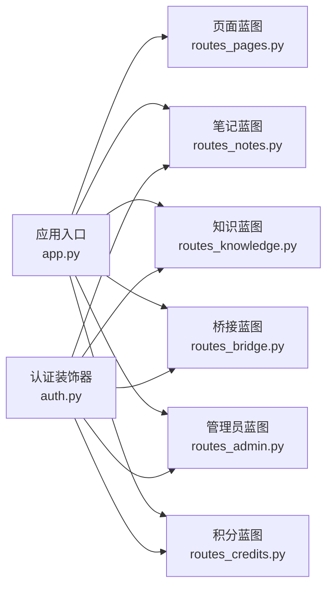

**图表来源**
- [app.py:1-120](file://server/app.py#L1-L120)
- [auth.py:1-120](file://server/auth.py#L1-L120)
- [routes_pages.py:1-120](file://server/routes_pages.py#L1-L120)
- [routes_notes.py:1-120](file://server/routes_notes.py#L1-L120)
- [routes_knowledge.py:1-120](file://server/routes_knowledge.py#L1-L120)
- [routes_bridge.py:1-120](file://server/routes_bridge.py#L1-L120)
- [routes_admin.py:1-120](file://server/routes_admin.py#L1-L120)
- [routes_credits.py:1-120](file://server/routes_credits.py#L1-L120)

**章节来源**
- [app.py:1-120](file://server/app.py#L1-L120)

## 性能考虑
- 路由匹配：保持URL层级扁平，减少正则匹配开销；优先使用静态前缀+短路径。
- 鉴权开销：将高频鉴权逻辑下沉到装饰器内部，避免重复计算。
- 流式处理：桥接接口采用流式响应，降低内存占用与首字节延迟。
- 分页与过滤：列表接口强制分页，避免全量拉取。
- 缓存：热点数据（如配置、字典表）引入缓存层，减轻数据库压力。

[本节为通用指导，不直接分析具体文件]

## 故障排查指南
- 常见错误分类：
  - 400 参数校验失败：检查路径/查询/请求体字段类型与必填项。
  - 401 未认证：确认Cookie/Token有效且已登录。
  - 403 无权限：检查角色与资源访问策略。
  - 404 路由不存在：核对URL前缀与蓝图注册。
  - 500 服务器错误：查看全局异常处理器日志与堆栈。
- 定位步骤：
  - 开启调试日志，捕获请求ID与关键参数。
  - 复现最小用例，逐步缩小范围至具体蓝图与装饰器。
  - 检查数据库/外部服务连通性与配额限制。

**章节来源**
- [app.py:1-120](file://server/app.py#L1-L120)
- [auth.py:1-120](file://server/auth.py#L1-L120)

## 结论
本项目通过蓝图拆分与装饰器鉴权实现了清晰、可扩展的路由架构。RESTful URL模式、统一的参数校验与响应格式提升了前后端协作效率。建议在后续迭代中：
- 完善API文档与自动化测试覆盖
- 引入限流、熔断与可观测性指标
- 持续优化流式接口与缓存策略

[本节为总结性内容，不直接分析具体文件]

## 附录

### RESTful API设计规范
- URL命名：名词复数形式，避免动词；使用路径参数表示资源标识。
- HTTP方法：GET读取、POST创建、PUT全量更新、PATCH增量更新、DELETE删除。
- 状态码：2xx成功、4xx客户端错误、5xx服务端错误。
- 版本管理：URL前缀“/api/vN/*”，弃用旧版本时保留过渡期。
- 分页：统一使用page/size或cursor参数。
- 排序与过滤：使用query参数，明确字段与方向。

[本节为通用规范，不直接分析具体文件]

### 请求参数验证与响应格式化
- 验证：路径参数、查询参数、请求体分别校验；失败返回400与错误明细。
- 响应：统一JSON结构，包含code、data、message、traceId等字段。
- 错误：全局异常处理器捕获并转换为标准错误响应。

**章节来源**
- [app.py:1-120](file://server/app.py#L1-L120)

### API文档生成与Swagger集成
- 方案：基于OpenAPI/Swagger自动生成文档，按蓝图分组。
- 集成：在应用入口注册文档视图，暴露/docs或/api-docs。
- 维护：在路由装饰器中添加注解，描述参数、响应与示例。

[本节为通用实践，不直接分析具体文件]

### 接口测试策略
- 单元测试：针对装饰器与工具函数。
- 集成测试：覆盖主要CRUD流程与权限分支。
- 端到端测试：模拟真实用户场景，包括登录、业务操作与退出。
- 契约测试：确保前后端接口契约稳定。

[本节为通用实践，不直接分析具体文件]