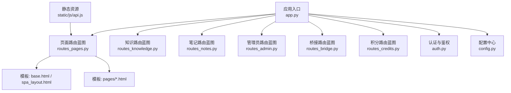
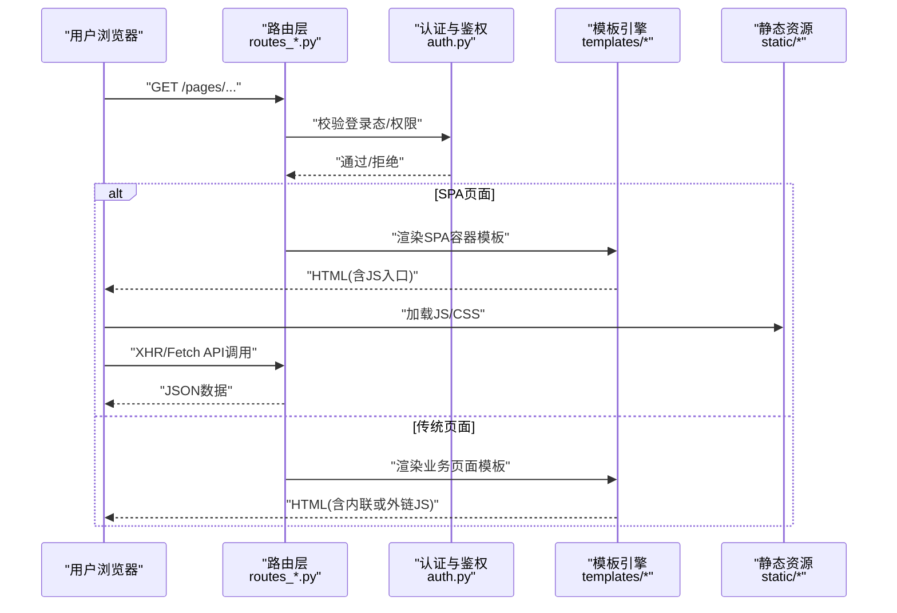
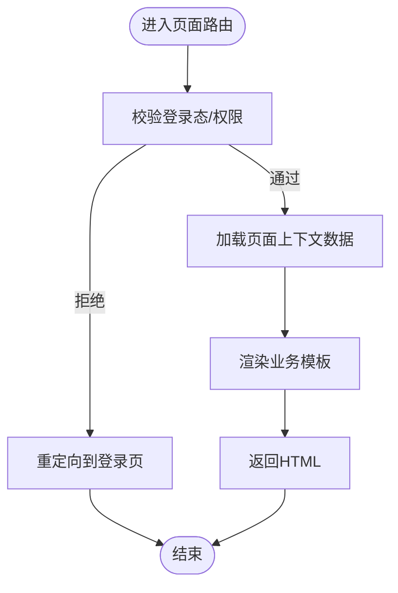
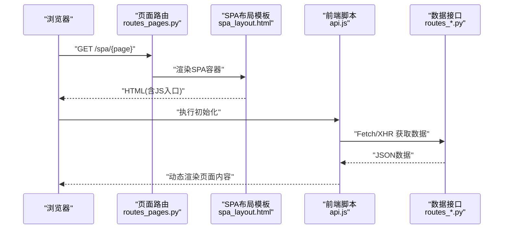
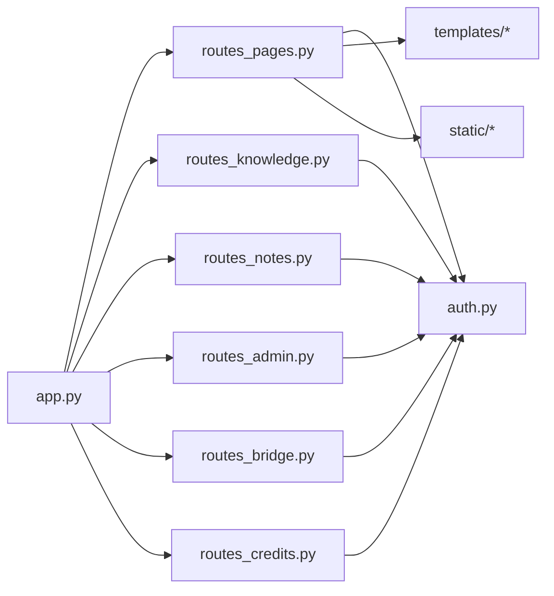

# 页面路由

<cite>
**本文引用的文件**   
- [app.py](file://server/app.py)
- [routes_pages.py](file://server/routes_pages.py)
- [routes_admin.py](file://server/routes_admin.py)
- [routes_bridge.py](file://server/routes_bridge.py)
- [routes_credits.py](file://server/routes_credits.py)
- [routes_knowledge.py](file://server/routes_knowledge.py)
- [routes_notes.py](file://server/routes_notes.py)
- [auth.py](file://server/auth.py)
- [config.py](file://server/config.py)
- [templates/base.html](file://server/templates/base.html)
- [templates/spa_layout.html](file://server/templates/spa_layout.html)
- [templates/spa/page.html](file://server/templates/spa/page.html)
- [templates/pages/dashboard.html](file://server/templates/pages/dashboard.html)
- [templates/pages/knowledge_base.html](file://server/templates/pages/knowledge_base.html)
- [static/js/api.js](file://server/static/js/api.js)
</cite>

## 目录
1. [简介](#简介)
2. [项目结构](#项目结构)
3. [核心组件](#核心组件)
4. [架构总览](#架构总览)
5. [详细组件分析](#详细组件分析)
6. [依赖关系分析](#依赖关系分析)
7. [性能与优化](#性能与优化)
8. [故障排查指南](#故障排查指南)
9. [结论](#结论)

## 简介
本文件面向LectureLearnLoop的“页面路由”模块，系统性说明以下主题：
- HTML模板渲染路由的设计模式（SPA页面、传统页面、静态资源）
- 页面权限控制机制与会话管理
- 页面缓存策略与加载优化
- 路由定义示例、URL映射规则与参数传递
- 页面中间件、请求拦截器与响应处理器实现要点
- 懒加载策略与性能监控方案

## 项目结构
本项目采用Flask后端组织路由与模板：
- 应用入口与全局配置在应用主文件中注册蓝图、中间件、错误处理等
- 路由按功能域拆分到多个蓝图文件（如页面、知识、笔记、管理员、桥接、积分等）
- 模板位于templates目录，包含基础布局、SPA布局与各业务页面
- 静态资源位于static目录，前端脚本通过API进行数据交互

图表来源
- [app.py](file://server/app.py)
- [routes_pages.py](file://server/routes_pages.py)
- [routes_knowledge.py](file://server/routes_knowledge.py)
- [routes_notes.py](file://server/routes_notes.py)
- [routes_admin.py](file://server/routes_admin.py)
- [routes_bridge.py](file://server/routes_bridge.py)
- [routes_credits.py](file://server/routes_credits.py)
- [auth.py](file://server/auth.py)
- [config.py](file://server/config.py)
- [templates/base.html](file://server/templates/base.html)
- [templates/spa_layout.html](file://server/templates/spa_layout.html)
- [static/js/api.js](file://server/static/js/api.js)

章节来源
- [app.py](file://server/app.py)
- [routes_pages.py](file://server/routes_pages.py)
- [templates/base.html](file://server/templates/base.html)
- [templates/spa_layout.html](file://server/templates/spa_layout.html)

## 核心组件
- 应用入口与蓝图注册：集中注册各功能域的路由蓝图，统一挂载前缀，便于权限与中间件切面管理
- 页面路由蓝图：负责HTML模板渲染、SPA页面容器、页面级权限校验与上下文注入
- 认证与鉴权：提供登录态检查、角色/权限判断、会话生命周期管理
- 配置中心：集中管理路由开关、缓存策略、日志级别、外部服务地址等
- 模板系统：基础布局与SPA布局分离，页面模板复用公共组件
- 静态资源与前端API：JS通过REST API获取数据，避免服务端直接返回大量JSON给模板

章节来源
- [app.py](file://server/app.py)
- [routes_pages.py](file://server/routes_pages.py)
- [auth.py](file://server/auth.py)
- [config.py](file://server/config.py)
- [templates/base.html](file://server/templates/base.html)
- [templates/spa_layout.html](file://server/templates/spa_layout.html)

## 架构总览
下图展示从浏览器到后端的请求路径，包括SPA与传统页面的差异、权限校验与模板渲染流程。

图表来源
- [routes_pages.py](file://server/routes_pages.py)
- [auth.py](file://server/auth.py)
- [templates/spa_layout.html](file://server/templates/spa_layout.html)
- [templates/base.html](file://server/templates/base.html)
- [static/js/api.js](file://server/static/js/api.js)

## 详细组件分析

### 页面路由蓝图（HTML模板渲染）
- 设计模式
  - 传统页面：直接渲染业务模板，适合首屏内容与服务端渲染
  - SPA页面：渲染一个轻量容器模板，实际内容由前端JS通过API动态加载
  - 静态资源：CSS/JS/图片等由静态目录托管，配合CDN或浏览器缓存
- URL映射规则
  - 页面类路由通常以/pages为前缀，便于权限与埋点统计
  - SPA容器路由指向统一的SPA布局模板
  - 业务页面路由指向具体模板文件
- 参数传递
  - 模板变量：通过视图函数将上下文对象传递给模板
  - URL参数：使用Flask路由参数语法传入ID、类型等
  - 查询参数：用于筛选、分页、排序等
- 权限控制
  - 对需要登录的页面增加登录态校验
  - 对管理页面增加角色/权限校验
- 缓存策略
  - 模板输出可结合HTTP缓存头（如ETag/Last-Modified）
  - 静态资源设置长期缓存，配合版本号或哈希文件名

章节来源
- [routes_pages.py](file://server/routes_pages.py)
- [templates/base.html](file://server/templates/base.html)
- [templates/spa_layout.html](file://server/templates/spa_layout.html)

#### 传统页面渲染流程

图表来源
- [routes_pages.py](file://server/routes_pages.py)
- [auth.py](file://server/auth.py)

#### SPA页面渲染流程

图表来源
- [routes_pages.py](file://server/routes_pages.py)
- [templates/spa_layout.html](file://server/templates/spa_layout.html)
- [static/js/api.js](file://server/static/js/api.js)

### 认证与会话管理
- 登录态检查：在访问受保护页面时校验会话中的用户标识
- 权限判断：基于用户角色或资源权限决定是否允许访问
- 会话生命周期：支持超时、刷新、登出清理
- 安全建议：敏感操作需二次确认；跨站请求防护；CSRF令牌

章节来源
- [auth.py](file://server/auth.py)

### 配置中心
- 路由开关：可按环境启用/禁用某些页面或API
- 缓存策略：控制模板与静态资源的缓存行为
- 日志与监控：记录访问日志、错误堆栈与性能指标
- 外部集成：LLM提供商、ASR/TTS服务、数据库连接等

章节来源
- [config.py](file://server/config.py)

### 模板系统与布局
- 基础布局：提供通用头部、侧边栏、底部、消息提示等
- SPA布局：提供单页应用的挂载点与全局状态容器
- 页面模板：按业务划分，复用公共组件，减少重复代码

章节来源
- [templates/base.html](file://server/templates/base.html)
- [templates/spa_layout.html](file://server/templates/spa_layout.html)

### 静态资源与前端API
- 静态资源：CSS/JS/字体/图片等由静态目录托管
- 前端API：统一封装请求方法、错误处理、重试与超时
- 缓存策略：利用浏览器缓存与版本化文件名提升加载速度

章节来源
- [static/js/api.js](file://server/static/js/api.js)

## 依赖关系分析
- 路由蓝图之间解耦，通过应用入口统一注册
- 认证模块被各路由蓝图依赖，形成横切关注点
- 模板与静态资源被路由蓝图引用，构成渲染链路
- 前端JS通过API与后端路由通信，实现前后端分离

图表来源
- [app.py](file://server/app.py)
- [routes_pages.py](file://server/routes_pages.py)
- [routes_knowledge.py](file://server/routes_knowledge.py)
- [routes_notes.py](file://server/routes_notes.py)
- [routes_admin.py](file://server/routes_admin.py)
- [routes_bridge.py](file://server/routes_bridge.py)
- [routes_credits.py](file://server/routes_credits.py)
- [auth.py](file://server/auth.py)
- [templates/base.html](file://server/templates/base.html)
- [templates/spa_layout.html](file://server/templates/spa_layout.html)
- [static/js/api.js](file://server/static/js/api.js)

章节来源
- [app.py](file://server/app.py)
- [routes_pages.py](file://server/routes_pages.py)
- [auth.py](file://server/auth.py)

## 性能与优化
- 页面加载优化
  - 首屏关键CSS/JS内联，非关键资源异步加载
  - 模板输出压缩与Gzip/Brotli压缩
  - 合理使用HTTP缓存头（Cache-Control, ETag, Last-Modified）
- 懒加载策略
  - SPA按需加载页面组件与数据
  - 图片与媒体资源延迟加载
  - 大列表分页与虚拟滚动
- 性能监控
  - 记录页面加载耗时、API响应时间
  - 错误率与异常堆栈上报
  - 关键业务指标埋点（如知识点掌握度、练习正确率）

[本节为通用指导，不直接分析具体文件]

## 故障排查指南
- 常见问题
  - 404未找到：检查路由前缀与蓝图注册是否正确
  - 401未授权：检查登录态与权限判断逻辑
  - 500服务器错误：查看日志与异常堆栈
  - 模板渲染失败：检查模板路径与变量传递
- 调试建议
  - 开启开发模式日志
  - 使用浏览器开发者工具检查网络请求与缓存
  - 逐步注释路由逻辑定位问题

章节来源
- [auth.py](file://server/auth.py)
- [routes_pages.py](file://server/routes_pages.py)

## 结论
LectureLearnLoop的页面路由模块通过蓝图拆分、模板渲染与静态资源托管，实现了传统页面与SPA的统一治理。认证与鉴权作为横切关注点贯穿所有路由，配置中心统一管理策略与开关。借助合理的缓存与懒加载策略，系统在可用性与性能之间取得平衡。建议在后续迭代中持续完善性能监控与错误上报，进一步提升用户体验与可维护性。