# 错误处理与日志

<cite>
**本文引用的文件**   
- [app.py](file://server/app.py)
- [logger_module.py](file://server/logger_module.py)
- [llm_call_logger.py](file://server/llm_call_logger.py)
- [llm_logger.py](file://server/llm_logger.py)
- [config.py](file://server/config.py)
- [routes_bridge.py](file://server/routes_bridge.py)
- [routes_knowledge.py](file://server/routes_knowledge.py)
- [routes_notes.py](file://server/routes_notes.py)
- [routes_admin.py](file://server/routes_admin.py)
- [routes_credits.py](file://server/routes_credits.py)
- [routes_pages.py](file://server/routes_pages.py)
- [error_slicer.py](file://server/services/error_slicer.py)
- [static/js/unified_logger.js](file://server/static/js/unified_logger.js)
</cite>

## 目录
1. [引言](#引言)
2. [项目结构](#项目结构)
3. [核心组件](#核心组件)
4. [架构总览](#架构总览)
5. [详细组件分析](#详细组件分析)
6. [依赖关系分析](#依赖关系分析)
7. [性能考虑](#性能考虑)
8. [故障排查指南](#故障排查指南)
9. [结论](#结论)

## 引言
本文件面向 LectureLearnLoop 的错误处理与日志系统，目标是帮助开发者快速理解全局异常处理机制、自定义错误类型、错误响应格式化、分层日志记录策略、日志级别管理、日志轮转配置、结构化日志格式、性能监控指标、业务日志追踪、日志分析工具、告警机制以及问题排查方法。文档在保持技术深度的同时，尽量用通俗语言解释关键概念，并配合图示说明数据流与调用链。

## 项目结构
本项目后端基于 Python Web 框架（Flask），错误处理与日志能力集中在以下位置：
- 应用入口与全局异常处理：server/app.py
- 日志模块封装与初始化：server/logger_module.py
- LLM 调用日志与结构化记录：server/llm_call_logger.py、server/llm_logger.py
- 配置项（含日志相关）：server/config.py
- 路由层统一错误捕获与返回：server/routes_*.py
- 错误切片与诊断辅助：server/services/error_slicer.py
- 前端统一日志采集：server/static/js/unified_logger.js

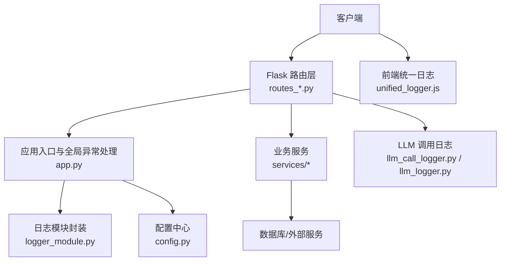

**图表来源**
- [app.py:1-200](file://server/app.py#L1-L200)
- [logger_module.py:1-200](file://server/logger_module.py#L1-L200)
- [llm_call_logger.py:1-200](file://server/llm_call_logger.py#L1-L200)
- [llm_logger.py:1-200](file://server/llm_logger.py#L1-L200)
- [config.py:1-200](file://server/config.py#L1-L200)
- [routes_bridge.py:1-200](file://server/routes_bridge.py#L1-L200)
- [routes_knowledge.py:1-200](file://server/routes_knowledge.py#L1-L200)
- [routes_notes.py:1-200](file://server/routes_notes.py#L1-L200)
- [routes_admin.py:1-200](file://server/routes_admin.py#L1-L200)
- [routes_credits.py:1-200](file://server/routes_credits.py#L1-L200)
- [routes_pages.py:1-200](file://server/routes_pages.py#L1-L200)
- [error_slicer.py:1-200](file://server/services/error_slicer.py#L1-L200)
- [static/js/unified_logger.js:1-200](file://server/static/js/unified_logger.js#L1-L200)

**章节来源**
- [app.py:1-200](file://server/app.py#L1-L200)
- [logger_module.py:1-200](file://server/logger_module.py#L1-L200)
- [config.py:1-200](file://server/config.py#L1-L200)

## 核心组件
- 全局异常处理器：在应用启动时注册，统一捕获未处理异常，转换为标准错误响应，避免泄露内部堆栈到客户端。
- 日志模块封装：提供统一的 logger 获取方式、基础配置（输出目标、格式、级别）、可选的日志轮转策略。
- LLM 调用日志：对大模型调用的输入、输出、耗时、状态码等做结构化记录，便于性能分析与审计。
- 路由层错误处理：在各路由中捕获业务异常，记录上下文信息，返回一致的错误响应结构。
- 错误切片工具：将长错误消息或堆栈进行分段，便于 UI 展示与检索。
- 前端统一日志：在前端收集控制台日志、网络请求失败、用户操作轨迹，并通过 API 上报。

**章节来源**
- [app.py:1-200](file://server/app.py#L1-L200)
- [logger_module.py:1-200](file://server/logger_module.py#L1-L200)
- [llm_call_logger.py:1-200](file://server/llm_call_logger.py#L1-L200)
- [llm_logger.py:1-200](file://server/llm_logger.py#L1-L200)
- [error_slicer.py:1-200](file://server/services/error_slicer.py#L1-L200)
- [static/js/unified_logger.js:1-200](file://server/static/js/unified_logger.js#L1-L200)

## 架构总览
下图展示了从请求进入、路由分发、业务处理、异常捕获、日志记录到响应返回的完整链路。

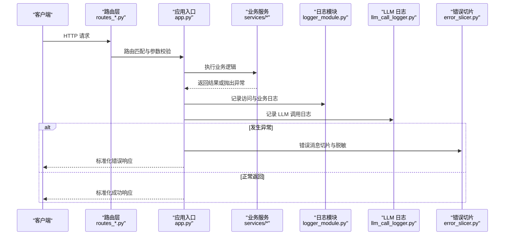

**图表来源**
- [app.py:1-200](file://server/app.py#L1-L200)
- [routes_bridge.py:1-200](file://server/routes_bridge.py#L1-L200)
- [routes_knowledge.py:1-200](file://server/routes_knowledge.py#L1-L200)
- [routes_notes.py:1-200](file://server/routes_notes.py#L1-L200)
- [routes_admin.py:1-200](file://server/routes_admin.py#L1-L200)
- [routes_credits.py:1-200](file://server/routes_credits.py#L1-L200)
- [routes_pages.py:1-200](file://server/routes_pages.py#L1-L200)
- [logger_module.py:1-200](file://server/logger_module.py#L1-L200)
- [llm_call_logger.py:1-200](file://server/llm_call_logger.py#L1-L200)
- [error_slicer.py:1-200](file://server/services/error_slicer.py#L1-L200)

## 详细组件分析

### 全局异常处理机制
- 作用范围：覆盖所有 Flask 路由与中间件抛出的未处理异常。
- 行为要点：
  - 捕获异常后记录结构化日志（包含请求 ID、路径、方法、用户标识、异常类型与简要信息）。
  - 根据异常类型映射为统一错误码与消息，避免暴露内部实现细节。
  - 返回标准 JSON 错误响应，包含 code、message、trace_id 等字段，便于前端与监控系统聚合。
- 调试支持：
  - 开发环境可开启详细堆栈输出到服务端日志，但不在响应体中返回。
  - 通过 trace_id 关联一次请求的全链路日志。

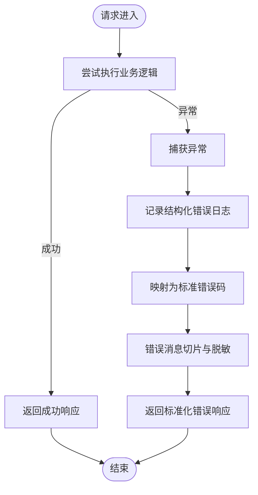

**图表来源**
- [app.py:1-200](file://server/app.py#L1-L200)
- [error_slicer.py:1-200](file://server/services/error_slicer.py#L1-L200)

**章节来源**
- [app.py:1-200](file://server/app.py#L1-L200)

### 自定义错误类型与错误响应格式化
- 自定义错误类型：
  - 定义一组业务异常类，用于区分参数错误、权限不足、资源不存在、第三方服务不可用等场景。
  - 每个异常携带错误码、可读消息与可选上下文字典。
- 错误响应格式化：
  - 统一响应结构包含：code、message、data、trace_id、timestamp。
  - 成功响应 data 字段承载业务数据；错误响应 data 可为空或包含最小化诊断信息。
  - 敏感字段（如密钥、令牌、用户隐私）在日志与响应中进行脱敏。

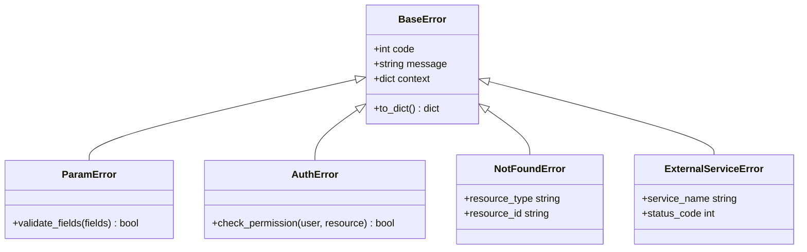

**图表来源**
- [app.py:1-200](file://server/app.py#L1-L200)

**章节来源**
- [app.py:1-200](file://server/app.py#L1-L200)

### 分层日志记录策略与日志级别管理
- 分层策略：
  - 访问日志：记录请求元数据（方法、路径、IP、User-Agent、耗时、状态码）。
  - 业务日志：记录关键业务流程节点（开始、结束、分支条件、关键变量摘要）。
  - 系统日志：记录基础设施事件（数据库连接、缓存命中、队列消费）。
  - 安全日志：记录认证、授权、越权尝试、敏感操作。
- 日志级别：
  - DEBUG：仅开发环境启用，包含详细上下文。
  - INFO：生产默认级别，记录关键流程与统计。
  - WARNING：潜在风险与降级行为。
  - ERROR：错误与异常，附带 trace_id。
  - CRITICAL：严重错误，触发告警。
- 输出目标：
  - 控制台（开发）与文件（生产），可按模块或级别拆分。
  - 可选接入集中式日志平台（如 ELK、云日志服务）。

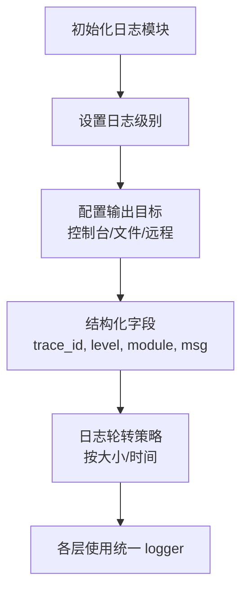

**图表来源**
- [logger_module.py:1-200](file://server/logger_module.py#L1-L200)
- [config.py:1-200](file://server/config.py#L1-L200)

**章节来源**
- [logger_module.py:1-200](file://server/logger_module.py#L1-L200)
- [config.py:1-200](file://server/config.py#L1-L200)

### 结构化日志格式与性能监控指标
- 结构化字段建议：
  - 通用：trace_id、span_id、level、module、ts、msg
  - 请求：method、path、ip、user_id、ua、latency_ms、status_code
  - 业务：action、entity_type、entity_id、result、extra
  - 外部：provider、model、tokens_in、tokens_out、cost_ms、status
- 性能指标：
  - 接口耗时分布（P50/P90/P99）
  - 错误率与错误分类占比
  - LLM 调用成功率、平均耗时、Token 用量
  - 资源使用（CPU、内存、磁盘 I/O）

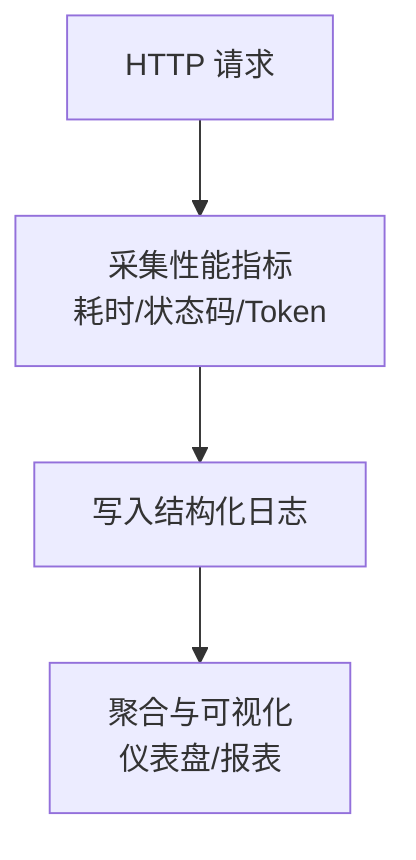

**图表来源**
- [llm_call_logger.py:1-200](file://server/llm_call_logger.py#L1-L200)
- [llm_logger.py:1-200](file://server/llm_logger.py#L1-L200)

**章节来源**
- [llm_call_logger.py:1-200](file://server/llm_call_logger.py#L1-L200)
- [llm_logger.py:1-200](file://server/llm_logger.py#L1-L200)

### 业务日志追踪与 LLM 调用日志
- 业务追踪：
  - 每次请求生成 trace_id，贯穿路由、服务、数据库与外部调用。
  - 关键业务动作打点，便于还原用户旅程与定位瓶颈。
- LLM 调用日志：
  - 记录请求参数摘要、模型名称、输入/输出 Token 数、耗时、状态码、重试次数。
  - 对敏感内容（Prompt/Response）进行脱敏或采样存储。
  - 结合错误码与超时阈值，自动标记不稳定调用。

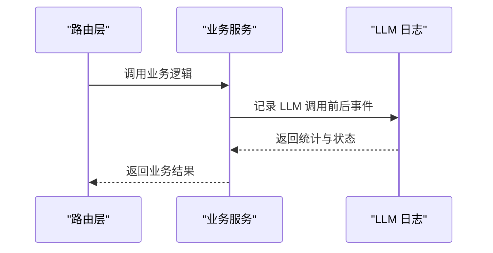

**图表来源**
- [llm_call_logger.py:1-200](file://server/llm_call_logger.py#L1-L200)
- [llm_logger.py:1-200](file://server/llm_logger.py#L1-L200)

**章节来源**
- [llm_call_logger.py:1-200](file://server/llm_call_logger.py#L1-L200)
- [llm_logger.py:1-200](file://server/llm_logger.py#L1-L200)

### 错误捕获示例与异常传播机制
- 路由层捕获：
  - 在每个路由函数内捕获业务异常，记录上下文并返回统一错误响应。
  - 对于可恢复错误（如临时网络抖动），进行有限次重试与退避。
- 异常传播：
  - 低层服务抛出具体异常，由上层统一转换与记录。
  - 未捕获异常由全局异常处理器接管，确保系统稳定性。

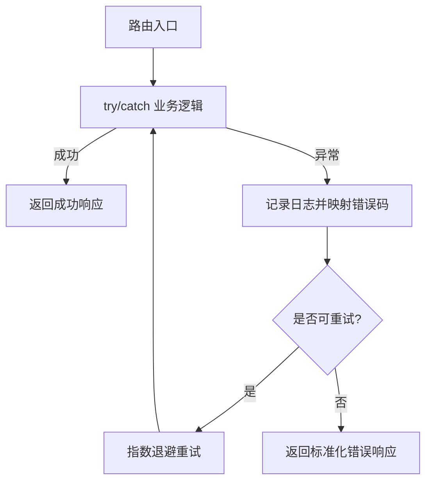

**图表来源**
- [routes_bridge.py:1-200](file://server/routes_bridge.py#L1-L200)
- [routes_knowledge.py:1-200](file://server/routes_knowledge.py#L1-L200)
- [routes_notes.py:1-200](file://server/routes_notes.py#L1-L200)
- [routes_admin.py:1-200](file://server/routes_admin.py#L1-L200)
- [routes_credits.py:1-200](file://server/routes_credits.py#L1-L200)
- [routes_pages.py:1-200](file://server/routes_pages.py#L1-L200)

**章节来源**
- [routes_bridge.py:1-200](file://server/routes_bridge.py#L1-L200)
- [routes_knowledge.py:1-200](file://server/routes_knowledge.py#L1-L200)
- [routes_notes.py:1-200](file://server/routes_notes.py#L1-L200)
- [routes_admin.py:1-200](file://server/routes_admin.py#L1-L200)
- [routes_credits.py:1-200](file://server/routes_credits.py#L1-L200)
- [routes_pages.py:1-200](file://server/routes_pages.py#L1-L200)

### 日志轮转配置
- 轮转策略：
  - 按文件大小轮转：单文件超过阈值自动切割，保留 N 个历史文件。
  - 按时间轮转：按天/小时切割，便于归档与分析。
- 压缩与清理：
  - 历史日志可压缩为归档文件，定期清理过期数据。
- 多模块隔离：
  - 不同模块或功能域可独立日志文件，降低交叉干扰。

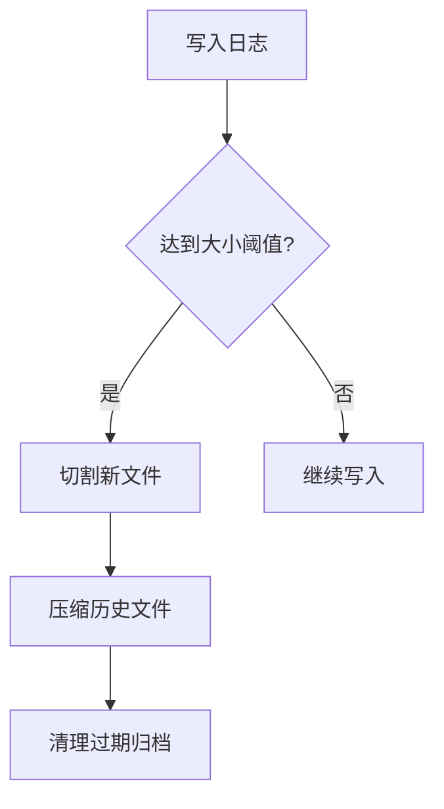

**图表来源**
- [logger_module.py:1-200](file://server/logger_module.py#L1-L200)
- [config.py:1-200](file://server/config.py#L1-L200)

**章节来源**
- [logger_module.py:1-200](file://server/logger_module.py#L1-L200)
- [config.py:1-200](file://server/config.py#L1-L200)

### 前端统一日志采集
- 采集范围：
  - 控制台日志（console.log/warn/error）
  - 网络请求失败与超时
  - 用户交互轨迹（页面跳转、表单提交、按钮点击）
- 上报策略：
  - 批量上报，限制频率与大小，避免影响用户体验。
  - 包含设备信息、浏览器版本、页面 URL、trace_id。
- 与后端联动：
  - 通过 API 上报日志，后端统一落盘并关联 trace_id。

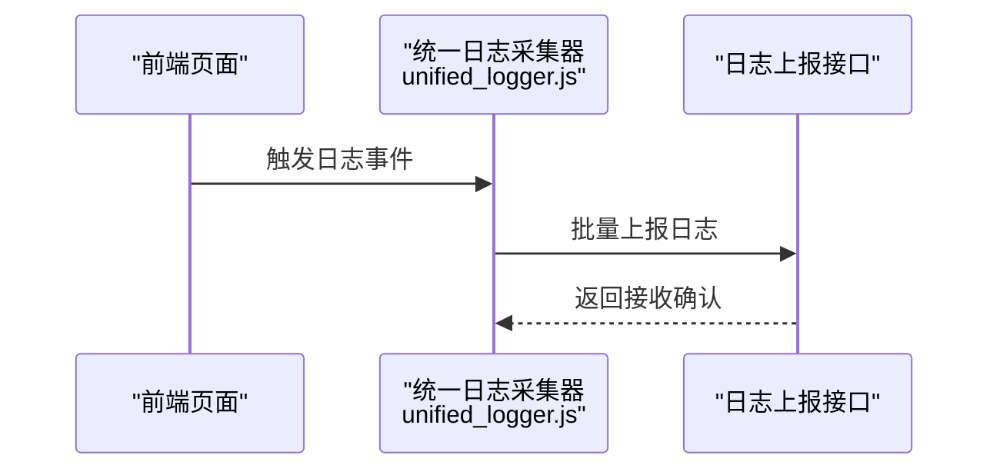

**图表来源**
- [static/js/unified_logger.js:1-200](file://server/static/js/unified_logger.js#L1-L200)

**章节来源**
- [static/js/unified_logger.js:1-200](file://server/static/js/unified_logger.js#L1-L200)

## 依赖关系分析
- 模块耦合：
  - app.py 依赖 logger_module.py 与 config.py，负责全局异常处理与日志初始化。
  - routes_*.py 依赖 logger_module.py 与自定义错误类型，负责业务异常捕获与响应格式化。
  - llm_call_logger.py 与 llm_logger.py 提供 LLM 调用日志能力，被业务服务调用。
  - error_slicer.py 被全局异常处理器与路由层使用，用于错误消息切片与脱敏。
- 外部依赖：
  - 日志可能输出到文件系统或远程日志平台。
  - LLM 调用依赖外部模型提供商，需记录状态码与耗时。

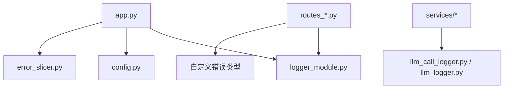

**图表来源**
- [app.py:1-200](file://server/app.py#L1-L200)
- [logger_module.py:1-200](file://server/logger_module.py#L1-L200)
- [config.py:1-200](file://server/config.py#L1-L200)
- [routes_bridge.py:1-200](file://server/routes_bridge.py#L1-L200)
- [routes_knowledge.py:1-200](file://server/routes_knowledge.py#L1-L200)
- [routes_notes.py:1-200](file://server/routes_notes.py#L1-L200)
- [routes_admin.py:1-200](file://server/routes_admin.py#L1-L200)
- [routes_credits.py:1-200](file://server/routes_credits.py#L1-L200)
- [routes_pages.py:1-200](file://server/routes_pages.py#L1-L200)
- [llm_call_logger.py:1-200](file://server/llm_call_logger.py#L1-L200)
- [llm_logger.py:1-200](file://server/llm_logger.py#L1-L200)
- [error_slicer.py:1-200](file://server/services/error_slicer.py#L1-L200)

**章节来源**
- [app.py:1-200](file://server/app.py#L1-L200)
- [logger_module.py:1-200](file://server/logger_module.py#L1-L200)
- [config.py:1-200](file://server/config.py#L1-L200)
- [routes_bridge.py:1-200](file://server/routes_bridge.py#L1-L200)
- [routes_knowledge.py:1-200](file://server/routes_knowledge.py#L1-L200)
- [routes_notes.py:1-200](file://server/routes_notes.py#L1-L200)
- [routes_admin.py:1-200](file://server/routes_admin.py#L1-L200)
- [routes_credits.py:1-200](file://server/routes_credits.py#L1-L200)
- [routes_pages.py:1-200](file://server/routes_pages.py#L1-L200)
- [llm_call_logger.py:1-200](file://server/llm_call_logger.py#L1-L200)
- [llm_logger.py:1-200](file://server/llm_logger.py#L1-L200)
- [error_slicer.py:1-200](file://server/services/error_slicer.py#L1-L200)

## 性能考虑
- 日志开销控制：
  - 在生产环境关闭 DEBUG 级别日志，减少 I/O 压力。
  - 对高频日志进行采样或合并，避免日志风暴。
- 异步写入：
  - 日志写入采用异步队列，降低主线程阻塞。
- 指标采集：
  - 使用轻量级计数器与直方图记录关键指标，避免引入重型监控库。
- LLM 调用优化：
  - 合理设置超时与重试策略，避免雪崩。
  - 对热点模型与 Prompt 进行缓存与复用。

[本节为通用指导，不直接分析具体文件]

## 故障排查指南
- 快速定位：
  - 通过 trace_id 在日志系统中检索全链路日志。
  - 关注 ERROR 与 CRITICAL 级别日志，结合 status_code 与错误码分类。
- 常见问题：
  - 参数校验失败：检查 ParamError 相关日志与前端表单校验。
  - 权限不足：检查 AuthError 与用户角色配置。
  - 资源不存在：检查 NotFoundError 与数据一致性。
  - 外部服务不可用：检查 ExternalServiceError 与网络连通性。
- 调试技巧：
  - 在本地开启 DEBUG 日志，复现问题并抓取详细堆栈。
  - 使用错误切片工具查看长错误消息的关键片段。
  - 结合前端 unified_logger.js 上报的日志，还原用户操作路径。

**章节来源**
- [error_slicer.py:1-200](file://server/services/error_slicer.py#L1-L200)
- [static/js/unified_logger.js:1-200](file://server/static/js/unified_logger.js#L1-L200)

## 结论
LectureLearnLoop 的错误处理与日志体系以“统一入口、分层记录、结构化输出、可观测性优先”为原则，构建了从前端到后端、从业务到基础设施的全链路可观测能力。通过全局异常处理、自定义错误类型、标准化响应、分层日志与 LLM 调用日志，系统在稳定性、可维护性与可诊断性方面得到显著提升。建议在生产环境中持续优化日志采样与指标采集策略，并结合集中式日志平台与告警机制，进一步提升问题发现与处置效率。