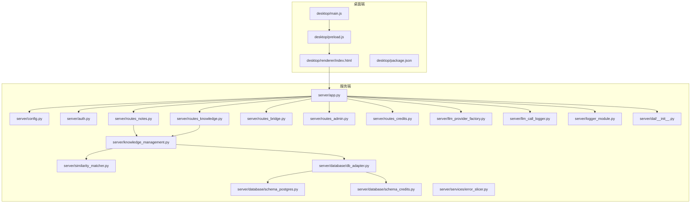
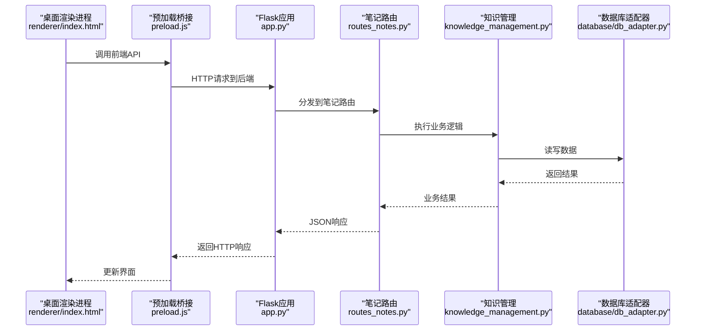
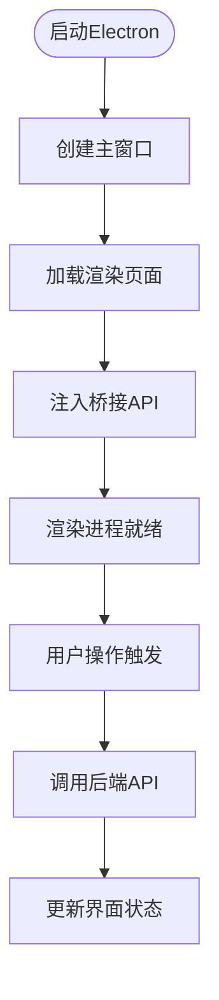
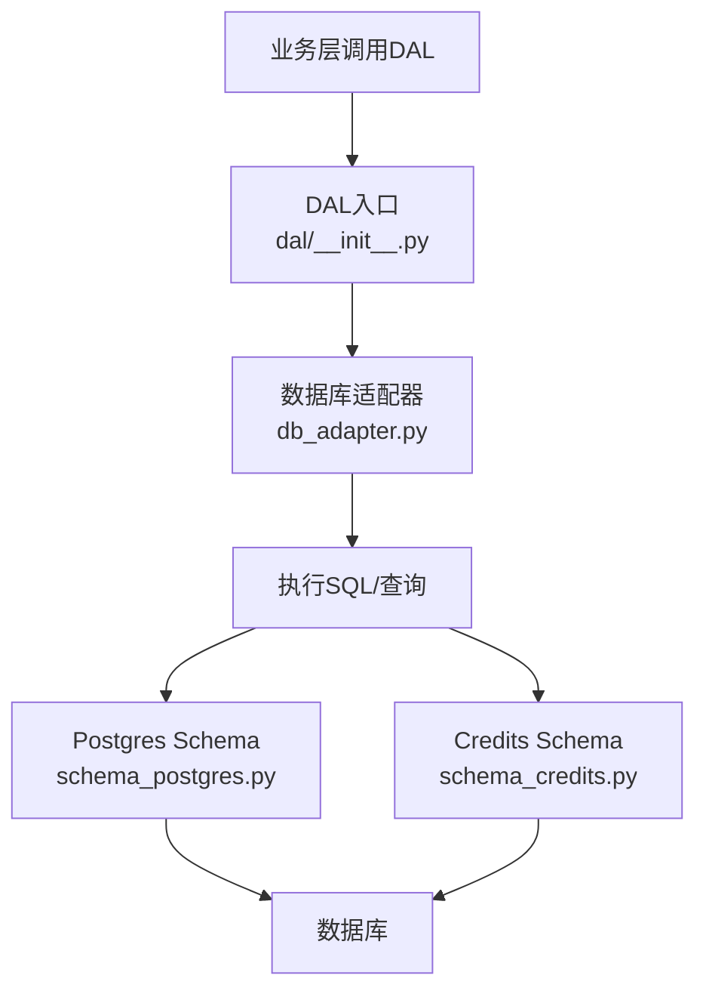
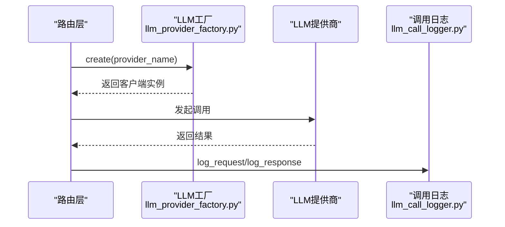
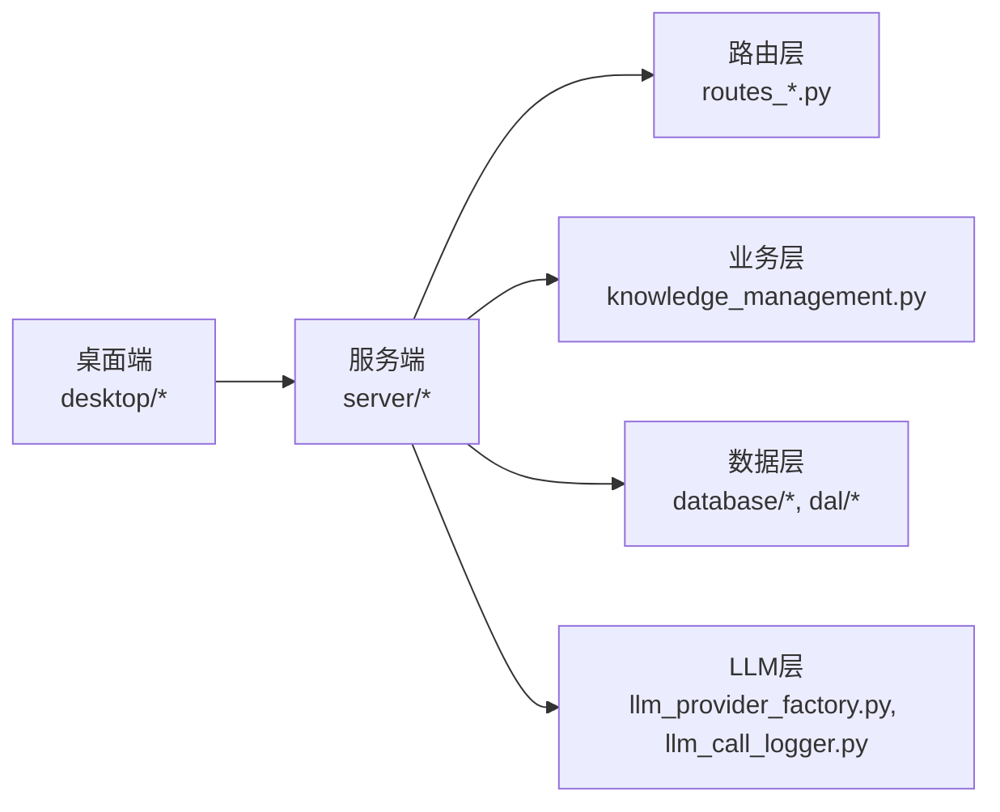

# 开发指南

<cite>
**本文引用的文件**   
- [start_app.ps1](file://start_app.ps1)
- [AGENTS.md](file://AGENTS.md)
- [server/app.py](file://server/app.py)
- [server/config.py](file://server/config.py)
- [server/auth.py](file://server/auth.py)
- [server/routes_notes.py](file://server/routes_notes.py)
- [server/routes_knowledge.py](file://server/routes_knowledge.py)
- [server/routes_bridge.py](file://server/routes_bridge.py)
- [server/routes_admin.py](file://server/routes_admin.py)
- [server/routes_credits.py](file://server/routes_credits.py)
- [server/knowledge_management.py](file://server/knowledge_management.py)
- [server/similarity_matcher.py](file://server/similarity_matcher.py)
- [server/llm_provider_factory.py](file://server/llm_provider_factory.py)
- [server/llm_call_logger.py](file://server/llm_call_logger.py)
- [server/logger_module.py](file://server/logger_module.py)
- [server/dal/__init__.py](file://server/dal/__init__.py)
- [server/database/db_adapter.py](file://server/database/db_adapter.py)
- [server/database/schema_postgres.py](file://server/database/schema_postgres.py)
- [server/database/schema_credits.py](file://server/database/schema_credits.py)
- [server/services/error_slicer.py](file://server/services/error_slicer.py)
- [desktop/main.js](file://desktop/main.js)
- [desktop/preload.js](file://desktop/preload.js)
- [desktop/renderer/index.html](file://desktop/renderer/index.html)
- [desktop/package.json](file://desktop/package.json)
- [tools/node/package.json](file://tools/node/package.json)
</cite>

## 目录
1. [简介](#简介)
2. [项目结构](#项目结构)
3. [核心组件](#核心组件)
4. [架构总览](#架构总览)
5. [详细组件分析](#详细组件分析)
6. [依赖关系分析](#依赖关系分析)
7. [性能考虑](#性能考虑)
8. [故障排查指南](#故障排查指南)
9. [结论](#结论)
10. [附录](#附录)

## 简介
本指南面向LectureLearnLoop项目的开发者，覆盖开发环境搭建、代码规范、调试技巧与贡献流程。文档基于仓库现有结构与实现进行说明，帮助你在本地快速运行应用、理解前后端职责边界、定位问题并安全地提交变更。

## 项目结构
项目采用“桌面客户端 + Web后端 + 模板与静态资源”的分层组织方式：
- desktop：Electron桌面应用入口、预加载脚本与渲染页面
- server：Python后端服务，包含路由、业务逻辑、数据库适配、LLM调用与日志
- docs：业务规则、计划、测试与掉坑笔记等文档
- tools：辅助工具（Node侧）

图表来源
- [desktop/main.js:1-200](file://desktop/main.js#L1-L200)
- [desktop/preload.js:1-200](file://desktop/preload.js#L1-L200)
- [desktop/renderer/index.html:1-200](file://desktop/renderer/index.html#L1-L200)
- [server/app.py:1-200](file://server/app.py#L1-L200)
- [server/config.py:1-200](file://server/config.py#L1-L200)
- [server/auth.py:1-200](file://server/auth.py#L1-L200)
- [server/routes_notes.py:1-200](file://server/routes_notes.py#L1-L200)
- [server/routes_knowledge.py:1-200](file://server/routes_knowledge.py#L1-L200)
- [server/routes_bridge.py:1-200](file://server/routes_bridge.py#L1-L200)
- [server/routes_admin.py:1-200](file://server/routes_admin.py#L1-L200)
- [server/routes_credits.py:1-200](file://server/routes_credits.py#L1-L200)
- [server/knowledge_management.py:1-200](file://server/knowledge_management.py#L1-L200)
- [server/similarity_matcher.py:1-200](file://server/similarity_matcher.py#L1-L200)
- [server/llm_provider_factory.py:1-200](file://server/llm_provider_factory.py#L1-L200)
- [server/llm_call_logger.py:1-200](file://server/llm_call_logger.py#L1-L200)
- [server/logger_module.py:1-200](file://server/logger_module.py#L1-L200)
- [server/dal/__init__.py:1-200](file://server/dal/__init__.py#L1-L200)
- [server/database/db_adapter.py:1-200](file://server/database/db_adapter.py#L1-L200)
- [server/database/schema_postgres.py:1-200](file://server/database/schema_postgres.py#L1-L200)
- [server/database/schema_credits.py:1-200](file://server/database/schema_credits.py#L1-L200)
- [server/services/error_slicer.py:1-200](file://server/services/error_slicer.py#L1-L200)

章节来源
- [start_app.ps1:1-200](file://start_app.ps1#L1-L200)
- [desktop/package.json:1-200](file://desktop/package.json#L1-L200)
- [tools/node/package.json:1-200](file://tools/node/package.json#L1-L200)

## 核心组件
- 桌面客户端（Electron）
  - main进程负责窗口与生命周期管理
  - preload注入桥接API供渲染进程使用
  - renderer为前端页面入口
- 后端服务（Flask）
  - app.py统一注册路由、中间件与配置
  - config.py集中管理配置项
  - auth.py处理认证相关逻辑
  - routes_*模块按领域拆分接口
  - knowledge_management.py与similarity_matcher.py提供知识管理与相似度匹配能力
  - llm_provider_factory.py与llm_call_logger.py封装LLM调用与调用日志
  - database/*与dal/*提供数据访问抽象与Postgres/Credits相关Schema
  - services/error_slicer.py提供错误切片等通用服务
  - logger_module.py统一日志输出

章节来源
- [server/app.py:1-200](file://server/app.py#L1-L200)
- [server/config.py:1-200](file://server/config.py#L1-L200)
- [server/auth.py:1-200](file://server/auth.py#L1-L200)
- [server/routes_notes.py:1-200](file://server/routes_notes.py#L1-L200)
- [server/routes_knowledge.py:1-200](file://server/routes_knowledge.py#L1-L200)
- [server/routes_bridge.py:1-200](file://server/routes_bridge.py#L1-L200)
- [server/routes_admin.py:1-200](file://server/routes_admin.py#L1-L200)
- [server/routes_credits.py:1-200](file://server/routes_credits.py#L1-L200)
- [server/knowledge_management.py:1-200](file://server/knowledge_management.py#L1-L200)
- [server/similarity_matcher.py:1-200](file://server/similarity_matcher.py#L1-L200)
- [server/llm_provider_factory.py:1-200](file://server/llm_provider_factory.py#L1-L200)
- [server/llm_call_logger.py:1-200](file://server/llm_call_logger.py#L1-L200)
- [server/logger_module.py:1-200](file://server/logger_module.py#L1-L200)
- [server/dal/__init__.py:1-200](file://server/dal/__init__.py#L1-L200)
- [server/database/db_adapter.py:1-200](file://server/database/db_adapter.py#L1-L200)
- [server/database/schema_postgres.py:1-200](file://server/database/schema_postgres.py#L1-L200)
- [server/database/schema_credits.py:1-200](file://server/database/schema_credits.py#L1-L200)
- [server/services/error_slicer.py:1-200](file://server/services/error_slicer.py#L1-L200)

## 架构总览
系统由三层组成：
- 桌面端：Electron主进程与渲染进程，负责UI交互与本地能力桥接
- 服务端：Flask应用，承载Web API、模板渲染与业务逻辑
- 数据层：通过db_adapter统一访问数据库，按Schema管理表结构

图表来源
- [desktop/renderer/index.html:1-200](file://desktop/renderer/index.html#L1-L200)
- [desktop/preload.js:1-200](file://desktop/preload.js#L1-L200)
- [server/app.py:1-200](file://server/app.py#L1-L200)
- [server/routes_notes.py:1-200](file://server/routes_notes.py#L1-L200)
- [server/knowledge_management.py:1-200](file://server/knowledge_management.py#L1-L200)
- [server/database/db_adapter.py:1-200](file://server/database/db_adapter.py#L1-L200)

## 详细组件分析

### 桌面客户端（Electron）
- main.js：主进程入口，创建窗口、加载页面、处理进程间通信
- preload.js：在渲染进程上下文注入安全API，屏蔽直接访问Node能力
- index.html：渲染进程页面入口，承载前端逻辑与视图

图表来源
- [desktop/main.js:1-200](file://desktop/main.js#L1-L200)
- [desktop/preload.js:1-200](file://desktop/preload.js#L1-L200)
- [desktop/renderer/index.html:1-200](file://desktop/renderer/index.html#L1-L200)

章节来源
- [desktop/main.js:1-200](file://desktop/main.js#L1-L200)
- [desktop/preload.js:1-200](file://desktop/preload.js#L1-L200)
- [desktop/renderer/index.html:1-200](file://desktop/renderer/index.html#L1-L200)

### 后端服务（Flask）
- app.py：应用初始化、蓝图注册、全局中间件与异常处理
- config.py：集中读取环境变量与配置文件
- auth.py：鉴权与权限控制
- routes_*：按领域划分的路由模块，如笔记、知识、桥接、管理员、积分等
- knowledge_management.py：知识实体管理、关联与检索
- similarity_matcher.py：文本相似度计算与匹配策略
- llm_provider_factory.py：LLM提供商工厂，统一接入不同模型服务
- llm_call_logger.py：记录LLM调用详情，便于审计与排错
- logger_module.py：统一日志门面

```mermaid
classDiagram
class FlaskApp {
+register_routes()
+configure_logging()
+handle_exceptions()
}
class Config {
+get(key, default)
+validate_env()
}
class Auth {
+authenticate(request)
+authorize(user, resource)
}
class NotesRoutes {
+list_notes()
+create_note()
+update_note()
+delete_note()
}
class KnowledgeManagement {
+upsert_knowledge()
+search_knowledge()
+link_to_note()
}
class SimilarityMatcher {
+match(text_a, text_b)
+batch_match(list_a, list_b)
}
class LLMProviderFactory {
+create(provider_name)
}
class LLMCallLogger {
+log_request()
+log_response()
}
class DBAdapter {
+execute(sql, params)
+query(sql, params)
+transaction(cb)
}
FlaskApp --> Config : "读取配置"
FlaskApp --> Auth : "鉴权"
FlaskApp --> NotesRoutes : "注册路由"
NotesRoutes --> KnowledgeManagement : "业务调用"
KnowledgeManagement --> SimilarityMatcher : "相似度匹配"
KnowledgeManagement --> DBAdapter : "数据访问"
FlaskApp --> LLMProviderFactory : "创建LLM客户端"
FlaskApp --> LLMCallLogger : "记录调用"
```

图表来源
- [server/app.py:1-200](file://server/app.py#L1-L200)
- [server/config.py:1-200](file://server/config.py#L1-L200)
- [server/auth.py:1-200](file://server/auth.py#L1-L200)
- [server/routes_notes.py:1-200](file://server/routes_notes.py#L1-L200)
- [server/knowledge_management.py:1-200](file://server/knowledge_management.py#L1-L200)
- [server/similarity_matcher.py:1-200](file://server/similarity_matcher.py#L1-L200)
- [server/llm_provider_factory.py:1-200](file://server/llm_provider_factory.py#L1-L200)
- [server/llm_call_logger.py:1-200](file://server/llm_call_logger.py#L1-L200)
- [server/database/db_adapter.py:1-200](file://server/database/db_adapter.py#L1-L200)

章节来源
- [server/app.py:1-200](file://server/app.py#L1-L200)
- [server/config.py:1-200](file://server/config.py#L1-L200)
- [server/auth.py:1-200](file://server/auth.py#L1-L200)
- [server/routes_notes.py:1-200](file://server/routes_notes.py#L1-L200)
- [server/knowledge_management.py:1-200](file://server/knowledge_management.py#L1-L200)
- [server/similarity_matcher.py:1-200](file://server/similarity_matcher.py#L1-L200)
- [server/llm_provider_factory.py:1-200](file://server/llm_provider_factory.py#L1-L200)
- [server/llm_call_logger.py:1-200](file://server/llm_call_logger.py#L1-L200)
- [server/database/db_adapter.py:1-200](file://server/database/db_adapter.py#L1-L200)

### 数据层与数据库
- db_adapter.py：统一数据库连接、执行SQL与事务管理
- schema_postgres.py：PostgreSQL相关表结构定义
- schema_credits.py：积分相关表结构定义
- dal/__init__.py：DAL层入口，暴露统一数据访问接口

图表来源
- [server/dal/__init__.py:1-200](file://server/dal/__init__.py#L1-L200)
- [server/database/db_adapter.py:1-200](file://server/database/db_adapter.py#L1-L200)
- [server/database/schema_postgres.py:1-200](file://server/database/schema_postgres.py#L1-L200)
- [server/database/schema_credits.py:1-200](file://server/database/schema_credits.py#L1-L200)

章节来源
- [server/dal/__init__.py:1-200](file://server/dal/__init__.py#L1-L200)
- [server/database/db_adapter.py:1-200](file://server/database/db_adapter.py#L1-L200)
- [server/database/schema_postgres.py:1-200](file://server/database/schema_postgres.py#L1-L200)
- [server/database/schema_credits.py:1-200](file://server/database/schema_credits.py#L1-L200)

### LLM调用与日志
- llm_provider_factory.py：根据配置选择具体LLM提供商并创建客户端
- llm_call_logger.py：记录请求参数、响应内容与耗时，便于追踪与审计

图表来源
- [server/llm_provider_factory.py:1-200](file://server/llm_provider_factory.py#L1-L200)
- [server/llm_call_logger.py:1-200](file://server/llm_call_logger.py#L1-L200)

章节来源
- [server/llm_provider_factory.py:1-200](file://server/llm_provider_factory.py#L1-L200)
- [server/llm_call_logger.py:1-200](file://server/llm_call_logger.py#L1-L200)

## 依赖关系分析
- 桌面端依赖Electron运行时与Node模块
- 服务端依赖Flask生态与数据库驱动
- 各路由模块依赖业务层与数据层，避免跨层耦合

图表来源
- [desktop/package.json:1-200](file://desktop/package.json#L1-L200)
- [server/app.py:1-200](file://server/app.py#L1-L200)
- [server/routes_notes.py:1-200](file://server/routes_notes.py#L1-L200)
- [server/knowledge_management.py:1-200](file://server/knowledge_management.py#L1-L200)
- [server/database/db_adapter.py:1-200](file://server/database/db_adapter.py#L1-L200)
- [server/llm_provider_factory.py:1-200](file://server/llm_provider_factory.py#L1-L200)

章节来源
- [desktop/package.json:1-200](file://desktop/package.json#L1-L200)
- [tools/node/package.json:1-200](file://tools/node/package.json#L1-L200)
- [server/app.py:1-200](file://server/app.py#L1-L200)

## 性能考虑
- 数据库访问
  - 使用db_adapter的事务接口减少多次往返
  - 对热点查询建立索引，避免全表扫描
- LLM调用
  - 合理缓存相似内容，减少重复调用
  - 使用llm_call_logger记录耗时，识别慢调用路径
- 前端渲染
  - 避免频繁DOM操作，批量更新UI
  - 合理使用preload桥接，减少IPC开销
- 日志与监控
  - 使用logger_module统一输出，避免过多I/O阻塞
  - 在生产环境降低日志级别，仅保留关键信息

[本节为通用指导，不直接分析具体文件]

## 故障排查指南
- 启动失败
  - 检查start_app.ps1中的环境与依赖是否满足
  - 确认Python虚拟环境与requirements已安装
- 登录与鉴权
  - 查看auth.py的鉴权逻辑与错误返回
  - 核对config.py中认证相关配置
- 笔记与知识管理
  - 通过routes_notes.py与routes_knowledge.py定位接口问题
  - 使用knowledge_management.py与similarity_matcher.py验证业务逻辑
- 数据库连接
  - 检查db_adapter.py的连接参数与事务行为
  - 核对schema_postgres.py与schema_credits.py是否与数据库一致
- LLM调用异常
  - 查看llm_call_logger.py记录的请求与响应
  - 使用llm_provider_factory.py切换或重试不同提供商

章节来源
- [start_app.ps1:1-200](file://start_app.ps1#L1-L200)
- [server/auth.py:1-200](file://server/auth.py#L1-L200)
- [server/config.py:1-200](file://server/config.py#L1-L200)
- [server/routes_notes.py:1-200](file://server/routes_notes.py#L1-L200)
- [server/routes_knowledge.py:1-200](file://server/routes_knowledge.py#L1-L200)
- [server/knowledge_management.py:1-200](file://server/knowledge_management.py#L1-L200)
- [server/similarity_matcher.py:1-200](file://server/similarity_matcher.py#L1-L200)
- [server/database/db_adapter.py:1-200](file://server/database/db_adapter.py#L1-L200)
- [server/database/schema_postgres.py:1-200](file://server/database/schema_postgres.py#L1-L200)
- [server/database/schema_credits.py:1-200](file://server/database/schema_credits.py#L1-L200)
- [server/llm_call_logger.py:1-200](file://server/llm_call_logger.py#L1-L200)
- [server/llm_provider_factory.py:1-200](file://server/llm_provider_factory.py#L1-L200)

## 结论
本指南梳理了LectureLearnLoop的项目结构、核心组件与关键流程，提供了从环境搭建到问题排查的系统化方法。建议在日常开发中遵循分层职责、统一日志与配置管理，并通过测试与审查保障质量。

[本节为总结性内容，不直接分析具体文件]

## 附录

### 开发环境搭建
- 前置条件
  - Node.js与npm（用于Electron与桌面端依赖）
  - Python 3.x与pip（用于后端服务）
  - PostgreSQL（用于数据存储）
- 步骤
  - 克隆仓库并进入根目录
  - 安装桌面端依赖：参考desktop/package.json
  - 安装服务端依赖：参考requirements（若存在）
  - 配置数据库：确保schema_postgres.py与schema_credits.py对应的表已创建
  - 启动应用：执行start_app.ps1

章节来源
- [desktop/package.json:1-200](file://desktop/package.json#L1-L200)
- [start_app.ps1:1-200](file://start_app.ps1#L1-L200)
- [server/database/schema_postgres.py:1-200](file://server/database/schema_postgres.py#L1-L200)
- [server/database/schema_credits.py:1-200](file://server/database/schema_credits.py#L1-L200)

### 代码规范与命名约定
- 模块组织
  - 后端按领域拆分路由（routes_*），业务逻辑集中在业务层（如knowledge_management.py）
  - 数据访问统一通过dal与database层
- 命名约定
  - Python模块使用小写下划线
  - 类名使用大驼峰
  - 常量使用大写加下划线
- 日志与错误
  - 使用logger_module统一输出
  - 关键路径添加llm_call_logger记录

章节来源
- [server/app.py:1-200](file://server/app.py#L1-L200)
- [server/logger_module.py:1-200](file://server/logger_module.py#L1-L200)
- [server/llm_call_logger.py:1-200](file://server/llm_call_logger.py#L1-L200)

### 调试技巧
- 桌面端
  - 启用Electron开发者工具，观察渲染进程控制台
  - 在preload.js中打印桥接API调用栈
- 服务端
  - 在路由层添加断点，跟踪请求参数与响应体
  - 使用llm_call_logger查看LLM调用详情
- 数据库
  - 在db_adapter.py中打印SQL语句与参数
  - 核对schema文件与实际数据库一致性

章节来源
- [desktop/preload.js:1-200](file://desktop/preload.js#L1-L200)
- [server/routes_notes.py:1-200](file://server/routes_notes.py#L1-L200)
- [server/llm_call_logger.py:1-200](file://server/llm_call_logger.py#L1-L200)
- [server/database/db_adapter.py:1-200](file://server/database/db_adapter.py#L1-L200)

### 贡献流程与版本管理
- Git工作流
  - 分支策略：feature/*、bugfix/*、release/*
  - 提交信息：清晰描述变更目的与影响范围
- 代码审查
  - 提交PR前自测通过
  - 审查关注点：安全性、性能、可维护性与测试覆盖
- 版本发布
  - 打标签与变更记录
  - 回滚预案与灰度发布

章节来源
- [AGENTS.md:1-200](file://AGENTS.md#L1-L200)