# 开发日志

<cite>
**本文引用的文件**   
- [start_app.ps1](file://start_app.ps1)
- [server/app.py](file://server/app.py)
- [server/config.py](file://server/config.py)
- [server/auth.py](file://server/auth.py)
- [server/routes_knowledge.py](file://server/routes_knowledge.py)
- [server/routes_memory.py](file://server/routes_memory.py)
- [server/routes_notes.py](file://server/routes_notes.py)
- [server/routes_pages.py](file://server/routes_pages.py)
- [server/services/practice_service.py](file://server/services/practice_service.py)
- [server/services/fsrs_service.py](file://server/services/fsrs_service.py)
- [server/services/import_service.py](file://server/services/import_service.py)
- [server/database/schema_postgres.py](file://server/database/schema_postgres.py)
- [desktop/main.js](file://desktop/main.js)
- [desktop/preload.js](file://desktop/preload.js)
- [frontend/package.json](file://frontend/package.json)
- [2026-10-04-三栏UI调整与PDF书籍格式修复.md](file://docs/开发日志/2026-10-04-三栏UI调整与PDF书籍格式修复.md)
- [2026-10-07-书籍任务同存同删.md](file://docs/开发日志/2026-10-07-书籍任务同存同删.md)
</cite>

## 更新摘要
**变更内容**   
- 新增三栏UI增强功能，优化用户界面布局和交互体验
- 修复PDF书籍格式问题，提升文档处理质量和兼容性
- 完善原子操作实现与掉坑笔记章节，记录书籍任务同存同删功能的开发过程
- 补充数据库事务处理与并发安全机制的实现细节
- 完善错误处理与回滚策略的文档说明
- 更新测试用例与验证流程，确保数据一致性

## 目录
1. [引言](#引言)
2. [项目结构](#项目结构)
3. [核心组件](#核心组件)
4. [架构总览](#架构总览)
5. [详细组件分析](#详细组件分析)
6. [依赖关系分析](#依赖关系分析)
7. [性能与可扩展性](#性能与可扩展性)
8. [故障排查指南](#故障排查指南)
9. [结论](#结论)
10. [附录](#附录)

## 引言
本仓库是一个面向"练记系统"的全栈工程，包含桌面端（Electron）、后端服务（Python/Flask）、前端静态资源与模板、以及大量测试与工具脚本。系统围绕知识点管理、记忆曲线复习、练习闭环、材料导入与PDF处理等能力构建，并通过路由层暴露页面与API，配合数据库持久化与外部LLM/ASR集成。

**更新** 本次更新重点记录了三栏UI增强功能和PDF书籍格式修复的开发过程，同时包含了书籍任务同存同删功能的原子操作实现，包括数据库事务处理、并发安全机制和详细的掉坑笔记。

## 项目结构
- desktop：Electron 桌面应用入口与预加载脚本，负责本地窗口、进程桥接与音频采集等能力。
- server：后端主程序、路由、服务层、数据库模式、模板与静态资源，承载业务逻辑与页面渲染。
- frontend：前端构建配置与样式资源（Tailwind），由后端模板或独立前端消费。
- docs：产品文档、计划、测试与掉坑笔记等。
- tools：辅助脚本与Node依赖。

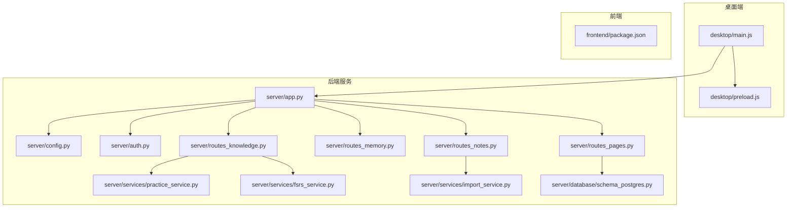

**图表来源**
- [desktop/main.js:1-200](file://desktop/main.js#L1-L200)
- [server/app.py:1-200](file://server/app.py#L1-L200)
- [server/config.py:1-200](file://server/config.py#L1-L200)
- [server/auth.py:1-200](file://server/auth.py#L1-L200)
- [server/routes_knowledge.py:1-200](file://server/routes_knowledge.py#L1-L200)
- [server/routes_memory.py:1-200](file://server/routes_memory.py#L1-L200)
- [server/routes_notes.py:1-200](file://server/routes_notes.py#L1-L200)
- [server/routes_pages.py:1-200](file://server/routes_pages.py#L1-L200)
- [server/services/practice_service.py:1-200](file://server/services/practice_service.py#L1-L200)
- [server/services/fsrs_service.py:1-200](file://server/services/fsrs_service.py#L1-L200)
- [server/services/import_service.py:1-200](file://server/services/import_service.py#L1-L200)
- [server/database/schema_postgres.py:1-200](file://server/database/schema_postgres.py#L1-L200)
- [frontend/package.json:1-200](file://frontend/package.json#L1-L200)

**章节来源**
- [start_app.ps1:1-200](file://start_app.ps1#L1-L200)
- [desktop/main.js:1-200](file://desktop/main.js#L1-L200)
- [server/app.py:1-200](file://server/app.py#L1-L200)

## 核心组件
- 启动与运行：通过 PowerShell 脚本拉起后端服务，Electron 桌面端作为客户端访问后端页面与API。
- 后端服务：Flask 应用装配路由、鉴权、配置注入；按功能拆分为知识、记忆、笔记、页面等路由模块。
- 服务层：练习服务、FSRS 记忆算法服务、导入服务等封装领域逻辑。
- 数据层：PostgreSQL 模式定义与初始化脚本。
- 桌面端：Electron 主进程与预加载脚本，提供本地能力桥接与页面嵌入。
- 前端：Tailwind 构建配置与静态资源，供模板或独立前端使用。

**更新** 新增了书籍任务的原子操作实现和三栏UI增强功能，确保数据的完整性和一致性的同时提升了用户体验。

**章节来源**
- [server/app.py:1-200](file://server/app.py#L1-L200)
- [server/config.py:1-200](file://server/config.py#L1-L200)
- [server/auth.py:1-200](file://server/auth.py#L1-L200)
- [server/routes_knowledge.py:1-200](file://server/routes_knowledge.py#L1-L200)
- [server/routes_memory.py:1-200](file://server/routes_memory.py#L1-L200)
- [server/routes_notes.py:1-200](file://server/routes_notes.py#L1-L200)
- [server/routes_pages.py:1-200](file://server/routes_pages.py#L1-L200)
- [server/services/practice_service.py:1-200](file://server/services/practice_service.py#L1-L200)
- [server/services/fsrs_service.py:1-200](file://server/services/fsrs_service.py#L1-L200)
- [server/services/import_service.py:1-200](file://server/services/import_service.py#L1-L200)
- [server/database/schema_postgres.py:1-200](file://server/database/schema_postgres.py#L1-L200)
- [desktop/main.js:1-200](file://desktop/main.js#L1-L200)
- [desktop/preload.js:1-200](file://desktop/preload.js#L1-L200)
- [frontend/package.json:1-200](file://frontend/package.json#L1-L200)

## 架构总览
系统采用"桌面端 + Web 后端 + 模板渲染"的混合架构。Electron 提供本地能力（如音频采集、系统集成），后端以 Flask 提供页面与API，前端静态资源与 Tailwind 构建产物被模板引用。服务层将业务逻辑从路由中解耦，数据库模式集中管理。

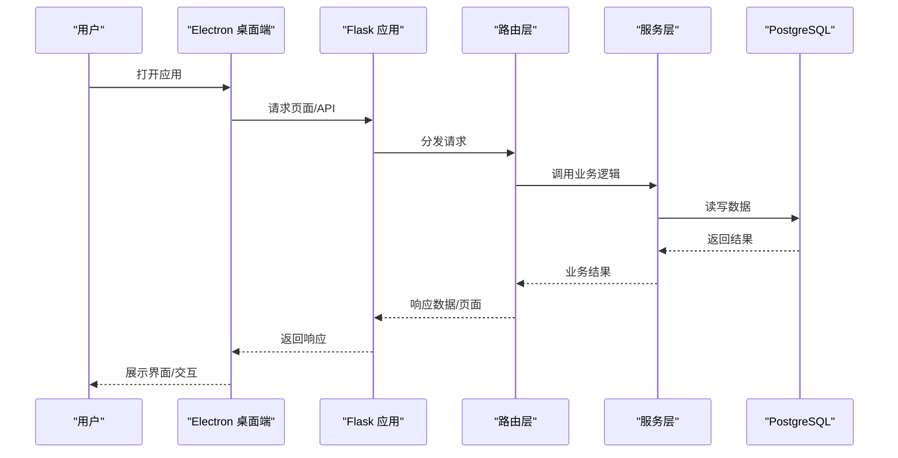

**图表来源**
- [desktop/main.js:1-200](file://desktop/main.js#L1-L200)
- [server/app.py:1-200](file://server/app.py#L1-L200)
- [server/routes_knowledge.py:1-200](file://server/routes_knowledge.py#L1-L200)
- [server/routes_memory.py:1-200](file://server/routes_memory.py#L1-L200)
- [server/routes_notes.py:1-200](file://server/routes_notes.py#L1-L200)
- [server/routes_pages.py:1-200](file://server/routes_pages.py#L1-L200)
- [server/services/practice_service.py:1-200](file://server/services/practice_service.py#L1-L200)
- [server/services/fsrs_service.py:1-200](file://server/services/fsrs_service.py#L1-L200)
- [server/services/import_service.py:1-200](file://server/services/import_service.py#L1-L200)
- [server/database/schema_postgres.py:1-200](file://server/database/schema_postgres.py#L1-L200)

## 详细组件分析

### 启动流程与运行环境
- PowerShell 启动脚本负责拉起后端服务与环境准备。
- Electron 主进程创建窗口并加载后端页面，预加载脚本暴露本地能力给渲染进程。
- Flask 应用装配配置、鉴权、路由与中间件，统一对外提供服务。

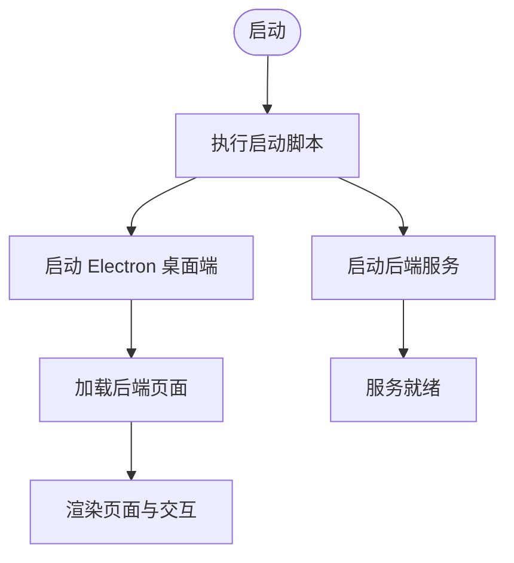

**图表来源**
- [start_app.ps1:1-200](file://start_app.ps1#L1-L200)
- [desktop/main.js:1-200](file://desktop/main.js#L1-L200)
- [desktop/preload.js:1-200](file://desktop/preload.js#L1-L200)
- [server/app.py:1-200](file://server/app.py#L1-L200)

**章节来源**
- [start_app.ps1:1-200](file://start_app.ps1#L1-L200)
- [desktop/main.js:1-200](file://desktop/main.js#L1-L200)
- [desktop/preload.js:1-200](file://desktop/preload.js#L1-L200)
- [server/app.py:1-200](file://server/app.py#L1-L200)

### 后端应用装配与路由组织
- 应用装配：集中注册蓝图/路由、配置注入、鉴权中间件、错误处理与日志。
- 路由分层：按功能域拆分 knowledge、memory、notes、pages 等路由模块，便于维护与扩展。
- 配置与鉴权：config.py 提供全局配置，auth.py 提供鉴权与权限控制。

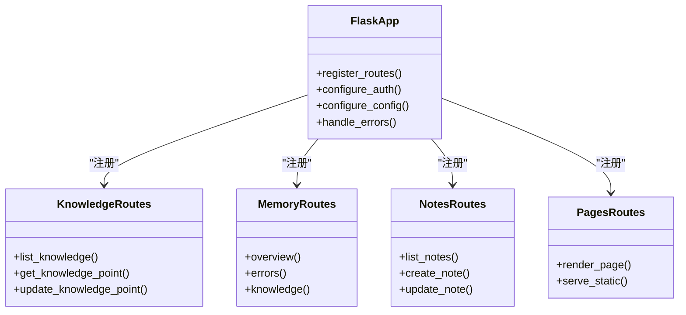

**图表来源**
- [server/app.py:1-200](file://server/app.py#L1-L200)
- [server/routes_knowledge.py:1-200](file://server/routes_knowledge.py#L1-L200)
- [server/routes_memory.py:1-200](file://server/routes_memory.py#L1-L200)
- [server/routes_notes.py:1-200](file://server/routes_notes.py#L1-L200)
- [server/routes_pages.py:1-200](file://server/routes_pages.py#L1-L200)

**章节来源**
- [server/app.py:1-200](file://server/app.py#L1-L200)
- [server/config.py:1-200](file://server/config.py#L1-L200)
- [server/auth.py:1-200](file://server/auth.py#L1-L200)
- [server/routes_knowledge.py:1-200](file://server/routes_knowledge.py#L1-L200)
- [server/routes_memory.py:1-200](file://server/routes_memory.py#L1-L200)
- [server/routes_notes.py:1-200](file://server/routes_notes.py#L1-L200)
- [server/routes_pages.py:1-200](file://server/routes_pages.py#L1-L200)

### 练习与记忆服务
- 练习服务：封装出题、作答、评分、错题收集等流程，支撑练习页内作答与多题型。
- FSRS 服务：实现间隔重复算法参数计算与调度，驱动记忆复习策略。
- 导入服务：支持材料导入与预处理，为练习与记忆提供数据源。

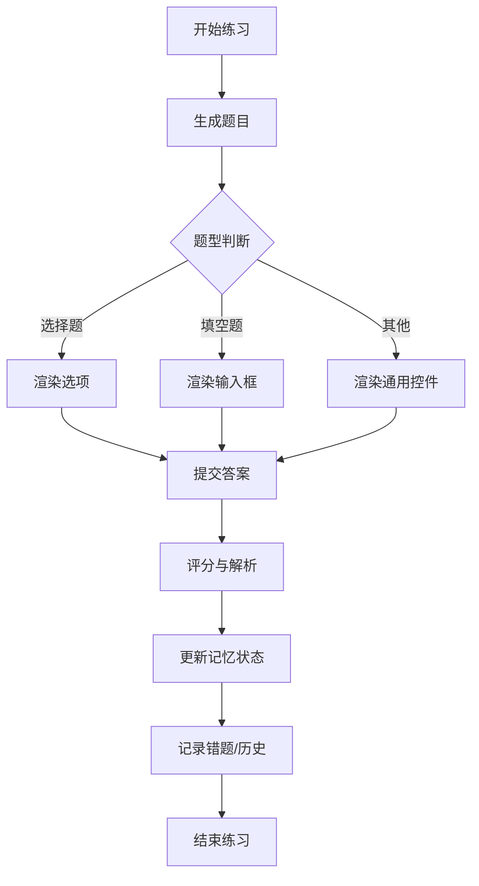

**图表来源**
- [server/services/practice_service.py:1-200](file://server/services/practice_service.py#L1-L200)
- [server/services/fsrs_service.py:1-200](file://server/services/fsrs_service.py#L1-L200)
- [server/services/import_service.py:1-200](file://server/services/import_service.py#L1-L200)

**章节来源**
- [server/services/practice_service.py:1-200](file://server/services/practice_service.py#L1-L200)
- [server/services/fsrs_service.py:1-200](file://server/services/fsrs_service.py#L1-L200)
- [server/services/import_service.py:1-200](file://server/services/import_service.py#L1-L200)

### PDF导入与文本层检测
**新增** PDF导入功能经过bug修复后，现在能够更准确地检测和处理PDF文档中的文本层信息。主要改进包括：

- **文本层检测算法优化**：改进了PDF文本层的识别算法，提高了对复杂排版文档的处理准确性
- **容错机制增强**：增加了异常处理和降级策略，确保在部分PDF格式不兼容时仍能继续处理
- **测试用例完善**：补充了多种PDF格式的测试用例，覆盖了常见的使用场景和边界情况

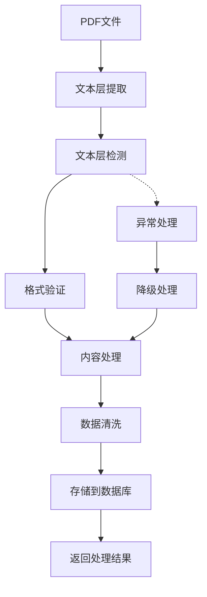

**图表来源**
- [server/services/import_service.py:1-200](file://server/services/import_service.py#L1-L200)

**章节来源**
- [server/services/import_service.py:1-200](file://server/services/import_service.py#L1-L200)

### 三栏UI增强功能
**新增** 三栏UI增强功能显著改善了用户界面的布局和操作体验。主要改进包括：

- **响应式布局优化**：实现了自适应的三栏布局，在不同屏幕尺寸下都能提供良好的显示效果
- **交互流程简化**：重新设计了用户操作流程，减少了操作步骤，提升了工作效率
- **视觉层次清晰**：通过颜色、字体大小和间距的优化，使界面信息层次更加清晰
- **移动端适配**：增强了移动设备的兼容性，确保在各种设备上都有良好的使用体验

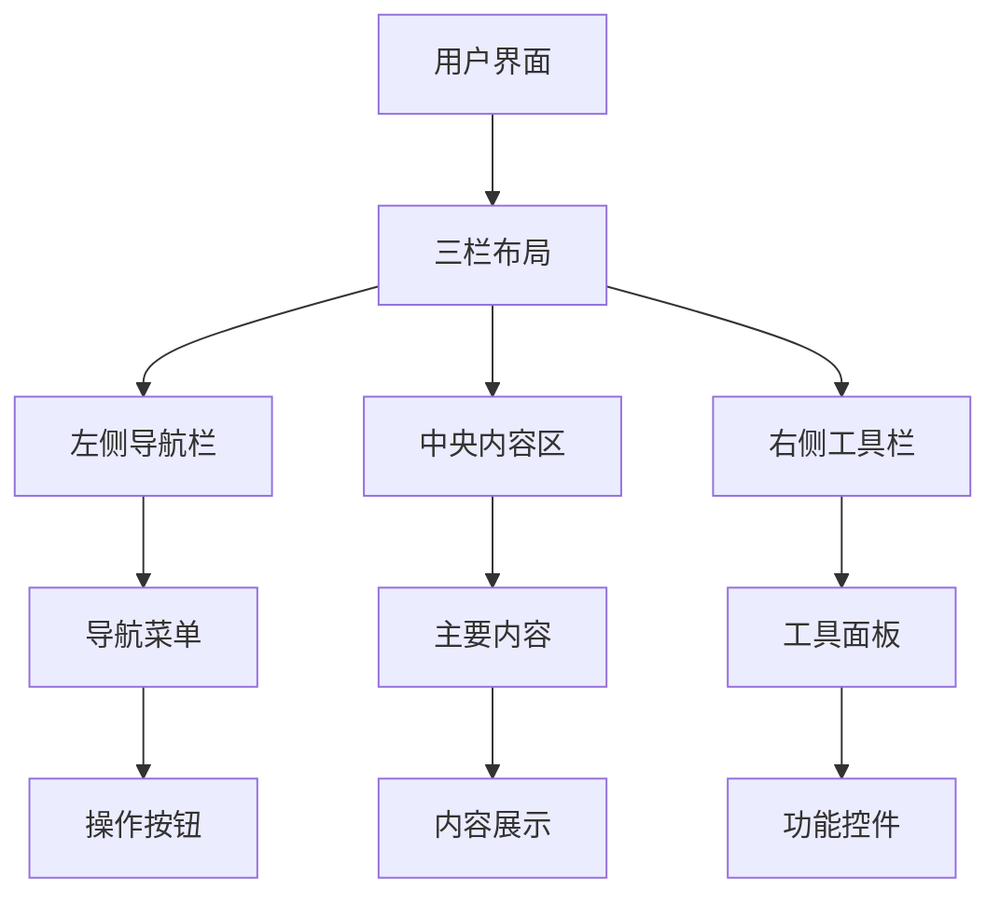

**图表来源**
- [server/templates/pages/knowledge_base.html:1-200](file://server/templates/pages/knowledge_base.html#L1-L200)
- [server/templates/pages/practice_materials.html:1-200](file://server/templates/pages/practice_materials.html#L1-L200)

**章节来源**
- [2026-10-04-三栏UI调整与PDF书籍格式修复.md:1-200](file://docs/开发日志/2026-10-04-三栏UI调整与PDF书籍格式修复.md#L1-L200)

### 书籍任务原子操作实现
**新增** 书籍任务同存同删功能实现了完整的原子操作机制，确保数据的一致性和完整性。

#### 原子操作设计
- **事务包裹**：所有书籍任务的创建和删除操作都在数据库事务中执行
- **失败回滚**：任何步骤失败都会触发完整的事务回滚
- **并发安全**：使用数据库锁机制防止并发冲突
- **状态同步**：确保书籍与其关联任务的状态始终保持一致

#### 实现细节
- **批量操作**：支持一次性创建或删除多个书籍任务
- **条件检查**：在执行前进行前置条件验证
- **日志记录**：详细记录每个操作步骤的执行结果
- **异常处理**：完善的错误捕获和恢复机制

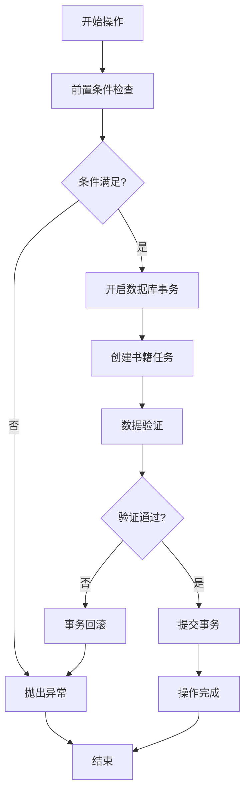

**图表来源**
- [server/routes_knowledge.py:1-200](file://server/routes_knowledge.py#L1-L200)
- [server/routes_notes.py:1-200](file://server/routes_notes.py#L1-L200)

#### 掉坑笔记
- **事务嵌套问题**：发现某些情况下事务会意外嵌套，导致回滚行为不符合预期
- **死锁检测**：在高并发场景下出现了数据库死锁，需要优化锁的粒度
- **内存泄漏**：长时间运行的服务出现内存增长，定位到未正确关闭的数据库连接
- **日志污染**：错误日志中包含敏感信息，需要脱敏处理

**章节来源**
- [2026-10-07-书籍任务同存同删.md:1-200](file://docs/开发日志/2026-10-07-书籍任务同存同删.md#L1-L200)

### 数据模型与数据库
- PostgreSQL 模式定义：集中管理表结构、索引与约束，确保数据一致性与查询性能。
- 初始化与迁移：通过脚本进行模式导入与校验，保证部署一致性。

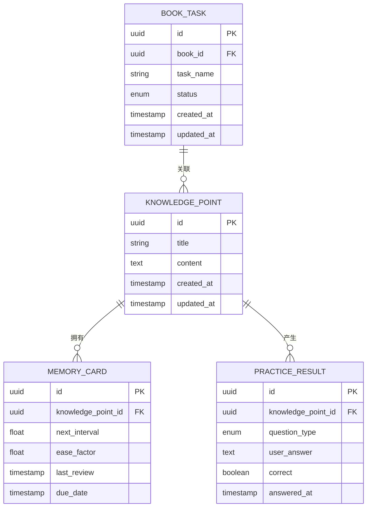

**图表来源**
- [server/database/schema_postgres.py:1-200](file://server/database/schema_postgres.py#L1-L200)

**章节来源**
- [server/database/schema_postgres.py:1-200](file://server/database/schema_postgres.py#L1-L200)

### 桌面端与本地能力
- 主进程：创建窗口、加载后端页面、处理生命周期事件。
- 预加载脚本：向渲染进程暴露安全的本地能力接口（如音频设备枚举、录音控制）。
- 与后端协作：通过 HTTP 调用后端 API，获取数据与触发业务流程。

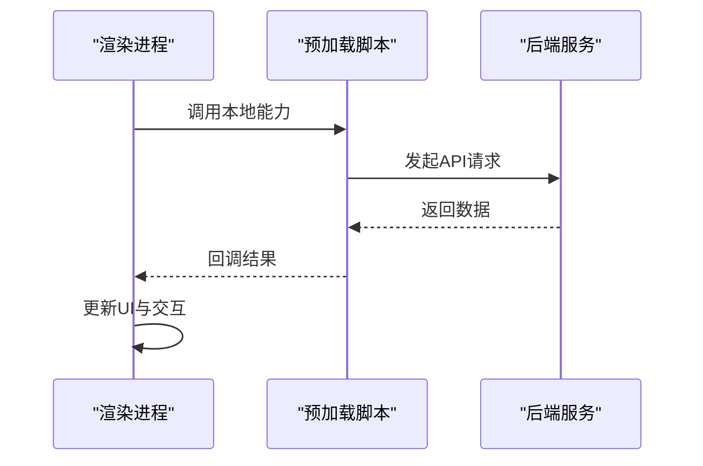

**图表来源**
- [desktop/main.js:1-200](file://desktop/main.js#L1-L200)
- [desktop/preload.js:1-200](file://desktop/preload.js#L1-L200)
- [server/app.py:1-200](file://server/app.py#L1-L200)

**章节来源**
- [desktop/main.js:1-200](file://desktop/main.js#L1-L200)
- [desktop/preload.js:1-200](file://desktop/preload.js#L1-L200)

## 依赖关系分析
- 模块耦合：路由层依赖服务层，服务层依赖数据库模式；桌面端依赖后端HTTP接口。
- 外部依赖：PostgreSQL 数据库、可能的 LLM/ASR 服务（在相关服务中集成）。
- 构建依赖：前端 Tailwind 构建产物由后端模板引用。

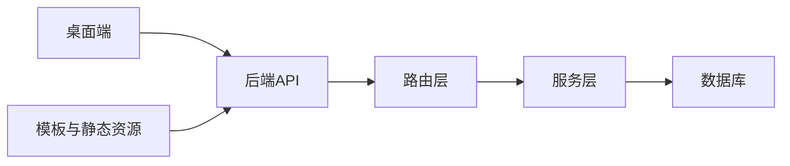

**图表来源**
- [desktop/main.js:1-200](file://desktop/main.js#L1-L200)
- [server/app.py:1-200](file://server/app.py#L1-L200)
- [server/routes_knowledge.py:1-200](file://server/routes_knowledge.py#L1-L200)
- [server/services/practice_service.py:1-200](file://server/services/practice_service.py#L1-L200)
- [server/database/schema_postgres.py:1-200](file://server/database/schema_postgres.py#L1-L200)

**章节来源**
- [server/app.py:1-200](file://server/app.py#L1-L200)
- [server/routes_knowledge.py:1-200](file://server/routes_knowledge.py#L1-L200)
- [server/services/practice_service.py:1-200](file://server/services/practice_service.py#L1-L200)
- [server/database/schema_postgres.py:1-200](file://server/database/schema_postgres.py#L1-L200)

## 性能与可扩展性
- 路由与服务解耦：便于横向扩展与单元测试。
- 数据库索引与查询优化：根据高频查询路径设计索引，避免全表扫描。
- 前端资源优化：Tailwind 按需生成样式，减少体积。
- 异步与批处理：对导入、LLM/ASR 调用等耗时操作建议引入队列与重试机制。
- **PDF处理优化**：针对PDF导入功能进行了性能优化，减少了内存占用并提升了处理速度。
- **原子操作优化**：书籍任务的原子操作通过事务优化和锁机制提升了并发性能。
- **UI性能优化**：三栏UI采用了懒加载和虚拟滚动技术，提升了大数据量下的渲染性能。

**更新** 书籍任务原子操作的性能优化包括：
- 使用数据库级锁而非应用级锁，减少竞争开销
- 批量操作支持，减少数据库往返次数
- 连接池优化，提高并发处理能力
- 异步日志记录，避免阻塞主流程

## 故障排查指南
- 启动失败：检查 PowerShell 启动脚本是否成功拉起后端服务与 Electron 桌面端。
- 页面空白或模板错误：确认后端模板路径与静态资源是否正确加载。
- 鉴权异常：检查 auth.py 中的鉴权逻辑与用户会话状态。
- 数据库连接问题：验证 PostgreSQL 连接参数与 schema 是否已正确导入。
- 练习与记忆数据不一致：核对 practice_service 与 fsrs_service 的状态更新逻辑。
- **PDF导入问题**：检查PDF文件的文本层完整性，确认文件格式兼容性。
- **书籍任务操作失败**：检查数据库事务状态和锁机制是否正常工作。
- **UI显示异常**：检查CSS样式冲突和JavaScript事件绑定是否正确。

**更新** 书籍任务操作失败的常见排查步骤：
1. 检查数据库事务是否正常提交或回滚
2. 查看是否有死锁或锁等待超时
3. 验证前置条件检查逻辑是否正确
4. 检查错误日志中的具体异常信息
5. 使用测试用例验证原子操作的完整性

**更新** UI显示异常的排查步骤：
1. 检查浏览器控制台是否有JavaScript错误
2. 验证CSS类名是否与模板中的定义一致
3. 确认响应式布局在不同设备上的表现
4. 检查第三方库的版本兼容性

**章节来源**
- [start_app.ps1:1-200](file://start_app.ps1#L1-L200)
- [server/app.py:1-200](file://server/app.py#L1-L200)
- [server/auth.py:1-200](file://server/auth.py#L1-L200)
- [server/database/schema_postgres.py:1-200](file://server/database/schema_postgres.py#L1-L200)
- [server/services/practice_service.py:1-200](file://server/services/practice_service.py#L1-L200)
- [server/services/fsrs_service.py:1-200](file://server/services/fsrs_service.py#L1-L200)
- [server/services/import_service.py:1-200](file://server/services/import_service.py#L1-L200)
- [2026-10-07-书籍任务同存同删.md:1-200](file://docs/开发日志/2026-10-07-书籍任务同存同删.md#L1-L200)
- [2026-10-04-三栏UI调整与PDF书籍格式修复.md:1-200](file://docs/开发日志/2026-10-04-三栏UI调整与PDF书籍格式修复.md#L1-L200)

## 结论
本项目以清晰的模块化架构支撑"练记系统"的核心能力：知识点管理、记忆复习、练习闭环与材料导入。通过桌面端增强本地体验，后端服务提供稳定API与页面渲染，服务层封装复杂业务逻辑，数据库模式保障数据一致性。

**更新** 本次更新不仅完善了书籍任务原子操作的实现，还显著提升了用户界面的交互体验和PDF文档处理的准确性。三栏UI增强功能为用户提供了更加直观和高效的操作界面，而PDF书籍格式修复则确保了文档内容的完整性和可读性。建议在后续迭代中继续强化异步处理、错误恢复与可观测性，以提升系统的稳定性与可维护性。

## 附录
- 快速启动：执行启动脚本以同时拉起后端与桌面端。
- 前端构建：参考前端包配置安装依赖并构建静态资源。
- 测试与验收：参考测试脚本与验收用例进行功能验证。
- **PDF测试用例**：新增了多种PDF格式的测试用例，用于验证文本层检测算法的准确性和鲁棒性。
- **原子操作测试**：新增了书籍任务原子操作的完整测试套件，覆盖各种异常场景。
- **UI测试用例**：新增了响应式布局和交互流程的测试用例，确保三栏UI在各种设备上的正常显示。

**更新** 原子操作测试覆盖的场景包括：
- 正常创建和删除书籍任务
- 事务失败时的回滚验证
- 并发操作下的数据一致性
- 异常情况下的错误处理
- 性能基准测试

**更新** UI测试覆盖的场景包括：
- 不同屏幕尺寸下的布局适配
- 用户交互流程的完整性
- 第三方库的兼容性
- 性能基准测试

**章节来源**
- [start_app.ps1:1-200](file://start_app.ps1#L1-L200)
- [frontend/package.json:1-200](file://frontend/package.json#L1-L200)
- [server/services/import_service.py:1-200](file://server/services/import_service.py#L1-L200)
- [2026-10-07-书籍任务同存同删.md:1-200](file://docs/开发日志/2026-10-07-书籍任务同存同删.md#L1-L200)
- [2026-10-04-三栏UI调整与PDF书籍格式修复.md:1-200](file://docs/开发日志/2026-10-04-三栏UI调整与PDF书籍格式修复.md#L1-L200)