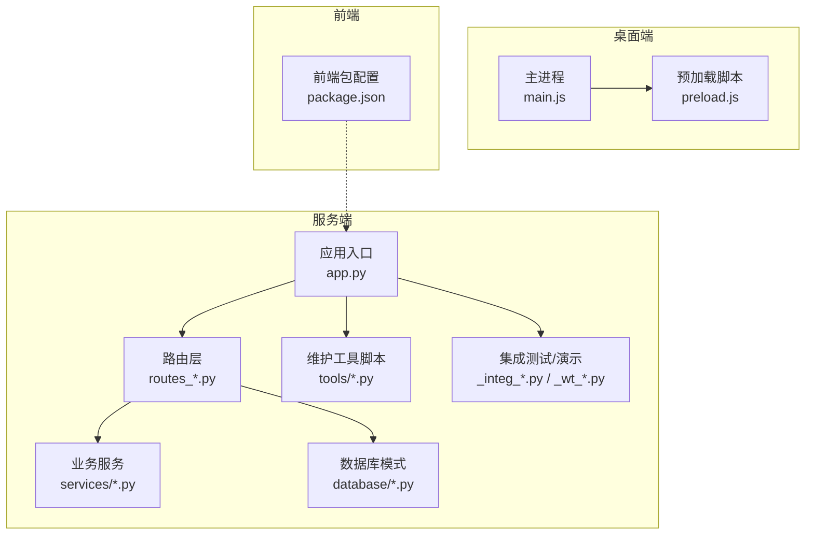
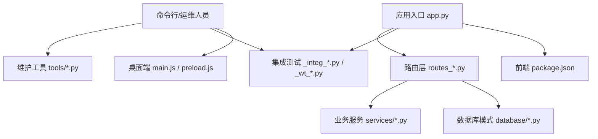
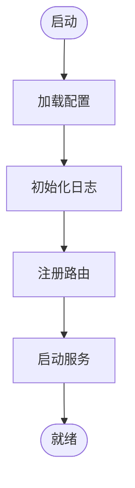
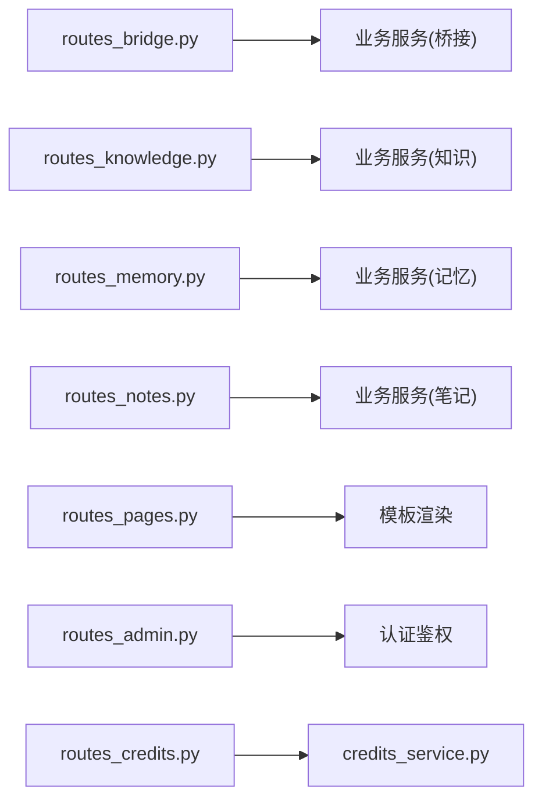
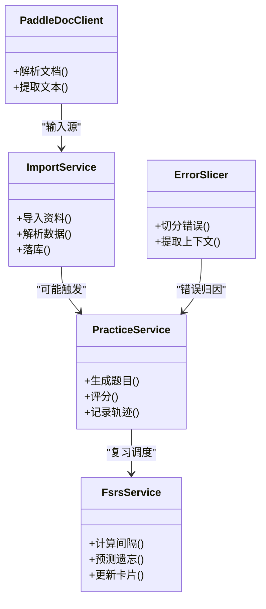
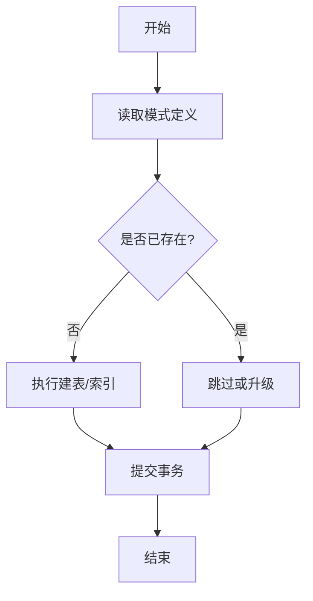
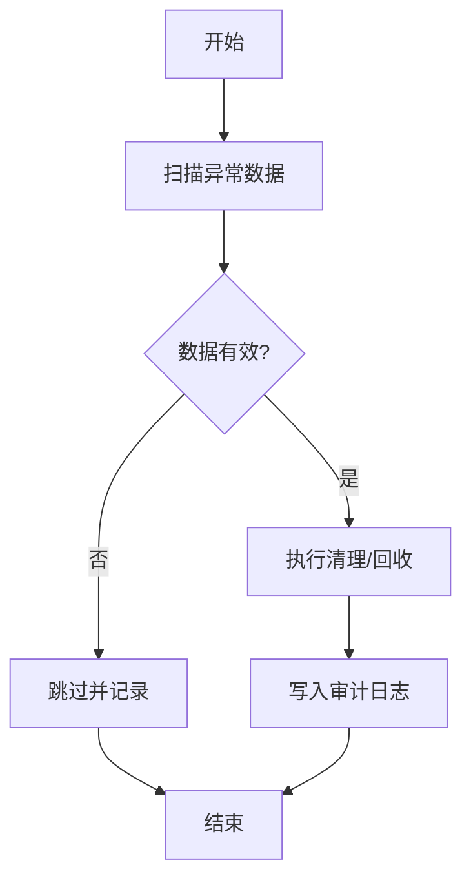
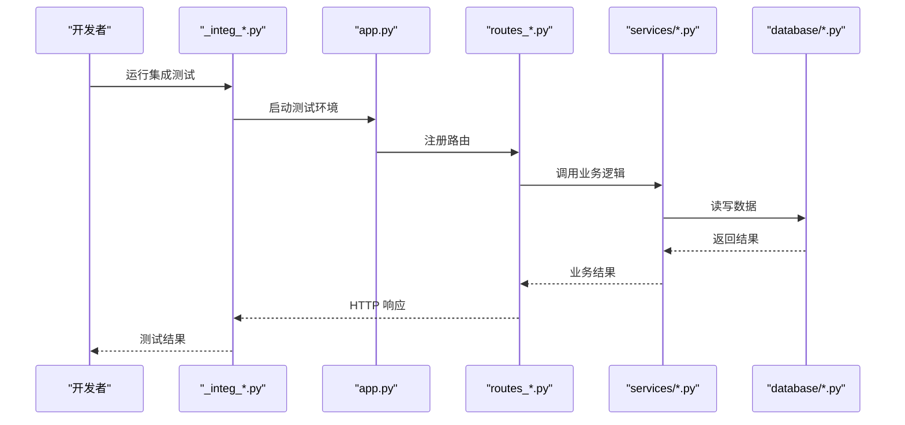
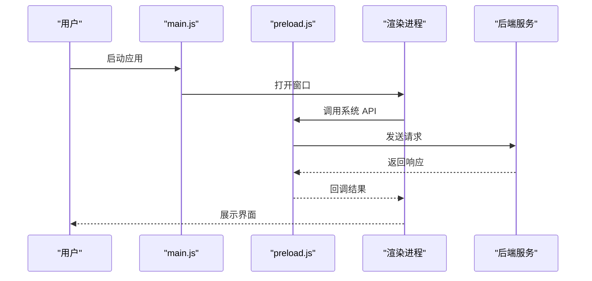
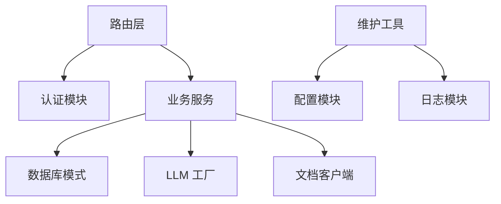

# 维护工具

<cite>
**本文引用的文件**   
- [app.py](file://server/app.py)
- [config.py](file://server/config.py)
- [routes_bridge.py](file://server/routes_bridge.py)
- [routes_knowledge.py](file://server/routes_knowledge.py)
- [routes_memory.py](file://server/routes_memory.py)
- [routes_notes.py](file://server/routes_notes.py)
- [routes_pages.py](file://server/routes_pages.py)
- [routes_admin.py](file://server/routes_admin.py)
- [routes_credits.py](file://server/routes_credits.py)
- [auth.py](file://server/auth.py)
- [credits_service.py](file://server/credits_service.py)
- [knowledge_management.py](file://server/knowledge_management.py)
- [llm_call_logger.py](file://server/llm_call_logger.py)
- [llm_logger.py](file://server/llm_logger.py)
- [llm_provider_factory.py](file://server/llm_provider_factory.py)
- [logger_module.py](file://server/logger_module.py)
- [similarity_matcher.py](file://server/similarity_matcher.py)
- [services/import_service.py](file://server/services/import_service.py)
- [services/practice_service.py](file://server/services/practice_service.py)
- [services/fsrs_service.py](file://server/services/fsrs_service.py)
- [services/error_slicer.py](file://server/services/error_slicer.py)
- [services/paddle_doc_client.py](file://server/services/paddle_doc客户端.py)
- [database/schema_import.py](file://server/database/schema_import.py)
- [database/schema_postgres.py](file://server/database/schema_postgres.py)
- [tools/cleanup_orphan_attachments.py](file://server/tools/cleanup_orphan_attachments.py)
- [tools/purge_zombie_book_tasks.py](file://server/tools/purge_zombie_book_tasks.py)
- [tools/apply_fsrs_schema.py](file://server/tools/apply_fsrs_schema.py)
- [_integ_apply_fsrs_schema.py](file://server/_integ_apply_fsrs_schema.py)
- [_integ_fsrs_service.py](file://server/_integ_fsrs_service.py)
- [_wt_routes_bridge.py](file://server/_wt_routes_bridge.py)
- [_wt_app.py](file://server/_wt_app.py)
- [_wt_fsrs_service.py](file://server/_wt_fsrs_service.py)
- [desktop/main.js](file://desktop/main.js)
- [desktop/preload.js](file://desktop/preload.js)
- [frontend/package.json](file://frontend/package.json)
- [desktop/package.json](file://desktop/package.json)
</cite>

## 目录
1. [引言](#引言)
2. [项目结构](#项目结构)
3. [核心组件](#核心组件)
4. [架构总览](#架构总览)
5. [详细组件分析](#详细组件分析)
6. [依赖关系分析](#依赖关系分析)
7. [性能考虑](#性能考虑)
8. [故障排查指南](#故障排查指南)
9. [结论](#结论)
10. [附录](#附录)

## 引言
本文件聚焦于“维护工具”主题，围绕服务端与桌面端中的运维、诊断、数据修复、集成测试与部署辅助脚本展开说明。内容覆盖：
- 应用入口与路由组织
- 数据库模式导入与迁移
- 数据清理与任务回收等维护脚本
- 集成测试与本地运行辅助
- 桌面端启动与桥接通信
- 前端构建与依赖管理

目标是帮助读者快速定位维护相关代码、理解其职责边界，并在日常运维中高效使用这些工具。

## 项目结构
本项目采用多模块组织方式：
- server：后端服务、路由、业务服务、数据库模式、维护工具脚本、集成测试与演示脚本
- desktop：Electron 桌面应用主进程与预加载脚本
- frontend：前端资源与构建配置
- design/docs：设计文档与开发日志（非维护工具重点）

图表来源
- [app.py:1-200](file://server/app.py#L1-L200)
- [routes_bridge.py:1-200](file://server/routes_bridge.py#L1-L200)
- [database/schema_import.py:1-200](file://server/database/schema_import.py#L1-L200)
- [tools/cleanup_orphan_attachments.py:1-200](file://server/tools/cleanup_orphan_attachments.py#L1-L200)
- [desktop/main.js:1-200](file://desktop/main.js#L1-L200)
- [frontend/package.json:1-200](file://frontend/package.json#L1-L200)

章节来源
- [app.py:1-200](file://server/app.py#L1-L200)
- [config.py:1-200](file://server/config.py#L1-L200)

## 核心组件
本节梳理与维护相关的核心组件及其职责：
- 应用入口与配置：负责初始化日志、加载配置、注册路由、启动服务
- 路由层：按功能域划分，承载对外接口与页面渲染
- 业务服务：封装领域逻辑（导入、练习、记忆算法、错误切片、文档处理）
- 数据库模式：PostgreSQL 模式定义与导入工具
- 维护工具脚本：数据清理、任务回收、模式应用等
- 集成测试与演示：端到端验证、服务模拟、UI 走查
- 桌面端：Electron 主进程与预加载脚本，提供系统能力桥接
- 前端：构建与依赖管理

章节来源
- [app.py:1-200](file://server/app.py#L1-L200)
- [routes_bridge.py:1-200](file://server/routes_bridge.py#L1-L200)
- [routes_knowledge.py:1-200](file://server/routes_knowledge.py#L1-L200)
- [routes_memory.py:1-200](file://server/routes_memory.py#L1-L200)
- [routes_notes.py:1-200](file://server/routes_notes.py#L1-L200)
- [routes_pages.py:1-200](file://server/routes_pages.py#L1-L200)
- [routes_admin.py:1-200](file://server/routes_admin.py#L1-L200)
- [routes_credits.py:1-200](file://server/routes_credits.py#L1-L200)
- [services/import_service.py:1-200](file://server/services/import_service.py#L1-L200)
- [services/practice_service.py:1-200](file://server/services/practice_service.py#L1-L200)
- [services/fsrs_service.py:1-200](file://server/services/fsrs_service.py#L1-L200)
- [services/error_slicer.py:1-200](file://server/services/error_slicer.py#L1-L200)
- [services/paddle_doc_client.py:1-200](file://server/services/paddle_doc_client.py#L1-L200)
- [database/schema_import.py:1-200](file://server/database/schema_import.py#L1-L200)
- [database/schema_postgres.py:1-200](file://server/database/schema_postgres.py#L1-L200)
- [tools/cleanup_orphan_attachments.py:1-200](file://server/tools/cleanup_orphan_attachments.py#L1-L200)
- [tools/purge_zombie_book_tasks.py:1-200](file://server/tools/purge_zombie_book_tasks.py#L1-L200)
- [tools/apply_fsrs_schema.py:1-200](file://server/tools/apply_fsrs_schema.py#L1-L200)
- [_integ_apply_fsrs_schema.py:1-200](file://server/_integ_apply_fsrs_schema.py#L1-L200)
- [_integ_fsrs_service.py:1-200](file://server/_integ_fsrs_service.py#L1-L200)
- [_wt_routes_bridge.py:1-200](file://server/_wt_routes_bridge.py#L1-L200)
- [_wt_app.py:1-200](file://server/_wt_app.py#L1-L200)
- [_wt_fsrs_service.py:1-200](file://server/_wt_fsrs_service.py#L1-L200)
- [desktop/main.js:1-200](file://desktop/main.js#L1-L200)
- [desktop/preload.js:1-200](file://desktop/preload.js#L1-L200)
- [frontend/package.json:1-200](file://frontend/package.json#L1-L200)

## 架构总览
下图展示维护工具在整体系统中的位置与交互关系：

图表来源
- [app.py:1-200](file://server/app.py#L1-L200)
- [routes_bridge.py:1-200](file://server/routes_bridge.py#L1-L200)
- [database/schema_import.py:1-200](file://server/database/schema_import.py#L1-L200)
- [tools/cleanup_orphan_attachments.py:1-200](file://server/tools/cleanup_orphan_attachments.py#L1-L200)
- [_integ_apply_fsrs_schema.py:1-200](file://server/_integ_apply_fsrs_schema.py#L1-L200)
- [desktop/main.js:1-200](file://desktop/main.js#L1-L200)
- [frontend/package.json:1-200](file://frontend/package.json#L1-L200)

## 详细组件分析

### 应用入口与配置
- 作用：初始化日志、加载配置、注册路由、启动 Web 服务；为其他维护流程提供统一入口
- 关键点：
  - 日志模块加载与配置
  - 配置项读取与环境变量注入
  - 路由注册与中间件挂载
  - 服务监听端口与调试开关

图表来源
- [app.py:1-200](file://server/app.py#L1-L200)
- [config.py:1-200](file://server/config.py#L1-L200)
- [logger_module.py:1-200](file://server/logger_module.py#L1-L200)

章节来源
- [app.py:1-200](file://server/app.py#L1-L200)
- [config.py:1-200](file://server/config.py#L1-L200)
- [logger_module.py:1-200](file://server/logger_module.py#L1-L200)

### 路由层（按功能域）
- 桥接路由：面向外部系统或桌面端的桥接接口
- 知识管理路由：知识点、知识库相关操作
- 记忆系统路由：记忆曲线、复习、错题等
- 笔记路由：笔记创建、编辑、同步
- 页面路由：模板渲染与静态资源
- 管理员路由：用户、积分、审计等管理功能
- 积分路由：积分发放、查询、统计

图表来源
- [routes_bridge.py:1-200](file://server/routes_bridge.py#L1-L200)
- [routes_knowledge.py:1-200](file://server/routes_knowledge.py#L1-L200)
- [routes_memory.py:1-200](file://server/routes_memory.py#L1-L200)
- [routes_notes.py:1-200](file://server/routes_notes.py#L1-L200)
- [routes_pages.py:1-200](file://server/routes_pages.py#L1-L200)
- [routes_admin.py:1-200](file://server/routes_admin.py#L1-L200)
- [routes_credits.py:1-200](file://server/routes_credits.py#L1-L200)
- [auth.py:1-200](file://server/auth.py#L1-L200)
- [credits_service.py:1-200](file://server/credits_service.py#L1-L200)

章节来源
- [routes_bridge.py:1-200](file://server/routes_bridge.py#L1-L200)
- [routes_knowledge.py:1-200](file://server/routes_knowledge.py#L1-L200)
- [routes_memory.py:1-200](file://server/routes_memory.py#L1-L200)
- [routes_notes.py:1-200](file://server/routes_notes.py#L1-L200)
- [routes_pages.py:1-200](file://server/routes_pages.py#L1-L200)
- [routes_admin.py:1-200](file://server/routes_admin.py#L1-L200)
- [routes_credits.py:1-200](file://server/routes_credits.py#L1-L200)
- [auth.py:1-200](file://server/auth.py#L1-L200)
- [credits_service.py:1-200](file://server/credits_service.py#L1-L200)

### 业务服务（导入、练习、记忆、错误切片、文档处理）
- 导入服务：批量导入资料、解析结构化数据、落库
- 练习服务：生成练习题、评分、记录学习轨迹
- 记忆服务：FSRS 算法调用、复习调度、遗忘曲线计算
- 错误切片：从长文本中切分出错误片段，便于复盘
- 文档客户端：对接文档解析服务（如 OCR/PDF 解析）

图表来源
- [services/import_service.py:1-200](file://server/services/import_service.py#L1-L200)
- [services/practice_service.py:1-200](file://server/services/practice_service.py#L1-L200)
- [services/fsrs_service.py:1-200](file://server/services/fsrs_service.py#L1-L200)
- [services/error_slicer.py:1-200](file://server/services/error_slicer.py#L1-L200)
- [services/paddle_doc_client.py:1-200](file://server/services/paddle_doc_client.py#L1-L200)

章节来源
- [services/import_service.py:1-200](file://server/services/import_service.py#L1-L200)
- [services/practice_service.py:1-200](file://server/services/practice_service.py#L1-L200)
- [services/fsrs_service.py:1-200](file://server/services/fsrs_service.py#L1-L200)
- [services/error_slicer.py:1-200](file://server/services/error_slicer.py#L1-L200)
- [services/paddle_doc_client.py:1-200](file://server/services/paddle_doc_client.py#L1-L200)

### 数据库模式与导入
- PostgreSQL 模式定义：表结构、索引、约束
- 模式导入工具：将模式应用到数据库，支持幂等执行

图表来源
- [database/schema_postgres.py:1-200](file://server/database/schema_postgres.py#L1-L200)
- [database/schema_import.py:1-200](file://server/database/schema_import.py#L1-L200)

章节来源
- [database/schema_postgres.py:1-200](file://server/database/schema_postgres.py#L1-L200)
- [database/schema_import.py:1-200](file://server/database/schema_import.py#L1-L200)

### 维护工具脚本
- 清理孤立附件：扫描未关联的附件并安全删除
- 回收僵尸书籍任务：清理未完成或卡住的书籍处理任务
- 应用 FSRS 模式：对记忆算法相关模式进行增量应用

图表来源
- [tools/cleanup_orphan_attachments.py:1-200](file://server/tools/cleanup_orphan_attachments.py#L1-L200)
- [tools/purge_zombie_book_tasks.py:1-200](file://server/tools/purge_zombie_book_tasks.py#L1-L200)
- [tools/apply_fsrs_schema.py:1-200](file://server/tools/apply_fsrs_schema.py#L1-L200)

章节来源
- [tools/cleanup_orphan_attachments.py:1-200](file://server/tools/cleanup_orphan_attachments.py#L1-L200)
- [tools/purge_zombie_book_tasks.py:1-200](file://server/tools/purge_zombie_book_tasks.py#L1-L200)
- [tools/apply_fsrs_schema.py:1-200](file://server/tools/apply_fsrs_schema.py#L1-L200)

### 集成测试与演示脚本
- 集成测试：针对 FSRS 模式与应用、服务行为进行端到端验证
- 演示脚本：快速拉起最小化服务用于 UI 走查或联调

图表来源
- [_integ_apply_fsrs_schema.py:1-200](file://server/_integ_apply_fsrs_schema.py#L1-L200)
- [_integ_fsrs_service.py:1-200](file://server/_integ_fsrs_service.py#L1-L200)
- [app.py:1-200](file://server/app.py#L1-L200)
- [routes_bridge.py:1-200](file://server/routes_bridge.py#L1-L200)
- [services/fsrs_service.py:1-200](file://server/services/fsrs_service.py#L1-L200)
- [database/schema_import.py:1-200](file://server/database/schema_import.py#L1-L200)

章节来源
- [_integ_apply_fsrs_schema.py:1-200](file://server/_integ_apply_fsrs_schema.py#L1-L200)
- [_integ_fsrs_service.py:1-200](file://server/_integ_fsrs_service.py#L1-L200)

### 桌面端与桥接
- 主进程：启动 Electron 窗口、加载页面、与后端桥接通信
- 预加载脚本：暴露系统 API 给渲染进程，封装安全调用

图表来源
- [desktop/main.js:1-200](file://desktop/main.js#L1-L200)
- [desktop/preload.js:1-200](file://desktop/preload.js#L1-L200)

章节来源
- [desktop/main.js:1-200](file://desktop/main.js#L1-L200)
- [desktop/preload.js:1-200](file://desktop/preload.js#L1-L200)

### 前端构建与依赖
- 前端包配置：声明依赖、构建脚本、Tailwind 配置
- 与后端协作：通过静态资源与 API 接口联动

章节来源
- [frontend/package.json:1-200](file://frontend/package.json#L1-L200)

## 依赖关系分析
- 组件耦合：
  - 路由层依赖业务服务与认证模块
  - 业务服务依赖数据库模式与外部服务（如文档解析）
  - 维护工具脚本独立运行，但共享配置与日志模块
- 外部依赖：
  - 数据库：PostgreSQL
  - LLM 调用：通过工厂与日志器统一管理
  - 文档解析：PaddleDoc 客户端

图表来源
- [routes_bridge.py:1-200](file://server/routes_bridge.py#L1-L200)
- [auth.py:1-200](file://server/auth.py#L1-L200)
- [services/import_service.py:1-200](file://server/services/import_service.py#L1-L200)
- [database/schema_import.py:1-200](file://server/database/schema_import.py#L1-L200)
- [llm_provider_factory.py:1-200](file://server/llm_provider_factory.py#L1-L200)
- [services/paddle_doc_client.py:1-200](file://server/services/paddle_doc_client.py#L1-L200)
- [tools/cleanup_orphan_attachments.py:1-200](file://server/tools/cleanup_orphan_attachments.py#L1-L200)
- [config.py:1-200](file://server/config.py#L1-L200)
- [logger_module.py:1-200](file://server/logger_module.py#L1-L200)

章节来源
- [routes_bridge.py:1-200](file://server/routes_bridge.py#L1-L200)
- [auth.py:1-200](file://server/auth.py#L1-L200)
- [services/import_service.py:1-200](file://server/services/import_service.py#L1-L200)
- [database/schema_import.py:1-200](file://server/database/schema_import.py#L1-L200)
- [llm_provider_factory.py:1-200](file://server/llm_provider_factory.py#L1-L200)
- [services/paddle_doc_client.py:1-200](file://server/services/paddle_doc_client.py#L1-L200)
- [tools/cleanup_orphan_attachments.py:1-200](file://server/tools/cleanup_orphan_attachments.py#L1-L200)
- [config.py:1-200](file://server/config.py#L1-L200)
- [logger_module.py:1-200](file://server/logger_module.py#L1-L200)

## 性能考虑
- 批量导入与解析：建议分页处理、异步队列、失败重试与断点续传
- 记忆算法计算：缓存中间结果，避免重复计算；合理设置批大小
- 错误切片：流式处理长文本，控制内存占用
- 文档解析：限制并发、超时控制、降级策略
- 维护脚本：可中断、可恢复、输出进度与审计日志

## 故障排查指南
- 常见问题定位：
  - 路由 404/500：检查路由注册与参数校验
  - 数据库连接失败：核对配置与权限
  - 导入失败：查看导入日志与错误切片结果
  - 桌面端无法访问后端：检查端口、跨域与桥接通信
- 建议步骤：
  - 启用详细日志，复现问题
  - 使用集成测试脚本隔离问题范围
  - 使用维护工具清理脏数据后重试
  - 逐步缩小依赖链（路由→服务→数据库/外部服务）

章节来源
- [logger_module.py:1-200](file://server/logger_module.py#L1-L200)
- [_integ_apply_fsrs_schema.py:1-200](file://server/_integ_apply_fsrs_schema.py#L1-L200)
- [_integ_fsrs_service.py:1-200](file://server/_integ_fsrs_service.py#L1-L200)
- [tools/cleanup_orphan_attachments.py:1-200](file://server/tools/cleanup_orphan_attachments.py#L1-L200)

## 结论
维护工具贯穿应用的配置、路由、服务、数据库与桌面端，形成完整的运维闭环。通过清晰的职责划分与脚本化工具，能够显著提升日常运维效率与稳定性。建议在团队内建立标准操作流程，结合集成测试与日志审计，确保变更可控、问题可追溯。

## 附录
- 常用命令与脚本路径参考：
  - 应用入口：[app.py](file://server/app.py)
  - 配置模块：[config.py](file://server/config.py)
  - 路由示例：[routes_bridge.py](file://server/routes_bridge.py)
  - 业务服务：[services/import_service.py](file://server/services/import_service.py)
  - 数据库模式：[database/schema_import.py](file://server/database/schema_import.py)
  - 维护脚本：[tools/cleanup_orphan_attachments.py](file://server/tools/cleanup_orphan_attachments.py)
  - 集成测试：[_integ_apply_fsrs_schema.py](file://server/_integ_apply_fsrs_schema.py)
  - 桌面端：[desktop/main.js](file://desktop/main.js)
  - 前端依赖：[frontend/package.json](file://frontend/package.json)