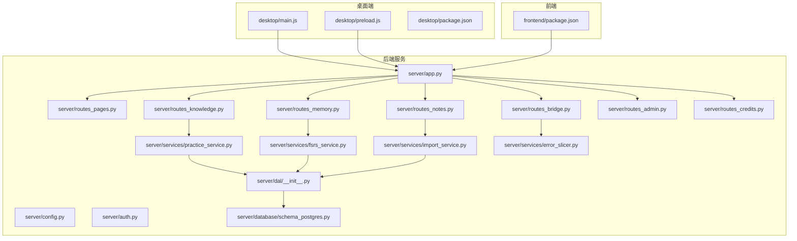
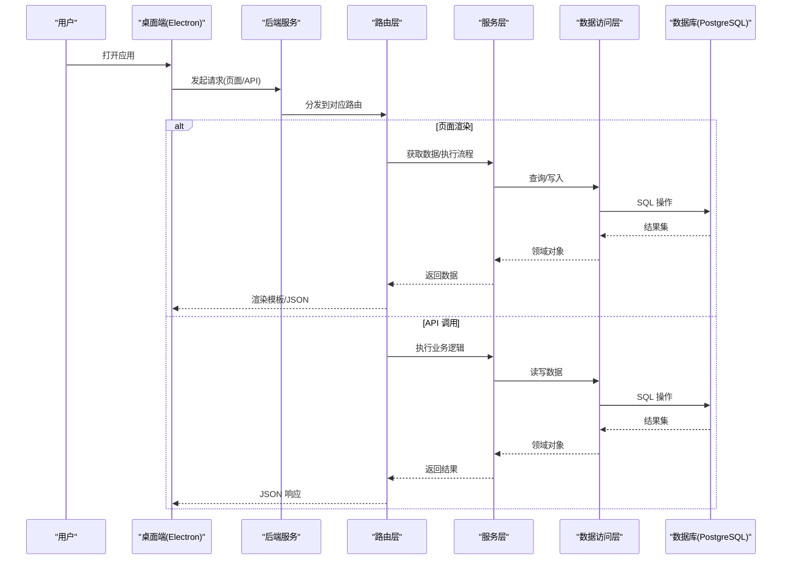
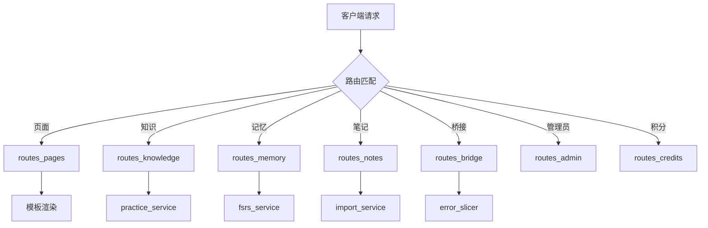
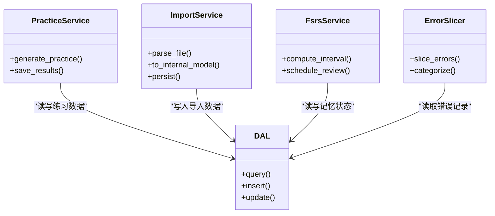
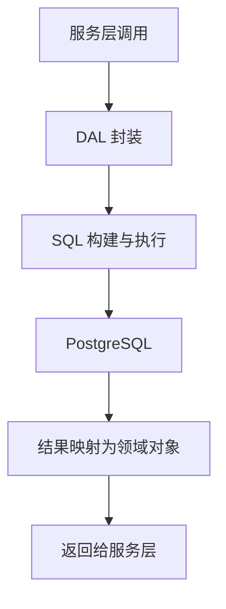
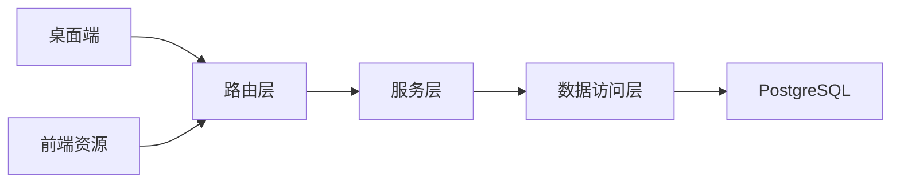

# 项目计划

<cite>
**本文引用的文件**   
- [start_app.ps1](file://start_app.ps1)
- [server/app.py](file://server/app.py)
- [server/config.py](file://server/config.py)
- [server/auth.py](file://server/auth.py)
- [server/routes_pages.py](file://server/routes_pages.py)
- [server/routes_knowledge.py](file://server/routes_knowledge.py)
- [server/routes_memory.py](file://server/routes_memory.py)
- [server/routes_notes.py](file://server/routes_notes.py)
- [server/routes_bridge.py](file://server/routes_bridge.py)
- [server/routes_admin.py](file://server/routes_admin.py)
- [server/routes_credits.py](file://server/routes_credits.py)
- [server/services/practice_service.py](file://server/services/practice_service.py)
- [server/services/import_service.py](file://server/services/import_service.py)
- [server/services/fsrs_service.py](file://server/services/fsrs_service.py)
- [server/services/error_slicer.py](file://server/services/error_slicer.py)
- [server/dal/__init__.py](file://server/dal/__init__.py)
- [server/database/schema_postgres.py](file://server/database/schema_postgres.py)
- [desktop/main.js](file://desktop/main.js)
- [desktop/preload.js](file://desktop/preload.js)
- [desktop/package.json](file://desktop/package.json)
- [frontend/package.json](file://frontend/package.json)
- [docs/计划/2026-09-28-练记系统改造方案.md](file://docs/计划/2026-09-28-练记系统改造方案.md)
- [docs/计划/2026-09-30-文件导入与PDF转MD方案.md](file://docs/计划/2026-09-30-文件导入与PDF转MD方案.md)
- [docs/业务规则/业务规则总览.md](file://docs/业务规则/业务规则总览.md)
- [docs/原则/系统架构梳理.md](file://docs/原则/系统架构梳理.md)
</cite>

## 目录
1. [引言](#引言)
2. [项目结构](#项目结构)
3. [核心组件](#核心组件)
4. [架构总览](#架构总览)
5. [详细组件分析](#详细组件分析)
6. [依赖关系分析](#依赖关系分析)
7. [性能考虑](#性能考虑)
8. [故障排查指南](#故障排查指南)
9. [结论](#结论)
10. [附录](#附录)

## 引言
本项目是一个面向“练习与记忆”的桌面端学习系统，包含后端服务、前端页面、Electron 桌面壳以及文档与设计资料。整体目标是通过知识管理、在线课程笔记、练习与错题复习、记忆曲线（FSRS）等能力，构建端到端的学习闭环。本文档聚焦于“项目计划”，从系统架构、模块职责、数据流、集成点、错误处理与性能特性等方面给出可执行的规划说明，帮助团队在后续迭代中保持方向一致。

## 项目结构
仓库采用多子工程组织：
- server：Python 后端服务，提供路由、业务服务、数据库访问、模板渲染与静态资源。
- desktop：Electron 桌面应用，负责本地进程、音频采集代理与测试脚本。
- frontend：前端构建配置与样式资源。
- docs：业务规则、设计原则、交付与计划文档。
- design：设计稿与走查材料。

图表来源
- [desktop/main.js:1-200](file://desktop/main.js#L1-L200)
- [desktop/preload.js:1-200](file://desktop/preload.js#L1-L200)
- [server/app.py:1-200](file://server/app.py#L1-L200)
- [server/config.py:1-200](file://server/config.py#L1-L200)
- [server/routes_pages.py:1-200](file://server/routes_pages.py#L1-L200)
- [server/routes_knowledge.py:1-200](file://server/routes_knowledge.py#L1-L200)
- [server/routes_memory.py:1-200](file://server/routes_memory.py#L1-L200)
- [server/routes_notes.py:1-200](file://server/routes_notes.py#L1-L200)
- [server/routes_bridge.py:1-200](file://server/routes_bridge.py#L1-L200)
- [server/routes_admin.py:1-200](file://server/routes_admin.py#L1-L200)
- [server/routes_credits.py:1-200](file://server/routes_credits.py#L1-L200)
- [server/services/practice_service.py:1-200](file://server/services/practice_service.py#L1-L200)
- [server/services/import_service.py:1-200](file://server/services/import_service.py#L1-L200)
- [server/services/fsrs_service.py:1-200](file://server/services/fsrs_service.py#L1-L200)
- [server/services/error_slicer.py:1-200](file://server/services/error_slicer.py#L1-L200)
- [server/dal/__init__.py:1-200](file://server/dal/__init__.py#L1-L200)
- [server/database/schema_postgres.py:1-200](file://server/database/schema_postgres.py#L1-L200)

章节来源
- [start_app.ps1:1-200](file://start_app.ps1#L1-L200)
- [desktop/package.json:1-200](file://desktop/package.json#L1-L200)
- [frontend/package.json:1-200](file://frontend/package.json#L1-L200)

## 核心组件
- 启动与运行入口
  - PowerShell 启动脚本统一拉起后端与桌面端，便于本地联调与打包前验证。
- 后端服务
  - 应用装配：注册路由、中间件、静态资源与模板引擎。
  - 配置中心：集中读取环境变量与配置文件。
  - 认证授权：用户登录、会话与权限控制。
  - 路由层：按功能域拆分（页面、知识、记忆、笔记、桥接、管理员、积分）。
  - 服务层：练习生成、导入处理、FSRS 记忆算法、错误切片等。
  - 数据访问层：封装数据库连接、事务与模型映射。
  - 数据库模式：PostgreSQL 建表与迁移脚本。
- 桌面端
  - Electron 主进程与预加载脚本，提供本地能力桥接与测试用例。
- 前端
  - 构建与样式配置，配合后端模板与静态资源使用。

章节来源
- [server/app.py:1-200](file://server/app.py#L1-L200)
- [server/config.py:1-200](file://server/config.py#L1-L200)
- [server/auth.py:1-200](file://server/auth.py#L1-L200)
- [server/routes_pages.py:1-200](file://server/routes_pages.py#L1-L200)
- [server/routes_knowledge.py:1-200](file://server/routes_knowledge.py#L1-L200)
- [server/routes_memory.py:1-200](file://server/routes_memory.py#L1-L200)
- [server/routes_notes.py:1-200](file://server/routes_notes.py#L1-L200)
- [server/routes_bridge.py:1-200](file://server/routes_bridge.py#L1-L200)
- [server/routes_admin.py:1-200](file://server/routes_admin.py#L1-L200)
- [server/routes_credits.py:1-200](file://server/routes_credits.py#L1-L200)
- [server/services/practice_service.py:1-200](file://server/services/practice_service.py#L1-L200)
- [server/services/import_service.py:1-200](file://server/services/import_service.py#L1-L200)
- [server/services/fsrs_service.py:1-200](file://server/services/fsrs_service.py#L1-L200)
- [server/services/error_slicer.py:1-200](file://server/services/error_slicer.py#L1-L200)
- [server/dal/__init__.py:1-200](file://server/dal/__init__.py#L1-L200)
- [server/database/schema_postgres.py:1-200](file://server/database/schema_postgres.py#L1-L200)
- [desktop/main.js:1-200](file://desktop/main.js#L1-L200)
- [desktop/preload.js:1-200](file://desktop/preload.js#L1-L200)

## 架构总览
系统采用“桌面端 + Web 后端 + 模板渲染”的组合：
- 桌面端通过 Electron 启动并桥接本地能力，同时访问后端 API 或渲染服务端模板页面。
- 后端以模块化路由组织业务，服务层实现核心算法与流程编排，DAL 抽象数据库访问。
- 前端资源由后端静态目录托管，模板与页面逻辑在后端侧组合。

图表来源
- [desktop/main.js:1-200](file://desktop/main.js#L1-L200)
- [server/app.py:1-200](file://server/app.py#L1-L200)
- [server/routes_pages.py:1-200](file://server/routes_pages.py#L1-L200)
- [server/services/practice_service.py:1-200](file://server/services/practice_service.py#L1-L200)
- [server/dal/__init__.py:1-200](file://server/dal/__init__.py#L1-L200)
- [server/database/schema_postgres.py:1-200](file://server/database/schema_postgres.py#L1-L200)

## 详细组件分析

### 启动与运行入口
- PowerShell 启动脚本负责环境准备与服务启动，统一本地开发体验。
- 建议将端口、调试开关、日志级别等参数纳入脚本参数化，便于不同环境复用。

章节来源
- [start_app.ps1:1-200](file://start_app.ps1#L1-L200)

### 后端应用装配与配置
- 应用装配负责注册路由、中间件、静态资源与模板引擎，确保各功能域可被正确挂载。
- 配置中心集中管理环境变量与默认值，避免散落的硬编码。

章节来源
- [server/app.py:1-200](file://server/app.py#L1-L200)
- [server/config.py:1-200](file://server/config.py#L1-L200)

### 认证与授权
- 提供用户登录与会话管理能力，保护受保护路由与敏感接口。
- 建议在路由层增加统一的鉴权装饰器或中间件，减少重复代码。

章节来源
- [server/auth.py:1-200](file://server/auth.py#L1-L200)

### 路由层（按功能域）
- 页面路由：负责模板渲染与基础页面导航。
- 知识路由：对接练习服务，提供知识点管理与练习生成。
- 记忆路由：对接 FSRS 服务，提供记忆状态与复习调度。
- 笔记路由：对接导入服务，支持文件导入与 PDF 转 Markdown。
- 桥接路由：提供跨模块协作能力，如错误切片与数据拼装。
- 管理员路由：后台管理相关能力。
- 积分路由：积分发放与查询。

图表来源
- [server/routes_pages.py:1-200](file://server/routes_pages.py#L1-L200)
- [server/routes_knowledge.py:1-200](file://server/routes_knowledge.py#L1-L200)
- [server/routes_memory.py:1-200](file://server/routes_memory.py#L1-L200)
- [server/routes_notes.py:1-200](file://server/routes_notes.py#L1-L200)
- [server/routes_bridge.py:1-200](file://server/routes_bridge.py#L1-L200)
- [server/routes_admin.py:1-200](file://server/routes_admin.py#L1-L200)
- [server/routes_credits.py:1-200](file://server/routes_credits.py#L1-L200)
- [server/services/practice_service.py:1-200](file://server/services/practice_service.py#L1-L200)
- [server/services/fsrs_service.py:1-200](file://server/services/fsrs_service.py#L1-L200)
- [server/services/import_service.py:1-200](file://server/services/import_service.py#L1-L200)
- [server/services/error_slicer.py:1-200](file://server/services/error_slicer.py#L1-L200)

章节来源
- [server/routes_pages.py:1-200](file://server/routes_pages.py#L1-L200)
- [server/routes_knowledge.py:1-200](file://server/routes_knowledge.py#L1-L200)
- [server/routes_memory.py:1-200](file://server/routes_memory.py#L1-L200)
- [server/routes_notes.py:1-200](file://server/routes_notes.py#L1-L200)
- [server/routes_bridge.py:1-200](file://server/routes_bridge.py#L1-L200)
- [server/routes_admin.py:1-200](file://server/routes_admin.py#L1-L200)
- [server/routes_credits.py:1-200](file://server/routes_credits.py#L1-L200)

### 服务层（练习、导入、FSRS、错误切片）
- 练习服务：根据知识点与题型策略生成练习任务，协调 DAL 进行持久化。
- 导入服务：解析多种格式文件，转换为内部结构并入库。
- FSRS 服务：计算记忆间隔与复习优先级，驱动复习队列。
- 错误切片：对错误数据进行切分与归因，辅助复盘与教学。

图表来源
- [server/services/practice_service.py:1-200](file://server/services/practice_service.py#L1-L200)
- [server/services/import_service.py:1-200](file://server/services/import_service.py#L1-L200)
- [server/services/fsrs_service.py:1-200](file://server/services/fsrs_service.py#L1-L200)
- [server/services/error_slicer.py:1-200](file://server/services/error_slicer.py#L1-L200)
- [server/dal/__init__.py:1-200](file://server/dal/__init__.py#L1-L200)

章节来源
- [server/services/practice_service.py:1-200](file://server/services/practice_service.py#L1-L200)
- [server/services/import_service.py:1-200](file://server/services/import_service.py#L1-L200)
- [server/services/fsrs_service.py:1-200](file://server/services/fsrs_service.py#L1-L200)
- [server/services/error_slicer.py:1-200](file://server/services/error_slicer.py#L1-L200)

### 数据访问层与数据库模式
- DAL 封装数据库连接、事务与通用查询方法，降低上层耦合。
- PostgreSQL 模式定义表结构与约束，保证数据一致性。

图表来源
- [server/dal/__init__.py:1-200](file://server/dal/__init__.py#L1-L200)
- [server/database/schema_postgres.py:1-200](file://server/database/schema_postgres.py#L1-L200)

章节来源
- [server/dal/__init__.py:1-200](file://server/dal/__init__.py#L1-L200)
- [server/database/schema_postgres.py:1-200](file://server/database/schema_postgres.py#L1-L200)

### 桌面端（Electron）
- 主进程负责窗口生命周期、菜单与本地能力桥接。
- 预加载脚本暴露安全 API 给渲染进程，屏蔽底层细节。
- 包配置声明依赖与入口脚本。

章节来源
- [desktop/main.js:1-200](file://desktop/main.js#L1-L200)
- [desktop/preload.js:1-200](file://desktop/preload.js#L1-L200)
- [desktop/package.json:1-200](file://desktop/package.json#L1-L200)

### 前端构建与样式
- 前端包配置定义构建脚本与依赖，配合 Tailwind 等样式工具。
- 与后端静态资源协同，提供一致的 UI 体验。

章节来源
- [frontend/package.json:1-200](file://frontend/package.json#L1-L200)

## 依赖关系分析
- 低耦合高内聚：路由层仅负责分发与参数校验，核心逻辑下沉至服务层；DAL 屏蔽数据库差异。
- 外部依赖：PostgreSQL 作为持久化存储；Electron 提供桌面能力；可选第三方库用于 PDF 解析与语音识别（由导入与桥接服务间接使用）。
- 潜在循环依赖：应避免服务层直接依赖路由层，DAL 不感知业务语义。

图表来源
- [server/routes_pages.py:1-200](file://server/routes_pages.py#L1-L200)
- [server/services/practice_service.py:1-200](file://server/services/practice_service.py#L1-L200)
- [server/dal/__init__.py:1-200](file://server/dal/__init__.py#L1-L200)
- [server/database/schema_postgres.py:1-200](file://server/database/schema_postgres.py#L1-L200)
- [desktop/main.js:1-200](file://desktop/main.js#L1-L200)

章节来源
- [server/app.py:1-200](file://server/app.py#L1-L200)
- [server/routes_knowledge.py:1-200](file://server/routes_knowledge.py#L1-L200)
- [server/services/fsrs_service.py:1-200](file://server/services/fsrs_service.py#L1-L200)

## 性能考虑
- 数据库层面
  - 合理索引与分页查询，避免全表扫描与大结果集传输。
  - 批量写入与事务合并，减少 IO 次数。
- 服务层
  - 对耗时操作（如 PDF 解析、LLM 调用）采用异步或队列机制，避免阻塞请求。
  - 缓存热点数据（如知识点、复习计划），降低重复计算。
- 前端与桌面端
  - 静态资源压缩与缓存策略，提升首屏加载速度。
  - 大文件上传分片与断点续传，提升用户体验。

[本节为通用指导，无需具体文件引用]

## 故障排查指南
- 常见问题定位
  - 路由未注册或路径冲突：检查应用装配与路由注册顺序。
  - 认证失败：核对会话状态与权限中间件是否生效。
  - 导入失败：确认文件格式与解析逻辑，查看导入服务的异常日志。
  - FSRS 计算异常：检查记忆状态字段完整性与边界条件。
- 日志与诊断
  - 启用结构化日志，记录关键步骤与异常堆栈。
  - 提供健康检查接口，快速判断服务可用性。
- 恢复策略
  - 对导入与练习生成等长任务提供重试与补偿机制。
  - 对数据库变更提供回滚脚本与版本管理。

章节来源
- [server/routes_notes.py:1-200](file://server/routes_notes.py#L1-L200)
- [server/services/import_service.py:1-200](file://server/services/import_service.py#L1-L200)
- [server/services/fsrs_service.py:1-200](file://server/services/fsrs_service.py#L1-L200)
- [server/auth.py:1-200](file://server/auth.py#L1-L200)

## 结论
本项目的“练习与记忆”系统以清晰的分层架构与模块化路由为基础，结合桌面端与后端模板渲染，形成完整的学习闭环。后续迭代应重点关注：
- 强化服务层的可测试性与可观测性。
- 完善导入与 PDF 转 Markdown 的能力与稳定性。
- 优化 FSRS 算法的参数调优与可视化展示。
- 建立完善的监控、告警与回滚机制，保障生产稳定性。

[本节为总结性内容，无需具体文件引用]

## 附录
- 业务规则与设计原则参考
  - 业务规则总览：明确知识、练习、记忆等核心概念与规则。
  - 系统架构梳理：沉淀架构决策与演进路线。
- 计划文档
  - 练记系统改造方案：阶段性目标与实施路径。
  - 文件导入与 PDF 转 MD 方案：技术选型与实现要点。

章节来源
- [docs/业务规则/业务规则总览.md:1-200](file://docs/业务规则/业务规则总览.md#L1-L200)
- [docs/原则/系统架构梳理.md:1-200](file://docs/原则/系统架构梳理.md#L1-L200)
- [docs/计划/2026-09-28-练记系统改造方案.md:1-200](file://docs/计划/2026-09-28-练记系统改造方案.md#L1-L200)
- [docs/计划/2026-09-30-文件导入与PDF转MD方案.md:1-200](file://docs/计划/2026-09-30-文件导入与PDF转MD方案.md#L1-L200)