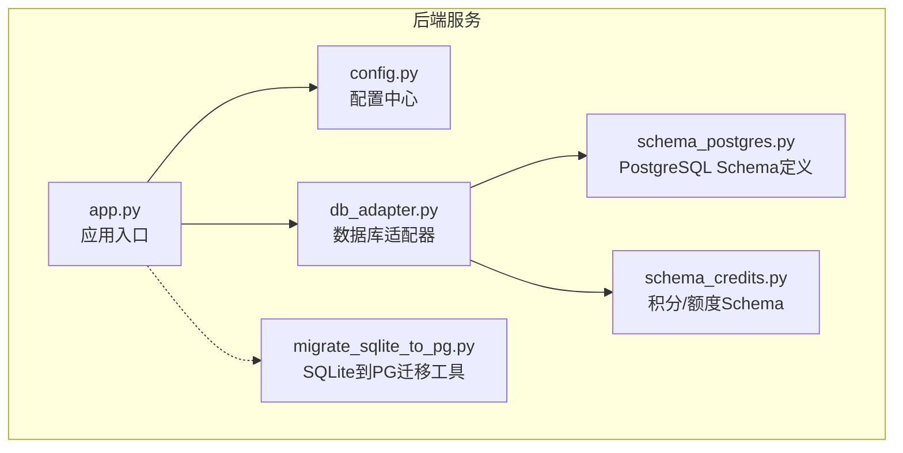
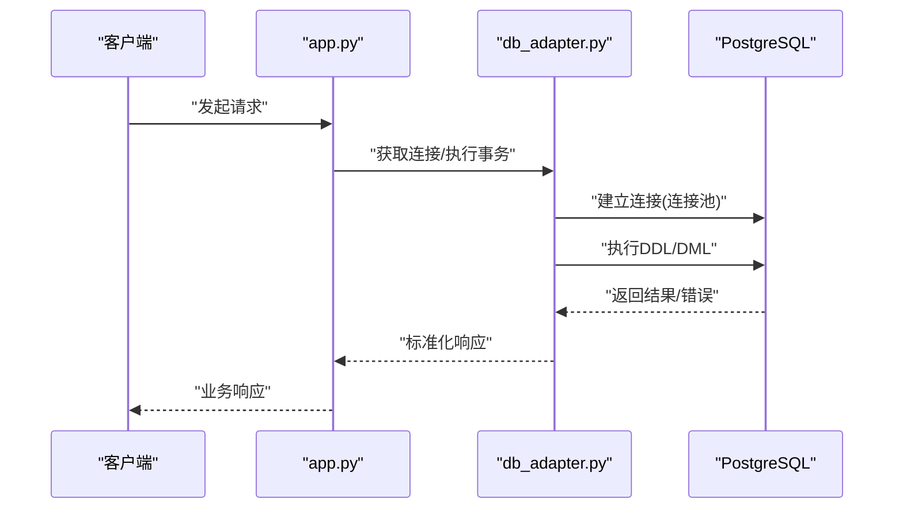
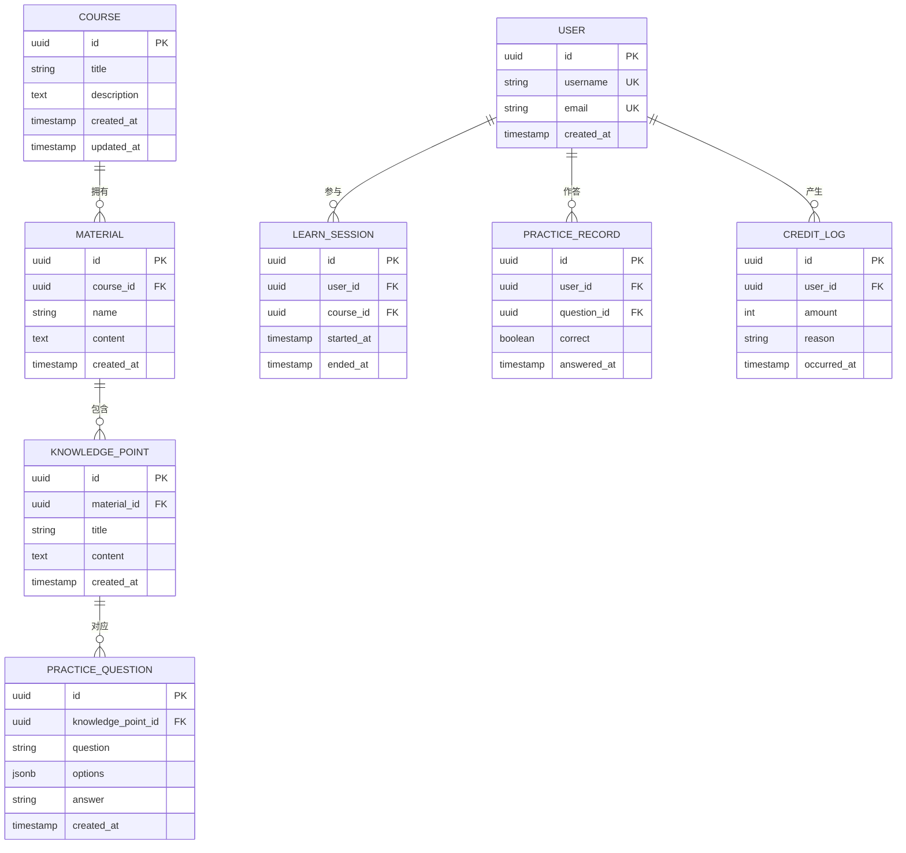
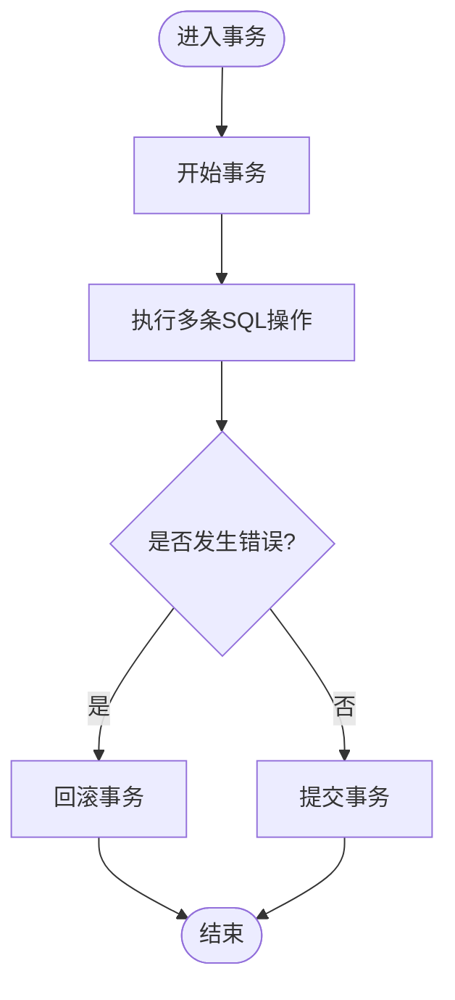
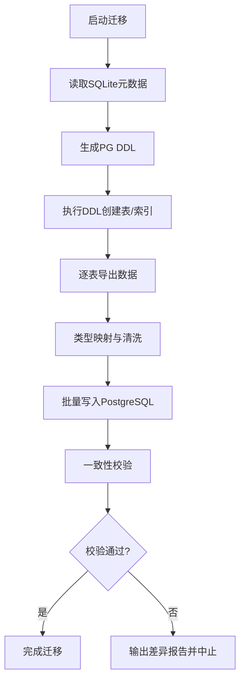
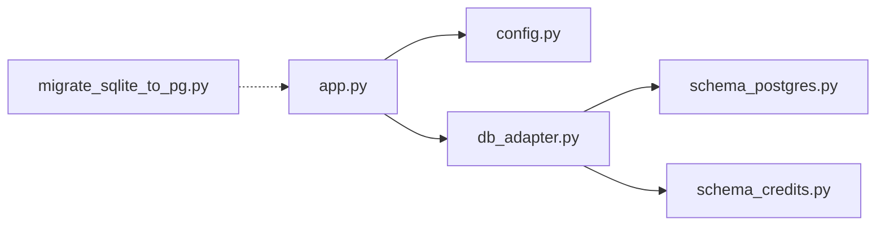

# 数据库Schema概览

<cite>
**本文引用的文件**   
- [server/database/schema_postgres.py](file://server/database/schema_postgres.py)
- [server/database/schema_credits.py](file://server/database/schema_credits.py)
- [server/database/db_adapter.py](file://server/database/db_adapter.py)
- [server/config.py](file://server/config.py)
- [server/app.py](file://server/app.py)
- [server/tools/migrate_sqlite_to_pg.py](file://server/tools/migrate_sqlite_to_pg.py)
</cite>

## 目录
1. [引言](#引言)
2. [项目结构](#项目结构)
3. [核心组件](#核心组件)
4. [架构总览](#架构总览)
5. [详细组件分析](#详细组件分析)
6. [依赖关系分析](#依赖关系分析)
7. [性能考虑](#性能考虑)
8. [故障排查指南](#故障排查指南)
9. [结论](#结论)
10. [附录](#附录)

## 引言
本文件面向LectureLearnLoop项目的PostgreSQL数据库，提供完整的Schema概览与工程化说明。内容涵盖：
- 整体数据库架构设计与核心表结构、ER关系图
- PostgreSQL选型的技术决策与优势
- 连接配置、事务管理与性能优化策略
- 数据库初始化流程、数据迁移机制与版本管理
- 数据备份恢复策略与监控方案
- 表关系图与字段映射说明

## 项目结构
本项目后端使用Python服务，数据库相关代码集中在 server/database 目录下，包含PostgreSQL Schema定义、Credits模块Schema以及通用数据库适配器；迁移脚本位于 server/tools 下；应用入口在 server/app.py，配置在 server/config.py。

图表来源
- [server/app.py:1-200](file://server/app.py#L1-L200)
- [server/config.py:1-200](file://server/config.py#L1-L200)
- [server/database/db_adapter.py:1-200](file://server/database/db_adapter.py#L1-L200)
- [server/database/schema_postgres.py:1-200](file://server/database/schema_postgres.py#L1-L200)
- [server/database/schema_credits.py:1-200](file://server/database/schema_credits.py#L1-L200)
- [server/tools/migrate_sqlite_to_pg.py:1-200](file://server/tools/migrate_sqlite_to_pg.py#L1-L200)

章节来源
- [server/app.py:1-200](file://server/app.py#L1-L200)
- [server/config.py:1-200](file://server/config.py#L1-L200)
- [server/database/db_adapter.py:1-200](file://server/database/db_adapter.py#L1-L200)
- [server/database/schema_postgres.py:1-200](file://server/database/schema_postgres.py#L1-L200)
- [server/database/schema_credits.py:1-200](file://server/database/schema_credits.py#L1-L200)
- [server/tools/migrate_sqlite_to_pg.py:1-200](file://server/tools/migrate_sqlite_to_pg.py#L1-L200)

## 核心组件
- PostgreSQL Schema定义：集中声明所有业务表、索引、约束与默认值，确保DDL可重复执行与一致性。
- Credits模块Schema：独立维护积分/额度相关的表结构与规则，便于扩展计费与配额能力。
- 数据库适配器：封装连接池、会话生命周期、事务边界、SQL执行与错误处理，向上层API暴露统一接口。
- 配置中心：统一管理数据库连接参数（主机、端口、库名、用户、密码）、连接池大小、超时等。
- 迁移工具：提供从SQLite到PostgreSQL的数据迁移脚本，支持增量迁移与回滚策略。

章节来源
- [server/database/schema_postgres.py:1-200](file://server/database/schema_postgres.py#L1-L200)
- [server/database/schema_credits.py:1-200](file://server/database/schema_credits.py#L1-L200)
- [server/database/db_adapter.py:1-200](file://server/database/db_adapter.py#L1-L200)
- [server/config.py:1-200](file://server/config.py#L1-L200)
- [server/tools/migrate_sqlite_to_pg.py:1-200](file://server/tools/migrate_sqlite_to_pg.py#L1-L200)

## 架构总览
下图展示应用、数据库适配器与PostgreSQL之间的交互关系，以及Schema定义如何被加载并用于建库与校验。

图表来源
- [server/app.py:1-200](file://server/app.py#L1-L200)
- [server/database/db_adapter.py:1-200](file://server/database/db_adapter.py#L1-L200)

## 详细组件分析

### PostgreSQL Schema设计
- 设计原则
  - 主键采用自增或UUID，保证唯一性与可扩展性。
  - 外键约束明确实体间关系，避免脏数据。
  - 常用查询字段建立索引，覆盖高频过滤与排序条件。
  - 时间戳字段统一使用UTC，便于审计与时区转换。
  - 文本类字段使用合适长度与字符集，必要时使用JSONB存储半结构化数据。
- 典型表族（示例）
  - 课程与材料：课程、材料、章节、知识点、练习题目等。
  - 学习行为：听课记录、练习记录、错题记录、复习计划等。
  - 系统元数据：用户、权限、日志、配置项等。
  - 积分与额度：积分流水、套餐、扣费记录等（由Credits模块管理）。
- ER关系图（概念级）

图表来源
- [server/database/schema_postgres.py:1-200](file://server/database/schema_postgres.py#L1-L200)
- [server/database/schema_credits.py:1-200](file://server/database/schema_credits.py#L1-L200)

章节来源
- [server/database/schema_postgres.py:1-200](file://server/database/schema_postgres.py#L1-L200)
- [server/database/schema_credits.py:1-200](file://server/database/schema_credits.py#L1-L200)

### Credits模块Schema
- 职责边界：负责用户积分、额度、消费流水与套餐规则的持久化。
- 关键表族
  - 积分流水：记录每次增减的原因、金额、时间戳。
  - 套餐与规则：定义不同套餐的额度、有效期与扣费优先级。
  - 用户额度快照：缓存当前可用额度，减少频繁计算。
- 与主Schema的关系：通过用户ID与业务事件（如完成练习、购买套餐）联动更新。

章节来源
- [server/database/schema_credits.py:1-200](file://server/database/schema_credits.py#L1-L200)

### 数据库适配器（连接与事务）
- 连接管理
  - 使用连接池提升并发性能，限制最大连接数防止资源耗尽。
  - 自动重试与退避策略应对瞬时网络抖动。
- 事务管理
  - 提供显式事务上下文管理器，确保多语句操作的原子性。
  - 失败时自动回滚，并抛出标准化异常供上层捕获。
- SQL执行
  - 统一封装查询、批量插入、分页查询与统计聚合。
  - 参数化查询防止SQL注入，统一日志记录慢查询。

图表来源
- [server/database/db_adapter.py:1-200](file://server/database/db_adapter.py#L1-L200)

章节来源
- [server/database/db_adapter.py:1-200](file://server/database/db_adapter.py#L1-L200)

### 配置中心（连接参数）
- 关键配置项
  - 数据库类型、主机、端口、库名、用户名、密码。
  - 连接池大小、连接超时、查询超时。
  - 日志级别、慢查询阈值、是否启用SSL。
- 环境变量与配置文件分离，便于多环境部署。

章节来源
- [server/config.py:1-200](file://server/config.py#L1-L200)

### 迁移机制（SQLite到PostgreSQL）
- 目标：将现有SQLite数据无损迁移至PostgreSQL，保持主键、外键与索引语义一致。
- 流程
  - 读取SQLite源Schema与数据。
  - 生成对应的PG DDL并执行。
  - 逐表导入数据，处理类型映射与空值。
  - 校验数据一致性，输出差异报告。
- 版本管理
  - 迁移脚本带版本号，支持向前与向后兼容。
  - 提供回滚脚本以撤销已执行的迁移。

图表来源
- [server/tools/migrate_sqlite_to_pg.py:1-200](file://server/tools/migrate_sqlite_to_pg.py#L1-L200)

章节来源
- [server/tools/migrate_sqlite_to_pg.py:1-200](file://server/tools/migrate_sqlite_to_pg.py#L1-L200)

## 依赖关系分析
- 耦合关系
  - app.py依赖config.py获取连接参数，依赖db_adapter.py进行数据库访问。
  - db_adapter.py依赖schema_postgres.py与schema_credits.py提供的DDL与约束信息。
  - migrate_sqlite_to_pg.py独立于运行时服务，仅在初始化或升级阶段运行。
- 外部依赖
  - PostgreSQL驱动（如psycopg2/asyncpg），连接池实现（如SQLAlchemy Pool或自定义）。
  - 可选：Prometheus指标导出器、日志采集Agent。

图表来源
- [server/app.py:1-200](file://server/app.py#L1-L200)
- [server/config.py:1-200](file://server/config.py#L1-L200)
- [server/database/db_adapter.py:1-200](file://server/database/db_adapter.py#L1-L200)
- [server/database/schema_postgres.py:1-200](file://server/database/schema_postgres.py#L1-L200)
- [server/database/schema_credits.py:1-200](file://server/database/schema_credits.py#L1-L200)
- [server/tools/migrate_sqlite_to_pg.py:1-200](file://server/tools/migrate_sqlite_to_pg.py#L1-L200)

章节来源
- [server/app.py:1-200](file://server/app.py#L1-L200)
- [server/config.py:1-200](file://server/config.py#L1-L200)
- [server/database/db_adapter.py:1-200](file://server/database/db_adapter.py#L1-L200)
- [server/database/schema_postgres.py:1-200](file://server/database/schema_postgres.py#L1-L200)
- [server/database/schema_credits.py:1-200](file://server/database/schema_credits.py#L1-L200)
- [server/tools/migrate_sqlite_to_pg.py:1-200](file://server/tools/migrate_sqlite_to_pg.py#L1-L200)

## 性能考虑
- 连接池调优
  - 根据并发量设置最小/最大连接数，避免连接风暴。
  - 合理设置连接空闲超时，及时回收闲置连接。
- 索引策略
  - 为高频过滤列（如用户ID、课程ID、时间范围）建立B-Tree索引。
  - 对JSONB字段使用GIN索引以加速半结构化查询。
  - 定期分析慢查询，调整复合索引顺序。
- 查询优化
  - 使用分页与只读副本分担压力。
  - 批量写入使用COPY或批量INSERT减少往返开销。
  - 避免N+1查询，使用JOIN或预加载。
- 事务与锁
  - 控制事务粒度，缩短持有锁的时间。
  - 使用行级锁与乐观锁避免写冲突。
- 监控与告警
  - 监控连接数、慢查询、锁等待、磁盘IO与CPU使用率。
  - 对关键指标设置阈值告警，结合日志定位问题。

[本节为通用指导，不直接分析具体文件]

## 故障排查指南
- 连接失败
  - 检查配置中心中的主机、端口、库名、用户名、密码是否正确。
  - 确认防火墙与安全组允许PostgreSQL端口访问。
  - 查看连接池是否耗尽，适当增大最大连接数。
- 事务异常
  - 捕获适配器抛出的标准化异常，检查是否因死锁或超时导致。
  - 缩小事务范围，拆分大事务为多个小事务。
- 数据不一致
  - 使用迁移工具的校验功能对比源与目标数据。
  - 核对外键约束与唯一索引，修复缺失或重复数据。
- 性能退化
  - 开启慢查询日志，定位热点SQL。
  - 检查索引命中率，重建失效索引。
  - 观察连接池与锁等待情况，调整并发与批大小。

章节来源
- [server/config.py:1-200](file://server/config.py#L1-L200)
- [server/database/db_adapter.py:1-200](file://server/database/db_adapter.py#L1-L200)
- [server/tools/migrate_sqlite_to_pg.py:1-200](file://server/tools/migrate_sqlite_to_pg.py#L1-L200)

## 结论
本项目基于PostgreSQL构建稳定、可扩展的数据库层。通过统一的Schema定义、健壮的数据库适配器与完善的迁移机制，确保了数据的一致性与可维护性。配合合理的连接池、索引与事务策略，可在高并发场景下保持良好性能。建议持续完善监控与告警体系，保障生产环境的稳定性与可观测性。

[本节为总结性内容，不直接分析具体文件]

## 附录

### PostgreSQL选型与技术优势
- ACID特性强，适合复杂事务与一致性要求高的业务。
- 丰富的数据类型与扩展生态（如JSONB、GIS、全文检索）。
- 成熟的复制与高可用方案（流复制、逻辑复制、云托管）。
- 强大的分析与报表能力，便于后续数据仓库与BI集成。

[本节为通用说明，不直接分析具体文件]

### 初始化流程清单
- 准备PostgreSQL实例与数据库。
- 加载Schema定义，执行DDL创建表、索引与约束。
- 运行迁移脚本，将历史数据从SQLite迁移至PostgreSQL。
- 验证数据一致性与完整性。
- 启动应用并接入连接池。

章节来源
- [server/database/schema_postgres.py:1-200](file://server/database/schema_postgres.py#L1-L200)
- [server/database/schema_credits.py:1-200](file://server/database/schema_credits.py#L1-L200)
- [server/tools/migrate_sqlite_to_pg.py:1-200](file://server/tools/migrate_sqlite_to_pg.py#L1-L200)

### 备份与恢复策略
- 全量备份：定期执行pg_dump，保留多份历史备份。
- 增量备份：启用WAL归档，结合pg_basebackup实现时间点恢复。
- 恢复演练：定期在测试环境演练恢复流程，验证RTO/RPO。
- 异地容灾：将备份同步至异地存储，防范单点故障。

[本节为通用指导，不直接分析具体文件]

### 监控方案建议
- 基础设施监控：CPU、内存、磁盘、网络。
- 数据库监控：连接数、慢查询、锁等待、IOPS、缓存命中率。
- 应用监控：QPS、延迟、错误率、事务耗时。
- 告警规则：按阈值与趋势触发告警，结合日志与链路追踪定位根因。

[本节为通用指导，不直接分析具体文件]