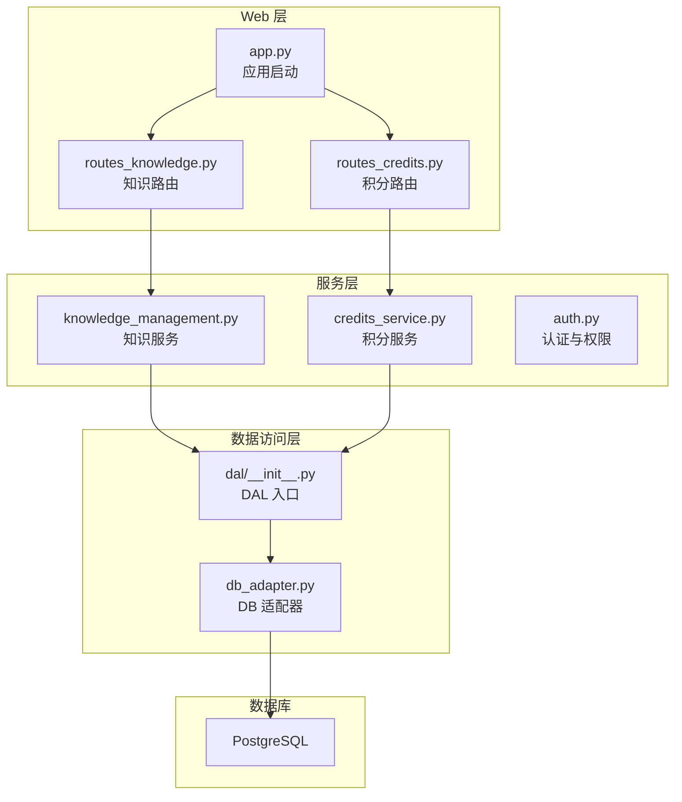
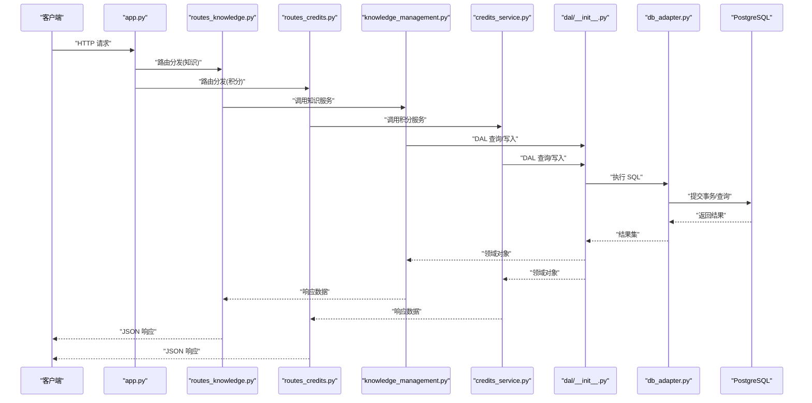
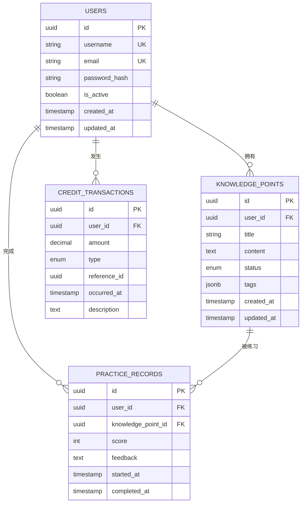
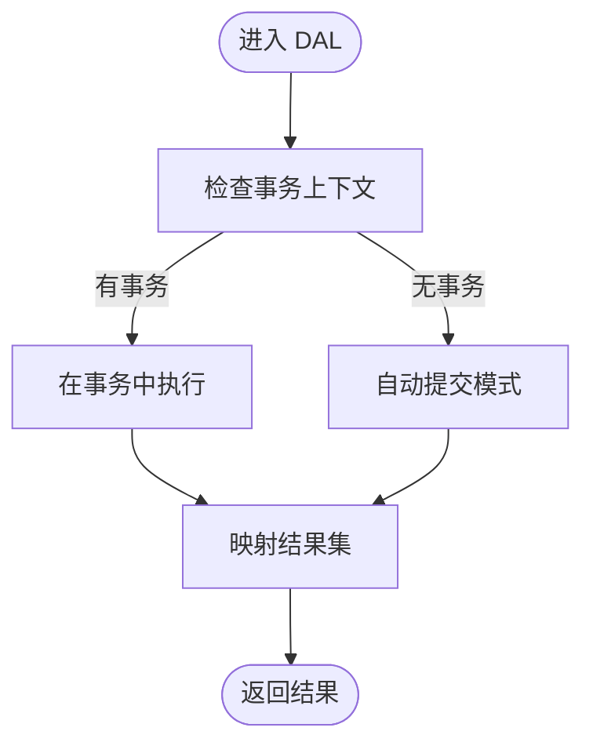
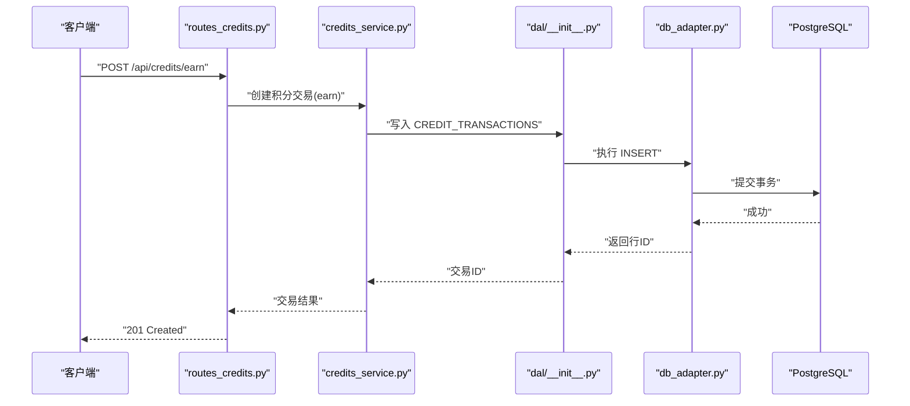
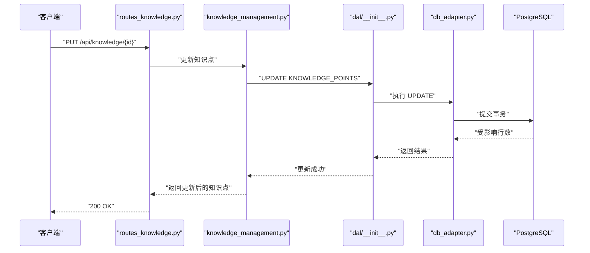
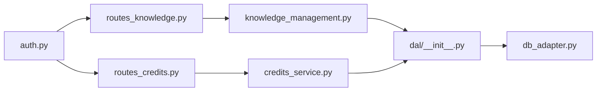

# 数据库设计

<cite>
**本文引用的文件**   
- [server/database/schema_postgres.py](file://server/database/schema_postgres.py)
- [server/database/schema_credits.py](file://server/database/schema_credits.py)
- [server/dal/__init__.py](file://server/dal/__init__.py)
- [server/database/db_adapter.py](file://server/database/db_adapter.py)
- [server/config.py](file://server/config.py)
- [server/routes_knowledge.py](file://server/routes_knowledge.py)
- [server/routes_credits.py](file://server/routes_credits.py)
- [server/knowledge_management.py](file://server/knowledge_management.py)
- [server/credits_service.py](file://server/credits_service.py)
- [server/auth.py](file://server/auth.py)
- [server/app.py](file://server/app.py)
</cite>

## 目录
1. [引言](#引言)
2. [项目结构](#项目结构)
3. [核心组件](#核心组件)
4. [架构总览](#架构总览)
5. [详细组件分析](#详细组件分析)
6. [依赖关系分析](#依赖关系分析)
7. [性能考虑](#性能考虑)
8. [故障排查指南](#故障排查指南)
9. [结论](#结论)
10. [附录](#附录)

## 引言
本文件为 LectureLearnLoop 项目的数据库设计文档，聚焦于用户表、知识点表、练习记录表和积分交易表的数据模型与实现。文档涵盖实体关系、字段定义、主键/外键、索引与约束、数据验证规则与业务规则、Schema 图与示例数据、数据访问模式、缓存策略与性能优化、数据生命周期与归档策略、迁移路径与版本管理，以及数据安全、隐私与访问控制等主题。目标是帮助开发者与维护者快速理解并正确使用数据库层。

## 项目结构
本项目采用 Python Web 服务架构，数据库相关代码集中在 server/database 与 server/dal 目录中：
- schema_postgres.py：PostgreSQL 数据库 Schema 定义（DDL）
- schema_credits.py：积分相关表的 DDL
- db_adapter.py：数据库连接与基础操作封装
- dal/__init__.py：数据访问层入口（对外暴露的查询/写入接口）
- routes_knowledge.py / routes_credits.py：知识管理与积分相关的 HTTP 路由
- knowledge_management.py / credits_service.py：领域服务层，封装业务逻辑
- auth.py：认证与权限控制
- config.py：配置项（数据库连接、日志等）
- app.py：应用启动与路由注册

图表来源
- [server/app.py:1-200](file://server/app.py#L1-L200)
- [server/routes_knowledge.py:1-200](file://server/routes_knowledge.py#L1-L200)
- [server/routes_credits.py:1-200](file://server/routes_credits.py#L1-L200)
- [server/knowledge_management.py:1-200](file://server/knowledge_management.py#L1-L200)
- [server/credits_service.py:1-200](file://server/credits_service.py#L1-L200)
- [server/dal/__init__.py:1-200](file://server/dal/__init__.py#L1-L200)
- [server/database/db_adapter.py:1-200](file://server/database/db_adapter.py#L1-L200)

章节来源
- [server/app.py:1-200](file://server/app.py#L1-L200)
- [server/config.py:1-200](file://server/config.py#L1-L200)

## 核心组件
- 数据库 Schema 定义：
  - PostgreSQL 主库 Schema：[schema_postgres.py](file://server/database/schema_postgres.py)
  - 积分模块 Schema：[schema_credits.py](file://server/database/schema_credits.py)
- 数据访问层：
  - DAL 入口：[dal/__init__.py](file://server/dal/__init__.py)
  - DB 适配器：[db_adapter.py](file://server/database/db_adapter.py)
- 领域服务：
  - 知识管理：[knowledge_management.py](file://server/knowledge_management.py)
  - 积分服务：[credits_service.py](file://server/credits_service.py)
- 路由与控制器：
  - 知识路由：[routes_knowledge.py](file://server/routes_knowledge.py)
  - 积分路由：[routes_credits.py](file://server/routes_credits.py)
- 认证与权限：
  - 认证模块：[auth.py](file://server/auth.py)
- 配置：
  - 配置中心：[config.py](file://server/config.py)

章节来源
- [server/database/schema_postgres.py:1-200](file://server/database/schema_postgres.py#L1-L200)
- [server/database/schema_credits.py:1-200](file://server/database/schema_credits.py#L1-L200)
- [server/dal/__init__.py:1-200](file://server/dal/__init__.py#L1-L200)
- [server/database/db_adapter.py:1-200](file://server/database/db_adapter.py#L1-L200)
- [server/knowledge_management.py:1-200](file://server/knowledge_management.py#L1-L200)
- [server/credits_service.py:1-200](file://server/credits_service.py#L1-L200)
- [server/routes_knowledge.py:1-200](file://server/routes_knowledge.py#L1-L200)
- [server/routes_credits.py:1-200](file://server/routes_credits.py#L1-L200)
- [server/auth.py:1-200](file://server/auth.py#L1-L200)
- [server/config.py:1-200](file://server/config.py#L1-L200)

## 架构总览
下图展示从 Web 请求到数据库的调用链，以及关键模块的职责边界。

图表来源
- [server/app.py:1-200](file://server/app.py#L1-L200)
- [server/routes_knowledge.py:1-200](file://server/routes_knowledge.py#L1-L200)
- [server/routes_credits.py:1-200](file://server/routes_credits.py#L1-L200)
- [server/knowledge_management.py:1-200](file://server/knowledge_management.py#L1-L200)
- [server/credits_service.py:1-200](file://server/credits_service.py#L1-L200)
- [server/dal/__init__.py:1-200](file://server/dal/__init__.py#L1-L200)
- [server/database/db_adapter.py:1-200](file://server/database/db_adapter.py#L1-L200)

## 详细组件分析

### 数据模型总览（ER 图）
以下 ER 图描述用户、知识点、练习记录与积分交易之间的主要关系。

图表来源
- [server/database/schema_postgres.py:1-200](file://server/database/schema_postgres.py#L1-L200)
- [server/database/schema_credits.py:1-200](file://server/database/schema_credits.py#L1-L200)

#### 用户表（USERS）
- 主键：id（UUID）
- 唯一约束：username、email
- 关键字段：
  - password_hash：密码哈希值
  - is_active：账户状态
  - created_at、updated_at：时间戳
- 索引建议：
  - 对 username、email 建立唯一索引（由唯一约束保证）
  - 对 is_active 建立普通索引以支持常见筛选
- 业务规则：
  - 用户名与邮箱全局唯一
  - 密码必须通过安全哈希存储，禁止明文
  - 账户激活状态影响登录与资源访问

章节来源
- [server/database/schema_postgres.py:1-200](file://server/database/schema_postgres.py#L1-L200)
- [server/auth.py:1-200](file://server/auth.py#L1-L200)

#### 知识点表（KNOWLEDGE_POINTS）
- 主键：id（UUID）
- 外键：user_id 引用 USERS(id)
- 关键字段：
  - title、content：标题与内容
  - status：状态枚举（如草稿、已发布、已归档）
  - tags：标签 JSONB，便于灵活检索
  - created_at、updated_at：时间戳
- 索引建议：
  - 对 user_id 建立索引以加速按用户查询
  - 对 status 建立索引以支持过滤
  - 对 tags 使用 GIN 索引以支持 JSONB 查询
- 业务规则：
  - 仅用户本人可编辑其知识点（需鉴权）
  - 状态变更需遵循工作流（草稿→已发布→已归档）

章节来源
- [server/database/schema_postgres.py:1-200](file://server/database/schema_postgres.py#L1-L200)
- [server/knowledge_management.py:1-200](file://server/knowledge_management.py#L1-L200)

#### 练习记录表（PRACTICE_RECORDS）
- 主键：id（UUID）
- 外键：
  - user_id 引用 USERS(id)
  - knowledge_point_id 引用 KNOWLEDGE_POINTS(id)
- 关键字段：
  - score：得分（整数或小数）
  - feedback：反馈文本
  - started_at、completed_at：开始与结束时间
- 索引建议：
  - 对 user_id、knowledge_point_id 建立复合索引以支持按用户与知识点统计
  - 对 completed_at 建立索引以支持按时间范围查询
- 业务规则：
  - 每次练习生成一条记录
  - 分数与反馈用于学习分析与推荐

章节来源
- [server/database/schema_postgres.py:1-200](file://server/database/schema_postgres.py#L1-L200)
- [server/knowledge_management.py:1-200](file://server/knowledge_management.py#L1-L200)

#### 积分交易表（CREDIT_TRANSACTIONS）
- 主键：id（UUID）
- 外键：user_id 引用 USERS(id)
- 关键字段：
  - amount：积分变动金额（正数增加，负数减少）
  - type：类型枚举（如 earn、spend、adjustment）
  - reference_id：关联的业务 ID（如练习记录、活动）
  - occurred_at：发生时间
  - description：描述
- 索引建议：
  - 对 user_id、occurred_at 建立复合索引以支持余额与流水查询
  - 对 type 建立索引以支持分类统计
- 业务规则：
  - 所有积分变动必须落库且不可篡改（追加式记录）
  - 余额计算基于累计交易（快照或实时聚合）

章节来源
- [server/database/schema_credits.py:1-200](file://server/database/schema_credits.py#L1-L200)
- [server/credits_service.py:1-200](file://server/credits_service.py#L1-L200)

### 数据访问模式
- DAL 入口提供统一的查询与写入方法，屏蔽底层数据库差异。
- DB 适配器负责连接池、事务管理、SQL 执行与结果映射。
- 服务层封装业务逻辑，DAL 仅暴露数据操作能力。

图表来源
- [server/dal/__init__.py:1-200](file://server/dal/__init__.py#L1-L200)
- [server/database/db_adapter.py:1-200](file://server/database/db_adapter.py#L1-L200)

章节来源
- [server/dal/__init__.py:1-200](file://server/dal/__init__.py#L1-L200)
- [server/database/db_adapter.py:1-200](file://server/database/db_adapter.py#L1-L200)

### 积分交易流程（序列图）

图表来源
- [server/routes_credits.py:1-200](file://server/routes_credits.py#L1-L200)
- [server/credits_service.py:1-200](file://server/credits_service.py#L1-L200)
- [server/dal/__init__.py:1-200](file://server/dal/__init__.py#L1-L200)
- [server/database/db_adapter.py:1-200](file://server/database/db_adapter.py#L1-L200)

章节来源
- [server/routes_credits.py:1-200](file://server/routes_credits.py#L1-L200)
- [server/credits_service.py:1-200](file://server/credits_service.py#L1-L200)

### 知识点更新流程（序列图）

图表来源
- [server/routes_knowledge.py:1-200](file://server/routes_knowledge.py#L1-L200)
- [server/knowledge_management.py:1-200](file://server/knowledge_management.py#L1-L200)
- [server/dal/__init__.py:1-200](file://server/dal/__init__.py#L1-L200)
- [server/database/db_adapter.py:1-200](file://server/database/db_adapter.py#L1-L200)

章节来源
- [server/routes_knowledge.py:1-200](file://server/routes_knowledge.py#L1-L200)
- [server/knowledge_management.py:1-200](file://server/knowledge_management.py#L1-L200)

## 依赖关系分析
- 路由层依赖服务层进行业务处理。
- 服务层依赖 DAL 进行数据访问。
- DAL 依赖 DB 适配器进行 SQL 执行。
- 认证模块校验用户身份与权限，影响路由与服务层的访问控制。

图表来源
- [server/routes_knowledge.py:1-200](file://server/routes_knowledge.py#L1-L200)
- [server/routes_credits.py:1-200](file://server/routes_credits.py#L1-L200)
- [server/knowledge_management.py:1-200](file://server/knowledge_management.py#L1-L200)
- [server/credits_service.py:1-200](file://server/credits_service.py#L1-L200)
- [server/dal/__init__.py:1-200](file://server/dal/__init__.py#L1-L200)
- [server/database/db_adapter.py:1-200](file://server/database/db_adapter.py#L1-L200)
- [server/auth.py:1-200](file://server/auth.py#L1-L200)

章节来源
- [server/routes_knowledge.py:1-200](file://server/routes_knowledge.py#L1-L200)
- [server/routes_credits.py:1-200](file://server/routes_credits.py#L1-L200)
- [server/knowledge_management.py:1-200](file://server/knowledge_management.py#L1-L200)
- [server/credits_service.py:1-200](file://server/credits_service.py#L1-L200)
- [server/dal/__init__.py:1-200](file://server/dal/__init__.py#L1-L200)
- [server/database/db_adapter.py:1-200](file://server/database/db_adapter.py#L1-L200)
- [server/auth.py:1-200](file://server/auth.py#L1-L200)

## 性能考虑
- 索引策略：
  - 对用户表：username、email 唯一索引；is_active 普通索引
  - 对知识点表：user_id、status 索引；tags 使用 GIN 索引
  - 对练习记录表：user_id + knowledge_point_id 复合索引；completed_at 索引
  - 对积分交易表：user_id + occurred_at 复合索引；type 索引
- 查询优化：
  - 避免 N+1 查询，批量加载关联数据
  - 分页与游标查询，防止大结果集拖慢响应
- 事务与锁：
  - 积分交易使用事务确保一致性
  - 热点账户余额更新使用行级锁或乐观并发控制
- 缓存策略：
  - 热点知识点可缓存（Redis），设置过期时间与失效策略
  - 用户基本信息缓存，减少频繁读取
- 连接池：
  - 合理配置连接池大小，避免连接耗尽
  - 监控慢查询与长事务

[本节为通用指导，不直接分析具体文件]

## 故障排查指南
- 常见问题：
  - 连接失败：检查数据库配置与网络连通性
  - 事务冲突：查看锁等待与死锁日志
  - 索引缺失：分析慢查询日志并补充索引
  - 权限错误：检查认证与授权逻辑
- 诊断步骤：
  - 启用详细日志，记录 SQL 与参数
  - 使用 EXPLAIN ANALYZE 分析查询计划
  - 监控连接池与事务时长
  - 校验数据一致性与完整性约束

章节来源
- [server/database/db_adapter.py:1-200](file://server/database/db_adapter.py#L1-L200)
- [server/config.py:1-200](file://server/config.py#L1-L200)

## 结论
本数据库设计围绕用户、知识点、练习记录与积分交易四大核心实体展开，明确了字段定义、主外键关系、索引与约束、业务规则与访问控制。通过分层架构（路由-服务-DAL-DB）与事务保障，确保数据一致性与可扩展性。建议在后续迭代中持续优化索引与缓存策略，完善审计与归档机制，提升系统性能与可维护性。

[本节为总结性内容，不直接分析具体文件]

## 附录

### 示例数据（示意）
- 用户：
  - id: "a1b2c3d4-e5f6-..."
  - username: "alice"
  - email: "alice@example.com"
  - password_hash: "$2b$12$..."
  - is_active: true
  - created_at: "2026-01-01T00:00:00Z"
  - updated_at: "2026-01-01T00:00:00Z"
- 知识点：
  - id: "k1k2k3k4-k5k6-..."
  - user_id: "a1b2c3d4-e5f6-..."
  - title: "Python 基础语法"
  - content: "变量、数据类型、控制流..."
  - status: "published"
  - tags: ["python", "basics"]
  - created_at: "2026-01-02T00:00:00Z"
  - updated_at: "2026-01-02T00:00:00Z"
- 练习记录：
  - id: "p1p2p3p4-p5p6-..."
  - user_id: "a1b2c3d4-e5f6-..."
  - knowledge_point_id: "k1k2k3k4-k5k6-..."
  - score: 85
  - feedback: "掌握良好"
  - started_at: "2026-01-03T10:00:00Z"
  - completed_at: "2026-01-03T10:30:00Z"
- 积分交易：
  - id: "t1t2t3t4-t5t6-..."
  - user_id: "a1b2c3d4-e5f6-..."
  - amount: 10
  - type: "earn"
  - reference_id: "p1p2p3p4-p5p6-..."
  - occurred_at: "2026-01-03T10:35:00Z"
  - description: "完成练习获得积分"

[本节为概念性示例，不直接分析具体文件]

### 数据生命周期与归档策略
- 活跃数据：
  - 近 6 个月的练习记录与积分交易保持热数据
- 归档数据：
  - 超过 6 个月的数据归档至历史表或冷存储
- 清理策略：
  - 删除长期未激活的用户及其关联数据（经确认与通知）
- 备份与恢复：
  - 定期全量备份与增量备份
  - 制定灾难恢复演练计划

[本节为通用指导，不直接分析具体文件]

### 数据迁移与版本管理
- 迁移工具：
  - 使用 Alembic 或自定义脚本管理 Schema 变更
- 版本控制：
  - 每个迁移包含版本号与回滚脚本
- 灰度发布：
  - 先在小流量环境验证迁移脚本
  - 逐步扩大范围，监控错误率与性能指标

[本节为通用指导，不直接分析具体文件]

### 数据安全、隐私与访问控制
- 认证与授权：
  - 使用 JWT 或会话机制进行身份认证
  - 基于角色的访问控制（RBAC）限制敏感操作
- 数据加密：
  - 传输层使用 TLS
  - 敏感字段（如密码）使用强哈希算法存储
- 审计与合规：
  - 记录关键操作的审计日志
  - 符合隐私法规（如最小化收集、用户同意）

章节来源
- [server/auth.py:1-200](file://server/auth.py#L1-L200)
- [server/config.py:1-200](file://server/config.py#L1-L200)