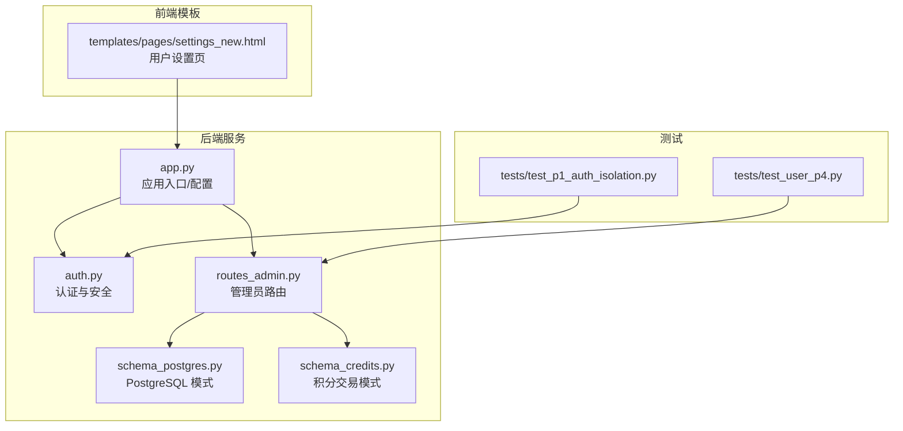
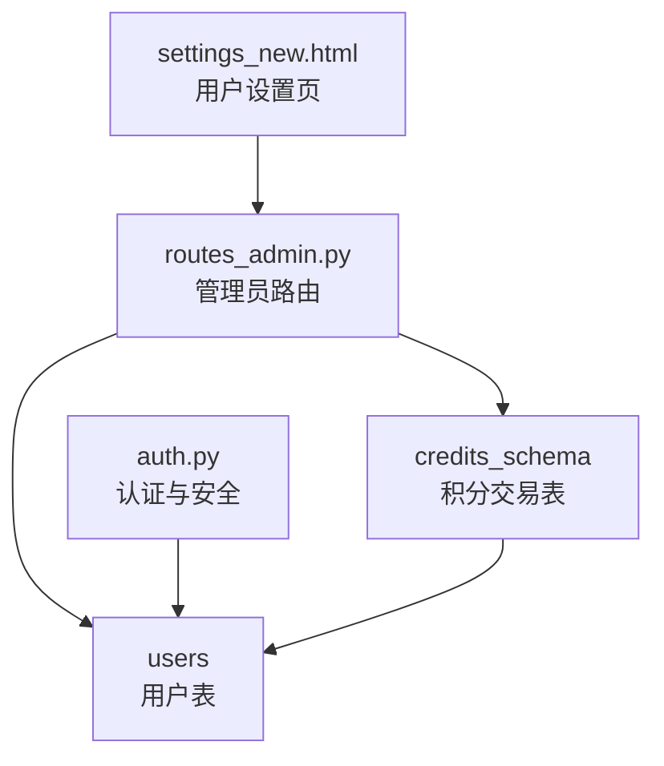
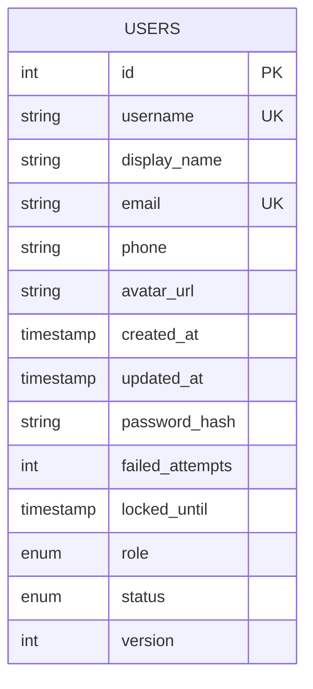
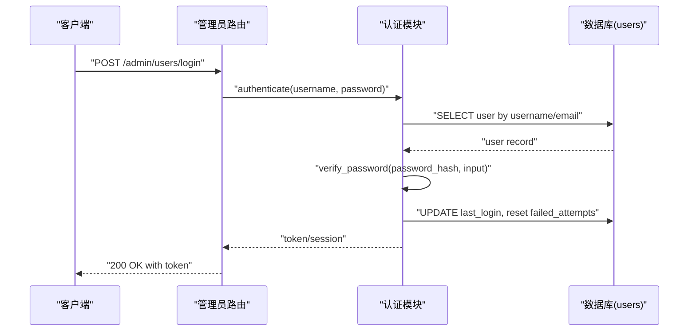
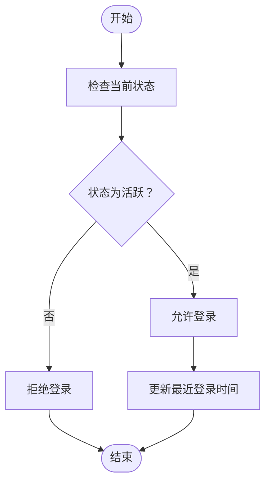
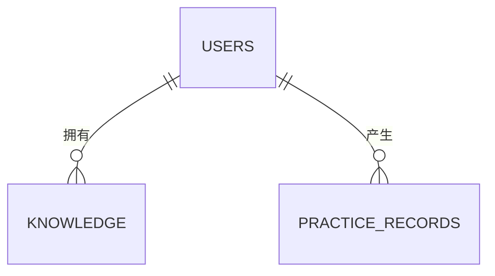
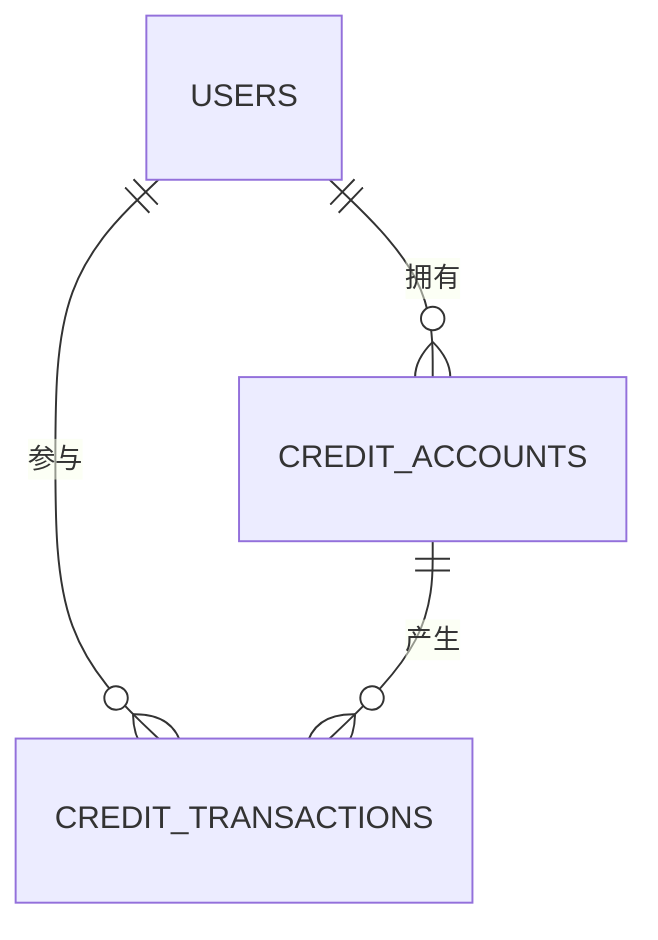
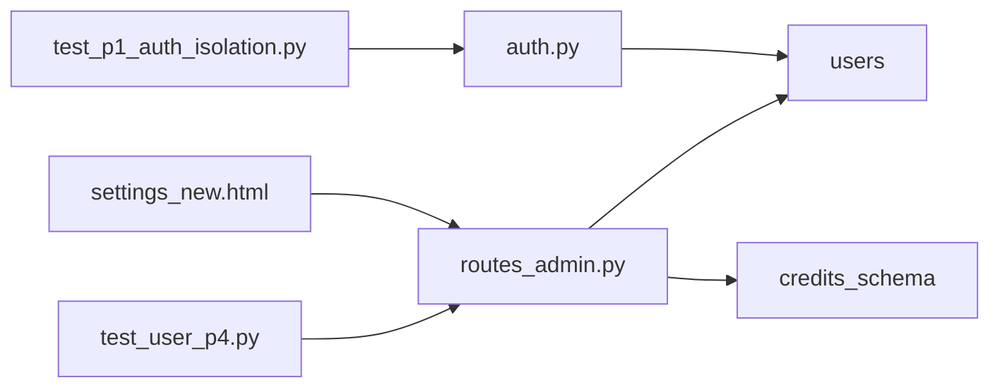

# 用户数据模型

<cite>
**本文引用的文件**   
- [server/database/schema_postgres.py](file://server/database/schema_postgres.py)
- [server/database/schema_credits.py](file://server/database/schema_credits.py)
- [server/auth.py](file://server/auth.py)
- [server/app.py](file://server/app.py)
- [server/routes_admin.py](file://server/routes_admin.py)
- [server/templates/pages/settings_new.html](file://server/templates/pages/settings_new.html)
- [server/tests/test_p1_auth_isolation.py](file://server/tests/test_p1_auth_isolation.py)
- [server/tests/test_user_p4.py](file://server/tests/test_user_p4.py)
</cite>

## 目录
1. [引言](#引言)
2. [项目结构](#项目结构)
3. [核心组件](#核心组件)
4. [架构总览](#架构总览)
5. [详细组件分析](#详细组件分析)
6. [依赖关系分析](#依赖关系分析)
7. [性能与索引优化](#性能与索引优化)
8. [故障排查指南](#故障排查指南)
9. [结论](#结论)
10. [附录：CRUD SQL 示例与最佳实践](#附录crud-sql-示例与最佳实践)

## 引言
本文件聚焦“用户数据模型”，围绕用户表结构设计、认证与安全策略、状态管理、以及与知识点、练习记录、积分交易的关联关系进行系统化说明。文档同时给出数据验证规则、业务约束、索引优化建议，以及面向 PostgreSQL 的 CRUD SQL 示例与最佳实践，帮助开发者在实现用户相关功能时保持一致性与可维护性。

## 项目结构
本项目采用 Python Web 应用结构，数据库模式定义集中在 server/database 下；认证逻辑位于 server/auth.py；路由层包含管理员与通用页面路由；前端模板提供用户设置界面；测试用例覆盖认证隔离与用户流程。

**图表来源**
- [server/app.py:1-200](file://server/app.py#L1-L200)
- [server/auth.py:1-200](file://server/auth.py#L1-L200)
- [server/routes_admin.py:1-200](file://server/routes_admin.py#L1-L200)
- [server/database/schema_postgres.py:1-200](file://server/database/schema_postgres.py#L1-L200)
- [server/database/schema_credits.py:1-200](file://server/database/schema_credits.py#L1-L200)
- [server/templates/pages/settings_new.html:1-200](file://server/templates/pages/settings_new.html#L1-L200)
- [server/tests/test_p1_auth_isolation.py:1-200](file://server/tests/test_p1_auth_isolation.py#L1-L200)
- [server/tests/test_user_p4.py:1-200](file://server/tests/test_user_p4.py#L1-L200)

**章节来源**
- [server/app.py:1-200](file://server/app.py#L1-L200)
- [server/auth.py:1-200](file://server/auth.py#L1-L200)
- [server/routes_admin.py:1-200](file://server/routes_admin.py#L1-L200)
- [server/database/schema_postgres.py:1-200](file://server/database/schema_postgres.py#L1-L200)
- [server/database/schema_credits.py:1-200](file://server/database/schema_credits.py#L1-L200)
- [server/templates/pages/settings_new.html:1-200](file://server/templates/pages/settings_new.html#L1-L200)
- [server/tests/test_p1_auth_isolation.py:1-200](file://server/tests/test_p1_auth_isolation.py#L1-L200)
- [server/tests/test_user_p4.py:1-200](file://server/tests/test_user_p4.py#L1-L200)

## 核心组件
- 用户表（users）：存储用户基本信息、认证凭据、权限角色、状态与审计字段。
- 认证模块（auth.py）：负责登录校验、密码哈希、会话/令牌管理与安全策略。
- 管理员路由（routes_admin.py）：提供用户创建、更新、禁用等管理接口。
- 积分交易模式（schema_credits.py）：定义积分账户与交易流水，用于用户消费与奖励。
- 用户设置页（settings_new.html）：前端用户信息编辑与密码修改入口。

关键职责划分：
- schema_postgres.py 定义用户表结构与约束。
- auth.py 实现认证流程与安全策略。
- routes_admin.py 暴露用户管理的 API 或页面路由。
- schema_credits.py 定义积分相关表，与用户通过外键关联。
- settings_new.html 提供用户自助修改资料与密码的前端能力。

**章节来源**
- [server/database/schema_postgres.py:1-200](file://server/database/schema_postgres.py#L1-L200)
- [server/auth.py:1-200](file://server/auth.py#L1-L200)
- [server/routes_admin.py:1-200](file://server/routes_admin.py#L1-L200)
- [server/database/schema_credits.py:1-200](file://server/database/schema_credits.py#L1-L200)
- [server/templates/pages/settings_new.html:1-200](file://server/templates/pages/settings_new.html#L1-L200)

## 架构总览
下图展示用户数据模型在系统中的位置与交互关系：用户表作为核心实体，被认证模块、管理员路由与积分系统引用；前端通过设置页与后端交互完成用户资料的增删改查与密码更新。

**图表来源**
- [server/database/schema_postgres.py:1-200](file://server/database/schema_postgres.py#L1-L200)
- [server/auth.py:1-200](file://server/auth.py#L1-L200)
- [server/routes_admin.py:1-200](file://server/routes_admin.py#L1-L200)
- [server/database/schema_credits.py:1-200](file://server/database/schema_credits.py#L1-L200)
- [server/templates/pages/settings_new.html:1-200](file://server/templates/pages/settings_new.html#L1-L200)

## 详细组件分析

### 用户表（users）设计
- 主键：用户唯一标识（建议使用自增整数或 UUID）。
- 基本信息：用户名、显示名、邮箱、手机号、头像 URL、注册时间、更新时间。
- 认证信息：密码哈希、盐值（若未使用框架内置）、最近登录时间、失败尝试次数、锁定截止时间。
- 权限角色：角色枚举（如普通用户、讲师、管理员），是否启用、是否删除标记。
- 审计字段：创建人、更新人、版本号（乐观锁）。

数据类型与约束建议：
- 用户名：非空、唯一、长度限制（例如 3-32 字符）。
- 邮箱：非空、唯一、符合邮箱格式。
- 密码哈希：固定长度字符串（如 bcrypt 输出）。
- 角色：枚举类型或受限字符串集。
- 状态：枚举（活跃、禁用、待审核）。
- 时间戳：带时区的时间类型。

索引优化：
- 用户名、邮箱建立唯一索引。
- 常用查询条件（如状态、角色）建立复合索引。
- 审计字段（创建时间、更新时间）建立索引以支持排序与分页。

**图表来源**
- [server/database/schema_postgres.py:1-200](file://server/database/schema_postgres.py#L1-L200)

**章节来源**
- [server/database/schema_postgres.py:1-200](file://server/database/schema_postgres.py#L1-L200)

### 认证与安全策略（auth.py）
- 登录流程：校验用户名/邮箱与密码，更新最近登录时间，处理失败尝试计数与账户锁定。
- 密码加密：使用强哈希算法（如 bcrypt），禁止明文存储。
- 会话/令牌：生成并验证访问令牌，设置过期时间，支持刷新机制。
- 安全策略：最小权限原则、输入校验、防暴力破解（尝试次数与锁定）、敏感操作二次确认。

**图表来源**
- [server/auth.py:1-200](file://server/auth.py#L1-L200)
- [server/routes_admin.py:1-200](file://server/routes_admin.py#L1-L200)
- [server/database/schema_postgres.py:1-200](file://server/database/schema_postgres.py#L1-L200)

**章节来源**
- [server/auth.py:1-200](file://server/auth.py#L1-L200)
- [server/routes_admin.py:1-200](file://server/routes_admin.py#L1-L200)

### 用户状态管理
- 状态枚举：活跃、禁用、待审核。
- 状态变更：管理员可通过后台路由更改用户状态；用户自助修改资料不改变状态。
- 锁定机制：连续失败登录达到阈值后自动锁定，需管理员解锁或等待超时自动解锁。
- 审计追踪：所有状态变更记录操作人与时间。

**图表来源**
- [server/auth.py:1-200](file://server/auth.py#L1-L200)
- [server/database/schema_postgres.py:1-200](file://server/database/schema_postgres.py#L1-L200)

**章节来源**
- [server/auth.py:1-200](file://server/auth.py#L1-L200)
- [server/database/schema_postgres.py:1-200](file://server/database/schema_postgres.py#L1-L200)

### 用户与知识点、练习记录的关联
- 知识点（knowledge_base）：通常由用户创建或关联到用户，形成一对多关系（一个用户可拥有多个知识点）。
- 练习记录（practice_records）：记录用户的练习行为与结果，与用户为一对多关系。
- 建议在 users 表中保留必要的统计字段（如知识点数量、练习次数）以减少复杂聚合查询。

**图表来源**
- [server/database/schema_postgres.py:1-200](file://server/database/schema_postgres.py#L1-L200)

**章节来源**
- [server/database/schema_postgres.py:1-200](file://server/database/schema_postgres.py#L1-L200)

### 用户与积分交易的关联（schema_credits.py）
- 积分账户（credit_accounts）：每个用户一个账户，记录余额、冻结金额、累计获得/消耗。
- 交易流水（credit_transactions）：记录每次积分变动的原因、金额、时间、操作人。
- 外键约束：credit_accounts.user_id 引用 users.id，保证一致性。

**图表来源**
- [server/database/schema_credits.py:1-200](file://server/database/schema_credits.py#L1-L200)
- [server/database/schema_postgres.py:1-200](file://server/database/schema_postgres.py#L1-L200)

**章节来源**
- [server/database/schema_credits.py:1-200](file://server/database/schema_credits.py#L1-L200)
- [server/database/schema_postgres.py:1-200](file://server/database/schema_postgres.py#L1-L200)

### 用户数据验证规则与业务约束
- 用户名：唯一、长度范围、字符集限制（字母数字与下划线）。
- 邮箱：唯一、格式校验、域名白名单（可选）。
- 密码：最小长度、复杂度要求（大小写、数字、特殊字符）、历史重复限制。
- 角色：仅允许预定义集合。
- 状态：仅允许预定义集合，且受业务规则控制（如禁用用户不可登录）。
- 并发更新：使用版本号字段进行乐观锁更新，避免覆盖写入。

**章节来源**
- [server/database/schema_postgres.py:1-200](file://server/database/schema_postgres.py#L1-L200)
- [server/auth.py:1-200](file://server/auth.py#L1-L200)

## 依赖关系分析
- 认证模块依赖用户表进行凭据校验与状态检查。
- 管理员路由依赖用户表与积分模式进行用户管理与积分操作。
- 前端设置页依赖管理员路由提供的接口完成用户资料与密码更新。
- 测试用例覆盖认证隔离与用户流程，确保数据一致性与安全性。

**图表来源**
- [server/auth.py:1-200](file://server/auth.py#L1-L200)
- [server/routes_admin.py:1-200](file://server/routes_admin.py#L1-L200)
- [server/database/schema_postgres.py:1-200](file://server/database/schema_postgres.py#L1-L200)
- [server/database/schema_credits.py:1-200](file://server/database/schema_credits.py#L1-L200)
- [server/templates/pages/settings_new.html:1-200](file://server/templates/pages/settings_new.html#L1-L200)
- [server/tests/test_p1_auth_isolation.py:1-200](file://server/tests/test_p1_auth_isolation.py#L1-L200)
- [server/tests/test_user_p4.py:1-200](file://server/tests/test_user_p4.py#L1-L200)

**章节来源**
- [server/auth.py:1-200](file://server/auth.py#L1-L200)
- [server/routes_admin.py:1-200](file://server/routes_admin.py#L1-L200)
- [server/database/schema_postgres.py:1-200](file://server/database/schema_postgres.py#L1-L200)
- [server/database/schema_credits.py:1-200](file://server/database/schema_credits.py#L1-L200)
- [server/templates/pages/settings_new.html:1-200](file://server/templates/pages/settings_new.html#L1-L200)
- [server/tests/test_p1_auth_isolation.py:1-200](file://server/tests/test_p1_auth_isolation.py#L1-L200)
- [server/tests/test_user_p4.py:1-200](file://server/tests/test_user_p4.py#L1-L200)

## 性能与索引优化
- 唯一索引：用户名、邮箱。
- 查询索引：状态、角色、创建时间、更新时间。
- 复合索引：(status, role)、(created_at DESC)。
- 分区建议：当用户规模较大时，可按注册时间或地区进行分区。
- 缓存策略：热点用户信息可使用 Redis 缓存，注意失效与一致性。
- 事务与锁：积分扣减与余额更新使用事务与行级锁，防止超扣。

[本节为通用性能指导，无需具体文件引用]

## 故障排查指南
- 登录失败：检查用户状态是否为活跃、失败尝试次数是否超限、锁定截止时间是否已过。
- 密码错误：确认密码哈希算法与版本，检查输入是否经过正确编码。
- 权限不足：核对用户角色与资源访问控制规则。
- 积分异常：检查交易流水是否完整、账户余额是否与流水汇总一致。
- 并发冲突：观察版本号字段是否递增，必要时重试或提示用户刷新。

**章节来源**
- [server/auth.py:1-200](file://server/auth.py#L1-L200)
- [server/database/schema_credits.py:1-200](file://server/database/schema_credits.py#L1-L200)

## 结论
用户数据模型以 users 表为核心，结合认证模块与管理路由实现安全的身份管理与权限控制；通过积分交易模式扩展用户价值体系；前端设置页提供用户自助管理能力。通过严格的验证规则、索引优化与事务保障，系统在可扩展性与一致性之间取得平衡。

[本节为总结性内容，无需具体文件引用]

## 附录：CRUD SQL 示例与最佳实践
以下示例基于 PostgreSQL 语法，假设 users 表已按前述设计创建。请根据实际列名调整。

- 创建用户
  - INSERT INTO users (username, display_name, email, phone, password_hash, role, status, created_at, updated_at) VALUES ('alice', 'Alice Wang', 'alice@example.com', '13800000000', '<bcrypt_hash>', 'user', 'active', NOW(), NOW());

- 查询用户
  - SELECT id, username, display_name, email, role, status, created_at FROM users WHERE username = 'alice';
  - SELECT * FROM users WHERE email = 'alice@example.com' AND status = 'active';

- 更新用户资料
  - UPDATE users SET display_name = 'Alice Li', phone = '13800000001', updated_at = NOW() WHERE username = 'alice' AND version = <current_version>;

- 更新密码（使用强哈希）
  - UPDATE users SET password_hash = '<new_bcrypt_hash>', updated_at = NOW() WHERE username = 'alice';

- 禁用/启用用户
  - UPDATE users SET status = 'disabled', updated_at = NOW() WHERE username = 'alice';
  - UPDATE users SET status = 'active', updated_at = NOW() WHERE username = 'alice';

- 处理登录失败与锁定
  - UPDATE users SET failed_attempts = failed_attempts + 1, locked_until = CASE WHEN failed_attempts + 1 >= 5 THEN NOW() + INTERVAL '30 minutes' ELSE NULL END, updated_at = NOW() WHERE username = 'alice';
  - 解锁：UPDATE users SET failed_attempts = 0, locked_until = NULL, updated_at = NOW() WHERE username = 'alice';

- 乐观锁更新
  - UPDATE users SET display_name = 'Alice Zhang', version = version + 1, updated_at = NOW() WHERE id = <user_id> AND version = <current_version>;

最佳实践：
- 始终使用参数化查询，防止 SQL 注入。
- 密码必须使用 bcrypt 等强哈希算法，禁止明文存储。
- 所有写操作记录 updated_at 与 version，便于审计与并发控制。
- 对高频查询字段建立合适索引，避免全表扫描。
- 涉及积分的操作使用事务，确保余额与流水一致。

**章节来源**
- [server/database/schema_postgres.py:1-200](file://server/database/schema_postgres.py#L1-L200)
- [server/auth.py:1-200](file://server/auth.py#L1-L200)
- [server/database/schema_credits.py:1-200](file://server/database/schema_credits.py#L1-L200)