# 知识数据模型

<cite>
**本文引用的文件**   
- [knowledge_management.py](file://server/knowledge_management.py)
- [routes_knowledge.py](file://server/routes_knowledge.py)
- [schema_postgres.py](file://server/database/schema_postgres.py)
- [schema_credits.py](file://server/database/schema_credits.py)
- [db_adapter.py](file://server/database/db_adapter.py)
- [app.py](file://server/app.py)
- [config.py](file://server/config.py)
- [knowledge_base.html](file://server/templates/pages/knowledge_base.html)
- [memory_knowledge.html](file://server/templates/pages/memory_knowledge.html)
- [practice_knowledge.html](file://server/templates/pages/practice_knowledge.html)
- [api.js](file://server/static/js/api.js)
</cite>

## 目录
1. [引言](#引言)
2. [项目结构](#项目结构)
3. [核心组件](#核心组件)
4. [架构总览](#架构总览)
5. [详细组件分析](#详细组件分析)
6. [依赖关系分析](#依赖关系分析)
7. [性能考虑](#性能考虑)
8. [故障排查指南](#故障排查指南)
9. [结论](#结论)
10. [附录](#附录)

## 引言
本文件面向“知识管理系统”的数据模型与实现，聚焦以下目标：
- 知识点表、知识分类表、知识关联表的字段设计与关系建模
- 知识内容存储格式、版本控制与元数据管理
- 知识图谱的关系建模、标签系统与搜索索引
- 知识点的层级结构、父子关系与依赖关系设计
- 知识数据的导入导出、批量操作与性能优化方案

该文档既适合后端开发者理解数据库与服务端逻辑，也适合前端与产品人员理解数据结构与交互流程。

## 项目结构
围绕知识数据模型，关键代码分布在服务端路由、领域服务、数据库适配与模板/前端脚本中：
- 领域服务层：负责知识点、分类、关联等核心业务逻辑
- 路由层：暴露 HTTP API，承载导入导出、批量操作等能力
- 数据访问层：封装数据库连接、事务与通用查询
- 数据库模式：定义 PostgreSQL 相关表结构与约束
- 前端页面与脚本：调用 API，渲染知识图谱、标签与搜索结果

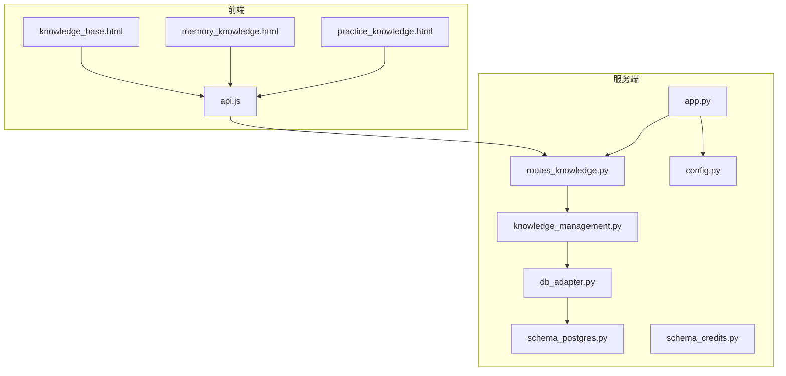

图表来源
- [app.py:1-200](file://server/app.py#L1-L200)
- [routes_knowledge.py:1-200](file://server/routes_knowledge.py#L1-L200)
- [knowledge_management.py:1-200](file://server/knowledge_management.py#L1-L200)
- [db_adapter.py:1-200](file://server/database/db_adapter.py#L1-L200)
- [schema_postgres.py:1-200](file://server/database/schema_postgres.py#L1-L200)
- [schema_credits.py:1-200](file://server/database/schema_credits.py#L1-L200)
- [config.py:1-200](file://server/config.py#L1-L200)
- [knowledge_base.html:1-200](file://server/templates/pages/knowledge_base.html#L1-L200)
- [memory_knowledge.html:1-200](file://server/templates/pages/memory_knowledge.html#L1-L200)
- [practice_knowledge.html:1-200](file://server/templates/pages/practice_knowledge.html#L1-L200)
- [api.js:1-200](file://server/static/js/api.js#L1-L200)

章节来源
- [app.py:1-200](file://server/app.py#L1-L200)
- [routes_knowledge.py:1-200](file://server/routes_knowledge.py#L1-L200)
- [knowledge_management.py:1-200](file://server/knowledge_management.py#L1-L200)
- [db_adapter.py:1-200](file://server/database/db_adapter.py#L1-L200)
- [schema_postgres.py:1-200](file://server/database/schema_postgres.py#L1-L200)
- [schema_credits.py:1-200](file://server/database/schema_credits.py#L1-L200)
- [config.py:1-200](file://server/config.py#L1-L200)
- [knowledge_base.html:1-200](file://server/templates/pages/knowledge_base.html#L1-L200)
- [memory_knowledge.html:1-200](file://server/templates/pages/memory_knowledge.html#L1-L200)
- [practice_knowledge.html:1-200](file://server/templates/pages/practice_knowledge.html#L1-L200)
- [api.js:1-200](file://server/static/js/api.js#L1-L200)

## 核心组件
- 知识点实体：承载知识的最小单元，包含标题、正文、类型、状态、排序、时间戳等元数据
- 知识分类实体：用于组织知识点的树形分类体系，支持层级与排序
- 知识关联实体：描述知识点之间的多种关系（如前置依赖、并列、扩展、引用等）
- 标签系统：为知识点打标签，支持多标签与检索
- 版本控制：对知识点内容进行版本化，保留历史变更轨迹
- 搜索索引：基于关键词、标签、分类进行检索与过滤

章节来源
- [knowledge_management.py:1-200](file://server/knowledge_management.py#L1-L200)
- [routes_knowledge.py:1-200](file://server/routes_knowledge.py#L1-L200)
- [schema_postgres.py:1-200](file://server/database/schema_postgres.py#L1-L200)

## 架构总览
知识数据模型在系统中的职责边界如下：
- 前端页面通过 api.js 发起请求，调用 routes_knowledge.py 暴露的接口
- routes_knowledge.py 将请求转发给 knowledge_management.py 处理业务逻辑
- knowledge_management.py 通过 db_adapter.py 访问数据库，遵循 schema_postgres.py 定义的表结构
- app.py 统一注册路由与配置，config.py 提供系统级配置项

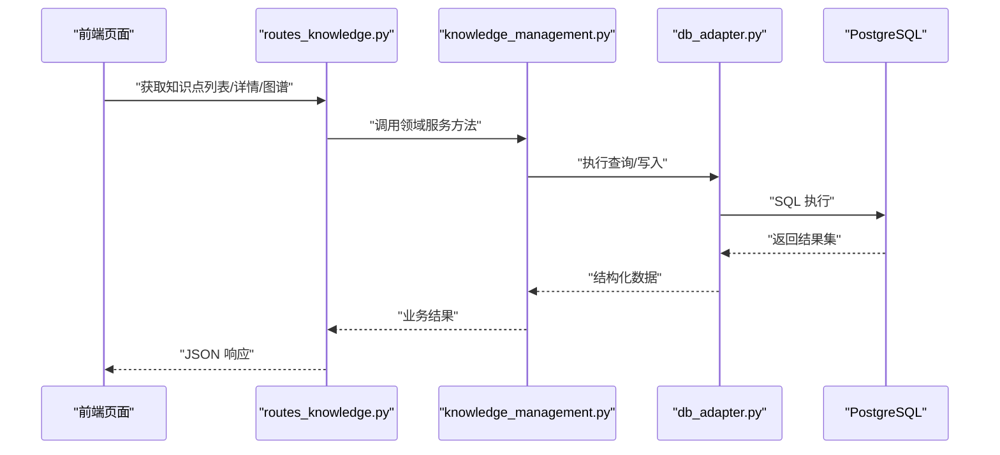

图表来源
- [routes_knowledge.py:1-200](file://server/routes_knowledge.py#L1-L200)
- [knowledge_management.py:1-200](file://server/knowledge_management.py#L1-L200)
- [db_adapter.py:1-200](file://server/database/db_adapter.py#L1-L200)
- [schema_postgres.py:1-200](file://server/database/schema_postgres.py#L1-L200)

## 详细组件分析

### 知识点表（Knowledge Item）
- 主键：唯一标识知识点
- 标题：知识点的名称
- 正文：知识内容的主体文本或结构化内容
- 类型：区分知识点类型（例如概念、规则、案例等）
- 状态：草稿、已发布、归档等生命周期状态
- 父节点：用于构建层级结构（根节点为空）
- 排序：同级排序权重
- 创建时间、更新时间：审计字段
- 版本号：配合版本控制使用
- 其他元数据：如来源、作者、语言、摘要等

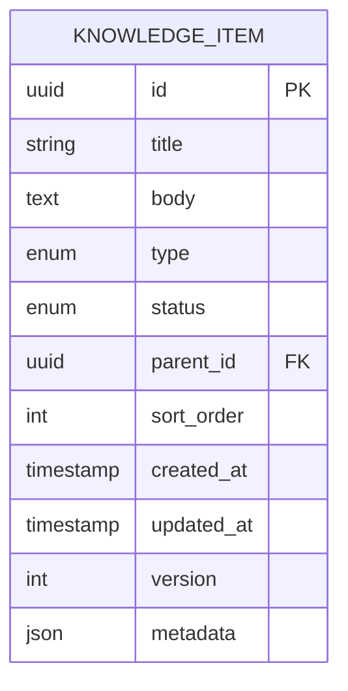

图表来源
- [schema_postgres.py:1-200](file://server/database/schema_postgres.py#L1-L200)
- [knowledge_management.py:1-200](file://server/knowledge_management.py#L1-L200)

章节来源
- [schema_postgres.py:1-200](file://server/database/schema_postgres.py#L1-L200)
- [knowledge_management.py:1-200](file://server/knowledge_management.py#L1-L200)

### 知识分类表（Knowledge Category）
- 主键：唯一标识分类
- 名称：分类名称
- 父分类：用于构建分类树
- 排序：同级排序权重
- 状态：启用/禁用
- 创建时间、更新时间：审计字段

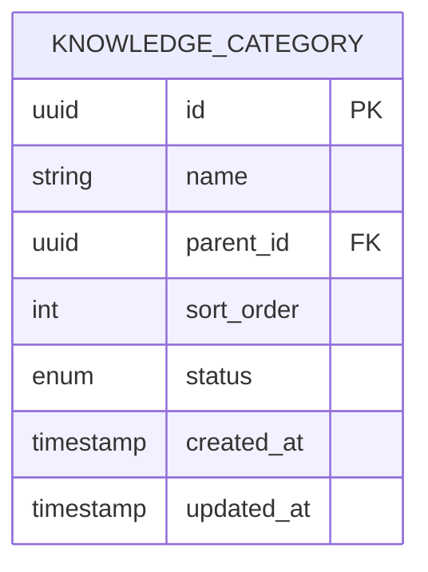

图表来源
- [schema_postgres.py:1-200](file://server/database/schema_postgres.py#L1-L200)

章节来源
- [schema_postgres.py:1-200](file://server/database/schema_postgres.py#L1-L200)

### 知识关联表（Knowledge Relation）
- 主键：唯一标识关联关系
- 源知识点：关系的起点
- 目标知识点：关系的终点
- 关系类型：前置依赖、并列、扩展、引用等
- 权重：关系的强度或优先级
- 创建时间、更新时间：审计字段

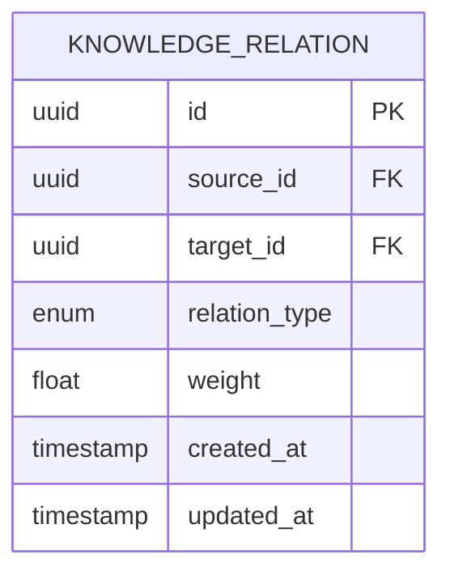

图表来源
- [schema_postgres.py:1-200](file://server/database/schema_postgres.py#L1-L200)

章节来源
- [schema_postgres.py:1-200](file://server/database/schema_postgres.py#L1-L200)

### 标签系统（Knowledge Tag）
- 主键：唯一标识标签
- 名称：标签名
- 别名：便于同义词检索
- 创建时间、更新时间：审计字段

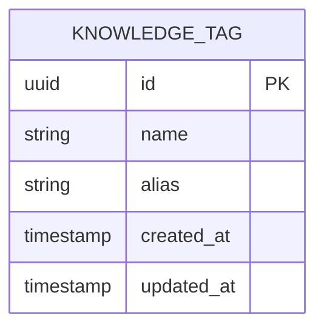

图表来源
- [schema_postgres.py:1-200](file://server/database/schema_postgres.py#L1-L200)

章节来源
- [schema_postgres.py:1-200](file://server/database/schema_postgres.py#L1-L200)

### 知识点-标签关联表（Knowledge_Tag_Mapping）
- 主键：唯一标识映射记录
- 知识点：被标记的知识点
- 标签：标签实体
- 创建时间：审计字段

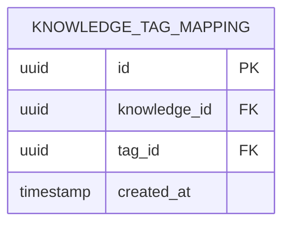

图表来源
- [schema_postgres.py:1-200](file://server/database/schema_postgres.py#L1-L200)

章节来源
- [schema_postgres.py:1-200](file://server/database/schema_postgres.py#L1-L200)

### 版本控制（Knowledge Version）
- 主键：唯一标识版本记录
- 知识点：所属知识点
- 版本号：递增或语义化版本
- 内容快照：保存某次修改后的内容
- 变更说明：本次修改的原因或摘要
- 创建时间、创建人：审计字段

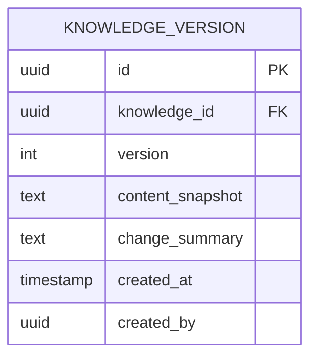

图表来源
- [schema_postgres.py:1-200](file://server/database/schema_postgres.py#L1-L200)

章节来源
- [schema_postgres.py:1-200](file://server/database/schema_postgres.py#L1-L200)

### 搜索索引（Search Index）
- 主键：唯一标识索引条目
- 知识点：被索引的知识点
- 分词内容：用于全文检索的分词结果
- 标签集合：与该知识点相关的标签
- 分类路径：从根到当前分类的路径
- 更新时间：索引同步时间

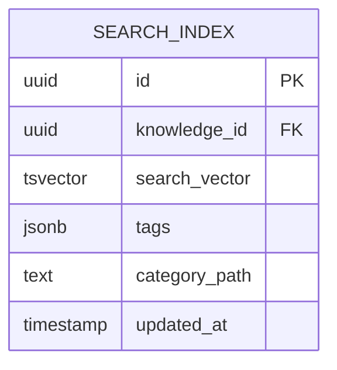

图表来源
- [schema_postgres.py:1-200](file://server/database/schema_postgres.py#L1-L200)

章节来源
- [schema_postgres.py:1-200](file://server/database/schema_postgres.py#L1-L200)

### 知识图谱关系建模
- 节点：知识点实体
- 边：知识关联实体，支持多种关系类型与权重
- 层级：通过父节点字段形成树状结构
- 依赖：通过关系类型表达前置依赖、扩展、引用等

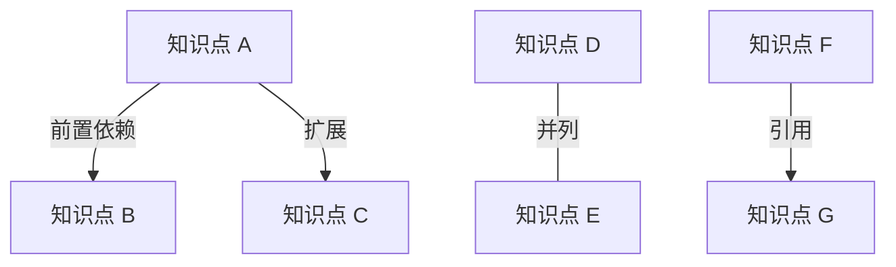

图表来源
- [schema_postgres.py:1-200](file://server/database/schema_postgres.py#L1-L200)
- [knowledge_management.py:1-200](file://server/knowledge_management.py#L1-L200)

章节来源
- [schema_postgres.py:1-200](file://server/database/schema_postgres.py#L1-L200)
- [knowledge_management.py:1-200](file://server/knowledge_management.py#L1-L200)

### 知识内容存储格式
- 正文字段支持富文本或结构化内容（如 JSON），便于前端渲染与二次加工
- 元数据字段以 JSON 形式存储扩展属性（如来源、作者、语言、摘要等）
- 版本控制通过内容快照字段保存每次修改后的完整内容

章节来源
- [schema_postgres.py:1-200](file://server/database/schema_postgres.py#L1-L200)
- [knowledge_management.py:1-200](file://server/knowledge_management.py#L1-L200)

### 层级结构与父子关系
- 知识点通过父节点字段形成树形结构，支持多级嵌套
- 分类同样通过父分类字段形成分类树
- 排序字段保证同级节点的展示顺序稳定

章节来源
- [schema_postgres.py:1-200](file://server/database/schema_postgres.py#L1-L200)

### 依赖关系设计
- 通过知识关联表表达依赖、扩展、引用等关系
- 关系类型与权重可用于图遍历、路径分析与可视化布局

章节来源
- [schema_postgres.py:1-200](file://server/database/schema_postgres.py#L1-L200)
- [knowledge_management.py:1-200](file://server/knowledge_management.py#L1-L200)

### 导入导出与批量操作
- 导入：支持批量导入知识点、分类、标签及其映射关系
- 导出：支持按分类、标签、关键词导出知识点及图谱关系
- 批量操作：批量更新状态、批量打标签、批量迁移分类

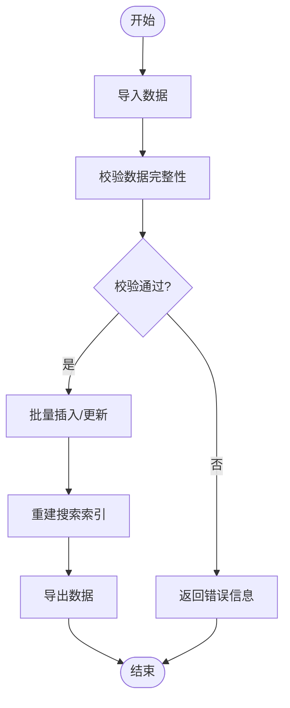

图表来源
- [routes_knowledge.py:1-200](file://server/routes_knowledge.py#L1-L200)
- [knowledge_management.py:1-200](file://server/knowledge_management.py#L1-L200)

章节来源
- [routes_knowledge.py:1-200](file://server/routes_knowledge.py#L1-L200)
- [knowledge_management.py:1-200](file://server/knowledge_management.py#L1-L200)

### 搜索与标签检索
- 关键词检索：基于分词内容与标签集合进行匹配
- 分类过滤：通过分类路径快速筛选
- 标签聚合：统计标签出现频率，辅助导航与推荐

章节来源
- [schema_postgres.py:1-200](file://server/database/schema_postgres.py#L1-L200)
- [knowledge_management.py:1-200](file://server/knowledge_management.py#L1-L200)

## 依赖关系分析
- 路由层依赖领域服务：routes_knowledge.py 调用 knowledge_management.py
- 领域服务依赖数据访问层：knowledge_management.py 通过 db_adapter.py 访问数据库
- 数据访问层依赖数据库模式：db_adapter.py 遵循 schema_postgres.py 的表结构
- 应用入口统一注册路由与配置：app.py 与 config.py 协同工作

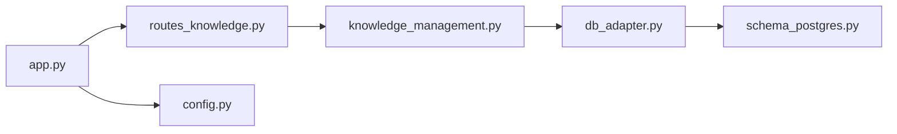

图表来源
- [routes_knowledge.py:1-200](file://server/routes_knowledge.py#L1-L200)
- [knowledge_management.py:1-200](file://server/knowledge_management.py#L1-L200)
- [db_adapter.py:1-200](file://server/database/db_adapter.py#L1-L200)
- [schema_postgres.py:1-200](file://server/database/schema_postgres.py#L1-L200)
- [app.py:1-200](file://server/app.py#L1-L200)
- [config.py:1-200](file://server/config.py#L1-L200)

章节来源
- [routes_knowledge.py:1-200](file://server/routes_knowledge.py#L1-L200)
- [knowledge_management.py:1-200](file://server/knowledge_management.py#L1-L200)
- [db_adapter.py:1-200](file://server/database/db_adapter.py#L1-L200)
- [schema_postgres.py:1-200](file://server/database/schema_postgres.py#L1-L200)
- [app.py:1-200](file://server/app.py#L1-L200)
- [config.py:1-200](file://server/config.py#L1-L200)

## 性能考虑
- 索引策略：为高频查询字段（如分类路径、标签、状态、更新时间）建立索引
- 分页与游标：大数据量列表采用分页或游标避免全表扫描
- 批量写入：导入时采用批量插入/更新减少事务开销
- 异步重索引：导入后异步重建搜索索引，避免阻塞主流程
- 缓存热点：对常用图谱与分类树进行缓存，降低数据库压力
- 连接池：合理配置数据库连接池大小，避免连接耗尽

[本节为通用性能建议，不直接分析具体文件]

## 故障排查指南
- 导入失败：检查数据校验逻辑与必填字段，确认分类与标签存在性
- 搜索无结果：确认分词内容与标签集合是否正确生成，检查索引更新时间
- 图谱异常：检查关联关系是否完整，验证关系类型与权重设置
- 版本回滚失败：核对版本快照与当前内容一致性，确认权限与锁定机制

章节来源
- [routes_knowledge.py:1-200](file://server/routes_knowledge.py#L1-L200)
- [knowledge_management.py:1-200](file://server/knowledge_management.py#L1-L200)

## 结论
本数据模型以知识点为核心，结合分类、关联、标签与版本控制，构建了可扩展的知识管理体系。通过搜索索引与图谱关系建模，支持高效的检索与可视化分析。导入导出与批量操作提升了数据治理能力，配合合理的索引与缓存策略，可满足大规模知识数据的存储与查询需求。

[本节为总结性内容，不直接分析具体文件]

## 附录
- 前端页面参考：knowledge_base.html、memory_knowledge.html、practice_knowledge.html
- 前端脚本参考：api.js
- 数据库模式参考：schema_postgres.py、schema_credits.py
- 应用入口与配置：app.py、config.py

章节来源
- [knowledge_base.html:1-200](file://server/templates/pages/knowledge_base.html#L1-L200)
- [memory_knowledge.html:1-200](file://server/templates/pages/memory_knowledge.html#L1-L200)
- [practice_knowledge.html:1-200](file://server/templates/pages/practice_knowledge.html#L1-L200)
- [api.js:1-200](file://server/static/js/api.js#L1-L200)
- [schema_postgres.py:1-200](file://server/database/schema_postgres.py#L1-L200)
- [schema_credits.py:1-200](file://server/database/schema_credits.py#L1-L200)
- [app.py:1-200](file://server/app.py#L1-L200)
- [config.py:1-200](file://server/config.py#L1-L200)