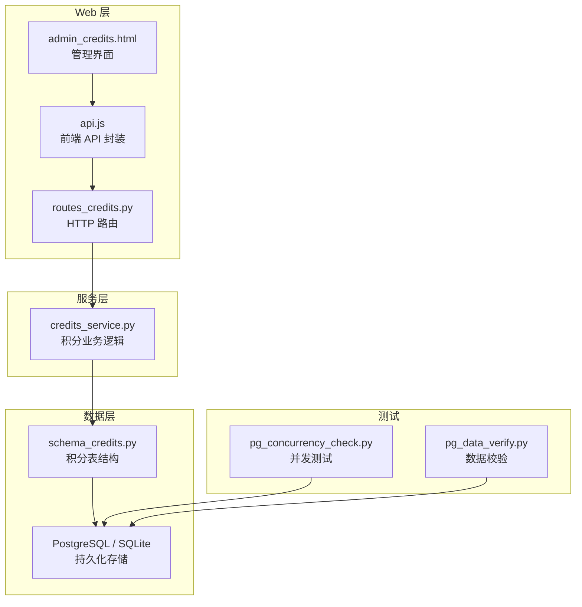
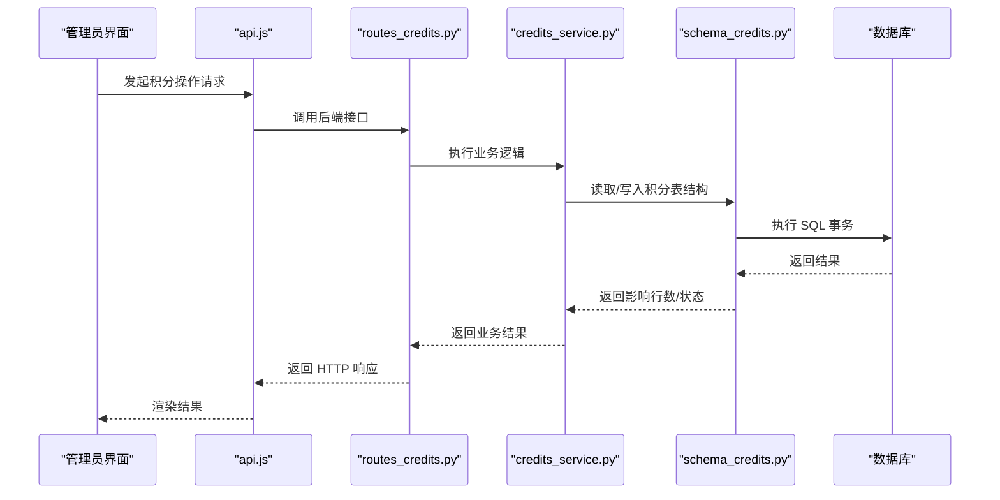
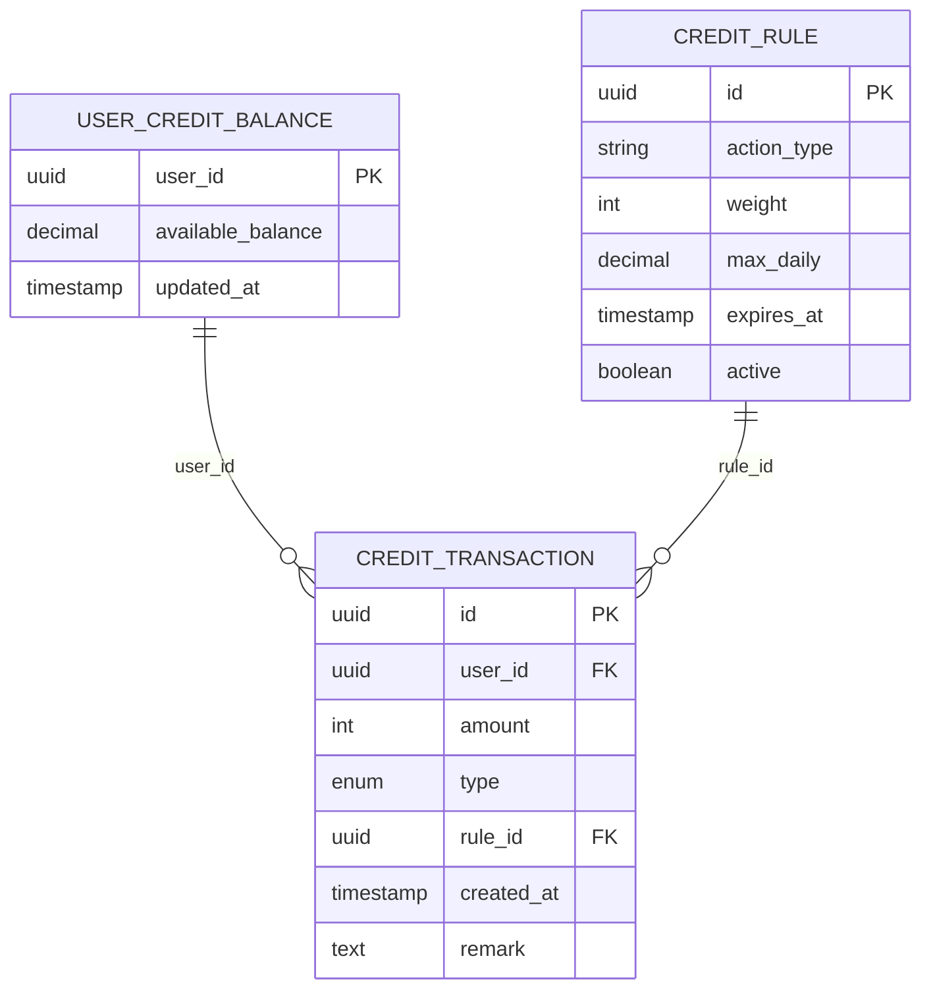
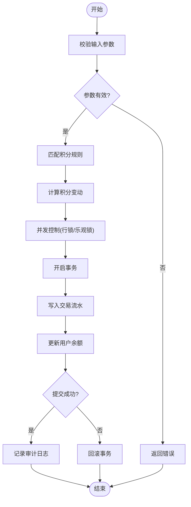
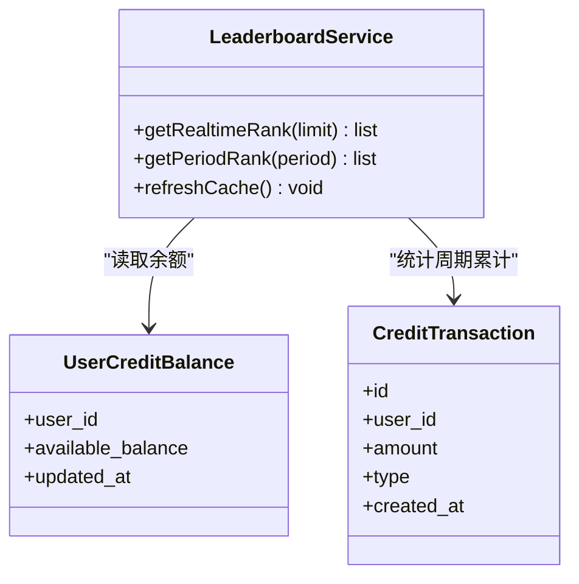
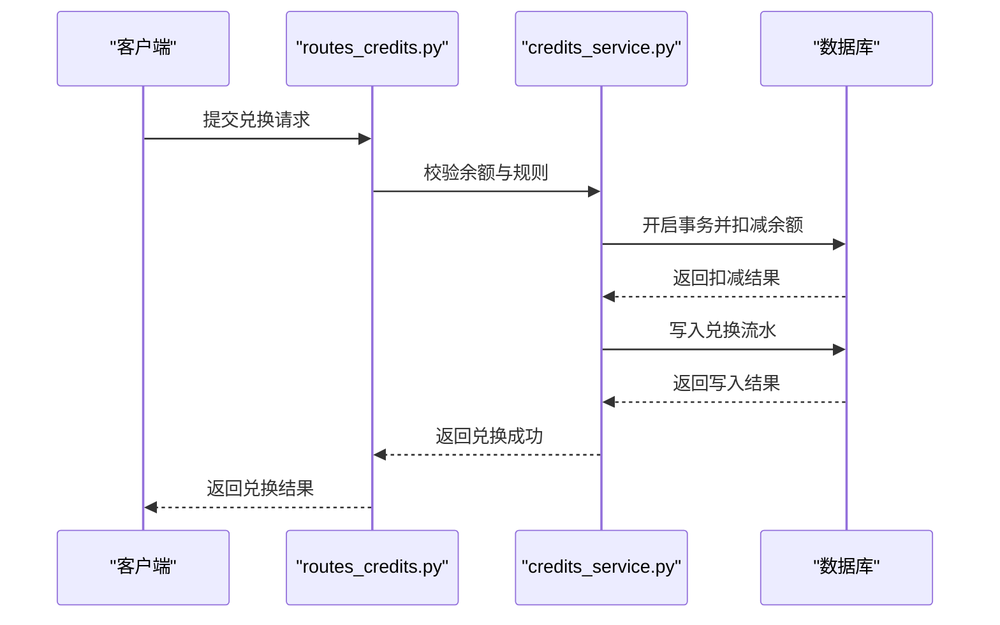
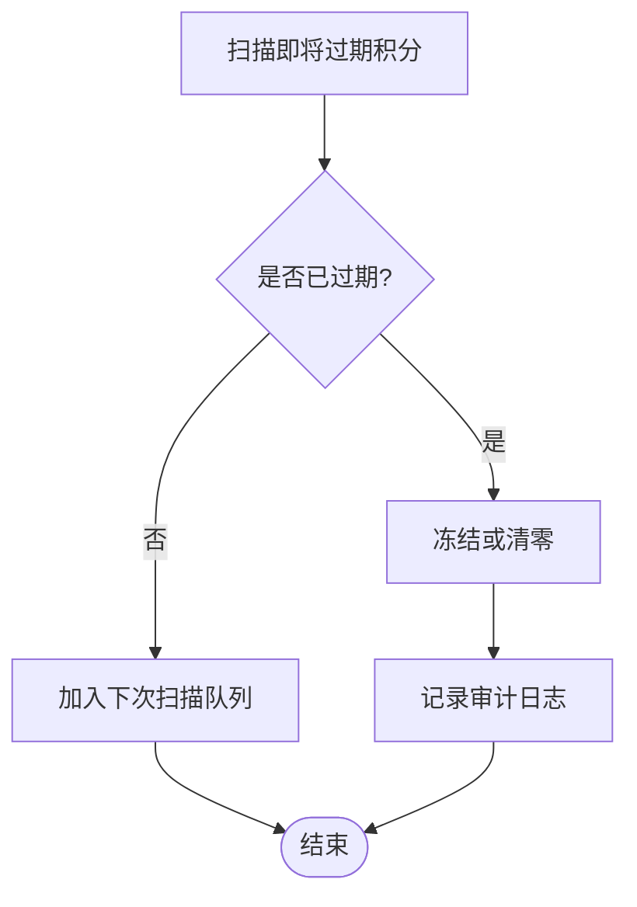
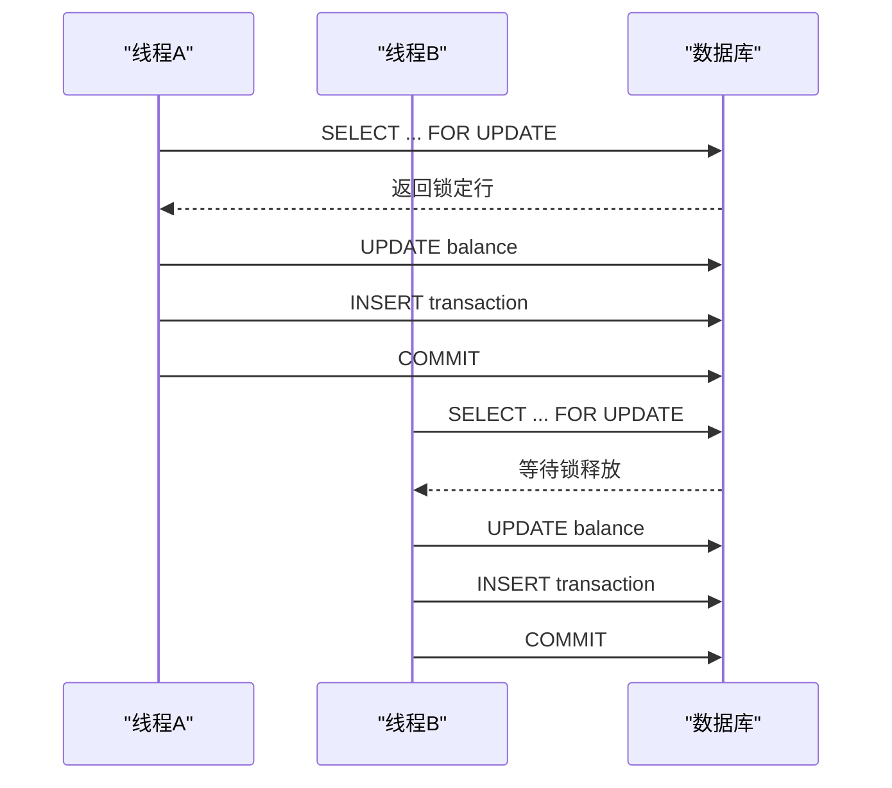
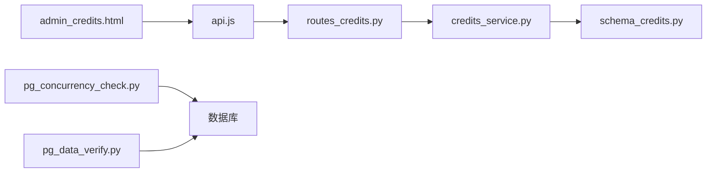

# 积分数据模型

<cite>
**本文引用的文件**   
- [server/database/schema_credits.py](file://server/database/schema_credits.py)
- [server/credits_service.py](file://server/credits_service.py)
- [server/routes_credits.py](file://server/routes_credits.py)
- [server/templates/pages/admin_credits.html](file://server/templates/pages/admin_credits.html)
- [server/static/js/api.js](file://server/static/js/api.js)
- [server/tests/pg_concurrency_check.py](file://server/tests/pg_concurrency_check.py)
- [server/tests/pg_data_verify.py](file://server/tests/pg_data_verify.py)
</cite>

## 目录
1. [引言](#引言)
2. [项目结构](#项目结构)
3. [核心组件](#核心组件)
4. [架构总览](#架构总览)
5. [详细组件分析](#详细组件分析)
6. [依赖关系分析](#依赖关系分析)
7. [性能与并发考虑](#性能与并发考虑)
8. [故障排查指南](#故障排查指南)
9. [结论](#结论)
10. [附录](#附录)

## 引言
本文件为“练记系统”的积分子系统提供全面的数据模型与实现文档，覆盖以下目标：
- 明确积分交易表、用户积分余额表、积分规则表的结构设计与字段定义。
- 解释积分获取与消耗的业务逻辑、交易流水记录与审计追踪。
- 文档化积分排行榜、兑换机制与有效期管理。
- 说明积分计算的准确性保证、并发控制与事务一致性。
- 给出积分数据的统计分析、报表生成与异常处理方案。

该文档面向产品、研发与测试人员，既提供高层架构视图，也深入到具体代码路径与数据库模式，帮助读者快速定位实现并理解设计取舍。

## 项目结构
积分相关代码主要分布在后端服务层、数据库模式定义、路由接口、前端模板与静态脚本以及测试用例中：
- 数据库模式：[schema_credits.py](file://server/database/schema_credits.py)
- 业务服务：[credits_service.py](file://server/credits_service.py)
- Web 路由：[routes_credits.py](file://server/routes_credits.py)
- 管理页面模板：[admin_credits.html](file://server/templates/pages/admin_credits.html)
- 前端 API 调用封装：[api.js](file://server/static/js/api.js)
- 并发与数据校验测试：[pg_concurrency_check.py](file://server/tests/pg_concurrency_check.py)、[pg_data_verify.py](file://server/tests/pg_data_verify.py)

**图表来源**
- [routes_credits.py:1-200](file://server/routes_credits.py#L1-L200)
- [credits_service.py:1-300](file://server/credits_service.py#L1-L300)
- [schema_credits.py:1-200](file://server/database/schema_credits.py#L1-L200)
- [admin_credits.html:1-300](file://server/templates/pages/admin_credits.html#L1-L300)
- [api.js:1-200](file://server/static/js/api.js#L1-L200)
- [pg_concurrency_check.py:1-200](file://server/tests/pg_concurrency_check.py#L1-L200)
- [pg_data_verify.py:1-200](file://server/tests/pg_data_verify.py#L1-L200)

**章节来源**
- [server/database/schema_credits.py:1-200](file://server/database/schema_credits.py#L1-L200)
- [server/credits_service.py:1-300](file://server/credits_service.py#L1-L300)
- [server/routes_credits.py:1-200](file://server/routes_credits.py#L1-L200)
- [server/templates/pages/admin_credits.html:1-300](file://server/templates/pages/admin_credits.html#L1-L300)
- [server/static/js/api.js:1-200](file://server/static/js/api.js#L1-L200)
- [server/tests/pg_concurrency_check.py:1-200](file://server/tests/pg_concurrency_check.py#L1-L200)
- [server/tests/pg_data_verify.py:1-200](file://server/tests/pg_data_verify.py#L1-L200)

## 核心组件
本节聚焦积分子系统的核心数据模型与关键流程：
- 积分交易表：记录每一次积分变动（获取或消耗）的明细流水，用于审计与对账。
- 用户积分余额表：维护每个用户的当前可用积分余额，供查询与扣减使用。
- 积分规则表：定义不同行为对应的积分增减策略、权重与约束条件。

这些组件共同支撑积分获取、消耗、排行榜、兑换与有效期管理等业务场景。

**章节来源**
- [server/database/schema_credits.py:1-200](file://server/database/schema_credits.py#L1-L200)
- [server/credits_service.py:1-300](file://server/credits_service.py#L1-L300)

## 架构总览
积分子系统采用分层架构：
- Web 路由层接收 HTTP 请求，进行参数校验与权限检查。
- 服务层封装积分计算、事务控制、并发安全与审计记录。
- 数据层通过 ORM/SQL 操作数据库，确保数据一致性与可追溯性。
- 前端管理页面与 API 封装负责展示与交互。

**图表来源**
- [routes_credits.py:1-200](file://server/routes_credits.py#L1-L200)
- [credits_service.py:1-300](file://server/credits_service.py#L1-L300)
- [schema_credits.py:1-200](file://server/database/schema_credits.py#L1-L200)

## 详细组件分析

### 数据模型与表结构
积分子系统包含三类核心表：
- 积分交易表：记录每笔积分变动的明细，包括用户标识、变动类型、金额、关联规则、时间戳、备注等。
- 用户积分余额表：维护用户当前可用积分余额，支持按用户维度查询与更新。
- 积分规则表：定义积分获取/消耗的规则，如行为类型、权重、上限、有效期等。

**图表来源**
- [server/database/schema_credits.py:1-200](file://server/database/schema_credits.py#L1-L200)

**章节来源**
- [server/database/schema_credits.py:1-200](file://server/database/schema_credits.py#L1-L200)

### 积分获取与消耗的业务逻辑
积分获取与消耗由服务层统一编排，典型流程如下：
- 参数校验：验证用户 ID、动作类型、数量等输入合法性。
- 规则匹配：根据动作类型查找对应规则，计算应得/应扣积分。
- 并发控制：使用行级锁或乐观锁避免重复扣减或超发。
- 事务提交：将交易流水与余额更新放入同一事务，保证一致性。
- 审计记录：记录操作人、来源、备注等信息，便于审计与对账。

**图表来源**
- [server/credits_service.py:1-300](file://server/credits_service.py#L1-L300)

**章节来源**
- [server/credits_service.py:1-300](file://server/credits_service.py#L1-L300)

### 交易流水与审计追踪
交易流水表作为不可变审计记录，承载以下职责：
- 全量记录每次积分变动，支持按用户、时间范围、动作类型检索。
- 与规则表关联，便于回溯积分来源与策略变更历史。
- 与余额表联动，支持对账与差异修复。

审计追踪建议：
- 在交易流水中记录操作来源（系统自动、管理员手动）、操作人、备注。
- 对异常变动增加标记字段，便于后续人工复核。

**章节来源**
- [server/database/schema_credits.py:1-200](file://server/database/schema_credits.py#L1-L200)
- [server/credits_service.py:1-300](file://server/credits_service.py#L1-L300)

### 积分排行榜
排行榜通常基于用户余额或累计获得积分排序：
- 实时排行榜：直接查询余额表并按分数降序排列。
- 周期排行榜：结合交易流水表统计某段时间内的累计获得积分。
- 缓存优化：对热点排行榜数据进行短期缓存，降低数据库压力。

**图表来源**
- [server/database/schema_credits.py:1-200](file://server/database/schema_credits.py#L1-L200)
- [server/credits_service.py:1-300](file://server/credits_service.py#L1-L300)

**章节来源**
- [server/database/schema_credits.py:1-200](file://server/database/schema_credits.py#L1-L200)
- [server/credits_service.py:1-300](file://server/credits_service.py#L1-L300)

### 兑换机制
兑换机制允许用户使用积分换取权益或服务：
- 兑换前校验：检查用户余额是否足够、规则是否生效、是否存在冷却期或上限。
- 兑换过程：在事务内扣减余额并写入兑换流水，同时记录兑换产物与订单号。
- 幂等性保障：通过唯一订单号或兑换批次号防止重复兑换。

**图表来源**
- [server/routes_credits.py:1-200](file://server/routes_credits.py#L1-L200)
- [server/credits_service.py:1-300](file://server/credits_service.py#L1-L300)
- [server/database/schema_credits.py:1-200](file://server/database/schema_credits.py#L1-L200)

**章节来源**
- [server/routes_credits.py:1-200](file://server/routes_credits.py#L1-L200)
- [server/credits_service.py:1-300](file://server/credits_service.py#L1-L300)
- [server/database/schema_credits.py:1-200](file://server/database/schema_credits.py#L1-L200)

### 有效期管理
积分有效期管理涉及规则与交易的过期处理：
- 规则过期：规则表中的过期时间用于限制新行为的积分发放策略。
- 积分过期：可在交易流水中标记积分来源的有效期，定期清理过期积分。
- 批量任务：定时任务扫描即将过期或已过期的积分，进行冻结或清零。

**图表来源**
- [server/database/schema_credits.py:1-200](file://server/database/schema_credits.py#L1-L200)
- [server/credits_service.py:1-300](file://server/credits_service.py#L1-L300)

**章节来源**
- [server/database/schema_credits.py:1-200](file://server/database/schema_credits.py#L1-L200)
- [server/credits_service.py:1-300](file://server/credits_service.py#L1-L300)

### 积分计算的准确性保证
为确保积分计算准确，需遵循以下原则：
- 原子性：所有积分变动必须在事务内完成，失败则回滚。
- 幂等性：相同请求多次提交不会产生重复效果。
- 可追溯性：每笔变动均有交易流水与审计日志。
- 校验与对账：定期对余额与交易流水进行对账，发现差异及时修复。

**章节来源**
- [server/credits_service.py:1-300](file://server/credits_service.py#L1-L300)
- [server/database/schema_credits.py:1-200](file://server/database/schema_credits.py#L1-L200)

### 并发控制与事务一致性
并发控制的关键点：
- 行级锁：对余额行加锁，避免并发扣减导致负数。
- 乐观锁：通过版本号或时间戳检测冲突，重试失败请求。
- 事务边界：将余额更新与交易写入放在同一事务中。

**图表来源**
- [server/credits_service.py:1-300](file://server/credits_service.py#L1-L300)
- [server/tests/pg_concurrency_check.py:1-200](file://server/tests/pg_concurrency_check.py#L1-L200)

**章节来源**
- [server/credits_service.py:1-300](file://server/credits_service.py#L1-L300)
- [server/tests/pg_concurrency_check.py:1-200](file://server/tests/pg_concurrency_check.py#L1-L200)

### 统计分析、报表生成与异常处理
统计分析：
- 用户维度：累计获得、累计消耗、当前余额、活跃度。
- 规则维度：各规则的触发次数、贡献积分占比。
- 时间维度：日/周/月积分趋势、峰值时段。

报表生成：
- 导出 CSV/Excel，支持按用户、时间范围、规则类型筛选。
- 可视化图表：折线图、柱状图、饼图展示积分分布与趋势。

异常处理：
- 余额不足：拒绝兑换或消耗，返回友好提示。
- 规则缺失或失效：记录告警并跳过本次积分变动。
- 并发冲突：重试机制与降级策略，必要时转人工处理。

**章节来源**
- [server/credits_service.py:1-300](file://server/credits_service.py#L1-L300)
- [server/database/schema_credits.py:1-200](file://server/database/schema_credits.py#L1-L200)

## 依赖关系分析
积分子系统内部依赖关系如下：
- Web 路由依赖服务层提供的积分操作方法。
- 服务层依赖数据库模式定义与 ORM/SQL 操作。
- 前端模板与 API 封装依赖路由接口。
- 测试用例依赖数据库环境与服务实现。

**图表来源**
- [server/routes_credits.py:1-200](file://server/routes_credits.py#L1-L200)
- [server/credits_service.py:1-300](file://server/credits_service.py#L1-L300)
- [server/database/schema_credits.py:1-200](file://server/database/schema_credits.py#L1-L200)
- [server/templates/pages/admin_credits.html:1-300](file://server/templates/pages/admin_credits.html#L1-L300)
- [server/static/js/api.js:1-200](file://server/static/js/api.js#L1-L200)
- [server/tests/pg_concurrency_check.py:1-200](file://server/tests/pg_concurrency_check.py#L1-L200)
- [server/tests/pg_data_verify.py:1-200](file://server/tests/pg_data_verify.py#L1-L200)

**章节来源**
- [server/routes_credits.py:1-200](file://server/routes_credits.py#L1-L200)
- [server/credits_service.py:1-300](file://server/credits_service.py#L1-L300)
- [server/database/schema_credits.py:1-200](file://server/database/schema_credits.py#L1-L200)
- [server/templates/pages/admin_credits.html:1-300](file://server/templates/pages/admin_credits.html#L1-L300)
- [server/static/js/api.js:1-200](file://server/static/js/api.js#L1-L200)
- [server/tests/pg_concurrency_check.py:1-200](file://server/tests/pg_concurrency_check.py#L1-L200)
- [server/tests/pg_data_verify.py:1-200](file://server/tests/pg_data_verify.py#L1-L200)

## 性能与并发考虑
- 索引优化：对用户 ID、动作类型、时间戳建立索引，提升查询与统计效率。
- 分页与限流：排行榜与流水查询采用分页，避免一次性加载大量数据。
- 缓存策略：对热点排行榜与规则配置进行短期缓存，减少数据库压力。
- 批处理：对批量积分发放与过期清理采用分批提交，降低锁竞争。
- 监控告警：对慢查询、事务超时、并发冲突进行监控与告警。

[本节为通用性能建议，不直接分析具体文件]

## 故障排查指南
常见问题与排查步骤：
- 余额不一致：核对交易流水与余额表，定位缺失或重复交易。
- 并发冲突：查看锁等待与重试日志，调整锁粒度或重试策略。
- 规则失效：检查规则表的激活状态与过期时间，确认策略是否正确应用。
- 兑换失败：检查兑换流水与订单号幂等性，确认库存与冷却期设置。

建议工具：
- 使用数据校验脚本验证余额与流水的一致性。
- 使用并发测试脚本模拟高并发场景，观察锁与事务行为。

**章节来源**
- [server/tests/pg_data_verify.py:1-200](file://server/tests/pg_data_verify.py#L1-L200)
- [server/tests/pg_concurrency_check.py:1-200](file://server/tests/pg_concurrency_check.py#L1-L200)

## 结论
本积分数据模型以交易流水为核心，结合用户余额与规则表，构建了完整的积分获取、消耗、排行榜、兑换与有效期管理机制。通过事务一致性、并发控制与审计追踪，确保了积分计算的准确性与可追溯性。配合统计分析、报表生成与异常处理方案，可为运营与管理提供可靠的数据支撑。

[本节为总结性内容，不直接分析具体文件]

## 附录
- 术语表：
  - 积分交易：指用户积分的获取或消耗记录。
  - 用户余额：指用户当前可用的积分总额。
  - 积分规则：定义积分获取/消耗的策略与约束。
- 参考实现路径：
  - 数据库模式：[schema_credits.py](file://server/database/schema_credits.py)
  - 业务服务：[credits_service.py](file://server/credits_service.py)
  - Web 路由：[routes_credits.py](file://server/routes_credits.py)
  - 管理界面：[admin_credits.html](file://server/templates/pages/admin_credits.html)
  - 前端 API：[api.js](file://server/static/js/api.js)
  - 并发测试：[pg_concurrency_check.py](file://server/tests/pg_concurrency_check.py)
  - 数据校验：[pg_data_verify.py](file://server/tests/pg_data_verify.py)

[本节为补充信息，不直接分析具体文件]