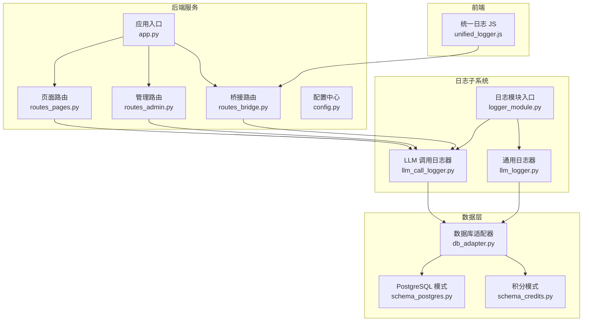
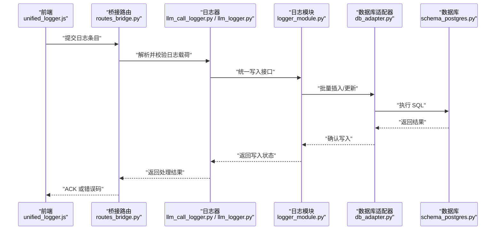
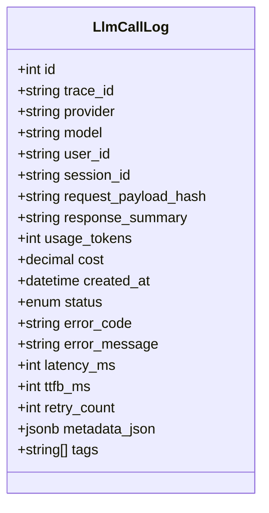
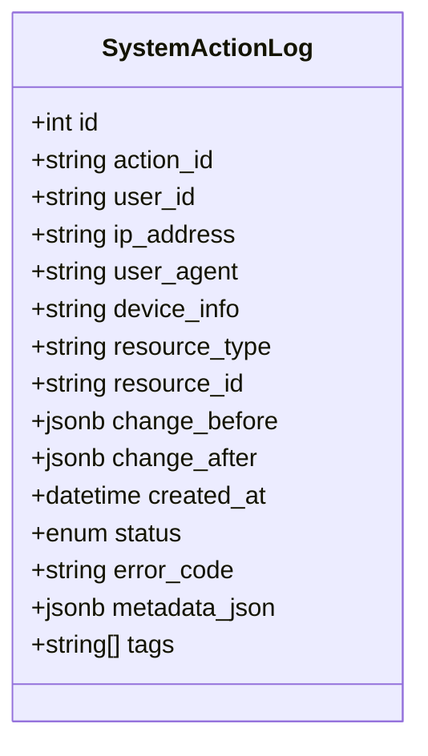
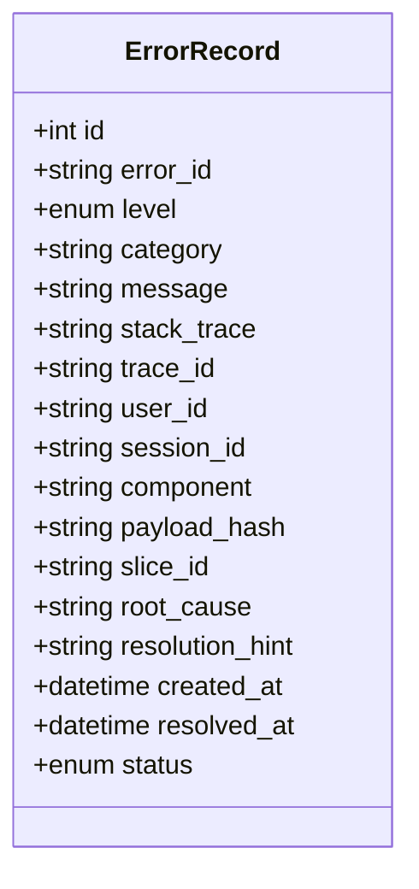
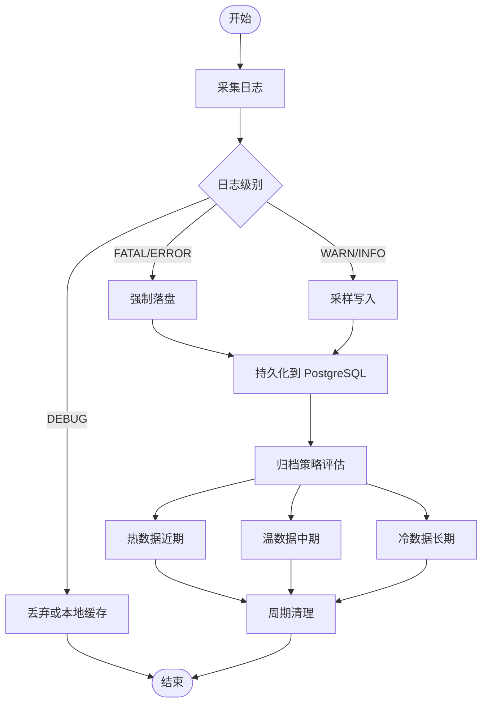
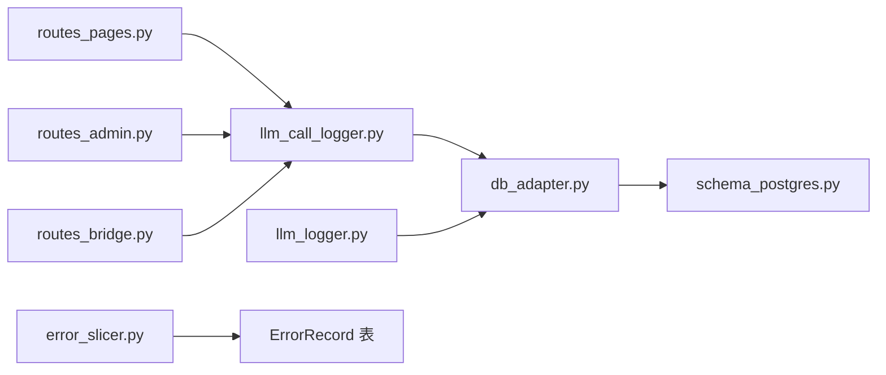
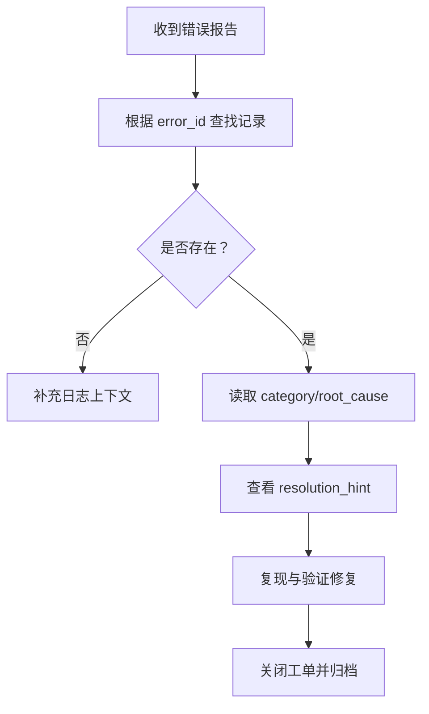

# 系统日志数据模型

<cite>
**本文引用的文件**   
- [llm_call_logger.py](file://server/llm_call_logger.py)
- [llm_logger.py](file://server/llm_logger.py)
- [logger_module.py](file://server/logger_module.py)
- [schema_postgres.py](file://server/database/schema_postgres.py)
- [schema_credits.py](file://server/database/schema_credits.py)
- [db_adapter.py](file://server/database/db_adapter.py)
- [routes_pages.py](file://server/routes_pages.py)
- [routes_admin.py](file://server/routes_admin.py)
- [routes_bridge.py](file://server/routes_bridge.py)
- [app.py](file://server/app.py)
- [config.py](file://server/config.py)
- [error_slicer.py](file://server/services/error_slicer.py)
- [unified_logger.js](file://server/static/js/unified_logger.js)
</cite>

## 目录
1. [引言](#引言)
2. [项目结构](#项目结构)
3. [核心组件](#核心组件)
4. [架构总览](#架构总览)
5. [详细组件分析](#详细组件分析)
6. [依赖关系分析](#依赖关系分析)
7. [性能与查询优化](#性能与查询优化)
8. [安全、脱敏与访问控制](#安全脱敏与访问控制)
9. [故障诊断与排错指南](#故障诊断与排错指南)
10. [结论](#结论)
11. [附录：字段与枚举定义](#附录字段与枚举定义)

## 引言
本文件聚焦“系统日志模块”的数据模型与实现，围绕三类日志对象展开：
- LLM 调用日志：记录大语言模型调用的请求、响应、耗时、成本、状态等。
- 系统操作日志：记录用户或系统的关键操作行为，用于审计与追踪。
- 错误记录表：记录应用运行时的异常、错误上下文与切片信息，便于定位问题。

文档将说明各表结构、字段含义、日志级别分类、存储策略、归档机制、查询优化、性能监控、敏感信息脱敏、安全与访问控制，以及日志分析与自动化清理方案。

## 项目结构
日志相关代码主要分布在以下位置：
- 日志写入与封装：server/llm_call_logger.py、server/llm_logger.py、server/logger_module.py
- 数据库模式与适配层：server/database/schema_postgres.py、server/database/schema_credits.py、server/database/db_adapter.py
- 页面路由与前端展示：server/routes_pages.py、server/routes_admin.py、server/routes_bridge.py、server/static/js/unified_logger.js
- 应用入口与配置：server/app.py、server/config.py
- 错误处理工具：server/services/error_slicer.py

**图表来源**
- [app.py:1-120](file://server/app.py#L1-L120)
- [routes_pages.py:1-200](file://server/routes_pages.py#L1-L200)
- [routes_admin.py:1-200](file://server/routes_admin.py#L1-L200)
- [routes_bridge.py:1-200](file://server/routes_bridge.py#L1-L200)
- [llm_call_logger.py:1-200](file://server/llm_call_logger.py#L1-L200)
- [llm_logger.py:1-200](file://server/llm_logger.py#L1-L200)
- [logger_module.py:1-200](file://server/logger_module.py#L1-L200)
- [db_adapter.py:1-200](file://server/database/db_adapter.py#L1-L200)
- [schema_postgres.py:1-200](file://server/database/schema_postgres.py#L1-L200)
- [schema_credits.py:1-200](file://server/database/schema_credits.py#L1-L200)
- [unified_logger.js:1-200](file://server/static/js/unified_logger.js#L1-L200)

**章节来源**
- [app.py:1-120](file://server/app.py#L1-L120)
- [config.py:1-200](file://server/config.py#L1-L200)

## 核心组件
- LLM 调用日志器：负责收集并持久化 LLM 调用全链路数据，包括请求参数、响应内容摘要、令牌数、费用、延迟、状态码、错误信息等。
- 通用日志器：提供统一的日志写入接口，支持结构化日志输出与分级（INFO/WARN/ERROR）。
- 日志模块入口：集中注册日志器、初始化数据库连接、暴露统一 API。
- 数据库适配器：封装 SQL 执行、事务、分页、批量写入等能力。
- 数据库模式：定义日志表结构、索引、约束；积分模式独立于日志但共享数据库连接。
- 前端统一日志：在浏览器侧采集 UI 交互与网络请求日志，通过桥接路由上报到后端。

**章节来源**
- [llm_call_logger.py:1-200](file://server/llm_call_logger.py#L1-L200)
- [llm_logger.py:1-200](file://server/llm_logger.py#L1-L200)
- [logger_module.py:1-200](file://server/logger_module.py#L1-L200)
- [db_adapter.py:1-200](file://server/database/db_adapter.py#L1-L200)
- [schema_postgres.py:1-200](file://server/database/schema_postgres.py#L1-L200)
- [schema_credits.py:1-200](file://server/database/schema_credits.py#L1-L200)
- [unified_logger.js:1-200](file://server/static/js/unified_logger.js#L1-L200)

## 架构总览
系统日志模块采用“采集—处理—持久化—展示”的分层架构：
- 采集层：前端 unified_logger.js 与后端 llm_call_logger.py、llm_logger.py 共同采集日志。
- 处理层：logger_module.py 统一调度，error_slicer.py 对错误进行切片与归因。
- 持久化层：db_adapter.py 将日志写入 PostgreSQL，遵循 schema_postgres.py 定义的表结构。
- 展示层：routes_pages.py、routes_admin.py、routes_bridge.py 提供查询、统计与管理界面。

**图表来源**
- [unified_logger.js:1-200](file://server/static/js/unified_logger.js#L1-L200)
- [routes_bridge.py:1-200](file://server/routes_bridge.py#L1-L200)
- [llm_call_logger.py:1-200](file://server/llm_call_logger.py#L1-L200)
- [llm_logger.py:1-200](file://server/llm_logger.py#L1-L200)
- [logger_module.py:1-200](file://server/logger_module.py#L1-L200)
- [db_adapter.py:1-200](file://server/database/db_adapter.py#L1-L200)
- [schema_postgres.py:1-200](file://server/database/schema_postgres.py#L1-L200)

## 详细组件分析

### LLM 调用日志表
该表用于记录每次 LLM 调用的完整上下文，便于成本核算、性能分析与问题回溯。

- 主键与标识
  - id：自增主键，唯一标识每条调用记录。
  - trace_id：跨服务的追踪 ID，用于关联前后端与外部调用链。
- 基础信息
  - provider：模型提供方（如 OpenAI、DeepSeek 等）。
  - model：具体模型名称。
  - user_id：调用者用户标识。
  - session_id：会话标识，用于聚合一次学习或练习流程。
- 请求与响应
  - request_payload_hash：请求体哈希，避免存储明文大文本。
  - response_summary：响应摘要，便于快速浏览。
  - usage_tokens：消耗的 token 数量。
  - cost：本次调用费用（按提供方计费规则计算）。
- 时间与状态
  - created_at：创建时间。
  - status：调用状态（成功、失败、超时、部分成功）。
  - error_code：错误码（来自提供方或本地映射）。
  - error_message：错误消息（已脱敏）。
- 性能指标
  - latency_ms：端到端延迟（毫秒）。
  - ttfb_ms：首字节延迟（毫秒）。
  - retry_count：重试次数。
- 扩展字段
  - metadata_json：扩展元数据（JSON），可存放额外上下文。
  - tags：标签数组，便于分类检索（如 “语音转写”、“知识问答”）。

**图表来源**
- [schema_postgres.py:1-200](file://server/database/schema_postgres.py#L1-L200)
- [llm_call_logger.py:1-200](file://server/llm_call_logger.py#L1-L200)

**章节来源**
- [schema_postgres.py:1-200](file://server/database/schema_postgres.py#L1-L200)
- [llm_call_logger.py:1-200](file://server/llm_call_logger.py#L1-L200)

### 系统操作日志表
该表记录用户或系统的操作行为，用于审计、合规与行为分析。

- 主键与标识
  - id：自增主键。
  - action_id：业务动作标识（如 “登录”、“导出笔记”、“删除知识点”）。
- 主体与环境
  - user_id：操作者用户标识。
  - ip_address：客户端 IP（脱敏后存储）。
  - user_agent：客户端 UA（仅保留必要片段）。
  - device_info：设备信息摘要。
- 资源与上下文
  - resource_type：资源类型（如 “note”、“knowledge”、“user_settings”）。
  - resource_id：资源标识。
  - change_before：变更前快照（JSON，脱敏）。
  - change_after：变更后快照（JSON，脱敏）。
- 时间与状态
  - created_at：操作时间。
  - status：操作结果（成功、失败、拒绝）。
  - error_code：错误码（可选）。
- 扩展字段
  - metadata_json：扩展元数据。
  - tags：标签（如 “admin”、“batch”）。

**图表来源**
- [schema_postgres.py:1-200](file://server/database/schema_postgres.py#L1-L200)
- [logger_module.py:1-200](file://server/logger_module.py#L1-L200)

**章节来源**
- [schema_postgres.py:1-200](file://server/database/schema_postgres.py#L1-L200)
- [logger_module.py:1-200](file://server/logger_module.py#L1-L200)

### 错误记录表
该表记录运行时错误及上下文，配合 error_slicer.py 的错误切片能力，提升定位效率。

- 主键与标识
  - id：自增主键。
  - error_id：错误实例标识（可与 trace_id 关联）。
- 错误信息
  - level：严重级别（DEBUG/INFO/WARN/ERROR/FATAL）。
  - category：错误类别（如 “network”、“validation”、“provider_error”）。
  - message：错误消息（脱敏）。
  - stack_trace：堆栈摘要（脱敏）。
- 上下文
  - trace_id：追踪 ID。
  - user_id：受影响用户。
  - session_id：会话 ID。
  - component：出错组件（如 “llm_provider”、“asr_proxy”）。
  - payload_hash：触发错误的输入哈希。
- 切片与归因
  - slice_id：错误切片标识（由 error_slicer.py 生成）。
  - root_cause：根因分类（如 “timeout”、“rate_limit”、“invalid_input”）。
  - resolution_hint：解决建议（模板化提示）。
- 时间与状态
  - created_at：发生时间。
  - resolved_at：解决时间（可选）。
  - status：处理状态（open/in_progress/resolved/duplicate）。

**图表来源**
- [schema_postgres.py:1-200](file://server/database/schema_postgres.py#L1-L200)
- [error_slicer.py:1-200](file://server/services/error_slicer.py#L1-L200)

**章节来源**
- [schema_postgres.py:1-200](file://server/database/schema_postgres.py#L1-L200)
- [error_slicer.py:1-200](file://server/services/error_slicer.py#L1-L200)

### 日志级别分类
- DEBUG：调试信息，通常在生产环境关闭。
- INFO：常规操作信息（如登录成功、导出完成）。
- WARN：潜在风险或降级路径（如重试、缓存未命中）。
- ERROR：可恢复错误（如网络超时、第三方 API 限流）。
- FATAL：不可恢复错误（如进程崩溃、数据损坏）。

日志级别影响：
- 写入策略：高优先级日志强制落盘，低优先级可采样或丢弃。
- 告警阈值：ERROR/FATAL 触发告警通道。
- 报表维度：按级别统计错误率与稳定性趋势。

**章节来源**
- [llm_logger.py:1-200](file://server/llm_logger.py#L1-L200)
- [logger_module.py:1-200](file://server/logger_module.py#L1-L200)

### 存储策略与归档机制
- 存储引擎：PostgreSQL，使用 JSONB 存储扩展元数据，提高灵活性。
- 分区与索引：
  - 按 created_at 建立索引，支持时间范围查询。
  - 对 user_id、trace_id、status、category 建立复合索引以加速常见查询。
- 归档策略：
  - 热数据：最近 N 天（如 30 天）直接查询。
  - 温数据：N-M 天迁移至归档表或冷存储（如 S3+Parquet），保留索引。
  - 冷数据：超过 M 天压缩归档，定期清理。
- 生命周期：
  - 自动清理任务：按策略删除过期日志，释放空间。
  - 增量备份：每日备份日志库，支持回滚。

**图表来源**
- [db_adapter.py:1-200](file://server/database/db_adapter.py#L1-L200)
- [schema_postgres.py:1-200](file://server/database/schema_postgres.py#L1-L200)

**章节来源**
- [db_adapter.py:1-200](file://server/database/db_adapter.py#L1-L200)
- [schema_postgres.py:1-200](file://server/database/schema_postgres.py#L1-L200)

## 依赖关系分析
- 路由层依赖日志器：routes_pages.py、routes_admin.py、routes_bridge.py 调用 llm_call_logger.py 与 llm_logger.py。
- 日志器依赖数据库适配器：llm_call_logger.py、llm_logger.py 通过 db_adapter.py 执行 SQL。
- 数据库适配器依赖模式定义：db_adapter.py 依据 schema_postgres.py 建表与索引。
- 错误切片依赖错误记录表：error_slicer.py 生成 slice_id 与 root_cause，写入 ErrorRecord。

**图表来源**
- [routes_pages.py:1-200](file://server/routes_pages.py#L1-L200)
- [routes_admin.py:1-200](file://server/routes_admin.py#L1-L200)
- [routes_bridge.py:1-200](file://server/routes_bridge.py#L1-L200)
- [llm_call_logger.py:1-200](file://server/llm_call_logger.py#L1-L200)
- [llm_logger.py:1-200](file://server/llm_logger.py#L1-L200)
- [db_adapter.py:1-200](file://server/database/db_adapter.py#L1-L200)
- [schema_postgres.py:1-200](file://server/database/schema_postgres.py#L1-L200)
- [error_slicer.py:1-200](file://server/services/error_slicer.py#L1-L200)

**章节来源**
- [routes_pages.py:1-200](file://server/routes_pages.py#L1-L200)
- [routes_admin.py:1-200](file://server/routes_admin.py#L1-L200)
- [routes_bridge.py:1-200](file://server/routes_bridge.py#L1-L200)
- [llm_call_logger.py:1-200](file://server/llm_call_logger.py#L1-L200)
- [llm_logger.py:1-200](file://server/llm_logger.py#L1-L200)
- [db_adapter.py:1-200](file://server/database/db_adapter.py#L1-L200)
- [schema_postgres.py:1-200](file://server/database/schema_postgres.py#L1-L200)
- [error_slicer.py:1-200](file://server/services/error_slicer.py#L1-L200)

## 性能与查询优化
- 索引设计
  - 时间范围：created_at 索引，支持按日/周/月聚合。
  - 用户维度：user_id 索引，支持个人日志与配额统计。
  - 追踪维度：trace_id 索引，支持链路追踪。
  - 状态与类别：status、category 索引，支持过滤与报表。
- 查询优化
  - 分页查询：限制每页条数，避免全表扫描。
  - 预聚合：对高频统计（如每日调用量、平均延迟）建立物化视图或汇总表。
  - 只读副本：报表查询走只读副本，降低主库压力。
- 写入优化
  - 批量插入：合并多条日志为一次事务。
  - 异步写入：非关键日志采用队列异步落盘。
  - 采样策略：DEBUG/INFO 在高负载时采样写入。
- 监控指标
  - 写入延迟：P95/P99 延迟。
  - 吞吐：每秒写入行数。
  - 错误率：ERROR/FATAL 占比。
  - 存储增长：每日新增大小与归档比例。

**章节来源**
- [schema_postgres.py:1-200](file://server/database/schema_postgres.py#L1-L200)
- [db_adapter.py:1-200](file://server/database/db_adapter.py#L1-L200)

## 安全、脱敏与访问控制
- 敏感信息脱敏
  - 请求体不存明文：使用 request_payload_hash 替代。
  - 响应摘要：response_summary 仅保留关键字段与长度。
  - IP 与 UA：ip_address 与 user_agent 脱敏或截断。
  - 变更快照：change_before/change_after 中剔除密码、密钥等字段。
- 安全策略
  - 最小权限：日志写入账户仅具备 INSERT/SELECT 权限。
  - 传输加密：HTTPS 传输日志，内部通信使用 TLS。
  - 审计：所有管理操作记录到 SystemActionLog。
- 访问控制
  - 角色隔离：普通用户仅查看自身日志，管理员可查看全局。
  - 接口鉴权：routes_admin.py 与 routes_pages.py 的日志查询需鉴权。
  - 数据隔离：按 tenant_id 或 user_id 隔离多租户数据。

**章节来源**
- [llm_call_logger.py:1-200](file://server/llm_call_logger.py#L1-L200)
- [routes_admin.py:1-200](file://server/routes_admin.py#L1-L200)
- [routes_pages.py:1-200](file://server/routes_pages.py#L1-L200)

## 故障诊断与排错指南
- 常见问题
  - LLM 调用失败：检查 status、error_code、error_message，结合 latency_ms 判断是否超时。
  - 成本异常：核对 usage_tokens 与 cost 的计算逻辑，确认 provider 计费规则。
  - 错误重复：根据 error_id 与 slice_id 去重，避免误报。
- 诊断步骤
  - 通过 trace_id 串联前后端日志，定位调用链。
  - 使用 category 与 root_cause 快速归类错误。
  - 查看 resolution_hint 获取解决建议。
- 工具支持
  - 错误切片：error_slicer.py 提供根因分析与建议。
  - 报表页面：routes_pages.py 与 routes_admin.py 提供可视化查询与统计。

**图表来源**
- [error_slicer.py:1-200](file://server/services/error_slicer.py#L1-L200)
- [routes_pages.py:1-200](file://server/routes_pages.py#L1-L200)

**章节来源**
- [error_slicer.py:1-200](file://server/services/error_slicer.py#L1-L200)
- [routes_pages.py:1-200](file://server/routes_pages.py#L1-L200)

## 结论
本系统日志模块通过清晰的三层架构与严格的数据模型，实现了 LLM 调用、系统操作与错误记录的全面采集、存储与分析。借助索引优化、归档策略与安全脱敏，系统在性能、安全与可维护性方面达到平衡。未来可进一步引入只读副本、物化视图与自动化告警，以提升运维效率与用户体验。

## 附录：字段与枚举定义
- 状态枚举（示例）
  - status：success、failed、timeout、partial_success
  - level：debug、info、warn、error、fatal
  - category：network、validation、provider_error、system
  - root_cause：timeout、rate_limit、invalid_input、internal_error
  - handling_status：open、in_progress、resolved、duplicate

- 常用查询场景
  - 按用户与时间范围查询 LLM 调用量与成本。
  - 按错误类别统计失败率与趋势。
  - 按 trace_id 追踪一次完整调用链路。
  - 按资源类型与操作动作审计系统变更。

**章节来源**
- [schema_postgres.py:1-200](file://server/database/schema_postgres.py#L1-L200)
- [llm_call_logger.py:1-200](file://server/llm_call_logger.py#L1-L200)
- [llm_logger.py:1-200](file://server/llm_logger.py#L1-L200)
- [error_slicer.py:1-200](file://server/services/error_slicer.py#L1-L200)